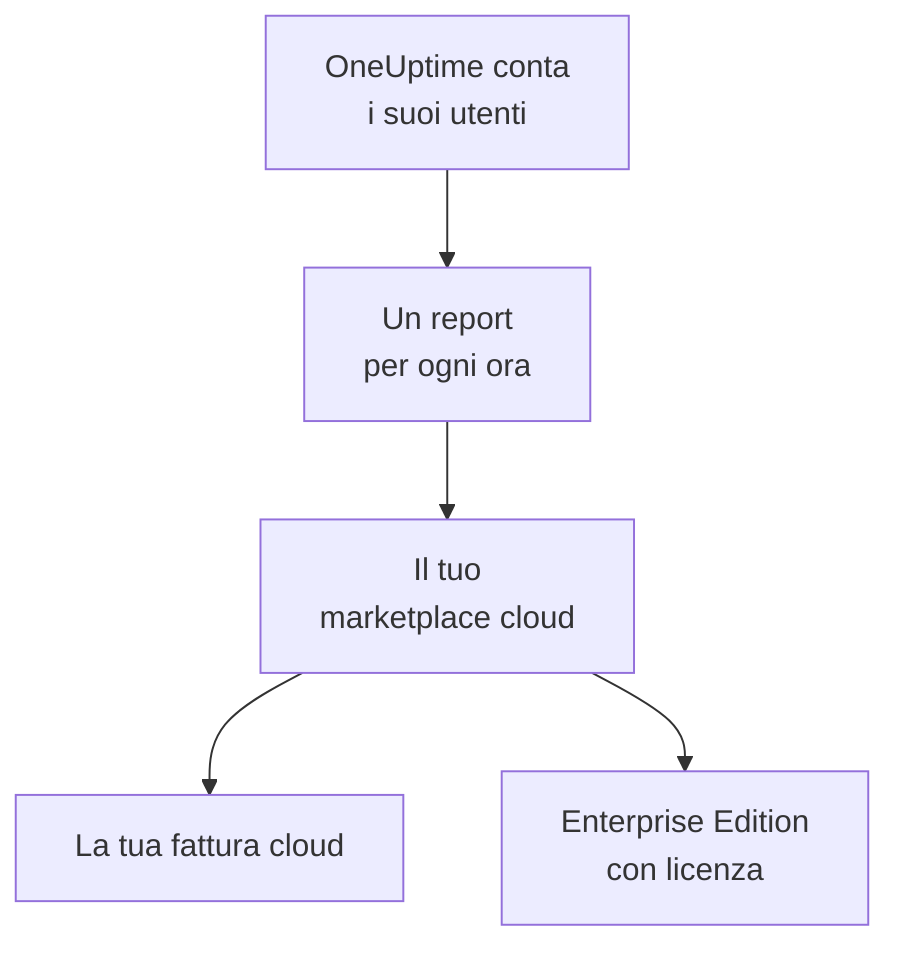

# Marketplace cloud

Esegui OneUptime Enterprise, acquistato su AWS Marketplace, Microsoft Marketplace o Google Cloud Marketplace, nel tuo cluster Kubernetes. Il marketplace ti addebita a ore ogni utente della tua installazione sulla tua fattura cloud, e il tuo abbonamento fornisce la licenza della Enterprise Edition: non c'è nessuna chiave di licenza da attivare.

:::cards
- [Installare OneUptime](#installare-oneuptime): Su Amazon EKS, Azure Kubernetes Service o Google Kubernetes Engine.
- [Come funziona la fatturazione](#come-funziona-la-fatturazione): USD 0.10 per utente all'ora, con un report ogni ora.
- [Aggiornamenti](#aggiornamenti): Come arriva una nuova release al tuo cluster.
- [Risoluzione dei problemi](#risoluzione-dei-problemi): Quando l'etichetta dell'edizione mostra un avviso sul marketplace.
:::

## Come funziona

OneUptime conta i suoi utenti ogni 15 minuti e, per ogni ora, invia un solo report al marketplace su cui l'hai acquistato, con il numero massimo di utenti visto in quell'ora. Il marketplace aggiunge l'ora alla tua fattura cloud. Ogni report accettato dice anche a OneUptime che il tuo abbonamento è attivo, e questo mantiene la licenza della Enterprise Edition.



| | AWS | Microsoft | Google Cloud |
| --- | --- | --- | --- |
| Inserzione | Non ancora pubblica: [contattaci](https://oneuptime.com/enterprise/demo) | [OneUptime Enterprise](https://marketplace.microsoft.com/en-us/product/oneupitme.oneuptime-enterprise) | Non ancora pubblica: [contattaci](https://oneuptime.com/enterprise/demo) |
| Gira su | Amazon EKS | Azure Kubernetes Service (AKS) | Google Kubernetes Engine (GKE) |
| Lo installi con | Helm, dal registry dell'inserzione | Il portale di Azure | La console di Google Cloud |
| OneUptime invia i report con | Il ruolo IAM del suo account di servizio Kubernetes | L'identità gestita che Azure assegna all'installazione | Il secret di reporting che Google Cloud Marketplace crea per il deployment |
| Nuove release | Aggiorni con Helm | Le versioni minori vengono installate per te | Aggiorni a mano |

## Prima di iniziare

- **Un cluster Kubernetes** sul cloud del marketplace, con almeno 3 nodi da 4 vCPU e 16 GiB di memoria, una StorageClass predefinita e il supporto per i servizi `LoadBalancer`. OneUptime esegue nel cluster i propri PostgreSQL, ClickHouse e Valkey; dimensionali con [Dimensionamento e pianificazione della capacità](/docs/installation/sizing).
- **Un nome di dominio** per OneUptime, come `oneuptime.example.com`, che tu possa puntare al load balancer del cluster.
- **HTTPS in uscita** dal cluster verso il marketplace, così OneUptime può comunicare quanti utenti ha: `metering.marketplace.<region>.amazonaws.com` e `sts.<region>.amazonaws.com` su AWS, `marketplaceapi.microsoft.com` su Azure, `servicecontrol.googleapis.com` e `oauth2.googleapis.com` su Google Cloud.

## Installare OneUptime

### AWS Marketplace

Su AWS, OneUptime invia i report sugli utenti con un ruolo IAM che EKS assegna al suo account di servizio Kubernetes (ruoli IAM per gli account di servizio). AWS Marketplace accetta l'utilizzo proveniente da EKS solo quando è firmato in questo modo.

:::steps
1. Abbonati a OneUptime Enterprise su AWS Marketplace, poi scegli **Continue to Configuration**, seleziona la versione e scegli **Continue to Launch**.
2. Associa al cluster un provider OIDC IAM, se non ne ha ancora uno, e crea l'account di servizio `oneuptime` con un ruolo IAM che ha la policy `AWSMarketplaceMeteringFullAccess`, con i comandi qui sotto. Eseguili al posto del comando `eksctl` del passo 1 delle **General launch instructions** della pagina di avvio: quel comando associa un ruolo che dovresti prima creare tu.
3. Accedi con Helm al registry dell'inserzione e installa il chart con i comandi del passo 2 delle **General launch instructions**. Nel comando `helm install`, imposta `serviceAccount.name` su `oneuptime`, `host` sul tuo nome di dominio e `httpProtocol` su `https` se davanti a OneUptime c'è un certificato.
4. [Apri OneUptime](#aprire-oneuptime).
:::

```bash
eksctl utils associate-iam-oidc-provider --cluster <cluster> --approve
eksctl create iamserviceaccount --name oneuptime --namespace oneuptime --cluster <cluster> \
  --attach-policy-arn arn:aws:iam::aws:policy/AWSMarketplaceMeteringFullAccess \
  --approve --override-existing-serviceaccounts
```

Conserva i valori del passo 3 in un file e passalo a ogni `helm upgrade`:

```yaml title="values.yaml"
host: oneuptime.example.com
httpProtocol: https
serviceAccount:
  name: oneuptime
```

### Microsoft Marketplace

Su Azure, OneUptime è un'applicazione Kubernetes: AKS la installa come estensione del cluster e le assegna l'identità gestita con cui invia i report sugli utenti.

:::steps
1. Apri OneUptime Enterprise su Microsoft Marketplace nel portale di Azure, oppure apri il tuo cluster AKS e seleziona **Extensions + applications** > **Add**, poi scegli il piano e seleziona **Create**.
2. Scegli la sottoscrizione e il gruppo di risorse, e se installare su un cluster AKS esistente o crearne uno nuovo.
3. Nel passaggio **OneUptime**, inserisci un nome per l'installazione, il tuo nome di dominio e il suo protocollo.
4. Seleziona **Review + create**, poi **Create**. L'installazione richiede qualche minuto; è terminata quando **Extensions + applications** mostra il suo stato di provisioning come **Succeeded**.
5. [Apri OneUptime](#aprire-oneuptime).
:::

I contatori personalizzati funzionano sui cluster AKS, non su Kubernetes abilitato per Azure Arc, quindi OneUptime Enterprise su Microsoft Marketplace si installa solo su AKS.

### Google Cloud Marketplace

Su Google Cloud, Marketplace esegue un deployer che installa OneUptime nel namespace che scegli, insieme a un secret di reporting con cui OneUptime invia i report sugli utenti.

:::steps
1. Apri OneUptime Enterprise su Google Cloud Marketplace nella console di Google Cloud e seleziona **Configure**.
2. Scegli il cluster GKE e il namespace, e inserisci un nome per l'installazione, il tuo nome di dominio e il suo protocollo.
3. Seleziona **Deploy**. Il deployment richiede qualche minuto; è terminato quando l'applicazione risulta pronta in **Kubernetes Engine** > **Applications**.
4. [Apri OneUptime](#aprire-oneuptime).
:::

## Aprire OneUptime

OneUptime inizia migrando il suo database, il che richiede qualche minuto su una nuova installazione. Poi punta il tuo nome di dominio al suo load balancer:

```bash
kubectl get service --namespace <namespace>
```

Il servizio il cui nome termina con `-nginx` ha un `EXTERNAL-IP`: crea per il tuo nome di dominio un record DNS che punti a quell'indirizzo. Apri il nome di dominio e registrati. Il primo account di una nuova installazione ne diventa l'amministratore principale, che può aprire l'Admin Dashboard su `/admin`.

Entro un'ora, l'etichetta dell'edizione mostra la Enterprise Edition, con licenza tramite il tuo marketplace. Gli amministratori principali vedono l'etichetta dell'edizione nell'intestazione dell'Admin Dashboard e nel piè di pagina della Dashboard.

## Come funziona la fatturazione

| Cosa | Come funziona |
| --- | --- |
| Prezzo | USD 0.10 per utente all'ora, circa USD 73 per utente al mese. |
| Chi viene contato | Chiunque abbia un account OneUptime sull'installazione. Gli iscritti alle pagine di stato e le persone che accedono a una pagina di stato privata non vengono contati. |
| Quando | OneUptime conta i suoi utenti ogni 15 minuti e, per ogni ora, invia un solo report, con il numero massimo di utenti visto in quell'ora. Un'ora in cui OneUptime non era in esecuzione non viene fatturata. |
| Dove | Sulla tua fattura di AWS, Azure o Google Cloud, tramite il marketplace. |
| Non incluso | Il cluster stesso: il tuo cloud fattura come sempre i suoi nodi, dischi e load balancer. |

Ogni installazione viene fatturata a sé, quindi viene fatturata anche un'installazione di staging. Per prezzi annuali, sconti sui volumi o un prezzo per le installazioni non di produzione, chiedi a [sales@oneuptime.com](mailto:sales@oneuptime.com) un'offerta privata, che accetti sul marketplace.

Quando un report non può essere inviato, per un problema di rete o un disservizio del marketplace, OneUptime lo invia di nuovo all'esecuzione successiva. Ogni report porta una chiave per la sua ora, quindi un'ora non viene mai fatturata due volte.

## Come funzionano le licenze

Il tuo abbonamento al marketplace è la tua licenza. Ogni report accettato dal marketplace concede la licenza di ogni funzionalità enterprise, per ogni utente, per le 72 ore successive. Anche una chiave di licenza di OneUptime funziona sulla stessa installazione: l'installazione usa la migliore delle due.

| Cosa succede | Cosa mostra l'etichetta dell'edizione |
| --- | --- |
| Il marketplace accetta i report orari | La Enterprise Edition, con licenza tramite il tuo marketplace. |
| Da 72 ore non viene accettato nessun report | **Enterprise Edition (Marketplace Reports Failing)**: ogni funzionalità enterprise continua a funzionare per un periodo di tolleranza di 30 giorni. |
| Il marketplace dice che l'installazione non ha un abbonamento, o il periodo di tolleranza finisce | **Enterprise Edition (Marketplace Subscription Ended)**: le funzionalità enterprise si fermano, come quando [una licenza scade](/docs/self-hosted/enterprise#quando-una-licenza-scade-o-manca). |

Il marketplace rifiuta un abbonamento annullato o sospeso, oppure un'installazione che non è quella che hai acquistato. Monitoraggio, avvisi, incidenti, reperibilità e pagine di stato continuano a funzionare in ogni caso, e non viene eliminato nulla. Abbonati di nuovo, e il successivo report accettato concede nuovamente la licenza della Enterprise Edition, senza riavvio.

## Aggiornamenti

| Marketplace | Come arriva una nuova release al tuo cluster |
| --- | --- |
| AWS Marketplace | Ogni release è una nuova versione dell'inserzione. Esegui `helm upgrade` con il chart dal registry dell'inserzione, la nuova versione e il tuo file dei valori. |
| Microsoft Marketplace | AKS installa per te le nuove versioni minori e le patch. Una nuova versione principale attende finché non la accetti. Puoi disattivare gli aggiornamenti automatici nella pagina dell'installazione in **Extensions + applications**. |
| Google Cloud Marketplace | Google Cloud Marketplace mantiene un deployment sulla versione che ha installato, e non lo aggiorna mai. Contatta il [supporto](https://oneuptime.com/support) prima di passare un deployment a una nuova versione. |

OneUptime migra il suo database quando si avvia la nuova release. Leggi le [note di aggiornamento](/docs/installation/upgrading) prima di passare a una nuova versione principale.

Aggiorna tramite il marketplace. Un'installazione dal marketplace non si confronta con le release di OneUptime su GitHub: le versioni offerte dal tuo marketplace sono quelle a cui aggiornare.

## Impostazioni e scaling

La tua fattura non cambia quando scali: OneUptime viene fatturato per utente. Più repliche o nodi più grandi cambiano solo ciò che il tuo cloud fattura per il cluster.

| Marketplace | Dove si trovano le tue impostazioni |
| --- | --- |
| AWS Marketplace | Il tuo file dei valori. Funziona ogni impostazione del [chart Helm](https://artifacthub.io/packages/helm/oneuptime/oneuptime), tranne gli operatori inclusi. |
| Microsoft Marketplace | Le impostazioni di configurazione dell'installazione, nella sua pagina in **Extensions + applications** o con `az k8s-extension update --configuration-settings`. Ogni impostazione è un valore del chart, come `autoscaling.enabled=true`. |
| Google Cloud Marketplace | I campi del modulo di deployment. Cambia tutto il resto con `kubectl`, sulle risorse proprie del deployment. |

- **Scala OneUptime** con le impostazioni del chart per le repliche e l'autoscaling (`deployment.replicaCount`, `autoscaling.enabled` e i valori propri di ogni servizio), e i nodi con l'autoscaler del tuo cluster.
- **Lascia le impostazioni del marketplace come le imposta l'inserzione**: `enterpriseMarketplace` e, su AWS, `serviceAccount`. Senza di esse OneUptime non può inviare i report, e la Enterprise Edition resta senza licenza.
- **Gli operatori KEDA, CloudNativePG e Altinity ClickHouse non sono inclusi**, perché un marketplace distribuisce solo le immagini della sua inserzione. Per archivi di dati ad alta disponibilità, punta OneUptime a servizi gestiti con `externalPostgres`, `externalRedis` e `externalClickhouse`.

La fatturazione non dipende da quante repliche sono in esecuzione: solo un'esecuzione alla volta invia i report, e ogni ora ha un solo report.

## Risoluzione dei problemi

:::details L'etichetta dell'edizione mostra Enterprise Edition (Marketplace Reports Failing)
OneUptime non riesce a inviare i report al marketplace. Ogni riga di log che scrive al riguardo inizia con `OneUptime Enterprise marketplace billing`; una riga che dice che l'utilizzo «cannot be reported» indica cosa manca. Le cause più comuni:

- **AWS:** l'account di servizio `oneuptime` non ha un ruolo IAM, oppure il ruolo non ha la policy `AWSMarketplaceMeteringFullAccess` (`AWSMarketplaceMeteringRegisterUsage` non basta). Associa la policy al ruolo, oppure crea il ruolo con il comando `eksctl` della sezione [AWS Marketplace](#aws-marketplace) e poi riavvia i pod di OneUptime con `kubectl rollout restart deployment --namespace oneuptime`.
- **Azure:** l'installazione non è l'applicazione di Microsoft Marketplace, per esempio perché è stata installata con Helm, quindi non ha un'identità né un piano con cui inviare i report. Installala dal portale di Azure.
- **Google Cloud:** il secret di reporting del deployment è stato eliminato o sostituito.
- **Ogni marketplace:** un firewall o un proxy blocca l'HTTPS in uscita indicato in [Prima di iniziare](#prima-di-iniziare).

L'utilizzo viene conservato mentre risolvi il problema, e fatturato non appena OneUptime riesce di nuovo a inviare i report. L'utilizzo più vecchio di 30 giorni non viene fatturato.
:::

:::details L'etichetta dell'edizione mostra Enterprise Edition (Marketplace Subscription Ended)
Il marketplace ha rifiutato l'installazione: l'abbonamento è stato annullato o sospeso, oppure l'installazione non è quella acquistata sul marketplace. Controlla l'abbonamento sul marketplace e abbonati di nuovo; il successivo report accettato concede nuovamente la licenza della Enterprise Edition. La stessa etichetta compare quando i report hanno continuato a fallire per l'intero periodo di tolleranza.
:::

:::details I pod restano in attesa dopo l'installazione
I database di OneUptime hanno bisogno di volumi persistenti. Dai al cluster una StorageClass predefinita: su Amazon EKS, installa il componente aggiuntivo del driver Amazon EBS CSI.
:::

## Passaggi successivi

:::cards
- [Edizione Enterprise](/docs/self-hosted/enterprise): Cosa aggiunge la Enterprise Edition, e cosa si ferma quando una licenza scade.
- [Aggiornamento](/docs/installation/upgrading): Le note di aggiornamento di ogni release.
- [Dimensionamento e pianificazione della capacità](/docs/installation/sizing): Dimensiona gli archivi di dati per la tua telemetria.
- [Architettura](/docs/self-hosted/architecture): Cosa gira nel tuo cluster.
- [Agent Kubernetes](/docs/telemetry/kubernetes-agent#installalo-come-componente-aggiuntivo-di-amazon-eks): Gratuito anche su AWS Marketplace, come componente aggiuntivo di Amazon EKS, per i cluster che inviano i loro dati a OneUptime.
:::
