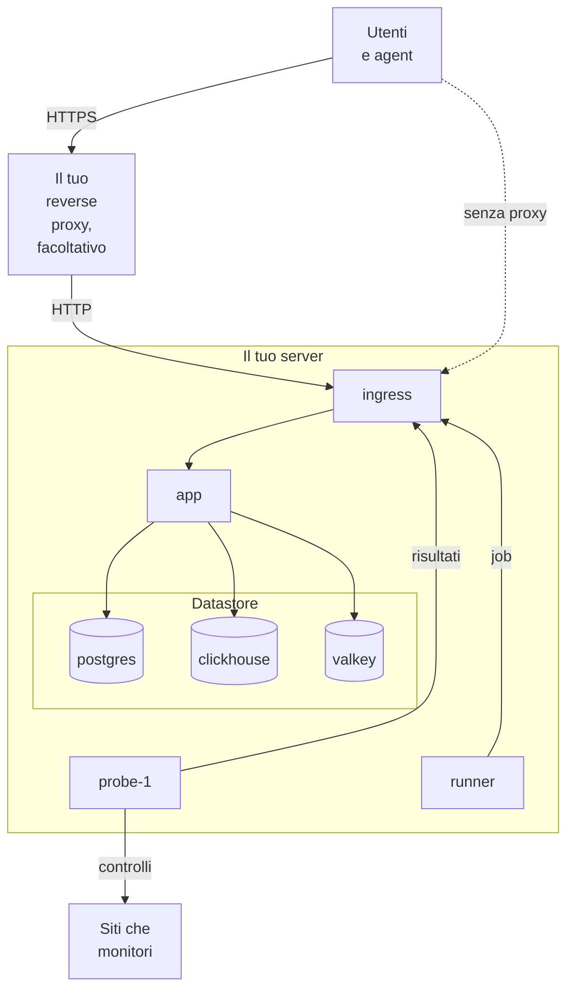

# Docker Compose

Esegui un'istanza OneUptime completa e gratuita su un unico server Linux con Docker Compose. Questa pagina ti porta da un server appena creato a un'istanza funzionante, poi tratta HTTPS, l'hardening per la produzione, i backup, gli aggiornamenti e la rimozione. Per lavorare invece sul codice di OneUptime, vedi [Sviluppo locale](/docs/installation/local-development).

:::cards
- [Installare OneUptime](#installare-oneuptime): Da un server appena creato al tuo primo account, in cinque passi.
- [Configurare HTTPS](#configurare-https): Lascia che OneUptime ottenga un certificato, o metti davanti il tuo proxy.
- [Checklist per la produzione](#checklist-per-la-produzione): Cosa sistemare prima che arrivi il traffico reale.
- [Aggiornare OneUptime](#aggiornare-oneuptime): Passa all'ultima release.
:::

## Come funziona

Docker Compose esegue ogni parte di OneUptime come container sul tuo server. Tutto il traffico entra dal container `ingress`, che lo instrada verso l'`app`. L'app conserva i suoi dati in PostgreSQL, ClickHouse e Valkey. Una sonda inclusa esegue i controlli dei tuoi monitor e riporta i risultati tramite l'ingress.



| Servizio | Immagine | Cosa fa |
| --- | --- | --- |
| `ingress` | `oneuptime/nginx` | Riceve tutto il traffico sulle porte 80 e 443 e lo instrada verso l'app. Serve HTTPS quando OneUptime gestisce il certificato. |
| `app` | `oneuptime/app` | La dashboard, l'API, le pagine di stato, l'ingestione della telemetria e i worker in background. |
| `probe-1` | `oneuptime/probe` | Una sonda globale che esegue i controlli dei tuoi monitor. Usa la rete dell'host. |
| `runner` | `oneuptime/runner` | Il Runner dell'istanza, che esegue le correzioni del codice con l'IA. Usa la rete dell'host. |
| `postgres` | `postgres:15` | Configurazione e stato: monitor, incidenti, utenti. Conservati nel volume `postgres`. |
| `clickhouse` | `clickhouse/clickhouse-server:26.7` | Telemetria: log, metriche, trace ed eccezioni. Conservata nel volume `clickhouse`. |
| `valkey` | `valkey/valkey:9.1-alpine` | Cache e code. Non conserva nulla su disco. |

> [!NOTE]
> Il servizio `valkey` esegue [Valkey](https://valkey.io), il fork con licenza BSD di Redis 7.2, configurato tramite le impostazioni `VALKEY_*` in `config.env`. Va bene qualsiasi server che parli il protocollo Redis: punta `VALKEY_HOST` a un Redis gestito se preferisci. Fino alla 13.0.0 queste impostazioni si chiamavano `REDIS_*`; i vecchi nomi vengono ancora letti, il container risponde ancora al nome host `redis` e `npm run update` non li riscrive, quindi un `config.env` più vecchio non richiede modifiche.

Per la produzione su larga scala, o quando ti serve l'alta disponibilità, usa invece il [chart Helm](https://artifacthub.io/packages/helm/oneuptime/oneuptime) su Kubernetes: Docker Compose esegue una sola copia di ogni servizio su un unico server.

## Requisiti

Scegli la dimensione del server in base a ciò che ci farai girare. È la telemetria (log, metriche, trace) a determinare memoria e disco; consulta [Dimensionamento e pianificazione della capacità](/docs/installation/sizing) quando conosci i tuoi volumi.

| | Consigliato | Minimo per un homelab |
| --- | --- | --- |
| **Memoria** | 16 GB | 8 GB |
| **CPU** | 8 core | 4 core |
| **Disco** | 400 GB | 20 GB |
| **Sistema** | Ubuntu 22.04, o un altro Linux basato su Debian, Ubuntu o RHEL | Lo stesso |
| **Architettura** | x86-64 (`amd64`) o ARM (`arm64`) | La stessa |

Il minimo per un homelab va bene per un uso personale e sperimentale: c'è chi fa girare OneUptime su un Raspberry Pi.

Ti servono anche:

- **Docker** con il plugin **Docker Compose v2** (il comando `docker compose`).
- **Git**, per scaricare OneUptime.
- **Node.js e npm**, che eseguono gli script `npm start` e `npm run update` che avvolgono Docker Compose.
- **Porte 80 e 443** libere sul server. La tabella qui sotto elenca ogni porta che OneUptime usa sull'host.

| Porta dell'host | Usata da | Impostazione | A cosa serve |
| --- | --- | --- | --- |
| 80 | `ingress` | `ONEUPTIME_HTTP_PORT` | La dashboard, l'API, l'ingestione della telemetria e la validazione di Let's Encrypt. |
| 443 | `ingress` | `STATUS_PAGE_HTTPS_PORT` | HTTPS per la tua istanza quando OneUptime gestisce il certificato, e per le pagine di stato e le dashboard su domini personalizzati. |
| 5400 | `postgres` | Impostata in `docker-compose.yml` | Permette a `npm run backup` e a `restore.sh` di raggiungere PostgreSQL dal server stesso. È pubblicata solo su `127.0.0.1`. |
| 3874 | `probe-1` | `GLOBAL_PROBE_1_PORT` | Il server proprio della sonda. Niente fuori dal server ne ha bisogno. |
| 3876 | `runner` | `ONEUPTIME_RUNNER_PORT` | Il server proprio del Runner. Niente fuori dal server ne ha bisogno. |

C'è anche una [guida video](https://youtu.be/j1SWmMW2oL4) dell'installazione.

## Installare OneUptime

Su un server nuovo con Ubuntu, Debian o una distribuzione basata su RHEL, un solo comando può eseguire per te i passi qui sotto. Installa Docker, Git e Node.js se mancano, clona il branch release in una cartella `oneuptime`, chiede l'indirizzo che le persone useranno ed esegue `npm start`:

```bash
curl -fsSL https://oneuptime.com/install.sh | bash
```

:::steps
### Clona il branch release

Il branch `release` contiene i file dell'ultima release.

```bash
git clone --depth 1 --single-branch --branch release https://github.com/OneUptime/oneuptime.git
cd oneuptime
```

### Crea config.env

Tutte le impostazioni di OneUptime si trovano in `config.env`. Parti dall'esempio:

```bash
cp config.example.env config.env
```

### Imposta il nome host

Apri `config.env` e imposta `HOST` sul nome di dominio o sull'indirizzo IP che verrà usato per raggiungere OneUptime, senza `http://`. Lascia `localhost` solo per provare OneUptime sul tuo computer.

```ini title="config.env"
HOST=oneuptime.example.com
```

### Avvia OneUptime

:::tabs
@tab npm
```bash
npm start
```
@tab Docker CLI
```bash
(export $(grep -v '^#' config.env | xargs) && docker compose up --remove-orphans -d)
```
Prima del primo avvio, sostituisci tu i secret segnaposto, come mostra [Genera secret casuali](#genera-secret-casuali): solo `npm start` lo fa per te.
:::

`npm start` controlla prima il server: Docker, la memoria, lo spazio su disco, le porte che OneUptime usa e `HOST`. Si ferma davanti a tutto ciò che impedirebbe a OneUptime di funzionare, e dice cosa cambiare. Poi dà a ogni secret segnaposto di `config.env` un valore casuale proprio, avvia OneUptime e attende che ogni parte risponda. Il primo avvio richiede diversi minuti, mentre Docker scarica le immagini e OneUptime crea i suoi database. Termina con **OneUptime is up!** e l'indirizzo da aprire.

### Crea il primo account

Apri `http://` seguito dal tuo `HOST` (per esempio `http://localhost`) e registrati. Il primo account di una nuova istanza ne diventa l'amministratore principale, che può aprire l'Admin Dashboard su `/admin`.

Chiunque possa raggiungere la pagina può registrarsi dopo di te. Per impedirlo, apri l'Admin Dashboard, vai in **Impostazioni > Autenticazione** e disattiva **Consenti la registrazione**. Le persone che inviti in un progetto possono comunque creare il proprio account.
:::

### Genera secret casuali

`config.example.env` contiene ogni secret come segnaposto, pubblico su GitHub. `npm start` dà a ciascuno un valore casuale proprio prima di avviare qualsiasi cosa, e nomina le impostazioni che ha compilato:

| Impostazione | Cosa protegge |
| --- | --- |
| `ONEUPTIME_SECRET` | Le chiamate tra i servizi di OneUptime. |
| `ENCRYPTION_SECRET` | I secret che OneUptime conserva, come i token delle integrazioni e le password SMTP, e i token di accesso che emette. |
| `DATABASE_PASSWORD`, `CLICKHOUSE_PASSWORD`, `VALKEY_PASSWORD` | I tre datastore. |
| `REGISTER_PROBE_KEY` | La registrazione delle sonde presso la tua istanza. |
| `GLOBAL_PROBE_1_KEY`, `GLOBAL_PROBE_2_KEY` | Le sonde globali che Docker Compose può eseguire (`probe-1` è attiva per impostazione predefinita). |
| `ONEUPTIME_RUNNER_KEY` | Il Runner incluso. |
| `GLOBAL_RUNNER_KEY` | Il Runner globale incluso, che esegue i passaggi JavaScript di tutti i progetti. |

> [!IMPORTANT]
> Non cambiare i secret una volta avviato OneUptime. PostgreSQL prende la sua password solo quando crea il database, e cambiare `ENCRYPTION_SECRET` in seguito rende illeggibile ogni valore cifrato con quello vecchio. Per questo `npm start` imposta `DATABASE_PASSWORD` ed `ENCRYPTION_SECRET` solo su una nuova installazione, prima che PostgreSQL crei il suo database.

Con la Docker CLI, sostituisci tu i segnaposto prima del primo avvio:

```bash
while grep -q "please-change-this-to-random-value" config.env; do
  sed -i "0,/please-change-this-to-random-value/{s/please-change-this-to-random-value/$(openssl rand -hex 32)/}" config.env
done
grep -c "please-change-this" config.env
```

L'ultimo comando stampa `0`: non è rimasto alcun segnaposto. Il ciclo usa GNU `sed`, presente su ogni server Linux.

## Configurare HTTPS

OneUptime serve HTTP semplice finché non scegli uno dei due modi per aggiungere HTTPS:

| | Lasciare che OneUptime ottenga un certificato | Usare il tuo reverse proxy |
| --- | --- | --- |
| **TLS termina su** | L'`ingress` di OneUptime, con un certificato Let's Encrypt gratuito che rinnova da solo | Il tuo proxy: Caddy, Nginx o un load balancer |
| **Ti serve** | Un nome di dominio pubblico che punti al server, e le porte 80 e 443 raggiungibili da Internet | Un proxy e un certificato per il tuo dominio |
| **Impostazioni** | `PROVISION_SSL=true`, `HTTP_PROTOCOL=https` | `PROVISION_SSL=false`, `HTTP_PROTOCOL=https`, `TRUSTED_PROXY_HOPS=2` |
| **Pagine di stato su domini personalizzati** | Funzionano senza altra configurazione | Il tuo proxy deve servire anche quei domini |

Se metti pagine di stato o dashboard su domini personalizzati, lasciare che OneUptime gestisca TLS è la configurazione più semplice: l'ingress ordina e serve da solo i certificati di quei domini.

Con `HTTP_PROTOCOL=https`, OneUptime costruisce link HTTPS, mantiene i cookie di accesso su HTTPS e chiede ai browser di raggiungere il tuo `HOST` solo in HTTPS. Un browser vi si attiene per un anno, su ogni porta di quel nome, quindi se un giorno `HOST` dovrà di nuovo rispondere in HTTP semplice, imposta `HSTS_MAX_AGE_SECONDS=0` in `config.env` un po' di tempo prima: i browser dimenticano la regola alla visita successiva.

### Lasciare che OneUptime ottenga un certificato

:::steps
#### Punta il tuo dominio al server

Crea un record DNS `A` (o `AAAA` per IPv6) per il tuo dominio, con l'indirizzo IP pubblico del server come valore. Con un record `AAAA`, attiva anche IPv6 per OneUptime: vedi [Indirizzi dei visitatori](#indirizzi-dei-visitatori).

#### Attiva l'ottenimento dei certificati

Imposta questi valori in `config.env`:

```ini title="config.env"
HOST=oneuptime.example.com
PROVISION_SSL=true
HTTP_PROTOCOL=https
```

`HOST` deve essere un nome di dominio: OneUptime non può ottenere un certificato per un indirizzo IP o per `localhost`.

#### Riavvia con le nuove impostazioni

```bash
npm start
```

#### Apri la tua istanza in HTTPS

Apri `https://oneuptime.example.com`. OneUptime ordina il certificato all'avvio e poi lo controlla ogni ora, rinnovandolo quando mancano meno di 30 giorni. Finché non arriva il primo certificato, di solito entro pochi minuti, l'ingress serve un certificato autofirmato temporaneo e il browser ti avvisa.
:::

### Usare il tuo reverse proxy

Questi passi eseguono il proxy sullo stesso server di OneUptime. Se il tuo proxy gira su un'altra macchina, salta il primo passo, punta il proxy alla porta 80 di questo server e, con il firewall del tuo provider cloud, lascia che solo il proxy raggiunga le porte 80 e 443: un visitatore che raggiunge OneUptime aggirando il proxy può scegliere l'indirizzo con cui OneUptime lo conta.

:::steps
#### Sposta l'ingress dalle porte 80 e 443

Il proxy ha bisogno delle porte 80 e 443, quindi sposta l'ingress su altre porte, pubblicate solo sull'indirizzo di loopback `127.0.0.1` di questo server, così i visitatori raggiungono OneUptime soltanto attraverso il tuo proxy:

```ini title="config.env"
ONEUPTIME_HTTP_PORT=127.0.0.1:8080
STATUS_PAGE_HTTPS_PORT=127.0.0.1:8443
```

La sonda e il Runner usano la rete dell'host e raggiungono OneUptime tramite `http://localhost`. `npm start` li sposta sulla nuova porta dell'ingress, `http://localhost:8080`, e lo dice.

#### Indica a OneUptime che è dietro un proxy

```ini title="config.env"
HOST=oneuptime.example.com
HTTP_PROTOCOL=https
PROVISION_SSL=false
TRUSTED_PROXY_HOPS=2
```

`HTTP_PROTOCOL=https` fa usare HTTPS ai link che OneUptime costruisce. `TRUSTED_PROXY_HOPS=2` conta il tuo proxy e l'ingress di OneUptime, così OneUptime legge l'indirizzo reale del visitatore per le allowlist IP e i limiti di frequenza. Aggiungine uno per ogni altro proxy che aggiunge voci a `X-Forwarded-For`, come una CDN o un load balancer.

#### Riavvia OneUptime sulle nuove porte

```bash
npm start
```

`npm start` controlla OneUptime sulla sua nuova porta, `localhost:8080`, e termina con **OneUptime is up!**

#### Configura il proxy

:::tabs
@tab Caddy
```text title="Caddyfile"
oneuptime.example.com {
	reverse_proxy localhost:8080
}
```
Caddy ottiene e rinnova il certificato da solo, reindirizza HTTP su HTTPS e fa passare le connessioni WebSocket. Ricarica Caddy dopo aver modificato il file, per esempio con `sudo systemctl reload caddy`.
@tab Nginx
```nginx title="/etc/nginx/conf.d/oneuptime.conf"
map $http_upgrade $oneuptime_connection_upgrade {
    default upgrade;
    ""      close;
}

server {
    listen 80;
    server_name oneuptime.example.com;
    return 301 https://$host$request_uri;
}

server {
    listen 443 ssl;
    server_name oneuptime.example.com;

    ssl_certificate     /etc/letsencrypt/live/oneuptime.example.com/fullchain.pem;
    ssl_certificate_key /etc/letsencrypt/live/oneuptime.example.com/privkey.pem;

    # The limits OneUptime's own ingress uses.
    client_max_body_size 50M;
    proxy_read_timeout 300s;
    proxy_send_timeout 300s;

    proxy_http_version 1.1;
    proxy_set_header Host $host;
    proxy_set_header X-Forwarded-For $proxy_add_x_forwarded_for;
    proxy_set_header X-Forwarded-Proto $scheme;
    proxy_set_header Upgrade $http_upgrade;
    proxy_set_header Connection $oneuptime_connection_upgrade;

    location / {
        proxy_pass http://127.0.0.1:8080;
    }

    # MCP clients keep a stream open.
    location /mcp {
        proxy_pass http://127.0.0.1:8080;
        proxy_buffering off;
        proxy_read_timeout 86400s;
        proxy_send_timeout 86400s;
    }
}
```
I percorsi dei certificati sono quelli in cui Certbot mette un certificato Let's Encrypt; usa i percorsi del tuo certificato se viene da altrove. Controlla il file e ricarica Nginx con `sudo nginx -t && sudo systemctl reload nginx`.
:::

Entrambi inviano `X-Forwarded-Proto`, che dice a OneUptime che un visitatore è arrivato in HTTPS. Anche qualsiasi altro proxy deve inviarlo, altrimenti i cookie di accesso delle pagine di stato e delle dashboard sui tuoi domini personalizzati non restano su HTTPS.

#### Apri la tua istanza tramite il proxy

Apri `https://oneuptime.example.com`. Dovresti vedere la pagina di accesso di OneUptime, servita con il certificato del tuo proxy.
:::

> [!NOTE]
> Dietro il tuo proxy, invia la telemetria tramite OTLP/HTTP (`/otlp`). OTLP su gRPC raggiunge OneUptime solo quando è il suo ingress a terminare TLS (`PROVISION_SSL=true`).

## Indirizzi dei visitatori

OneUptime conta ogni visitatore in base all'indirizzo da cui si collega: i limiti di accesso, gli altri limiti per indirizzo e le allowlist IP delle pagine di stato e delle dashboard lo leggono tutti. Due configurazioni richiedono un'impostazione perché quell'indirizzo sia proprio quello del visitatore:

| Configurazione | Impostazione |
| --- | --- |
| Le persone raggiungono OneUptime via IPv6, ad esempio tramite un record `AAAA` | IPv6 sulla rete di OneUptime, in `docker-compose.override.yml` |
| Il tuo reverse proxy sta davanti a OneUptime | `TRUSTED_PROXY_HOPS=2`, con l'ingress pubblicato su `127.0.0.1` (vedi [Usare il tuo reverse proxy](#usare-il-tuo-reverse-proxy)) |

Senza IPv6 sulla rete di OneUptime, Docker passa a OneUptime ogni visitatore che arriva via IPv6 da un indirizzo proprio, e OneUptime li conta tutti come un solo visitatore: gli accessi non riusciti di una persona possono bloccare le altre. Attivare IPv6 richiede Docker Engine 27 o successivo (`docker version` mostra la tua).

:::steps
### Attiva IPv6

Crea `docker-compose.override.yml` accanto a `docker-compose.yml`, oppure aggiungi questo a quello che hai già; `npm start` e `npm run update` lo leggono:

```yaml title="docker-compose.override.yml"
networks:
  oneuptime:
    enable_ipv6: true
```

### Riavvia OneUptime

```bash
npm stop
npm start
```

OneUptime si ferma e riparte con IPv6 sulla sua rete. I tuoi dati restano. Docker non può rimuovere una rete a cui è ancora collegato un tuo container, come un reverse proxy: scollegalo prima dalla rete di OneUptime e ricollegalo dopo. Se `npm start` si ferma con `has active endpoints`, scollegalo ed esegui di nuovo `npm stop` e `npm start`.

### Controlla la rete

```bash
docker network ls --quiet --filter name=_oneuptime | xargs docker network inspect | grep EnableIPv6
```

Stampa `"EnableIPv6": true,`.
:::

Quando più persone accedono da uno stesso indirizzo di rete privata, la pagina **Integrità di OneUptime** dell'Admin Dashboard lo segnala, con l'impostazione che lo cambia.

## Checklist per la produzione

Docker Compose esegue una sola copia di ogni servizio su un unico server, il che si adatta a team piccoli e homelab. Prima di affidartici, ripassa questa lista.

| Ambito | Cosa fare |
| --- | --- |
| **Secret** | Nessun valore in `config.env` è ancora un segnaposto `please-change-this-to-random-value`. Vedi [Genera secret casuali](#genera-secret-casuali), e [Cambia la password del database](#cambia-la-password-del-database) per un'installazione avviata con il segnaposto in `DATABASE_PASSWORD`. |
| **HTTPS** | OneUptime si raggiunge in HTTPS e `HTTP_PROTOCOL=https` è impostato. Vedi [Configurare HTTPS](#configurare-https). |
| **Registrazioni** | Quando il tuo team ha i suoi account, disattiva **Consenti la registrazione** in **Impostazioni > Autenticazione** nell'Admin Dashboard. |
| **Firewall** | Solo le porte 80 e 443 (e SSH) sono aperte verso Internet. OneUptime pubblica la porta 5400 di PostgreSQL solo su `127.0.0.1`. Chiudi ogni altra porta che pubblichi con il firewall del tuo provider cloud: le regole di `ufw` non si applicano alle porte che Docker pubblica. |
| **Indirizzi dei visitatori** | La pagina **Integrità di OneUptime** dell'Admin Dashboard non segnala che più persone accedono da uno stesso indirizzo. Vedi [Indirizzi dei visitatori](#indirizzi-dei-visitatori). |
| **Backup** | PostgreSQL viene salvato ogni giorno e le copie lasciano il server. Vedi [Backup e ripristino](#backup-e-ripristino). |
| **E-mail** | Un server di posta è configurato in **Impostazioni > Notifiche > E-mail** nell'Admin Dashboard, così OneUptime può inviare inviti e notifiche. Vedi [SMTP](/docs/emails/smtp). |
| **Disco** | Lo spazio libero è tenuto d'occhio. ClickHouse cresce con la telemetria che conservi (vedi [Dimensionamento e pianificazione della capacità](/docs/installation/sizing)); il log di ogni container è limitato a 1000 MB. |
| **Aggiornamenti** | OneUptime viene aggiornato almeno una volta alla settimana. Le release escono spesso. Vedi [Aggiornare OneUptime](#aggiornare-oneuptime). |
| **Alta disponibilità** | Se ti serve, passa al [chart Helm](https://artifacthub.io/packages/helm/oneuptime/oneuptime) su Kubernetes. |

### Cambia la password del database

PostgreSQL mantiene la password con cui è stato creato, quindi cambiare solo `DATABASE_PASSWORD` in `config.env` lascia OneUptime fuori dal suo database. Per dare una password propria a un'installazione avviata con il segnaposto, cambiala in PostgreSQL e in `config.env` insieme, poi avvia di nuovo OneUptime:

```bash
NEW_PASSWORD=$(openssl rand -hex 32) &&
  (export $(grep -v '^#' config.env | xargs) && docker compose exec -T postgres psql -U "$DATABASE_USERNAME" -d "$DATABASE_NAME" -c "ALTER USER \"$DATABASE_USERNAME\" PASSWORD '$NEW_PASSWORD'") &&
  sed -i "s/^DATABASE_PASSWORD=.*/DATABASE_PASSWORD=$NEW_PASSWORD/" config.env
npm start
```

Se hai impostato `DATABASE_BACKUP_PASSWORD` e `DATABASE_RESTORE_PASSWORD`, dai anche a loro il nuovo valore.

## Backup e ripristino

PostgreSQL contiene tutto ciò che configuri: monitor, incidenti, pagine di stato, utenti. `npm run backup` ne fa il dump in un file nella cartella `Backups`.

:::steps
### Dai allo script di backup la password del database

In `config.env`, imposta `DATABASE_BACKUP_PASSWORD` sul valore di `DATABASE_PASSWORD`. Lo script legge `config.env` come testo semplice, quindi il `${DATABASE_PASSWORD}` fornito non viene mai sostituito.

### Esegui il backup

```bash
npm run backup
```

Chiede la tua password di sudo e scrive `Backups/db-<day of the month>.backup`, così i backup giornalieri sostituiscono quelli di un mese prima. Eseguilo almeno una volta al giorno.

### Copia i backup fuori dal server

Un backup sullo stesso disco del database non sopravvive alla perdita di quel disco.
:::

Solo il server stesso raggiunge PostgreSQL: risponde sulla porta 5400 di `127.0.0.1`. Per farne il backup da un'altra macchina, apri un tunnel SSH da quella macchina, poi connettiti alla sua porta 5400:

```bash
ssh -N -L 5400:127.0.0.1:5400 you@oneuptime.example.com
```

:::details Pubblica PostgreSQL su un indirizzo di una rete privata
Se uno strumento della tua rete privata deve raggiungere PostgreSQL senza tunnel, pubblicalo anche sull'indirizzo del server in quella rete, su una porta a sé. Crea `docker-compose.override.yml` accanto a `docker-compose.yml`; `npm start` e `npm run update` lo leggono:

```yaml title="docker-compose.override.yml"
services:
  postgres:
    ports:
      - "10.0.0.5:5401:5432"
```

Metti l'indirizzo privato del server stesso al posto di `10.0.0.5`, mai uno pubblico, e prima dai a PostgreSQL una password propria (vedi [Cambia la password del database](#cambia-la-password-del-database)). Poi esegui `npm start`, e PostgreSQL risponderà anche sulla porta 5401 di quell'indirizzo.
:::

ClickHouse conserva la tua telemetria nel volume Docker `oneuptime_clickhouse`, e nessuno script ne fa il backup. Se devi conservare quella telemetria, fai il backup del volume con uno strumento per ClickHouse come [clickhouse-backup](https://github.com/Altinity/clickhouse-backup), oppure copialo mentre OneUptime è fermo.

Per ripristinare PostgreSQL, imposta i valori `DATABASE_RESTORE_*` in `config.env`: `DATABASE_RESTORE_PASSWORD` sul valore di `DATABASE_PASSWORD`, come per i backup, e `DATABASE_RESTORE_FILENAME` sul backup da ripristinare, per esempio `db-31.backup`. Poi esegui `bash restore.sh`. Il database in cui ripristina deve già esistere; in un'installazione in funzione esiste.

> [!CAUTION]
> `restore.sh` elimina dal database di destinazione ogni oggetto presente nel backup prima di ricrearlo. Chiede conferma prima di iniziare; controlla il nome del database che mostra.

## Aggiornare OneUptime

Fai prima un backup, poi esegui:

```bash
git checkout release
git pull
npm run update
```

`npm run update` aggiunge al tuo `config.env` le nuove impostazioni di `config.example.env` (i tuoi valori restano), scarica le nuove immagini e riavvia OneUptime. Come `npm start`, termina con **OneUptime is up!**

Passare a una nuova versione major (dalla 13 alla 14, per esempio) può richiedere di più: leggi [Aggiornamento di OneUptime](/docs/installation/upgrading) prima di iniziare.

`APP_TAG=release` in `config.env` scarica sempre l'ultima release della Community Edition. Per restare su una versione, imposta `APP_TAG` sul suo numero, per esempio `14.0.22`. Per la Enterprise Edition, i tag sono `enterprise-release` e `enterprise-14.0.22`.

## Disinstallare OneUptime

Ferma OneUptime e rimuovi i suoi container e la sua rete:

```bash
npm run down
```

I tuoi dati restano nei volumi `oneuptime_postgres` e `oneuptime_clickhouse`, e la cartella `oneuptime` conserva `config.env` e i tuoi backup. Per eliminare anche i dati:

```bash
(export $(grep -v '^#' config.env | xargs) && docker compose down --volumes --remove-orphans)
```

Poi elimina la cartella `oneuptime`.

> [!CAUTION]
> `--volumes` elimina per sempre ogni monitor, incidente, utente e tutta la telemetria. Fai prima un backup se potrebbe servirti qualcosa.

## Risoluzione dei problemi

:::details npm start si ferma prima di avviare OneUptime
`npm start` controlla prima il server e si ferma davanti a tutto ciò che impedirebbe a OneUptime di funzionare: Docker o il suo plugin Compose mancante, Docker fermo o fuori dalla portata del tuo utente, una porta occupata da un altro programma, o un `HOST` che nessun browser può aprire. Ogni riga segnata con ✗ dice cosa cambiare. Correggilo, poi esegui di nuovo `npm start`. Se un controllo sbaglia sul tuo server, avvia senza i controlli:

```bash
ONEUPTIME_SKIP_PREFLIGHT=true npm start
```
:::

:::details Docker dice "permission denied" quando esegui npm start
Il tuo utente non raggiunge il daemon di Docker. Aggiungilo al gruppo `docker`, poi esci e rientra:

```bash
sudo usermod -aG docker $USER
```
:::

:::details L'ingress non parte perché la porta 80 o 443 è occupata
Un altro programma sul server, spesso un web server, occupa la porta. `npm start` controlla le porte prima di avviare qualsiasi cosa, e nomina il container che ne occupa una quando lo esegue Docker. Ferma quel programma, oppure sposta l'ingress su altre porte e metti il programma davanti a OneUptime come descritto in [Usare il tuo reverse proxy](#usare-il-tuo-reverse-proxy).
:::

:::details npm start termina con "Maximum retries reached"
Il controllo con cui termina `npm start` si è arreso prima che OneUptime rispondesse. Il primo avvio può durare più di quanto il controllo aspetti, mentre si scaricano le immagini e si creano i database. Guarda cosa è in esecuzione e leggi i log:

```bash
npm run ps
npm run logs
```

Quando ogni container è in esecuzione, ripeti il controllo con `npm run status-check`. Controlla l'ingress sulla porta che imposta `ONEUPTIME_HTTP_PORT`.
:::

:::details Il browser mostra "OneUptime non è configurato per questo indirizzo"
Hai aperto OneUptime a un indirizzo diverso dal suo `HOST`, per esempio l'indirizzo IP del server mentre `HOST` è ancora `localhost`. La pagina mostra la riga `HOST` per l'indirizzo che hai aperto, con un pulsante che la copia: metti quella riga in `config.env`, poi esegui `npm start`. Se hai aperto l'indirizzo in `HOST` e la pagina dice che il tuo proxy non l'ha passato, imposta il proxy perché inoltri il nome host richiesto dal browser: Caddy lo fa per impostazione predefinita, Nginx con `proxy_set_header Host $host;` e Apache con `ProxyPreserveHost On`.
:::

:::details Alcune pagine si caricano, ma gli aggiornamenti in tempo reale o gli upload falliscono
Apri OneUptime all'indirizzo in `HOST`. L'ingress instrada le richieste in base al nome host: solo `HOST` e `localhost` raggiungono l'intera applicazione, e qualsiasi altro nome, come l'indirizzo IP del server, viene trattato come dominio di una pagina di stato. Imposta `HOST` sul nome che si usa, poi esegui `npm start`.
:::

:::details La registrazione o l'accesso fallisce con "Page not found"
La pagina di registrazione si carica, ma la registrazione fallisce con `Page not found - /identity/signup` e l'accesso con `Page not found - /identity/login`. La richiesta ha raggiunto OneUptime con un nome host diverso da `HOST`, quindi l'ingress l'ha instradata come il dominio personalizzato di una pagina di stato, dove la registrazione e l'accesso di OneUptime non sono serviti. Controlla entrambe le cose:

- `HOST` è l'indirizzo che le persone aprono, con la sua porta se ne usano una, come `oneuptime.example.com:8080`. Esegui `npm start` dopo averlo cambiato.
- Un proxy davanti a OneUptime inoltra il nome host richiesto dal browser. Caddy lo fa per impostazione predefinita, Nginx con `proxy_set_header Host $host;` come in [Usare il tuo reverse proxy](#usare-il-tuo-reverse-proxy), e Apache con `ProxyPreserveHost On`.
:::

:::details Il browser avvisa del certificato dopo che hai impostato PROVISION_SSL
Finché Let's Encrypt non emette il certificato, l'ingress serve un certificato autofirmato temporaneo. Se l'avviso resta per più di qualche minuto, controlla che:

- `HOST` sia un nome di dominio, non un indirizzo IP né `localhost`.
- Il record DNS del dominio punti a questo server.
- La porta 80 sia raggiungibile da Internet, così Let's Encrypt può validare il dominio.

Quando un ordine fallisce, l'app registra un errore che inizia con `CoreSSL:EnsurePrimaryHostCertificate`, seguito dal motivo:

```bash
(export $(grep -v '^#' config.env | xargs) && docker compose logs app) | grep -A 5 CoreSSL
```
:::

:::details La sonda inclusa risulta Disconnesso dopo che hai spostato la porta dell'ingress
L'Admin Dashboard elenca la sonda in **Impostazioni > Monitoraggio > Sonde globali**. Raggiunge OneUptime su `GLOBAL_PROBE_1_ONEUPTIME_URL`, che per impostazione predefinita è `http://localhost` (porta 80). `npm start` lo sposta, insieme a `ONEUPTIME_RUNNER_ONEUPTIME_URL`, sulla porta dell'ingress finché puntano a `localhost`. Se li hai impostati su un altro indirizzo, o hai avviato OneUptime con la Docker CLI, imposta entrambi sulla nuova porta dell'ingress, per esempio `http://localhost:8080`, e riavvia OneUptime.
:::

## Passi successivi

:::cards
- [Aggiornamento di OneUptime](/docs/installation/upgrading): Cosa ti chiede ogni versione major.
- [Dimensionamento e pianificazione della capacità](/docs/installation/sizing): Pianifica memoria e disco per la tua telemetria.
- [Architettura self-hosted](/docs/self-hosted/architecture): Come si incastrano i componenti.
- [Edizione Enterprise](/docs/self-hosted/enterprise): Cosa aggiunge l'immagine Enterprise, e la sua licenza.
:::
