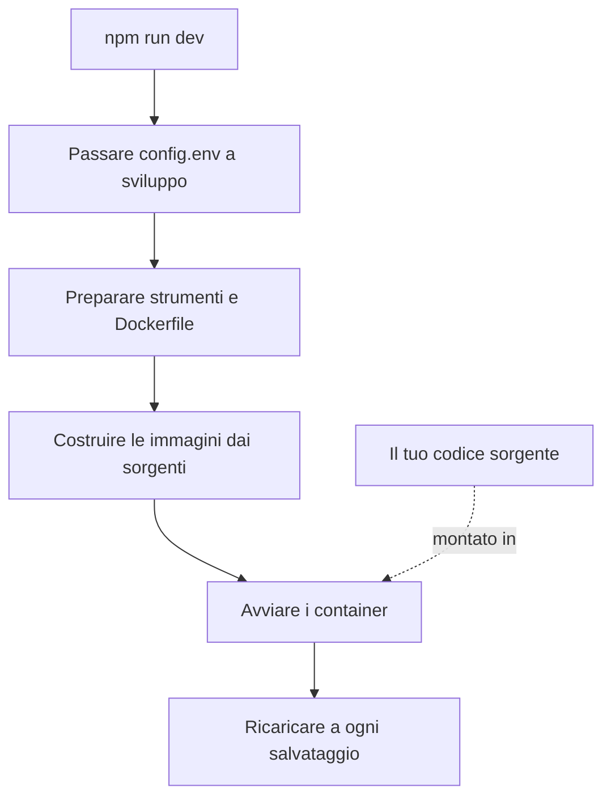

# Sviluppo locale

Esegui OneUptime dai sorgenti sul tuo computer per lavorarci. Lo stack di sviluppo costruisce ogni servizio dalla tua copia del repository, monta il tuo codice sorgente nei container e li ricarica quando salvi un file.

Per eseguire invece una versione rilasciata, usa [Docker Compose](/docs/installation/docker-compose).

## Come funziona lo stack di sviluppo

`npm run dev` prepara la tua copia del repository, poi avvia lo stack definito in `Scripts/Dev/docker-compose.dev.yml`:



| Fase | Cosa succede |
| --- | --- |
| Passaggio a sviluppo | Imposta `ENVIRONMENT=development` in `config.env`. |
| Preparazione | Chiede la tua password di sudo, installa gli strumenti mancanti (Git, curl, Node.js, Docker, gomplate, ts-node), esegue `git pull` sul tuo branch corrente, aggiunge a `config.env` le nuove impostazioni di `config.example.env` e genera un `Dockerfile` da ogni `Dockerfile.tpl`. |
| Build | Costruisce un'immagine per ogni servizio dai sorgenti. La prima build richiede un po' di tempo. |
| Esecuzione | Avvia i container con il tuo codice sorgente montato al loro interno. |
| Ricaricamento | L'App riavvia la sua API quando cambia un file del server e ricostruisce le dashboard mentre le modifichi. |

Quando la cartella `ee/` del repository è presente, l'App carica da lì l'Enterprise Edition. Imposta `ONEUPTIME_EDITION=community` in `config.env` per eseguire invece la Community Edition.

## Prima di iniziare

| Ti serve | Note |
| --- | --- |
| **Docker** | Docker Desktop su macOS e Windows, oppure Docker Engine con il plugin Docker Compose v2 su Linux. |
| **Node.js 26 o successivo, e npm** | La versione richiesta dal `package.json` del repository, e quella usata dalla CI. |
| **Git** | Per clonare il repository. |
| **Accesso sudo** | `npm run dev` chiede la tua password prima di installare qualsiasi cosa. |
| **Porte 80 e 443 libere** | Lo stack serve OneUptime su `http://localhost` (porta 80), e HTTPS sulla porta 443. |

## Avviare lo stack di sviluppo

:::steps
### Clonare il repository

```bash
git clone https://github.com/OneUptime/oneuptime.git
cd oneuptime
```

### Creare config.env

```bash
cp config.example.env config.env
```

I valori di esempio funzionano così come sono per lo sviluppo. Puoi cambiarli, ma non è necessario.

### Avviare lo stack

```bash
npm run dev
```

Chiede la tua password di sudo, poi costruisce le immagini e avvia i container in background. Segui l'avvio dell'App con `docker logs -f oneuptime-app-1`.

### Aprire OneUptime

Apri `http://localhost` e registrati. Il primo account diventa l'amministratore principale, che può aprire l'Admin Dashboard su `http://localhost/admin`.
:::

## Lavorare sul codice

Modifica i file in `packages/` e salva: i container recepiscono la modifica.

Prima di aprire una pull request, verifica la modifica sul tuo computer, fuori dai container. Installa una volta le dipendenze necessarie: esegui `npm install` nella radice del repository, per ESLint e gli strumenti di migrazione, poi `npm run install-modules`, che elimina e reinstalla i `node_modules` di ogni pacchetto e richiede un po' di tempo.

:::steps
### Compilare ciò che hai modificato

Esegui il compilatore in ogni pacchetto che hai modificato, per esempio l'App:

```bash
cd packages/App
npm run compile
```

### Eseguire il lint solo sui tuoi file

Dalla radice del repository, passa i file che hai modificato:

```bash
npx eslint --fix packages/App/path/to/File.ts
```

Evita `npm run lint` e `npm run fix-lint`: eseguono il lint dell'intero repository.

### Eseguire i test che coprono la modifica

Dal pacchetto, esegui i file di test che contano invece dell'intera suite:

```bash
cd packages/App
npx jest Tests/path/to/YourChange.test.ts
```
:::

### Migrazioni del database

| Database | Come aggiungere una migrazione |
| --- | --- |
| PostgreSQL | Modifica il modello, poi esegui `npm run generate-postgres-migration` invece di scrivere la migrazione a mano. Registra il nuovo file in `packages/Common/Server/Infrastructure/Postgres/SchemaMigrations/Index.ts`: non viene eseguito finché non è elencato lì. `npm run check-postgres-schema-drift` mostra ogni istruzione ancora mancante. |
| ClickHouse | Scrivi la migrazione a mano in `packages/App/FeatureSet/Workers/DataMigrations`, sul modello di quelle esistenti. |

## Riferimento

### Comandi

Eseguili dalla radice del repository.

| Attività | Comando |
| --- | --- |
| Avviare lo stack, o applicare modifiche a `config.env` | `npm run dev` |
| Ricostruire le immagini, dopo un cambio di dipendenze | `npm run build`, poi `npm run dev` |
| Ricostruire le immagini da zero | `npm run force-build-dev`, poi `npm run dev` |
| Elencare i container in esecuzione | `docker ps` |
| Seguire i log di un servizio | `docker logs -f oneuptime-app-1` |
| Fermare lo stack e rimuoverne i container | `npm run down` |

`npm run down` conserva i tuoi dati: i volumi di PostgreSQL e ClickHouse rimangono.

### Porte

Lo stack di sviluppo pubblica gli archivi di dati, così puoi collegarti con i tuoi strumenti. Le password sono in `config.env`.

| Servizio | Indirizzo | Accesso con |
| --- | --- | --- |
| OneUptime | `http://localhost` | L'account che hai creato |
| PostgreSQL | `localhost:5400` | Utente `postgres`, database `oneuptimedb`, password `DATABASE_PASSWORD` |
| ClickHouse | `localhost:8189` (HTTP), `localhost:9034` (nativo) | Utente `default`, database `oneuptime`, password `CLICKHOUSE_PASSWORD` |
| Valkey | `localhost:6310` | Password `VALKEY_PASSWORD` |

## Risoluzione dei problemi

:::details npm run dev si ferma su git pull
`npm run dev` esegue `git pull` sul tuo branch corrente prima della build. Git rifiuta su un branch senza upstream, o quando il pull sovrascriverebbe le tue modifiche non salvate in un commit. Imposta l'upstream del branch (per esempio facendone il push con `git push -u origin <branch>`) oppure esegui il commit del tuo lavoro, poi esegui di nuovo `npm run dev`.
:::

:::details npm run dev si ferma mentre installa uno strumento
Installa tu stesso quello strumento, per esempio gomplate o ts-node, ed esegui di nuovo `npm run dev`: salta ogni strumento già installato.
:::

:::details Un servizio non funziona dopo aver cambiato le sue dipendenze
Le immagini contengono ancora le vecchie dipendenze. Ricostruiscile con `npm run build`, poi riavvia lo stack con `npm run dev`. Se non basta, ricostruisci da zero con `npm run force-build-dev`.
:::

:::details La porta 80 o 443 è già in uso
Un altro programma sul tuo computer, spesso un server web locale, occupa la porta. Fermalo, poi esegui di nuovo `npm run dev`.
:::

## Passaggi successivi

:::cards
- [Architettura self-hosted](/docs/self-hosted/architecture): Come si combinano i servizi che hai appena avviato.
- [Docker Compose](/docs/installation/docker-compose): Eseguire una versione rilasciata su un server.
- [Riferimento API](/docs/api-reference/api-reference): Chiamare l'API della tua istanza locale.
:::
