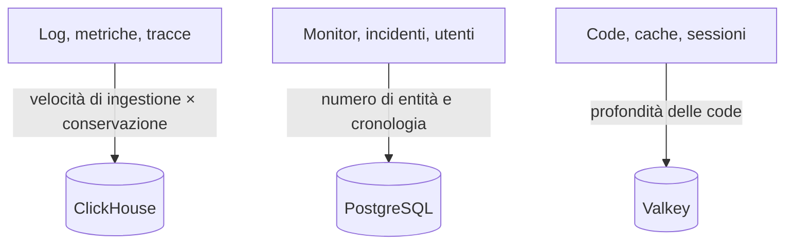

# Dimensionamento e pianificazione della capacità

Pianifica CPU, memoria e disco per un OneUptime self-hosted su Kubernetes con il [chart Helm](https://artifacthub.io/packages/helm/oneuptime/oneuptime). Dimensiona separatamente i tre archivi di dati – **ClickHouse**, **PostgreSQL** e **Valkey** – e l'applicazione, parti da uno dei livelli qui sotto e correggi quando avrai numeri reali.

> [!IMPORTANT]
> I valori predefiniti del chart non sono un dimensionamento di produzione. I servizi che esegue per impostazione predefinita non impostano **nessuna richiesta né limite di CPU o memoria**, e PostgreSQL e ClickHouse ricevono piccoli volumi da **25 Gi**, perché il chart si installi su qualsiasi cluster. Per qualsiasi uso oltre una prova, imposta tu risorse e storage, con i numeri di questa pagina.

Usi invece l'installazione Docker Compose su un singolo server? Il suo dimensionamento è più semplice: consulta i [requisiti](/docs/installation/docker-compose#requisiti) (consigliati 16 GB di memoria, 8 core e 400 GB di disco).

:::cards
- [Cosa fa crescere ogni archivio](#cosa-fa-crescere-ogni-archivio): Tre archivi che crescono con tre cose diverse.
- [Livelli di partenza](#livelli-di-partenza): Punti di partenza piccolo, medio e grande.
- [Alta disponibilità](#alta-disponibilità): Repliche e failover per ogni archivio.
- [Conservazione](#la-conservazione-e-il-suo-effetto-sullo-storage): L'impostazione che moltiplica il tuo disco.
:::

## Dimensiona la tua installazione

:::steps
1. Scopri quanta telemetria invii: i GB di log, metriche e tracce al giorno. Misurala su una piccola installazione, se puoi.
2. Decidi per quanti giorni conservarla. La conservazione moltiplica il disco di ClickHouse (vedi [Conservazione](#la-conservazione-e-il-suo-effetto-sullo-storage)).
3. Calcola il disco di ClickHouse con la [formula di storage](#formula-di-storage), poi quello di PostgreSQL e di Valkey dalle loro sezioni.
4. Scegli il [livello di partenza](#livelli-di-partenza) più vicino ai tuoi numeri e imposta CPU, memoria e storage nei tuoi valori Helm.
5. Attiva l'[alta disponibilità](#alta-disponibilità) per gli archivi che ne hanno bisogno, poi osserva l'uso reale e correggi.
:::

## Cosa fa crescere ogni archivio

In produzione OneUptime ha bisogno di tre archivi di dati. Ognuno cresce con qualcosa di diverso, quindi dimensionali in modo indipendente.



| Archivio | Cosa memorizza | Cosa ne determina la dimensione |
| --- | --- | --- |
| **ClickHouse** | Tutta la telemetria – log, metriche, tracce, eccezioni, profili | La telemetria: **velocità di ingestione × conservazione**. È circa il 95% del tuo storage e il costo principale. |
| **PostgreSQL** | Configurazione e stato – monitor, incidenti, avvisi, utenti, team, progetti, workflow, pagine di stato, dashboard | **Numero di entità e cronologia**, non il volume di telemetria. Cresce lentamente. |
| **Valkey** | Cache, code di lavoro e sessioni | **Profondità delle code e sessioni attive**. Legato alla memoria e modesto. Non è una fonte di verità. |

OneUptime non ha mai bisogno di un object storage (S3, MinIO) per funzionare, e non sposta la telemetria più vecchia su object storage. Ti serve un object storage solo se scegli backup su object storage: il plugin Barman Cloud per CloudNativePG, oppure [clickhouse-backup](https://github.com/Altinity/clickhouse-backup) per ClickHouse. Il backup CloudNativePG del chart (`postgresOperator.cnpg.backup`) crea snapshot dei volumi e non richiede alcun object storage. CloudNativePG non elimina mai i vecchi snapshot: rimuovili tu, altrimenti continuano ad accumularsi.

## ClickHouse – il fattore principale

Quasi tutto il tuo storage e gran parte della memoria vanno a ClickHouse, perché lì vive ogni riga di log, punto di metrica, span di traccia ed eccezione.

### Formula di storage

```text
ClickHouse disk ≈ (daily raw telemetry GB ÷ compression) × retention days × replicas × 1.3 (headroom)
```

La compressione dipende dal segnale:

| Segnale | Compressione tipica | Cosa la cambia |
| --- | --- | --- |
| Log | Circa 5:1 | I log si comprimono bene. |
| Metriche | Circa 2:1 | Un'alta **cardinalità** delle etichette gonfia disco e memoria più in fretta del volume grezzo. Mantieni bassa la cardinalità delle etichette. |
| Tracce | A metà tra i due | Gli attributi degli span che invii. |

### Esempio pratico

Una flotta di **10 cluster**, ognuno con circa 10 nodi e 100 pod che scrivono log a livello INFO, produce all'incirca **50–150 GB di log grezzi per cluster in 30 giorni** (circa 1,7–5 GB al giorno per cluster). Sull'intera flotta, aggiungendo metriche e tracce e dopo la compressione, prevedi all'incirca **5–15 GB al giorno di telemetria compressa**.

| Conservazione | Una replica | 2 repliche + 30% di margine |
| --- | --- | --- |
| 30 giorni | ~150–450 GB | **~0,4–1,2 TB** |
| 90 giorni | ~0,45–1,35 TB | **~1,2–3,5 TB** |

Lo storage cresce **in modo lineare con la conservazione**: una finestra di 90 giorni costa circa il triplo di una di 30.

### Memoria e tipo di disco

- **Usa NVMe o SSD.** La telemetria è pesante in scrittura, con raffiche di letture di aggregazione; ClickHouse fatica su dischi rotanti.
- **Dai a ClickHouse molta memoria.** Le query di aggregazione consumano molta memoria. Come regola pratica, dimensiona la memoria al 25–50% dei dati compressi *caldi* (interrogati di recente), con un minimo pratico di 16 GB per qualsiasi vera flotta di produzione.
- **Tieni sotto controllo la cardinalità delle metriche.** È la leva singola più importante sulla memoria e sul disco di ClickHouse. Imponi convenzioni di etichette a bassa cardinalità dove raccogli le metriche, e osserva il numero di serie attive.

## PostgreSQL – configurazione e stato

PostgreSQL memorizza la configurazione e lo stato operativo, non la telemetria, quindi cresce lentamente e resta piccolo rispetto a ClickHouse. Anche le installazioni grandi restano di solito nell'ordine delle decine di GB. Il volume predefinito da **25 Gi** basta per le installazioni piccole; prevedi 50–100 GB per quelle più grandi, con margine per la cronologia di incidenti e avvisi.

Con molte repliche di app, worker e probe, le connessioni al database possono esaurirsi prima dello storage. Ogni pod apre fino a 50 connessioni per impostazione predefinita, e il PostgreSQL incluso ne accetta 500. Proprio per questo il chart include un connection pooler **PgBouncer** opzionale (`pgbouncer.enabled`): attivalo per le installazioni con molte repliche.

## Valkey – cache, code e sessioni

Il livello di cache esegue [Valkey](https://valkey.io), il fork di Redis 7.2 con licenza BSD, come cache, coda di lavoro e archivio delle sessioni. Qualsiasi server compatibile con il protocollo Redis può sostituirlo, e il dimensionamento qui sotto vale in entrambi i casi. È **legato alla memoria**, e la persistenza è **disattivata per impostazione predefinita**: non è una fonte di verità e si può ricostruire. Dimensionalo in base alla profondità delle code e alle sessioni simultanee; 2–8 GB di memoria bastano per la maggior parte delle installazioni. La sua politica di eviction è `noeviction`, quindi tieni d'occhio la memoria se le code si accumulano sotto un carico prolungato.

## Calcolo dell'applicazione

Oltre agli archivi di dati, dimensiona i carichi di lavoro senza stato. Ognuno gira **senza richieste né limiti di risorse** finché non li imposti, e con una replica, tranne il telemetry writer, che ne ha due.

| Carico di lavoro | Chiave dei valori | Cresce con |
| --- | --- | --- |
| App: dashboard, API e ingestione | `app` | Utenti, chiamate API e telemetria in ingresso |
| Worker, quando separati dall'app | `worker` | Telemetria ed elaborazione dei job in background |
| Probe | `probes` | Il numero di monitor attivi |
| Gateway di ingresso | `nginx` | Il volume di richieste |
| Telemetry writer, quando attivato | `telemetryWriter` | Non con il carico: raggruppa ogni inserimento di telemetria in ClickHouse, quindi si dimensiona su ciò che ClickHouse può reggere |

Il chart include **KEDA**, così app, worker, probe e il Runner possono scalare in base alla coda arretrata. Attiva `keda.enabled` insieme al `keda.enabled` di ogni servizio (per esempio `app.keda.enabled`). Su un cluster che non ha ancora KEDA, la prima installazione richiede un passaggio in più: vedi la [guida KEDA](https://github.com/OneUptime/oneuptime/blob/master/HelmChart/Docs/Keda.md) del chart. I servizi che KEDA non gestisce possono usare invece un autoscaler basato su CPU o memoria (`autoscaling`).

## Livelli di partenza

Scegli come punto di partenza il livello più vicino al tuo ambiente, poi osserva l'uso reale (`kubectl top pods`, la crescita del disco di ClickHouse e PostgreSQL) e correggi.

- **Piccolo / PoC** – 1–3 cluster, ≤30 nodi, ≤5 GB/giorno di telemetria grezza, 30 giorni di conservazione.
- **Medio / Flotta di produzione** – ~10 cluster, ~100 nodi, 10–30 GB/giorno di telemetria grezza, 30–90 giorni di conservazione.
- **Grande / Più flotte** – 50+ cluster, 500+ nodi, 100+ GB/giorno di telemetria grezza, 90 giorni di conservazione.

| | Piccolo / PoC | Medio / Flotta di produzione | Grande / Più flotte |
| --- | --- | --- | --- |
| **ClickHouse** | 4 vCPU / 16 GB / 200 GB NVMe | 8 vCPU / 32 GB / 1–3 TB NVMe | 16+ vCPU / 64–128 GB / 5–15 TB NVMe, **con shard** |
| **PostgreSQL** | 2 vCPU / 4 GB / 50 GB SSD | 4 vCPU / 8 GB / 100 GB SSD | 8 vCPU / 16–32 GB / 250 GB SSD (+ PgBouncer) |
| **Valkey** | 1 vCPU / 2 GB | 2 vCPU / 4 GB | 4 vCPU / 8–16 GB |
| **Conservazione ipotizzata** | 30 giorni | 30–90 giorni | 90 giorni |

Questi livelli dimensionano il backend di OneUptime. L'agent che installi su ogni cluster monitorato è trattato nella pagina [Agent Kubernetes](/docs/telemetry/kubernetes-agent), che mostra anche come ridurre il volume di dati che invia.

## Alta disponibilità

Gli archivi di dati integrati nel chart girano per impostazione predefinita come **istanze singole**. Per l'alta disponibilità in produzione:

| Archivio | Per l'alta disponibilità |
| --- | --- |
| **PostgreSQL** | Attiva l'operatore [CloudNativePG](https://cloudnative-pg.io) incluso (`postgresOperator.cnpg.enabled`) con **3 istanze** (`postgresOperator.cnpg.instances`): un primario e due hot standby, con failover automatico. |
| **ClickHouse** | Attiva l'operatore [Altinity](https://github.com/Altinity/clickhouse-operator) incluso (`clickhouseOperator.altinity.enabled`) con **2 o più repliche per shard** (`clickhouseOperator.altinity.cluster.replicasCount`). Il suo ClickHouse Keeper incluso gira su **3 nodi** per il quorum. Aggiungi shard (`shardsCount`) quando il disco o la memoria di un nodo diventano il limite. |
| **Valkey** | Il chart non lo replica. Punta OneUptime a un Redis o Valkey esterno gestito con failover automatico (`externalValkey`). OneUptime si collega a un solo host e porta, quindi usa l'endpoint primario del servizio, non uno in modalità cluster. |

> [!WARNING]
> Attivare uno dei due operatori su un'installazione esistente avvia un database nuovo e vuoto: nessuno dei due copia i dati del database a istanza singola che sostituisce. Migra i tuoi dati come descrivono le guide del chart – per [PostgreSQL](https://github.com/OneUptime/oneuptime/blob/master/HelmChart/Docs/MigratePostgresStandaloneToOperator.md) e per [ClickHouse](https://github.com/OneUptime/oneuptime/blob/master/HelmChart/Docs/MigrateClickhouseStandaloneToOperator.md).

## La conservazione e il suo effetto sullo storage

La conservazione della telemetria è un **TTL di ClickHouse contato in giorni**. Ogni edizione ha il valore predefinito del progetto, in **Impostazioni del progetto > Telemetria e APM > Conservazione dei dati** (**Conservazione predefinita (giorni)**); se non è impostato nulla, è di 15 giorni. L'[Enterprise Edition](/docs/self-hosted/enterprise) aggiunge sostituzioni: per segnale (log, tracce, metriche, profili), per gravità del log e stato della traccia, e per servizio o risorsa.

Log e metriche vengono eliminati un giorno alla volta, alla prima mezzanotte (ora del server ClickHouse) dopo la fine della loro conservazione, il che evita a ClickHouse di riscrivere ogni giorno di dati a intervalli di poche ore mentre scade. Poco prima di mezzanotte, sul disco resta ancora fino a un giorno in più della finestra di conservazione: dimensiona log e metriche per **giorni di conservazione + 1**.

Poiché la conservazione moltiplica lo storage di ClickHouse, decidila prima di dimensionare il disco. OneUptime **non** archivia né sposta la vecchia telemetria su object storage. Per una conservazione pluriennale a fini di conformità, estendi la finestra di conservazione e dimensiona di conseguenza lo storage di ClickHouse, oppure esporta in un archivio esterno di tua scelta.

## Misura prima di impegnarti

Il volume di telemetria varia enormemente con la verbosità dei log delle applicazioni, il numero di namespace, l'intervallo di scrape e il fatto che il logging DEBUG sia attivo da qualche parte. Considera i livelli qui sopra come punti di partenza: **raccogli dati dal tuo ambiente per almeno quattro settimane**, misura i GB reali al giorno per ogni segnale, poi dimensiona conservazione e storage su dati reali.

## Passaggi successivi

:::cards
- [Docker Compose](/docs/installation/docker-compose): Requisiti per un'installazione su un singolo server.
- [Architettura self-hosted](/docs/self-hosted/architecture): Come si combinano i componenti.
- [Agent Kubernetes](/docs/telemetry/kubernetes-agent): Il collector che invia la telemetria di un cluster.
- [Enterprise Edition](/docs/self-hosted/enterprise): Le sostituzioni della conservazione e le altre funzionalità Enterprise.
:::
