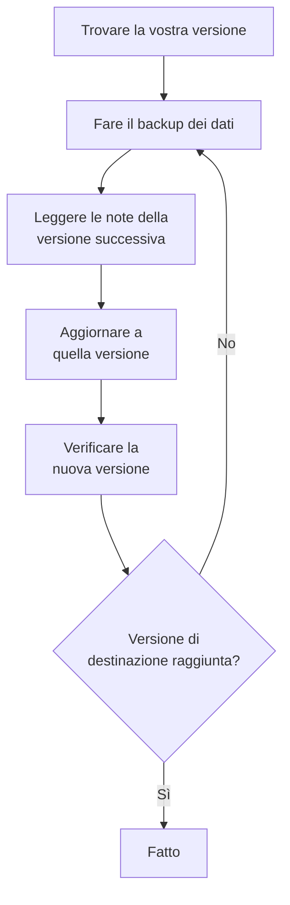

# Aggiornamento

Aggiornate un'installazione self-hosted di OneUptime – con Docker Compose, oppure con Kubernetes e Helm – a una versione più recente. Seguite la procedura qui sotto e leggete le note di ogni versione principale tra quella che eseguite e quella a cui passate.

:::cards
- [Come aggiornare](#come-aggiornare): La procedura, per Docker Compose e Kubernetes.
- [Le note di ogni versione](#trovare-le-note-della-vostra-versione): Cosa vi chiede ogni versione principale, a colpo d'occhio.
- [Immagini della Community Edition e della Enterprise Edition](#immagini-della-community-edition-e-della-enterprise-edition): Quale immagine eseguire dalla 14 in poi.
- [Aggiornamento da OneUptime 13 → 14](#aggiornamento-da-oneuptime-13-14): La versione principale più recente.
:::

## Come aggiornare

Tre regole rendono sicuro un aggiornamento:

- **Aggiornate una versione principale alla volta** (per esempio 6 → 7 → 8). Non saltate nessuna versione principale.
- **Saltate pure le versioni minori e le patch** (per esempio 8.1 → 8.4), purché seguiate le loro note di rilascio.
- **Fate un backup prima di ogni aggiornamento**, e verificate di poterlo ripristinare.



:::steps
### Trovate la vostra versione attuale

Come amministratore master, aprite l'etichetta dell'edizione nell'intestazione del pannello amministratore: **This installation** mostra la versione che eseguite. L'istanza la riporta anche su `/version`:

```bash
curl http://localhost/version
```

Sostituite `http://localhost` con l'indirizzo della vostra istanza. La risposta è JSON, come `{"version":"14.0.22","commit":"..."}`.

### Fate il backup dei vostri dati

Fate il backup di PostgreSQL, e di ClickHouse se vi serve la sua telemetria. Con Docker Compose, vedi [Backup e ripristino](/docs/installation/docker-compose#backup-e-ripristino). Su Kubernetes, usate i vostri snapshot dei volumi o i backup CloudNativePG del chart.

### Leggete le note della versione principale successiva

Le trovate nella [tabella qui sotto](#trovare-le-note-della-vostra-versione). Fate ciò che chiedono prima di aggiornare: alcuni passaggi, come rinominare valori Helm, vanno fatti prima.

### Eseguite l'aggiornamento

:::tabs
@tab Docker Compose
```bash
git checkout release
git pull
npm run update
```
`npm run update` aggiunge le nuove impostazioni al vostro `config.env` senza cambiare le vostre, scarica le nuove immagini e riavvia OneUptime.
@tab Kubernetes
```bash
helm repo update
helm upgrade my-oneuptime oneuptime/oneuptime -f values.yaml
```
Usate il vostro nome di release e il vostro file dei valori. Il chart esegue le migrazioni del database in un Job a sé, prima che i nuovi pod servano traffico.
:::

### Verificate la nuova versione

Con Docker Compose, `npm run update` termina con **OneUptime is up!** Su Kubernetes, attendete che ogni pod sia `Running` e pronto:

```bash
kubectl get pods -n <namespace>
```

Poi verificate di nuovo la vostra versione, come nel primo passaggio. Se non avete ancora raggiunto la versione di destinazione, tornate a [Fate il backup dei vostri dati](#fate-il-backup-dei-vostri-dati) e passate alla versione principale successiva.
:::

### Trovare le note della vostra versione

| Aggiornamento | Cosa dovete fare |
| --- | --- |
| [13 → 14](#aggiornamento-da-oneuptime-13-14) | Scegliere un'edizione. Le installazioni Docker Compose che impostano `IS_ENTERPRISE_EDITION=true` passano a `APP_TAG=enterprise-release`. Attivare una licenza sulla Enterprise Edition. Salvare di nuovo i monitor IPv6 Ping, Port e SSL. Le correzioni di codice AI passano al Runner globale: tenerlo attivo e, su Helm, spostare `runner.keda` in `globalRunner.keda`. |
| [12 → 13](#aggiornamento-da-oneuptime-12-13) | Di solito nulla: Redis diventa Valkey, e i vecchi nomi delle impostazioni continuano a funzionare. Eseguite Docker Compose a mano? Aggiungete `--remove-orphans`. Usate una cache vostra? Leggete [Se gestite una cache vostra](#se-gestite-una-cache-vostra). |
| [11 → 12](#aggiornamento-da-oneuptime-11-12) | Ridistribuire i Runbook Agent come Runner. Con Docker Compose, impostare `ONEUPTIME_RUNNER_KEY`. Con Helm, rinominare `aiAgent:` in `runner:`. Riassegnare i permessi Runner che le chiavi API avevano direttamente. |
| [10 → 11](#aggiornamento-da-oneuptime-10-11) | SCIM e le impostazioni di conformità dei team richiedono la Enterprise Edition. Per conservare lo storico della telemetria, rinominate le vecchie tabelle ClickHouse prima di aggiornare. |
| [9 → 10](#aggiornamento-da-oneuptime-9-10) | Nulla. |
| [8 → 9](#aggiornamento-da-oneuptime-8-9) | Con Helm, rimuovere le sostituzioni di `oneuptimeIngress` dai vostri valori. |
| [7 → 8](#aggiornamento-da-oneuptime-7-8) | Con Helm, passare alla nuova struttura dei valori per Postgres, Redis e ClickHouse. Fare prima un backup. |

## Immagini della Community Edition e della Enterprise Edition

OneUptime distribuisce ora l'applicazione come due immagini. La **Community Edition** è open source sotto licenza Apache 2.0 e include il single sign-on SAML e OIDC, l'SSO globale e «Require SSO for login». La **Enterprise Edition** aggiunge i moduli enterprise della directory `ee/` del repository: SCIM, la conformità dei team, i log di audit e le dashboard Health enterprise del pannello amministratore. Prima di questa modifica entrambe le edizioni eseguivano lo stesso codice, e `IS_ENTERPRISE_EDITION` decideva quali funzionalità erano attive. Ora decide l'immagine, e l'immagine Community non contiene la directory `ee/`.

La pagina [Edizione Enterprise](/docs/self-hosted/enterprise) contiene il confronto completo delle funzionalità, i dettagli della licenza e cosa succede quando cambiate edizione.

### Cosa fare prima di aggiornare

- **Community Edition senza SCIM:** nulla. Aggiornate come al solito.
- **Community Edition con ruoli personalizzati, liste di IP consentiti, controlli di accesso delle pagine di stato o Powered by OneUptime nascosto:** i ruoli personalizzati, le liste di IP consentiti e i controlli di accesso delle pagine di stato passano alla Enterprise Edition. Quelli che avete impostato continuano ad applicarsi, e potete rimuoverli, ma non crearli né modificarli. Le pagine di stato mostrano di nuovo Powered by OneUptime. Passate all'immagine Enterprise per continuare a gestirli.
- **Helm con `image.type: enterprise-edition`:** nulla. Il chart scarica già le immagini `enterprise-`, che ora contengono i moduli enterprise.
- **Docker Compose con `IS_ENTERPRISE_EDITION=true`:** passate all'immagine Enterprise durante l'aggiornamento impostando `APP_TAG=enterprise-release` (oppure `enterprise-<version>`) in `config.env`. `APP_TAG=release` è l'immagine Community, e `IS_ENTERPRISE_EDITION=true` non attiva più nulla. `npm run update` fa questa modifica al vostro posto finché `IS_ENTERPRISE_EDITION=true` (`release` diventa `enterprise-release`, un `13.0.7` fissato diventa `enterprise-13.0.7`) e stampa cosa ha cambiato. L'applicazione ora **rifiuta di avviarsi** quando `IS_ENTERPRISE_EDITION=true` è impostato sull'immagine Community, invece di fermare in silenzio il provisioning SCIM e la registrazione di audit. L'errore dice cosa impostare: `APP_TAG=enterprise-<version>` per mantenere la Enterprise Edition, oppure `IS_ENTERPRISE_EDITION=false` per eseguire la Community Edition.
- **Immagine Community con SCIM già configurato:** il provisioning SCIM si ferma con questo aggiornamento, deprovisioning compreso. Passate all'immagine Enterprise per mantenerlo. Altrimenti, leggete [Passare da Enterprise a Community](/docs/self-hosted/enterprise#passare-da-enterprise-a-community) prima di aggiornare. Spiega cosa si ferma e chi rimuovere prima. Per eseguire la Community Edition, impostate anche `IS_ENTERPRISE_EDITION=false`. Il single sign-on non è interessato: anche l'immagine Community lo serve.

La vostra configurazione non viene mai eliminata, e cambiare edizione non richiede alcuna migrazione in nessuna direzione.

### La licenza dopo l'aggiornamento

La Enterprise Edition ora verifica la propria licenza:

- **Un'installazione con una chiave di licenza** continua a funzionare. Verifica la licenza con OneUptime all'avvio e una volta al giorno. Se la licenza scade, tutto continua a funzionare per un periodo di tolleranza di 30 giorni, dopo il quale succede lo stesso che a un'installazione senza licenza.
- **Un'installazione senza licenza**, per esempio una che eseguiva la Enterprise Edition solo con `IS_ENTERPRISE_EDITION=true`, ottiene una prova di 14 giorni dal primo avvio di questa versione. **Se usate SCIM o la registrazione di audit, attivate una licenza prima che la prova finisca.** Dopo la prova, il provisioning SCIM si ferma e la registrazione di audit smette di registrare. Anche la configurazione enterprise diventa di sola lettura e le dashboard Health enterprise vengono bloccate. Il single sign-on non è interessato. Tutto riprende, senza riavvio, non appena attivate una licenza. La prova serve alla valutazione: l'uso in produzione della Enterprise Edition richiede un abbonamento OneUptime Enterprise. Vedi [Quando una licenza scade o manca](/docs/self-hosted/enterprise#quando-una-licenza-scade-o-manca).
- **Le installazioni isolate dalla rete** possono attivarsi con un token di licenza firmato invece che con una chiave. Vedi [Attivazione offline](/docs/self-hosted/enterprise#attivazione-offline-installazioni-isolate-dalla-rete).

### Clienti di OneUptime Cloud

Per voi non cambia nulla. OneUptime Cloud esegue la Enterprise Edition, e il vostro piano decide ancora quali funzionalità ricevete: SSO, OIDC, SCIM e conformità dei team dal piano Scale in su, e i log di audit nel piano Enterprise. I progetti del piano Scale vedono ora le impostazioni di SSO, OIDC, SCIM e conformità dei team che prima mostravano un invito a passare a un piano superiore.

### Modifiche alle API e agli endpoint

- `GET /api/global-config/license` restituisce la chiave di licenza, il token di licenza, l'elenco delle istanze, l'ID dell'istanza e i dettagli della versione solo agli amministratori master. Gli altri chiamanti ricevono l'edizione e lo stato della licenza.
- Le installazioni self-hosted non servono più gli endpoint del server delle licenze sotto `/api/enterprise-license/`. Li usa solo oneuptime.com.
- Gli endpoint SCIM mantengono esattamente i loro percorsi sulla Enterprise Edition, quindi la configurazione dell'identity provider non cambia. Sulla Community Edition restituiscono `404`. Sulla Enterprise Edition rifiutano le richieste mentre la licenza è scaduta (dopo la prova o il periodo di tolleranza), e rispondono di nuovo non appena viene attivata una licenza.
- Gli endpoint SSO e OIDC (gli URL di accesso e ACS SAML, gli URI di reindirizzamento OIDC e gli endpoint dell'SSO globale) mantengono esattamente i loro percorsi e sono serviti da entrambe le edizioni in ogni stato della licenza.

## Aggiornamento da OneUptime 13 → 14

OneUptime 14 divide l'applicazione in due edizioni, e l'immagine che scaricate decide quale eseguite. La **Community Edition** (Apache-2.0, i tag `release` e `<version>`) include SAML SSO, OpenID Connect, l'SSO globale e «Require SSO for login». Non contiene la directory `ee/` del repository, quindi il provisioning SCIM, le impostazioni di conformità dei team, i log di audit, le dashboard **Health** del pannello amministratore e la **Query Console** del pannello amministratore non sono affatto presenti in quell'immagine. La **Enterprise Edition** (i tag `enterprise-release` e `enterprise-<version>`) li contiene, e verifica una licenza Enterprise durante l'esecuzione, cosa che OneUptime 13 non ha mai fatto. Il single sign-on non dipende da quella licenza.

[Immagini della Community Edition e della Enterprise Edition](#immagini-della-community-edition-e-della-enterprise-edition), qui sopra, è il riferimento per questa modifica: cosa contiene ogni edizione, cosa impostare per ciascun tipo di deployment e cosa fa la licenza. Questa sezione è l'aggiornamento in sé. Aggiornate partendo dalla 13 – se siete ancora sulla 12, fate prima 12 → 13.

Nulla viene eliminato, in nessuna delle due edizioni. Il single sign-on funziona allo stesso modo in entrambe: la vostra configurazione SSO e OIDC e le vostre impostazioni «Require SSO for login» vengono mantenute così come sono. La vostra configurazione SCIM e i log di audit registrati finora restano nel database. La Community Edition semplicemente non li serve, e cambiare edizione non richiede alcuna migrazione in nessuna direzione.

### Cosa dovete fare

1. **Decidete quale edizione esegue questa installazione.** Se usate il provisioning SCIM, le impostazioni di conformità dei team o i log di audit, oppure volete le dashboard **Health** del pannello amministratore, quella è la Enterprise Edition. Altrimenti non c'è nulla da decidere: la Community Edition è ciò che avete già, e include SAML SSO e OpenID Connect.
2. **Con Helm, indicate l'edizione nel vostro file dei valori:** `image.type: enterprise-edition` (il valore predefinito è `community-edition`). Non toccate `image.tag` – il chart aggiunge da sé il prefisso `enterprise-`, quindi `image.tag: release` scarica `oneuptime/app:enterprise-release`. Questo valore non è nuovo. Se usate già `enterprise-edition`, non c'è nulla da cambiare: il tag che già scaricate ora contiene `ee/`.
3. **Con Docker Compose, impostate `APP_TAG=enterprise-release`** (oppure `enterprise-<version>` per fissare una versione) in `config.env`. `APP_TAG=release` è l'immagine Community. È questo l'unico punto che blocca un'installazione sulla 13: nella 13 un'installazione Enterprise con Compose era `APP_TAG=release` più `IS_ENTERPRISE_EDITION=true`, e quella combinazione ora **rifiuta di avviarsi** invece di partire come Community Edition con il provisioning SCIM e la registrazione di audit fermati in silenzio. `npm run update` riscrive `APP_TAG` al vostro posto finché `IS_ENTERPRISE_EDITION=true` (`release` diventa `enterprise-release`, un `13.0.8` fissato diventa `enterprise-13.0.8`) e stampa cosa ha cambiato. Se invece scaricate le immagini a mano, impostate prima voi stessi `APP_TAG`.
4. **Sulla Enterprise Edition, attivate una licenza.** Un'installazione senza licenza ottiene una prova di 14 giorni, contati dal suo primo avvio della Enterprise Edition – in un aggiornamento è il giorno in cui aggiornate, non quello in cui avete installato OneUptime la prima volta. Un amministratore master la attiva dall'etichetta dell'edizione nell'intestazione del pannello amministratore; le installazioni isolate dalla rete attivano invece con un token firmato. Vedi [Licenze](/docs/self-hosted/enterprise#licenze).
5. **Se questa installazione eseguirà la Community Edition mentre il vostro identity provider esegue il deprovisioning degli utenti tramite SCIM, verificate chi ha accesso prima di aggiornare.** Il deprovisioning SCIM si ferma, quindi le persone che rimuovete nel vostro identity provider mantengono i loro account OneUptime e, a meno che non si applichi loro «Require SSO for login», chiunque raggiunga ancora la casella di posta di uno di questi account può impostare una password con «Password dimenticata» e accedere. Rimuovete prima quegli utenti: [Passare da Enterprise a Community](/docs/self-hosted/enterprise#passare-da-enterprise-a-community).
6. **Se monitorate indirizzi IPv6 con monitor Ping, Port o SSL, salvate di nuovo quei monitor dopo l'aggiornamento.** Le destinazioni salvate prima della 14 potrebbero essere state memorizzate troncate – vedi [Monitor IPv6 Ping, Port e SSL](#monitor-ipv6-ping-port-e-ssl).
7. **Se OneUptime AI corregge il codice nei vostri repository, tenete attivo il Runner globale.** Ora si occupa delle correzioni di codice AI che faceva il Runner condiviso, e il servizio `runner` di Docker Compose e il deployment `runner` del chart non esistono più. Se avete impostato `GLOBAL_RUNNER_REPLICAS=0` o `globalRunner.enabled: false`, riattivatelo, oppure [scegliete un Runner vostro](/docs/ai/ai-agent#scegli-il-runner-del-repository) per quei repository in Code. Su Helm, togliete `runner:` dai vostri values e spostate `runner.keda` in `globalRunner.keda`.

### Edizioni: cosa è cambiato e cosa no

| | Fino alla 13 | Dalla 14 |
| --- | --- | --- |
| Codice Enterprise | in ogni immagine; `IS_ENTERPRISE_EDITION=true` lo attivava | in `ee/`, e solo nelle immagini `enterprise-` |
| Selettore Helm | `image.type` | `image.type` – invariato, ma ora le immagini sono diverse |
| Selettore Compose | `IS_ENTERPRISE_EDITION=true` | `APP_TAG=enterprise-release` |
| Licenza Enterprise | mai verificata in esecuzione | verificata all'avvio e una volta al giorno |
| Endpoint SSO e OIDC | gli stessi percorsi in entrambe le edizioni | gli stessi percorsi in entrambe le edizioni, qualunque sia lo stato della licenza |
| Endpoint SCIM | gli stessi percorsi in entrambe le edizioni | gli stessi percorsi su Enterprise; `404` su Community |
| La vostra configurazione enterprise | memorizzata, applicata | memorizzata in entrambi i casi, applicata su Enterprise |

Viene eseguita una migrazione: una colonna nullable `enterpriseEditionFirstSeenAt` sulla tabella `GlobalConfig`, che ha una sola riga, quindi è istantanea. Non c'è nessuna migrazione ClickHouse, nulla viene eliminato e cambiare edizione non richiede migrazioni in nessuna direzione.

### La cronologia della licenza sulla Enterprise Edition

- **Un'installazione senza licenza** esegue una prova di 14 giorni, contati dal primo avvio della Enterprise Edition. Durante la prova ogni funzionalità enterprise funziona, e l'etichetta dell'edizione avvisa prima che finisca. La prova serve alla valutazione: l'uso in produzione della Enterprise Edition richiede un abbonamento ai sensi della OneUptime Enterprise License.
- **Una licenza che scade** ottiene un periodo di tolleranza di 30 giorni dalla data di scadenza, durante il quale ogni funzionalità enterprise funziona e l'etichetta dell'edizione avvisa.
- **Dopo la prova, o dopo quel periodo di tolleranza**, e fino all'attivazione di una licenza: le richieste SCIM del vostro identity provider vengono rifiutate e la registrazione di audit smette di registrare. La configurazione enterprise diventa di sola lettura – potete ancora consultarla, eliminarla e reimpostare un bearer token SCIM, cioè ciò che serve durante un incidente – e le dashboard Health e la Query Console del pannello amministratore vengono bloccate.
- **Nulla viene eliminato, e il monitoraggio principale non è mai interessato.** Monitor, avvisi, incidenti, reperibilità, pagine di stato e telemetria sono fuori dalla licenza, e lo è anche l'accesso: l'accesso con SSO e OIDC, «Require SSO for login» e l'accesso con password per ogni utente, amministratori master compresi, funzionano allo stesso modo in ogni stato della licenza. Attivare una licenza ripristina il provisioning SCIM e la registrazione di audit con la configurazione che avete già, senza riavvio.
- **Una chiave di licenza che avete già viene accettata**, come licenza «unverified»: la sua data di scadenza e il suo limite di posti vengono da ciò che il server delle licenze ha già comunicato a questa installazione, e ottiene lo stesso periodo di tolleranza di 30 giorni dopo quella scadenza. Le licenze emesse d'ora in poi sono firmate e verificate dall'applicazione stessa. Per questo aggiornamento non vi serve una nuova chiave.
- **Una chiave di cui questa installazione non ha mai registrato la scadenza** continua a funzionare durante la prova invece di fermarsi. Il server delle licenze scrive la chiave e la data di scadenza separatamente, quindi un'installazione può avere una chiave di cui non le è mai stata comunicata la scadenza. Un'installazione del genere viene trattata esattamente come una senza licenza: ogni funzionalità enterprise funziona durante la prova di 14 giorni, contati dal primo avvio della Enterprise Edition, e dopo la prova si fermano le stesse cose indicate sopra. Il limite di posti non viene applicato finché la licenza è in questo stato, perché il record di licenza che l'installazione possiede è già incompleto. Un amministratore master che riattiva la licenza dall'etichetta dell'edizione, o la sincronizzazione giornaliera della licenza che recupera la scadenza da oneuptime.com, la ripristina senza riavvio.

La tabella completa degli stati è in [Quando una licenza scade o manca](/docs/self-hosted/enterprise#quando-una-licenza-scade-o-manca).

### Docker Compose: scegliere il tag dell'immagine

```bash
git checkout release # Please make sure you're on release branch.
git pull
npm run update
```

- **`npm run update` sposta `APP_TAG` finché `IS_ENTERPRISE_EDITION=true`**, all'immagine Enterprise della stessa versione, e stampa cosa ha cambiato. Mantiene i vostri commenti e le virgolette, lascia stare un `APP_TAG` che è già un tag `enterprise-` e non cambia nulla a una seconda esecuzione.
- **Scaricare le immagini a mano salta questo passaggio**, e l'applicazione si chiude allora all'avvio con un errore che indica esattamente cosa impostare: `APP_TAG=enterprise-<version>` per mantenere la Enterprise Edition, oppure `IS_ENTERPRISE_EDITION=false` per eseguire la Community Edition.
- **Per passare di proposito alla Community Edition**, impostate `APP_TAG=release` e `IS_ENTERPRISE_EDITION=false`. Leggete prima il punto 5 qui sopra se il vostro identity provider esegue il deprovisioning degli utenti tramite SCIM.
- Nient'altro in `config.env` deve cambiare per questa versione.

### Helm: scegliere il tipo di immagine

```bash
helm repo update
helm upgrade my-oneuptime oneuptime/oneuptime -f values.yaml
```

- **Un'installazione già su `image.type: enterprise-edition` non deve cambiare alcun valore.** Il chart antepone il prefisso al tag da tempo; la novità è che le immagini `enterprise-` contengono `ee/`. Da questa versione le si applica la licenza, secondo la cronologia qui sopra.
- **`image.tag: release` è il valore predefinito**, quindi un chart rimasto sul tag mobile passa alla 14 al suo prossimo aggiornamento senza alcuna modifica dei valori. Se quell'installazione ha SCIM configurato su `community-edition`, impostate `image.type: enterprise-edition` nello stesso aggiornamento.
- **`IS_ENTERPRISE_EDITION` viene ancora emesso dal chart**, derivato da `image.type` perché i due non possano mai essere in disaccordo. Non controlla nulla. Forzarlo a `true` tramite `extraEnv` su un'immagine Community fa solo rifiutare l'avvio all'applicazione. Non impostate mai `ONEUPTIME_EDITION` tramite il chart.
- **Le sonde del chart rispettano di nuovo `probes.<key>.allowPrivateNetworkMonitors`** ([#3879](https://github.com/OneUptime/oneuptime/issues/3879)). Non cambia nulla a meno che non lo impostiate – il valore predefinito resta `false` – e si applica ai monitor di tutti i progetti dell'istanza, perché le sonde del chart sono sonde globali. Loopback, link-local e `169.254.169.254` restano bloccati qualunque valore impostiate.

### Altre modifiche nella 14

Queste modifiche cambiano il comportamento di OneUptime dopo l'aggiornamento, e la maggior parte non richiede nulla da parte vostra. Leggetele se usate ruoli personalizzati o chiavi API composti da singoli permessi, stati personalizzati di incidenti, avvisi o manutenzioni, Terraform o le API, l'SSO, o le app di Slack e Microsoft Teams.

:::details Leggete le altre modifiche della 14
- **L'acquisizione OTLP conferma un batch solo dopo che la coda lo ha accettato.** La 13 rispondeva prima `200` e accodava dopo, quindi un batch rifiutato dalla coda andava perso in silenzio. La 14 risponde invece `503` con `Telemetry queue unavailable. Please retry.`, e l'endpoint gRPC restituisce `UNAVAILABLE`; entrambi si possono ritentare, e gli exporter ritentano. Questo vale per log, metriche, trace e profili. Non serve fare nulla, ma i nuovi tentativi lato exporter e la contropressione della coda ora sono visibili dove prima i dati sparivano – utile da sapere se dimensionate la capacità di acquisizione.
- **Le dashboard Health e la Query Console del pannello amministratore richiedono la Enterprise Edition**, insieme agli avvisi di stato di PostgreSQL e Valkey. Nella 13 arrivavano con il solo `IS_ENTERPRISE_EDITION=true`, quindi è una perdita visibile per un'installazione Community che li usava. Il monitoraggio della capacità di ClickHouse e la sua potatura, lo stato delle migrazioni, le sonde globali e il pacchetto di supporto sono in entrambe le edizioni.
- **I monitor HTTPS che raggiungono un indirizzo IP tramite il proxy di una sonda funzionano di nuovo.** La sonda inviava l'IP come nome del server TLS, che non è un nome di server valido e che Node rifiuta senza appello, quindi un monitor su `https://<private IP>` da una sonda globale con `PROBE_ALLOW_PRIVATE_NETWORK_MONITORS` falliva l'handshake. La sonda ora omette il nome del server per una destinazione IP e verifica il certificato rispetto all'IP stesso. Le destinazioni per nome host non cambiano.
- **La CLI `oneuptime` riporta la sua versione reale** con `--version` invece di un segnaposto.
- **Un nuovo avviso o episodio inizia nello stato indicato dalla sua creazione.** Le API, Terraform (`current_alert_state_id`, `current_incident_state_id`) e i workflow possono indicare lo stato in cui inizia un avviso, un episodio di avvisi o un episodio di incidenti, come fa il campo **Stato iniziale** della dashboard. Prima, quello stato veniva sostituito con lo stato di creazione del progetto; una configurazione Terraform che lo impostava riceveva un valore diverso da quello pianificato. Una creazione che non indica alcuno stato inizia ancora nello stato di creazione, e uno stato di un altro progetto viene rifiutato. Vedi [Lo stato in cui inizia un nuovo record](/docs/api-reference/api-reference#lo-stato-in-cui-inizia-un-nuovo-record).
- **Un record creato già riconosciuto o risolto non chiama nessuno.** Un incidente, un avviso o un episodio creato in uno stato successivo – tramite **Stato iniziale**, lo stato iniziale di un modello, le API, Terraform o un workflow – non esegue più i suoi criteri di reperibilità; il suo feed lo dice al loro posto. Uno creato risolto inoltre non viene più raggruppato in un episodio, rimediato, indagato da OneUptime AI né dotato di un canale Slack o Microsoft Teams, e un incidente creato risolto lascia stare lo stato e il monitoraggio dei suoi monitor e non avvia alcuno SLA. Uno creato riconosciuto avvia il suo SLA già come risposto. I record creati nello stato di creazione, come tutti quelli aperti da un monitor, non cambiano. Vedi [Dichiarato già riconosciuto o risolto](/docs/incidents/declaring-incidents#dichiarato-già-riconosciuto-o-risolto).
- **Uno stato successivo al vostro stato risolto conta come risolto ovunque.** Un incidente, un avviso o un episodio in uno stato che avete posto dopo lo stato risolto – uno stato **Closed** sotto **Risolto**, per esempio – contava come risolto in alcuni punti e come aperto in altri. Ognuno di essi applica ora un'unica regola: lo stato risolto del progetto, e ogni stato successivo, è risolto. I record in uno stato del genere escono dagli elenchi **Incidenti attivi** e **Avvisi attivi** e dai loro contatori nel menu laterale, dagli elenchi di incidenti e avvisi delle dashboard, dagli episodi attivi e dagli elenchi di record aperti dell'app mobile; i riepiloghi di Slack e Microsoft Teams li contano come risolti, e le cronologie delle pagine di stato mostrano una riga del genere come risolta. Un monitor o una regola di burn rate SLO il cui incidente o avviso si trova in uno stato del genere ne apre uno nuovo la volta successiva che scatta, dove prima prendeva il vecchio per ancora aperto. Spostare un incidente direttamente in uno stato del genere lo risolve come fa **Risolto**, e spostarlo oltre **Risolto** non riapre più un episodio né avvia un nuovo SLA per l'incidente. I progetti i cui stati personalizzati stanno tutti sopra lo stato risolto non notano alcuna modifica. Vedi [L'elenco degli incidenti attivi](/docs/incidents/states-and-severities#lelenco-incidenti-attivi).
- **Uno stato successivo al vostro stato riconosciuto conta come riconosciuto ovunque.** Un incidente, un avviso o un episodio in uno stato che avete posto tra i vostri stati riconosciuto e risolto – uno stato **Investigating** sotto **Riconosciuto**, per esempio – fermava già le chiamate di reperibilità, ma l'app mobile e Microsoft Teams offrivano ancora **Acknowledge** per esso, e riconoscere un avviso o un episodio in quello stato (da Teams, Slack o una pagina di reperibilità) lo riportava a **Riconosciuto**. Ognuno di essi applica ora un'unica regola: lo stato riconosciuto del progetto, ogni stato successivo e uno stato risolto contano come riconosciuti. **Acknowledge** non viene più offerto da nessuna parte per un record del genere, e riconoscerlo viene rifiutato ("... is already acknowledged.") invece di riportarlo indietro; un responder che riconosce la propria chiamata per esso completa semplicemente la chiamata. Spostare un record direttamente in uno stato del genere segna ora lo SLA dell'incidente come risposto – dove prima restava senza risposta fino alla risoluzione dell'incidente, il che poteva violare l'obiettivo di risposta – e conta come il suo riconoscimento nel tempo di riconoscimento della panoramica, nella metrica **Time to Acknowledge**, nelle misurazioni e nell'MTTA dei riepiloghi di Slack e Microsoft Teams. Un record risolto senza essere stato riconosciuto conta ora come riconosciuto nel momento in cui è stato risolto, come già mostrava la panoramica. I filtri di elenco **Riconosciuto** mostrano anche i record in quegli stati, e l'attributo `isAcknowledgedState` della metrica **Time in State** è `true` per essi. I progetti i cui stati personalizzati stanno tutti sopra lo stato riconosciuto non notano alcuna modifica. Vedi [Cosa fa il riconoscimento](/docs/incidents/states-and-severities#che-cosa-fa-il-riconoscimento).
- **Gli episodi attraversano i loro stati secondo la regola che seguono incidenti e avvisi.** Un episodio di incidenti o di avvisi poteva essere riportato più in alto nel suo elenco di stati – un episodio risolto riportato a **Riconosciuto**, per esempio – dalla cronologia degli stati della dashboard, da Slack, da Microsoft Teams, dalle API o da Terraform, e lo spostamento passava ai suoi incidenti o avvisi. Ora uno spostamento verso uno stato che nell'ordine precede quello attuale dell'episodio viene rifiutato con l'errore che riceve un incidente ("Episode cannot transition to Acknowledged state from Resolved state because Acknowledged is before Resolved in the order of incident states."), e nulla cambia. L'opzione **Riapri gli episodi risolti di recente** di una regola di raggruppamento riapre ancora un episodio, come spostamento proprio di OneUptime. Per correggere uno stato impostato per errore, eliminate la sua riga dalla cronologia degli stati dell'episodio, come per un incidente; l'episodio torna allo stato della sua ultima riga rimasta, ed eliminare la riga che l'ha risolto cancella il suo orario di risoluzione. Un episodio sposta ciascuno dei suoi incidenti o avvisi solo dove si sposterebbe il loro stato: uno che è già in quello stato, o oltre, resta dov'è.
- **Una scrittura dello stato attuale di un record segue la stessa regola.** Aggiornare lo stato attuale di un incidente, di un avviso, di un episodio o di un evento di manutenzione programmata tramite le API o Terraform (`currentIncidentStateId`, `currentAlertStateId`, `currentScheduledMaintenanceStateId`) viene rifiutato prima di salvare qualsiasi cosa quando riporta il record più in alto nel suo elenco, con lo stesso errore. Prima, la scrittura arrivava al record e la cronologia degli stati poi la rifiutava, lasciando il record in uno stato che la sua cronologia non aveva mai contenuto. Scrivere lo stato di un episodio di incidenti ora lo registra nella cronologia degli stati dell'episodio e sposta i suoi incidenti, come già faceva la scrittura dello stato di un episodio di avvisi. Un piano Terraform che imposta uno stato precedente fallisce all'apply; impostate gli stati nel loro ordine, oppure cambiate lo stato con una riga della cronologia degli stati.
- **Change State in Slack e Microsoft Teams offre solo gli stati in cui un record può passare dopo.** Un record nell'ultimo stato che può raggiungere riceve la risposta "There is no later state to move this incident to." invece di un modulo in cui ogni scelta verrebbe rifiutata. Il menu **Cambia stato in** nell'intestazione della dashboard applica la stessa regola.
- **L'errore per un evento di manutenzione programmata riportato più in alto nel suo elenco si legge come gli altri:** "Scheduled Maintenance cannot transition to Scheduled state from Ongoing state because Scheduled is before Ongoing in the order of scheduled maintenance states." (prima diceva `ScheduledMaintenance` e `scheduledMaintenance states`). Uno script che confrontava il vecchio testo ha bisogno di quello nuovo. Vedi [L'ordine è un vincolo reale](/docs/incidents/states-and-severities#lordine-è-un-vincolo-reale-non-una-preferenza-di-visualizzazione).
- **Risolvere un incidente restituisce solo i monitor che trattiene.** OneUptime registra ora se un incidente trattiene lo stato dei suoi monitor. Un incidente già risolto una volta e poi riaperto non riporta più i suoi monitor a operativi quando viene risolto di nuovo, quindi uno stato che hanno ricevuto nel frattempo – dalle loro sonde, da una manutenzione o impostato a mano – resta; modificare i suoi monitor, o lo stato in cui li mette, mentre è aperto glieli fa trattenere di nuovo. Gli incidenti di prima dell'aggiornamento restituiscono i loro monitor alla risoluzione successiva, come hanno sempre fatto. Vedi [Cosa fa la risoluzione](/docs/incidents/states-and-severities#che-cosa-fa-la-risoluzione).
- **L'episodio di un incidente o di un avviso viene impostato solo dai membri dell'episodio.** `incidentEpisodeId` e `alertEpisodeId` (e le relazioni `incidentEpisode` e `alertEpisode`) sono di sola lettura. Le API, Terraform (`incident_episode_id`, `alert_episode_id`), gli strumenti MCP e i workflow potevano scriverli senza aggiungere il record all'episodio: la panoramica dell'episodio elencava allora un incidente o un avviso che la sua pagina **Membri** non aveva, e uno creato con un episodio impostato non veniva mai raggruppato. Una creazione o un aggiornamento che ne invia uno viene ora rifiutato, con un messaggio che rimanda ai membri dell'episodio: aggiungete il record con `POST /api/incident-episode-member` (o `/api/alert-episode-member`) ed eliminate quel membro per toglierlo, e il riferimento all'episodio segue. La lettura non cambia. Una configurazione Terraform che imposta `incident_episode_id` o `alert_episode_id` deve toglierlo non appena aggiornate il provider, che ora si limita a leggerli; le risorse `oneuptime_incident_episode_member` e `oneuptime_alert_episode_member` gestiscono l'appartenenza. Vedi [L'episodio in cui si trova un incidente o un avviso](/docs/api-reference/api-reference#lepisodio-in-cui-si-trova-un-incidente-o-un-avviso).
- **Le nuove regole di escalation delle chiamate in arrivo squillano per 20 secondi, non 30.** Molti telefoni inviano una chiamata senza risposta alla segreteria entro 30 secondi, e una segreteria che risponde chiude lì la chiamata invece di passarla alla regola successiva. Il campo **Durata dello squillo (in secondi)** della dashboard, le API (`escalateAfterSeconds`) e il provider Terraform (`escalate_after_seconds`) avviano ora una nuova regola a 20. Le regole che esistono già mantengono la loro durata dello squillo: l'aggiornamento cambia solo il valore predefinito della colonna. Una configurazione Terraform che omette `escalate_after_seconds` pianificherà `30 -> 20` per le regole che gestisce non appena aggiornate il provider; impostate `escalate_after_seconds = 30` per mantenere 30. Vedi [Criterio per le chiamate in arrivo](/docs/on-call/incoming-call-policy).
- **I riepiloghi di Slack e Microsoft Teams mantengono la loro ora del giorno quando cambia l'ora legale.** Un riepilogo ha ora un fuso orario, e la sua pianificazione si legge su quell'orologio. Finora si leggeva in UTC, quindi un riepilogo impostato per le 09:00 a Berlino partiva lì alle 08:00 quando tornava l'ora solare. L'aggiornamento assegna a ogni riepilogo esistente il fuso orario del profilo del suo creatore, l'orologio che la dashboard gli mostrava, oppure UTC quando non ha un creatore che ne abbia uno (l'ha creato una chiave API), cioè ciò in cui veniva letto finora. Nessun invio successivo si sposta durante l'aggiornamento; dal suo prossimo invio, un riepilogo che si era spostato di un'ora torna all'ora del giorno del suo primo riepilogo, e un riepilogo mensile dal 29 al 31 non scivola più al 28. Le API e Terraform (`timezone`) accettano il nome di un fuso orario IANA; un riepilogo creato senza prende il fuso orario del profilo del suo creatore, oppure UTC quando lo crea una chiave API, e un nome che non è un fuso orario viene rifiutato. Vedi [Riepiloghi](/docs/workspace-connections/slack#riepiloghi).
- **La voce «aggiornato» del feed di un incidente o di un avviso registra solo ciò che è cambiato.** Salvare la scheda **Dettagli dell'incidente** dopo aver cambiato solo il titolo, oppure un client API, un workflow o uno script che riscriveva un incidente o un avviso così com'era, aggiungeva una voce che ripeteva il titolo, la descrizione, la causa principale, le note di rimedio e le etichette che portava – pubblicata anche nei canali Slack e Microsoft Teams dell'incidente o dell'avviso –, e ogni scrittura che portava le etichette o l'interruttore **Invia promemoria** faceva ripartire l'intervallo dei promemoria anche quando nulla cambiava, quindi un incidente modificato spesso continuava a rimandare i suoi promemoria. Ora ogni riga viene scritta per un valore che è cambiato, e nulla per un salvataggio che non ha cambiato nulla; la regola dei promemoria viene riapplicata, e l'intervallo riparte, solo quando cambiano la gravità o le etichette o quando si commuta **Invia promemoria**. Un testo che si legge uguale conta come uguale (a parte i fine riga e gli spazi intorno), e le etichette come lo stesso insieme in qualsiasi ordine. Gli avvisi registrano ora anche una causa principale cambiata nella sua pagina, che prima perdevano a meno che il titolo non cambiasse con essa, e una descrizione, una causa principale o note di rimedio svuotate. Togliere tutte le etichette viene registrato come "All labels removed.". Vedi [Cosa registra il feed](/docs/incidents/notes-owners-and-feed#che-cosa-registra-il-feed).
- **Anche la voce «aggiornato» del feed di un evento di manutenzione programmata o di un monitor registra solo ciò che è cambiato.** Salvare la scheda **Maintenance Details** o **Risorse interessate** di un evento, o i dettagli di un monitor, senza cambiare nulla, oppure un client API, un workflow, Terraform o uno script che riscriveva un evento o un monitor così com'era, aggiungeva una voce che ripeteva il titolo (il nome di un monitor), la finestra, la descrizione, i promemoria, le pagine di stato, le risorse interessate e le etichette che portava – pubblicata anche nei suoi canali Slack e Microsoft Teams –, e ogni scrittura che portava le etichette di un evento o il suo interruttore **Invia promemoria** faceva ripartire il suo intervallo dei promemoria. Ora ogni riga viene scritta per un valore che è cambiato, e nulla per un salvataggio che non ha cambiato nulla; la regola dei promemoria di un evento viene riapplicata solo quando cambiano le sue etichette o si commuta **Invia promemoria**. Un orario conta come uguale quando indica lo stesso istante, comunque sia scritto, e i promemoria, le pagine di stato, le risorse interessate e le etichette come lo stesso insieme in qualsiasi ordine. Svuotare la descrizione, i promemoria, le pagine di stato o le etichette di un evento, o la descrizione o le etichette di un monitor, viene ora registrato, e il nome, la descrizione e i nomi delle etichette di un monitor appaiono come digitati invece di essere letti come Markdown. Un evento spostato da **Programmato** direttamente in uno stato personalizzato posto tra **In corso** e **Terminato** inizia ora come fa **In corso**: i suoi monitor passano al suo **Cambia lo stato del monitor in**, dove finora restavano com'erano. Vedi [Eventi di manutenzione programmata](/docs/status-pages/subscribers#eventi-di-manutenzione-programmata).
- **Un evento di manutenzione in uno stato personalizzato prima di In corso inizia alla sua ora, e viene elencato come imminente.** Un evento di manutenzione programmata spostato da **Programmato** a uno stato personalizzato posto sopra **In corso** – un passaggio "Confirmed", per esempio – non veniva mai avviato al suo **Inizia il**: i suoi monitor non venivano messi in manutenzione e i suoi proprietari e iscritti non venivano avvisati, finché qualcuno non lo spostava a mano. Spariva anche dagli eventi imminenti delle sue pagine di stato e dai loro feed RSS e Atom, dalla manutenzione programmata dell'app di Microsoft Teams, e i promemoria dei suoi iscritti prima dell'evento venivano scartati. Ora inizia alla sua ora come un evento lasciato in **Programmato**, e fino ad allora viene elencato e ricordato come uno in arrivo. Un evento in uno stato del genere il cui inizio è già passato viene avviato entro un minuto dall'aggiornamento – e terminato un minuto dopo se è passato anche il suo **Termina il** –, avvisando i suoi proprietari e iscritti come per ogni inizio e fine; quindi, prima di aggiornare, spostate avanti o eliminate ogni evento del genere rimasto indietro. Uno stato personalizzato posto prima di **Programmato** – una bozza o un passaggio di approvazione – resta affidato a una persona, come prima. Lo accompagnano quattro modifiche minori. Ogni cambio di stato di un evento calcola subito lo stato dei siti di rete che copre, anche quando torna indietro perché la voce dello stato in cui si trova è stata eliminata dalla sua **Cronologia stato**, dove finora un ritorno indietro aspettava la scansione di cinque minuti. Un evento è completato in **Completato** e in ogni stato personalizzato posto dopo – "Archived": i promemoria dei suoi proprietari non vengono più ripianificati per esso dopo una modifica della regola dei promemoria, Microsoft Teams lo tratta come chiuso quando cerca reazioni da trasformare in note, e il suo feed e la cronologia della pagina di stato lo segnano come concluso. La scheda **Misurazioni** dell'evento tratta un evento in uno stato personalizzato posto dopo **Terminato** come finito, come fa la sua intestazione, e «l'ingresso nello stato terminato» e «l'ingresso nello stato completato» sono i passaggi a uno stato in cui l'evento è finito o completato, quindi un evento completato direttamente da **In corso** registra lì la sua fine. E uno stato che porta più di uno dei quattro indicatori predefiniti si legge ora allo stesso modo nell'intestazione dell'evento e sul server. I progetti senza stati personalizzati vedono solo le modifiche ai siti di rete e alle misurazioni. Vedi [Eventi di manutenzione programmata](/docs/status-pages/subscribers#eventi-di-manutenzione-programmata).
- **Un evento di manutenzione in uno stato personalizzato dopo In corso conta ovunque come in corso.** Un evento di manutenzione programmata spostato da **In corso** a uno stato personalizzato posto sopra **Terminato** – un passaggio "Verifying", per esempio – teneva i suoi monitor in manutenzione, ma nient'altro lo considerava in corso: la panoramica delle sue pagine di stato lo ometteva del tutto, i siti di rete e le serie di telemetria che copre non erano più silenziati, gli avvisi di burn rate SLO sui suoi monitor scattavano, gli elenchi **In corso** sotto **Manutenzione programmata** e **Home**, i loro badge del menu e il riquadro **Manutenzione in corso** lo omettevano, l'app di Microsoft Teams non lo elencava, e nulla lo terminava al suo **Termina il**: restava in quello stato, con i suoi monitor in manutenzione, finché qualcuno non lo spostava. Ognuno di essi applica ora un'unica regola: un evento è in corso nello stato in corso e in ogni stato personalizzato posto tra **In corso** e **Terminato**. Un evento del genere viene terminato al suo **Termina il** come uno in corso, avvisando i suoi iscritti se **Quando l'evento termina** è attivo, quindi un evento rimasto in "Verifying" oltre la sua fine viene terminato entro un minuto dall'aggiornamento. Uno stato personalizzato posto dopo **Terminato** – "Reviewing" – è finito: spostarvi un evento da **In corso** o da "Verifying" ora lo termina come fa **Terminato**, dove finora i suoi monitor restavano in manutenzione per sempre, e l'intestazione dell'evento non offre più **Segna come Terminato** per esso. Uno stato posto prima di **In corso** aspetta ancora l'inizio. Spostare a mano un evento in uno stato personalizzato che lo avvia o lo termina avvia **Notifica gli iscritti alla pagina di stato** come farebbero **Segna come In corso** o **Segna come Terminato**. La pagina degli eventi programmati della pagina di stato e i suoi feed RSS e Atom elencano anche un evento in corso iniziato prima della finestra di storico della pagina. I progetti i cui stati personalizzati stanno tutti prima di **In corso** non notano alcuna modifica. Lo accompagnano tre correzioni minori: spostare il **Inizia il** di un evento sposta con sé il suo primo promemoria quando la sua regola dei promemoria aspetta l'inizio; togliere la sua ultima risorsa interessata oltre ai monitor viene registrato nel suo feed come "No other affected resources."; e un **Inizia il** o un **Termina il** scritto senza fuso orario viene confrontato come UTC, come viene memorizzato, quindi un server che non funziona in UTC non registra più uno spostamento che non c'è stato. Vedi [Eventi di manutenzione programmata](/docs/status-pages/subscribers#eventi-di-manutenzione-programmata).
- **Salvare di nuovo un segreto così com'è non cambia nulla.** Un segreto di monitor, una variabile di workflow, un segreto o una credenziale di runbook, la chiave API di un provider LLM, un client secret OIDC e gli altri valori che OneUptime memorizza cifrati vengono cifrati di nuovo a ogni salvataggio, quindi un salvataggio che ne rimandava uno invariato sembrava una modifica: eseguiva i workflow **On Update** del record, inviava il record alle dashboard aperte e aggiungeva una voce al log di audit. Un valore riscritto così com'è conta ora come invariato; un valore nuovo fa ancora tutte e tre le cose, e resta memorizzato cifrato.
- **Su OneUptime Cloud, le chiavi API smettono di funzionare sotto il loro piano, e SCIM rimuove soltanto persone.** Le chiavi API di un progetto richiedono **Growth** e le sue connessioni SCIM – quelle del progetto e delle sue pagine di stato – richiedono **Scale**. Finora continuavano a funzionare dopo la fine di una prova o il passaggio del progetto a un piano inferiore. Ora ogni richiesta fatta con una delle chiavi API del progetto – le API REST, Terraform, la CLI, i client MCP collegati con una chiave API – viene rifiutata con `402` e un messaggio che indica il piano, e ogni richiesta SCIM che aggiungerebbe o modificherebbe persone o gruppi viene rifiutata con `402` nel formato di errore SCIM. SCIM continua a disattivare, eliminare e rimuovere persone su ogni piano, quindi chi se ne va perde comunque il suo accesso. Nulla viene eliminato: tornano a funzionare completamente, così come sono, non appena il progetto torna sul piano, entro un minuto. I proprietari del progetto ricevono un'email quando un cambio di piano le ferma, e i proprietari dei progetti che erano già sotto questi piani ricevono una sola email dopo questo aggiornamento che dice cosa si è fermato e come riattivarlo. **Impostazioni del progetto** > **Fatturazione e fatture** > **Fatturazione** indica quante ne ferma o ne limita un piano inferiore. Le persone che accedono, i client MCP collegati accedendo, le chiavi di acquisizione della telemetria, le chiavi delle sonde e le chiavi degli agenti non sono interessati, e le installazioni self-hosted (senza piani) non notano alcuna modifica. Vedi [Chiavi API e SCIM sotto il loro piano](/docs/api-reference/api-reference#chiavi-api-e-scim-sotto-il-loro-piano).
- **Un interruttore scritto come testo è l'interruttore che viene memorizzato, e un salvataggio che non cambia nulla non avvia nulla.** Le API, Terraform e i workflow possono inviare un campo acceso/spento come testo o come numero: `"true"`, `"yes"`, `"on"`, `"1"` o `1` per acceso, `"false"`, `"no"`, `"off"`, `"0"` o `0` per spento. Il database li ha sempre memorizzati come acceso o spento, ma OneUptime stesso leggeva il testo: un evento di manutenzione programmata inviato con `"isVisibleOnStatusPage": "true"` compariva sulla sua pagina di stato con le sue immagini lasciate private, quindi lì non si caricavano, e un monitor inviato con `"isArchived": "false"` restava non archiviato ma veniva marcato con chi lo aveva archiviato, e quando. Ora ognuno di questi valori è l'acceso o lo spento che il database memorizza, ovunque OneUptime lo legga. Un valore che il database non può memorizzare, come `"maybe"`, `""` o `2`, viene rifiutato con `400` e un messaggio che indica il campo (`isEnabled must be true or false.`) invece che con un errore del server; questo include `""` per le opzioni di avviso e incidente di una regola di burn rate SLO, che prima veniva letto come il loro valore predefinito. Riscrivere un record con i valori che ha già – un interruttore spento inviato come spento, un conteggio di 0 come 0, le stesse etichette in un altro ordine – non avvia più i suoi workflow **On Update**, non invia un aggiornamento in tempo reale e non aggiunge una voce al log di audit, e una voce per una modifica reale elenca solo i campi cambiati. Il **Fields to watch** di un workflow ora sente solo i campi che un aggiornamento cambia, e sente ogni loro modifica: uno in ascolto su un interruttore si esegue anche quando l'interruttore viene spento, cosa che prima gli sfuggiva. Vedi [Interruttori](/docs/api-reference/api-reference#interruttori).
- **I Runner si sono spostati dalle Impostazioni del progetto ai Runbook.** I Runner sono ora in **Runbook → Agenti di runbook** (`…/runbooks/runners`) e le credenziali dei Runner in **Runbook → Agenti di runbook → Credenziali** (`…/runbooks/runner-credentials`), accanto ai runbook di cui eseguono i passaggi. I vecchi URL `…/settings/runners` e `…/settings/runner-credentials` reindirizzano, quindi i segnalibri continuano a funzionare. Nient'altro cambia: i Runner mantengono i loro ID, chiavi, capacità e permessi, ed eseguono ancora le correzioni di codice AI e i comandi di rimedio AI. Un'immagine Runner precedente a questa versione scrive ancora "Project Settings > Runners" nei suoi messaggi di log; leggetelo come Runbook → Agenti di runbook.
- **Gli aggiornamenti in tempo reale finiscono con l'accesso che li ha aperti, e chiedono ciò che chiede ogni richiesta.** Gli aggiornamenti in tempo reale di una pagina aperta – i contatori nell'intestazione, i log in tempo reale, la chat AI – ora si fermano quando finisce il suo accesso: alla disconnessione, al cambio della password, a un blocco o alla scadenza del token di accesso di 15 minuti. Un minuto prima che il token scada, la pagina rinnova il suo accesso e si ricollega da sola, quindi i suoi aggiornamenti in tempo reale continuano; un accesso che non si può rinnovare porta la persona alla pagina di accesso, come prima. Un progetto che richiede l'SSO, o un'istanza che lo richiede, dà aggiornamenti in tempo reale solo alle pagine con accesso tramite SSO, e manda una pagina senza ad accedere con l'SSO, come facevano già le sue richieste – comprese le pagine già aperte quando il requisito viene attivato. Una modifica dei permessi di qualcuno, un blocco o la perdita del ruolo di amministratore master raggiunge subito le sue pagine aperte, su ogni server applicativo invece che solo su quello che ha fatto la modifica: ogni server applicativo mantiene una connessione in più a Valkey, iscritta al canale `oneuptime:realtime:access-changes`. Quando quel canale non è raggiungibile, un server si rimette in pari entro 30 secondi per i permessi, entro un minuto per un blocco ed entro i 15 minuti del token di accesso per una sessione o un accesso SSO appena richiesto. Vedi [Utenti, team e permessi](/docs/permissions/index).
- **Disattivare il provider SSO di un progetto, o eliminarlo, chiude gli accessi che ha concesso.** Dove l'SSO è richiesto, le persone che hanno effettuato l'accesso con un provider SAML o OIDC che viene disattivato o eliminato devono accedere di nuovo con l'SSO alla loro richiesta successiva, le loro pagine aperte smettono di ricevere aggiornamenti in tempo reale, e i client MCP che hanno collegato con quell'accesso vanno ricollegati. Riattivare il provider non riporta quegli accessi, e un provider già disattivato al momento dell'aggiornamento conta come disattivato all'aggiornamento. Un nuovo certificato o client secret mantiene tutti connessi. Finché un progetto richiede l'SSO, il suo ultimo provider, e il provider che richiede, non si possono disattivare né eliminare finché "Require SSO for Login" non viene disattivato; quando l'intero server richiede l'SSO, l'ultimo provider di un progetto non si può disattivare né eliminare finché un altro non è attivo. Vedi [SSO](/docs/identity/sso#disattivare-o-eliminare-un-provider).
- **I provider SSO globali e quelli delle pagine di stato chiudono i loro accessi allo stesso modo, e attivare "Require SSO for Login" richiede un provider.** Disattivare un provider SAML o OIDC globale, o eliminarlo, chiude gli accessi che ha concesso, come fa il provider di un progetto, e riattivarlo non li riporta; un provider globale già disattivato al momento dell'aggiornamento conta come disattivato all'aggiornamento. Una modifica a un provider globale o ai suoi progetti collegati che lascerebbe un progetto che richiede l'SSO – di suo o perché lo richiede l'intero server – senza un provider con cui accedere viene rifiutata, indicando i progetti. Attivare "Require SSO for Login", per un progetto o per l'intero server, viene rifiutato finché nessun provider farebbe accedere le persone lì; il messaggio dice cosa configurare prima. Disattivare il provider SSO o OIDC di una pagina di stato, o eliminarlo, disconnette gli utenti privati che ha fatto accedere, e una pagina di stato che richiede l'SSO non mantiene più le sessioni aperte con una password. Gli utenti privati che solo l'SSO ha mai fatto accedere accedono ancora una volta dopo l'aggiornamento. Vedi [SSO globale](/docs/identity/global-sso#disattivare-o-eliminare-un-provider) e [Pagine di stato](/docs/status-pages/index#sso-e-oidc).
- **Anche la creazione di un progetto segue le regole dell'SSO, e le modifiche che permettono alle persone di accedere raggiungono subito ogni server applicativo.** Finché l'intero server richiede l'SSO per l'accesso, creare un progetto richiede un provider SSO globale attivo che faccia accedere le persone a ogni progetto, poiché un nuovo progetto non ha ancora un provider suo; senza, la creazione di un progetto viene rifiutata, e il messaggio chiede a un amministratore del server di attivarne uno. Gli amministratori master possono ancora creare progetti. Un progetto creato con "Require SSO for Login" già attivo richiede lo stesso. Attivare un provider o il collegamento di un provider globale, togliere la restrizione di un provider globale ai suoi progetti collegati e disattivare "Require SSO for Login", per un progetto o per l'intero server, raggiungono ora subito ogni server applicativo, come già facevano le modifiche che chiudono gli accessi, invece che quando un minuto dopo scade la risposta in cache di un altro server. Solo quando due modifiche della stessa impostazione vengono salvate esattamente nello stesso momento un server applicativo può ancora metterci fino a un minuto ad adeguarsi. Vedi [SSO](/docs/identity/sso#richiedere-lsso-per-il-progetto) e [SSO globale](/docs/identity/global-sso#imporre-lsso).
- **Salvare di nuovo "Require SSO for Login" attivo viene controllato come la sua attivazione.** Un salvataggio che invia "Require SSO for Login" attivo – per un progetto o per l'intero server – o che indica il provider richiesto da un progetto viene ora controllato anche quando l'impostazione ha già quel valore, come fanno le API, Terraform e gli altri strumenti che inviano ogni impostazione a ogni salvataggio. Finché nessun provider farebbe accedere le persone lì, o il provider richiesto da un progetto è disattivato, un salvataggio del genere viene rifiutato con il messaggio che dà la sua attivazione, qualunque altra cosa cambi: attivate prima un provider, oppure disattivate l'impostazione. Disattivarla e svuotare il provider richiesto non vengono mai rifiutati. Vedi [SSO](/docs/identity/sso#richiedere-lsso-per-il-progetto).
- **Un record che non potete leggere non si può più modificare né eliminare, e una modifica per ID che non raggiunge nulla lo dice.** Una modifica o un'eliminazione – dalla dashboard, dalle API, da Terraform, dagli strumenti MCP o da un workflow – raggiunge ora solo i record che il suo chiamante può leggere, e un record letto attraverso un altro solo attraverso un record che il suo chiamante può leggere. I ruoli forniti da OneUptime funzionano come prima: ognuno che può modificare o eliminare un tipo di record può leggerlo, i ruoli degli avvisi vedono ancora a quali incidenti sono collegati i loro avvisi, i ruoli della telemetria leggono ancora le regole delle pipeline delle metriche e le source map, e tutti leggono ancora il log delle notifiche inviate loro. Ciò che cambia riguarda i ruoli personalizzati e le chiavi API composti da singoli permessi:
  - Un permesso di modificare o eliminare un tipo di record ne richiede uno per leggerlo: `EditProjectIncident` senza un permesso di leggere gli incidenti non modifica alcun incidente. Un ruolo le cui letture sono limitate ad alcune etichette o ad alcuni proprietari modifica ed elimina solo quei record, per quanto ampi siano i suoi permessi di modifica o eliminazione, e un blocco sulla lettura toglie anche la modifica e l'eliminazione.
  - Un record letto attraverso un altro – le note di un incidente o di un avviso, gli annunci e i domini di una pagina di stato, le regole di escalation di un criterio di reperibilità e simili – richiede un permesso di leggere quell'altro record: `ReadIncidentInternalNote` senza un permesso di leggere gli incidenti ora non raggiunge alcuna nota, dove prima raggiungeva le note di ogni incidente. Un blocco con etichette sulla lettura degli incidenti esclude le note degli incidenti che le portano.
  - Modificare o eliminare un record tramite il suo ID (`PUT` o `DELETE /api/<resource>/<id>`, e le rotte `update-item` e `delete-item`) risponde `404` quando il record non esiste o il chiamante non può leggerlo, e `422` quando il chiamante può leggerlo ma non modificarlo. Un'eliminazione rispondeva prima `200` senza eliminare nulla, e un aggiornamento `422` in entrambi i casi. Terraform legge un `404` durante un destroy come già eliminato.

  Date a un ruolo personalizzato o a una chiave API il permesso di lettura accanto a ogni permesso di modifica o eliminazione, e il permesso di lettura del genitore accanto a quello di una nota o di un annuncio. Una chiave API con Project Admin legge ora anche i provider SSO e OIDC del progetto che poteva già modificare. Vedi [Modificare o eliminare un record che non potete leggere](/docs/api-reference/api-reference#modificare-o-eliminare-un-record-che-non-puoi-leggere) e [Utenti, team e permessi](/docs/permissions/index).
- **Un record letto attraverso un altro viene creato solo sotto un record che il suo creatore può leggere.** Le note, la cronologia degli stati e il feed di un incidente, di un avviso, di un episodio o di un evento di manutenzione programmata, gli annunci, i domini, i gruppi e i proprietari di una pagina di stato, le regole di escalation di un criterio di reperibilità e gli altri record letti attraverso un altro vengono creati – dalla dashboard, dalle API, da Terraform o dagli strumenti MCP – solo sotto uno che il chiamante può leggere, secondo la regola che segue la sua lettura: le etichette o i proprietari che raggiunge il permesso di lettura del chiamante, meno ciò che toglie un blocco con etichette sulla sua lettura. Uno che il chiamante non può leggere viene rifiutato come se non esistesse, con il `400` che indica il campo e l'ID, e nulla viene scritto. Un incidente, un avviso o un episodio privato li accetta solo dai suoi proprietari, direttamente o tramite un team, e dai proprietari e amministratori del progetto. Un annuncio viene creato solo su pagine di stato che il chiamante può leggere, ognuna di esse, e un chiamante il cui permesso di leggere le pagine di stato ne raggiunge solo alcune ne indica almeno una. I ruoli forniti da OneUptime funzionano come prima, e così un ruolo personalizzato o una chiave API che legge in tutto il progetto i record sotto cui crea. Ciò che cambia riguarda quelli composti da singoli permessi: `CreateIncidentInternalNote` senza un permesso di leggere gli incidenti ora non crea alcuna nota, dove prima poteva aggiungerne una a qualsiasi incidente, e con `ReadProjectIncident` limitato ad alcune etichette o all'ambito **Possedute** aggiunge note solo a quegli incidenti. La cronologia degli stati di un monitor segue la stessa regola: un incidente che qualcuno dichiara o modifica cambia lo stato dei monitor che quella persona può leggere e lascia gli altri come sono. Date a un ruolo personalizzato o a una chiave API il permesso di lettura del record sotto cui crea accanto a ciascuno di questi permessi di creazione. Vedi [Record indicati da una richiesta](/docs/api-reference/api-reference#i-record-che-una-richiesta-nomina) e [Utenti, team e permessi](/docs/permissions/index).
- **Un record spostato sotto un altro, o a cui si aggiungono record in un elenco, riceve solo record che chi lo modifica può leggere, e un'autorizzazione a creare limitata a etichette o all'ambito Possedute vale anche per il record che crea.** Una modifica che sposta un record letto attraverso un altro – un annuncio messo su più pagine di stato, una regola spostata a un altro servizio – segue la regola che segue una creazione: ogni record che aggiunge come genitore deve essere uno che il chiamante può leggere, altrimenti la modifica viene rifiutata con il `400` che indica il campo e l'ID, e nulla viene scritto. I record che una creazione o una modifica elenca – i monitor di un incidente, i servizi di un avviso, le pagine di stato di un evento di manutenzione programmata – si attengono al permesso del chiamante di leggere quel tipo di record quando ne ha uno, e in ogni caso a un blocco con etichette sulla sua lettura. Ciò che una modifica lascia dov'è, come genitore o in un elenco, non viene ricontrollato. Un permesso di creare limitato a etichette crea solo record che portano una delle sue etichette – per un record senza etichette proprie, record sotto uno che ne porta una – a meno che un altro permesso di creare quel tipo di record raggiunga l'intero progetto, e un blocco con etichette su un permesso di creare rifiuta un record che porta una delle sue etichette; entrambi vengono rifiutati con un `422` che indica le etichette. Un permesso di creare con ambito **Possedute** crea un monitor, una pagina di stato o un altro record con proprietari propri solo per una persona, che ne diventa proprietaria, e una nota solo su un incidente che quella persona o uno dei suoi team possiede. I ruoli e le chiavi API i cui permessi raggiungono l'intero progetto funzionano come prima; date a uno limitato a etichette una di quelle etichette su ogni record che crea. I proprietari scelti alla creazione di un monitor, di un incidente, di un avviso, di un evento di manutenzione programmata, di una pagina di stato o di un modello, e la prima regola di escalation scelta alla creazione di un criterio di reperibilità, vengono aggiunti per il loro creatore anche quando la sua lettura non raggiunge il nuovo record. Una scelta che il suo permesso di aggiungerla non raggiunge – limitato a etichette che il nuovo record non porta, per esempio – fa rifiutare la creazione, e nulla viene salvato. Vedi [Record indicati da una richiesta](/docs/api-reference/api-reference#i-record-che-una-richiesta-nomina) e [Utenti, team e permessi](/docs/permissions/index).
- **L'unico record che una scrittura nomina, e una modifica delle etichette di un record, si attengono anch'essi ai permessi del chiamante.** L'unico record che una creazione o una modifica nomina in un campo proprio – il monitor di un avviso, il monitor che mostra una risorsa di una pagina di stato, il servizio di un budget dei costi, l'incidente a cui è collegata un'esecuzione di runbook – segue la regola che seguono i record che una scrittura elenca, con l'uno o l'altro dei suoi nomi: uno al di fuori del permesso del chiamante di leggere quel tipo di record, o che porta un'etichetta che un blocco sulla sua lettura toglie, viene rifiutato con il `400` che indica il campo e l'ID, e nulla viene scritto. Una modifica lo controlla solo quando nomina un altro record. Le sonde globali e gli agenti IA di OneUptime restano aperti a ogni progetto. I record che un servizio compila per il suo chiamante – i monitor, le pagine di stato e i criteri di reperibilità che un modello di incidente aggiunge a un incidente dichiarato da esso – vengono controllati allo stesso modo, prima che venga salvato qualsiasi cosa e prima che l'incidente riceva il suo numero. Una modifica delle etichette che un record porta lo mantiene entro il permesso del chiamante di modificarlo: se il permesso è limitato a etichette, il record ne conserva una, e un blocco con etichette sulla sua modifica rifiuta di dargli una delle sue etichette; entrambi i casi vengono rifiutati con un `422` che indica le etichette. Un creatore il cui permesso di creare raggiunge solo ciò che possiede ne diventa il proprietario subito dopo il salvataggio, prima che al record succeda qualsiasi altra cosa, e quando questo fallisce il record viene rimosso di nuovo e la creazione viene rifiutata con un `500`. I proprietari di monitor, incidenti, avvisi, eventi di manutenzione programmata e dei loro modelli vengono ora letti attraverso il record che possiedono, come quelli di una pagina di stato e di un servizio. I ruoli e le chiavi API i cui permessi raggiungono l'intero progetto funzionano come prima; date a un ruolo personalizzato o a una chiave API limitati a etichette la lettura dei record che nominano. Vedi [Record indicati da una richiesta](/docs/api-reference/api-reference#i-record-che-una-richiesta-nomina) e [Utenti, team e permessi](/docs/permissions/index).
- **Ciò che raggiungono un'iscrizione, il Run Now di una regola, un elenco di provider LLM e l'approvazione di un piano di comandi dell'IA resta entro ciò che è loro permesso.**
  - Un'iscrizione a una pagina di stato nomina solo risorse della propria pagina di stato. Un'iscrizione o una modifica fatta sulla pagina di stato nomina solo le risorse che la pagina mostra, quindi non una il cui monitor è archiviato, e una creazione o una modifica da parte del team, di una chiave API o di un workflow nomina solo risorse della pagina dell'iscritto; ogni altra risorsa viene rifiutata con il `400` che indica il campo e l'ID, come lo è una che non esiste. Una modifica chiede solo delle risorse che aggiunge, quindi un'iscrizione conserva ciò che nomina già. Un'iscrizione salvata prima di questa versione che nomina una risorsa di un'altra pagina resta così com'è: viene informata degli eventi solo attraverso le risorse della propria pagina, come è sempre stato.
  - **Esegui ora** sulle regole di assegnazione dei siti, di etichettatura dei dispositivi e di importazione automatica di una rete richiede permessi che raggiungono l'intero progetto, come fa il **Esegui ora** di ogni altra regola: modificare la regola, e `EditNetworkDevice` – oppure, per una regola di importazione automatica, `CreateNetworkDevice`, e `CreateProjectMonitor` quando la regola ha un modello di monitor. Un permesso limitato a etichette o alle risorse possedute viene rifiutato con un `422`, e così il blocco con etichette di un team sulle risorse che un'esecuzione modifica, per il **Esegui ora** di ogni regola: l'esecuzione modificherebbe anche le risorse che portano quelle etichette. Date a un ruolo o a una chiave API che esegue regole questi permessi con ambito su tutte le risorse del progetto.
  - I provider LLM vengono letti solo dai membri del progetto che possono leggerne le impostazioni (`ProjectOwner`, `ProjectAdmin`, `ProjectMember`, `Viewer`, `SettingsAdmin`, `SettingsMember`, `SettingsViewer` e `ReadProjectLlm`); una richiesta senza accesso riceve un `401`. L'elenco dei provider LLM globali in **Impostazioni del progetto → IA → Provider LLM** mostra il loro nome, la descrizione e il prezzo a chiunque abbia effettuato l'accesso.
  - Approvare un piano di comandi AI con un comando SSH richiede il permesso di leggere le credenziali dei runbook (`ReadRunbookCredential`, oppure `ProjectOwner` o `ProjectAdmin`), come lo richiede nominare una credenziale in un passaggio di runbook; senza di esso l'approvazione viene rifiutata con un `422` e nulla viene eseguito. Salvare una regola di rimedio automatico che lascia a OneUptime AI eseguire i suoi comandi senza chiedere – OneUptime AI che compone i comandi, **Correggi senza chiedere** e un elenco di comandi consentiti – richiede lo stesso permesso quando il salvataggio attiva questo comportamento (compresa l'attivazione di una regola del genere) o aggiunge modelli all'elenco dei comandi consentiti o Runner. Le regole che funzionano già così continuano a funzionare, e restringerle o disattivare quel comportamento non richiede altro. Attivare **Esegue i comandi di rimedio AI** per un Runner che contiene credenziali SSH richiede lo stesso permesso; un Runner che li esegue già continua a farlo. `ProjectMember` e i ruoli dei runbook approvano piani del genere non appena `ReadRunbookCredential` viene aggiunto al loro team.
  Vedi [Lasciare che gli iscritti scelgano risorse e tipi di evento](/docs/status-pages/subscribers#lasciare-che-gli-iscritti-scelgano-risorse-e-tipi-di-evento), [Eseguire le regole sulle risorse esistenti](/docs/configuration/run-rules-now#prima-di-iniziare) e [Utenti, team e permessi](/docs/permissions/index).
- **Nella Enterprise Edition, lo stato di conformità di un team lo legge solo chi può leggerne le regole di conformità.** La pagina **Conformità** del team (`GET /api/team/compliance-status/:teamId`) ora richiede quanto la lettura delle regole: `ProjectOwner`, `ProjectAdmin`, `ProjectMember`, `Viewer` o `ReadProjectTeam`, e nessun blocco dei team su di essi. Un membro i cui team non ne concedono nessuno non poteva leggere le regole, ma le vedeva in quella pagina insieme a quali membri le rispettano, e ora viene rifiutato con `422`. Nessun altro ruolo fornito da OneUptime ne concede uno: i ruoli Settings (`SettingsAdmin`, `SettingsMember`, `SettingsViewer`), che leggono i team, i ruoli di fatturazione e i ruoli di ogni area del prodotto, come `OnCallAdmin` e `MonitorViewer`. Chiunque nel progetto vede ancora i membri di un team. Vedi [Utenti, team e permessi](/docs/permissions/index).
- **Chi possiede una risorsa, e un'impostazione che contiene credenziali, li nomina solo chi può leggerli.** I proprietari di ogni risorsa – criteri e turni di reperibilità, gruppi di monitor, dashboard, criteri per le chiamate in arrivo, workflow, runbook, sonde, host e cluster, SLO e il resto – vengono ora elencati, letti, aggiunti e rimossi attraverso la risorsa che possiedono, come quelli di un monitor, di una pagina di stato e di un servizio: un ruolo o una chiave API limitati a etichette raggiungono i proprietari delle risorse che portano le loro etichette, un blocco con etichette sulla lettura della risorsa ne esclude i proprietari, e un permesso sui soli proprietari non ne raggiunge nessuno. I proprietari dei criteri per le chiamate in arrivo seguono ora i ruoli propri del criterio (`SettingsAdmin`, `SettingsMember`, `SettingsViewer`) invece di quelli della reperibilità. Una creazione o una modifica che nomina un server SMTP, un provider di chiamate e SMS, una credenziale di runbook, credenziali SNMP, una connessione per videochiamate o una chiave API – il server SMTP o il provider di chiamate e SMS di una pagina di stato, il provider di un criterio per le chiamate in arrivo, la credenziale che un cluster Kubernetes dà a OneUptime AI, le credenziali SNMP di un dispositivo di rete o di un sito, la connessione di una videochiamata, la chiave del permesso di una chiave API, la credenziale dei passaggi SSH e Kubernetes di un runbook – richiede un permesso di leggere quel tipo di impostazione, e altrimenti viene rifiutata con il `400` che indica il campo e l'ID; una modifica che mantiene l'impostazione che un record nomina già non viene controllata. Un ruolo che modifica le pagine di stato ma non può leggere i server SMTP o i provider di chiamate e SMS del progetto, come `StatusPageAdmin`, non ne sceglie più uno per una pagina di stato; chi scrive runbook ha bisogno di `ReadRunbookCredential` per nominare una credenziale in un passaggio. Cercare numeri da acquistare, ed elencare i numeri che possiede un provider di chiamate e SMS, richiedono la stessa lettura del provider che nominano. Dove è stato acquistato un progetto – il suo rivenditore, il suo piano del rivenditore e la sua licenza – lo imposta solo OneUptime: la creazione di un progetto che invia `resellerId`, `resellerPlanId`, `resellerLicenseId` o le loro relazioni viene rifiutata con un `400` che indica il campo, come lo era già una loro modifica. Vedi [Record indicati da una richiesta](/docs/api-reference/api-reference#i-record-che-una-richiesta-nomina) e [Utenti, team e permessi](/docs/permissions/index).
- **L'aggiunta e la rimozione dei proprietari seguono l'ambito `Owned`.** Un'autorizzazione ad aggiungere e rimuovere i proprietari di una risorsa – come `MonitorAdmin`, `MonitorMember` o `ProjectMember`, data a un team direttamente o tramite un ruolo personalizzato – limitata all'ambito `Owned` ora li aggiunge e li rimuove solo sulle risorse di cui le sue persone o i loro team sono proprietari, per quante altre ne possano leggere. Prima raggiungeva i proprietari di tutte le risorse che potevano leggere. I proprietari si leggono ancora attraverso la risorsa, e le autorizzazioni su tutto il progetto, le chiavi API e i passaggi dei workflow aggiungono e rimuovono qualsiasi proprietario. A chi gestisce i proprietari di risorse che non possiede, date quell'autorizzazione su tutto il progetto o limitata a etichette. Vedi [Utenti, team e permessi](/docs/permissions/index).
- **L'ambito `Owned` restringe ogni risorsa che ha proprietari.** Anche i gruppi di monitor, le pianificazioni di reperibilità, gli episodi di avvisi e di incidenti, le policy delle chiamate in entrata, i modelli di incidenti e di manutenzione, le sonde, i Runner e gli agenti IA hanno proprietari, e un'autorizzazione limitata all'ambito `Owned` – come `MonitorAdmin`, `OnCallMember` o `ProjectMember` – ora modifica ed elimina solo quelli di cui le sue persone o i loro team sono proprietari, e aggiunge e rimuove proprietari solo su quelli. Ciò che appartiene a uno di essi lo segue: i livelli di una pianificazione, le persone che vi figurano e il suo link di calendario condiviso, le regole di escalation di una policy delle chiamate in entrata, le note, i cambi di stato e i membri con un ruolo in un episodio, e i monitor di un gruppo di monitor. Incidenti e avvisi, uno alla volta o molti insieme, si aggiungono a un episodio solo dove la persona o il suo team ne sono proprietari. I gruppi di monitor, gli episodi e le policy delle chiamate in entrata inoltre si leggono solo dove se ne è proprietari; le sonde, i Runner, gli agenti IA, le pianificazioni di reperibilità e i modelli si leggono ancora per intero, così da poterli scegliere, tranne la chiave di un Runner, che si vede solo dove se ne è proprietari. Chi ne crea uno con un'autorizzazione limitata all'ambito `Owned` ne diventa proprietario; uno di cui nessuno è proprietario lo modifica solo un'autorizzazione su tutto il progetto, quindi rendete i vostri team proprietari di quelli di cui si occupano: un episodio aperto da una regola di raggruppamento prende i proprietari di episodio della regola. Vedi [Utenti, team e permessi](/docs/permissions/index).
- **Ogni autorizzazione e ogni ambito restringono ciò che raggiungono, e una lettura per ID di un record che non potete leggere risponde `404`.** La stessa regola vale ora nei punti in cui non arrivava ancora:
  - Leggere un record tramite il suo ID (`POST /api/<resource>/<id>/get-item`) risponde `404` quando il record non esiste, si trova in un altro progetto o è uno che il chiamante non può leggere – la stessa risposta per ciascun caso, come la dà già una modifica o un'eliminazione per ID. Prima rispondeva `200` con un corpo vuoto. La dashboard mostra un record del genere come non trovato, come prima. Gli strumenti MCP rispondono con un errore di record non trovato che rimanda allo strumento di elenco, e la CLI termina con il codice `3`. Il provider Terraform rimuove dal suo stato una risorsa che non può più leggere quando si aggiorna, e il piano successivo la crea di nuovo: date alla chiave API che usa Terraform i permessi, e le etichette, per leggere ogni risorsa che gestisce (vedi [Risoluzione dei problemi](/docs/terraform/troubleshooting#una-risorsa-lascia-lo-stato-e-lapply-successivo-la-crea-di-nuovo)).
  - Un permesso **All Operational Resources** limitato a etichette (`ReadAllOperationalResources`, `EditAllOperationalResources`, `DeleteAllOperationalResources`) raggiungeva ogni monitor, incidente, pagina di stato e altra risorsa operativa del progetto, qualunque fossero le sue etichette. Ora raggiunge quelle che portano una delle sue etichette, come fa il permesso proprio di ciascuna risorsa limitato alle stesse etichette, e un blocco con etichette su di esso toglie da ciò che concede le risorse che portano quelle etichette. Un team o una chiave API che ha bisogno di ogni risorsa detiene il permesso con ambito **Tutti**.
  - Quando un ruolo può leggere gli incidenti solo con ambito **Possedute**, i record letti attraverso un incidente – le sue note, la cronologia degli stati, il feed e simili – sono quelli degli incidenti che possiedono le sue persone o i loro team, per la lettura come per la modifica e l'eliminazione, qualunque sia l'ambito del permesso per i record stessi. Lo stesso vale per avvisi, episodi, manutenzioni programmate, monitor, criteri di reperibilità, pagine di stato e ogni altro record attraverso cui se ne leggono altri: le note di un episodio, o gli annunci di una pagina di stato, raggiungevano prima quelli di ogni episodio o pagina di stato.
  - Eliminare la telemetria – log, trace, metriche, eccezioni, profili e registrazioni delle sessioni – si attiene alle risorse di cui il chiamante può sia leggere sia eliminare la telemetria, meno quelle che toglie un blocco con etichette, e avviene in un progetto alla volta: una richiesta su tutti i progetti del chiamante viene rifiutata. L'eliminazione di una riga tramite il suo ID che non raggiunge nulla risponde `404`, oppure `422` quando il chiamante può leggere la riga ma non eliminarla.
  - I provider di accesso SAML e OIDC di una pagina di stato vengono letti da `ProjectOwner`, `ProjectAdmin`, `ProjectMember`, `Viewer` e dai permessi **Read Status Page SSO** e **Read Status Page OIDC**, e non più da ogni membro che può leggere la pagina di stato. La pagina di accesso della pagina di stato non è interessata.

  Vedi [Leggere un record tramite il suo ID](/docs/api-reference/api-reference#leggere-un-record-dal-suo-id) e [Utenti, team e permessi](/docs/permissions/index).
- **Runbook Member esegue i runbook e non ne costruisce nessuno.** `RunbookMember` poteva creare ed eliminare runbook, Runner e i loro proprietari, anche se non modificarli. Ora apre i runbook e le loro esecuzioni e li esegue – avvia un'esecuzione, ne completa o salta i passaggi, la annulla – e non ne crea, modifica né elimina nessuno: date `RunbookAdmin` alle persone che costruiscono i runbook. Un ruolo inoltre esegue solo i runbook che raggiungono le sue etichette e il suo ambito delle risorse possedute, letti con l'autorizzazione propria di quel ruolo: prima, un `RunbookMember` limitato ad alcune etichette poteva eseguire ogni runbook del progetto, dalla pagina del runbook, dalla sua API o approvando un suggerimento di rimedio. **Esegui ora** è bloccato, con il motivo nel suo tooltip, per chi non può eseguire runbook. `WorkflowMember` non aggiunge né rimuove più i proprietari di un workflow. Vedi [Permessi](/docs/runbooks/configuration#autorizzazioni).
- **I ruoli di fatturazione fanno ciò che dicono.** `BillingViewer` legge le pagine e i record di fatturazione del progetto – il piano e l'abbonamento, le fatture, l'utilizzo, i saldi, i crediti AI, i metodi di pagamento e i dati di contatto per la fatturazione – e non cambia nulla. `BillingMember` inoltre scarica le fatture e modifica i dati di contatto per la fatturazione, e `BillingAdmin` fa ciò che fa `BillingMember` e attiva o disattiva SMS, chiamate telefoniche, WhatsApp e Telegram. Prima, un team o una chiave API con solo `BillingViewer` o `BillingMember` non poteva leggere nulla di tutto ciò, e la pagina di fatturazione falliva per tutti tranne i proprietari. **Manage Billing** ora legge e paga anche le fatture. Cambiare il piano, i metodi di pagamento o i saldi, e pagare le fatture, richiede ancora `ProjectOwner` o **Manage Billing**: quei pulsanti sono bloccati per tutti gli altri, e dicono chi può usarli.
- **Le email ai proprietari seguono i blocchi dei team.** Le email che ricevono i proprietari di un progetto – cambi di piano, l'interruzione dovuta al piano, limiti e crediti AI, saldi bassi – vanno ai membri che detengono `ProjectOwner`, e non più a qualcuno a cui un team lo blocca. Un invito in sospeso non è un'appartenenza.
- **La descrizione di ogni ruolo dice cosa fa il ruolo.** Le descrizioni del selettore dei ruoli sono state confrontate con i permessi di ciascun ruolo. Quelle che promettevano più di quanto il ruolo faccia – le chiavi API, i team, le etichette, l'SSO e i domini di `SettingsAdmin`, le pipeline e le chiavi di acquisizione di `TelemetryAdmin`, le sonde e i segreti di `MonitorAdmin`, l'SSO di `StatusPageAdmin` – ora dicono cosa fa, e quelle che dicevano troppo poco, come «can view most resources» di `ProjectMember`, dicono cosa modifica. Nessun altro ruolo ha perso qualcosa che poteva fare: solo `RunbookMember` e `WorkflowMember` qui sopra. **Create Team** non viene più offerto a `ProjectMember`, `SettingsAdmin` e `SettingsMember`: il nome di un team richiede `ProjectAdmin` o **Create Team**, quindi non potevano mai crearne uno.
- **Una connessione a Slack, Microsoft Teams o GitHub che non si completa dice perché, sulla pagina da cui è partita.** Una connessione fallita mentre si completava – uno scambio di token rifiutato da Slack, una lettura o una scrittura fallita – poteva lasciare il browser in attesa senza alcuna risposta; una connessione Slack o GitHub rifiutata finiva su una semplice pagina di errore, e quelle di Microsoft Teams e GitHub potevano mostrare ciò che Microsoft o GitHub avevano risposto. Ora il browser torna sempre alla pagina da cui è partita la connessione – Slack o Microsoft Teams nelle Impostazioni del progetto o nelle vostre Impostazioni utente, GitHub nei Repository di codice – che dice, nella vostra lingua, che la connessione non è riuscita e perché, con il suo pulsante di connessione proprio lì. Ciò che il provider ha risposto si trova solo nel log del server. Un link che non si può più usare porta a `/dashboard/connect-return`, che apre la pagina del provider nel progetto che avete aperto. Niente da configurare: gli URL di reindirizzamento dell'app Slack, della registrazione dell'app Microsoft e della GitHub App restano gli stessi. Vedi [Slack](/docs/self-hosted/slack-integration#risoluzione-dei-problemi), [Microsoft Teams](/docs/self-hosted/microsoft-teams-integration#la-connessione-non-è-stata-completata) e [GitHub](/docs/self-hosted/github-integration#risoluzione-dei-problemi).
- **Un amministratore del server non è vincolato ad alcun piano all'interno di un progetto.** Dove la fatturazione è attiva, una richiesta che un amministratore del server faceva in un progetto attraverso le rotte proprie dell'API – una notifica di prova, l'avvio di una connessione GitHub – era vincolata al piano del progetto, mentre la creazione di record non lo era mai. Ora vale ovunque un'unica regola: un amministratore del server che agisce in un progetto non è vincolato ad alcun piano, e tutti gli altri a quello del progetto. Le installazioni con la fatturazione disattivata, l'impostazione predefinita self-hosted, non notano alcuna modifica.
- **Cambiare uno stato richiede il permesso della cronologia degli stati, e nient'altro.** Un incidente, un avviso, un episodio o un evento di manutenzione programmata cambia stato, e un monitor cambia stato operativo, con una nuova riga nella sua cronologia degli stati, e il record prende poi il nuovo stato. Quella seconda scrittura veniva fatta con i vostri permessi, quindi un ruolo personalizzato con **Create Incident State Timeline** ma senza **Edit Incident** – o un team con un blocco su **Edit Incident** – vedeva la sua modifica registrata nella cronologia e rifiutata sull'incidente, che manteneva il suo vecchio stato. OneUptime ora scrive da sé lo stato del record una volta che la riga della cronologia è consentita, quindi quei ruoli cambiano gli stati. Se usavate un blocco sulla modifica per impedire a un team di cambiare stati, bloccate invece il permesso di creazione della cronologia degli stati. Una nota pubblicata con una modifica richiede ancora il permesso proprio della nota. Un cambio di stato fallito dopo essere iniziato inoltre non trattiene più la modifica successiva dello stesso record: quella successiva procede subito, dove prima aspettava circa dieci secondi e poi procedeva senza il blocco che impedisce a due modifiche di incrociarsi. Vedi [Cambiare uno stato](/docs/permissions/index#cambiare-uno-stato).
- **Riconoscere gli avvisi mentre dichiarate un incidente richiede ciò che richiede riconoscerli in qualsiasi altro punto.** Dichiarare un incidente da avvisi con la casella per riconoscerli spuntata – `acknowledgeAlertsToLink` nell'API – richiedeva **Edit Alert** oltre a **Create Alert State Timeline** per ogni avviso che riconosceva, più che riconoscere gli stessi avvisi uno per uno nelle loro pagine. Ora richiede solo **Create Alert State Timeline**, ristretto dalle vostre etichette, dai proprietari e dalla privacy di ciascun avviso come nella pagina dell'avviso, quindi un ruolo personalizzato con quel permesso ma senza **Edit Alert** – o un team con un blocco su **Edit Alert** – riconosce gli avvisi mentre dichiara. Un blocco su **Create Alert State Timeline** continua a impedirlo a un team, e i ruoli predefiniti non notano alcuna modifica. La casella della dashboard chiede la stessa cosa, e Terraform non dichiara incidenti da avvisi, quindi lì non cambia nulla. Vedi [Riconoscere gli avvisi mentre dichiarate](/docs/incidents/linked-alerts#riconoscere-gli-avvisi-mentre-dichiarate).
- **I numeri di telefono di un criterio per le chiamate in arrivo seguono i ruoli del criterio.** Cercare numeri – `POST /api/notification/phone-number/search` e `/list-owned` – richiede il permesso di leggere i criteri per le chiamate in arrivo e di leggere le configurazioni di chiamate e SMS, quindi **Visualizzatore** e i ruoli **Settings** possono ora cercare numeri, e un ruolo personalizzato con il solo **Read Incoming Call Policy**, che veniva fatto entrare e poi si sentiva dire che la configurazione non era stata trovata, viene rifiutato con "Looking up phone numbers needs permission to read incoming call policies and call and SMS settings." Acquistare, associare e rilasciare un numero – `/purchase`, `/assign-existing` e `/release` – richiede il permesso di modificare i criteri per le chiamate in arrivo, che **Amministratore delle impostazioni** e **Membro delle impostazioni** ora hanno anche qui, come sul criterio stesso. Il blocco senza etichette di un team su uno dei due permessi lo toglie, dove prima veniva ignorato. I pulsanti **Aggiungi numero di telefono** e **Rilascia** della dashboard restano sullo schermo, bloccati, per chiunque l'API rifiuterebbe. Acquistare un numero addebita ancora il vostro account Twilio e non richiede alcun permesso di fatturazione. Terraform non gestisce i numeri di telefono, quindi lì non cambia nulla. Vedi [Chi può aggiungere e rilasciare numeri di telefono](/docs/on-call/incoming-call-policy#chi-può-aggiungere-e-rilasciare-numeri-di-telefono).
- **I moduli di Slack e Microsoft Teams agiscono come il membro di OneUptime che li usa.** `/incident` e `/maintenance` di Slack, le schede `create incident` e `create maintenance` di Microsoft Teams e i selettori **Execute On-Call Policy** elencavano ogni gravità, monitor, stato del monitor, criterio di reperibilità ed etichetta del progetto, e `/incident` di Slack era aperto a chiunque nel workspace, collegato o no. Ora a chi non ha collegato a OneUptime il proprio account di chat viene chiesto di collegarlo, a chi non può dichiarare un incidente, creare un evento o eseguire un criterio viene detto prima che si apra qualsiasi modulo, ogni elenco contiene solo ciò che quel membro può leggere, e l'invio viene fatto con i permessi propri del membro: un record che non può leggere, o uno di un altro progetto, viene rifiutato come uno che il progetto non ha, e nulla viene creato. Anche le viste dei monitor e dei criteri di reperibilità di Teams leggono come il membro, e fare l'escalation di un criterio da una scheda richiede il permesso di eseguirne uno. Nessuna impostazione del progetto riporta la dichiarazione da Slack senza un account collegato. L'API REST e Terraform non cambiano. Vedi [Slack](/docs/workspace-connections/slack#creare-incidenti-e-manutenzioni-da-slack) e [Microsoft Teams](/docs/workspace-connections/microsoft-teams#creare-incidenti-e-manutenzioni-da-microsoft-teams).
- **I pulsanti di Slack e Microsoft Teams agiscono come il membro di OneUptime che li preme.** **Acknowledge**, **Resolve**, **Change State**, **Mark as Ongoing**, **Mark as Complete**, **Add Note** ed **Execute On-Call Policy** su incidenti, avvisi, episodi ed eventi di manutenzione programmata, e le note salvate da un messaggio con una reazione, ora fanno la modifica che la dashboard fa per la stessa azione, con i permessi propri del membro, e la attribuiscono a lui. Un membro che non può fare quella modifica in OneUptime, un record al di fuori delle sue etichette o di un altro progetto, e una modifica che il piano del progetto non include vengono rifiutati, e nulla cambia. **Acknowledge** e **Resolve** di Microsoft Teams richiedevano il permesso di modificare l'incidente o l'avviso; come il pannello degli stati della dashboard, ora richiedono il permesso di cambiarne lo stato (**Create Incident State Timeline**, **Create Alert State Timeline**), quindi controllate i ruoli personalizzati che hanno uno dei due e non l'altro. **Change State** elenca solo gli stati che il membro può leggere. **Escalate** di Teams esegue il suo criterio per l'incidente, l'avviso o l'episodio di cui tratta la sua scheda, e una scheda che non tratta nessuno di essi riceve invece una risposta. Eseguire un criterio di reperibilità archiviato, anche con **Esegui criterio di reperibilità** di un record o tramite l'API, non chiama nessuno, e il suo log di esecuzione dice perché, come già faceva la dichiarazione di un incidente con uno di essi. Vedi [Slack](/docs/workspace-connections/slack#agire-su-incidenti-avvisi-ed-eventi-da-slack) e [Microsoft Teams](/docs/workspace-connections/microsoft-teams#agire-su-incidenti-avvisi-ed-eventi-da-microsoft-teams).
- **Le azioni di Ask AI vengono fatte come la persona che ha chiesto.** Riconoscere o risolvere un incidente o un avviso, chiamare un criterio di reperibilità, eseguire un runbook, cambiare la gravità di un incidente, avviare un'indagine AI e scrivere codice in un repository da Ask AI ora fanno la modifica che la dashboard fa per la stessa azione, con i permessi, le etichette e i proprietari propri della persona che chiede, e la attribuiscono a lei. Riconoscere e risolvere richiedevano il permesso di modificare l'incidente o l'avviso; come il pannello degli stati della dashboard, ora richiedono il permesso di cambiarne lo stato (**Create Incident State Timeline**, **Create Alert State Timeline**). Chiamare richiedeva il permesso di modificare gli incidenti e ora richiede il permesso di eseguire i criteri di reperibilità (**Create On-Call Duty Policy Execution Log**), ed eseguire un runbook richiedeva il permesso di modificare i runbook e ora richiede il permesso di avviare esecuzioni di runbook (**Create Runbook Execution**), quindi controllate i ruoli personalizzati che hanno il vecchio permesso e non il nuovo. Un'azione rifiutata non cambia nulla, e Ask AI dice perché. Le risposte dell'IA in Slack e Microsoft Teams, e le indagini AI autonome, non compiono nessuna di queste azioni. Vedi [Ask AI](/docs/ai/ask-ai#le-azioni-sono-fatte-a-tuo-nome).
- **Una credenziale SSH raggiunge un Runner che esegue i comandi di OneUptime AI solo attraverso qualcuno che può leggere le credenziali dei runbook.** Creare una credenziale SSH di runbook con un Runner su cui è attivo **Esegue i comandi di rimedio AI**, o aggiungere un Runner del genere a una credenziale, richiede ora il permesso di leggere le credenziali dei runbook (`ReadRunbookCredential`, oppure `ProjectOwner` o `ProjectAdmin`), come già lo richiede attivare quell'interruttore per un Runner che contiene credenziali SSH; senza di esso il salvataggio viene rifiutato con un `422` che indica il Runner. Le credenziali mantengono i Runner a cui erano assegnate prima dell'aggiornamento, e rimuovere Runner, salvare una credenziale con i Runner che ha e le credenziali Kubernetes non richiedono altro. La creazione di una credenziale del genere e l'attivazione dell'interruttore da parte di qualcuno senza quel permesso vengono salvate una alla volta in un progetto: un salvataggio del genere che aspetta troppo a lungo un altro, o che non riesce a raggiungere Valkey, viene rifiutato con un `400` che chiede di riprovare tra un momento. Salvare un Runner senza cambiarne l'interruttore – modificandone la descrizione, per esempio – non aspetta mai e non richiede Valkey, chiunque lo salvi. I passaggi di un workflow agiscono come un Project Admin, ma non ricevono mai in prestito la lettura delle credenziali dei runbook, né di alcun'altra impostazione che contiene credenziali: un passaggio che lascerebbe ai comandi di OneUptime AI usare una credenziale di runbook, o che nomina un server SMTP, un provider di chiamate e SMS, credenziali SNMP, una connessione per videochiamate, una chiave API o una credenziale di runbook, viene rifiutato, e il suo log di esecuzione dice che deve fare la modifica una persona che può leggerli. Aggiornamento dalla 14.0.26 alla 14.0.31: quelle versioni chiedevano invece della persona che aveva salvato per ultima i passaggi di un workflow, registrata in una colonna di sola lettura `lastSavedByUserId` sui workflow. Quella colonna viene eliminata all'avvio, l'API e Terraform non la restituiscono più, e un passaggio viene rifiutato chiunque abbia salvato il workflow. Vedi [Le credenziali dei runbook sono rimosse](#le-credenziali-dei-runbook-sono-rimosse) e [Cosa possono fare i passaggi di un workflow](/docs/workflows/configuration#cosa-possono-fare-i-passaggi-di-un-workflow).
- **I Parametri aggiuntivi di un provider LLM vengono letti come la sua chiave API, e il suo URL di base viene modificato solo da chi può leggerli.** I **Parametri aggiuntivi** di un provider vengono inviati al provider con ogni richiesta e possono contenere un token o un header, quindi ora li leggono solo i proprietari e gli amministratori del progetto (`ProjectOwner`, `ProjectAdmin`), come già la **Chiave API**. Gli altri membri, e le chiavi API che hanno i loro ruoli, ricevono un `422` quando chiedono `additionalParams`; possono invece leggere il nuovo campo di sola lettura `hasAdditionalParams`, che dice se sono salvati dei parametri e viene ricavato da essi a ogni lettura. I membri che possono modificare un provider possono ancora sostituirne la chiave API e i parametri. La chiave API e i parametri vengono inviati all'**URL di base** del provider, quindi cambiare `baseUrl` ora richiede anch'esso `ProjectOwner` o `ProjectAdmin`; chiunque altro riceve un `422` che indica chi può cambiarlo. Il provider Terraform e il server MCP tralasciano ciò che una chiave API non può leggere, quindi una chiave API di Terraform che gestisce `additional_params` o `base_url` ha bisogno di `ProjectOwner` o `ProjectAdmin`. Chiunque legga un provider legge il suo **URL di base**, quindi tenete fuori da esso chiavi e token. Vedi [Chi può vedere un provider](/docs/ai/llm-provider#configurare-un-provider-llm).
- **Le sonde e gli agenti IA vengono letti solo dai membri del loro progetto.** Leggere le sonde o gli agenti IA di un progetto richiede un ruolo che può leggerli, come **Visualizzatore**, **Visualizzatore delle impostazioni**, **Read Probe** o **Read AI Agent** (e i ruoli dei monitor, per le sonde), e una richiesta senza un utente che ha effettuato l'accesso o una chiave API riceve come risposta un `401`. Chi può leggere, creare o modificare monitor, le sonde di un monitor, i dispositivi di rete, le loro scansioni di rilevamento o i siti di rete legge ciò che un selettore di sonde mostra delle sonde del progetto – nome, descrizione, icona, stato e se i nuovi monitor iniziano con essa – ma non la chiave, la versione, le etichette o il rapporto di cattura dei pacchetti di una sonda. La chiave di una sonda resta ai proprietari e agli amministratori del progetto. L'elenco delle sonde globali risponde solo agli utenti che hanno effettuato l'accesso.
- **Un aggiornamento o un'eliminazione indica il suo progetto.** Un aggiornamento o un'eliminazione dei record di un progetto, fatti da un utente che ha effettuato l'accesso, che non indicano alcun progetto (nessun header `tenantid`), o che chiedono su tutti i suoi progetti (l'header `is-multi-tenant-query`), vengono rifiutati con un `400` che dice di passare l'ID del progetto. Prima una richiesta del genere falliva con un `500`. Le chiavi API agiscono nel proprio progetto, e la Dashboard e l'app mobile inviano sempre il progetto con una modifica, quindi nessuna delle due è interessata. Vedi [Le modifiche si fanno in un progetto alla volta](/docs/api-reference/api-reference#le-modifiche-si-fanno-un-progetto-alla-volta).
- **Un'istruzione del database che l'app smette di attendere viene annullata.** Quando un'istruzione supera `DATABASE_QUERY_TIMEOUT_MS` (35 secondi per impostazione predefinita), l'app ora la annulla sul database e chiude la connessione su cui era in esecuzione, invece di limitarsi a rinunciarvi. Dietro PgBouncer un'istruzione del genere continuava a essere eseguita, e una creazione di cui faceva parte poteva essere confermata dalla richiesta successiva che usava quella connessione, dopo che alla prima era stato detto che era fallita. Una richiesta la cui istruzione dura così tanto ora aspetta fino a 5 secondi in più, perché il database confermi l'annullamento, e poi fallisce come prima. Il PgBouncer del chart ora rifiuta un'istruzione che ha atteso 30 secondi nella sua coda una connessione al server libera (`pgbouncer.queryWaitTimeoutSeconds`; il valore predefinito di PgBouncer stesso è 120 secondi), quindi non parte mai dopo che l'app vi ha rinunciato. Se gestite un vostro PgBouncer o un endpoint con pool gestito, impostate il suo `query_wait_timeout` sotto `DATABASE_QUERY_TIMEOUT_MS`, e mantenete `statement_timeout` impostato sul ruolo del database dell'app: termina ancora un'istruzione il cui annullamento non riesce a raggiungere il database. Una modifica delle impostazioni di accesso SSO, o dei Runner e delle credenziali che OneUptime AI può usare, la cui scrittura è stata annullata ora restituisce subito il suo blocco invece di trattenere altre modifiche del genere fino a un minuto.
- **Un `ENCRYPTION_SECRET` lasciato a un valore segnaposto non firma più i token di accesso.** Un'installazione il cui `ENCRYPTION_SECRET` non è impostato, è `secret` o è il `please-change-this-to-random-value` che imposta `config.example.env` firmava i propri token di accesso con quel valore pubblico. Ora li firma con una chiave casuale che genera al primo avvio e conserva nel proprio database, quindi dopo l'aggiornamento richiede ancora una volta gli accessi che non può rinnovare da sola: l'SSO e la password di una pagina di stato o di una dashboard. Un'installazione che ha impostato il proprio `ENCRYPTION_SECRET`, come mostra [Genera secret casuali](/docs/installation/docker-compose#genera-secret-casuali), non vede alcun cambiamento.
- **Gli elenchi di campi di un workflow hanno nomi chiari, e un record collegato osservato viene sentito.** Il **Listen on** di un trigger **On Update** ora si chiama **Fields to watch**, e **Select Fields** si chiama **Fields to pass on**. Entrambi si scelgono da un elenco, e un workflow salvato mantiene i campi che aveva. Un trigger che osservava un record collegato in sé, come `{"currentIncidentState": true}`, non veniva mai eseguito, perché un aggiornamento cambia il `currentIncidentStateId` del record: ora viene eseguito quando quell'ID cambia, quindi controllate ogni workflow rimasto silenziosamente inattivo. **Esegui flusso di lavoro** trova un record tramite il suo numero o il suo nome oltre che tramite il suo ID, e invia come JSON il JSON scritto per un trigger: il **JSON** di un trigger Manual arriva come oggetto, così un passaggio successivo ne legge un campo senza un passaggio **Text to JSON**.
- **I cookie di accesso restano su HTTPS, e un'installazione in HTTPS chiede ai browser di restarci.** OneUptime impostava i suoi cookie senza `Secure`, quindi un browser che aveva fatto l'accesso in HTTPS inviava ancora la sua sessione con qualsiasi richiesta in HTTP semplice allo stesso indirizzo. Ora ogni cookie che OneUptime imposta mentre il browser è in HTTPS è `Secure`, e un'installazione con `HTTP_PROTOCOL=https` invia `Strict-Transport-Security` per il suo `HOST`: un browser che l'ha visto raggiunge quel nome solo in HTTPS, su ogni porta, per un anno (`HSTS_MAX_AGE_SECONDS`, che ora `config.example.env` elenca; `0` lo fa dimenticare ai browser). Le pagine di stato e le dashboard su domini personalizzati ricevono cookie `Secure` ogni volta che sono servite in HTTPS, e nessun `Strict-Transport-Security`. I cookie che un browser aveva da prima dell'aggiornamento vengono sostituiti quando la sua sessione si rinnova, o al suo accesso successivo. Con `HTTP_PROTOCOL=https`, bisogna accedere in HTTPS: un accesso in HTTP semplice a `HOST` non mantiene più l'accesso. Dietro il tuo proxy, controlla che invii `X-Forwarded-Proto`, come fanno Caddy e l'esempio Nginx in [Configurare HTTPS](/docs/installation/docker-compose#configurare-https). Un'installazione servita in HTTP semplice (`HTTP_PROTOCOL=http`) non vede alcun cambiamento.
- **OneUptime rifiuta un `ONEUPTIME_SECRET` lasciato a un valore segnaposto.** I servizi di OneUptime dimostrano tra loro con `ONEUPTIME_SECRET` che una chiamata arriva da uno di loro, e un valore che il repository fornisce per esso ora viene rifiutato da qualunque chiamante: non impostato, `secret` o un segnaposto di `config.example.env` (contengono tutti `please-change-this`). Un'installazione che ne ha mantenuto uno non deve cambiare nulla per la sua app e i suoi worker: si chiamano invece tra loro con una chiave derivata dalla chiave di firma dei token propria dell'installazione. `npm start` e `npm run update` ora danno a `ONEUPTIME_SECRET` un valore casuale in `config.env` quando contiene ancora un segnaposto. Se avvii i container in un altro modo, o imposti `oneuptimeSecret` a un segnaposto in Helm, e un tuo script chiama OneUptime con `ONEUPTIME_SECRET`, dagli un valore casuale lungo, come mostra [Genera secret casuali](/docs/installation/docker-compose#genera-secret-casuali). Un'installazione che ha impostato il proprio `ONEUPTIME_SECRET` non vede alcun cambiamento.
- **I servizi di OneUptime inviano `ONEUPTIME_SECRET` in un'intestazione, e solo alle route che lo accettano.** Queste route lo leggono soltanto dall'intestazione di richiesta `clusterkey`. Una richiesta il cui URL lo contiene viene rifiutata. Le route che niente in OneUptime chiamava sono state rimosse: le statistiche delle code e i job falliti (`GET .../queue/stats`, `GET .../queue/size`, `GET .../queue/failed`) e i monitor in attesa (`GET /monitor/pending-count/...`, `GET /monitor/pending-list/...`). Il pacchetto di supporto del pannello amministratore mostra le code. Uno script tuo che chiama una route con `ONEUPTIME_SECRET` ora lo invia nell'intestazione `clusterkey`, e se lo ha mai messo in un URL, cambia `ONEUPTIME_SECRET` sull'app e su ogni servizio che lo usa. I servizi propri di un'installazione non hanno bisogno di alcuna modifica, nemmeno durante un aggiornamento progressivo.
- **PostgreSQL risponde solo sul server stesso, e una nuova installazione parte con una password del database tutta sua.** `docker-compose.yml` pubblicava la porta 5400 di PostgreSQL su ogni indirizzo del server. Ora è pubblicata solo su `127.0.0.1`, dove `npm run backup` e `restore.sh` la raggiungono come prima, e lo stack di sviluppo pubblica allo stesso modo le sue porte di PostgreSQL, ClickHouse e Valkey. Ciò che si collegava alla porta 5400 da un'altra macchina ora ha bisogno di un tunnel SSH, o di un indirizzo privato pubblicato come mostra [Backup e ripristino](/docs/installation/docker-compose#backup-e-ripristino). Su una nuova installazione, `npm start` sostituisce un `DATABASE_PASSWORD` che è ancora il segnaposto di `config.example.env` con un valore casuale prima che PostgreSQL crei il suo database. Un'installazione il cui database esiste già mantiene la sua password, e `npm start` avvisa finché è il segnaposto: [Cambia la password del database](/docs/installation/docker-compose#cambia-la-password-del-database) mostra come cambiarla. Se hai commentato la riga della porta in `docker-compose.yml`, `git pull` si ferma su quel file: esegui `git checkout docker-compose.yml`, poi rifai il pull. Le installazioni Helm non vedono alcun cambiamento.
- **Il Runner incluso non esegue più i comandi di un repository e ha solo ciò che gli serve.** Il Runner che avviano Docker Compose (il suo servizio `runner`) e il chart Helm (`runner.enabled`) esegue le correzioni del codice con l'IA per ogni progetto senza un Runner proprio. Non esegue più i comandi di setup, build e test di un repository di codice, e il suo agente di codice non ha alcuno strumento per i comandi: la correzione viene scritta, la pull request si apre con la verifica indicata come saltata e la CI del tuo repository controlla la modifica. Inoltre si avvia solo con il suo URL di OneUptime, la sua chiave e le sue impostazioni di telemetria, invece che con l'intero ambiente dell'app; le impostazioni che gli hai dato con `runner.extraEnv` o con un override di Compose restano. Per far compilare e testare le correzioni prima che si apra la pull request, [esegui un Runner tuo](/docs/ai/ai-agent#esegui-un-runner-tuo): le verifica come prima. I Runner che hai installato tu non vedono alcun cambiamento.
- **I codici a due fattori sbagliati vengono contati per l'account, da qualunque parte arrivino.** Una volta che la password di un accesso è corretta, ogni codice sbagliato di un'app di autenticazione viene contato per quell'account, da qualunque indirizzo o rete venga inserito: dopo cinque di fila, ogni codice successivo attende prima di essere controllato, un minuto all'inizio e il doppio dopo ogni codice sbagliato, fino a un'ora. I codici di backup hanno un conteggio tutto loro, così i codici sbagliati dell'app non li bloccano mai, e una chiave di sicurezza non viene mai bloccata. Il titolare dell'account riceve un'e-mail quando iniziano le attese, al massimo una volta al giorno. Un accesso con il codice giusto, una nuova password o la reimpostazione dell'autenticazione a due fattori da parte di un amministratore principale pone fine all'attesa, e i codici sbagliati vengono dimenticati un giorno dopo l'ultimo. Chi inserisce il codice giusto entro cinque tentativi non nota alcun cambiamento. Vedi [Il tuo account](/docs/introduction/your-account).
- **Una sonda globale e il Runner incluso non si autenticano più con una chiave che il repository fornisce.** Una sonda globale esegue i monitor di ogni progetto dell'installazione, e il Runner incluso serve le correzioni di codice con IA di ogni progetto, quindi le chiavi che presentano devono essere quelle dell'installazione, mai un valore pubblico nel repository di OneUptime. `REGISTER_PROBE_KEY` (che registra una sonda globale), la chiave propria di una sonda globale (`GLOBAL_PROBE_1_KEY`, `GLOBAL_PROBE_2_KEY`) e l'`ONEUPTIME_RUNNER_KEY` del Runner ora sono rifiutati quando non sono impostati, valgono `secret` o sono un segnaposto di `config.example.env` (contengono tutti `please-change-this`). `npm start` e `npm run update` danno a ciascuno un valore casuale in `config.env` finché contiene ancora un segnaposto, e la sonda inclusa si registra di nuovo con la sua nuova chiave senza perdere i suoi monitor. Il chart Helm genera già valori casuali per tutte. Se avvii i container in altro modo, o esegui una sonda globale o il Runner nel cluster con una di queste chiavi su un segnaposto, impostala su un valore casuale lungo, come mostra [Genera secret casuali](/docs/installation/docker-compose#genera-secret-casuali): fino ad allora quella sonda o quel Runner non può registrarsi. Le sonde e i Runner che hai installato tu, che hanno già le proprie chiavi, e un'installazione che ha impostato le proprie chiavi, non vedono alcun cambiamento.
- **Le sonde, i Runner, l'agente di infrastruttura e i servizi di OneUptime seguono un reindirizzamento solo sul server che chiamano.** Una richiesta che porta una delle loro chiavi segue un reindirizzamento verso lo stesso indirizzo, o verso quell'indirizzo passato da `http` a `https`, e da nessun'altra parte: un reindirizzamento verso un altro server fa fallire la richiesta, con un errore che nomina quel server. Se il tuo indirizzo di OneUptime reindirizza a un altro nome host, per esempio da un vecchio dominio a uno nuovo, imposta `ONEUPTIME_URL` delle tue sonde e dei tuoi Runner, e `--oneuptime-url` dell'agente di infrastruttura, sull'indirizzo a cui reindirizza. Un indirizzo che risponde direttamente, o che passa solo da `http` a `https`, non vede alcun cambiamento.
- **Il ClickHouse e il Valkey inclusi ricevono password proprie.** Quando `CLICKHOUSE_PASSWORD` o `VALKEY_PASSWORD` in `config.env` è ancora il segnaposto di `config.example.env`, `npm start` e `npm run update` ora gli danno un valore casuale, anche su un'installazione esistente. Questo avviene solo finché `CLICKHOUSE_HOST` o `VALKEY_HOST` indica il ClickHouse o il Valkey che Docker Compose esegue: entrambi prendono la loro password a ogni avvio, quindi lo stesso avvio li ricrea con quella nuova, e ClickHouse conserva i suoi dati. Uno strumento tuo che accede a uno dei due ha bisogno del nuovo valore da `config.env`. Un segnaposto per un ClickHouse o una cache che esegui altrove viene lasciato com'è, e `npm start` lo segnala. All'avvio, l'app ora avvisa anche quando `REGISTER_PROBE_KEY` non è impostata o è un valore che il repository fornisce, o quando lo è la password di un archivio dati. La chiave di una sonda, di un Runner o di un agente IA non può più essere impostata su un valore del genere, e un tuo Runner che ne ha una smette di connettersi finché non reimposti la sua chiave nella dashboard e dai al Runner quella nuova. Con Helm e l'operatore Altinity (`clickhouseOperator.altinity.enabled`), una nuova installazione dà all'utente ClickHouse dell'operatore stesso una password casuale invece di quella che il suo chart fornisce a ogni installazione. Un'installazione esistente mantiene la sua password, e `helm upgrade` indica come cambiarla.
- **Le email in arrivo richiedono un secret del webhook tutto tuo.** Una volta impostato `INBOUND_EMAIL_DOMAIN`, OneUptime accetta un'email da SendGrid solo quando l'URL del webhook termina con `INBOUND_EMAIL_WEBHOOK_SECRET`. Finché è vuota o è un segnaposto della guida di configurazione, ogni email viene rifiutata con `503` e nessuna raggiunge un Incoming Email Monitor o un workflow; l'app lo segnala all'avvio, e lo fa anche `helm upgrade`. Se la Destination URL nelle impostazioni Inbound Parse di SendGrid termina già con un valore casuale lungo e tuo, imposta `INBOUND_EMAIL_WEBHOOK_SECRET` su quel valore; altrimenti fai prima terminare quell'URL con uno nuovo, poi imposta il secret sullo stesso valore, come mostra [Configura OneUptime](/docs/self-hosted/sendgrid-inbound-email#configura-oneuptime). Con Docker Compose impostala in `config.env` ed esegui `npm start`; con Helm imposta `inboundEmail.webhookSecret` ed esegui `helm upgrade`. SendGrid ritenta un'email rifiutata per un massimo di tre giorni, quindi le email inviate nel frattempo arrivano appena è impostata. Un'installazione che ha impostato il proprio secret non nota alcun cambiamento.
- **Il Runner incluso si registra con la propria chiave e non ha `ONEUPTIME_SECRET`.** Il Runner che avviano Docker Compose (il suo servizio `runner`) e il chart Helm (`runner.enabled`) ora si registra con il suo `ONEUPTIME_RUNNER_KEY`, che riceve anche l'app, così il suo container non ha più `ONEUPTIME_SECRET`, la chiave con cui i servizi di OneUptime si chiamano tra loro. `npm run update` e `helm upgrade` lo configurano. Se avvii i container in un altro modo, dai all'app l'`ONEUPTIME_RUNNER_KEY` del Runner, imposta `ONEUPTIME_RUNNER_SHARED` a `true` sul Runner e togli `ONEUPTIME_SECRET` dal suo ambiente. Un Runner di una versione precedente, o uno che riceve ancora `ONEUPTIME_SECRET`, continua a registrarsi con essa, e l'app scrive nei log che andrebbe aggiornato.
- **I Runner globali si occupano delle correzioni di codice di OneUptime AI, e il Runner condiviso non c'è più.** Il Runner globale incluso, e ogni Runner globale che aggiunge un amministratore principale, lavorano ora in ogni repository di codice su **Runner globale**: uno che lo sceglie nella sua impostazione del Runner in Code, o che non sceglie alcun Runner in un progetto senza Runner predefinito, finché il progetto usa i Runner globali. I progetti che disattivano i Runner globali, e i repository che scelgono il proprio Runner, non vedono alcun cambiamento. Su un Runner globale una correzione non esegue mai i comandi di setup, build e test del repository, e l'agente di codice non ha alcuno strumento per i comandi: la correzione viene scritta e aperta per la revisione con la verifica indicata come saltata, come prima sul Runner condiviso. Un Runner tuo continua a compilare e testare le correzioni: vedi [Esegui un Runner tuo](/docs/ai/ai-agent#esegui-un-runner-tuo). Un Runner globale raggiunge solo server Git su internet, tramite HTTPS, tranne su un OneUptime self-hosted, dove può raggiungere i server Git privati che il server stesso può raggiungere. Continua a non eseguire mai passaggi Bash, SSH o kubectl, i comandi di OneUptime AI o un passaggio che ha bisogno di una credenziale. Un Runner globale agisce solo per la correzione che ha preso: riceve i dettagli di quella correzione, e il token del suo repository, solo mentre ci lavora. Su ogni Runner, il token che una correzione riceve per un repository GitHub ora raggiunge solo quel repository, non ogni repository che l'app GitHub può raggiungere, e il Runner lo revoca quando la correzione finisce. Il Runner condiviso separato, che le note qui sopra chiamano il Runner incluso, non c'è più. Docker Compose non ha più il servizio `runner` e non usa più `ONEUPTIME_RUNNER_KEY`, `ONEUPTIME_RUNNER_PORT` né `ONEUPTIME_RUNNER_ONEUPTIME_URL`: `npm run update` rimuove il vecchio container (lo fa `docker compose up -d --remove-orphans`, se esegui Compose a mano), e puoi eliminare quelle tre righe da `config.env`. Il chart Helm non ha più il deployment `runner` e ignora i valori `runner.*`, che il suo schema accetta ancora perché i vecchi file di values continuino a funzionare: togli `runner:` dai tuoi values e sposta `runner.keda` in `globalRunner.keda`, che ha gli stessi campi. Un Runner ancora avviato come Runner condiviso, con `ONEUPTIME_RUNNER_SHARED` impostato a `true`, ora scrive nei log che il Runner condiviso non c'è più e si ferma: toglilo dal tuo deployment. Se hai impostato `GLOBAL_RUNNER_REPLICAS=0` o `globalRunner.enabled: false`, questo ora ferma anche le correzioni di codice AI nei repository su **Runner globale**: riattiva il Runner globale, oppure scegli un Runner tuo per quei repository in Code. La pagina Agenti IA globali della Dashboard di amministrazione, in **Impostazioni → IA**, è stata rimossa: per i Runner globali, apri **Impostazioni**, poi **Runner globali**. Un Runner che hai avviato con l'ID e la chiave di un agente IA globale di quella pagina non prende più lavoro, e lo dice: avvialo invece con l'ID e la chiave di un Runner globale. Gli agenti IA che un progetto ha creato prima della 12.0 continuano a funzionare come prima. Vedi [Runner globali](/docs/runbooks/agents#runner-globali).
- **Le chiavi sbagliate di sonde e Runner vengono contate.** Un indirizzo può inviare solo dieci chiavi sbagliate diverse per una sonda, un Runner o un agente IA in un quarto d'ora, e solo dieci valori sbagliati diversi di `REGISTER_PROBE_KEY`. Dopo, alle sue richieste per quella sonda, quel Runner o quell'agente, o alle sue registrazioni, viene risposto con `429` fino alla fine del quarto d'ora, anche con la chiave giusta. Una sonda o un Runner che invia ancora la chiave che aveva prima di un reset invia una sola chiave sbagliata, per quante volte chiami, quindi non viene mai rifiutato per questo. Le chiavi inviate da un indirizzo di rete privata, cioè da dove chiamano le sonde e il Runner inclusi, non vengono contate affatto, quindi nulla di ciò che viene inviato accanto a loro può farli rifiutare.
- **Ogni installazione esegue un proprio Runner globale.** Un nuovo servizio `global-runner` in Docker Compose, e un deployment `globalRunner` nel chart Helm, eseguono i passaggi JavaScript di ogni progetto che non sceglie un Runner proprio, ognuno in una sandbox che raggiunge solo internet. Ha una propria chiave, `GLOBAL_RUNNER_KEY`, a cui `npm start` e `npm run update` danno un valore casuale e che il chart genera, e nient'altro del server. I passaggi che scelgono un Runner lo mantengono, e un segreto di runbook esistente lo raggiunge solo dopo che hai attivato il suo interruttore **I Runner globali possono usare questo segreto**. Per disattivarlo, imposta `GLOBAL_RUNNER_REPLICAS=0` in `config.env`, oppure `globalRunner.enabled` a `false` nel chart. Vedi [Runner globali](/docs/runbooks/agents#runner-globali).
- **I segreti dei runbook e le credenziali usate dai passaggi dei runbook sono variabili dei runbook.** I runbook hanno variabili, come i workflow: quelle globali in **Runbook → Impostazioni → Variabili globali**, che ogni runbook può usare, e quelle proprie di un runbook nelle sue **Impostazioni → Variabili**. Una variabile è un valore semplice o un segreto, che è cifrato, mai riletto e nascosto in ciò che i passaggi stampano. Ogni segreto di runbook è ora una variabile globale segreta con lo stesso nome, con il suo valore, i suoi Runner e il suo interruttore per i Runner globali, ora chiamato **I Runner globali possono usarlo**, e `{{runbookSecrets.NAME}}` la legge ancora. Un passaggio SSH ora esegue uno script bash e accede con una variabile segreta, e un passaggio Kubernetes è ora un passaggio kubectl che esegue uno script di comandi kubectl con una variabile kubeconfig. Ogni passaggio salvato è stato portato in questa forma, con ciò che conteneva la sua credenziale copiato in variabili globali segrete, e fa ciò che faceva. Le credenziali sono rimaste, nella pagina **AI Access** in **Runbook → Agenti di runbook**, per i comandi di OneUptime AI, e un passaggio Kubernetes portato in questa forma ha conservato la sua credenziale e la sua azione, quindi un Runner precedente a questa versione lo eseguiva ancora come prima, finché [le credenziali dei runbook non sono state rimosse](#le-credenziali-dei-runbook-sono-rimosse). Un nuovo passaggio kubectl, e uno portato in questa forma una volta cambiati il suo script o il suo kubeconfig, richiede un Runner di questa versione: uno più vecchio fa fallire un passaggio del genere e lo dice, quindi aggiorna i tuoi Runner. Vedi [Variabili dei runbook](/docs/runbooks/variables).
- **I visitatori conservano il proprio indirizzo in più configurazioni.** OneUptime conta un visitatore in base all'indirizzo da cui si collega, per i limiti di accesso, gli altri limiti per indirizzo e le allowlist IP. Il suo ingress ora ascolta su IPv6 oltre che su IPv4, e IPv6 si può attivare per la rete di Docker Compose in `docker-compose.override.yml` (Docker Engine 27 o successivo), così un visitatore che arriva via IPv6 conserva il proprio indirizzo invece di uno da cui Docker lo passa. Se un tuo reverse proxy sullo stesso server è la via d'ingresso, pubblica l'ingress solo su `127.0.0.1` (`ONEUPTIME_HTTP_PORT=127.0.0.1:8080`), così i visitatori raggiungono OneUptime soltanto attraverso il proxy. `npm start` lo segnala finché è ancora pubblicato su tutti gli indirizzi. Con Helm, `nginx.service.externalTrafficPolicy: Local` conserva l'indirizzo di ogni visitatore attraverso un load balancer che lo trasmette; finché non è impostato, `helm install` e `helm upgrade` lo segnalano. **Pannello amministratore → Integrità di OneUptime** segnala quando più persone accedono da uno stesso indirizzo di rete privata. Reti e Service restano come sono finché non imposti una di queste opzioni. `NGINX_LISTEN_OPTIONS`, che nginx rifiutava per qualsiasi valore, ora funziona. Vedi [Indirizzi dei visitatori](/docs/installation/docker-compose#indirizzi-dei-visitatori).
- **Un repository di codice sceglie il suo Runner, e i Runner perdono il loro interruttore per le correzioni di codice con IA.** Le impostazioni di un repository in Codice scelgono il Runner su cui l'IA ci lavora, e uno che non ne sceglie nessuno lavora su un Runner globale finché il suo progetto li usa. L'aggiornamento mantiene la scelta di ogni progetto: i suoi repository scelgono il Runner per cui aveva attivato **Runs AI Code Fixes** (quello che si è fatto sentire più di recente), e l'interruttore viene rimosso. Ora un Runner prende lavoro sul codice solo per i repository che lo scelgono, e solo lui riceve un token per loro; uno che nessun repository sceglie non ne prende. Vedi [Scegli il Runner del repository](/docs/ai/ai-agent#scegli-il-runner-del-repository).
- **OneUptime AI corregge con qualsiasi runbook, o solo con quelli che una regola consente, e una regola sceglie il suo Runner.** Una regola di rimedio automatico non chiede più **Correggi con**: OneUptime AI corregge ciò a cui corrisponde tramite l'agente IA sul cluster o sull'host interessato, può eseguire il runbook del progetto adatto - qualsiasi, o solo i **Runbook** che la regola nomina in **Altri campi** - ed esegue comandi propri sul **Runner** che la regola vi sceglie. Senza regole, OneUptime AI propone anche, per l'approvazione, il runbook adatto a ogni nuovo incidente o avviso. Una regola salvata con **Correggi con** su **Runbook** continua ad avviare i suoi runbook a ogni corrispondenza (**Eseguili ogni volta**). I Runner perdono l'interruttore **Esegue i comandi di rimedio AI**: è scegliere un Runner per una regola, o per l'accesso IA di un cluster Kubernetes, a permettere ai comandi di OneUptime AI di eseguirsi su di esso, e sceglierne uno che ha credenziali SSH richiede l'autorizzazione a leggere le credenziali dei runbook. L'aggiornamento fa sì che ogni regola continui a fare ciò che faceva: una regola in cui l'IA compone comandi e che non nominava alcun Runner nomina i Runner del suo progetto su cui veniva eseguita, e sceglie quello su cui veniva eseguita quando ce n'era uno solo. L'interruttore di nessun Runner cambia, quindi un cluster collegato a un Runner con l'interruttore spento ti chiede, nella sua pagina dell'agente IA, di scegliere di nuovo il Runner. Vedi [Quali incidenti vengono indagati e corretti](/docs/ai/ai-sre#quali-incidenti-vengono-indagati-e-corretti).
- **Un passaggio di runbook chiede l'approvazione prima di essere eseguito.** L'interruttore di approvazione sta sul passaggio che trattiene, **Richiedi approvazione prima di eseguire questo passaggio**, e non sul passaggio precedente. L'aggiornamento sposta le approvazioni di ogni runbook in modo che ciascuna si fermi dove si fermava: un'approvazione dopo un passaggio diventa un'approvazione prima del passaggio successivo, un'approvazione dopo un passaggio seguito da un passaggio Manual diventa la fermata propria di quel passaggio Manual, e una dopo l'ultimo passaggio diventa un passaggio Manual alla fine, **Approve the result**. Le esecuzioni già avviate finiscono come sono iniziate. Nell'API e in Terraform l'interruttore è `requireApprovalBeforeRunning`; `requireApproval` funziona ancora e indica un'approvazione dopo quel passaggio, quindi una configurazione Terraform che lo attiva pianifica un aggiornamento sul posto di `steps` dopo l'aggiornamento, e applicarlo non cambia nulla nel modo in cui il runbook viene eseguito. Vedi [Gestione degli errori e approvazioni](/docs/runbooks/authoring#gestione-degli-errori-e-approvazioni).
- **Un repository di codice che non sceglie alcun Runner segue il Runner predefinito del progetto.** Prima lavorava su un Runner globale anche in un progetto con un Runner predefinito, e un repository importato dalla GitHub App partiva su una copia del predefinito, che un predefinito successivo non spostava. Ora un repository che non ne sceglie nessuno lavora sul Runner predefinito del progetto e lo segue, come un passaggio di runbook; in un progetto senza predefinito, lavora su un Runner globale come prima. L'aggiornamento lascia ogni repository dove lavora: uno che non ne sceglie nessuno in un progetto che ha già un Runner predefinito sceglie invece **Runner globale**, e un repository che ha scelto un Runner lo mantiene. Nell'API e in Terraform, `isGlobalRunnerPicked` indica che un repository ha scelto **Runner globale**. Vedi [Scegli il Runner del repository](/docs/ai/ai-agent#scegli-il-runner-del-repository).
- **Finché l'intero server richiede l'SSO, le pagine di accesso offrono solo l'SSO, e i suoi provider globali hanno una sola pagina.** Con "Require SSO for Login" attivo per l'intero server, le pagine di accesso, di single sign-on e di registrazione mostrano un pulsante per ogni provider SSO globale attivo, e nessuna password, passkey, accesso con Microsoft o registrazione. Il server li rifiuta anche, pure a uno script che accede con una password, e solo la password o la passkey di un amministratore principale lo fanno ancora accedere, su `/accounts/admin-login`. Chi ha effettuato l'accesso con una password accede con l'SSO per aprire un progetto, su una pagina che ora offre anche i provider globali che vi fanno accedere. Nell'Admin Dashboard, gli elenchi Global SSO e Global OIDC sono un'unica pagina di single sign-on nelle impostazioni, con "Require SSO for Login" sotto i provider, e i loro vecchi indirizzi la aprono. Vedi [SSO globale](/docs/identity/global-sso#imporre-lsso).
- **Un'autorizzazione con ambito Possedute raggiunge ciò che possiede il suo team.** L'autorizzazione di un team con ambito **Possedute** raggiungeva le risorse possedute dalla persona che agisce o da uno qualsiasi dei suoi team: chi faceva parte di un team che può modificare gli incidenti di cui è proprietario e di un altro che può solo vedere gli incidenti di cui è proprietario poteva modificare anche gli incidenti del secondo team. Ora l'autorizzazione con ambito Possedute di ogni team raggiunge ciò che possiede la persona e ciò che possiede quel team, mai ciò che possiede soltanto un altro dei team della persona – per leggere, modificare ed eliminare una risorsa, per aggiungerne o rimuoverne i proprietari (quindi in questo modo non si può rendere il primo team proprietario degli incidenti del secondo), per una nota o un altro record che prende i proprietari da quello a cui appartiene, e per la telemetria. L'autorizzazione con ambito Possedute di un ruolo personalizzato raggiunge ciò che possiede ciascun team a cui il ruolo è assegnato. Non cambia nulla per un'autorizzazione su tutto il progetto o limitata a etichette, né per ciò che una persona possiede direttamente. Chi contava sulla proprietà di un altro team deve rendere proprietario di quelle risorse anche il proprio team, oppure avere un'autorizzazione su tutto il progetto. Vedi [Ambito](/docs/permissions/index#ambito-fin-dove-arriva-unautorizzazione-concessa).
- **L'autorizzazione di un team limitata a etichette è di nuovo limitata a esse, qualunque sia l'ambito con cui è salvata.** La colonna dell'ambito è arrivata con il valore predefinito Tutti, quindi ogni autorizzazione che un'installazione precedente aveva limitato a etichette è stata salvata come Tutti, così come una che un chiamante dell'API o di Terraform scrive con etichette e senza ambito – e ogni controllo leggeva una riga del genere come se raggiungesse tutto il progetto, mentre la dashboard la mostrava come **Solo le risorse con determinate etichette**. Ora raggiunge ciò che mostra la dashboard: le risorse che portano una delle sue etichette. Un team che deve raggiungere ogni risorsa ha bisogno dell'autorizzazione senza etichette. Project Owner, Project Admin e i ruoli Settings e di fatturazione raggiungono tutto il progetto, come prima.
- **Eliminare un'etichetta rimuove le autorizzazioni limitate soltanto a essa.** L'autorizzazione di un team, di una chiave API o di un ruolo personalizzato le cui etichette vengono eliminate tutte non raggiunge più nulla una volta sparite le etichette, ma senza etichette rimaste veniva letta come un'autorizzazione su tutto il progetto. Ora viene rimossa prima dell'etichetta, il che lascia ciò che ciascuno può fare com'era prima dell'eliminazione. Un'autorizzazione che conserva un'altra delle sue etichette resta.
- Vedi [Modifiche alle API e agli endpoint](#modifiche-alle-api-e-agli-endpoint) qui sopra per gli endpoint che si sono spostati o sono diventati più restrittivi, compresi `GET /api/global-config/license` e gli endpoint del server delle licenze che le installazioni self-hosted non servono più.
:::

### I passaggi dei workflow agiscono come un Project Admin

I passaggi Find, Create, Update e Delete di un workflow, e i suoi trigger On Create, On Update e On Delete, agivano finora come OneUptime stesso: non si applicava loro alcun controllo di permessi, di colonne o di piano. Ora agiscono come un **Amministratore del progetto** del progetto del workflow, sul piano del progetto. Vedi [Cosa possono fare i passaggi di un workflow](/docs/workflows/configuration#cosa-possono-fare-i-passaggi-di-un-workflow).

Cosa cambia per un workflow esistente:

- Un passaggio che crea, modifica o elimina un team, un membro di un team, un permesso di un team, un ruolo personalizzato o un permesso di una chiave API viene rifiutato, qualunque cosa concederebbe, **Proprietario del progetto** e **Amministratore del progetto** compresi: i passaggi di un workflow non cambiano chi ha accesso al progetto. Queste modifiche le fa una persona che gestisce i team e le chiavi API del progetto.
- Un passaggio che modificava o eliminava una voce del feed, scriveva un log delle notifiche, impostava un valore che OneUptime tiene per sé (un CNAME verificato, gli interruttori di protezione di un team, il ruolo principale dell'incidente, i campi di notifica e di promemoria, chi è di reperibilità adesso, i risultati di uno SLO, il token di reimpostazione della password di un utente privato…) o spostava un record sotto un altro genitore viene rifiutato. L'elenco è su quella pagina.
- Un passaggio **Create One Incident** che dichiarava da un modello inviando `createdIncidentTemplateId` viene rifiutato. Scegliete invece il modello nell'impostazione **Incident Template** del passaggio, e togliete `createdIncidentTemplateId` dal suo **JSON Object**. Il passaggio dichiara allora l'incidente dal modello come fa la dashboard – tutto ciò che il passaggio imposta prevale, stato compreso –, aggiunge i proprietari del modello e registra il modello. Il log di esecuzione di un passaggio che invia ancora la colonna rimanda all'impostazione. Vedi [Dichiarare un incidente da un modello](/docs/workflows/components#dichiarare-un-incidente-da-un-modello).
- Un passaggio che seleziona chi ha creato una sonda o un agente IA viene rifiutato.
- Un passaggio che nomina un server SMTP, un provider di chiamate e SMS, credenziali SNMP, una connessione per videochiamate, una chiave API o una credenziale di runbook viene rifiutato – uno che imposta il server SMTP di una pagina di stato, per esempio, o che concede un permesso a una chiave API. A un passaggio non viene mai prestata la lettura delle impostazioni che contengono credenziali: quella modifica deve farla una persona che può leggerle. Un passaggio che mantiene quella che un record nomina già, o che la svuota, non viene rifiutato.
- Su OneUptime Cloud, un passaggio che crea o modifica ciò che il piano del progetto non include viene rifiutato indicando il piano che serve, come lo è la dashboard.
- Un passaggio Update non scrive più il progetto: un record resta nel suo progetto, come prima.

Un passaggio rifiutato prende la sua uscita **Error** senza fare la modifica rifiutata, e il suo log di esecuzione indica il passaggio e il motivo (un passaggio Create Many si ferma al record rifiutato, mantenendo quelli che ha creato prima). Dopo l'aggiornamento, controllate le **Esecuzioni** dei vostri workflow in cerca di passaggi rifiutati.

Cosa non cambia: l'API, Terraform e il server MCP sottoponevano già i loro chiamanti a questi controlli, e continuano a farlo, quindi per loro non cambia nulla. I passaggi dei workflow che comunicano con altri sistemi (API, email, chat, Custom Code, IA) non sono interessati. Chi può modificare o eseguire un workflow non cambia.

Il log di audit registra ora le modifiche che fanno i passaggi di un workflow e indica il workflow, con il nome che aveva in quel momento. Prima erano eventi di sistema, registrati solo quando era attivo **Memorizza eventi di sistema**. Le due nuove colonne del log di audit, `workflowId` e `workflowName`, vengono aggiunte all'avvio; le voci scritte prima dell'aggiornamento si leggono come prima.

Anche le azioni di Slack e Microsoft Teams sono vincolate al piano del progetto: chiamare un criterio di reperibilità dalla chat con un piano che non include la reperibilità viene rifiutato indicando il piano che serve, come nella dashboard.

### Monitor IPv6 Ping, Port e SSL

Una destinazione Ping o Port incollata con spazi intorno – che è ciò che si ottiene copiando un indirizzo da un looking glass o dalla configurazione di un router – veniva memorizzata troncata: `2001:518:2800:9::2 ` diventava l'host `2001` con la porta `518`. Entrambe le metà sono valide, quindi nulla falliva e non veniva mostrato alcun errore; il monitor controllava semplicemente un host che nessuno aveva digitato. Gli indirizzi IPv4 non sono mai stati interessati, perché non c'è alcun due punti su cui dividere. La 14 corregge l'analisi, insieme ai monitor Ping IPv6 sulle sonde macOS e FreeBSD che fallivano subito e per sempre (e venivano segnalati come interruzioni reali) e ai monitor SSL IPv6 che fallivano con `ENOTFOUND`.

Non c'è alcuna migrazione per le destinazioni già memorizzate, quindi **riaprite ogni monitor IPv6 Ping, Port e SSL dopo l'aggiornamento e salvatelo di nuovo**, e verificate la destinazione che mostra. Aspettatevi che i monitor che fallivano sempre sulle sonde macOS o FreeBSD inizino a riportare la verità, il che può risolvere incidenti o aprirne di nuovi.

### Le ricerche di log e tracce per valore di attributo usano un indice

I log e le tracce filtrati su un valore di attributo, come `@http.route:/orders` o un valore su cui fate clic nella barra laterale delle faccette, leggevano gli attributi di ogni riga di log o span dell'intervallo di tempo. Su un'installazione molto carica, una ricerca su qualche ora o più poteva fermarsi al limite di query di 45 secondi. La 14 aggiunge un indice sui valori degli attributi delle tabelle di log e di span, quindi queste ricerche leggono solo le parti della tabella che possono contenere il valore. L'elenco, il grafico, i conteggi delle faccette e l'esportazione restituiscono gli stessi risultati di prima, più rapidamente.

Aiuta soprattutto con un valore che hanno poche righe, come un percorso di richiesta o un id di utente, tenant, ordine o sessione. Un valore che hanno quasi tutte le righe, come `GET`, ci guadagna poco, e caratteri jolly, «contiene», esclusioni, confronti e `@k:*` leggono quanto prima.

Non dovete fare nulla. All'avvio, OneUptime aggiunge l'indice a `LogItemV3` e `SpanItemV3` senza riscriverle e indicizza i nuovi log e span man mano che arrivano. ClickHouse indicizza poi in background quelli che avete già, insieme all'acquisizione e alle ricerche: legge una volta gli attributi di ogni riga, più o meno il lavoro di una ricerca su tutto ciò che conservate. I giorni più vecchi diventano più veloci man mano che li raggiunge. L'indice aggiunge qualche punto percentuale alla dimensione di queste due tabelle, il 4% nelle nostre misurazioni.

Per seguire l'indicizzazione in background, eseguite questo in `clickhouse-client`. Elenca ogni tabella ancora in corso di indicizzazione con il numero di parti che le restano, e nulla quando l'indicizzazione è finita:

```sql
SELECT table, parts_to_do
FROM system.mutations
WHERE command LIKE '%idx_attribute_values%'
  AND NOT is_done;
```

Se l'indicizzazione rallenta un'installazione molto grande, fermatela (`oneuptime` è il nome predefinito del cluster):

```sql
KILL MUTATION ON CLUSTER 'oneuptime'
WHERE command LIKE '%idx_attribute_values%';
```

I giorni che non ha ancora raggiunto vengono allora cercati come prima, finché non vengono riuniti di nuovo o scadono.

### Chart dell'agente Kubernetes: l'agente IA Kubernetes

Il chart `kubernetes-agent` esegue ora per impostazione predefinita l'**Agente IA Kubernetes**: un piccolo pod di sola lettura (`component=ai-agent`, immagine `oneuptime/kubernetes-ai-agent`) che permette a OneUptime AI di eseguire `kubectl` mentre indaga su un incidente o un avviso di quel cluster. Sostituisce il Runner interno al cluster che installava `aiAccess.enabled=true`. Non ha nulla a che vedere con l'AI Agent ritirato in OneUptime 12 ([Se eseguivate l'AI Agent autonomo](#se-eseguivate-lai-agent-autonomo)).

- **Aggiornate il server OneUptime prima del chart.** L'agente IA ha bisogno di un'API che i server meno recenti non hanno. Con uno di essi, registra "This OneUptime server does not have the Kubernetes AI agent API" e riprova ogni 5 minuti – e l'aggiornamento del chart ha già rimosso il vecchio Runner interno al cluster. Finché non potete aggiornare il server, installate la versione del chart che gli corrisponde (`--version <your OneUptime version>`).
- **Replicate l'immagine in un mirror, o rinunciate all'agente, se i vostri aggiornamenti attendono.** L'aggiornamento del chart aggiunge un pod che scarica `docker.io/oneuptime/kubernetes-ai-agent`. Se i vostri nodi scaricano le immagini tramite un mirror o un elenco di immagini consentite e aggiornate con `--wait` o `--atomic`, con Terraform o con Flux, replicate l'immagine nel mirror e impostate `aiAgent.image.repository` (e `aiAgent.imagePullSecrets` per un registry privato), oppure passate `--set aiAgent.enabled=false`. Altrimenti il pod non diventa mai pronto, l'aggiornamento va in timeout, e `--atomic` annulla l'intera release.
- **Le impostazioni `aiAccess` vengono riportate.** L'accesso in scrittura, l'elenco dei namespace, l'interruttore delle operazioni sui nodi e `aiAccess.extraEnv` continuano ad applicarsi finché non impostate il valore `aiAgent.*` corrispondente, che prevale sempre. `aiAccess.enabled=false` non disattiva l'agente IA – lo fa `--set aiAgent.enabled=false` – e `aiAccess.image` e `aiAccess.resources` non vengono riportati.
- **Le impostazioni AI dei cluster vengono mantenute**, con due modifiche fatte dall'aggiornamento del server: un cluster il cui Runner qualcuno aveva scollegato o eliminato (il Runner interno al cluster o qualsiasi altro) inizia con l'accesso kubectl disattivato, e **Automatico** o **Salta l'approvazione** su un cluster il cui progetto non ha mai attivato **Enable AI Command Execution** diventa **Chiedi l'approvazione**.
- **Per tornare a un chart precedente, usate `helm rollback`**, non `helm upgrade --version <older version>`: lo schema di un chart più vecchio rifiuta i valori `aiAgent` memorizzati nella release. Entro una settimana dall'aggiornamento, il rollback riporta il Runner interno al cluster, che si ricollega da solo una volta che l'agente IA si è fermato. Dopo, OneUptime potrebbe aver rimosso il vecchio Runner, e quello ripristinato non viene usato finché non lo collegate di nuovo al cluster con l'API o Terraform (l'**AI Access Runner** del cluster; può farlo un Project Owner, un Project Admin o **Edit AI Rule**), oppure finché non aggiornate di nuovo il chart.

```bash
helm repo update
helm upgrade kubernetes-agent oneuptime/kubernetes-agent \
  --namespace oneuptime-agent --reset-then-reuse-values \
  --set aiAgent.enabled=true
```

Usate il vostro nome di release e il vostro namespace se sono diversi. La sezione [Aggiornare l'agente](/docs/telemetry/kubernetes-agent#aggiornare-lagent) della pagina dell'agente Kubernetes contiene i dettagli, e [AI SRE – Accesso al cluster](/docs/ai/ai-sre#accesso-al-cluster-lascia-che-oneuptime-ai-esegua-kubectl) spiega cosa può fare l'agente e come lasciargli correggere ciò che trova.

### Cosa può fare l'IA si imposta sull'agente IA

L'indagine e le correzioni su un cluster Kubernetes o su una risorsa di infrastruttura sono ora impostazioni proprie dell'agente IA – `aiAgent.investigation` e `aiAgent.fixes` del chart, oppure `ONEUPTIME_AI_INVESTIGATION` e `ONEUPTIME_AI_FIXES` dove viene eseguito l'agente IA di una risorsa. L'agente le comunica, OneUptime le applica, e la pagina dell'agente IA le mostra in sola lettura: **Cambia** mostra il comando per ciascuna opzione invece di salvare qualcosa.

- **Le impostazioni che avete scelto restano.** Un cluster o una risorsa le cui impostazioni AI qualcuno ha scelto nella pagina del suo agente IA le mantiene finché la configurazione del suo agente non le nomina. Un agente o un chart precedente a questa versione non comunica nulla, e la pagina le imposta come prima.
- **Una configurazione che le nomina prevale.** OneUptime rifiuta allora una modifica fatta in qualsiasi altro punto – la pagina dell'agente IA, l'API, Terraform – finché la configurazione non smette di nominarle. L'elenco dei comandi consentiti resta sulla pagina.
- **Niente ancora scelto: i valori predefiniti dell'agente.** Indagine attiva, e correzioni su **Chiedi l'approvazione** quando l'agente ha accesso in scrittura, altrimenti **Disattivato**.
- Un cluster i cui comandi AI passano attraverso un Runner che avete collegato mantiene le sue impostazioni sulla pagina.

[AI SRE – Accesso al cluster](/docs/ai/ai-sre#accesso-al-cluster-lascia-che-oneuptime-ai-esegua-kubectl) e [Agenti IA dell'infrastruttura](/docs/ai/infrastructure-ai-agents#cosa-può-fare-lia-deciso-dallagente) contengono i comandi.

### Le credenziali dei runbook sono rimosse

La pagina **AI Access** in **Runbook → Agenti di runbook** non c'è più, e con lei le credenziali dei runbook che conteneva. Erano il modo in cui i comandi di OneUptime AI raggiungevano un server tramite SSH, o un cluster Kubernetes da un Runner esterno al cluster. Gli host e i cluster Kubernetes ora hanno agenti IA propri, che eseguono i comandi di OneUptime AI con il proprio accesso, e i passaggi dei runbook accedono con le [variabili dei runbook](/docs/runbooks/variables).

Cosa cambia dopo l'aggiornamento:

- **Le credenziali vengono eliminate.** Un passaggio di runbook che ne nominava ancora una viene prima portato a variabili segrete dei runbook, come il passaggio alle variabili ha portato gli altri, e viene eseguito come prima. Un passaggio Kubernetes portato in questa forma in precedenza non conserva più una credenziale né un'azione per un Runner più vecchio: ogni passaggio kubectl richiede un Runner della 14.0.79 o successiva.
- **OneUptime AI non esegue più comandi SSH.** Un piano che ne contiene uno non viene più approvato, e un comando in coda prima dell'aggiornamento fallisce e dice perché. Un host si corregge tramite il suo [agente IA](/docs/ai/infrastructure-ai-agents), o con un runbook il cui passaggio SSH accede con una variabile.
- **Il collegamento di un cluster a un Runner esterno viene tolto.** OneUptime AI raggiunge il cluster tramite il suo agente IA Kubernetes, che il chart dell'agente Kubernetes installa, e le sue impostazioni IA seguono la configurazione di quell'agente come quelle di ogni altro cluster. Un cluster ancora collegato al suo precedente Runner interno al cluster lo mantiene finché il chart non viene aggiornato.
- **I quattro permessi Runbook Credential vengono rimossi** da ogni team, chiave API e ruolo personalizzato che li aveva. Nient'altro di ciò che hanno cambia.
- **API e Terraform.** `RunbookCredential` e la risorsa Terraform `oneuptime_runbook_credential` non esistono più, e nemmeno `aiAccessCredentialId` (`ai_access_credential_id`) di un cluster Kubernetes. Un salvataggio che dà a un passaggio di runbook un `credentialId` viene rifiutato: scrivi il passaggio come uno script che accede con una variabile.

Il vecchio indirizzo della pagina **AI Access** apre **Runbook → Agenti di runbook**.

### Abilita IA è l'unico interruttore dell'IA

**Impostazioni del progetto → IA → AI Features** aveva tre interruttori. **Enable Auto-Remediation** ed **Enable AI Command Execution (for Runners)** non ci sono più: il rimedio automatico e i comandi AI sui Runner vengono eseguiti ogni volta che **Abilita IA** è attivo. Disattivare **Abilita IA** li ferma insieme a ogni altra funzionalità AI, comprese le regole di rimedio automatico che avviano un runbook senza IA. Un progetto che ha già **Abilita IA** disattivato smette quindi di eseguire quelle regole dopo l'aggiornamento; attivate **Abilita IA** per mantenerle.

I due interruttori trattenevano alcune correzioni. Perché nulla inizi a modificare i vostri sistemi senza una persona quando spariscono, l'aggiornamento del server fa passare quelle correzioni a chiedere prima:

- In un progetto che aveva disattivato **Enable Auto-Remediation**, le regole **Full Auto** diventano **Suggest**, e i cluster e le risorse impostati su **Automatico** o **Salta l'approvazione** diventano **Chiedi l'approvazione**.
- In un progetto che non ha mai attivato **Enable AI Command Execution**, le regole **Full Auto** che lasciano all'IA comporre i comandi diventano **Suggest**. Un cluster Kubernetes che l'IA raggiunge attraverso un Runner che gli avete collegato (con una credenziale Kubernetes) passa da **Automatico** o **Salta l'approvazione** a **Chiedi l'approvazione**. I cluster raggiunti attraverso l'agente IA Kubernetes mantengono la loro modalità, e così le risorse: non hanno mai avuto bisogno di quell'interruttore.

Nulla viene disattivato. Le regole, i cluster e le risorse che uno degli interruttori teneva in silenzio iniziano a proporre correzioni, e ogni correzione aspetta ancora una persona. Per tenere il rimedio automatico fuori da un progetto, disattivate **Abilita IA**, oppure disattivate **Correggi automaticamente i nuovi incidenti** e **Correggi automaticamente i nuovi avvisi** (Incidenti o Avvisi → IA → Impostazioni; vedi [Correggere i nuovi incidenti e avvisi ha un interruttore proprio](#correggere-i-nuovi-incidenti-e-avvisi-ha-un-interruttore-proprio)). I client API e le configurazioni Terraform che impostano `enableAutoRemediation` o `enableAiCommandExecution` (`enable_auto_remediation` o `enable_ai_command_execution` in Terraform) dovrebbero smettere di impostarli.

### I nuovi progetti iniziano con ogni funzionalità AI attiva

Un progetto creato dopo l'aggiornamento inizia con ogni funzionalità AI attivata, non solo l'indagine automatica di incidenti e avvisi: le bozze dei postmortem (Incidenti → IA → Impostazioni), e AI Insights con le sue pull request di correzione e l'archiviazione automatica delle eccezioni di rifiuto previsto (IA → Informazioni → Impostazioni). Le pull request che OneUptime AI apre per incidenti e avvisi fanno parte della correzione, che inizia disattivata; vedi [Gli interruttori delle pull request sono passati alle regole di rimedio automatico](#gli-interruttori-delle-pull-request-sono-passati-alle-regole-di-rimedio-automatico).

I progetti che esistono già mantengono le loro impostazioni; l'aggiornamento non attiva nulla. Attivo non significa nemmeno in esecuzione: ogni funzionalità ha ancora bisogno di un provider LLM (e di crediti AI su OneUptime Cloud), e quelle che aprono pull request hanno bisogno di un repository collegato e di un Runner con la capacità di correzione del codice. Disattivatene una qualsiasi nella sua pagina delle impostazioni, o tutte con **Abilita IA**.

Un progetto creato tramite l'API che imposta uno di questi campi su `false` lo mantiene disattivato. Il valore predefinito del provider Terraform per questi attributi è ancora `false`, quindi un progetto creato con Terraform inizia con essi disattivati a meno che la sua configurazione non li imposti su `true`.

### L'IA non ha limiti per impostazione predefinita

Ogni limite sul lavoro che l'IA fa da sola è ora facoltativo, e un limite che nessuno ha impostato non si applica. Dove un progetto esistente aveva lasciato vuota una di queste impostazioni, prima riceveva un valore predefinito e ora non riceve alcun limite:

| Impostazione | Prima | Ora |
| --- | --- | --- |
| **Minimum Severity To Investigate** (avvisi) | I due livelli di gravità più alti del progetto | Ogni gravità |
| **Re-investigation Cooldown (Minutes)** (incidenti e avvisi) | 30 minuti | Nessuna attesa: ogni incidente e ogni avviso viene indagato |
| **Max Concurrent Incident Investigations**, **Max Concurrent Alert Investigations** | 3, e un valore che impostavate era limitato a 1–25 | Nessun limite: ogni indagine parte subito |
| **Daily Incident AI Fix Task Limit**, **Daily Alert AI Fix Task Limit** | 25 per giorno UTC | Nessun limite |
| Lavoro dell'IA al di fuori di incidenti e avvisi: il triage degli insight, e le attività di correzione per eccezioni, insight e prestazioni | 3 esecuzioni alla volta, 25 attività di correzione per giorno UTC | Nessun limite |
| **Numero massimo di pull request di correzione aperte** (la pagina **Impostazioni** di un repository) | 5 | Nessun tetto |

I valori che un progetto ha già impostato vengono mantenuti esattamente, e nulla viene migrato. Funzionano come prima, tranne che un tetto di concorrenza non è più limitato a 25: può essere qualsiasi numero da 1 in su. Le indagini si mettono in coda per un posto libero solo in una corsia che ha un tetto, e una indagine in coda scade ancora dopo 30 minuti. 0 mette ancora in pausa dove lo faceva: un limite giornaliero di attività di correzione pari a 0 mette in pausa le attività di correzione di quella corsia, e un **Numero massimo di pull request di correzione aperte** pari a 0 blocca le pull request di correzione AI su quel repository. Un'attesa resta limitata a 1440 minuti al massimo (un giorno).

Per mantenere i vecchi limiti, impostateli voi stessi: **Minimum Severity To Investigate**, l'attesa, i tetti di concorrenza e i limiti giornalieri delle attività di correzione in **Incidenti → IA → Impostazioni** e **Avvisi → IA → Impostazioni**, e **Numero massimo di pull request di correzione aperte** nella pagina **Impostazioni** di ogni repository. Il lavoro dell'IA al di fuori di incidenti e avvisi non ha un'impostazione, quindi viene eseguito senza questi limiti. Nulla cambia per **Daily Incident AI Token Limit** e **Daily Alert AI Token Limit** (0 mette ancora in pausa quella corsia) né per il limite di tempo delle indagini: erano già non impostati per impostazione predefinita, il che significa nessun limite.

Le pagine dell'IA sono cambiate anche nei menu laterali di Incidenti e Avvisi. La sezione **IA** di ogni menu, subito dopo **Episodi** e chiusa finché non la aprite, contiene tutto ciò che OneUptime AI fa per quel tipo di segnale: **Informazioni** e **Registri**, che sono nuove, poi **Impostazioni**, la pagina che si chiamava **Indagine**, e **Regole di rimedio automatico**, la pagina che si chiamava **Rimedio**. I loro indirizzi sono passati da `…/settings/ai` e `…/settings/auto-remediation-rules` a `…/ai/settings` e `…/ai/auto-remediation-rules`. I vecchi indirizzi aprono le nuove pagine, quindi i segnalibri continuano a funzionare.

### Gli AI Logs ricevono un indice per i limiti giornalieri dell'IA

I limiti giornalieri dell'IA di un progetto (**Impostazioni del progetto → IA → AI Features → Altre impostazioni**) e i limiti giornalieri di token di incidenti e avvisi sommano gli AI Logs del giorno prima di ogni chiamata all'IA. Finora questo leggeva ogni AI Log che il progetto avesse mai scritto, e un'installazione self-hosted li conserva tutti. L'aggiornamento aggiunge un indice sugli AI Logs (`LlmLog`), sul progetto e sull'ora di ogni chiamata, quindi ogni controllo legge solo quelli del giorno. Anche la pagina degli AI Logs elenca più velocemente i log di un progetto.

Niente da fare: l'indice viene costruito online durante l'aggiornamento (`CREATE INDEX CONCURRENTLY`), e le chiamate all'IA continuano a funzionare mentre viene costruito. Su una tabella degli AI Logs grande questo richiede qualche minuto. La costruzione aspetta al massimo due minuti dietro una singola transazione di lunga durata, come un backup, e dura al massimo quindici. Se non riesce a terminare, l'aggiornamento si completa comunque, i limiti continuano a funzionare senza l'indice, e il log lo dice e spiega come costruirlo. Eseguite questo sul database di OneUptime, al di fuori di una transazione, in qualsiasi momento:

```sql
CREATE INDEX CONCURRENTLY IF NOT EXISTS "IDX_LLM_LOG_PROJECT_CREATED_AT"
  ON "LlmLog" ("projectId", "createdAt");
```

Se il log dice che è rimasta una copia incompleta (INVALID), eliminatela prima con `DROP INDEX CONCURRENTLY IF EXISTS "IDX_LLM_LOG_PROJECT_CREATED_AT";`. Succede quando un backup è in esecuzione durante l'aggiornamento: il backup trattiene la tabella finché non finisce. Un indice che costruite in questo modo prima di aggiornare viene mantenuto così com'è.

Con Helm e `migrate.hook: true`, `helm upgrade` aspetta le migrazioni, per impostazione predefinita per 5 minuti. Se la vostra tabella degli AI Logs è molto grande, eseguite questo aggiornamento con `--timeout 20m`.

### Correggere i nuovi incidenti e avvisi ha un interruttore proprio

**Incidenti → IA → Impostazioni** e **Avvisi → IA → Impostazioni** hanno ciascuno un nuovo interruttore, **Correggi automaticamente i nuovi incidenti** e **Correggi automaticamente i nuovi avvisi**. Finché è disattivato, nulla di nuovo di quel tipo viene corretto: nessuna correzione di cluster Kubernetes o di host, e nessuna regola di rimedio automatico. Inizia disattivato, anche per i nuovi progetti, perché permette a OneUptime AI di modificare la vostra infrastruttura. **Abilita IA** disattiva ancora tutta l'IA in una volta.

L'aggiornamento fa sì che ogni progetto continui a correggere ciò che correggeva prima:

- L'interruttore è attivo per gli incidenti (o gli avvisi) in un progetto che aveva una regola di rimedio automatico abilitata per essi, o le correzioni attive per uno qualsiasi dei suoi cluster Kubernetes o host. Ovunque altrove è disattivato.
- Con delle regole impostate, ora vengono corretti solo gli incidenti che corrispondono a una di esse. Finora OneUptime AI correggeva ogni incidente sui cluster e sugli host a cui era collegato, qualunque cosa dicessero le regole, quindi un progetto con regole abilitate e correzioni attive per un cluster o un host riceve una regola in più, **Fix every incident with OneUptime AI** (o **Fix every alert with OneUptime AI**), che corrisponde a ognuno e lascia che OneUptime AI lo corregga. Eliminatela per correggere solo ciò a cui corrispondono le vostre altre regole.
- Una regola di rimedio automatico pone ora tre domande: quali incidenti (le sue condizioni), **Correggi con** (**OneUptime AI** o **Runbook**) e **Approvazione** (**Chiedi prima di correggere** o **Correggi senza chiedere**). Una regola esistente senza impostazione AI è una regola **Runbook** ed esegue i suoi runbook come prima; una che lasciava all'IA comporre comandi o scegliere un runbook continua a farlo. Le loro altre impostazioni (l'elenco dei comandi consentiti, i Runner dei comandi, la finestra di verifica e la risoluzione automatica) vengono mantenute, e si impostano tramite l'API o Terraform: la dashboard non le mostra più.
- Le regole sono passate da una pagina propria ad **Altre impostazioni** nella pagina delle impostazioni AI, accanto alle nuove **Regole di indagine**, che restringono quali incidenti (o avvisi) vengono indagati; senza di esse, lo sono tutti. `…/ai/auto-remediation-rules` e `…/settings/auto-remediation-rules` aprono la pagina delle impostazioni AI.

I client API e le configurazioni Terraform possono attivare la correzione con `enableAutomaticIncidentRemediation` e `enableAutomaticAlertRemediation` del progetto (`enable_automatic_incident_remediation` e `enable_automatic_alert_remediation` in Terraform), e indicare con cosa corregge una regola nel suo `remediationAction` (`OneUptimeAI` o `Runbooks`). Una regola creata senza di esso, con runbook e senza impostazione AI, è una regola **Runbook**, come sarebbe stata eseguita prima.

### Gli interruttori delle pull request sono passati alle regole di rimedio automatico

**Open a fix pull request when an investigation finds a code change** e **Open a pull request that adds missing telemetry** non sono più interruttori di **Incidenti → IA → Impostazioni** e **Avvisi → IA → Impostazioni**. Li ha invece ogni regola di rimedio automatico, come **Pull request di correzione** e **Pull request di telemetria** in **Altri campi**, entrambi attivi in una nuova regola. Una pull request continua ad aprirsi da sola solo finché **Correggi automaticamente i nuovi incidenti** (o **Correggi automaticamente i nuovi avvisi**) è attivo:

- Senza regole si aprono entrambe le pull request, in qualsiasi repository collegato.
- Con le regole, una pull request si apre solo per un incidente (o un avviso) che corrisponde a una regola, quando una regola corrispondente la ha attiva, e solo nei repository indicati in **Repository di codice** dalle regole corrispondenti. Una regola che non ne indica nessuno consente tutti i repository collegati; le regole di indagine indicano allo stesso modo i repository che OneUptime AI può leggere.

Ogni progetto mantiene la propria scelta:

- Un progetto con la correzione disattivata, o con entrambi gli interruttori attivi, mantiene le proprie regole così come sono, e i loro interruttori partono attivi.
- In un progetto con la correzione attiva e un interruttore disattivato, quell'interruttore viene disattivato in ognuna delle sue regole di quel tipo. Senza regole abilitate di quel tipo, ne riceve una, **All incidents** (o **All alerts**): corrisponde a ogni incidente, corregge senza chiedere come faceva OneUptime AI senza regole, e mantiene i due interruttori come li aveva il progetto. Attivate un interruttore al suo interno, o eliminatela, per aprire quelle pull request.
- **Open Fix PR from this analysis** su un'indagine non cambia.

Il **Runner** di una regola elenca i vostri Runner e **Runner globale**. **AI agent on the cluster or host** non c'è più: i comandi sul cluster o sull'host interessato passano sempre dal suo agente IA, qualunque cosa scelga la regola. Una regola che non ne aveva scelto nessuno mostra **Runner globale** e corregge come prima: OneUptime AI non esegue comandi Bash su un Runner globale.

I client API e le configurazioni Terraform perdono i campi del progetto `enableAutomaticIncidentCodeFixes`, `enableIncidentInstrumentationFixTasks`, `enableAutomaticAlertCodeFixes` e `enableAlertInstrumentationFixTasks` (`enable_automatic_incident_code_fixes` e gli altri in Terraform): rimuoveteli dalla vostra configurazione. `openCodeFixPullRequests` e `openTelemetryPullRequests` di una regola di rimedio automatico (`open_code_fix_pull_requests` e `open_telemetry_pull_requests`) valgono `true` se non li impostate, e una regola di entrambi i tipi indica i propri repository in `codeRepositories` (`code_repositories`), vuoto per tutti i repository collegati.

### Le regole di indagine e le regole di rimedio automatico sono ora regole IA

**Incidenti → IA → Impostazioni** e **Avvisi → IA → Impostazioni** avevano due tabelle di regole sotto **Altre impostazioni**: le regole di indagine, che restringevano quali incidenti (o avvisi) OneUptime AI indaga, e le regole di rimedio automatico, che restringevano quali corregge e come. Non c'è correzione senza indagine, quindi ora sono un'unica tabella, **Regole IA**: le condizioni di una regola si scrivono una volta, e la regola dice quando OneUptime AI indaga ciò che corrisponde, e se e come lo corregge. Vedete [Quali incidenti vengono indagati e corretti](/docs/ai/ai-sre#quali-incidenti-vengono-indagati-e-corretti).

L'aggiornamento lascia che l'IA di ogni progetto continui a fare ciò che faceva, per gli incidenti come per gli avvisi:

- Una regola di indagine e una regola di rimedio automatico che corrispondono agli stessi incidenti — le stesse condizioni, entrambe attive o entrambe disattivate — e consentono gli stessi server MCP, gli stessi repository di codice e lo stesso provider LLM diventano un'unica regola: la regola di rimedio automatico, che ora indaga anche, dopo l'attesa della regola di indagine. Mantiene il suo nome, la sua correzione, i suoi runbook, il suo Runner e i suoi interruttori delle pull request.
- Ogni altra regola di indagine diventa una regola IA che indaga e non corregge, con il suo nome, le sue condizioni, la sua attesa, i suoi server MCP, i suoi repository di codice e il suo provider LLM.
- Ogni altra regola di rimedio automatico corregge come prima. Dove una regola di indagine attiva decideva cosa si indaga, non indaga — la sua colonna **Indaga e corregge** dice **Non indaga** — così ciò che si indaga non cambia. Dove nessuna lo faceva, indaga anche, a meno che non scelga un provider LLM; e se una regola attiva ora indaga, il progetto riceve anche **Investigate every incident** (o **Investigate every alert**), che indaga ognuno e non corregge nulla, così ogni incidente viene ancora indagato — a meno che una regola che indaga non corrisponda già a tutti.
- Dove una regola di indagine attiva decideva cosa si indaga e nessuna regola di rimedio automatico attiva decideva cosa si corregge, ogni incidente veniva corretto finché la correzione era attiva. Un progetto con la correzione attiva riceve **Fix every incident** (o **Fix every alert**), che corregge ognuno come faceva OneUptime AI senza regole e non indaga; un progetto con la correzione disattivata non riceve alcuna regola che corregge. Se in seguito attivi la correzione in quel progetto, aggiungi prima una regola che corregge: con le regole, OneUptime AI corregge solo ciò che corrisponde a una regola che corregge.

Client API e configurazioni Terraform: una regola IA è un `AutoRemediationRule`, in `/api/auto-remediation-rule`, con la route, i permessi e gli ID che avevano le regole di rimedio automatico. `investigates` e `fixes` dicono cosa fa — `false` e `true` se non li impostate, così un client scritto prima crea ancora regole che correggono soltanto — e `onlyIfOpenAfterMinutes` è la sua attesa. In Terraform è `oneuptime_ai_rule`; `oneuptime_auto_remediation_rule` funziona ancora, ma è deprecato, e un blocco `moved` sposta una regola dall'uno all'altro senza sostituirla. La route delle regole di indagine, `/api/ai-investigation-rule`, risponde `410 Gone` con cosa usare al suo posto, e `oneuptime_investigation_rule` non esiste più: scrivete una regola del genere come `oneuptime_ai_rule` con `investigates` a `true` e `fixes` a `false`.

I permessi delle regole sono quelli delle regole di rimedio automatico, rinominati **Create AI Rule**, **Edit AI Rule**, **Delete AI Rule** e **Read AI Rule**. Un ruolo personalizzato che li ha ora può gestire anche le regole che indagano soltanto, cosa che prima richiedeva un Project Owner o un Project Admin.

### Verificare l'edizione e la licenza

- L'**etichetta dell'edizione nell'intestazione del pannello amministratore** indica l'edizione in esecuzione e, sulla Enterprise Edition, anche lo stato della licenza.
- **Compose:** `docker compose images` elenca i tag che eseguite – ogni immagine OneUptime porta il prefisso `enterprise-` sulla Enterprise Edition.
- **Helm:** `kubectl get pods -n <namespace> -o jsonpath='{..image}'` stampa le immagini che eseguono i pod; vale la stessa regola del prefisso.
- Gli endpoint SCIM distinguono i due casi: `404` significa che questa immagine non contiene `ee/` (la Community Edition), mentre `402` o `403` significa che la Enterprise Edition è in esecuzione con una licenza che richiede attenzione.

### Tornare alla 13

- Entrambe le edizioni ed entrambe le versioni leggono gli stessi dati, e l'unica modifica dello schema è una colonna nullable che la 13 ignora, quindi riportare indietro le immagini non richiede alcun intervento sul database.
- **Docker Compose:** riportate `APP_TAG` al tag della 13 che eseguivate (`13.0.8`, oppure `enterprise-13.0.8`) ed eseguite `npm run update`. Nella 13 è `IS_ENTERPRISE_EDITION=true` che attiva le funzionalità enterprise, quindi rimettetelo se lo avevate.
- **Helm:** `helm rollback my-oneuptime`, oppure fissate `image.tag` a `13.0.8`.
- La vostra configurazione enterprise non viene toccata dall'esecuzione della 14, quindi un rollback la ritrova com'era.

> [!TIP]
> Sulla Enterprise Edition, attivate la licenza il giorno in cui aggiornate invece che alla fine della prova. È l'attivazione che mantiene in funzione il provisioning SCIM e la registrazione di audit, e la prova viene contata da questo aggiornamento, non dalla data della vostra installazione originale.

## Aggiornamento da OneUptime 12 → 13

OneUptime 13 sostituisce Redis con [Valkey](https://valkey.io) come motore di cache e di code incluso. Redis 7.4 ha abbandonato la licenza BSD e la maggior parte dei contributori originali di Redis è passata a Valkey, che è un fork di Redis 7.2 e parla lo stesso protocollo di rete. Nulla è cambiato al di sopra del socket – e potete ancora puntare OneUptime su un vero Redis, o su un servizio gestito compatibile con Redis, se preferite.

Tutto ciò che configurate ora porta il suo nome: le impostazioni sono `VALKEY_*`, i valori Helm sono `valkey:` / `externalValkey:` e gli oggetti Kubernetes sono `<release>-valkey*`. **Ogni vecchio nome funziona ancora**, quindi un `config.env` o un `values.yaml` lasciato intatto si aggiorna e continua a funzionare. Non c'è alcuna configurazione che dovete obbligatoriamente modificare, e nessun dato da migrare – la cache non è una fonte di verità, e Postgres e ClickHouse non vengono toccati.

Cosa dovete fare dipende da come avete fatto il deployment:

- **Docker Compose:** aggiornate come al solito, con un'opzione che conta – vedi [Aggiornamenti con Docker Compose](#aggiornamenti-con-docker-compose).
- **Helm:** nessuna modifica dei valori, ma il pod della cache viene ricreato e torna vuoto – vedi [Aggiornamenti con Helm](#aggiornamenti-con-helm).
- **Puntate OneUptime su una cache che gestite voi** (Redis gestito, ElastiCache, Memorystore, il vostro Valkey): leggete [Se gestite una cache vostra](#se-gestite-una-cache-vostra). È l'unica configurazione che può smettere in silenzio di raggiungere il vostro server.
- **Avete dashboard, avvisi, network policy o script basati sui nomi degli oggetti Kubernetes:** quei nomi cambiano – vedi [Aggiornamenti con Helm](#aggiornamenti-con-helm).

### Cosa è cambiato, e cosa no

| | Fino alla 12 | Dalla 13 |
| --- | --- | --- |
| Motore | `redis:7.0.12` | `valkey/valkey:9.1-alpine` |
| Impostazioni | `REDIS_*` | `VALKEY_*` – `REDIS_*` ancora letto |
| Servizio Compose | `redis` | `valkey` – risponde ancora al nome host `redis` |
| Valori Helm | `redis:`, `externalRedis:` | `valkey:`, `externalValkey:` – le vecchie chiavi vengono ancora applicate |
| Oggetti Kubernetes | `<release>-redis`, `<release>-redis-master` | `<release>-valkey`, `<release>-valkey-master` |
| Secret generato | `redis-password` in `<release>-redis` | `valkey-password` in `<release>-valkey` |
| Secret della cache esterna | `<release>-external-redis` | `<release>-external-valkey` |

Le dieci impostazioni rinominate sono `VALKEY_HOST`, `VALKEY_PORT`, `VALKEY_DB`, `VALKEY_USERNAME`, `VALKEY_PASSWORD`, `VALKEY_IP_FAMILY`, `VALKEY_TLS_CA`, `VALKEY_TLS_CERT`, `VALKEY_TLS_KEY` e `VALKEY_TLS_SENTINEL_MODE`. Dove un'impostazione è presente con entrambe le grafie, l'app preferisce quella `VALKEY_*`. Il chart Helm risolve il conflitto al contrario: una chiave legacy `redis:` prevale sul nuovo valore predefinito, quindi un file dei valori che non avete mai toccato continua a comportarsi esattamente come prima.

**La cache si riavvia una volta**, in entrambi i tipi di deployment, perché il container viene sostituito. Non conserva nulla su disco (`appendonly no`, `save ""`), quindi torna fredda: i valori in cache spariscono, e i job BullMQ in attesa, ritardati o in backoff vanno persi. I job ripetibili e cron si registrano di nuovo da soli alla riconnessione. Aggiornate in un momento tranquillo se vi importano la telemetria in transito o i nuovi tentativi dei workflow.

### Aggiornamenti con Docker Compose

L'aggiornamento standard è tutto ciò che vi serve:

```bash
git checkout release # Please make sure you're on release branch.
git pull
npm run update
```

- **Usate `--remove-orphans` se eseguite compose a mano.** `npm run update` e `npm run start` lo passano già, ed è ciò che rimuove il vecchio container `redis`. Se lasciate in esecuzione quel container, due container rispondono al nome host `redis` – le connessioni finiscono a caso su quello obsoleto.
- **Il vostro `config.env` non viene riscritto.** `npm run update` di solito aggiunge ogni impostazione che trova in `config.example.env` e che manca nel vostro file, ma riconosce queste dieci come rinomine e lascia i vostri valori – compreso il vostro `REDIS_PASSWORD` – esattamente dove sono. Stampa quali ha mantenuto.
- Rinominare le vostre chiavi in `VALKEY_*` è facoltativo e si può fare senza rischi più tardi. Impostate una sola grafia per ogni impostazione.
- **Se impostate variabili della cache in un `docker-compose.override.yml`, rinominatele in `VALKEY_*`.** Il file di base ora imposta `VALKEY_HOST` a partire dal vostro `REDIS_HOST`, e l'app legge prima `VALKEY_HOST`, quindi un override che imposta solo `REDIS_HOST` non prevale più.

### Aggiornamenti con Helm

```bash
helm repo update
helm upgrade my-oneuptime oneuptime/oneuptime -f values.yaml
```

- **Non serve alcuna modifica dei valori.** `redis:` ed `externalRedis:` funzionano ancora – ciò che vi impostate viene sovrapposto ai nuovi valori predefiniti `valkey:` / `externalValkey:` – e `helm upgrade` stampa un avviso `DEPRECATED VALUES` che elenca le vecchie chiavi trovate. Rinominatele quando vi fa comodo.
- **Nulla viene rigenerato.** Il chart legge la password dal vostro Secret `<release>-redis` esistente e la riporta in `<release>-valkey`, invece di crearne una nuova.
- **Entrambi i vecchi Secret vengono mantenuti.** `<release>-redis` e, se usate una cache vostra, `<release>-external-redis` hanno l'annotazione `helm.sh/resource-policy: keep`, quindi restano lì con copie ormai inutilizzate. Eliminateli una volta che l'aggiornamento si è stabilizzato – ma leggete prima [Tornare indietro](#tornare-alla-12).
- **I nomi degli oggetti cambiano.** Aggiornate tutto ciò che si basa su `<release>-redis` o `<release>-redis-master`: dashboard Grafana, regole di avviso, NetworkPolicy, ServiceMonitor, job di backup.
- Il Service viene pubblicato anche con il suo vecchio nome, `<release>-redis-master`, così i pod non ancora riavviati si ricollegano da soli invece di non risolvere nulla per tutta la durata del rollout. Impostate `valkey.legacyServiceAlias: false` per eliminarlo una volta che ogni workload è stato riavviato.
- **Se avevate `persistence.enabled: true`**, il nuovo StatefulSet richiede un volume nuovo `data-<release>-valkey-0`. Il vecchio `data-<release>-redis-0` non ha mai contenuto nulla, quindi eliminatelo per smettere di pagarlo.

### Se gestite una cache vostra

Puntare OneUptime su una cache che non gestisce è ancora pienamente supportato, e il server all'altro capo può essere Valkey, Redis o un servizio gestito compatibile con Redis. Cambia il nome del blocco che la configura.

- Rinominate `externalRedis:` in `externalValkey:` nel vostro file dei valori. È facoltativo – la vecchia chiave viene ancora applicata – ma è ciò che il chart documenta ora.
- Il chart genera di nuovo il Secret con il nuovo nome, `<release>-external-valkey`. Il vecchio `<release>-external-redis` viene mantenuto e non viene più aggiornato, quindi se uno dei vostri manifest lo richiama per nome, aggiornate il riferimento.
- **Gli override `extraEnv` smettono di raggiungere la cache – e questo fallisce in silenzio.** Se puntate a una cache gestita con `extraEnv: [{name: REDIS_HOST, ...}]` invece che con il blocco `externalValkey:`, la vostra voce vince ancora lo slot `REDIS_HOST`, ma l'app ora legge prima `VALKEY_HOST` – e il chart lo imposta sulla propria cache interna al cluster. Il vostro override è presente nella specifica del pod e viene ignorato. Rinominate quelle voci in `VALKEY_*`, oppure spostate le impostazioni in `externalValkey:`, che è il modo supportato. `helm upgrade` avvisa per le voci `extraEnv` a livello dell'intero chart; non può vedere gli elenchi `<service>.extraEnv` per servizio, quindi controllateli voi. L'equivalente in Compose è un file di override che imposta solo `REDIS_HOST`.

### Verificare l'aggiornamento

- **Pannello amministratore → Integrità di OneUptime → Valkey** dovrebbe mostrare «Connected», con un valore di memoria. È lo stesso controllo di raggiungibilità che usano le email di avviso sullo stato.
- **Compose:** `docker compose ps` elenca un servizio `valkey` e nessun container `redis`.
- **Helm:** `kubectl get pods,svc -n <namespace>` mostra `<release>-valkey-0` in stato Running e il Service `<release>-valkey-master`. Eseguite `helm get notes my-oneuptime` per rivedere gli avvisi di deprecazione che l'aggiornamento ha stampato.
- Per un controllo più approfondito, `HelmChart/Public/diagnose.sh` riporta la memoria della cache, le evizioni e la connettività, e riconosce sia i vecchi sia i nuovi nomi degli oggetti.

### Tornare alla 12

- **Helm:** `helm rollback` funziona, perché il chart della 12 trova ancora al suo posto il Secret `<release>-redis` che aveva creato e ne riutilizza la password. Per questo i vecchi Secret vengono mantenuti – non eliminateli finché non siete sicuri di restare sulla 13.
- **Docker Compose:** mantenete la grafia `REDIS_*` in `config.env` finché non ne siete sicuri. OneUptime 12 legge solo `REDIS_*`, quindi tornare indietro con un `config.env` le cui chiavi avete rinominato lascia la cache senza alcuna password configurata, e la cache si avvia completamente aperta sulla rete di compose mentre l'app non riesce ad autenticarsi. Funziona anche mantenere entrambe le grafie, con valori identici.
- Tornare indietro riavvia di nuovo la cache, con lo stesso costo di avvio a freddo.

### Nomi rimasti Redis di proposito

Non sono sviste, e nessuno di essi richiede un intervento:

- **L'API mantiene la sua forma.** `components.redis` e `summary.redis` nel payload sullo stato dell'istanza, la rotta `/api/admin/health/redis` e il valore di motore `redis` nella Query Console dell'amministrazione sono chiavi di protocollo, non testo visualizzato. Tutto ciò che avete scritto in script basati su di essi continua a funzionare.
- **Il vocabolario del protocollo Redis:** `redis-cli`, il campo `redis_version` in `INFO`, e la chiave memorizzata della base di memoria con cui si confrontano le notifiche sullo stato. Rinominare quella chiave cancellerebbe lo storico di ogni istanza.
- **Il nome host predefinito è ancora `redis`**, per i manifest scritti a mano e le configurazioni con un semplice `docker run`. Viene usato solo quando non sono impostati né `VALKEY_HOST` né `REDIS_HOST`, cosa che non succede mai nei nostri Compose o Helm.
- I nomi interni delle classi e i nomi delle colonne di Postgres, che nessun lettore vede e la cui rinomina costerebbe una migrazione.

## Aggiornamento da OneUptime 11 → 12

OneUptime 12 unisce due componenti in uno. Il **Runbook Agent** (il container che installavate sui vostri host per eseguire i passaggi dei runbook) e l'**AI Agent** (il servizio che lavorava alle correzioni di codice AI) sono ora un unico componente: il **OneUptime Runner**, distribuito come immagine Docker `oneuptime/runner`. Le vecchie immagini `oneuptime/runbook-agent` e `oneuptime/ai-agent` non vengono più costruite né pubblicate – i tag esistenti restano scaricabili, ma non riceveranno mai più un aggiornamento.

Un Runner è un container installato che può avere diverse **capacità**, attivate per ciascun Runner nella dashboard: **Esegue i runbook** (attiva per impostazione predefinita), **Runs AI Code Fixes** (disattivata per impostazione predefinita) ed **Esegue i comandi di rimedio AI** (disattivata per impostazione predefinita). Le modifiche alle capacità vengono adottate al successivo heartbeat del Runner – senza bisogno di riavvio. Vedi [Runner](/docs/runbooks/agents) per come funziona il componente giorno per giorno.

Cosa dovete fare dipende da come avete fatto il deployment:

- **Tutti:** leggete [Cosa succede automaticamente](#cosa-succede-automaticamente) e [Pagine della dashboard spostate](#pagine-della-dashboard-spostate).
- **Avete installato dei Runbook Agent sui vostri host:** ridistribuiteli sulla nuova immagine – vedi [Ridistribuite i vostri Runbook Agent](#ridistribuite-i-vostri-runbook-agent).
- **Docker Compose:** rinomine di variabili d'ambiente più **un passaggio rilevante per la sicurezza** – vedi [Deployment con Docker Compose](#deployment-con-docker-compose).
- **Helm:** una rinomina nel file dei valori che fa fallire la validazione se la saltate – vedi [Deployment con Helm](#deployment-con-helm).
- **Chiavi API a cui erano stati concessi direttamente permessi degli agenti:** concedeteli di nuovo – vedi [Permessi: i team migrano, le chiavi API no](#permessi-i-team-migrano-le-chiavi-api-no).

### Cosa succede automaticamente

Nessun intervento manuale sul database. Al primo avvio, la v12 esegue una migrazione che:

- Rinomina le tabelle e le colonne di Postgres (`RunbookAgent` → `Runner`, `RunbookAgentJob` → `RunnerJob`, più le tabelle dei proprietari, delle etichette e di join corrispondenti). Gli ID, le chiavi e lo storico dei job dei Runner non vengono toccati – è una rinomina, non una nuova registrazione.
- Migra ogni concessione di permessi **dei team** dai vecchi nomi di permesso `…RunbookAgent…` ai nuovi nomi `…Runner…`, quindi i ruoli dei team continuano a funzionare senza riassegnazione. (Le concessioni dirette alle chiavi API sono l'eccezione – vedi sotto.)

Anche l'API resta compatibile:

- Le richieste a `/api/runbook-agent`, `/api/runbook-agent-job`, `/api/runbook-agent-owner-team` e `/api/runbook-agent-owner-user` vengono riscritte lato server sui loro equivalenti `/runner…`, quindi gli script esistenti continuano a funzionare.
- Il percorso di acquisizione rivolto agli agenti `/runbook-agent-ingest` è ancora servito accanto al nuovo `/runner-ingest`, quindi **i container Runbook Agent che non avete ancora ridistribuito continuano a inviare heartbeat e a eseguire i passaggi Bash e JavaScript** verso un server v12. Ciascuno registra sul server un avviso di deprecazione che indica l'agente da ridistribuire.

### Ridistribuite i vostri Runbook Agent

I vostri agenti esistenti continuano a eseguire i passaggi Bash e JavaScript senza modifiche, quindi questo non blocca l'aggiornamento – ma fatelo poco dopo:

- **I passaggi SSH e Kubernetes (nuovi nella v12) falliscono sui vecchi agenti.** Il server non impedisce ai vecchi agenti di prenderli in carico: un agente ancora sull'immagine `runbook-agent` prenderà un job SSH o Kubernetes e lo farà fallire con `Unsupported step type` – di solito nel mezzo di un incidente, quando il runbook viene eseguito. Ridistribuite l'agente **prima** di scrivere passaggi SSH o Kubernetes destinati a esso.
- La vecchia immagine non riceve più aggiornamenti di alcun tipo.

Ridistribuire significa eseguire di nuovo il comando di installazione con la nuova immagine e i nuovi nomi delle variabili. L'ID e la chiave dell'agente sono **invariati** (la stessa riga del database) – cambiate i nomi, mantenete i valori:

```bash
docker rm -f oneuptime-runbook-agent

docker run --name oneuptime-runner --restart unless-stopped \
  -e ONEUPTIME_RUNNER_ID=<agent-id> \
  -e ONEUPTIME_RUNNER_KEY=<agent-key> \
  -e ONEUPTIME_URL=https://oneuptime.yourdomain.com \
  -d oneuptime/runner:release
```

(Oppure aprite il Runner in **Runbook → Agenti di runbook** e usate **Mostra istruzioni di configurazione** per un comando già compilato.)

Se avevate configurato l'agente con variabili d'ambiente, rinominatele – i vecchi nomi vengono **ignorati in silenzio** dalla nuova immagine:

| Vecchio (Runbook Agent) | Nuovo (Runner) |
| --- | --- |
| `RUNBOOK_AGENT_ID` | `ONEUPTIME_RUNNER_ID` |
| `RUNBOOK_AGENT_KEY` | `ONEUPTIME_RUNNER_KEY` |
| `RUNBOOK_AGENT_POLL_INTERVAL_MS` | `ONEUPTIME_RUNNER_POLL_INTERVAL_MS` |
| `RUNBOOK_AGENT_HEARTBEAT_INTERVAL_MS` | `ONEUPTIME_RUNNER_HEARTBEAT_INTERVAL_MS` |
| `RUNBOOK_AGENT_JOB_HEARTBEAT_INTERVAL_MS` | `ONEUPTIME_RUNNER_JOB_HEARTBEAT_INTERVAL_MS` |
| `RUNBOOK_AGENT_CONCURRENCY` | `ONEUPTIME_RUNNER_CONCURRENCY` |

### Se eseguivate l'AI Agent autonomo

La pagina **Impostazioni → IA → Agenti IA** non c'è più e l'immagine `oneuptime/ai-agent` non viene più costruita. Se avevate installato voi stessi un container AI Agent, sostituitelo con un Runner:

:::steps
1. Create un Runner in **Runbook → Agenti di runbook** e installatelo con il comando che fornisce **Mostra istruzioni di configurazione**.
2. Attivate su di esso **Runs AI Code Fixes**. La modifica viene recepita al successivo heartbeat.
:::

Le vecchie credenziali dell'AI Agent avviano ancora la nuova immagine `oneuptime/runner` grazie a un fallback legacy (solo correzioni di codice, con un avviso nel log che vi dice di creare un vero Runner) – consideratelo un ponte durante la migrazione, non una destinazione.

### Deployment con Docker Compose

Il servizio compose `ai-agent` è ora `runner`. Se aggiornate con il normale flusso `npm run update`, le nuove variabili vengono aggiunte automaticamente al vostro `config.env` e lo stack si avvia – ma leggete l'avviso sulla chiave qui sotto. Le rinomine, se gestite `config.env` o gli override a mano:

| Vecchio | Nuovo |
| --- | --- |
| `AI_AGENT_KEY` | `ONEUPTIME_RUNNER_KEY` |
| `AI_AGENT_ONEUPTIME_URL` | `ONEUPTIME_RUNNER_ONEUPTIME_URL` |
| `AI_AGENT_PORT` | `ONEUPTIME_RUNNER_PORT` |
| `DISABLE_TELEMETRY_FOR_AI_AGENT` | `DISABLE_TELEMETRY_FOR_RUNNER` |
| `ENABLE_PROFILING_FOR_AI_AGENT` | `ENABLE_PROFILING_FOR_RUNNER` |

Le vecchie righe `AI_AGENT_*` possono restare in `config.env`; nulla le legge più.

**Importante – impostate `ONEUPTIME_RUNNER_KEY` su un valore casuale.** L'unione con il modello lo aggiunge con il segnaposto letterale `please-change-this-to-random-value`; il vostro vecchio valore di `AI_AGENT_KEY` **non** viene riportato. Questa chiave registra il Runner dell'intera istanza e autentica il protocollo delle correzioni di codice AI – compresa l'emissione dei token di accesso ai repository – quindi lasciare al suo posto il segnaposto pubblicamente noto è una falla di sicurezza. Prima di avviare la v12, impostatela su un valore casuale lungo (riutilizzare il vostro vecchio valore di `AI_AGENT_KEY` va bene).

**Rimuovete il container orfano `ai-agent`.** `npm start` esegue compose con `--remove-orphans` e lo elimina. Se eseguite `docker compose up -d` a mano, aggiungete `--remove-orphans` (oppure eliminate il vecchio container con `docker rm -f`) – altrimenti il vecchio AI Agent continua a funzionare e a prendere in carico lavoro di correzione del codice accanto al nuovo Runner.

### Deployment con Helm

- Rinominate il blocco `aiAgent:` nei vostri override dei valori in `runner:`. Tutte le sottochiavi (`enabled`, `replicaCount`, `resources`, `keda` e così via) restano invariate. È una rottura netta: lo schema del chart rifiuta le chiavi sconosciute, quindi `helm upgrade` **fallisce la validazione** finché resta un blocco `aiAgent:`.
- I nomi dei workload passano da `<release>-ai-agent` a `<release>-runner` – aggiornate tutto ciò che si basa sui vecchi nomi (dashboard, avvisi, network policy).
- La chiave del secret della release passa da `ai-agent-key` a `runner-key`. Una nuova chiave viene generata all'aggiornamento e il Runner interno al cluster si registra di nuovo automaticamente, quindi non c'è nulla da fare a meno che qualcosa di esterno non facesse riferimento al vecchio valore del secret.
- Volutamente invariato: la metrica di scalabilità KEDA si chiama ancora `oneuptime_ai_agent_queue_size` – non rinominatela negli scaler personalizzati.

### Permessi: i team migrano, le chiavi API no

Dodici permessi sono stati rinominati (`CreateRunbookAgent` → `CreateRunner`, `EditRunbookAgent` → `EditRunner`, `DeleteRunbookAgent` → `DeleteRunner`, `ReadRunbookAgent` → `ReadRunner`, e gli stessi quattro verbi per `…RunbookAgentOwnerTeam` → `…RunnerOwnerTeam` e `…RunbookAgentOwnerUser` → `…RunnerOwnerUser`). Le concessioni ottenute **tramite i team** vengono migrate automaticamente. Le concessioni associate **direttamente a una chiave API** no – una chiave che aveva uno di questi dodici permessi perde quell'accesso dopo l'aggiornamento. Concedete di nuovo i nuovi permessi `…Runner…` a quelle chiavi nella dashboard. Le famiglie di permessi `RunbookSecret`, `RunbookCredential` e `RunbookExecution` hanno mantenuto i loro nomi.

Inoltre, la v12 chiude una falla: avviare un'esecuzione di runbook richiede ora un chiamante autenticato con `ProjectOwner`, `ProjectAdmin`, `ProjectMember`, `CreateRunbookExecution`, `RunbookAdmin` o `RunbookMember` – far avanzare o annullare un'esecuzione accetta anche `EditRunbookExecution`. L'avvio senza autenticazione non funziona più, e i ruoli di sola lettura (per esempio `RunbookViewer`) non possono più avviare esecuzioni – l'automazione tramite API che avvia i runbook ha bisogno di `CreateRunbookExecution`.

### Pagine della dashboard spostate

Non ci sono reindirizzamenti dai vecchi URL – aggiornate i segnalibri e i link dei wiki interni:

| Pagina | Vecchia posizione | Nuova posizione |
| --- | --- | --- |
| Runner (prima «Agents») | Runbook → Impostazioni → Agents (`…/runbooks/settings/agents`) | Impostazioni → Runner (`…/settings/runners`) |
| Credenziali dei Runner | Runbook → Impostazioni → Credenziali (`…/runbooks/settings/credentials`) | Impostazioni → Credenziali dei Runner (`…/settings/runner-credentials`) |
| Agenti IA | Impostazioni → IA → Agenti IA (`…/settings/ai-agents`) | Rimossa – la sostituiscono i Runner con la capacità **Runs AI Code Fixes** |

I segreti dei runbook restano dove erano, in Runbook → Impostazioni → Segreti.

Lì si trovavano le pagine nella 12 e nella 13. Nella 14 le due pagine dei Runner si sono spostate di nuovo, in **Runbook → Agenti di runbook** (`…/runbooks/runners`) e **Runbook → Agenti di runbook → Credenziali** (`…/runbooks/runner-credentials`); gli URL della 12 e della 13 nella tabella reindirizzano lì. Vedi [Altre modifiche nella 14](#altre-modifiche-nella-14).

### Novità della 12, niente da attivare per sbaglio

La v12 aggiunge i comandi di rimedio composti dall'IA: l'IA può proporre un piano di comandi e affidarlo a un Runner perché lo esegua. Tutto ciò è disattivato per impostazione predefinita e resta disattivato finché non date il vostro consenso due volte – l'impostazione a livello di progetto **AI command execution** e la capacità per Runner **Esegue i comandi di rimedio AI** devono essere entrambe attive, e partecipano solo i runbook e le regole che configurate a tale scopo. L'aggiornamento qui non cambia nulla.

> [!TIP]
> Come per ogni aggiornamento di versione principale, fate un backup di Postgres prima di aggiornare (tornare alla v11 significa ripristinare quel backup), provate prima in staging e aggiornate un passo alla volta – 11 → 12, senza saltare da versioni principali precedenti.

## Aggiornamento da OneUptime 10 → 11

OneUptime 11 contiene due modifiche che richiedono la vostra attenzione prima dell'aggiornamento:

1. **Il provisioning SCIM e le impostazioni di conformità dei team sono passati alla Enterprise Edition** – se li usate su una build Community self-hosted, leggete prima questo.
2. **L'archiviazione della telemetria in ClickHouse è stata ricostruita** – rilevante se volete conservare lo storico della telemetria.

Questa pagina spiega entrambe le cose – cosa cambia, chi deve intervenire e (per la ricostruzione della telemetria) ogni query necessaria per migrare lo storico.

### SCIM e le impostazioni di conformità dei team richiedono ora la Enterprise Edition

Nella v11, le seguenti funzionalità di gestione degli accessi sono passate alla **OneUptime Enterprise Edition** e non fanno più parte della build gratuita e open source (Community):

- **Provisioning degli utenti SCIM** – progetto e pagina di stato
- **Impostazioni di conformità dei team**

SAML SSO, OpenID Connect (OIDC) e l'SSO globale (a livello di istanza), sia per l'accesso ai progetti sia per l'accesso alle pagine di stato, fanno parte della Community Edition – vedi [Immagini della Community Edition e della Enterprise Edition](#immagini-della-community-edition-e-della-enterprise-edition).

**Cosa vedrete dopo l'aggiornamento:** se avete configurato SCIM o le impostazioni di conformità dei team su una build della Community Edition, le pagine delle impostazioni mostrano un invito a passare a un piano superiore invece del modulo di configurazione, e la configurazione non si può più modificare. La vostra configurazione esistente è **conservata nel database** – nulla viene eliminato – e funziona di nuovo non appena l'istanza esegue la Enterprise Edition.

**Disponibilità:**

- **Self-hosted:** richiede la build **Enterprise Edition**.
- **OneUptime Cloud:** richiede il piano **Scale** (o superiore).

**Se dipendete da SCIM e usate il self-hosting**, scrivete a [support@oneuptime.com](mailto:support@oneuptime.com) per una licenza Enterprise Edition, indicate che avete aggiornato dalla v10 alla v11, e vi aiuteremo a rimetterlo in funzione. Se il vostro team è a metà dell'aggiornamento e questo blocca il provisioning, contattateci prima di aggiornare la produzione, così possiamo pianificarlo con voi.

### Cosa cambia nella v11 (archiviazione della telemetria)

La telemetria (log, trace, metriche, eccezioni, profili, log dei monitor, log di audit) passa a nuove tabelle ClickHouse con partizionamento basato sul tempo, codec di compressione per colonna e le nuove colonne del modello delle entità:

| Vecchia tabella | Nuova tabella |
| --- | --- |
| `LogItemV2` | `LogItemV3` |
| `MetricItemV2` | `MetricItemV3` |
| `SpanItemV2` | `SpanItemV3` |
| `ExceptionItemV2` | `ExceptionItemV3` |
| `ProfileItemV2` | `ProfileItemV3` |
| `ProfileSampleItemV2` | `ProfileSampleItemV3` |
| `MonitorLogV2` | `MonitorLogV3` |
| `AuditLogV1` | `AuditLogV2` |

Due colonne vengono rinominate in ogni tabella di telemetria: `serviceId` → `primaryEntityId` e `serviceType` → `primaryEntityType`. È una rinomina netta – **se interrogate direttamente l'API di analisi di OneUptime con filtri `serviceId`/`serviceType`, aggiornateli ai nuovi nomi.** Le dashboard, i monitor e gli avvisi all'interno di OneUptime vengono migrati automaticamente.

Il passaggio è **solo in avanti**: le nuove tabelle iniziano vuote, tutta la telemetria acquisita dopo l'aggiornamento vi arriva subito, e lo storico si riempie da sé con il passare del tempo. Le vecchie tabelle vengono **eliminate automaticamente** durante l'aggiornamento per recuperare il loro spazio su disco – se volete avere la possibilità di conservare lo storico, rinominatele **prima** di aggiornare ([Prima di aggiornare, rinominate le vecchie tabelle](#prima-di-aggiornare-rinominate-le-vecchie-tabelle)).

> [!IMPORTANT]
> **Siete già sulla 11.0.0 o sulla 11.0.1?** Quelle versioni mantenevano le vecchie tabelle (si svuotavano tramite TTL, e la copia si poteva eseguire «in qualsiasi momento dopo l'aggiornamento»). Ogni aggiornamento successivo **le elimina all'avvio**. Se volete ancora copiare lo storico e non l'avete ancora fatto, rinominate le vecchie tabelle ([Prima di aggiornare, rinominate le vecchie tabelle](#prima-di-aggiornare-rinominate-le-vecchie-tabelle)) prima di applicare l'aggiornamento.

### Chi deve fare qualcosa

- **Nuove installazioni:** niente da fare.
- **Aggiornamenti che non hanno bisogno della telemetria precedente all'aggiornamento nell'interfaccia:** niente da fare. Le pagine della telemetria mostrano semplicemente i dati dal momento dell'aggiornamento in poi; le vecchie tabelle vengono eliminate durante l'aggiornamento.
- **Aggiornamenti che vogliono vedere la telemetria precedente all'aggiornamento:** rinominate le vecchie tabelle **prima** dell'aggiornamento ([Prima di aggiornare, rinominate le vecchie tabelle](#prima-di-aggiornare-rinominate-le-vecchie-tabelle)), poi eseguite la copia manuale in qualsiasi momento dopo.

Come sempre: aggiornate le versioni principali un passo alla volta (10 → 11, senza saltare), e fate un backup di Postgres e ClickHouse prima di aggiornare.

### Facoltativo: conservare lo storico della telemetria

Il primo passaggio si esegue **prima dell'aggiornamento**; ogni passaggio successivo si esegue **dopo che l'aggiornamento si è avviato completamente** (le nuove tabelle e le loro viste materializzate devono esistere). Collegatevi direttamente sul vostro host ClickHouse – il protocollo nativo non ha timeout HTTP, quindi le istruzioni di più ore non sono un problema:

```bash
clickhouse-client --database oneuptime
```

Da sapere prima di iniziare:

- La copia si può eseguire senza rischi mentre OneUptime è in funzione. La nuova telemetria viene scritta nelle nuove tabelle in modo indipendente; lo storico copiato si riempie dietro di essa.
- Su larga scala aspettatevi ore (centinaia di GB).
- Ogni istruzione qui sotto porta un `insert_deduplication_token`, e le nuove tabelle hanno una finestra di deduplicazione – quindi **eseguire di nuovo un'istruzione fallita a metà è sicuro** (i blocchi già inseriti vengono saltati, anche nei rollup delle metriche), purché la eseguiate di nuovo ragionevolmente presto. Con una forte acquisizione in tempo reale la finestra (gli ultimi 10.000 blocchi di inserimento per tabella) finisce per scartare i token vecchi.
- Copiare le metriche ricostruisce anche automaticamente i rollup preaggregati delle dashboard (ogni riga copiata alimenta di nuovo le viste materializzate dei rollup) – questo rende la copia delle metriche più lenta delle altre; eseguitela per ultima.

:::details La copia, passo dopo passo
:::steps
#### Prima di aggiornare, rinominate le vecchie tabelle

L'aggiornamento elimina le vecchie tabelle all'avvio, quindi spostate prima fuori dalla sua portata quelle da cui volete copiare. Fermate OneUptime (riducete il deployment a zero) in modo che nulla possa scrivervi o ricrearle, poi rinominatele – `RENAME TABLE` è un'operazione istantanea sui metadati, e `IF EXISTS` permette al batch di saltare le tabelle che la vostra installazione non ha mai avuto (i deployment precedenti alla metà della 10.0.x potrebbero non avere affatto `AuditLogV1` o alcune tabelle `…V2` – non c'è storico di quel tipo da copiare):

```sql
RENAME TABLE IF EXISTS LogItemV2 TO LogItemV2_backup;
RENAME TABLE IF EXISTS MetricItemV2 TO MetricItemV2_backup;
RENAME TABLE IF EXISTS SpanItemV2 TO SpanItemV2_backup;
RENAME TABLE IF EXISTS ExceptionItemV2 TO ExceptionItemV2_backup;
RENAME TABLE IF EXISTS ProfileItemV2 TO ProfileItemV2_backup;
RENAME TABLE IF EXISTS ProfileSampleItemV2 TO ProfileSampleItemV2_backup;
RENAME TABLE IF EXISTS MonitorLogV2 TO MonitorLogV2_backup;
RENAME TABLE IF EXISTS AuditLogV1 TO AuditLogV1_backup;
RENAME TABLE IF EXISTS MetricItemAggMV1mByHost TO MetricItemAggMV1mByHost_backup;
```

Poi aggiornate e lasciate che OneUptime si avvii completamente prima di continuare.

> [!WARNING]
> Se tornate alla v10 dopo aver rinominato le tabelle (la v10 ricrea all'avvio tabelle vuote con i vecchi nomi), riportate le tabelle `_backup` ai loro nomi originali prima di riavviare la v10 – altrimenti la telemetria acquisita durante il rollback finisce nelle tabelle ricreate e viene eliminata all'aggiornamento successivo.

#### Elencate le partizioni di origine

Ogni vecchia tabella ha al massimo 16 partizioni. Per ogni tabella di origine:

```sql
SELECT DISTINCT _partition_id FROM LogItemV2_backup ORDER BY _partition_id;
```

#### Generate l'istruzione di copia

Gli insiemi di colonne possono differire leggermente tra un'installazione e l'altra (i deployment più vecchi potrebbero non avere colonne aggiunte di recente), quindi generate l'istruzione dal vostro schema attivo invece di copiare e incollare un'istruzione fissa. Impostate `src` e `dst` nella clausola `WITH` su una delle coppie di tabelle della tabella qui sopra (l'origine porta il suffisso `_backup` del primo passaggio), ed eseguite:

```sql
WITH 'LogItemV2_backup' AS src, 'LogItemV3' AS dst
SELECT concat(
  'INSERT INTO ', dst, ' (`', arrayStringConcat(groupArray(name), '`, `'), '`)',
  ' SELECT ', arrayStringConcat(groupArray(selectExpr), ', '),
  ' FROM ', src,
  ' WHERE _partition_id = ''{PARTITION}''',
  ' ORDER BY ', (SELECT sorting_key FROM system.tables WHERE database = currentDatabase() AND name = dst), ', _id',
  ' SETTINGS max_execution_time = 0, max_partitions_per_insert_block = 0, insert_deduplication_token = ''v3copy:', dst, ':{PARTITION}'', deduplicate_blocks_in_dependent_materialized_views = 1'
) AS copy_sql
FROM (
  SELECT name,
    multiIf(name = 'primaryEntityId', 'serviceId', name = 'primaryEntityType', 'serviceType', name) AS srcName,
    if(srcName = name, concat('`', name, '`'), concat('`', srcName, '` AS `', name, '`')) AS selectExpr,
    position
  FROM system.columns
  WHERE database = currentDatabase() AND table = dst
    AND srcName IN (SELECT name FROM system.columns WHERE database = currentDatabase() AND table = src)
  ORDER BY position
);
```

L'istruzione generata copia solo le colonne che entrambe le tabelle hanno in comune (le nuove colonne prendono i loro valori predefiniti), rinomina `serviceId`/`serviceType` al volo, ordina le righe in modo deterministico così che un nuovo tentativo produca blocchi identici e deduplicabili, e solleva i limiti sul tempo di esecuzione e sul numero di partizioni, come serve a un'istruzione di queste dimensioni.

#### Eseguitela, una partizione alla volta

Prendete l'istruzione generata e sostituite `{PARTITION}` (compare due volte – nel `WHERE` e nel token) con ciascun ID di partizione che avete elencato. Eseguite le istruzioni una alla volta, poi elencate, generate ed eseguite di nuovo per ogni coppia di tabelle.

> [!NOTE]
> Se una tabella di origine non esisteva nella vostra installazione, il primo passaggio l'ha saltata, ed elencarne le partizioni fallisce con `UNKNOWN_TABLE` – saltate semplicemente la coppia; non c'è storico di quel tipo da copiare.

Se un'istruzione fallisce a metà, eseguite di nuovo la **stessa** istruzione al più presto – i blocchi già confermati vengono deduplicati. Se la eseguite di nuovo molto più tardi, confrontate prima il numero di righe ([Verificate la copia](#verificate-la-copia)).

#### Facoltativo: copiate i rollup delle metriche per host

Le righe grezze delle metriche copiate ricostruiscono automaticamente i rollup a livello di servizio, ma non il rollup **per host** (le vecchie righe non hanno una chiave di entità host). La vecchia tabella di rollup che avete rinominato nel primo passaggio è l'unica fonte di questo storico; conservatelo calcolando la nuova chiave dal nome host:

```sql
INSERT INTO MetricItemAggMV1mByHostV2 (projectId, name, hostEntityKey, bucketTime, valueSumState, valueCountState, valueMinState, valueMaxState, retentionDate)
SELECT
  projectId,
  name,
  substring(lower(hex(SHA256(concat(projectId, '|host|host.name=', lower(trimBoth(hostIdentifier)))))), 1, 16) AS hostEntityKey,
  bucketTime,
  valueSumState,
  valueCountState,
  valueMinState,
  valueMaxState,
  retentionDate
FROM MetricItemAggMV1mByHost_backup
ORDER BY projectId, name, hostIdentifier, bucketTime, _id
SETTINGS max_execution_time = 0, insert_deduplication_token = 'v3copy:MetricItemAggMV1mByHostV2:all';
```

L'`ORDER BY` è importante: fa sì che una nuova esecuzione produca blocchi di inserimento identici, così che il token di deduplicazione possa riconoscerli. Senza di esso, un nuovo tentativo potrebbe essere saltato in silenzio o contato due volte. (Caso limite: i nomi host che contengono `\`, `|` o `=` – caratteri non validi in un nome host secondo RFC-1123 – calcolerebbero una chiave diversa da quella dell'applicazione; ignoratelo a meno che non sappiate di avere host del genere.)

#### Verificate la copia

Confrontate i totali per ogni coppia di tabelle (la nuova tabella contiene anche le righe successive all'aggiornamento, quindi dovrebbe essere maggiore o uguale a quella vecchia):

```sql
SELECT
  (SELECT count() FROM LogItemV2_backup) AS old_rows,
  (SELECT count() FROM LogItemV3) AS new_rows;
```

#### Eliminate i backup

Le tabelle rinominate mantengono il loro TTL di conservazione, quindi si svuotano e si riducono da sole – ma quando siete soddisfatti della copia, eliminatele per recuperare subito lo spazio su disco:

```sql
DROP TABLE IF EXISTS LogItemV2_backup SETTINGS max_table_size_to_drop = 0;
DROP TABLE IF EXISTS MetricItemV2_backup SETTINGS max_table_size_to_drop = 0;
DROP TABLE IF EXISTS SpanItemV2_backup SETTINGS max_table_size_to_drop = 0;
DROP TABLE IF EXISTS ExceptionItemV2_backup SETTINGS max_table_size_to_drop = 0;
DROP TABLE IF EXISTS ProfileItemV2_backup SETTINGS max_table_size_to_drop = 0;
DROP TABLE IF EXISTS ProfileSampleItemV2_backup SETTINGS max_table_size_to_drop = 0;
DROP TABLE IF EXISTS MonitorLogV2_backup SETTINGS max_table_size_to_drop = 0;
DROP TABLE IF EXISTS AuditLogV1_backup SETTINGS max_table_size_to_drop = 0;
DROP TABLE IF EXISTS MetricItemAggMV1mByHost_backup SETTINGS max_table_size_to_drop = 0;
```

(`max_table_size_to_drop = 0` solleva la protezione dall'eliminazione di 50 GB del server per quella singola istruzione.)
:::
:::

> [!TIP]
> Come per ogni aggiornamento di versione principale, provate prima in un ambiente di staging e verificate che la telemetria arrivi nelle nuove tabelle prima di fare affidamento sulla copia in produzione.

## Aggiornamento da OneUptime 9 → 10

Nessuna modifica richiede un intervento manuale: seguite [Come aggiornare](#come-aggiornare).

## Aggiornamento da OneUptime 8 → 9

Il chart Helm non crea più una risorsa Ingress di Kubernetes. OneUptime include un container di gateway di ingresso che termina già TLS, gestisce i domini delle pagine di stato e instrada il traffico della piattaforma, quindi un ingress controller nel cluster non è più necessario.

- Rimuovete ogni sostituzione di `oneuptimeIngress` dai vostri file `values.yaml` personalizzati prima di aggiornare. Quelle chiavi ora vengono ignorate e causano errori di validazione se le lasciate.
- Verificate che `nginx.service.type` corrisponda a come volete esporre il gateway di ingresso incluso (per esempio `LoadBalancer`, `NodePort` o `ClusterIP` con un load balancer esterno).
- Verificate che i record DNS delle pagine di stato o degli host principali puntino ancora al Service o al load balancer davanti al gateway di ingresso di OneUptime.
- Dopo l'aggiornamento, verificate che i certificati TLS continuino a rinnovarsi tramite il gateway integrato e che i domini delle pagine di stato si risolvano correttamente.

## Aggiornamento da OneUptime 7 → 8

Se usate Kubernetes, ci sono importanti modifiche incompatibili:

- Non usiamo più i chart Bitnami per Postgres, Redis e ClickHouse a causa delle [modifiche alla licenza di Bitnami](https://github.com/bitnami/charts/issues/35164)
- Queste modifiche non sono retrocompatibili. Dovete seguire la nuova struttura del `values.yaml` del chart Helm.
- Fate un backup dei vostri dati (Postgres, ClickHouse ed eventuali volumi persistenti) prima di aggiornare.

> [!TIP]
> Provate prima l'aggiornamento in un ambiente di staging. Verificate che i vostri workload siano in salute e che i dati siano intatti prima di aggiornare la produzione.

## Prossimi passi

:::cards
- [Docker Compose](/docs/installation/docker-compose): Installare, fare il backup e aggiornare un'istanza su un solo server.
- [Edizione Enterprise](/docs/self-hosted/enterprise): Le edizioni, la licenza e il passaggio dall'una all'altra.
- [Dimensionamento e pianificazione della capacità](/docs/installation/sizing): Pianificare le risorse prima che la vostra installazione cresca.
- [Architettura](/docs/self-hosted/architecture): Come si incastrano i componenti.
:::
