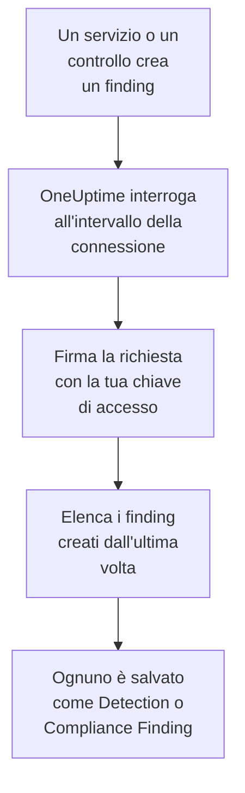

# AWS Security Hub

Importa i finding di [AWS Security Hub](https://aws.amazon.com/security-hub/) negli eventi di sicurezza di OneUptime: i finding di GuardDuty, Inspector, Macie e IAM Access Analyzer, i controlli propri di Security Hub e i finding dei prodotti dei partner. Lì li cerchi accanto a log, trace e metriche, li correli con ogni altra fonte e chiami la reperibilità per quelli che contano. OneUptime li legge con una chiave di accesso che crei tu, autorizzata a una sola azione di sola lettura, e non modifica nulla in AWS. Non c'è nessun agente, regola EventBridge o esportazione S3 da configurare.

:::cards
- [Configurare la connessione](#configurare-la-connessione): Una policy IAM, una chiave di accesso e il modulo della connessione.
- [Cosa viene importato](#cosa-viene-importato): Come ogni finding diventa un evento di sicurezza.
- [Come funziona il polling](#come-funziona-il-polling): La finestra che legge ogni interrogazione, e perché si sovrappone di 30 minuti alla precedente.
- [Risoluzione dei problemi](#risoluzione-dei-problemi): Cosa significa ogni errore e cosa cambiare.
:::

## Come funziona



Ogni minuto, OneUptime interroga ogni connessione abilitata il cui intervallo di polling è trascorso. Un'interrogazione chiama `GetFindings` di Security Hub nella tua regione, firmando la richiesta con [Signature Version 4](https://docs.aws.amazon.com/IAM/latest/UserGuide/reference_sigv-create-signed-request.html), per i finding creati dall'ultima interrogazione. Salva ognuno come un evento [OCSF](https://schema.ocsf.io/): un controllo come un Compliance Finding (classe `2003`), e ogni altro finding come un Detection Finding (classe `2004`). Regole di rilevamento, monitor e dashboard lo trattano poi come un evento di sicurezza di qualsiasi altra fonte.

## Prima di iniziare

- In OneUptime, il ruolo Project Owner, Project Admin o Security Admin. I ruoli Security Member e Security Viewer vedono le connessioni e la cronologia delle loro esecuzioni, ma non possono modificarle.
- Un account AWS con Security Hub abilitato nella regione che colleghi. Security Hub è regionale: una connessione legge i finding che un account ha in una regione.
- Per leggere i finding di ogni account e di ogni regione tramite una sola connessione, l'account amministratore delegato di Security Hub, nella sua regione di origine, con l'[aggregazione tra regioni](https://docs.aws.amazon.com/securityhub/latest/userguide/finding-aggregation.html) attiva. **Security Hub → Settings → Regions** mostra la regione di origine.
- HTTPS in uscita dall'app e dai worker di OneUptime verso `securityhub.<region>.amazonaws.com`, o `securityhub.<region>.amazonaws.com.cn` in Cina, e un orologio corretto sui loro host: AWS rifiuta una richiesta firmata con più di 5 minuti di scarto.

## Configurare la connessione

La connessione firma le sue richieste con una chiave di accesso IAM. L'identità della chiave ha bisogno di una sola azione, `securityhub:GetFindings`, e di nient'altro: la connessione non modifica mai un finding.

:::steps
### Consentire la lettura dei finding

Nella [console IAM](https://console.aws.amazon.com/iam/), apri **Policies → Create policy**, scegli **JSON** e incolla questa policy. Dalle un nome, per esempio `OneUptimeSecurityHubRead`:

```json
{
  "Version": "2012-10-17",
  "Statement": [
    {
      "Effect": "Allow",
      "Action": "securityhub:GetFindings",
      "Resource": "*"
    }
  ]
}
```

`GetFindings` non si può limitare a una risorsa, quindi `Resource` resta `*`. Anche la policy gestita `AWSSecurityHubReadOnlyAccess` funziona, ma consente di più.

### Creare una chiave di accesso

1. Apri **Users → Create user**, dai un nome all'utente, per esempio `oneuptime-security-hub`, lascia disattivato l'accesso alla console e collega la policy. Per i finding di altri account, fallo nell'account amministratore delegato.
2. Apri l'utente, poi **Security credentials → Access keys → Create access key**, e scegli **Third-party service**.
3. Copia l'**ID chiave di accesso** e la **Chiave di accesso segreta**. AWS mostra il segreto una sola volta.

### Aggiungere la connessione in OneUptime

Apri **Prodotti → Security Events → Connections** (`/dashboard/{projectId}/security-events/connections`), fai clic su **Aggiungi connessione**, scegli **AWS Security Hub** e fai clic su **Avanti**. Compila le impostazioni della tabella qui sotto, fai clic su **Avanti** e incolla il segreto in **Chiave di accesso segreta**.

### Provarla prima di salvare

Fai clic su **Test these settings** sotto **Testa prima di salvare**. Il test firma una richiesta con i valori del modulo, senza salvare nulla, così una chiave sbagliata o un'autorizzazione mancante emerge prima che la connessione esista. Poi fai clic su **Avanti**, dai un **Nome** alla connessione e creala.
:::

| Impostazione | Cosa inserire |
| --- | --- |
| **Regione** | Il codice della regione, per esempio `us-east-1`, `eu-central-1` o `us-gov-west-1`: per i finding di altri account, la regione di origine dell'account amministratore. |
| **ID chiave di accesso** | L'ID della chiave: da 16 a 128 lettere o cifre, di solito 20, che iniziano con `AKIA`, o con `ASIA` per le credenziali temporanee. |
| **Chiave di accesso segreta** | Il segreto della chiave. È cifrato, mai restituito dall'API e mai più mostrato. Sostituiscilo con **Update credentials** sulla connessione. |
| **Session token** | Solo per le credenziali temporanee, che ne hanno bisogno: una chiave `ASIA` viene rifiutata senza, e una chiave `AKIA` viene rifiutata con. |

Le credenziali temporanee di `aws sts assume-role` o `aws sts get-session-token` scadono, al massimo dopo 12 ore per un ruolo assunto, e il polling si ferma finché non ne incolli di nuove con **Update credentials**. Una chiave di lunga durata con questa policy ristretta, ruotata secondo il tuo calendario, continua a interrogare senza interventi. Per passare dalle credenziali temporanee a una chiave di lunga durata, inserisci la nuova chiave in **Update credentials** e attiva **Remove the stored Session token**.

Il passaggio **Polling** ha anche una **Descrizione** facoltativa, il **Poll Interval (Minutes)**, un numero intero da `1` a `1440` che parte da `5`, e **Abilitato**, che parte attivo.

## Cosa viene importato

Ogni finding diventa un evento, con il fornitore `Amazon Web Services` e il prodotto `AWS Security Hub`. Un finding con un oggetto `Compliance`, un controllo rispetto a uno standard come AWS Foundational Security Best Practices o CIS, diventa un Compliance Finding (classe OCSF `2003`). Ogni altro finding diventa un Detection Finding (classe OCSF `2004`).

| Campo del finding | Colonna di OneUptime |
| --- | --- |
| `Id`, un ARN per i finding che crea AWS | UID dell'evento, che serve anche a scartare i duplicati |
| `CreatedAt`, altrimenti `UpdatedAt`, altrimenti `FirstObservedAt` | Ora dell'evento |
| `Title` | Nome della regola |
| `GeneratorId`, come il tipo di finding di GuardDuty o l'ID del controllo | ID della regola |
| `Title`, altrimenti `Description` | Messaggio |
| `Severity.Label`, altrimenti una fascia di `Severity.Normalized` | Gravità |
| `Workflow.Status`: `NEW`, `NOTIFIED`, `RESOLVED` o `SUPPRESSED`, altrimenti il vecchio `WorkflowState` | Stato |
| `Types` sotto `TTPs/`: `TTPs/Initial Access/...` diventa `TA0001` | Tattiche e tecniche MITRE ATT&CK |
| L'utente IAM di una risorsa chiave di accesso o utente, `Network.SourceIpV4` o `SourceIpV6`, `Process.Name` o `Process.Path` | Utente, IP e processo dell'attore |
| `Process.Name` e `Process.Path` | Nome e percorso del processo. Un finding non indica né la riga di comando né il processo padre. |
| L'ID istanza di una risorsa `AwsEc2Instance`, `Network.DestinationIpV4` o `DestinationIpV6`, `Network.DestinationPort`, il primo `Resources[].Id` | Host, IP, porta e risorsa della destinazione |
| Questi, ogni `Resources[].Id`, `AwsAccountId`, i domini della rete, i nomi dei malware e i valori di threat intelligence | Osservabili |
| L'intero finding, appiattito in chiavi puntate, come `Compliance.Status` e `Remediation.Recommendation.Url` | `attributes` |

Quando un finding non ha `Severity.Label`, decide `Severity.Normalized`: `0` è Informational, da `1` a `39` Low, da `40` a `69` Medium, da `70` a `89` High, e da `90` a `100` Critical. Un finding che Security Hub aggiorna più tardi, con un nuovo `Workflow.Status` o un controllo che ora passa, mantiene il suo `Id`, quindi non viene importato di nuovo: l'evento conserva il finding com'era al momento dell'importazione.

## Come funziona il polling

Ogni interrogazione elenca i finding creati nella sua finestra, dal più vecchio, 100 per pagina, e segue `NextToken` finché non ha letto l'intera finestra:

```text
POST https://securityhub.{region}.amazonaws.com/findings
    {"Filters": {"CreatedAt": [{"Start": "{window start}", "End": "{window end}"}]},
     "SortCriteria": [{"Field": "CreatedAt", "SortOrder": "asc"}],
     "MaxResults": 100}
```

- **L'ora di creazione è il cursore.** I finding vengono elencati per `CreatedAt`, mai per `FirstObservedAt`. GuardDuty crea un finding quando ha visto abbastanza attività, e un controllo quando Security Hub verifica la risorsa per la prima volta, ore o giorni dopo l'inizio dell'attività. Un cursore sull'ora di osservazione li salterebbe.
- **La prima interrogazione guarda indietro di 24 ore**, così una nuova connessione mostra subito i suoi finding recenti.
- **Ogni interrogazione successiva parte 30 minuti prima del cursore salvato.** `CreatedAt` è impostato dal servizio che ha trovato il problema, e il finding raggiunge Security Hub più tardi: GuardDuty invia i nuovi finding entro cinque minuti, e una consegna fallita tramite EventBridge viene ritentata per un massimo di 24 ore. La sovrapposizione legge questi finding all'interrogazione successiva. Uno che arriva più di 30 minuti dopo il suo `CreatedAt` può finire dietro il cursore: importa il suo intervallo di tempo per recuperarlo.
- **Un'interrogazione legge al massimo 24 ore oltre il cursore.** Una connessione il cui cursore è rimasto indietro recupera in una serie di finestre di 24 ore, e la sua **Health** indica **Catching up**.
- **I duplicati vengono scartati in base all'`Id` del finding** all'interno del progetto, così la sovrapposizione, una finestra ripetuta e un'importazione non salvano mai un finding due volte.

### Quando una finestra contiene più di quanto un'interrogazione possa leggere

Un'interrogazione invia al massimo 20 richieste da 100 finding: 2.000 finding. Quando una finestra ne contiene di più, l'esecuzione è **Partial**, con un avviso come questo:

```text
Stopped after 20 findings requests (the per-run request limit) before the window was fully read. The last finding read was created at 2026-09-14T08:12:44.000Z.
```

I finding vengono letti dal più vecchio, quindi OneUptime sposta il cursore all'ora di creazione dell'ultimo finding letto, e l'interrogazione successiva parte da lì, senza la sovrapposizione di 30 minuti, con la stessa lunghezza di finestra. Un account molto attivo recupera circa 2.000 finding per interrogazione, invece di rileggere gli stessi. La sovrapposizione torna quando il cursore è avanzato di 30 minuti oltre quel punto.

Quando un'esecuzione non riesce affatto a superare il cursore salvato, per esempio perché i soli 30 minuti di sovrapposizione contengono più di 2.000 finding, OneUptime accorcia invece la finestra:

1. **Restringere.** L'interrogazione successiva legge una finestra lunga la metà, dallo stesso punto di partenza, e continua a dimezzarla finché una finestra non viene letta per intero, fino a un minuto. L'avviso dell'esecuzione lo dice: `This window holds more records than one poll can read; the next poll reads a {n} minute window from the same starting point.`
2. **Tornare a crescere.** Dopo che una finestra è stata letta per intero, la successiva è di nuovo lunga il doppio, fino a 24 ore.
3. **Superare un singolo minuto.** Se anche un solo minuto contiene più di quanto un'interrogazione possa leggere, il polling lo supera, così i finding più recenti continuano ad arrivare, e la sovrapposizione delle interrogazioni successive non vi risale più. L'esecuzione resta **Partial**, e **Ultimo errore** riporta `More records were created in the one minute from {cursor} to {end} than one poll can read. Polling moved past this minute so newer records keep arriving; use Import this time range in Diagnostics on this minute to recover what one run can read.` Importa quel minuto con **Import this time range** per recuperare ciò che un'esecuzione può leggere.

Un'esecuzione che fallisce del tutto, con un errore di AWS, mantiene il cursore e la lunghezza della finestra, e l'interrogazione successiva rilegge la stessa finestra. L'unica eccezione è una richiesta scaduta: il cursore resta, ma la finestra successiva è lunga la metà, perché una finestra troppo pesante per ricevere risposta in tempo scadrebbe a ogni tentativo. Cambiare il **Poll Interval (Minutes)** non cambia nulla di tutto questo: decide quanto spesso parte un'interrogazione, non dove inizia la sua finestra.

### Eseguire, visualizzare in anteprima e importare su richiesta

Fai clic su **Diagnostics** su una connessione per vederne le esecuzioni recenti e lavorarci a mano. Chi può modificare la connessione può avviare queste azioni; chi può vederla può leggerne la cronologia.

- **Run now** avvia subito un'interrogazione, con il cursore abituale, anche quando la connessione non è **Abilitato**.
- **Preview findings** legge un intervallo di tempo fino a 7 giorni e non importa nulla.
- **Import this time range** importa un intervallo fino a 7 giorni, dopo la tua conferma, senza spostare il cursore. I finding già importati vengono saltati.
- **Copy diagnostics** su un'esecuzione copia il suo rapporto per il supporto. Non contiene mai credenziali.

## Testare la connessione

**Testa la connessione** sulla riga di una connessione, e **Test these settings** nel modulo, vengono eseguiti nel processo dell'API, non in un worker in background, così un test risponde anche quando il problema sono i worker. Esegue questi controlli, in ordine:

| Controllo | Cosa verifica |
| --- | --- |
| **Configurazione** | Ogni impostazione è presente e ben formata. Non viene contattato nulla quando questo fallisce. |
| **Authenticate with AWS** | AWS accetta una richiesta `GetFindings` firmata per un finding creato nelle ultime 24 ore. AWS verifica la firma prima della policy IAM, quindi un rifiuto della policy supera comunque questo controllo: la chiave è giusta. |
| **Read findings** | Security Hub risponde a quella richiesta: l'identità può chiamare `securityhub:GetFindings`, e Security Hub è abilitato nella regione. |
| **Findings available to import** | Quanti finding sono stati creati nelle ultime 24 ore e negli ultimi 7 giorni, una pagina da 100 ciascuno, quindi `100+` significa di più. Nessuno in 7 giorni è un avviso, non un errore. |
| **Background workers**, **Poll scheduler**, **Security event storage** | Il lato di OneUptime stesso: un processo prende i job della coda Worker, il job di polling gira ogni minuto e l'archivio degli eventi di sicurezza risponde. |
| **Scheduled polling** | Per una connessione salvata: il polling è attivo, nessuna esecuzione è bloccata in attesa di un worker e le interrogazioni girano in orario. |

Ogni richiesta di un test ha una scadenza di 20 secondi. Un test non importa mai nulla e non sposta mai il cursore, e ogni controllo fallito dice cosa cambiare.

## Risoluzione dei problemi

Il **Ultimo errore** della connessione conserva il messaggio di errore completo, con le credenziali oscurate, dietro un prefisso che nomina il passaggio fallito. Quando una connessione ha un errore, seleziona **Visualizza errore** nella sua colonna **Azioni** per leggerlo, e **Copia errore** nella finestra di dialogo per copiarlo. Ogni messaggio inizia con `AWS Security Hub findings request`; leggi ciò che segue.

:::details Last Error dice `failed (HTTP 401)` o `failed (HTTP 403)`
AWS ha rifiutato la richiesta. Il messaggio cita il codice di errore di AWS, o le parole stesse di AWS quando non ha inviato alcun codice:

- `AccessDeniedException`, o `is not authorized to perform`: la chiave è giusta, ma la sua identità non può chiamare `securityhub:GetFindings`. Collega la policy di [Configurare la connessione](#configurare-la-connessione). Anche un permissions boundary o una service control policy può negarlo.
- `InvalidAccessException`, o `is not subscribed to AWS Security Hub`: Security Hub non è abilitato per questo account in questa **Regione**, oppure lì l'account non è il suo amministratore.
- `InvalidSignatureException` o `SignatureDoesNotMatch`, o `The request signature we calculated does not match`: la **Chiave di accesso segreta** non appartiene all'**ID chiave di accesso**. Crea una nuova chiave di accesso e salvala con **Update credentials**.
- `UnrecognizedClientException` o `InvalidClientTokenId`, o `The security token included in the request is invalid`: AWS non conosce l'**ID chiave di accesso**. È scritto male, eliminato, disattivato o di un'altra partizione, oppure è una chiave temporanea senza il suo **Session token**.
- `ExpiredTokenException`, o `The security token included in the request is expired`: le credenziali temporanee sono scadute. Emettine di nuove, o passa a una chiave di lunga durata.
- `RequestTimeTooSkewed` o `RequestExpired`, o `Signature expired`: l'orologio degli host di OneUptime ha più di 5 minuti di scarto. Correggi NTP sugli host dell'app e dei worker.
- Nessun codice: AWS non ha detto se l'ha rifiutata la chiave o la policy. Controlla prima la chiave, poi la policy.
:::

:::details Last Error dice `failed (HTTP ...)` con un altro stato
- `HTTP 404`: nessun endpoint di Security Hub ha risposto in questa **Regione**. Confrontala con il menu delle regioni della console AWS: `us-east-1`, non `us-east1` né `N. Virginia`.
- `HTTP 429`: l'account ha raggiunto il limite di Security Hub, 3 richieste `GetFindings` al secondo in una regione. L'interrogazione successiva riprova. Se continua a succedere, cerca un altro strumento o un'altra connessione che legge lo stesso account e la stessa regione.
- `HTTP 5xx`: Security Hub ha avuto un problema dalla sua parte. L'interrogazione successiva riprova.
- `HTTP 400`: Security Hub ha rifiutato la query, che costruisce OneUptime, non le tue impostazioni. Invia il messaggio al supporto di OneUptime.
:::

:::details Last Error dice `returned`, `timed out` o `Could not reach data source`
- `returned a non-JSON body` o `returned an unrecognized response shape`: ha risposto qualcosa di diverso da Security Hub, per esempio la pagina di accesso di un proxy o un gateway che riscrive le risposte. Viene segnalato invece di essere preso per una finestra vuota, così il cursore non supera mai finding che nessuno ha letto.
- `timed out after 60 seconds with no response`, o `failed: Could not reach data source`: la richiesta non ha ricevuto risposta. Gli endpoint di Security Hub sono pubblici, quindi controlla DNS, firewall e proxy tra l'app e i worker di OneUptime e `securityhub.<region>.amazonaws.com`.
:::

:::details Last Polled è Never e Last Error è vuoto
Nessuna interrogazione è terminata per questa connessione. Esegui **Testa la connessione**: i suoi controlli **Background workers** e **Poll scheduler** nominano la causa. Su un'installazione self-hosted, la causa abituale è `DISABLE_QUEUE_WORKERS=true` sull'app, senza un deployment separato dei worker che prenda i job: impostalo su `false`, oppure esegui il deployment dei worker (Helm: `worker.enabled: true`).
:::

:::details Un'esecuzione è Partial
- `Stopped after 20 findings requests`: la finestra conteneva più dei 2.000 finding che legge un'esecuzione. Non si perde nulla: l'interrogazione successiva parte dopo l'ultimo finding letto. Una connessione che resta **Partial** un'interrogazione dopo l'altra sta recuperando un arretrato, e i suoi **Last Polled** e **Last Event Imported** continuano ad avanzare. Se non recupera mai, l'account crea più di 2.000 finding per intervallo di polling: accorcia il **Poll Interval (Minutes)**.
- `More records were created in the one minute from ... than one poll can read`: il polling ha superato quel minuto. Importalo con **Import this time range** in **Diagnostics**. Un'importazione legge quanto un'interrogazione.
:::

:::details Il test riesce, ma non viene importato nulla
Leggi **Findings available to import** nel rapporto del test. `0` negli ultimi 7 giorni significa che Security Hub non ha creato alcun finding in questo account e in questa regione: verifica che lì sia attivo GuardDuty, Inspector o uno standard di sicurezza. Per vedere i finding di altri account e regioni, collega l'account amministratore nella sua regione di origine.
:::

:::details Un finding della console di Security Hub non è mai arrivato
Confronta il suo `CreatedAt` con il suo `ProcessedAt`, quando Security Hub l'ha ricevuto. Un finding arrivato più di 30 minuti dopo il suo `CreatedAt` può finire dietro il cursore: importa il suo `CreatedAt` con **Import this time range**.
:::

## Cosa ottieni

- **Ricerca.** Filtra i finding per gravità, stato, regola, account, risorsa o qualsiasi osservabile nell'esploratore degli eventi di sicurezza, accanto a ogni altra fonte.
- **Correlazione.** Gli utenti, le istanze, gli IP, gli ARN delle risorse e gli ID degli account di ogni finding vengono indicizzati come osservabili, quindi una ricerca trova tutto ciò che li menziona.
- **Regole di rilevamento.** Regole Sigma che girano secondo una pianificazione sui tuoi eventi di sicurezza, e aprono avvisi che chiamano la reperibilità.
- **Monitor.** I monitor degli eventi di sicurezza contano gli eventi corrispondenti, per esempio i nuovi finding critici di GuardDuty o i controlli falliti, e aprono incidenti o avvisi oltre una soglia.

Gli eventi di sicurezza sono fatturati come il resto della tua telemetria, per GB acquisito. Vedi i [prezzi](https://oneuptime.com/pricing).

## Prossimi passi

:::cards
- [Eventi di sicurezza](/docs/telemetry/security-events): Cerca, correla e genera avvisi su ciò che importi.
- [Okta System Log](/docs/integrations/okta): Importa anche gli accessi del tuo identity provider.
- [Ruoli](/docs/permissions/reference#ruoli): Cosa possono vedere e modificare i ruoli Security.
- [Panoramica delle integrazioni](/docs/integrations/index): Gli altri strumenti che puoi collegare.
:::
