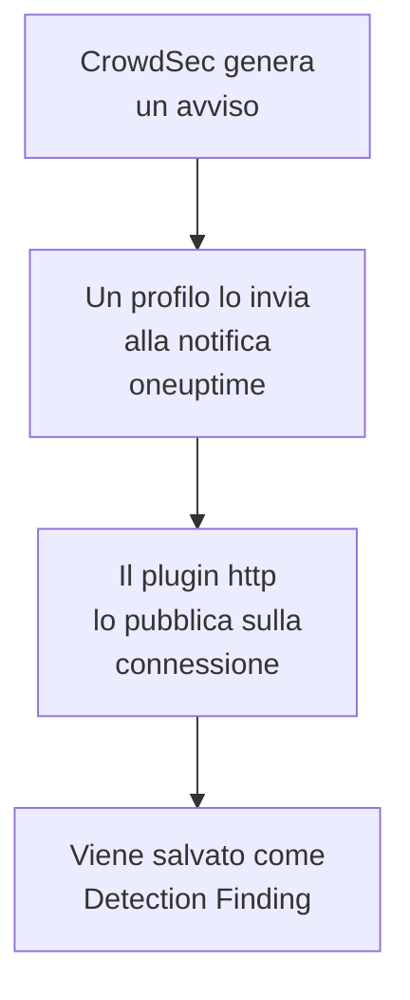

# CrowdSec

Ricevi gli avvisi di [CrowdSec](https://www.crowdsec.net/) negli eventi di sicurezza di OneUptime man mano che CrowdSec li genera, e blocca con CrowdSec gli indirizzi nella blocklist del tuo progetto. Il plugin di notifica di CrowdSec stesso invia ogni avviso a una connessione CrowdSec, che apre casi dai rilevamenti di CrowdSec. Una volta attivato il blocco, OneUptime banna ogni indirizzo che blocchi tramite la Local API di CrowdSec, e ogni bouncer che la legge blocca l'indirizzo.

:::cards
- [Configurare la connessione](#configurare-la-connessione): Una connessione, e la notifica che le invia gli avvisi di CrowdSec.
- [Cosa viene ricevuto](#cosa-viene-ricevuto): Come ogni avviso di CrowdSec diventa un evento di sicurezza.
- [Bloccare indirizzi con CrowdSec](#bloccare-indirizzi-con-crowdsec): Banna in CrowdSec gli indirizzi della tua blocklist.
- [Leggere le blocklist di CrowdSec](#leggere-le-blocklist-di-crowdsec): Le liste che la CrowdSec Console fornisce, come feed di threat intel.
- [Risoluzione dei problemi](#risoluzione-dei-problemi): Cosa significa ogni errore e cosa cambiare.
:::

## Come funziona



La Local API di CrowdSec consegna ogni avviso che un profilo invia a una notifica al plugin di quella notifica. La notifica della connessione usa il plugin `http` di CrowdSec: pubblica l'avviso, nel JSON di CrowdSec stesso, sull'ingestione degli eventi di sicurezza con la tua chiave di acquisizione, nominando la connessione. OneUptime lo salva come un evento [OCSF](https://schema.ocsf.io/) Detection Finding (classe `2004`), lo confronta con le tue regole di rilevamento e apre un caso da ciascuno dei rilevamenti di CrowdSec stesso che raggiunge il livello di **Apri casi da** della connessione. Nulla viene interrogato: un avviso arriva pochi secondi dopo che CrowdSec lo ha generato.

## Prima di iniziare

- In OneUptime, il ruolo Proprietario del progetto, Amministratore del progetto o Amministratore della sicurezza. I ruoli Membro della sicurezza e Visualizzatore della sicurezza vedono le connessioni, ma non possono modificarle.
- CrowdSec 1.5 o successivo, con la sua Local API e il plugin di notifica `http` che include. Questa pagina è scritta su CrowdSec v1.8.2.
- HTTPS in uscita dall'host che esegue la Local API di CrowdSec verso il tuo OneUptime.
- Per bloccare anche gli indirizzi: una Local API che OneUptime possa raggiungere, e una macchina per OneUptime (vedi [Bloccare indirizzi con CrowdSec](#bloccare-indirizzi-con-crowdsec)).

## Configurare la connessione

:::steps
### Aggiungere la connessione in OneUptime

Apri **Prodotti → Eventi di sicurezza → Connessioni** (`/dashboard/{projectId}/security-events/connections`), fai clic su **Aggiungi connessione**, scegli **CrowdSec** e fai clic su **Avanti**. Per ricevere solo gli avvisi, lascia vuote tutte le impostazioni della tabella qui sotto; per bloccare anche gli indirizzi, compilale.

### Provarla prima di salvare

Fai clic su **Prova queste impostazioni** in **Testa prima di salvare**. Senza una Local API impostata, il test lo dice e non contatta nulla; con una, raggiunge la Local API e accede come la macchina, e non salva nulla. Poi fai clic su **Avanti**, dai alla connessione un **Nome** nel passaggio **Avvisi**, scegli il valore di **Apri casi da** e creala.

### Salvare la notifica sull'host di CrowdSec

Creare la connessione apre il suo **Invia avvisi**, che riapri poi dalla riga della connessione. In **Scegli una chiave di acquisizione** scegli una chiave, poi salva la notifica che mostra, con la tua chiave e la tua connessione già inserite, sull'host che esegue la Local API di CrowdSec:

```yaml title="/etc/crowdsec/notifications/oneuptime.yaml"
type: http
name: oneuptime

# info or quieter: at debug, CrowdSec logs each request's headers.
log_level: info

format: |
  {{.|toJson}}

url: https://oneuptime.com/security-events/v1/ingest?connection=YOUR_CONNECTION_ID&format=crowdsec
method: POST
headers:
  Content-Type: application/json
  x-oneuptime-token: YOUR_INGESTION_TOKEN
```

### Inviarle gli avvisi dei tuoi profili

In `/etc/crowdsec/profiles.yaml`, aggiungi `oneuptime` alle `notifications` di ogni profilo i cui avvisi OneUptime deve ricevere, poi ricarica CrowdSec:

```yaml title="/etc/crowdsec/profiles.yaml"
notifications:
  - oneuptime
```

```bash
sudo systemctl reload crowdsec
```

### Inviare un avviso di test

```bash
sudo cscli notifications test oneuptime
```

**Invia avvisi** dice quando arriva, e **Visualizza avvisi** lo apre negli eventi di sicurezza. È un evento di gravità Informational, e non apre alcun caso.
:::

| Impostazione | Cosa inserire |
| --- | --- |
| **URL della Local API** | Solo per bloccare gli indirizzi: dove OneUptime raggiunge la Local API di CrowdSec, ad esempio `https://crowdsec.example.com:8080`. Usa `https` ovunque la connessione attraversi una rete. |
| **ID macchina** | Solo per bloccare gli indirizzi: la macchina con cui OneUptime accede, aggiunta sull'host di CrowdSec con `sudo cscli machines add oneuptime --auto -f -`. |
| **Blocca indirizzi con CrowdSec** | Disattivato su una nuova connessione. Attivato, banna in CrowdSec gli indirizzi e gli intervalli della tua blocklist, e richiede le altre tre impostazioni (vedi [Bloccare indirizzi con CrowdSec](#bloccare-indirizzi-con-crowdsec)). |
| **Password della macchina** | Solo per bloccare gli indirizzi: la password che `cscli` ha mostrato per la macchina. È cifrata, mai restituita dall'API e mai più mostrata. Sostituiscila con **Aggiorna le credenziali** sulla connessione. |

Il passaggio **Avvisi** ha anche una **Descrizione** facoltativa, e **Abilitato**, che parte attivo. Una connessione non abilitata conserva come eventi gli avvisi che riceve, e non apre alcun caso da essi.

In un container, la notifica va nella cartella montata su `/etc/crowdsec/notifications/`, e un riavvio del container la legge. Un'installazione Kubernetes la dichiara nei suoi valori Helm sotto `config.notifications`, con `profiles.yaml` accanto sotto `config`.

## Cosa viene ricevuto

Ogni avviso che CrowdSec invia diventa un evento Detection Finding (classe OCSF `2004`), con fornitore e prodotto `CrowdSec`:

| Campo di CrowdSec | Colonna di OneUptime |
| --- | --- |
| `uuid`, o un hash per un avviso che non lo ha | UID dell'evento, che serve anche a scartare i duplicati |
| `stop_at`, o `start_at` | Ora dell'evento |
| `scenario` | ID della regola, e il nome della regola: il titolo dello scenario sul CrowdSec Hub, o il suo nome |
| `source.ip`, o `source.value` di un avviso `Ip` | IP principale |
| `target_fqdn` o `target_host` dell'avviso o dei suoi eventi, altrimenti la `machine` che nominano i suoi eventi | Host di destinazione |
| `target_user`, `target_uri` | Utente e risorsa di destinazione |
| Il `type` della prima decisione | Stato: `Blocked` per un ban, `Challenge` per un captcha, `Logged` senza decisione o in modalità simulazione |
| Il comportamento dello scenario | Gravità, e le sue tattiche e tecniche MITRE ATT&CK |
| Tutto il resto, come `source.cn`, `source.as_name` e `events_count` | `attributes`: i campi dell'avviso appiattiti in chiavi puntate, i suoi primi 10 eventi per intero, e la lettura di OneUptime sotto `crowdsec.` |

Un avviso di CrowdSec non ha una gravità propria, quindi OneUptime la ricava da ciò che lo scenario rileva, come lo etichetta il CrowdSec Hub (`ssh:bruteforce`, `http:exploit`):

| Comportamento | Gravità |
| --- | --- |
| Un exploit, come una CVE o ciò che il componente AppSec ha bloccato, o ciò che fa un attaccante una volta dentro | High |
| Forza bruta, denial of service, frode, un accesso impossibile, o un comportamento che OneUptime non sa collocare | Medium |
| Scansioni, sondaggi, crawl, bot, spam e modifiche negli audit del cloud | Low |
| Gli scenari di test di CrowdSec stesso | Informational |

Con **Apri casi da** su **Alta e superiori**, gli exploit di CrowdSec aprono casi, e i suoi ban quotidiani di scanner e di chi tenta di indovinare le password restano eventi per le tue regole di rilevamento. Solo i rilevamenti di CrowdSec stesso aprono casi. Una decisione che qualcuno ha aggiunto con `cscli` o nella Console di CrowdSec, un indirizzo su una blocklist di CrowdSec, l'avviso di test e i ban di OneUptime stesso che ritornano sono Informational, e non ne aprono nessuno. Un avviso inviato due volte, come fa `cscli notifications reinject`, viene salvato una volta sola.

## Bloccare indirizzi con CrowdSec

Attiva **Blocca indirizzi con CrowdSec** su una connessione, e gli indirizzi e gli intervalli nella [blocklist](/docs/telemetry/security-cases#blocklist) del tuo progetto vengono bannati in CrowdSec. Ogni bouncer che legge la sua Local API, come i suoi bouncer per firewall, nginx e Traefik, li blocca dove gira, come blocca i ban di CrowdSec stesso. I blocchi passano per le stesse approvazioni, gli stessi limiti della risposta automatica e la stessa **Revoca** di ogni altro punto in cui si applica la tua blocklist.

L'interruttore è disattivato su una nuova connessione. Per attivarlo:

1. Sull'host di CrowdSec, aggiungi una macchina per OneUptime; il comando ne mostra la password:

   ```bash
   sudo cscli machines add oneuptime --auto -f -
   ```

2. Lascia che OneUptime raggiunga la Local API, che ascolta su `127.0.0.1:8080` salvo diversa indicazione: imposta `api.server.listen_uri` nel `config.yaml` di CrowdSec, servila tramite TLS o dietro un proxy `https`, e lascia passare gli indirizzi di OneUptime nel tuo firewall.
3. Modifica la connessione, compila **URL della Local API** e **ID macchina**, inserisci la password in **Password della macchina**, attiva **Blocca indirizzi con CrowdSec** e salva. **Testa la connessione** verifica poi che la macchina acceda e legga i ban di OneUptime, senza cambiare nulla.

Come nasce un ban, e come finisce:

- Ogni blocco è una decisione di ban, creata come la crea `cscli decisions add`, con lo scenario `oneuptime/blocklist`. CrowdSec la conserva come decisione manuale, quindi non viene mai condivisa con la Central API di CrowdSec, a meno che tu non condivida le decisioni manuali. OneUptime legge e rimuove solo i propri ban, mai uno creato da una persona o da CrowdSec.
- Un blocco con una scadenza è un ban fino esattamente a quella scadenza, e CrowdSec lo revoca allora da solo, che OneUptime possa raggiungerlo o no. Un blocco fino alla revoca è un ban di 7 giorni, rinnovato quando restano 3 giorni o meno, così un ban che OneUptime non mantiene più finisce entro una settimana.
- **Revoca** rimuove il ban al passaggio successivo, entro un minuto. Un ban rimosso in CrowdSec, con `cscli decisions delete` o un flush, viene ricreato al passaggio successivo finché il blocco dura.
- Un indirizzo o un intervallo su una delle allowlist di CrowdSec non viene mai bannato: il blocco lo mostra lì come non applicato, nominando l'allowlist, e un ban già creato viene rimosso appena un'allowlist contiene l'indirizzo.
- Gli indirizzi del tuo progetto, come i tuoi **Proxy attendibili**, i bilanciatori di carico e le reti perimetrali, non vengono mai bloccati da nessuna parte, CrowdSec compreso.
- CrowdSec banna e basta: lì una verifica non viene applicata, e un dominio, un URL o un file non gli vengono inviati.

Quando la Local API non è raggiungibile, in CrowdSec non cambia nulla: i ban che detiene restano, e finiscono quando finiscono. **Applicato su** nella **Blocklist** dice quando CrowdSec ha detenuto ogni blocco l'ultima volta, e OneUptime riprova dopo 1 minuto, poi aspetta ogni volta il doppio, fino a 30 minuti. Un nuovo blocco aspetta di poter essere creato.

## Leggere le blocklist di CrowdSec

La CrowdSec Console fornisce le blocklist a cui la tua organizzazione è abbonata come integrazione Raw IP List: un indirizzo per riga, dietro nome utente e password. Un [feed di threat intel](/docs/telemetry/threat-intelligence) le legge, e confronta i tuoi eventi con esse:

1. Nella CrowdSec Console, crea un'integrazione Raw IP List, con l'aggregazione IP disattivata: OneUptime confronta indirizzi, non intervalli. Copia il suo endpoint, il nome utente e la password.
2. In OneUptime, apri **Prodotti → Eventi di sicurezza → Rilevamenti → Threat Intel**, fai clic su **Crea: Feed di threat intel** e scegli **Elenco di indicatori**.
3. Incolla l'endpoint come **URL dell'elenco**, scegli **Nome utente e password** in **Accesso** e incolla entrambi. Con il piano Community di CrowdSec, che consente un download al giorno, imposta **Intervallo di interrogazione (minuti)** su `1440`.

Le liste sono di CrowdSec: puoi usarle nei tuoi strumenti, ma non ridistribuirle. OneUptime non offre alcuna lista propria.

## Testare la connessione

**Testa la connessione** sulla riga di una connessione, e **Prova queste impostazioni** nel modulo, vengono eseguiti nel processo dell'API, non in un worker in background. Eseguono questi controlli, in ordine:

| Controllo | Cosa verifica |
| --- | --- |
| **Configurazione** | Le impostazioni sono tutte vuote o tutte compilate, e ben formate. Non viene contattato nulla quando questo fallisce. |
| **Reach CrowdSec's Local API** | `GET /health` risponde. Senza una Local API impostata, il controllo dice che la connessione riceve solo avvisi, e i tre successivi non vengono eseguiti. |
| **Sign in to the Local API** | `POST /v1/watchers/login` accetta la macchina e la sua password. |
| **Read CrowdSec's allowlists** | `GET /v1/allowlists` risponde, e quanti indirizzi e intervalli contengono. Una Local API precedente alla 1.6.8, che non ne ha, supera il controllo. |
| **Block with CrowdSec** | Solo con **Blocca indirizzi con CrowdSec** attivo: la macchina può rileggere i ban di OneUptime, e quanti sono in vigore. Il controllo non cambia nulla. |
| **Background workers**, **Security event storage** | Il lato di OneUptime stesso: un processo prende i job della coda Worker, che salvano ciò che CrowdSec invia, e l'archivio degli eventi di sicurezza risponde. |
| **Alerts received** | Per una connessione salvata: quando è arrivato l'ultimo avviso. Nessuno finora è un avvertimento, con le istruzioni per inviare un avviso di test. |

Un test non banna né rimuove mai nulla. **Copia il rapporto** copia l'elenco dei controlli come JSON, senza la password né i token.

## Risoluzione dei problemi

L'**Integrità** della connessione mostra **In attesa di avvisi** finché non arriva il primo avviso, poi **Riceve avvisi**, per quanto tempo impieghi il successivo; **Casi in pausa** significa che la connessione non è abilitata. CrowdSec scrive ciò che il plugin ha risposto nel proprio log, `/var/log/crowdsec.log`, come `HTTP server returned non 200 status code`.

:::details Non arriva nessun avviso
- Esegui `sudo cscli notifications list`: `oneuptime` deve essere elencata, e attiva in un profilo. Una notifica che nessun profilo nomina non invia nulla.
- `401`: la chiave di acquisizione in `x-oneuptime-token` manca, è sbagliata o è scaduta, e `422`: è disattivata. Scegli una chiave in **Invia avvisi**, e copia di nuovo la notifica.
- `400`: l'indirizzo non nomina alcuna connessione CrowdSec di questo progetto. Copia l'indirizzo da **Invia avvisi** della connessione: termina con l'ID della connessione.
- Niente di niente nel log: l'host di CrowdSec non riesce a raggiungere il tuo OneUptime. Controlla il suo HTTPS in uscita, e il suo proxy.
:::

:::details Testa la connessione fallisce su Reach CrowdSec's Local API
`CrowdSec Local API health check could not be completed` significa che non ha risposto nulla: la Local API ascolta su `127.0.0.1` per impostazione predefinita, quindi OneUptime non può raggiungerla finché `api.server.listen_uri` e il tuo firewall non lo consentono. Un avvertimento secondo cui risponde tramite `http` significa che la password della macchina attraversa la rete in chiaro: servi la Local API tramite TLS, o mettile davanti un proxy `https`.
:::

:::details Testa la connessione fallisce su Sign in to the Local API
`CrowdSec Local API login failed (HTTP 401)` termina con cosa fare: controlla l'ID macchina e la password con `sudo cscli machines list`, convalida una macchina non ancora convalidata con `sudo cscli machines validate oneuptime`, o aggiungi una macchina che accede con una password. Salva una nuova password con **Aggiorna le credenziali**.
:::

:::details Un blocco non è applicato in CrowdSec
Passa il mouse sul suo **Applicato su**: nomina un'allowlist che contiene l'indirizzo, una verifica che CrowdSec non applica, o l'errore della Local API. Finché la Local API non è raggiungibile, OneUptime continua a riprovare, e i ban che CrowdSec detiene già restano in vigore.
:::

:::details CrowdSec invia i suoi avvisi, ma nessuno viene salvato
Ciò che CrowdSec invia viene salvato dai worker in background: su un'installazione self-hosted con `DISABLE_QUEUE_WORKERS=true` sull'app e senza un deployment separato dei worker, gli avvisi vengono accolti e mai salvati. **Testa la connessione** lo mostra come un controllo **Background workers** fallito. Impostalo su `false`, oppure esegui il deployment dei worker (Helm: `worker.enabled: true`).
:::

## Prossimi passi

:::cards
- [Eventi di sicurezza](/docs/telemetry/security-events): Cerca, correla e genera avvisi su ciò che CrowdSec invia.
- [Casi di sicurezza](/docs/telemetry/security-cases): Gestisci i casi che aprono i rilevamenti di CrowdSec, e blocca a partire da essi.
- [Intelligence sulle minacce](/docs/telemetry/threat-intelligence): Confronta i tuoi eventi con le blocklist di CrowdSec.
- [Panoramica delle integrazioni](/docs/integrations/index): Gli altri strumenti che puoi collegare.
:::
