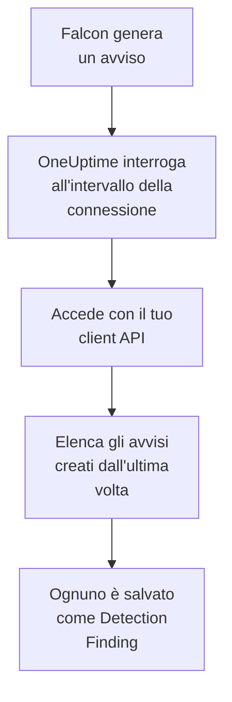

# CrowdStrike Falcon

Importa gli avvisi di [CrowdStrike Falcon](https://www.crowdstrike.com/platform/), dai rilevamenti su endpoint, identità e cloud, negli eventi di sicurezza di OneUptime. Lì li cerchi accanto a log, trace e metriche, li correli con ogni altra fonte e chiami la reperibilità per quelli che contano. OneUptime li legge tramite la Alerts API di Falcon con un client API che crei tu, e non scrive mai in Falcon.

:::cards
- [Configurare la connessione](#configurare-la-connessione): Un client API con un solo ambito e il modulo della connessione.
- [Cosa viene importato](#cosa-viene-importato): Come ogni avviso di Falcon diventa un evento di sicurezza.
- [Come funziona il polling](#come-funziona-il-polling): La finestra che legge ogni interrogazione, e cosa le fa un CID molto attivo.
- [Risoluzione dei problemi](#risoluzione-dei-problemi): Cosa significa ogni errore e cosa cambiare.
:::

## Come funziona



Ogni minuto, OneUptime interroga ogni connessione abilitata il cui intervallo di polling è trascorso. Un'interrogazione accede al tuo cloud Falcon con l'ID e il segreto del client API, chiede alla Alerts API gli avvisi creati dall'ultima interrogazione e salva ognuno come un evento [OCSF](https://schema.ocsf.io/) Detection Finding (classe `2004`). Regole di rilevamento, monitor e dashboard lo trattano poi come un evento di sicurezza di qualsiasi altra fonte.

## Prima di iniziare

- In OneUptime, il ruolo Project Owner, Project Admin o Security Admin. I ruoli Security Member e Security Viewer vedono le connessioni e la cronologia delle loro esecuzioni, ma non possono modificarle.
- Un ID cliente Falcon (CID) e un utente della console Falcon che può gestire i client API: il ruolo Falcon Administrator, o un ruolo personalizzato con l'autorizzazione API clients and keys.
- HTTPS in uscita dall'app e dai worker di OneUptime verso l'host API del tuo cloud Falcon, elencato in **Falcon cloud** più sotto.

## Configurare la connessione

:::steps
### Creare un client API

1. Nella console Falcon, apri **Support and resources → API clients and keys** e seleziona **Create API client**.
2. Dagli un nome, per esempio `OneUptime security events`. In **API scopes**, attiva **Alerts → Read** e lascia disattivato ogni altro ambito: la connessione non scrive mai in Falcon.
3. Crea il client. Falcon mostra una sola volta il suo ID client, il suo segreto e il suo URL di base. Copiali tutti e tre adesso: il segreto si può reimpostare in seguito, ma non viene più mostrato.

### Trovare il tuo cloud Falcon

L'URL di base mostrato da Falcon ti dice in quale cloud si trova il tuo CID. Anche la pagina **API clients and keys** lo mostra, accanto a ogni client. Un client di un cloud viene rifiutato dagli altri.

| URL di base mostrato da Falcon | Cloud Falcon |
| --- | --- |
| `https://api.crowdstrike.com` | US-1 |
| `https://api.us-2.crowdstrike.com` | US-2 |
| `https://api.eu-1.crowdstrike.com` | EU-1 |
| `https://api.laggar.gcw.crowdstrike.com` | US-GOV-1 |

### Aggiungere la connessione in OneUptime

Apri **Prodotti → Security Events → Connections** (`/dashboard/{projectId}/security-events/connections`), fai clic su **Aggiungi connessione**, scegli **CrowdStrike Falcon** e fai clic su **Avanti**. Compila le impostazioni della tabella qui sotto, fai clic su **Avanti** e incolla il segreto in **Client secret**.

### Provarla prima di salvare

Fai clic su **Test these settings** in **Testa prima di salvare**. Il test accede e legge gli avvisi con i valori del modulo, e non salva nulla, quindi un cloud sbagliato o un ambito mancante emergono prima che la connessione esista. Poi fai clic su **Avanti**, dai alla connessione un **Nome** e creala.
:::

| Impostazione | Cosa inserire |
| --- | --- |
| **Client ID** | L'ID del client API, come lo ha mostrato Falcon quando hai creato il client. |
| **Falcon cloud** | Il cloud del tuo CID: **US-1 (api.crowdstrike.com)**, **US-2 (api.us-2.crowdstrike.com)**, **EU-1 (api.eu-1.crowdstrike.com)** o **US-GOV-1 (api.laggar.gcw.crowdstrike.com)**. Ogni richiesta va all'host API di quel cloud. |
| **Client secret** | Il segreto del client API. È cifrato, mai restituito dall'API e mai più mostrato. Sostituiscilo con **Update credentials** sulla connessione. |

Il passaggio **Polling** ha anche una **Descrizione** facoltativa, il **Poll Interval (Minutes)**, un numero intero da `1` a `1440` che parte da `5`, e **Abilitato**, che parte attivo. Una connessione non abilitata si può comunque testare e interrogare a mano.

## Cosa viene importato

La connessione legge gli avvisi di Falcon: ciò che la console Falcon elenca in **Endpoint security → Endpoint detections** e **Next-Gen SIEM → Alerts**, da ogni prodotto che li genera. Ogni avviso diventa un evento Detection Finding (classe OCSF `2004`), con il fornitore `CrowdStrike` e il prodotto `Falcon`:

| Campo di Falcon | Colonna di OneUptime |
| --- | --- |
| `composite_id` | UID dell'evento, che serve anche a scartare i duplicati |
| `created_timestamp` | Ora dell'evento |
| `display_name`, o `name` | Nome della regola |
| `pattern_id` | ID della regola |
| `description`, o il nome della regola | Messaggio |
| `severity_name`, o `severity` da 0 a 100 | Gravità |
| `status`, come `new`, `in_progress` o `closed` | Stato |
| `tactic_id`, `technique_id` | Tattiche e tecniche MITRE ATT&CK |
| `device.hostname`, `device.local_ip`, `user_name`, `filename` o `cmdline` | Host, IP, utente e processo principali |
| `filename`, `filepath` e `cmdline`; `parent_details.filename`, `parent_details.filepath` e `parent_details.cmdline` | Nome, percorso e riga di comando del processo; nome, percorso e riga di comando del processo padre |
| `device.hostname`, `device.local_ip`, `device.external_ip`, `user_name`, `sha256` | Osservabili |
| Tutto il resto, come `device.platform_name`, `falcon_host_link`, `product` e `timestamp` | `attributes`, appiattito in chiavi puntate |

L'ora dell'evento è, di proposito, quella in cui Falcon ha creato l'avviso: l'ora del comportamento che c'è dietro, `timestamp`, resta in `attributes.timestamp`.

## Come funziona il polling

- **L'ora di creazione è il cursore.** Gli avvisi vengono elencati per `created_timestamp`, mai per l'ora del comportamento che c'è dietro. Falcon può generare un avviso molto dopo l'attività che descrive, e un cursore sull'ora di attività salterebbe ognuno di questi avvisi.
- **La prima interrogazione guarda indietro di 24 ore**, così una nuova connessione mostra subito i suoi avvisi recenti.
- **Ogni interrogazione successiva parte 1 minuto prima del cursore salvato**, così un avviso creato al confine tra due finestre non viene mai perso.
- **Un'interrogazione legge al massimo 24 ore oltre il cursore.** Una connessione il cui cursore è rimasto indietro recupera in una serie di finestre di 24 ore.
- **I duplicati vengono scartati in base a `composite_id`** all'interno del progetto, così la sovrapposizione e una finestra ripetuta non salvano mai un avviso due volte.
- **Ogni finestra costa** una richiesta di token, conservato per tutta la sua durata, poi una query di avvisi e un recupero di avvisi ogni 1.000 avvisi, ciascuno con il proprio timeout.

### Quando una finestra contiene più di quanto un'interrogazione possa leggere

Un'interrogazione invia al massimo 20 richieste. Con una richiesta di token e due richieste ogni 1.000 avvisi, legge al massimo 9.000 avvisi. Quando una finestra ne contiene di più, l'esecuzione è **Partial**, con un avviso come questo:

```text
Stopped after 19 requests before reading the whole window. Alerts are read oldest first; every alert created before 2026-09-14T08:12:44.995Z was read.
```

La query degli avvisi è ordinata per `created_timestamp`, dal più vecchio, quindi OneUptime sposta il cursore all'ora di creazione dell'ultimo avviso letto, e l'interrogazione successiva parte da lì con la stessa lunghezza di finestra, dall'offset `0`. Un CID molto attivo recupera circa 9.000 avvisi per interrogazione, invece di rileggere gli stessi. Gli avvisi creati in quello stesso istante vengono letti due volte, e il controllo dei duplicati scarta la seconda copia.

La query degli avvisi di Falcon non può paginare oltre 10.000 risultati (`limit` più `offset`). Il limite di richieste ferma un'esecuzione a 9.000 avvisi, prima di quel tetto. Se il tetto dovesse mai fermare una lettura, viene gestito allo stesso modo: l'esecuzione è **Partial**, il cursore passa all'ultimo avviso letto e la query successiva riparte dall'offset `0`.

Quando un'esecuzione non riesce affatto a superare il cursore salvato, per esempio perché più di 9.000 avvisi condividono il minuto di sovrapposizione, OneUptime accorcia invece la finestra:

1. **Restringere.** L'interrogazione successiva legge una finestra lunga la metà, dallo stesso punto di partenza, e continua a dimezzarla finché una finestra non viene letta per intero, fino a un minuto. L'avviso dell'esecuzione lo dice: `This window holds more records than one poll can read; the next poll reads a {n} minute window from the same starting point.`
2. **Tornare a crescere.** Dopo che una finestra è stata letta per intero, la successiva è di nuovo lunga il doppio, fino a 24 ore.
3. **Superare un singolo minuto.** Se anche un solo minuto contiene più di quanto un'interrogazione possa leggere, il polling lo supera, così gli avvisi più recenti continuano ad arrivare. L'esecuzione resta **Partial**, e **Ultimo errore** riporta `More records were created in the one minute from {cursor} to {end} than one poll can read. Polling moved past this minute so newer records keep arriving; use Import this time range in Diagnostics on this minute to recover what one run can read.` Importa quel minuto con **Import this time range** per recuperare ciò che un'esecuzione può leggere.

Un'esecuzione che fallisce del tutto, con un errore di Falcon, mantiene il cursore e la lunghezza della finestra, e l'interrogazione successiva rilegge la stessa finestra. L'unica eccezione è una richiesta scaduta: il cursore resta, ma la finestra successiva è lunga la metà, perché una finestra troppo pesante per ricevere risposta in tempo scadrebbe a ogni tentativo. Cambiare il **Poll Interval (Minutes)** non cambia nulla di tutto questo: decide quanto spesso parte un'interrogazione, non dove inizia la sua finestra.

### Eseguire, visualizzare in anteprima e importare su richiesta

Fai clic su **Diagnostics** su una connessione per vederne le esecuzioni recenti e lavorarci a mano. Chi può modificare la connessione può avviare queste azioni; chi può vederla può leggerne la cronologia.

- **Run now** avvia subito un'interrogazione, con il cursore abituale, anche quando la connessione non è **Abilitato**.
- **Preview alerts** legge un intervallo di tempo fino a 7 giorni e non importa nulla.
- **Import this time range** importa un intervallo fino a 7 giorni, dopo la tua conferma, senza spostare il cursore. Gli avvisi già importati vengono saltati.
- **Copy diagnostics** su un'esecuzione copia il suo rapporto per il supporto. Non contiene mai credenziali.

## Testare la connessione

**Testa la connessione** sulla riga di una connessione, e **Test these settings** nel modulo, vengono eseguiti nel processo dell'API, non in un worker in background, così un test risponde anche quando il problema sono i worker. Esegue questi controlli, in ordine:

| Controllo | Cosa verifica |
| --- | --- |
| **Configurazione** | **Client ID**, **Falcon cloud** e **Client secret** sono presenti e ben formati. Non viene contattato nulla quando questo fallisce. |
| **Authenticate with CrowdStrike Falcon** | `POST /oauth2/token` con l'ID e il segreto del client API, sull'host del tuo cloud, restituisce un token. |
| **Read alerts from the Falcon Alerts API** | Una query di avvisi per un solo avviso (`limit=1`) sulle ultime 24 ore viene accettata, il che dimostra l'ambito **Alerts → Read**. |
| **Alerts available to import** | Quanti avvisi sono stati creati nelle ultime 24 ore e negli ultimi 7 giorni. Nessuno in 7 giorni è un avviso, non un errore: il polling importa i nuovi avvisi man mano che Falcon li crea. |
| **Background workers**, **Poll scheduler**, **Security event storage** | Il lato di OneUptime stesso: un processo prende i job della coda Worker, il job di polling gira ogni minuto e l'archivio degli eventi di sicurezza risponde. |
| **Scheduled polling** | Per una connessione salvata: il polling è attivo, nessuna esecuzione è bloccata in attesa di un worker e le interrogazioni girano in orario. |

Ogni richiesta di un test ha una scadenza di 20 secondi. Un test non importa mai nulla e non sposta mai il cursore, e ogni controllo fallito dice cosa cambiare. **Copy report** copia l'elenco dei controlli come JSON, senza credenziali né token.

## Risoluzione dei problemi

Il **Ultimo errore** della connessione, e ogni controllo fallito, conservano il messaggio di errore completo, con le credenziali oscurate, dietro un prefisso che nomina il passaggio fallito. Quando una connessione ha un errore, seleziona **Visualizza errore** nella sua colonna **Azioni** per leggerlo, e **Copia errore** nella finestra di dialogo per copiarlo. Leggi prima il prefisso.

:::details Last Error inizia con `CrowdStrike Falcon token request`
- `CrowdStrike Falcon token request failed (HTTP 401)` o `(HTTP 403)`: Falcon ha rifiutato l'ID e il segreto del client API, prima che la Alerts API venisse contattata. Verifica che **Falcon cloud** sia il cloud del tuo CID, perché un client di un altro cloud viene rifiutato qui, che **Client ID** sia quello del client e che **Client secret** sia il segreto rilasciato con esso. Se il segreto è andato perso, reimpostalo nella console Falcon e salvalo con **Update credentials**.
- `CrowdStrike Falcon token request returned ...`: Falcon ha risposto con qualcosa di inutilizzabile, un corpo che non è JSON o senza `access_token`. Di solito è un proxy o un gateway nel mezzo, non le credenziali.
:::

:::details Last Error inizia con `CrowdStrike Falcon alerts`
- `CrowdStrike Falcon alerts query failed (HTTP 403)`: il token è stato accettato, ma il client API non ha l'ambito **Alerts → Read**. Attivalo per il client in **API clients and keys** e salva. Si applica al token successivo, quindi riprova il test dopo un minuto.
- `CrowdStrike Falcon alerts query failed (HTTP 401)`: la Alerts API ha rifiutato il token, il che significa quasi sempre che **Falcon cloud** non è il cloud che ha rilasciato il client.
- `CrowdStrike Falcon alerts query failed (HTTP 429)` o `CrowdStrike Falcon alerts fetch failed (HTTP 429)`: Falcon sta limitando la frequenza di questo client API. Il client HTTP di OneUptime non conserva le intestazioni di risposta in caso di errore, quindi il messaggio di solito termina con `the X-RateLimit-RetryAfter header was not available` invece di citarla. Le interrogazioni pianificate riprovano da sole. Se continua a succedere, dai a OneUptime un client API tutto suo, invece di uno condiviso con altri strumenti.
- `CrowdStrike Falcon alerts query failed (HTTP 400)`: Falcon ha rifiutato la query. La connessione invia un filtro FQL fisso su `created_timestamp`, quindi copia il rapporto e invialo al supporto di OneUptime.
- `CrowdStrike Falcon alerts query returned ...` o `CrowdStrike Falcon alerts fetch returned ...`: Falcon ha risposto `200`, con un corpo che non è JSON o con una forma che la connessione non conosce. Viene segnalato invece di essere preso per una finestra vuota, così il cursore non supera mai avvisi che nessuno ha letto.
- `CrowdStrike Falcon alerts fetch failed (HTTP ...)`: gli avvisi sono stati elencati, ma il loro recupero è fallito, per gli stessi motivi della query. Un `403` qui significa che l'ambito è stato rimosso tra le due chiamate.
:::

:::details Last Error dice che la richiesta non è stata completata
`CrowdStrike Falcon token request could not be completed`, `CrowdStrike Falcon alerts query could not be completed` e `CrowdStrike Falcon alerts fetch could not be completed` significano che non è tornato nulla: un timeout, un errore DNS o traffico in uscita bloccato. Controlla l'HTTPS in uscita dall'app e dai worker di OneUptime verso l'host API del tuo cloud, come `api.crowdstrike.com`.
:::

:::details Last Error nomina un cloud sconosciuto
`CrowdStrike Falcon cloud "..." is not one of us-1, us-2, eu-1, us-gov-1` significa che il cloud salvato non è uno di quelli che la connessione conosce. Modifica la connessione e scegli un cloud dall'elenco.
:::

:::details Un'esecuzione è Partial
- `Stopped after 19 requests before reading the whole window`: la finestra conteneva più dei 9.000 avvisi che legge un'esecuzione. Non si perde nulla: l'interrogazione successiva parte dopo l'ultimo avviso letto. Una connessione che resta **Partial** un'interrogazione dopo l'altra sta recuperando un arretrato, e il suo **Last Polled** e il suo **Last Event Imported** continuano ad avanzare. Il conteggio può superare di poco 19 quando il token è stato rinnovato durante l'esecuzione.
- `Falcon returned alerts out of created_timestamp order, so this run cannot name a point to resume from.`: la query ha ignorato l'ordine dal più vecchio al più recente, quindi l'esecuzione non può spostare il cursore sul suo ultimo avviso, e l'interrogazione successiva legge invece una finestra più corta. Se si ripete, invia il rapporto dell'esecuzione al supporto di OneUptime.
- `More records were created in the one minute from ... than one poll can read`: il polling ha superato quel minuto. Importalo con **Import this time range** in **Diagnostics**. Un'importazione legge quanto un'interrogazione.
:::

:::details Last Polled è Never e Last Error è vuoto
Non è stata eseguita nessuna interrogazione, quindi nulla ha raggiunto Falcon. **Testa la connessione** lo mostra come un controllo **Background workers** o **Poll scheduler** fallito. Su un'installazione self-hosted, la causa abituale è `DISABLE_QUEUE_WORKERS=true` sull'app, senza un deployment separato dei worker che prenda i job: impostalo su `false`, oppure esegui il deployment dei worker (Helm: `worker.enabled: true`).
:::

:::details Il test riesce, ma non compare nessun evento
Leggi **Alerts available to import**: un avviso lì significa che Falcon non ha creato avvisi negli ultimi 7 giorni, quindi non c'è ancora nulla da importare. Altrimenti apri **Diagnostics**, controlla la finestra e i conteggi dell'ultima interrogazione e usa **View events in this time range** su un'esecuzione per aprire l'intervallo di tempo degli avvisi che ha importato.
:::

## Cosa ottieni

- **Ricerca.** Filtra gli avvisi di Falcon per gravità, stato, tattica MITRE, host, utente o qualsiasi osservabile nell'esploratore degli eventi di sicurezza, accanto ai log e alle metriche di quell'host.
- **Correlazione.** I nomi host, gli IP, gli utenti e gli hash dei file di ogni avviso vengono indicizzati come osservabili, quindi una ricerca trova tutto ciò che menziona un host in ogni fonte.
- **Regole di rilevamento.** Regole Sigma che girano secondo una pianificazione sui tuoi eventi di sicurezza, e aprono avvisi che chiamano la reperibilità.
- **Monitor.** I monitor degli eventi di sicurezza contano gli eventi corrispondenti, e aprono incidenti o avvisi oltre una soglia.

Gli eventi di sicurezza sono fatturati come il resto della tua telemetria, per GB acquisito. Vedi i [prezzi](https://oneuptime.com/pricing).

## Prossimi passi

:::cards
- [Eventi di sicurezza](/docs/telemetry/security-events): Cerca, correla e genera avvisi su ciò che importi.
- [Microsoft Defender XDR](/docs/integrations/microsoft-defender-xdr): Importa anche gli avvisi dei carichi di lavoro Defender di Microsoft.
- [Ruoli](/docs/permissions/reference#ruoli): Cosa possono vedere e modificare i ruoli Security.
- [Panoramica delle integrazioni](/docs/integrations/index): Gli altri strumenti che puoi collegare.
:::
