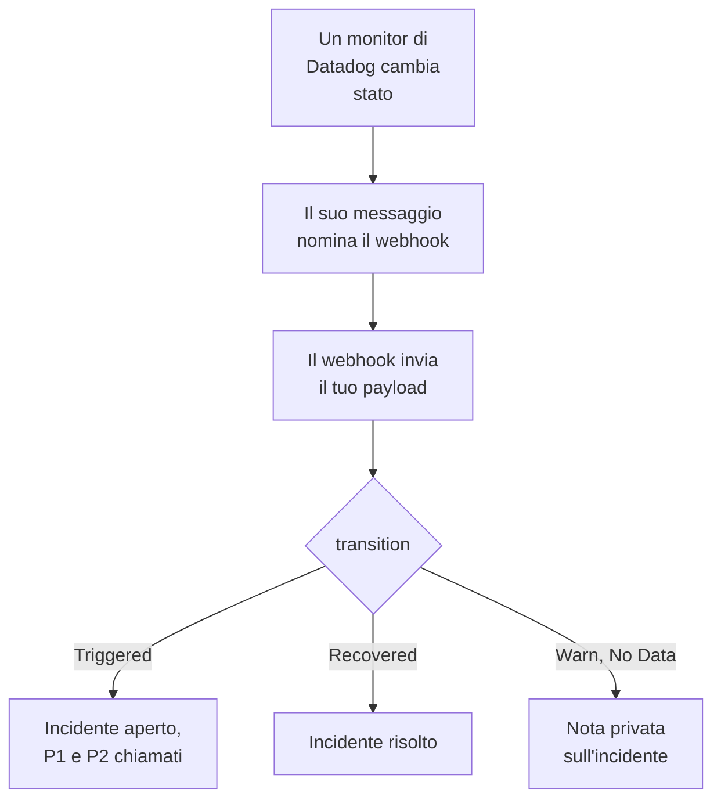

# Datadog

Invia gli avvisi dei monitor di [Datadog](https://www.datadoghq.com) a OneUptime, così ognuno diventa un incidente o un avviso, chiama il tuo team reperibile quando è urgente e si risolve quando il monitor di Datadog rientra. Datadog invia i suoi avvisi tramite la sua [integrazione Webhooks](https://docs.datadoghq.com/integrations/webhooks/), quindi non c'è nulla da installare né da una parte né dall'altra.

:::cards
- [Scegliere come OneUptime riceve gli avvisi](#scegliere-come-oneuptime-riceve-gli-avvisi): Un modello di workflow, o un monitor Incoming Request.
- [Partire dal modello](#partire-dal-modello): Scegli chi chiamare, copia l'URL e vedi cosa fa ogni avviso.
- [Ricevere gli avvisi con un monitor](#ricevere-gli-avvisi-con-un-monitor): Un incidente per avviso, risolto al rientro.
- [Configurare Datadog](#configurare-datadog): Un webhook e i monitor che lo notificano.
- [Risoluzione dei problemi](#risoluzione-dei-problemi): Quando gli avvisi non arrivano o gli incidenti restano aperti.
:::

## Come funziona



Un monitor di Datadog notifica i webhook che il suo messaggio menziona quando cambia stato: quando scatta, avverte, rientra o non ha dati. Il corpo JSON del webhook lo scrivi tu, con le [variabili di template](https://docs.datadoghq.com/integrations/webhooks/#usage) di Datadog, quindi questa guida te ne dà uno che nomina ogni avviso e dice cosa gli è successo.

## Prima di iniziare

- Un account Datadog in cui puoi configurare le integrazioni e modificare i monitor.
- In OneUptime, il permesso di creare workflow, o monitor se scegli quella strada. Su OneUptime Cloud, i workflow richiedono il piano **Growth** o superiore.

## Scegliere come OneUptime riceve gli avvisi

Configura prima OneUptime: ti dà l'URL a cui invia Datadog.

| Strada | Usala quando |
| --- | --- |
| Il modello di workflow (consigliato) | Vuoi ogni avviso come un incidente o un avviso a una gravità data dalla priorità del monitor, con i reperibili chiamati per P1 e P2, gli avvertimenti annotati sopra, e risolto al rientro. Non c'è nulla da costruire. |
| Un monitor Incoming Request | Vuoi incidenti senza un workflow, con qualsiasi piano, e un monitor il cui stato segue Datadog. |

Entrambi ricevono lo stesso JSON dallo stesso webhook, quindi puoi iniziare con uno e passare all'altro in seguito cambiando un URL in Datadog.

## Partire dal modello

La finestra **Crea un flusso di lavoro** ha due modelli Datadog, sotto **Datadog** nel suo elenco di categorie: **Declare an incident when a Datadog monitor triggers**, e **Create an alert when a Datadog monitor triggers** per gli avvisi. Entrambi fanno lo stesso, ciascuno con il proprio tipo di record.

:::steps
1. Vai su **Flussi di lavoro** e fai clic su **Crea flusso di lavoro**. In **Oppure parti da un modello**, scegli **Datadog** nell'elenco di categorie, fai clic su **Declare an incident when a Datadog monitor triggers**, o su **Create an alert when a Datadog monitor triggers**, e poi su **Usa questo modello**.
2. In **Who to page for P1 and P2 monitors**, scegli le policy di reperibilità da chiamare, o nessuna per non chiamare nessuno, e fai clic su **Crea flusso di lavoro**. Il workflow si apre nel **Costruttore**, disattivato.
3. Fai clic sul trigger **Webhook**, poi su **Copia URL**, e conserva l'URL per Datadog.
4. Attiva **Abilitato** in cima al **Costruttore**. Un workflow disattivato risponde a Datadog con `400`.
:::

Poi [configura Datadog](#configurare-datadog) perché invii i suoi avvisi a quell'URL. Il passo `read-event-1` del workflow si apre con la stessa configurazione, per quando ci torni nel **Costruttore**.

### Cosa fa il workflow

Dopo il trigger **Webhook**, il passo **Check With JavaScript** `read-event-1` legge la `transition` che Datadog invia, e **Incident From Another Tool**, o **Alert From Another Tool** nel modello degli avvisi, fa ciò che significa, tramite la chiave di ciclo dell'avviso. Datadog tiene quella chiave dal momento in cui un avviso scatta finché non rientra, e la volta successiva che scatta la chiave è nuova, quindi ogni volta ha un incidente tutto suo. L'incidente conserva la chiave nel suo campo personalizzato `datadogAlertCycleKey`.

| Transizione | Cosa fa il workflow |
| --- | --- |
| `Triggered`, `Re-Triggered` | Dichiara un incidente intitolato `Datadog: <monitor>`, alla gravità a cui corrisponde la priorità del monitor, fuori dalle tue pagine di stato. La sua descrizione collega l'avviso in Datadog e riporta la priorità, l'host, l'ambito e il messaggio del monitor. Una notifica per un avviso che ha già il suo incidente non ne apre un secondo, e non chiama nessuno di nuovo. |
| `Recovered` | Risolve l'incidente dell'avviso, a meno che non sia già risolto. Il motivo è nella sua cronologia. |
| `Warn`, `Re-Warn`, `No Data`, `Re-No Data` | Aggiunge una nota privata all'incidente dell'avviso, dicendo qual è ora lo stato del monitor. |
| `Renotify` | Niente: l'avviso è ancora aperto. |

Un avvertimento o un rientro per un avviso senza incidente non cambia nulla. Tutto il resto, come una richiesta di un altro strumento, viene lasciato com'è: `read-event-1` prende **No**, e i **Passaggi** dell'esecuzione dicono perché. Nulla torna a Datadog: risolve da solo i suoi avvisi quando il segnale rientra, ed è questo che risolve l'incidente.

### Priorità e chiamate

Un nuovo incidente chiama le policy di reperibilità che hai scelto quando il suo monitor è P1 o P2, o non ha priorità. P3, P4 e P5 aprono un incidente e non chiamano nessuno. In un nuovo progetto, le priorità corrispondono a queste gravità di incidente e di avviso:

| Priorità di Datadog | Incidente | Avviso | Reperibili |
| --- | --- | --- | --- |
| P1 | Critical Incident | High | Chiamati |
| P2 | Critical Incident | High | Chiamati |
| Nessuna priorità | Critical Incident | High | Chiamati |
| P3 | Major Incident | Low | Non chiamati |
| P4 | Minor Incident | Low | Non chiamati |
| P5 | Minor Incident | Low | Non chiamati |

Con gravità tue, P1, P2 e nessuna priorità vanno alla più grave, P3 a quella di mezzo, e P4 e P5 alla meno grave.

- Per mappare una priorità su una delle tue per nome, modifica `SEVERITY_BY_NAME` nel passo `read-event-1`, ad esempio `{ P3: 'Minor Incident' }`.
- Per chiamare i reperibili anche per P3, imposta **Compare with** del passo `if-page-1` **If / Else** a `3`.

## Ricevere gli avvisi con un monitor

Un [monitor Incoming Request](/docs/monitor/incoming-request-monitor) ti dà un URL, e i suoi criteri decidono cosa fa ogni avviso.

:::steps
### Creare il monitor

Vai su **Monitor** e fai clic su **Crea monitor**. Scegli **Incoming Request** in **Tipo di monitor**, chiamalo `Datadog` e fai clic su **Avanti**.

### Dichiarare un incidente per ogni avviso

Nel passaggio **Criteri**, apri il primo criterio, quello che segna il monitor come offline. Imposta il suo filtro su **Corpo della Richiesta**, **Contiene**, `"transition":"Triggered"`. Questo criterio dichiara già un incidente quando il suo filtro corrisponde. Compila l'incidente:

- **Titolo dell'incidente**: `{{requestBody.title}}`.
- **Descrizione dell'incidente**, in **Descrizione**: `{{requestBody.body}}`, poi `Datadog: {{requestBody.link}}` su una riga a sé.
- **Gravità**: la gravità d'incidente che devono avere questi avvisi.
- **Policy di reperibilità**, in **Reperibilità**: le policy da chiamare.
- **Risoluzione automatica dell'incidente**, in **Altri campi**: lasciala attiva, com'è all'inizio. Senza, i rientri vengono ignorati e gli incidenti restano aperti.

### Aprire un incidente per avviso

Nello stesso criterio, apri **Impostazioni** e attiva **Group incidents and alerts by a payload field**. Compilalo come sotto, così ogni avviso ha il proprio incidente e il suo rientro lo risolve:

| Campo | Valore |
| --- | --- |
| **Open a separate incident for each…** | `requestBody.alert_key` |
| **Field that signals recovery** | `requestBody.transition` |
| **Value that means recovered** | `Recovered` |

### Riportare il monitor online

Apri il secondo criterio, quello che segna il monitor come online, e imposta il suo filtro su **Corpo della Richiesta**, **Contiene**, `"transition":"Recovered"`.

### Copiare l'URL

Fai clic su **Crea monitor**. La pagina **Panoramica** del monitor mostra il suo **Heartbeat URL**. Copialo per Datadog:

```text
https://oneuptime.com/heartbeat/<secret key>
```

Un'installazione self-hosted ha il proprio host al posto di `oneuptime.com`.
:::

Il payload qui sotto imposta `alert_key` sull'ID del monitor di Datadog e sui tag del gruppo che ha generato l'avviso, così ogni gruppo di un monitor multi-avviso ha il proprio incidente e il rientro di quel gruppo lo risolve. Un monitor che scatta di nuovo o rinotifica mentre il suo incidente è aperto non ne apre un secondo. Vedi [Ricevere avvisi da un altro sistema](/docs/monitor/incoming-request-monitor#ricevere-avvisi-da-un-altro-sistema) per cosa fa ogni impostazione.

> [!NOTE]
> Una notifica **Warn** o **No Data** non apre alcun incidente con questi filtri. Per essere chiamato anche per gli avvertimenti, fai clic su **Aggiungi criteri**, dai al nuovo criterio il filtro **Corpo della Richiesta**, **Contiene**, `"transition":"Warn"`, un incidente con la sua **Gravità** e le stesse impostazioni di raggruppamento, poi trascinalo sopra il primo criterio. I criteri vengono controllati dall'alto, e decide il primo che corrisponde.

## Configurare Datadog

:::steps
### Aggiungere il webhook

In Datadog, apri il [riquadro dell'integrazione Webhooks](https://app.datadoghq.com/integrations/webhooks) e installala se non è ancora installata. Aggiungi un webhook con queste impostazioni, poi salvalo:

- **Name**: `oneuptime`. I monitor menzionano il webhook con questo nome, come `@webhook-oneuptime`.
- **URL**: l'URL che hai copiato da OneUptime.
- **Payload**:

  ```json
  {
    "alert_key": "$ALERT_ID $ALERT_SCOPE",
    "alert_cycle_key": "$ALERT_CYCLE_KEY",
    "transition": "$ALERT_TRANSITION",
    "alert_priority": "$ALERT_PRIORITY",
    "title": "$EVENT_TITLE",
    "body": "$TEXT_ONLY_MSG",
    "host": "$HOSTNAME",
    "scope": "$ALERT_SCOPE",
    "priority": "$PRIORITY",
    "link": "$LINK"
  }
  ```

### Menzionare il webhook nei tuoi monitor

In ogni monitor di Datadog che deve chiamare tramite OneUptime, aggiungi `@webhook-oneuptime` al messaggio di notifica del monitor e salva il monitor. Datadog invia allora a OneUptime gli avvisi e i rientri di quel monitor.
:::

| Variabile | Cosa ci mette Datadog |
| --- | --- |
| `$ALERT_ID` | L'ID del monitor di Datadog che ha generato l'avviso. |
| `$ALERT_SCOPE` | I tag del gruppo che ha generato l'avviso, come `host:web-1`. |
| `$ALERT_CYCLE_KEY` | Un ID che resta lo stesso dal momento in cui un avviso scatta finché non rientra. |
| `$ALERT_TRANSITION` | Cosa è successo: `Triggered`, `Re-Triggered`, `Warn`, `Recovered`, `No Data` o `Renotify`, tra gli altri. |
| `$ALERT_PRIORITY` | La priorità del monitor di Datadog, da `P1` a `P5`, o niente per un monitor che non ne ha. |
| `$EVENT_TITLE` | Il titolo dell'evento, come `[Triggered] High CPU`. |
| `$TEXT_ONLY_MSG` | Il messaggio del monitor, senza Markdown. |
| `$LINK` | Un link all'evento in Datadog. |

Un solo payload serve in entrambi i modi: il modello usa `alert_cycle_key` e `alert_priority`, e il monitor usa `alert_key`. Tienili tutti, e potrai passare dall'uno all'altro cambiando solo l'URL.

## Provarlo

Invia un avviso all'URL che hai copiato, come farebbe Datadog:

```bash
curl -X POST "<url>" \
  -H "Content-Type: application/json" \
  -d '{
    "alert_key": "1234 host:web-1",
    "alert_cycle_key": "7151157925468446720",
    "transition": "Triggered",
    "alert_priority": "P1",
    "title": "[Triggered] High CPU",
    "body": "CPU is above 90% on web-1.",
    "host": "web-1",
    "scope": "host:web-1",
    "priority": "normal",
    "link": "https://app.datadoghq.com/event/event?id=1"
  }'
```

Con il modello, si apre un incidente intitolato `Datadog: High CPU`, e le policy di reperibilità che hai scelto vengono chiamate. Con il monitor, si apre un incidente intitolato `[Triggered] High CPU`. Invia la stessa richiesta con `transition` impostato su `Recovered`, e l'incidente si risolve.

Poi prova da Datadog: apri un monitor che menziona il webhook, fai clic su **Test Notifications** e invia la sua notifica **Alert**. Per vedere che è arrivata, apri **Registri → Esecuzioni** del workflow, o la timeline del monitor di OneUptime.

## Risoluzione dei problemi

:::details Non arriva nulla in OneUptime
- Verifica che il messaggio del monitor di Datadog menzioni `@webhook-oneuptime`, scritto come si chiama il webhook.
- Il monitor risponde `200` subito, prima di controllare qualsiasi cosa, anche con una chiave segreta errata. Guarda la timeline del monitor per vedere se gli avvisi arrivano.
- Un workflow disattivato risponde `400`. Attiva **Abilitato** in cima al suo **Costruttore**.
:::

:::details Il workflow gira, ma non apre nulla
Apri l'esecuzione in **Registri → Esecuzioni**. La voce `read-event-1` nei suoi **Passaggi** dice perché ha preso **No**.

- `Datadog named no alert cycle key`: aggiungi `"alert_cycle_key": "$ALERT_CYCLE_KEY"` al payload del webhook in Datadog.
- `Datadog named no transition`: aggiungi `"transition": "$ALERT_TRANSITION"` al payload del webhook in Datadog.
:::

:::details I reperibili non vengono chiamati
- Chiamano solo i monitor P1 e P2 e i monitor senza priorità. Vedi [Priorità e chiamate](#priorità-e-chiamate).
- Una notifica per un avviso che ha già il suo incidente non chiama nessuno di nuovo.
- Se nella finestra **Crea un flusso di lavoro** non hai scelto nessuno, il workflow non ha alcun passo che chiami.
:::

:::details Gli incidenti si aprono ma non vengono mai risolti
- Il monitor di Datadog deve notificare al webhook anche i suoi rientri. Un messaggio che menziona il webhook solo per gli avvisi, dentro una condizione, non invia alcun rientro.
- Con il modello, apri l'esecuzione del rientro in **Registri → Esecuzioni**: il suo ultimo passo dice perché. L'`alert_cycle_key` del rientro deve essere quello dell'avviso, quindi lascia `$ALERT_CYCLE_KEY` così com'è nel payload.
- Con il monitor, l'incidente del criterio ha bisogno di **Risoluzione automatica dell'incidente**, in **Altri campi**.
- **Value that means recovered** deve essere esattamente `Recovered`. Il confronto distingue maiuscole e minuscole.
- L'`alert_key` del rientro deve essere quello dell'avviso: lascia `$ALERT_ID $ALERT_SCOPE` così com'è nel payload.
:::

:::details Un campo mostra il nome di una variabile, o niente
Datadog compila solo le variabili che valgono per l'evento. Invia una notifica di prova, poi guarda cosa è arrivato: nella timeline del monitor, o per un workflow in **Registri → Esecuzioni**.
:::

:::details Tutti gli avvisi di un monitor finiscono in un solo incidente
Con il monitor, ogni gruppo ha bisogno del proprio `alert_key`. Verifica che il payload lo componga sia da `$ALERT_ID` sia da `$ALERT_SCOPE`, e che il percorso di raggruppamento sia `requestBody.alert_key`.
:::

## Sicurezza

- **Tratta l'URL come una password.** Chiunque lo abbia può aprire incidenti. Se trapela, reimpostalo: **Reimposta URL** nel trigger **Webhook** del workflow, o **Reimposta la chiave segreta della richiesta in arrivo** nella pagina **Impostazioni** del monitor. Poi aggiorna l'**URL** del webhook in Datadog.
- **I link portano a Datadog.** Il modello collega un avviso solo su un sito Datadog, qualunque cosa dica una richiesta, e scrive ciò che Datadog ha inviato come testo.
- **Self-hosted?** Datadog invia i webhook da internet, quindi il tuo OneUptime deve essere raggiungibile da lì via HTTPS.

## Prossimi passi

:::cards
- [Modelli di workflow](/docs/workflows/authoring): Crea un workflow da un modello e modificalo nel Costruttore.
- [Monitor richieste in arrivo](/docs/monitor/incoming-request-monitor): Ogni impostazione del monitor che riceve i tuoi avvisi.
- [New Relic](/docs/integrations/new-relic): Lo stesso modello, per i problemi di New Relic.
- [Regole di escalation](/docs/on-call/escalation-rules): Decidi chi chiama una policy di reperibilità, e quando.
- [Panoramica delle integrazioni](/docs/integrations/index): Gli altri strumenti che puoi collegare.
:::
