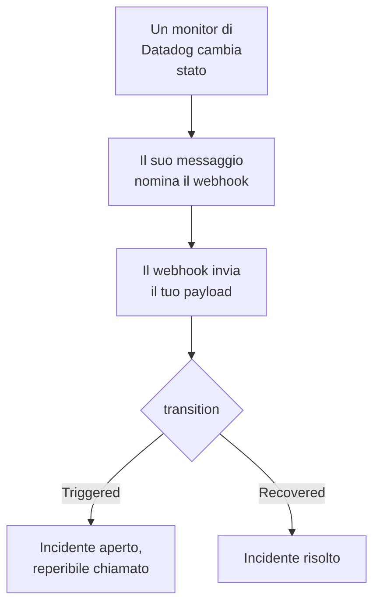

# Datadog

Invia gli avvisi dei monitor di [Datadog](https://www.datadoghq.com) a OneUptime, così ogni avviso diventa un incidente che chiama il tuo team reperibile e si risolve quando il monitor di Datadog rientra. Datadog invia i suoi avvisi tramite la sua [integrazione Webhooks](https://docs.datadoghq.com/integrations/webhooks/), quindi non c'è nulla da installare né da una parte né dall'altra.

:::cards
- [Scegliere come OneUptime riceve gli avvisi](#scegliere-come-oneuptime-riceve-gli-avvisi): Un monitor Incoming Request o un workflow tuo.
- [Ricevere gli avvisi con un monitor](#ricevere-gli-avvisi-con-un-monitor): Un incidente per avviso, risolto al rientro.
- [Configurare Datadog](#configurare-datadog): Un webhook e i monitor che lo notificano.
- [Risoluzione dei problemi](#risoluzione-dei-problemi): Quando gli avvisi non arrivano o gli incidenti restano aperti.
:::

## Come funziona



Un monitor di Datadog notifica i webhook che il suo messaggio menziona quando cambia stato: quando scatta, avverte, rientra o non ha dati. Il corpo JSON del webhook lo scrivi tu, con le [variabili di template](https://docs.datadoghq.com/integrations/webhooks/#usage) di Datadog, quindi questa guida te ne dà uno che nomina ogni avviso e dice cosa gli è successo.

## Prima di iniziare

- Un account Datadog in cui puoi configurare le integrazioni e modificare i monitor.
- In OneUptime, il permesso di creare monitor, o workflow se scegli quella strada.

## Scegliere come OneUptime riceve gli avvisi

Configura prima OneUptime: ti dà l'URL a cui invia Datadog.

| Strada | Usala quando |
| --- | --- |
| Un monitor Incoming Request (consigliato) | Vuoi che ogni avviso sia un incidente che chiama la reperibilità e si risolve quando il monitor di Datadog rientra. Non c'è nulla da costruire. |
| Un workflow con un trigger Webhook | Ti serve una logica tua: filtrare gli avvisi, rimodellarli o chiamare prima altri sistemi. Un workflow dichiara un incidente per ogni avviso che riceve, e non lo risolve al rientro. |

Entrambi ricevono lo stesso JSON dallo stesso webhook, quindi puoi iniziare con uno e passare all'altro in seguito cambiando un URL in Datadog.

## Ricevere gli avvisi con un monitor

Un [monitor Incoming Request](/docs/monitor/incoming-request-monitor) ti dà un URL, e i suoi criteri decidono cosa fa ogni avviso.

:::steps
### Creare il monitor

Vai su **Monitor** e fai clic su **Crea monitor**. Scegli **Incoming Request** in **Tipo di monitor**, chiamalo `Datadog` e fai clic su **Avanti**.

### Dichiarare un incidente per ogni avviso

Nel passaggio **Criteri**, apri il primo criterio, quello che segna il monitor come offline. Imposta il suo filtro su **Corpo della Richiesta**, **Contiene**, `"transition":"Triggered"`. Questo criterio dichiara già un incidente quando il suo filtro corrisponde. Compila l'incidente:

- **Titolo dell'incidente**: `{{requestBody.title}}`.
- **Descrizione dell'incidente**, in **Descrizione**: `{{requestBody.body}}`, poi `Datadog: {{requestBody.link}}` su una riga a sé.
- **Gravità**: la gravità d'incidente che devono avere questi avvisi.
- **Policy di reperibilità**, in **Reperibilità**: le policy da chiamare.
- **Risoluzione automatica dell'incidente**, in **Altri campi**: lasciala attiva, com'è all'inizio. Senza, i rientri vengono ignorati e gli incidenti restano aperti.

### Aprire un incidente per avviso

Nello stesso criterio, apri **Impostazioni** e attiva **Group incidents and alerts by a payload field**. Compilalo come sotto, così ogni avviso ha il proprio incidente e il suo rientro lo risolve:

| Campo | Valore |
| --- | --- |
| **Open a separate incident for each…** | `requestBody.alert_key` |
| **Field that signals recovery** | `requestBody.transition` |
| **Value that means recovered** | `Recovered` |

### Riportare il monitor online

Apri il secondo criterio, quello che segna il monitor come online, e imposta il suo filtro su **Corpo della Richiesta**, **Contiene**, `"transition":"Recovered"`.

### Copiare l'URL

Fai clic su **Crea monitor**. La pagina **Panoramica** del monitor mostra il suo **Heartbeat URL**. Copialo per Datadog:

```text
https://oneuptime.com/heartbeat/<secret key>
```

Un'installazione self-hosted ha il proprio host al posto di `oneuptime.com`.
:::

Il payload qui sotto imposta `alert_key` sull'ID del monitor di Datadog e sui tag del gruppo che ha generato l'avviso, così ogni gruppo di un monitor multi-avviso ha il proprio incidente e il rientro di quel gruppo lo risolve. Un monitor che scatta di nuovo o rinotifica mentre il suo incidente è aperto non ne apre un secondo. Vedi [Ricevere avvisi da un altro sistema](/docs/monitor/incoming-request-monitor#ricevere-avvisi-da-un-altro-sistema) per cosa fa ogni impostazione.

> [!NOTE]
> Una notifica **Warn** o **No Data** non apre alcun incidente con questi filtri. Per essere chiamato anche per gli avvertimenti, fai clic su **Aggiungi criteri**, dai al nuovo criterio il filtro **Corpo della Richiesta**, **Contiene**, `"transition":"Warn"`, un incidente con la sua **Gravità** e le stesse impostazioni di raggruppamento, poi trascinalo sopra il primo criterio. I criteri vengono controllati dall'alto, e decide il primo che corrisponde.

## Configurare Datadog

:::steps
### Aggiungere il webhook

In Datadog, apri il [riquadro dell'integrazione Webhooks](https://app.datadoghq.com/integrations/webhooks) e installala se non è ancora installata. Aggiungi un webhook con queste impostazioni, poi salvalo:

- **Name**: `oneuptime`. I monitor menzionano il webhook con questo nome, come `@webhook-oneuptime`.
- **URL**: l'URL che hai copiato da OneUptime.
- **Payload**:

  ```json
  {
    "alert_key": "$ALERT_ID $ALERT_SCOPE",
    "transition": "$ALERT_TRANSITION",
    "title": "$EVENT_TITLE",
    "body": "$TEXT_ONLY_MSG",
    "host": "$HOSTNAME",
    "priority": "$PRIORITY",
    "link": "$LINK"
  }
  ```

### Menzionare il webhook nei tuoi monitor

In ogni monitor di Datadog che deve chiamare tramite OneUptime, aggiungi `@webhook-oneuptime` al messaggio di notifica del monitor e salva il monitor. Datadog invia allora a OneUptime gli avvisi e i rientri di quel monitor.
:::

| Variabile | Cosa ci mette Datadog |
| --- | --- |
| `$ALERT_ID` | L'ID del monitor di Datadog che ha generato l'avviso. |
| `$ALERT_SCOPE` | I tag del gruppo che ha generato l'avviso, come `host:web-1`. |
| `$ALERT_TRANSITION` | Cosa è successo: `Triggered`, `Re-Triggered`, `Warn`, `Recovered`, `No Data` o `Renotify`, tra gli altri. |
| `$EVENT_TITLE` | Il titolo dell'evento, come `[Triggered] High CPU`. |
| `$TEXT_ONLY_MSG` | Il messaggio del monitor, senza Markdown. |
| `$LINK` | Un link all'evento in Datadog. |

## Provarlo

Invia un avviso a OneUptime, come farebbe Datadog:

```bash
curl -X POST "https://oneuptime.com/heartbeat/<secret key>" \
  -H "Content-Type: application/json" \
  -d '{
    "alert_key": "1234 host:web-1",
    "transition": "Triggered",
    "title": "[Triggered] High CPU",
    "body": "CPU is above 90% on web-1.",
    "host": "web-1",
    "priority": "normal",
    "link": "https://app.datadoghq.com/event/event?id=1"
  }'
```

Si apre un incidente intitolato `[Triggered] High CPU`. Invia la stessa richiesta con `transition` impostato su `Recovered` e l'incidente si risolve.

Poi prova da Datadog: apri un monitor che menziona il webhook, fai clic su **Test Notifications** e invia la sua notifica **Alert**. Guarda la timeline del monitor di OneUptime per vedere che è arrivata.

## Ricevere gli avvisi con un workflow

Usa un [workflow](/docs/workflows/index) quando ti servono passaggi tuoi tra Datadog e l'incidente.

:::steps
### Creare il workflow

Vai su **Flussi di lavoro**, fai clic su **Crea flusso di lavoro**, poi su **Parti da zero**. Chiamalo `Datadog alerts` e fai clic su **Crea flusso di lavoro**.

### Aggiungere il trigger Webhook

Fai clic sul blocco tratteggiato **Scegli cosa avvia questo flusso di lavoro** e scegli **Webhook**. Fai clic sul trigger, poi su **Copia URL**, e usa quell'URL nel webhook in Datadog.

### Verificare che il monitor sia scattato

Fai clic su **Aggiungi componente**, aggiungi un blocco **If / Else** e collegaci il punto **Out** del trigger. Imposta **Value to check** su `{{local.components.webhook-1.returnValues.request-body.transition}}`, **Comparison** su **is equal to** e **Compare with** su `Triggered`.

### Dichiarare l'incidente

Aggiungi un blocco **Create One Incident** e collegaci il lato **Yes** del blocco **If / Else**. In **Incident Template**, scegli un modello che imposti la gravità e le policy di reperibilità da chiamare (vedi [Modelli di incidenti](/docs/incidents/settings#modelli-di-incidenti)). In **JSON Object**, imposta ciò che arriva da Datadog:

```json
{
  "title": "{{local.components.webhook-1.returnValues.request-body.title}}",
  "description": "{{local.components.webhook-1.returnValues.request-body.body}}\nDatadog: {{local.components.webhook-1.returnValues.request-body.link}}"
}
```

Senza un modello, **JSON Object** deve contenere anche `incidentSeverityId`, l'ID di una delle gravità d'incidente del progetto.

### Attivare il workflow

Attiva **Abilitato** in cima al **Costruttore**. Un workflow disattivato risponde a Datadog con `400`.
:::

Ogni notifica `Triggered` dichiara un nuovo incidente. Un rientro prende il lato **No** del blocco **If / Else**, dove non è collegato nulla, quindi l'esecuzione finisce lì. Per un incidente per avviso, risolto al rientro, usa il monitor.

## Risoluzione dei problemi

:::details Non arriva nulla in OneUptime
- Verifica che il messaggio del monitor di Datadog menzioni `@webhook-oneuptime`, scritto come si chiama il webhook.
- Il monitor risponde `200` subito, prima di controllare qualsiasi cosa, anche con una chiave segreta errata. Guarda la timeline del monitor per vedere se gli avvisi arrivano.
- Un workflow disattivato risponde `400`. Attiva **Abilitato** in cima al suo **Costruttore**.
:::

:::details Gli incidenti si aprono ma non vengono mai risolti
- Il monitor di Datadog deve notificare al webhook anche i suoi rientri. Un messaggio che menziona il webhook solo per gli avvisi, dentro una condizione, non invia alcun rientro.
- L'incidente del criterio ha bisogno di **Risoluzione automatica dell'incidente**, in **Altri campi**.
- **Value that means recovered** deve essere esattamente `Recovered`. Il confronto distingue maiuscole e minuscole.
- L'`alert_key` del rientro deve essere quello dell'avviso: lascia `$ALERT_ID $ALERT_SCOPE` così com'è nel payload.
:::

:::details Un campo mostra il nome di una variabile, o niente
Datadog compila solo le variabili che valgono per l'evento. Invia una notifica di prova, poi guarda cosa è arrivato: nella timeline del monitor, o per un workflow in **Registri → Esecuzioni**.
:::

:::details Tutti gli avvisi di un monitor finiscono in un solo incidente
Ogni gruppo ha bisogno del proprio `alert_key`. Verifica che il payload lo componga sia da `$ALERT_ID` sia da `$ALERT_SCOPE`, e che il percorso di raggruppamento sia `requestBody.alert_key`.
:::

## Sicurezza

- **Tratta l'URL come una password.** Chiunque lo abbia può aprire incidenti. Se trapela, reimpostalo: **Reimposta la chiave segreta della richiesta in arrivo** nella pagina **Impostazioni** del monitor, o **Reimposta URL** nel trigger **Webhook** del workflow. Poi aggiorna l'**URL** del webhook in Datadog.
- **Self-hosted?** Datadog invia i webhook da internet, quindi il tuo OneUptime deve essere raggiungibile da lì via HTTPS.

## Prossimi passi

:::cards
- [Monitor richieste in arrivo](/docs/monitor/incoming-request-monitor): Ogni impostazione del monitor che riceve i tuoi avvisi.
- [Prometheus Alertmanager](/docs/integrations/prometheus-alertmanager): La stessa configurazione, per Alertmanager.
- [Regole di escalation](/docs/on-call/escalation-rules): Decidi chi chiama una policy di reperibilità, e quando.
- [Panoramica delle integrazioni](/docs/integrations/index): Gli altri strumenti che puoi collegare.
:::
