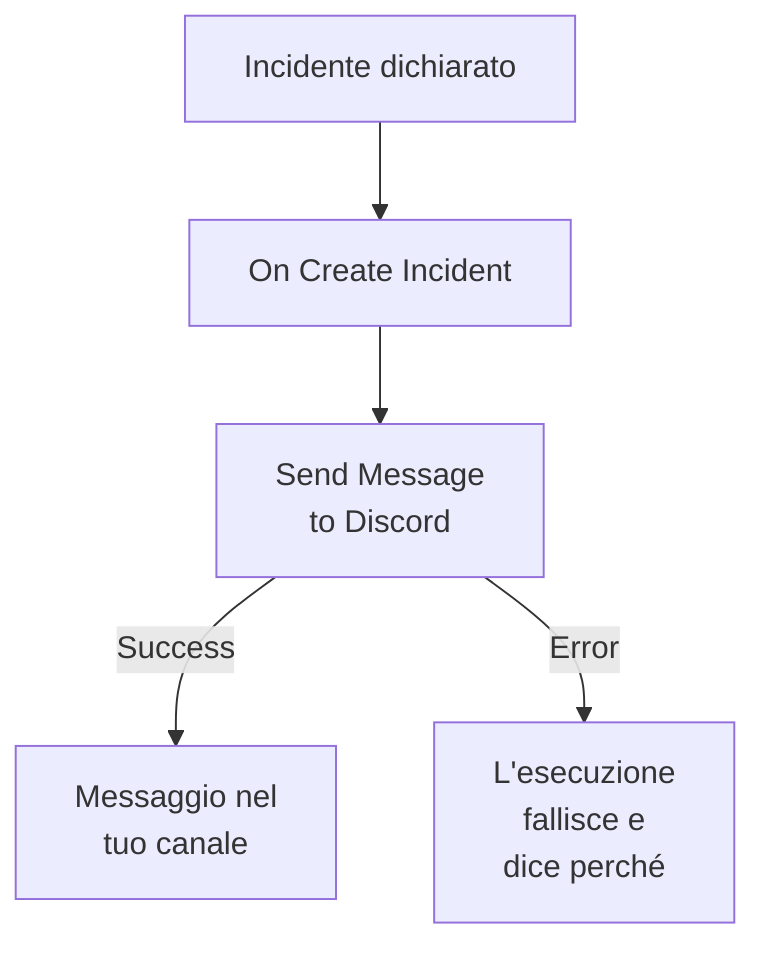

# Discord

Pubblica un messaggio in un canale [Discord](https://discord.com) quando si apre un incidente, così chi segue quel canale lo sa subito. Il passo di workflow **Send Message to Discord** di OneUptime pubblica tramite il webhook del canale, e un modello pronto costruisce l'intero workflow per te. Questa integrazione è **in uscita**: OneUptime pubblica nel canale e non legge quello che vi si dice.

:::cards
- [Come funziona](#come-funziona): Cosa fa il workflow quando si apre un incidente.
- [Configurazione](#configurare-lintegrazione): Un webhook in Discord, poi il workflow: dal modello o da zero.
- [Suggerimenti](#suggerimenti): Formattazione, messaggi lunghi e altri eventi.
- [Risoluzione dei problemi](#risoluzione-dei-problemi): Cosa significano gli errori del passo e cosa cambiare.
:::

## Come funziona



Il passo pubblica il **Message Text** sul webhook del canale. Prende la sua uscita **Success** quando Discord accetta il messaggio, e la sua uscita **Error**, con il motivo di Discord, quando Discord lo rifiuta. Senza nulla collegato a **Error**, come nel modello, un'esecuzione che non è riuscita a pubblicare fallisce, e i suoi **Passaggi** dicono perché.

## Prima di iniziare

- In Discord, il permesso **Manage Webhooks** sul canale.
- In OneUptime, il diritto di creare workflow e variabili. Su OneUptime Cloud, i workflow richiedono il piano **Growth** o superiore.

## Configurare l'integrazione

:::steps
### Creare un webhook in Discord

1. In Discord, apri le impostazioni del canale con **Edit Channel**, poi **Integrations → Webhooks**, e seleziona **New Webhook**.
2. Dagli un nome, per esempio `OneUptime`, e verifica che pubblichi nel canale giusto.
3. Seleziona **Copy Webhook URL**.

Chiunque abbia l'URL può pubblicare nel canale, quindi custodiscilo come una password.

### Costruire il workflow

Parti dal modello, che costruisce l'intero workflow per te, oppure da zero.

:::tabs
@tab Dal modello
1. Apri **Flussi di lavoro** e fai clic su **Crea flusso di lavoro**.
2. Digita `Discord` in **Cerca modelli…**, fai clic su **Tell Discord when an incident opens**, poi su **Usa questo modello**.
3. Mantieni il nome **Notify Discord on new incident** o cambialo, e fai clic su **Avanti**.
4. Incolla l'URL in **Discord Webhook URL** e fai clic su **Crea flusso di lavoro**.

Il workflow si apre nel **Costruttore** con due passi: **On Create Incident** e **Send Message to Discord**, che pubblica il numero, il titolo, la gravità e lo stato dell'incidente. L'URL viene salvato come variabile segreta `discordWebhookUrl` del workflow.
@tab Da zero
1. Salva l'URL come variabile globale segreta: vai su **Flussi di lavoro → Variabili globali**, fai clic su **Crea: Flusso di lavoro Variabile**, chiamala `DISCORD_WEBHOOK_URL` e fai clic su **Avanti**. Incolla l'URL in **Contenuto**, attiva **Segreto** e fai clic su **Crea: Flusso di lavoro Variabile**.
2. Vai su **Flussi di lavoro**, fai clic su **Crea flusso di lavoro**, scegli **Parti da zero**, dai un nome al workflow e fai clic su **Crea flusso di lavoro**.
3. Nel **Costruttore**, fai clic su **Scegli cosa avvia questo flusso di lavoro** e scegli **On Create Incident** sotto **Popolari**. Fai clic sul trigger: i suoi **Fields to pass on** iniziano con **Titolo**, quindi fai clic su **Aggiungi campo** e scegli gli altri campi che mostra il tuo messaggio, per esempio **Incident Number With Prefix**.
4. Fai clic su **Aggiungi componente**, cerca `discord` e fai clic su **Send Message to Discord**. Collega l'uscita **Success** del trigger a questo passo.
5. Fai clic sul nuovo passo. In **Discord Incoming Webhook URL**, fai clic su **{ }** e scegli `DISCORD_WEBHOOK_URL` sotto **Global variables**. In **Message Text**, scrivi il messaggio e inserisci i campi dell'incidente con **{ }**.
:::

Un messaggio costruito da zero legge i campi dell'incidente con riferimenti come questi:

```text
🚨 **Incident {{local.components.incident-on-create-1.returnValues.model.incidentNumberWithPrefix}} declared**
**Title:** {{local.components.incident-on-create-1.returnValues.model.title}}
```

### Attivarlo e provarlo

Attiva l'interruttore **Abilitato** in cima al **Costruttore**. Da quel momento, ogni nuovo incidente viene pubblicato nel canale.

Per provarlo senza aprire un incidente, fai clic su **Esegui flusso di lavoro** e scegli un incidente che hai già sotto **Incidente**: sono elencati i più recenti, e digitando il suo numero o parte del suo titolo ne trovi un altro. Fai clic su **Esegui manualmente il flusso di lavoro** e conferma con **Esegui**. Il pannello **Esecuzione del flusso di lavoro** segue l'esecuzione, e il messaggio compare nel canale. Se invece il passo prende **Error**, l'esecuzione fallisce, e la voce del passo in **Passaggi** dice perché: vedi [Risoluzione dei problemi](#risoluzione-dei-problemi).
:::

## Suggerimenti

- **Formattare con il Markdown di Discord.** Il testo viene inviato così come è scritto, quindi il Markdown di Discord funziona: gli asterischi intorno a una parola la mettono in grassetto, e un URL appare come link.
- **Tenere conto del limite di 2.000 caratteri.** Discord accetta messaggi fino a 2.000 caratteri. Uno più lungo viene tagliato, e termina con "… (truncated — see OneUptime for the full text)", invece di essere rifiutato.
- **Pubblicare più dei nuovi incidenti.** Costruisci un altro workflow su **On Update Incident** per i cambi di stato, o su **On Create Alert** per gli avvisi, con lo stesso passo. Per pubblicare solo alcuni incidenti, metti un blocco **If / Else** prima del passo.
- **Solo gli indirizzi di Discord.** Il passo pubblica su un URL `https` di `discord.com` o `discordapp.com`, e non segue i reindirizzamenti, quindi un URL che punta altrove ferma l'esecuzione.

## Risoluzione dei problemi

Quando il passo prende **Error**, l'esecuzione fallisce, e la voce del passo nei **Passaggi** dell'esecuzione riporta il motivo di Discord.

:::details Discord risponde "Unknown Webhook" o "Invalid Webhook Token"
Il webhook è stato eliminato, oppure l'URL è stato copiato male. Crea un nuovo webhook e sostituisci l'URL: nel workflow del modello, la variabile `discordWebhookUrl`; in un tuo workflow, il contenuto di `DISCORD_WEBHOOK_URL`.
:::

:::details Discord risponde "You are being rate limited"
Discord limita quanto spesso un webhook può pubblicare. Una raffica di incidenti può raggiungere il limite: pubblica meno messaggi, per esempio solo per alcune gravità.
:::

:::details L'esecuzione si ferma con "Discord Webhook URL must be an https URL on discord.com or discordapp.com"
**Discord Incoming Webhook URL** contiene qualcosa di diverso da un webhook Discord, oppure la variabile che legge è vuota. Incolla di nuovo l'URL da **Copy Webhook URL**.
:::

## Prossimi passi

:::cards
- [Componenti del workflow](/docs/workflows/components#discord): Ogni impostazione del passo e cosa significano le sue uscite.
- [Telegram](/docs/integrations/telegram): La stessa idea, in una chat Telegram.
- [Esecuzioni del workflow](/docs/workflows/runs-and-logs): Leggi cosa ha fatto ogni esecuzione del workflow.
- [Panoramica delle integrazioni](/docs/integrations/index): Il modello in uscita e gli altri strumenti che puoi collegare.
:::
