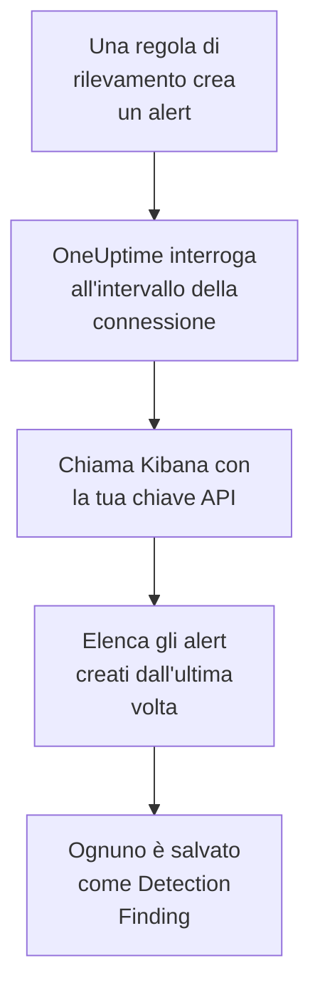

# Elastic Security

Importa gli alert di rilevamento generati dalle tue regole di [Elastic Security](https://www.elastic.co/security) negli eventi di sicurezza di OneUptime. Lì li cerchi accanto a log, trace e metriche, li correli con ogni altra fonte e chiami la reperibilità per quelli che contano. OneUptime li legge tramite l'API del motore di rilevamento di Kibana con una chiave API che crei tu, e non modifica nulla in Elastic.

:::cards
- [Configurare la connessione](#configurare-la-connessione): Una chiave API, i suoi privilegi e il modulo della connessione.
- [Cosa viene importato](#cosa-viene-importato): Come ogni alert di rilevamento diventa un evento di sicurezza.
- [Come funziona il polling](#come-funziona-il-polling): La finestra che legge ogni interrogazione, e cosa le fa uno spazio molto attivo.
- [Risoluzione dei problemi](#risoluzione-dei-problemi): Cosa significa ogni errore e cosa cambiare.
:::

## Come funziona



Ogni minuto, OneUptime interroga ogni connessione abilitata il cui intervallo di polling è trascorso. Un'interrogazione chiede a Kibana gli alert di rilevamento creati nel tuo spazio dall'ultima interrogazione, 1.000 alla volta, e salva ognuno come un evento [OCSF](https://schema.ocsf.io/) Detection Finding (classe `2004`). Contano tutti i tipi di regola: query personalizzata, soglia, EQL, corrispondenza di indicatori, machine learning e nuovi termini. Regole di rilevamento, monitor e dashboard trattano poi gli alert come eventi di sicurezza di qualsiasi altra fonte.

## Prima di iniziare

- In OneUptime, il ruolo Project Owner, Project Admin o Security Admin. I ruoli Security Member e Security Viewer vedono le connessioni e la cronologia delle loro esecuzioni, ma non possono modificarle.
- Elastic Security 8.x o successivo, su Elastic Cloud o sul tuo stack Elastic, con regole di rilevamento che girano in uno spazio Kibana.
- Un accesso a Kibana che possa vedere gli alert di rilevamento in quello spazio: i privilegi di indice `read` e `view_index_metadata` su `.alerts-security.alerts-<space-id>`, e un privilegio della funzionalità Security di Kibana che gli permetta di leggervi gli alert.
- Un Kibana che OneUptime possa raggiungere in HTTPS. OneUptime Cloud si collega da internet, quindi Kibana ha bisogno di un indirizzo pubblico, come quelli dei deployment di Elastic Cloud: gli indirizzi privati vengono rifiutati. Un OneUptime self-hosted si collega dai suoi container dell'app e dei worker, e può raggiungere un Kibana nella tua rete privata, a meno che `DATA_SOURCE_BLOCK_PRIVATE_ADDRESSES` non sia `true`.

## Configurare la connessione

:::steps
### Creare una chiave API

1. In Kibana, apri **Stack Management → API keys** e seleziona **Create API key**.
2. Dalle un nome, per esempio `oneuptime-security-events`. Una chiave ha i privilegi dell'utente che la crea, a meno che tu non gliene dia meno: le servono solo quelli sopra.
3. Scegli quando scade, o mai. Una chiave che scade ferma la connessione finché non la sostituisci.
4. Crea la chiave e copia il suo valore **Base64**, che Kibana mostra una sola volta. Non l'ID della chiave, né la coppia `id:api_key`.

### Trovare l'ID del tuo spazio

Gli alert sono salvati per spazio. Apri lo spazio in cui girano le tue regole: il suo ID è la parte dell'indirizzo di Kibana dopo `/s/`, per esempio `security` in `https://kibana.example.com/s/security/app/security`. Lo spazio predefinito non ha una parte `/s/` e non ha bisogno di alcun ID.

### Aggiungere la connessione in OneUptime

Apri **Prodotti → Security Events → Connections** (`/dashboard/{projectId}/security-events/connections`), fai clic su **Aggiungi connessione**, scegli **Elastic Security** e fai clic su **Avanti**. Compila le impostazioni della tabella qui sotto, fai clic su **Avanti** e incolla la chiave in **Chiave API**.

### Provarla prima di salvare

Fai clic su **Test these settings** sotto **Testa prima di salvare**. Il test si autentica e legge gli alert con i valori del modulo, senza salvare nulla, così uno spazio sbagliato o un privilegio mancante emerge prima che la connessione esista. Poi fai clic su **Avanti**, dai un **Nome** alla connessione e creala.
:::

| Impostazione | Cosa inserire |
| --- | --- |
| **Kibana URL** | L'indirizzo da cui viene servito Kibana, per esempio `https://kibana.example.com` o `https://<deployment>.kb.<region>.cloud.es.io`. Senza percorso: né `/app/security`, né `/api`, né la parte `/s/<space>`. |
| **Kibana space** | L'ID dello spazio, non il suo nome: lettere, cifre, trattini e trattini bassi. Lascialo vuoto per lo spazio predefinito. |
| **Chiave API** | Il valore **Base64** della chiave, da solo: OneUptime aggiunge da sé lo schema `ApiKey`. È cifrato, mai restituito dall'API e mai più mostrato. Sostituiscilo con **Update credentials** sulla connessione. |

Il passaggio **Polling** ha anche una **Descrizione** facoltativa, il **Poll Interval (Minutes)**, un numero intero da `1` a `1440` che parte da `5`, e **Abilitato**, che parte attivo.

## Cosa viene importato

Ogni alert di rilevamento diventa un evento Detection Finding (classe OCSF `2004`), con il fornitore `Elastic` e il prodotto `Elastic Security`:

| Campo dell'alert | Colonna di OneUptime |
| --- | --- |
| `_id`, l'ID dell'alert | UID dell'evento, che serve anche a scartare i duplicati |
| `kibana.alert.original_time`, altrimenti `kibana.alert.start`, altrimenti `@timestamp` | Ora dell'evento |
| `kibana.alert.rule.name` | Nome della regola |
| `kibana.alert.rule.uuid`, altrimenti `kibana.alert.rule.rule_id` | ID della regola |
| `kibana.alert.reason`, altrimenti il nome della regola, altrimenti `kibana.alert.rule.description` | Messaggio |
| `kibana.alert.severity`, altrimenti una fascia di `kibana.alert.risk_score` | Gravità |
| `kibana.alert.workflow_status`: `open`, `acknowledged` o `closed` | Stato |
| `kibana.alert.rule.threat`, sotto-tecniche incluse | Tattiche e tecniche MITRE ATT&CK |
| `user.name`, `host.name`, `source.ip` o `host.ip`, `process.name` o `process.executable` | Utente, host, IP e processo dell'attore |
| `process.name`, `process.executable` e `process.command_line`; `process.parent.name`, `process.parent.executable` e `process.parent.command_line` | Nome, percorso e riga di comando del processo; nome, percorso e riga di comando del processo padre |
| `user.target.name`, `destination.domain`, `destination.ip`, `destination.port`, `file.path` | Utente, host, IP, porta e risorsa della destinazione |
| Questi, e `related.*`, `dns.question.name`, `url.domain` e gli hash dei file | Osservabili |
| L'intero alert, appiattito in chiavi puntate, con `_index` e `_id` | `attributes` |

L'ora di un alert è, di proposito, quella dell'attività a cui si riferisce. Il suo `@timestamp`, quando la regola l'ha creato, è ciò che legge il polling, quindi un alert creato oggi sull'attività di ieri compare alla data di ieri nell'esploratore degli eventi di sicurezza. Quando un alert non ha una gravità, decide il suo punteggio di rischio: da `74` Critical, da `48` High, da `22` Medium, e sotto Low.

## Come funziona il polling

Ogni interrogazione elenca gli alert creati nella sua finestra, dal più vecchio, 1.000 per pagina. In uno spazio diverso da quello predefinito, il percorso inizia con `/s/{Kibana space}`:

```text
POST {Kibana URL}/api/detection_engine/signals/search
    {"query": {"range": {"@timestamp": {"gte": "{window start}", "lt": "{window end}"}}},
     "size": 1000, "sort": [{"@timestamp": "asc"}]}
```

- **L'ora di creazione è il cursore.** Gli alert vengono elencati per il loro `@timestamp`, quando l'esecuzione della regola li ha creati, mai per l'ora dell'attività a cui si riferiscono. Una regola che gira ogni ora crea alert su un'attività vecchia fino a un'ora, e un cursore sull'ora di attività li salterebbe tutti.
- **La prima interrogazione guarda indietro di 24 ore**, così una nuova connessione mostra subito i suoi avvisi recenti.
- **Ogni interrogazione successiva parte 1 minuto prima del cursore salvato**, così un alert creato al confine tra due finestre non viene mai perso.
- **Un'interrogazione legge al massimo 24 ore oltre il cursore.** Una connessione il cui cursore è rimasto indietro recupera in una serie di finestre di 24 ore, e la sua **Health** indica **Catching up**.
- **I duplicati vengono scartati in base all'`_id` dell'alert** all'interno del progetto, così la sovrapposizione, una finestra ripetuta e un'importazione non salvano mai un alert due volte.

La ricerca degli alert di Kibana accetta una dimensione e un ordinamento, ma nessun token di pagina. Quindi OneUptime pagina spostando l'inizio dell'intervallo sull'ultimo alert di ogni pagina, e lascia fuori, per `_id`, gli alert che ha già letto in quell'istante. Un'esecuzione di regola spesso marca molti alert con la stessa ora, e un gruppo del genere viene letto pagina per pagina, nessuno due volte e nessuno saltato.

### Quando una finestra contiene più di quanto un'interrogazione possa leggere

Un'interrogazione legge al massimo 10.000 alert, in al massimo 20 richieste. Quando una finestra ne contiene di più, l'esecuzione è **Partial**, con un avviso come questo:

```text
Stopped after collecting 10000 alerts; the window holds more.
```

Gli alert vengono letti dal più vecchio, quindi OneUptime sposta il cursore all'ora di creazione dell'ultimo alert letto, e l'interrogazione successiva parte da lì con la stessa lunghezza di finestra. Uno spazio molto attivo recupera 10.000 alert per interrogazione, invece di rileggere gli stessi. Gli alert creati in quello stesso istante vengono letti due volte, e il controllo dei duplicati scarta la seconda copia.

Gli ID lasciati fuori viaggiano in ogni richiesta, e Kibana limita la dimensione di una richiesta. Quando più alert condividono un istante di quanti una richiesta ne possa lasciare fuori, circa 7.800, l'esecuzione si ferma lì come **Partial**, con un avviso che nomina l'istante.

Quando un'esecuzione non riesce affatto a superare il cursore salvato, OneUptime accorcia invece la finestra:

1. **Restringere.** L'interrogazione successiva legge una finestra lunga la metà, dallo stesso punto di partenza, e continua a dimezzarla finché una finestra non viene letta per intero, fino a un minuto. L'avviso dell'esecuzione lo dice: `This window holds more records than one poll can read; the next poll reads a {n} minute window from the same starting point.`
2. **Tornare a crescere.** Dopo che una finestra è stata letta per intero, la successiva è di nuovo lunga il doppio, fino a 24 ore.
3. **Superare un singolo minuto.** Se anche un solo minuto contiene più di quanto un'interrogazione possa leggere, il polling lo supera, così gli avvisi più recenti continuano ad arrivare. L'esecuzione resta **Partial**, e **Ultimo errore** riporta `More records were created in the one minute from {cursor} to {end} than one poll can read. Polling moved past this minute so newer records keep arriving; use Import this time range in Diagnostics on this minute to recover what one run can read.` Importa quel minuto con **Import this time range** per recuperare ciò che un'esecuzione può leggere.

Un'esecuzione che fallisce del tutto, con un errore di Kibana, mantiene il cursore e la lunghezza della finestra, e l'interrogazione successiva rilegge la stessa finestra. L'unica eccezione è una richiesta scaduta: il cursore resta, ma la finestra successiva è lunga la metà, perché una finestra troppo pesante per ricevere risposta in tempo scadrebbe a ogni tentativo. Cambiare il **Poll Interval (Minutes)** non cambia nulla di tutto questo: decide quanto spesso parte un'interrogazione, non dove inizia la sua finestra.

### Eseguire, visualizzare in anteprima e importare su richiesta

Fai clic su **Diagnostics** su una connessione per vederne le esecuzioni recenti e lavorarci a mano. Chi può modificare la connessione può avviare queste azioni; chi può vederla può leggerne la cronologia.

- **Run now** avvia subito un'interrogazione, con il cursore abituale, anche quando la connessione non è **Abilitato**.
- **Preview alerts** legge un intervallo di tempo fino a 7 giorni e non importa nulla.
- **Import this time range** importa un intervallo fino a 7 giorni, dopo la tua conferma, senza spostare il cursore. Gli avvisi già importati vengono saltati.
- **Copy diagnostics** su un'esecuzione copia il suo rapporto per il supporto. Non contiene mai credenziali.

## Testare la connessione

**Testa la connessione** sulla riga di una connessione, e **Test these settings** nel modulo, vengono eseguiti nel processo dell'API, non in un worker in background, così un test risponde anche quando il problema sono i worker. Esegue questi controlli, in ordine:

| Controllo | Cosa verifica |
| --- | --- |
| **Configurazione** | Ogni impostazione è presente e ben formata. Non viene contattato nulla quando questo fallisce. |
| **Authenticate with Kibana** | `/api/status` di Kibana risponde per intero. Kibana risponde anche, con meno, ai chiamanti che non ha autenticato, quindi una risposta breve fa fallire questo controllo. |
| **Read detection alerts** | Si può leggere un alert creato nelle ultime 24 ore. Questo dimostra i privilegi e lo spazio. |
| **Alerts available to import** | Quanti alert sono stati creati nelle ultime 24 ore e negli ultimi 7 giorni, con `+` dove Elasticsearch ne ha contato solo una parte. Nessuno in 7 giorni è un avviso, non un errore. |
| **Background workers**, **Poll scheduler**, **Security event storage** | Il lato di OneUptime stesso: un processo prende i job della coda Worker, il job di polling gira ogni minuto e l'archivio degli eventi di sicurezza risponde. |
| **Scheduled polling** | Per una connessione salvata: il polling è attivo, nessuna esecuzione è bloccata in attesa di un worker e le interrogazioni girano in orario. |

Ogni richiesta di un test ha una scadenza di 20 secondi. Un test non importa mai nulla e non sposta mai il cursore, e ogni controllo fallito dice cosa cambiare.

## Inviare eventi di sicurezza a Elastic Security

OneUptime può anche inviare ciò che trova a Elasticsearch, come documenti Elastic Common Schema (ECS) in un data stream, così gli avvisi, le timeline e le regole di rilevamento di Elastic Security vedono i rilevamenti di OneUptime accanto ai tuoi. Un rilevamento è un documento con `event.kind` `alert`, e ogni altro evento ha `event.kind` `event`.

:::steps
### Creare una chiave API che possa scrivere

In Kibana, apri **Stack Management → API keys**, fai clic su **Create API key**, dalle i privilegi qui sotto e copia il suo valore **Encoded**.

### Aggiungere la destinazione

Apri **Prodotti → Security Events → Connections**. In **Invia al tuo SIEM**, fai clic su **Aggiungi destinazione**, scegli Elastic Security in **SIEM** e fai clic su **Avanti**. Inserisci l'**URL di Elasticsearch**, l'endpoint Elasticsearch del deployment e non quello di Kibana, e incolla la chiave in **Chiave API**. **Data stream** è facoltativo: se resta vuoto, i documenti vanno in `logs-oneuptime.security-default`, che Elasticsearch crea alla prima scrittura.

### Inviare un evento di prova e iniziare a inviare

Fai clic su **Invia un evento di prova**: un documento arriva nel data stream. Poi, in **Cosa inviare**, lascia **Solo rilevamenti** o scegli **Tutti gli eventi di sicurezza**, e fai clic su **Inizia a inviare**.
:::

I privilegi della chiave, per il data stream predefinito:

```json title="oneuptime-writer-role.json"
{
  "oneuptime-writer": {
    "indices": [
      {
        "names": [
          "logs-oneuptime.security-*"
        ],
        "privileges": [
          "create_doc",
          "auto_configure"
        ]
      }
    ]
  }
}
```

- I documenti partono in lotti di massimo 500, ciascuno con l'id del proprio evento, così un evento inviato due volte viene salvato una volta sola.
- Un documento che Elasticsearch non riesce a mappare viene escluso e indicato in **Visualizza errore**, e uno che per ora non può accettare (`429`) viene inviato di nuovo.
- Gli avvisi che OneUptime ha importato da Elastic Security non gli vengono mai rimandati.

## Risoluzione dei problemi

Il **Ultimo errore** della connessione conserva il messaggio di errore completo, con le credenziali oscurate, dietro un prefisso che nomina il passaggio fallito. Quando una connessione ha un errore, seleziona **Visualizza errore** nella sua colonna **Azioni** per leggerlo, e **Copia errore** nella finestra di dialogo per copiarlo. Leggi prima il prefisso.

:::details Last Error inizia con `Elastic Security status request`
- `Elastic Security status request failed (HTTP ...)`: Kibana ha rifiutato la richiesta di stato.
  - `HTTP 401`: Kibana non ha accettato la chiave API. Non è il valore **Base64**, oppure è scaduta o è stata invalidata. Crea una nuova chiave e salvala con **Update credentials**.
  - `HTTP 404`: la **Kibana URL** ha un percorso, oppure non è Kibana.
  - `HTTP 503`: Kibana si dichiara non disponibile, di solito perché non riesce a raggiungere Elasticsearch.
  - `HTTP 3xx`: Kibana ha reindirizzato la richiesta, e i reindirizzamenti vengono rifiutati. Usa l'indirizzo da cui viene servito Kibana.
- `Elastic Security status request returned ...`: ha risposto qualcosa di diverso da Kibana, per esempio una pagina di accesso o un proxy.
- Quando fallisce solo il test, dicendo che Kibana `answered without authenticating the request`, la chiave non ha raggiunto Kibana. Verifica che sia il valore **Base64**, e che nessun proxy davanti a Kibana tolga l'intestazione `Authorization`.
:::

:::details Last Error inizia con `Elastic Security alerts search`
- `Elastic Security alerts search failed (HTTP ...)`: Kibana ha rifiutato la ricerca degli alert.
  - `HTTP 403`: la chiave accede, ma non può leggere gli alert dello spazio. Dalle i privilegi indicati in [Prima di iniziare](#prima-di-iniziare).
  - `HTTP 404`: nessuno spazio ha quell'ID **Kibana space**, oppure Elastic Security non è abilitato in esso.
  - `HTTP 429` o `HTTP 5xx`: Kibana o Elasticsearch sta limitando le richieste o sta fallendo. L'interrogazione successiva riprova.
- `Elastic Security alerts search returned ...`: Kibana ha risposto `200`, ma senza una pagina di alert leggibile, per esempio con un proprio errore. Il messaggio lo cita. Viene segnalato invece di essere preso per una finestra vuota, così il cursore non supera mai alert che nessuno ha letto.
:::

:::details Last Error termina con `did not complete`
`Elastic Security alerts search did not complete`, e lo stesso per la richiesta di stato, significa che la richiesta non ha ricevuto risposta: un timeout, un nome che non si risolve, una connessione rifiutata, o un indirizzo privato rifiutato. Verifica che l'app OneUptime e i worker possano raggiungere Kibana, con lo schema e la porta giusti. Dopo un timeout, l'interrogazione successiva legge una finestra lunga la metà.
:::

:::details Last Polled è Never e Last Error è vuoto
Nessuna interrogazione è terminata per questa connessione. Esegui **Testa la connessione**: i suoi controlli **Background workers** e **Poll scheduler** nominano la causa. Su un'installazione self-hosted, la causa abituale è `DISABLE_QUEUE_WORKERS=true` sull'app, senza un deployment separato dei worker che prenda i job: impostalo su `false`, oppure esegui il deployment dei worker (Helm: `worker.enabled: true`).
:::

:::details Un'esecuzione è Partial
- `Stopped after collecting 10000 alerts; the window holds more`: la finestra conteneva più dei 10.000 alert che legge un'esecuzione. Non si perde nulla: l'interrogazione successiva parte dopo l'ultimo alert letto. Una connessione che resta **Partial** un'interrogazione dopo l'altra sta recuperando un arretrato, e i suoi **Last Polled** e **Last Event Imported** continuano ad avanzare. Se non recupera mai, lo spazio crea più di 10.000 alert per intervallo di polling: accorcia il **Poll Interval (Minutes)**.
- `More records were created in the one minute from ... than one poll can read`: il polling ha superato quel minuto. Importalo con **Import this time range** in **Diagnostics**. Un'importazione legge quanto un'interrogazione.
:::

:::details Il test riesce, ma non viene importato nulla
Leggi **Alerts available to import** nel rapporto del test. `0` negli ultimi 7 giorni significa che nessuna regola ha creato un alert in quello spazio: verifica che lì ci siano regole abilitate, e che **Kibana space** sia lo spazio in cui girano. Se gli alert esistono, allarga l'intervallo di tempo nell'esploratore degli eventi di sicurezza: gli alert compaiono all'ora della loro attività, che può essere molto precedente alla loro creazione.
:::

## Cosa ottieni

- **Ricerca.** Filtra gli alert per gravità, stato, regola, tecnica MITRE ATT&CK, utente, host o qualsiasi osservabile nell'esploratore degli eventi di sicurezza, accanto a ogni altra fonte.
- **Correlazione.** Gli utenti, gli host, gli IP, i domini e gli hash di ogni alert vengono indicizzati come osservabili, quindi una ricerca trova tutto ciò che li menziona.
- **Regole di rilevamento.** Regole Sigma che girano secondo una pianificazione sui tuoi eventi di sicurezza, e aprono avvisi che chiamano la reperibilità.
- **Monitor.** I monitor degli eventi di sicurezza contano gli eventi corrispondenti, per esempio i nuovi alert critici, e aprono incidenti o avvisi oltre una soglia.

Gli eventi di sicurezza sono fatturati come il resto della tua telemetria, per GB acquisito. Vedi i [prezzi](https://oneuptime.com/pricing).

## Prossimi passi

:::cards
- [Eventi di sicurezza](/docs/telemetry/security-events): Cerca, correla e genera avvisi su ciò che importi.
- [Splunk Enterprise Security](/docs/integrations/splunk): Importa anche i notable event di un search head Splunk.
- [Ruoli](/docs/permissions/reference#ruoli): Cosa possono vedere e modificare i ruoli Security.
- [Panoramica delle integrazioni](/docs/integrations/index): Gli altri strumenti che puoi collegare.
:::
