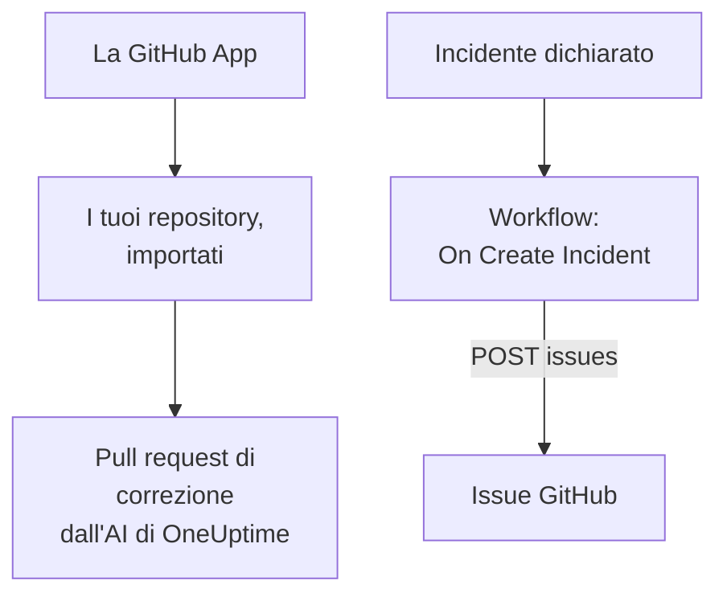

# GitHub

OneUptime lavora con [GitHub](https://github.com) in due modi. Collega i tuoi repository tramite la GitHub App di OneUptime, e l'AI di OneUptime apre pull request che correggono ciò che trova, e risponde quando la menzioni in una issue o in una pull request. Oppure costruisci un workflow che apre una issue GitHub per ogni incidente, così il lavoro che ne segue viene tracciato nel repository a cui appartiene il servizio.

:::cards
- [Scegliere come collegarsi](#scegliere-come-collegarsi): La GitHub App o un workflow, e cosa fa ciascuno.
- [Collegare i tuoi repository](#collegare-i-tuoi-repository): La GitHub App, per le pull request di correzione.
- [Aprire una issue per ogni incidente](#aprire-una-issue-github-per-ogni-incidente): Un workflow, due blocchi.
- [Risoluzione dei problemi](#risoluzione-dei-problemi): Quando GitHub rifiuta una richiesta.
:::

## Come funziona



I due sono indipendenti, e puoi usarne uno o entrambi. La GitHub App lavora nei repository in cui la installi. Il workflow ha bisogno solo di un token, e chiama la [REST API](https://docs.github.com/en/rest/issues/issues#create-an-issue) di GitHub come qualsiasi altra API.

## Scegliere come collegarsi

| Modo | Cosa fa | Di cosa ha bisogno |
| --- | --- | --- |
| La GitHub App | Importa i tuoi repository. L'AI di OneUptime vi apre pull request che correggono eccezioni, trace lente e le cause trovate dalle sue indagini, e risponde alle menzioni in issue e pull request. | Un'organizzazione o un account su cui installare l'app. Su OneUptime Cloud, il piano **Growth**. |
| Un workflow | Apre una issue GitHub per ogni incidente, nel repository che scegli. | Un token GitHub che possa creare issue, e un workflow di due blocchi. |

## Collegare i tuoi repository

Apri **Prodotti → Codice** e fai clic su **Connetti GitHub**. GitHub chiede dove installare l'app e quali repository può usare. Ogni repository dell'installazione viene importato, e resta allineato quando aggiungi repository all'installazione o li togli.

Se l'app è già installata sull'account, per un altro progetto o direttamente da GitHub, fai clic su **Collega un'installazione esistente**, sotto **Connetti GitHub**, invece di installarla di nuovo. Serve un account GitHub che amministri l'installazione: il proprietario di un account personale, o chi ha il permesso di amministratore su ogni repository a cui l'installazione può accedere, come ce l'ha un proprietario dell'organizzazione.

Un'istanza self-hosted ha prima bisogno di una sua GitHub App: [Integrazione GitHub](/docs/self-hosted/github-integration) mostra come crearla. Da lì in poi, l'IA apre pull request nei tuoi repository da [Codice](/docs/ai/ai-agent), e la pagina [GitHub App](/docs/ai/github-app) mostra cosa fa l'app quando la menzioni in una issue o in una pull request.

## Prima di iniziare

Il resto di questa pagina costruisce il workflow. Serve:

- Un token GitHub che possa creare issue nel repository: un personal access token fine-grained per quel repository, con il permesso **Issues** impostato su **Read and write**, oppure un token classico con lo scope `repo`. Creane uno nelle [impostazioni dei token](https://github.com/settings/tokens) di GitHub.
- In OneUptime, il permesso di creare workflow e variabili globali. Su OneUptime Cloud, i workflow richiedono il piano **Growth** o superiore.

## Salvare il token

:::steps
1. Vai su **Flussi di lavoro → Variabili globali** e fai clic su **Crea: Flusso di lavoro Variabile**.
2. Chiamala `GITHUB_TOKEN` e fai clic su **Avanti**.
3. Incolla il token in **Contenuto**, attiva **Segreto** e fai clic su **Crea: Flusso di lavoro Variabile**.
:::

Una variabile segreta viene sostituita da `[REDACTED]` nei log delle esecuzioni, quindi il token non compare mai in un'esecuzione.

## Aprire una issue GitHub per ogni incidente

:::steps
### Creare il workflow

Vai su **Flussi di lavoro**, fai clic su **Crea flusso di lavoro**, poi su **Parti da zero**. Chiamalo `Incidents to GitHub` e fai clic su **Crea flusso di lavoro**.

### Aggiungere il trigger

Fai clic sul blocco tratteggiato **Scegli cosa avvia questo flusso di lavoro** e scegli **On Create Incident**. Fai clic sul trigger: i suoi **Fields to pass on** iniziano con **Titolo**, quindi fai clic su **Aggiungi campo** e scegli **Descrizione** e **Incident Number With Prefix**.

### Aprire la issue

Fai clic su **Aggiungi componente**, aggiungi un blocco **API Post (JSON)** e collegagli il punto **Success** del trigger. Imposta il suo **URL** su `https://api.github.com/repos/your-org/your-repo/issues`, con il proprietario e il nome del tuo repository. In **Altri campi**, imposta le sue **Request Headers** su:

```json
{
  "Authorization": "Bearer {{global.variables.GITHUB_TOKEN}}",
  "Accept": "application/vnd.github+json",
  "X-GitHub-Api-Version": "2022-11-28"
}
```

E il suo **Request Body** su:

```json
{
  "title": "{{local.components.incident-on-create-1.returnValues.model.title}}",
  "body": "{{local.components.incident-on-create-1.returnValues.model.description}}\n\nOpened by OneUptime for incident {{local.components.incident-on-create-1.returnValues.model.incidentNumberWithPrefix}}.",
  "labels": ["incident"]
}
```

### Provarlo, poi attivarlo

Fai clic su **Esegui flusso di lavoro**, scegli un incidente di prova sotto **Incidente** ed eseguilo. Il passo **API Post (JSON)** mostra una risposta `201` con la nuova issue, con il suo `number` e il suo `html_url`. Poi attiva **Abilitato** in cima al **Costruttore**.
:::

La issue resta aperta quando l'incidente viene risolto, perché il lavoro che ne segue di solito dura più dell'incidente. Per ticket allineati all'incidente in entrambe le direzioni, vedi [Jira](/docs/integrations/jira).

## Suggerimenti

- **GitHub Enterprise Server.** Invia invece la richiesta al tuo server: `https://your-github-host/api/v3/repos/your-org/your-repo/issues`. Un server su un indirizzo di rete privato ha bisogno di un OneUptime self-hosted il cui amministratore lo consenta: vedi [Accesso alla rete in uscita](/docs/workflows/configuration#accesso-alla-rete-in-uscita).
- **Assegnala.** Aggiungi `"assignees": ["octocat"]` o `"milestone": 3` al corpo. GitHub scarta senza dire nulla etichette, assegnatari e milestone quando il token non può fare push nel repository.
- **Solo alcuni incidenti.** Metti un blocco **If / Else** tra il trigger e il blocco API, e apri issue solo sul suo lato **Yes**, per esempio per una gravità.

## Risoluzione dei problemi

Il passo **API Post (JSON)** prende **Error** quando GitHub rifiuta la richiesta. I suoi **Response Status** e **Response Body** nell'esecuzione dicono perché.

:::details GitHub risponde 401
Il token è sbagliato, scaduto o revocato. Creane uno nuovo e sostituisci il contenuto di `GITHUB_TOKEN`.
:::

:::details GitHub risponde 403
Il token non può creare issue lì: un token fine-grained senza **Issues** su **Read and write** per questo repository, un token che la tua organizzazione non ha approvato, oppure un token classico non autorizzato per il single sign-on della tua organizzazione. Un 403 il cui corpo parla di un rate limit significa che il token ha inviato troppe richieste: aspetta, oppure apri issue per meno incidenti.
:::

:::details GitHub risponde 404
Il proprietario o il repository nell'**URL** è sbagliato, oppure il token non può vedere il repository. GitHub risponde 404, non 403, per un repository privato che un token non può vedere.
:::

:::details GitHub risponde 410 o 422
- `410`: le issue sono disattivate nelle impostazioni del repository.
- `422`: GitHub non riesce a leggere il corpo. Verifica che sia JSON valido, che `title` sia impostato, e che `labels` e `assignees` siano elenchi.
:::

## Prossimi passi

:::cards
- [GitHub App](/docs/ai/github-app): Chiedi all'AI di OneUptime una modifica, una revisione o una review direttamente da GitHub.
- [GitLab](/docs/integrations/gitlab): Lo stesso workflow, per le issue GitLab.
- [Componenti del workflow](/docs/workflows/components#api): Ogni impostazione dei blocchi API.
- [Panoramica delle integrazioni](/docs/integrations/index): Gli schemi dietro ogni integrazione.
:::
