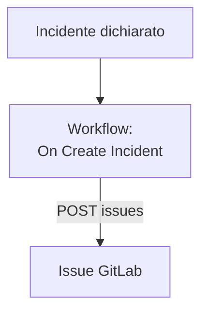

# GitLab

Apri una issue [GitLab](https://gitlab.com) per ogni incidente di OneUptime, così il lavoro che ne segue viene tracciato nel progetto a cui appartiene il servizio. Un workflow chiama la [Issues API](https://docs.gitlab.com/api/issues/#new-issue) di GitLab, su GitLab.com o su un tuo GitLab.

:::cards
- [Salvare il token](#salvare-il-token): Tieni il token di GitLab fuori dai tuoi workflow.
- [Aprire una issue per ogni incidente](#aprire-una-issue-gitlab-per-ogni-incidente): Un workflow, due blocchi.
- [Suggerimenti](#suggerimenti): Un tuo GitLab, percorsi dei progetti e assegnatari.
- [Risoluzione dei problemi](#risoluzione-dei-problemi): Quando GitLab rifiuta una richiesta.
:::

> [!NOTE]
> L'AI di OneUptime lavora anche nei repository GitLab: collegali in Codice con un token di accesso, e apre una merge request per ogni correzione. Vedi [Collegare un repository](/docs/ai/ai-agent#collegare-un-repository).

## Come funziona



Il workflow viene eseguito una volta per ogni nuovo incidente. Il suo blocco **API Post (JSON)** invia il titolo e la descrizione dell'incidente alle issue del progetto, firmati con un token di accesso.

## Prima di iniziare

- L'ID del progetto GitLab. Nella pagina di panoramica del progetto, seleziona il menu delle azioni, i tre puntini verticali, poi **Copy project ID**.
- Un token di accesso GitLab con lo scope `api`, per un utente o un bot il cui ruolo nel progetto possa creare issue: un token di accesso di progetto, di gruppo o personale. Crealo in **Settings → Access tokens** nel progetto, nel gruppo o nelle impostazioni del tuo utente.
- In OneUptime, il permesso di creare workflow e variabili globali. Su OneUptime Cloud, i workflow richiedono il piano **Growth** o superiore.

## Salvare il token

:::steps
1. Vai su **Flussi di lavoro → Variabili globali** e fai clic su **Crea: Flusso di lavoro Variabile**.
2. Chiamala `GITLAB_TOKEN` e fai clic su **Avanti**.
3. Incolla il token in **Contenuto**, attiva **Segreto** e fai clic su **Crea: Flusso di lavoro Variabile**.
:::

Una variabile segreta viene sostituita da `[REDACTED]` nei log delle esecuzioni, quindi il token non compare mai in un'esecuzione.

## Aprire una issue GitLab per ogni incidente

:::steps
### Creare il workflow

Vai su **Flussi di lavoro**, fai clic su **Crea flusso di lavoro**, poi su **Parti da zero**. Chiamalo `Incidents to GitLab` e fai clic su **Crea flusso di lavoro**.

### Aggiungere il trigger

Fai clic sul blocco tratteggiato **Scegli cosa avvia questo flusso di lavoro** e scegli **On Create Incident**. Fai clic sul trigger: i suoi **Fields to pass on** iniziano con **Titolo**, quindi fai clic su **Aggiungi campo** e scegli **Descrizione** e **Incident Number With Prefix**.

### Aprire la issue

Fai clic su **Aggiungi componente**, aggiungi un blocco **API Post (JSON)** e collegagli il punto **Success** del trigger. Imposta il suo **URL** su `https://gitlab.com/api/v4/projects/12345678/issues`, con l'ID del tuo progetto al posto di `12345678`. In **Altri campi**, imposta le sue **Request Headers** su:

```json
{
  "PRIVATE-TOKEN": "{{global.variables.GITLAB_TOKEN}}"
}
```

E il suo **Request Body** su:

```json
{
  "title": "{{local.components.incident-on-create-1.returnValues.model.title}}",
  "description": "{{local.components.incident-on-create-1.returnValues.model.description}}\n\nOpened by OneUptime for incident {{local.components.incident-on-create-1.returnValues.model.incidentNumberWithPrefix}}.",
  "labels": "incident,oneuptime"
}
```

### Provarlo, poi attivarlo

Fai clic su **Esegui flusso di lavoro**, scegli un incidente di prova sotto **Incidente** ed eseguilo. Il passo **API Post (JSON)** mostra una risposta `201` con la nuova issue, con il suo `iid` e il suo `web_url`. Poi attiva **Abilitato** in cima al **Costruttore**.
:::

Il blocco invia JSON, quindi non ha bisogno di un'intestazione `Content-Type`. GitLab crea le etichette che non ha ancora visto, quindi `incident` e `oneuptime` non richiedono alcuna preparazione. La issue resta aperta quando l'incidente viene risolto, perché il lavoro che ne segue di solito dura più dell'incidente.

## Suggerimenti

- **Un tuo GitLab.** Invia invece la richiesta al tuo server: `https://gitlab.example.com/api/v4/projects/12345678/issues`. Un server su un indirizzo di rete privato ha bisogno di un OneUptime self-hosted il cui amministratore lo consenta: vedi [Accesso alla rete in uscita](/docs/workflows/configuration#accesso-alla-rete-in-uscita).
- **Il percorso del progetto al posto del suo ID.** Il percorso funziona al posto dell'ID, con la sua `/` scritta come `%2F`: `projects/your-group%2Fyour-project/issues`. L'URL viene inviato esattamente come è scritto, quindi codificalo tu.
- **Assegnala.** Aggiungi `"assignee_ids": [42]` o `"due_date": "2026-12-31"` al corpo, oppure `"confidential": true` per mostrarla solo ai membri del progetto.
- **Solo alcuni incidenti.** Metti un blocco **If / Else** tra il trigger e il blocco API, e apri issue solo sul suo lato **Yes**, per esempio per una gravità.

## Risoluzione dei problemi

Il passo **API Post (JSON)** prende **Error** quando GitLab rifiuta la richiesta. I suoi **Response Status** e **Response Body** nell'esecuzione dicono perché.

:::details GitLab risponde 401
Il token è sbagliato, scaduto o revocato. Creane uno nuovo e sostituisci il contenuto di `GITLAB_TOKEN`.
:::

:::details GitLab risponde 403
Il token non ha lo scope `api`, oppure il ruolo del suo utente nel progetto non può creare issue. Il corpo nomina `insufficient_scope` quando si tratta dello scope.
:::

:::details GitLab risponde 404
L'ID del progetto nell'**URL** è sbagliato, oppure il token non può vedere il progetto. GitLab risponde 404, non 403, per un progetto privato che un token non può vedere.
:::

:::details GitLab risponde 400
GitLab non riesce a leggere il corpo: manca `title`, oppure un campo ha il tipo sbagliato. Il corpo nomina il campo.
:::

## Prossimi passi

:::cards
- [GitHub](/docs/integrations/github): Lo stesso workflow per GitHub, e la GitHub App.
- [Componenti del workflow](/docs/workflows/components#api): Ogni impostazione dei blocchi API.
- [Esecuzioni del workflow](/docs/workflows/runs-and-logs): Leggi cosa ha inviato e ricevuto ogni richiesta.
- [Panoramica delle integrazioni](/docs/integrations/index): Gli schemi dietro ogni integrazione.
:::
