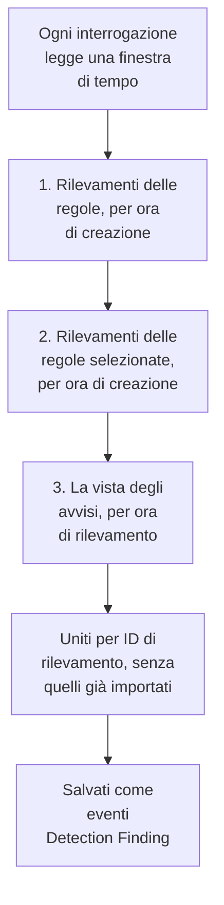

# Google SecOps

Porta gli avvisi e i rilevamenti di [Google SecOps](https://cloud.google.com/security/products/security-operations) (in precedenza Chronicle) negli eventi di sicurezza di OneUptime. Lì li cerchi accanto a log, trace e metriche, li correli con ogni altra fonte e chiami la reperibilità per quelli che contano.

:::cards
- [Scegliere come collegarsi](#scegliere-come-collegarsi): Un webhook da un playbook SOAR, il connettore gestito o l'inoltro UDM.
- [Configurare il connettore gestito](#configurare-il-connettore-gestito): Una chiave di account di servizio e il modulo della connessione.
- [Come interroga il connettore](#come-interroga-il-connettore): Tre letture di ogni finestra, e i loro budget.
- [Risoluzione dei problemi](#risoluzione-dei-problemi): Cosa dice Last Error e cosa fare.
- [Inviare eventi di sicurezza a Google SecOps](#inviare-eventi-di-sicurezza-a-google-secops): I rilevamenti di OneUptime, in Google SecOps.
:::

## Scegliere come collegarsi

| Strada | Cosa arriva | Usala quando |
| --- | --- | --- |
| Un webhook da un playbook SOAR | Ogni avviso che un playbook pubblica, in pochi secondi | Esegui playbook SOAR e vuoi i loro avvisi in OneUptime senza polling. |
| Il connettore gestito | Gli avvisi, e i rilevamenti delle regole se lo scegli, interrogati a intervalli | Vuoi che OneUptime li recuperi per te, senza nulla da configurare in SecOps. |
| L'inoltro degli eventi UDM | Eventi UDM grezzi, per ricerca e correlazione complete | Esporti già eventi UDM e li vuoi tutti. |

Ogni strada normalizza ciò che arriva in [OCSF](https://schema.ocsf.io/), l'Open Cybersecurity Schema Framework in cui OneUptime salva ogni evento di sicurezza, così regole di rilevamento e dashboard funzionano allo stesso modo qualunque sia la fonte.

## Prima di iniziare

- Per il connettore gestito, in OneUptime, il ruolo Project Owner, Project Admin o Security Admin. I ruoli Security Member e Security Viewer possono leggere le connessioni, ma non crearle.
- Per il webhook e l'inoltro UDM, una chiave di ingestione: apri **Impostazioni del progetto → Telemetria e APM → Chiavi di acquisizione** e fai clic su **Crea chiave di ingestione**.
- Per il connettore gestito, il permesso di creare un account di servizio Google Cloud nel progetto a cui è associata la tua istanza SecOps.

## Inviare gli avvisi da un playbook SOAR

I playbook SOAR di Google SecOps possono pubblicare avvisi su qualsiasi endpoint HTTP. Indirizzane uno verso l'ingestione degli eventi di sicurezza di OneUptime.

:::steps
### Aggiungere un'azione HTTP request

Nel tuo playbook SOAR di SecOps, aggiungi un'azione **HTTP request** che venga eseguita sui nuovi avvisi.

### Indirizzarla verso OneUptime

Imposta il suo **Method** su `POST` e il suo **URL** su `https://oneuptime.com/security-events/v1/ingest`, o `https://<your-host>/security-events/v1/ingest` su un'installazione self-hosted. Aggiungi queste intestazioni:

```text
Content-Type: application/json
x-oneuptime-token: <your telemetry ingestion key>
```

Invia il JSON dell'avviso come **Body**. Un rilevamento, i dettagli della regola con gli eventi UDM corrispondenti in `collectionElements`, viene riconosciuto da solo, salvato come evento Detection Finding, e utenti, host e IP dei suoi eventi corrispondenti vengono conservati come osservabili.

### Verificare che gli avvisi arrivino

Esegui il playbook. I suoi avvisi compaiono in **Prodotti → Security Events** in pochi secondi.
:::

## Inoltrare gli eventi UDM

Per ricerca e correlazione complete, inoltra gli eventi UDM stessi, per esempio da una pipeline di esportazione BigQuery, una Cloud Function o qualsiasi forwarder che esegui già:

```bash
curl -X POST "https://oneuptime.com/security-events/v1/ingest?format=udm" \
  -H "Content-Type: application/json" \
  -H "x-oneuptime-token: <your telemetry ingestion key>" \
  -d '{
    "events": [
      {
        "metadata": {
          "event_type": "USER_LOGIN",
          "event_timestamp": "2026-08-21T10:00:00Z",
          "vendor_name": "Google",
          "product_name": "Google SecOps"
        },
        "principal": { "user": { "userid": "alice" }, "ip": ["203.0.113.7"] },
        "target": { "hostname": "vpn-gw-01" },
        "security_result": [{ "severity": "HIGH", "action": ["BLOCK"] }]
      }
    ]
  }'
```

- `format` può essere `udm`, `ocsf`, `google-secops-alert` o `generic`. Se lo ometti, il formato viene rilevato evento per evento.
- Il corpo può essere un evento, un elenco di eventi o `{ "events": [...] }`.
- `x-oneuptime-service-name` nomina il servizio di telemetria a cui appartengono gli eventi. Senza, appartengono al servizio che prende il nome dal prodotto del payload.

## Configurare il connettore gestito

OneUptime interroga i rilevamenti e gli avvisi del tuo tenant a intervalli, senza configurazione SOAR. Google SecOps è un provider delle Security Event Connections, quindi viene creato, testato, interrogato e diagnosticato nella stessa pagina e nello stesso modo di ogni altro connettore gestito.

:::steps
### Creare una chiave di account di servizio

In Google Cloud, crea un account di servizio nel progetto a cui è associata la tua istanza SecOps e concedigli il ruolo **Chronicle API Viewer** (`roles/chronicle.viewer`). Quel ruolo include le autorizzazioni `legacySearchDetections`, `legacySearchCuratedDetections`, `countAllCuratedRuleSetDetections` e `legacyFetchAlertsView` con cui legge il connettore.

Nella scheda **Keys** dell'account di servizio, aggiungi una chiave di tipo **JSON** e scaricala. Incolli l'intero file nella connessione. Il suo `token_uri` deve essere un URL `https` su un host Google, come lo è già una chiave scaricata da Google Cloud.

### Trovare la regione e il nome della risorsa dell'istanza

In Google SecOps, apri **SIEM Settings → Profile**. Il nome della risorsa dell'istanza ha la forma `projects/{project}/locations/{location}/instances/{instance}`, dove il componente dell'istanza è l'ID dell'istanza SecOps; un nome visualizzato della connessione o il nome di un account di servizio non lo sostituisce. La regione è l'endpoint regionale che serve quella località, e deve corrispondere al segmento locations del nome della risorsa dell'istanza, altrimenti la connessione viene rifiutata al salvataggio.

### Aggiungere la connessione

Apri **Prodotti → Security Events → Connessioni** (`/dashboard/{projectId}/security-events/connections`), seleziona **Aggiungi connessione**, scegli **Google SecOps** e compila il modulo con le impostazioni della tabella qui sotto.

### Testare prima di salvare

Seleziona **Prova queste impostazioni** in **Testa prima di salvare** prima di salvare. Il test usa i valori del modulo senza salvare nulla, quindi una chiave malformata, un ruolo mancante o un'istanza sbagliata vengono individuati prima che la connessione esista. Nel modulo di modifica, lo stesso pulsante testa la **Regione**, l'**Nome della risorsa dell'istanza** e il **Data to import** mostrati a schermo con la chiave salvata; un campo delle credenziali lasciato vuoto mantiene la chiave salvata. Quando qualcosa di testato differisce da ciò che la connessione ha salvato, compresa una chiave appena inserita, non viene registrata alcuna riga nella cronologia delle esecuzioni, perché la connessione non ha ancora quelle impostazioni.
:::

| Impostazione | Dove trovarla | Obbligatoria |
| --- | --- | --- |
| **Regione** | L'endpoint regionale di Google SecOps (`us`, `europe`, `asia-southeast1`, ...) che corrisponde alla località nel nome della risorsa della tua istanza. Non c'è un valore predefinito, così un tenant fuori dagli Stati Uniti non può salvare per errore l'endpoint sbagliato. | Sì |
| **Nome della risorsa dell'istanza** | In Google SecOps, **SIEM Settings → Profile**: `projects/{project}/locations/{location}/instances/{instance}`. | Sì |
| **Chiudi gli avvisi quando il loro caso viene chiuso** | All'ultimo passo del modulo, disattivato finché non lo attivi. Attivato, chiudere un caso chiude i suoi avvisi di Google SecOps: vedi [Chiudi gli avvisi quando il loro caso viene chiuso](#chiudi-gli-avvisi-quando-il-loro-caso-viene-chiuso). | No |
| **JSON dell'account di servizio** | Google Cloud, la scheda **Keys** dell'account di servizio. Incolla l'intero file della chiave JSON. Solo scrittura: cifrato a riposo, mai restituito dall'API, mai più mostrato nella pagina. Usa **Aggiorna le credenziali** sulla connessione per ruotarlo. | Sì |
| **Data to import** | Gli **Avvisi** vengono sempre importati, perché l'API degli avvisi di Google li restituisce sempre. Seleziona **Rilevamenti** per importare anche le corrispondenze delle regole che non hanno generato un avviso. Questo non inoltra eventi UDM grezzi: inoltrali tu, come sopra. | Avvisi sempre |

Il passaggio di polling del modulo chiede un **Nome**, una **Descrizione** facoltativa, l'impostazione **Abilitato** della connessione e il **Intervallo di interrogazione (minuti)**: un numero intero da `1` a `1440`, predefinito `5`. Qualsiasi valore fuori da questo intervallo viene rifiutato al salvataggio.

I nuovi rilevamenti vengono importati come eventi Detection Finding attribuiti a un servizio di telemetria `Google SecOps`.

## Leggere lo stato della connessione

L'elenco delle connessioni mostra **Nome**, **Provider** (con sotto la selezione Data to import della connessione), **Stato** (Enabled o Disabled), **Integrità**, **Intervallo (minuti)**, **Ultima interrogazione**, **Ultima interrogazione riuscita** e **Ultimo evento importato**. Quando una connessione ha un errore, **Visualizza errore** compare nella sua colonna **Azioni**, accanto a **Testa la connessione**, **Esegui ora**, **Diagnostica**, **Modifica** e **Aggiorna le credenziali**. Enabled significa che il polling automatico è configurato. Last Polled registra un tentativo; una finestra vuota riuscita non dimostra che un certo rilevamento sia stato importato.

**Integrità** indica **Last poll succeeded** solo una volta che un evento è stato importato. Fino ad allora una connessione che riesce indica **Polling, no events imported yet**, lo stato da indagare con Testa la connessione. Gli altri stati sono **No records returned**, **Partial import**, **Catching up**, **Last poll failed**, **Poll overdue**, **Schedule paused** e **In attesa della prima interrogazione**; passa il mouse su uno stato per vedere cosa significa.

> [!NOTE]
> Il connettore usa le API legacy `v1alpha` di rilevamenti e avvisi di Chronicle, che Google distribuisce come pre-GA. Quando un'interrogazione fallisce, il campo **Ultimo errore** della connessione conserva il messaggio di errore completo, con le credenziali oscurate, dietro un prefisso che nomina il passaggio fallito, anche nel caso in cui Chronicle risponde `200` e mette il rifiuto nel corpo. Seleziona **Visualizza errore** nella colonna **Azioni** della connessione per leggere il messaggio, poi **Copia errore** nella finestra di dialogo per copiarlo per il supporto.

## Come interroga il connettore



Una volta al minuto un worker in background mette in coda un'interrogazione per ogni connessione abilitata il cui intervallo è trascorso dall'ultima interrogazione. Ogni interrogazione è un'esecuzione nella cronologia della connessione, eseguita da un worker. Legge una finestra di tempo in tre modi e unisce i risultati per ID di rilevamento, così un record restituito da più di un passaggio viene salvato una volta sola:

1. **Rilevamenti delle regole per ora di creazione.** `legacy:legacySearchDetections` con `ruleId=-` (ogni revisione di ogni regola) e `listBasis=CREATED_TIME`, seguendo `nextPageToken` finché la pagina non è l'ultima.
2. **Rilevamenti delle regole selezionate per ora di creazione.** `legacy:legacySearchCuratedDetections`, allo stesso modo, una volta per ogni regola selezionata (scritta da Google). Quell'endpoint accetta un solo ID di regola selezionata (`ur_...`) e non ha un carattere jolly per «ogni regola», quindi il passaggio chiama prima `:countAllCuratedRuleSetDetections` per la settimana precedente la finestra fino alla sua fine, e cerca in ogni regola selezionata che ha prodotto rilevamenti. Una regola selezionata che non è scattata in quella settimana non ha nulla da importare. Un tenant senza accesso alle regole selezionate risponde a questo passaggio con `400`, `403` o `404`; questo viene registrato come un avviso sull'esecuzione, non come un errore.
3. **La vista degli avvisi per ora di rilevamento.** `legacy:legacyFetchAlertsView`, che copre gli avvisi di telemetria, gli avvisi SOAR e gli avvisi di machine intelligence oltre agli avvisi delle regole. L'endpoint non ha paginazione, quindi una risposta che Google limita viene divisa in finestre più piccole e riletta.

La vista degli avvisi può filtrare solo per ora di rilevamento, e Google rende spesso leggibile un avviso molto dopo la sua ora di rilevamento (ritardo di ingestione, regole pianificate, riesecuzioni su dati in ritardo). Un'interrogazione pianificata quindi **scorre anche la vista degli avvisi sulle 24 ore prima della sua finestra**, solo avvisi, registrato come il controllo **Read late alerts by detection time**. I record già importati vengono saltati, quindi le ripetizioni di questo scorrimento compaiono in **Already imported**. Lo scorrimento è fatto al meglio: quando Google lo limita, il suo budget si esaurisce o fallisce, l'esecuzione riceve un avviso, ma l'interrogazione non diventa Partial né Non riuscito e il cursore avanza comunque, perché il giorno a cui torna indietro è già stato letto da interrogazioni precedenti.

Interrogare per **ora di creazione** è l'intero progetto. Una regola di Google SecOps gira secondo una pianificazione (ogni 10 minuti, ogni ora, ogni giorno), e il rilevamento che crea porta un `detectionTime` che è la fine della finestra temporale della regola o l'ora dell'evento corrispondente, mentre `createdTime` è quando il motore di rilevamento lo ha effettivamente prodotto. Un rilevamento creato alle 10:05 per una finestra che termina alle 09:00 ha un'ora di rilevamento già dietro un cursore che ha superato le 09:00 diverse interrogazioni fa, quindi un connettore che interroga per ora di rilevamento non lo vede mai, e nemmeno un evento arrivato in ritardo. Leggere per ora di creazione fa chiedere a ogni interrogazione «cosa ha creato Google dall'ultima volta che ho guardato», che è la domanda che ha una risposta. Ogni esecuzione registra il suo ritardo di creazione, quanti record recuperati sono stati creati più di un intervallo di polling (più un minuto) dopo la loro ora di rilevamento, e lo scarto più grande, così l'effetto è visibile in Diagnostics.

La prima interrogazione di una nuova connessione guarda indietro di **24 ore** per ora di creazione. Ogni interrogazione successiva riprende dal cursore salvato della connessione con una sovrapposizione di **1 minuto**; un record creato al confine di una finestra viene letto da entrambe le interrogazioni e salvato una volta, perché le interrogazioni saltano gli eventi già salvati con lo stesso identificatore di origine. Ogni interrogazione pianificata legge al massimo **24 ore** oltre il cursore, quindi una connessione con un cursore salvato più vecchio recupera in finestre consecutive di 24 ore (Health indica **Catching up**) invece di scartare i rilevamenti intermedi. Usa **Import this time range** in Diagnostics per i record creati prima della prima finestra di 24 ore.

### Quando una finestra contiene più di quanto un'interrogazione possa leggere

Il connettore dà a ogni interrogazione budget fissi: il passaggio dei rilevamenti delle regole ha **20** pagine di ricerca, il passaggio delle regole selezionate fino a **200** richieste (il conteggio più almeno una pagina per ogni regola selezionata scattata nell'ultima settimana, prima le regole più attive), la vista degli avvisi e il suo scorrimento degli avvisi in ritardo condividono **16** richieste, e l'intera lettura si ferma dopo **4 minuti**. Il passaggio delle regole selezionate non inizia altre regole selezionate una volta speso il 60% di quel tempo, così la vista degli avvisi viene comunque eseguita. Quando un'interrogazione non può cercare in ogni regola selezionata attiva, registra un avviso che dice quante non sono state cercate invece di trattenere il cursore, perché una finestra più corta avrebbe comunque tutte quelle regole da cercare. Un passaggio che un budget ha fermato a metà viene registrato come un controllo di avviso che nomina il budget (per esempio `Read rule detections by created time was stopped by the request budget after 20 requests.`), e un passaggio che il budget non ha mai lasciato iniziare è un controllo saltato con lo stesso motivo negli avvisi dell'esecuzione, mai un successo. Una finestra con più rilevamenti di così non si può leggere in un'interrogazione, e il polling non rilegge mai all'infinito la stessa finestra:

1. **Restringere.** Gli endpoint di ricerca di Google restituiscono prima i rilevamenti più recenti, quindi un'interrogazione che si ferma presto non ha un punto da cui riprendere. L'interrogazione viene registrata come **Parziale**, il cursore resta dov'era e l'interrogazione successiva legge una finestra lunga la metà dallo stesso punto di partenza, con l'avviso `This window holds more records than one poll can read; the next poll reads a {n} minute window from the same starting point.` Il dimezzamento continua fino a un minuto, finché una finestra non ci sta.
2. **Tornare a crescere.** Ogni interrogazione completa raddoppia la finestra successiva, fino al massimo di 24 ore, così una raffica costa qualche interrogazione breve invece di una connessione lenta per sempre.
3. **Superare un singolo minuto.** Se anche un solo minuto contiene più rilevamenti di quanti un'interrogazione possa leggere, il polling sposta il cursore oltre quel minuto così i rilevamenti più recenti continuano ad arrivare. L'esecuzione è **Parziale** e lo stesso testo apre **Ultimo errore**: `More records were created in the one minute from {start} to {end} than one poll can read. Polling moved past this minute so newer records keep arriving; use Import this time range in Diagnostics on this minute to recover what one run can read.` Per recuperare ciò che un'esecuzione può leggere, apri **Diagnostica**, scegli un intervallo personalizzato che copra quel minuto (i campi dell'intervallo usano la tua ora locale; il messaggio è in UTC) ed esegui **Import this time range**; un'importazione ha gli stessi limiti per esecuzione di un'interrogazione. I rilevamenti già importati vengono saltati.

Un'interrogazione Partial salva anche i suoi avvisi in **Ultimo errore**, dove restano finché un'interrogazione completa non li cancella. Un'interrogazione che fallisce del tutto (un errore, non troppi record) mantiene il suo cursore e la lunghezza della finestra e viene riprovata al ciclo successivo. L'unica eccezione è una richiesta scaduta: l'interrogazione successiva legge una finestra lunga la metà dallo stesso punto di partenza (`The source did not answer in time for this window; the next poll reads a {n} minute window from the same starting point.`), perché una finestra troppo pesante per ricevere risposta in tempo scadrebbe altrimenti a ogni nuovo tentativo. Accorciare l'intervallo di polling non cambia nulla di tutto questo: la finestra la decidono il cursore e l'esito dell'ultima interrogazione, non la frequenza delle interrogazioni.

## Testare la connessione

**Testa la connessione**, sulla riga della connessione o in **Diagnostica**, viene eseguito in modo sincrono nel processo dell'API. Non ha bisogno di un worker in background, ed è proprio per questo che può dirti quando nessun worker è in esecuzione. L'elenco dei controlli:

1. **Configurazione**: ogni campo è presente e ben formato: una **Regione** supportata che corrisponde alla località dell'istanza, un **Nome della risorsa dell'istanza** della forma giusta e una chiave **JSON dell'account di servizio** con `client_email`, una `private_key` leggibile e un `token_uri` di Google. Non viene contattato nulla se questo fallisce.
2. **Authenticate with Google**: la chiave viene scambiata con un token di accesso presso l'endpoint OAuth di Google, prima che Chronicle venga contattato.
3. **Read rule detections**, **Read curated rule detections** e **Read the alerts view**: una sonda di un solo record per ogni passaggio sulle ultime 24 ore. Il controllo delle regole selezionate legge i conteggi delle regole selezionate degli ultimi 7 giorni e sonda la regola selezionata con più rilevamenti; se in quella settimana non è scattata nessuna regola selezionata, riesce senza nulla da sondare. Una lettura delle regole selezionate a cui viene risposto `400`, `403` o `404` è un avviso, perché il tenant potrebbe semplicemente non avere accesso alle regole selezionate.
4. **Detections available to import**: cosa ha Google con la selezione **Data to import** salvata e con l'altra (solo Avvisi, o Avvisi e **Rilevamenti**) sulle ultime 24 ore e sugli ultimi 7 giorni: il conteggio delle corrispondenze della vista degli avvisi e una pagina di ricerca per ora di creazione per intervallo, riportato come numero o come `1000+`. Quando la selezione salvata non ha nulla ma l'altra sì, il controllo avvisa: le tue regole creano rilevamenti, ma gli avvisi non sono abilitati su di esse. Modifica la connessione e seleziona **Rilevamenti** in **Data to import**, oppure abilita gli avvisi sulle regole in Google SecOps.
5. **Background workers**, **Poll scheduler** e **Security event storage**: se un processo sta consumando la coda Worker di OneUptime, se il job di polling al minuto è registrato e se l'archivio degli eventi di sicurezza risponde alla stessa ricerca di duplicati che il polling esegue prima di ogni inserimento, così un database analitico guasto fallisce qui con un nome invece che un'ora dopo come errore di polling.
6. **Scheduled polling** (solo connessioni salvate): se il polling è abilitato, se un'esecuzione in coda è bloccata in attesa di un worker e se la connessione viene interrogata secondo la pianificazione.

Ogni richiesta di un test ha una scadenza di 20 secondi. I test non toccano il cursore di polling né l'archivio degli eventi. Una connessione salvata testata con le sue impostazioni salvate riceve una riga nella cronologia delle esecuzioni di tipo test, e i dettagli della riga mostrano lo stesso elenco di controlli.

## Anteprima, esecuzione e importazione su richiesta

Apri **Diagnostica** su una connessione per vedere le esecuzioni recenti e gestire il connettore. I proprietari del progetto, gli amministratori del progetto e gli amministratori della sicurezza possono avviare operazioni. I membri e i lettori della sicurezza possono leggere la cronologia.

- **Esegui ora** mette subito in coda un'interrogazione, con il cursore e il percorso di ingestione normali, anche quando il polling pianificato è disabilitato. Gli stati in coda e in esecuzione restano visibili mentre il worker esegue la richiesta. Se un'esecuzione resta in coda, verifica che dei worker stiano elaborando la coda Worker; il controllo **Background workers** di Testa la connessione dice se un processo lo sta facendo.
- **Preview detections** legge un intervallo di tempo scelto senza importare né cambiare il cursore. Usa l'ultima ora, 24 ore, 7 giorni o un intervallo personalizzato fino a 7 giorni. L'intervallo corrisponde alla vista degli avvisi di SecOps, che legge per ora di rilevamento, e i due passaggi di ricerca leggono i rilevamenti creati al suo interno oltre a quelli la cui ora di rilevamento vi ricade, quindi l'anteprima di ieri mostra anche rilevamenti creati ieri su eventi più vecchi. L'anteprima mostra separatamente l'ora di rilevamento e l'ora di creazione. I risultati seguono la selezione **Data to import** salvata della connessione.
- **Import this time range** importa l'intervallo scelto, dopo la tua conferma, senza spostare il cursore di polling. È anche il modo per recuperare un minuto che il polling ha superato, come descritto sopra. Guarda prima l'anteprima dell'intervallo. Interrogazioni e importazioni ripetute saltano gli eventi già salvati con lo stesso identificatore di origine nel progetto. Le importazioni possono attivare le regole di rilevamento e i monitor configurati, proprio come il polling pianificato.

I dettagli di ogni esecuzione mostrano la **Requested window (UTC)**, la selezione **Data to import** della connessione e cinque conteggi:

| Conteggio | Cosa conta |
| --- | --- |
| **Returned by Google SecOps** | I record che Google ha restituito nei tre passaggi, dopo l'unione per ID. |
| **Imported into OneUptime** | Le righe scritte nell'archivio degli eventi. |
| **Already imported** | I record saltati perché lo stesso identificatore di origine è già salvato in questo progetto; la sovrapposizione di 1 minuto e le riesecuzioni rendono questo normale. |
| **Rifiutato** | Gli oggetti restituiti che non sono rilevamenti di Google SecOps. Vengono contati e segnalati, mai riprovati, e non trattengono il cursore. |
| **Non riuscito** | I record che non è stato possibile normalizzare. Un'interrogazione li riprova in una finestra più corta. |

I **Provider details** aggiungono il **Time basis read**, i record **Returned by each pass** (rilevamenti delle regole, rilevamenti delle regole selezionate e vista degli avvisi) e il **Creation lag**. Seguono i controlli, uno per passaggio, gli avvisi e alcuni rilevamenti di esempio. I dettagli di un'interrogazione pianificata mostrano anche la **Window read by this poll** e cosa **Next scheduled poll reads**, e un'interrogazione Partial dice se ha mantenuto il suo punto di partenza e ristretto la finestra successiva, o se ha superato un singolo minuto che nomina. **Successo**, **No records returned**, **Parziale** e **Non riuscito** sono esiti distinti.

Usa **View events in this time range** su un'esecuzione per aprire l'intervallo di tempo degli eventi dei rilevamenti che ha restituito. Altrimenti un rilevamento creato oggi con l'ora di rilevamento di ieri può essere nascosto da un filtro sugli eventi recenti. La cronologia delle esecuzioni conserva gli errori anche dopo che un'interrogazione completa successiva ha cancellato Last Error. Usa **Copy diagnostics** quando contatti il supporto; le credenziali dell'account di servizio e i token non sono mai inclusi.

## Perché non vedo eventi?

Verifica questi punti in ordine. Ognuno si distingue dal successivo in **Diagnostica** o con **Testa la connessione**.

1. **Data to import.** Per impostazione predefinita vengono importati solo gli **Avvisi**, e un rilevamento di regola è un avviso solo quando gli avvisi sono abilitati sulla regola in Google SecOps. Un tenant le cui regole creano rilevamenti senza avvisi interroga onestamente a vuoto per sempre. Esegui **Testa la connessione**: il controllo **Detections available to import** conta con e senza **Rilevamenti** e lo dice quando selezionarle aggiungerebbe record. Modifica la connessione e seleziona **Rilevamenti** in **Data to import**, oppure abilita gli avvisi sulle regole.
2. **Frequenza di esecuzione delle regole e latenza di rilevamento.** I rilevamenti vengono creati quando la regola gira, il che può avvenire fino a un'ora o un giorno dopo gli eventi che descrivono. Il connettore interroga per ora di creazione, quindi arrivano alla prima interrogazione dopo che Google li ha creati, non alla loro ora di rilevamento. Una regola appena abilitata non ha ancora creato nulla, e un tenant tranquillo non ha nulla da creare. Il controllo di disponibilità riporta quanti rilevamenti sono stati creati nelle ultime 24 ore e negli ultimi 7 giorni; zero con e senza **Rilevamenti** significa che Google non ha ancora nulla che OneUptime possa importare.
3. **Leggi i conteggi dell'ultima esecuzione.** In Diagnostics, **Returned by Google SecOps** con zero in **Imported into OneUptime** e un conteggio **Already imported** corrispondente è il connettore che funziona come previsto: quei rilevamenti li ha importati un'interrogazione precedente. I record **Rifiutato** sono oggetti che Google ha restituito e che non sono affatto rilevamenti.
4. **Qualcosa sta interrogando?** Last Polled che indica `Never` con un Last Error vuoto significa che nessuna interrogazione è terminata per questa connessione. Testa la connessione riporta **Background workers** (i processi che consumano la coda Worker), **Poll scheduler** (la registrazione dello scheduler al minuto) e **Scheduled polling** (la pianificazione propria di questa connessione, compresa un'interrogazione in ritardo o un'esecuzione bloccata in coda). Vedi la voce di risoluzione dei problemi qui sotto per le impostazioni di deployment che lo causano.
5. **Cerca nel posto giusto.** Gli eventi vengono salvati sotto la loro ora di rilevamento, che può precedere di ore o giorni il momento in cui sono stati creati e importati, quindi un filtro «ultima ora» negli eventi di sicurezza nasconde un rilevamento importato un minuto fa su un evento di ieri. Usa **View events in this time range** su un'esecuzione in Diagnostics: apre l'intervallo di tempo degli eventi dei rilevamenti che quell'esecuzione ha restituito.

## Come viene impostata la gravità

Google SecOps memorizza la gravità di un rilevamento in posti diversi a seconda di chi ha scritto la regola, e OneUptime li legge in questo ordine, usando il primo che nomina una gravità:

1. **La gravità propria di Google** (`detection[].severity`). Google la imposta sulle regole selezionate, come Applied Threat Intelligence e i set di regole selezionate.
2. **La gravità dell'avviso** (la `severity` della Collection), per gli avvisi SOAR e i corpi dei webhook.
3. **La gravità `meta` della regola.** Per una regola YARA-L personalizzata, Google lascia vuoto `detection[].severity` e restituisce la sezione `meta` della regola come `ruleLabels`. OneUptime legge l'etichetta `severity`, che è il valore mostrato dalla dashboard delle regole di Google SecOps. Vengono riconosciuti Info, Informational, Low, Medium, High e Critical, con qualsiasi combinazione di maiuscole e minuscole.
4. **Il risultato `$risk_score` della regola**, se la regola non imposta alcuna gravità, classificato con gli [intervalli consigliati da Google](https://docs.cloud.google.com/chronicle/docs/yara-l/outcome-syntax): 90–100 Critical, 80–89 High, 50–79 Medium, 20–49 Low, 1–19 Informational. OneUptime usa solo un punteggio impostato dalla regola stessa. Ignora il `riskScore` che Google compila per le regole che non ne hanno uno (40 per le regole che generano avvisi, 15 altrimenti), perché quel valore predefinito non dice nulla su quanto sia grave il rilevamento.

Un rilevamento che nessuno di questi classifica viene mostrato come Unknown. Per classificare una regola personalizzata, aggiungi una gravità alla sua sezione `meta` in Google SecOps, per esempio `severity = "High"`, oppure imposta `$risk_score` nella sua sezione `outcome`. I rilevamenti che la regola crea da quel momento vengono importati con quella gravità.

## Chiudi gli avvisi quando il loro caso viene chiuso

Con **Chiudi gli avvisi quando il loro caso viene chiuso** attivo, chiudere un [caso di sicurezza](/docs/telemetry/security-cases#chiudere-un-caso) chiude gli avvisi di Google SecOps da cui è nato. Ogni avviso viene segnato come chiuso con il verdetto del caso, un True Positive come malevolo e un False Positive o un Benign Positive come non malevolo, insieme alla nota di chiusura del caso e a un link al caso. La cronologia del caso dice quanti avvisi sono stati chiusi.

- L'account di servizio ha bisogno di `chronicle.legacies.legacyUpdateAlert`, che il ruolo `roles/chronicle.editor` ha. Il ruolo `roles/chronicle.viewer` legge gli avvisi ma non può chiuderli, e un `403` lo segnala sul caso.
- Un avviso che Google SecOps non ha più viene saltato. Quando Google SecOps non è raggiungibile, OneUptime riprova per circa un'ora, poi scrive sul caso cosa non è riuscito a chiudere.

## Controllare gli altri eventi per i suoi indicatori

Un [feed di threat intelligence](/docs/telemetry/threat-intelligence#come-viene-letto-google-secops) la cui **Origine** è **Google SecOps** legge, tramite questa connessione, gli indicatori che la threat intelligence di Google SecOps ha trovato nei suoi eventi, e controlla il resto degli eventi del tuo progetto per trovarli: gli accessi, i flussi di rete e gli eventi degli endpoint che Google SecOps non ha mai visto.

## Inviare eventi di sicurezza a Google SecOps

OneUptime può anche inviare ciò che trova a Google SecOps, così il SIEM in cui lavora il tuo team vede i rilevamenti di OneUptime accanto ai propri. Ogni evento di sicurezza viene importato come evento UDM: un accesso come `USER_LOGIN`, l'avvio di un processo come `PROCESS_LAUNCH`, una connessione di rete come `NETWORK_CONNECTION` e tutto il resto come `GENERIC_EVENT`, con la sua gravità, i suoi tag MITRE ATT&CK e la regola che l'ha trovato.

:::steps
### Creare una chiave che possa importare eventi

In Google Cloud, crea un account di servizio nel progetto a cui è collegata la tua istanza SecOps e assegnagli un ruolo con l'autorizzazione `chronicle.events.import`, come **Chronicle API Editor** (`roles/chronicle.editor`). Nella sua scheda **Keys**, aggiungi una chiave di tipo **JSON** e scaricala.

### Aggiungere la destinazione

Apri **Prodotti → Security Events → Connessioni**. In **Invia al tuo SIEM**, fai clic su **Aggiungi destinazione**, scegli Google SecOps in **SIEM** e fai clic su **Avanti**. Scegli la **Regione**, inserisci il **Nome della risorsa dell'istanza** come per il connettore qui sopra e incolla la chiave in **JSON dell'account di servizio**.

### Inviare un evento di prova

Fai clic su **Invia un evento di prova**. Un `GENERIC_EVENT` del prodotto `OneUptime Security Events` arriva a Google SecOps con le impostazioni del modulo, e non viene salvato niente. Compare in Google SecOps entro pochi minuti.

### Scegliere cosa inviare

In **Cosa inviare**, lascia **Solo rilevamenti**, cioè ciò che hanno trovato le tue regole e la tua threat intelligence e gli avvisi sollevati dai prodotti connessi, oppure scegli **Tutti gli eventi di sicurezza**. Fai clic su **Inizia a inviare**.
:::

- Una destinazione invia gli eventi che arrivano dal momento in cui viene salvata, mai la cronologia del progetto, e invia quelli nuovi ogni minuto.
- Gli avvisi che OneUptime ha importato da Google SecOps non gli vengono mai rimandati.
- Quando Google SecOps non risponde o rifiuta un lotto, la destinazione mantiene la sua posizione e riprova all'esecuzione successiva. Il suo **Stato** indica **In errore**, e **Visualizza errore** mostra cosa ha risposto Google SecOps.

## Risoluzione dei problemi

:::details I rilevamenti delle regole personalizzate mostrano la gravità Unknown mentre quelli delle regole selezionate sono classificati
La regola non imposta alcuna gravità. Aggiungi `severity = "Low"`, `"Medium"`, `"High"` o `"Critical"` alla sezione `meta` della regola, oppure imposta `$risk_score` nella sua sezione `outcome` (vedi [Come viene impostata la gravità](#come-viene-impostata-la-gravità)). Anche le versioni precedenti a questa modifica ignoravano la gravità `meta` di una regola personalizzata; l'aggiornamento riclassifica i rilevamenti importati da quelle versioni, usando le etichette della regola salvate con ogni rilevamento.
:::

:::details Gli avvisi compaiono in Google SecOps ma mai in OneUptime
Aggiorna a una versione che legge i rilevamenti delle regole selezionate una regola selezionata alla volta e che scorre la vista degli avvisi alla ricerca di avvisi in ritardo. Le versioni precedenti inviavano `ruleId=-` a `legacySearchCuratedDetections`, che non ha carattere jolly, quindi Google rispondeva a ogni ricerca delle regole selezionate con un successo vuoto; e leggevano la vista degli avvisi solo sui pochi minuti di ora di rilevamento dell'interrogazione stessa, quindi un avviso che Google rendeva leggibile più tardi non veniva mai visto. Entrambe le cose sembravano una connessione sana e tranquilla. Dopo l'aggiornamento, usa **Import this time range** in Diagnostics per importare gli ultimi 7 giorni.
:::

:::details Google restituisce zero record
Controlla in Diagnostics la finestra di tempo esatta, la base temporale e la selezione **Data to import** salvata, ed esegui Testa la connessione per leggere i conteggi di disponibilità con e senza **Rilevamenti**. Una corrispondenza di regola senza avviso richiede la casella **Rilevamenti**. Guarda l'anteprima di un periodo che copra sia la sua ora di rilevamento sia la sua ora di creazione. La prima interrogazione pianificata guarda indietro di 24 ore per ora di creazione; usa **Import this time range** per i record più vecchi.
:::

:::details Health indica Partial import
Apri l'ultima esecuzione in **Diagnostica** e leggi i suoi avvisi; gli stessi avvisi sono in Last Error. `This window holds more records than one poll can read; ...` significa che il polling sta restringendo la sua finestra dallo stesso punto di partenza e non serve fare nulla: torna a crescere quando le interrogazioni si completano. `More records were created in the one minute from ...` significa che il polling ha superato quel minuto; importalo con **Import this time range** per recuperare i rilevamenti che ha saltato. Un avviso che dice che un passaggio è stato fermato, o non eseguito, dal budget di richieste o dal budget di tempo dell'interrogazione nomina il passaggio che è stato interrotto. Accorciare l'intervallo di polling non cambia la finestra. Un Last Error vuoto da solo non dimostra una copertura completa.
:::

:::details Health indica Poll overdue
Le interrogazioni pianificate non girano in orario. Controlla la coda dei worker ed esegui Testa la connessione per i controlli **Background workers** e **Scheduled polling**.
:::

:::details Stato indica Disabled
Il polling pianificato salta la connessione. Gli utenti autorizzati possono comunque testare, vedere l'anteprima, eseguire un'interrogazione con **Esegui ora** o importare da Diagnostics.
:::

:::details Last Polled è `Never` e Last Error è vuoto
Nessuna interrogazione è terminata per questa connessione. Apri **Diagnostica**: quando la sua cronologia delle esecuzioni non contiene interrogazioni, o solo una bloccata in coda, il worker in background non ha mai eseguito il job di polling, quindi nulla ha mai raggiunto Chronicle. Nei deployment self-hosted, la causa abituale è `DISABLE_QUEUE_WORKERS=true` sul container dell'app senza un deployment separato dei worker che svuoti le code. Imposta `DISABLE_QUEUE_WORKERS=false` (il valore predefinito di `config.example.env` con cui viene distribuito Docker Compose), oppure esegui il deployment dedicato dei worker (Helm: `worker.enabled: true`, che è `false` per impostazione predefinita). Testa la connessione lo segnala come un controllo **Background workers**, **Poll scheduler** o **Scheduled polling** fallito. Un'interrogazione che è partita ma si è fermata prima di raggiungere la connessione è invece un'esecuzione fallita in quella cronologia: `Another poll or import for this source is still running in this project` significa che un'altra interrogazione o importazione di Google SecOps in questo progetto teneva il blocco della sorgente, e la connessione viene rimessa in coda al ciclo successivo. Uno scheduler che non è riuscito nemmeno a mettere in coda un'interrogazione scrive `Scheduler could not queue a poll:` e il motivo in Last Error.
:::

:::details Last Error è valorizzato
È stata tentata un'interrogazione e qualcosa al suo interno è fallito, un'interrogazione non è riuscita a leggere l'intera finestra, oppure lo scheduler non è riuscito a mettere in coda un'interrogazione. Per un'interrogazione fallita il campo conserva il messaggio di errore completo, con le credenziali oscurate. Quando una connessione ha un errore, seleziona **Visualizza errore** nella sua colonna **Azioni** per aprire il messaggio completo, poi **Copia errore** nella finestra di dialogo per copiarlo per il supporto. Il campo si svuota alla successiva interrogazione completa, che rimuove anche l'azione **Visualizza errore**; la cronologia delle esecuzioni lo conserva. Leggi prima il prefisso. Un messaggio che inizia con `More records were created in the one minute from` è quel minuto saltato e non un errore; vedi **Health indica Partial import** sopra. Solo quattro prefissi portano uno stato HTTP, quindi un messaggio senza stato non è la prova di un guasto dal lato di OneUptime:

- `Google token exchange failed (HTTP ...)`: la credenziale dell'account di servizio è stata rifiutata dall'endpoint OAuth di Google, prima ancora che Chronicle venisse contattato. Di solito è una chiave malformata, revocata o di un altro progetto.
- `Google token exchange returned ...`: lo stesso endpoint OAuth ha risposto, ma con qualcosa di inutilizzabile: nessun `access_token`, o un corpo che non è JSON. Siamo ancora prima di Chronicle, e di solito è un proxy o un gateway nel mezzo e non la chiave stessa.
- `Google SecOps detections search failed (HTTP ...)`: Chronicle stesso ha rifiutato la ricerca per ora di creazione (`legacySearchDetections` o `legacySearchCuratedDetections`). Un `403` di solito significa che all'account di servizio manca il ruolo **Chronicle API Viewer** sul progetto a cui è associata l'istanza; nel passaggio delle regole selezionate un `400`, `403` o `404` viene declassato ad avviso perché il tenant potrebbe semplicemente non avere accesso alle regole selezionate.
- `Google SecOps detections search returned ...`: Chronicle ha risposto `200` alla ricerca, ma il corpo non era una pagina di rilevamenti leggibile: vuoto, non JSON o di una forma che il parser non riconosce. Viene segnalato invece di essere contato come una finestra tranquilla, così il cursore non può avanzare oltre ciò che è stato perso.
- `Google SecOps curated rule detection counts failed (HTTP ...)`: Chronicle ha rifiutato `countAllCuratedRuleSetDetections`, la chiamata che nomina le regole selezionate in cui cerca il passaggio delle regole selezionate. Un `400`, `403` o `404` viene declassato ad avviso per lo stesso motivo della ricerca delle regole selezionate; qualsiasi altra cosa fa fallire l'interrogazione.
- `Google SecOps curated rule detection counts returned ...`: Chronicle ha risposto `200` ai conteggi delle regole selezionate, ma il corpo era vuoto, non JSON o di una forma che il parser non riconosce. Viene segnalato invece di essere letto come «nessuna regola selezionata è scattata», così i rilevamenti delle regole selezionate non vengono saltati in silenzio.
- `Google SecOps alerts fetch failed (HTTP ...)`: Chronicle stesso ha rifiutato la richiesta alla vista degli avvisi. Un `403` di solito significa che all'account di servizio manca il ruolo **Chronicle API Viewer** sul progetto a cui è associata l'istanza; un `404` di solito significa che il nome della risorsa dell'istanza punta a un'altra istanza, o che il prefisso della regione non è uno servito da Chronicle.
- `Google SecOps alerts fetch returned ...`: Chronicle ha risposto `200`, ma il corpo non era un flusso leggibile di avvisi di rilevamento: vuoto, non JSON o di una forma che il parser non riconosce. Viene segnalato di proposito invece di essere contato come una finestra vuota: trattare un corpo che non è riuscito a leggere come «nessun avviso» farebbe avanzare il cursore oltre tutto ciò che è stato perso.
- `Google SecOps alerts query was rejected by Chronicle on an HTTP 200`: Chronicle ha accettato la richiesta, l'ha eseguita e ha rifiutato la query nel corpo che ha restituito (`validSnapshotQuery` o `validBaselineQuery` a false, oppure `queryValidationErrors`). È il rifiuto di Google, e non c'è alcuno stato HTTP da nessuna parte.
- `timed out after 60 seconds with no response`: né l'endpoint OAuth di Google né Chronicle hanno risposto prima che il client rinunciasse (un test di connessione usa una scadenza di 20 secondi per richiesta e riporta la stessa formulazione con quel numero). Non è tornato nulla, quindi il messaggio non attribuisce la colpa a nessuna delle due parti; controlla il traffico in uscita del worker di OneUptime oltre al tenant.
- Un messaggio che non corrisponde a nessuno dei casi sopra non viene da Google. Uno che inizia con il nome di un campo, `Region`, `Instance resource name` o `Service account JSON`, significa che le impostazioni salvate non superano la validazione: modifica la connessione, o sostituisci la chiave con **Aggiorna le credenziali**. Una connessione portata dal connettore Google SecOps precedente le cui impostazioni salvate non superano più le regole attuali finisce qui finché non viene modificata. Altrimenti il guasto era dal lato di OneUptime: di solito i rilevamenti sono arrivati ed è la loro scrittura nell'archivio di telemetria che è fallita.
:::

:::details Last Error cita `Unknown name "pageSize": Cannot bind query parameter`
Il messaggio riporta `Google SecOps alerts fetch failed (HTTP 400)` e indica un parametro di richiesta non supportato sulla vista degli avvisi. La versione upstream **13.0.0** ha già sostituito `pageSize` con `alertListOptions.maxReturnedAlerts` su quell'endpoint. Se questo errore compare ancora, controlla le immagini effettive dell'app e dei worker, comprese le build personalizzate e i worker distribuiti separatamente. Ruotare la chiave dell'account di servizio non corregge un parametro di query non supportato. Uno scambio di token OAuth riuscito conferma che la credenziale è stata accettata; il solo rifiuto del parametro non dimostra né l'autenticazione né l'autorizzazione.
:::

### Una richiesta di avvisi restituisce ancora `400 INVALID_ARGUMENT`

Uno scambio di token OAuth riuscito conferma che Google ha accettato la credenziale dell'account di servizio. Non conferma il nome della risorsa dell'istanza SecOps né l'autorizzazione a leggere quell'istanza. Una risposta generica `Request contains an invalid argument` non indica quale argomento è fallito.

La versione upstream **13.0.0** usa già `alertListOptions.maxReturnedAlerts` sulla vista degli avvisi. Se un deployment che riporta quella versione invia ancora `pageSize` lì, controlla le immagini effettive usate da ogni worker che interroga, compresi i worker distribuiti separatamente e le build personalizzate.

1. Controlla le **versioni delle immagini dell'app e dei worker in esecuzione**. Aggiornare un file sorgente locale del connettore o ricaricare il JSON dell'account di servizio non aggiorna un container distribuito. Distribuisci un'immagine che contiene la correzione del connettore su ogni app o worker dedicato che esegue il job di polling. Se costruisci la tua immagine, ricostruiscila con il sorgente corretto e distribuisci un nuovo tag immutabile; riavviare un pod con la vecchia immagine non basta.
2. Verifica la richiesta alla vista degli avvisi con il [riferimento dell'API di Google](https://docs.cloud.google.com/chronicle/docs/reference/rest/v1alpha/projects.locations.instances.legacy/legacyFetchAlertsView). Usa `timeRange.startTime`, `timeRange.endTime`, `snapshotQuery=` (un valore vuoto include tutti gli stati degli avvisi), `alertListOptions.maxReturnedAlerts` e `includeNonAlertingDetections` impostato esplicitamente dalla selezione **Data to import** salvata. Non deve inviare `pageSize` né `pageToken` a quell'endpoint. I due passaggi per ora di creazione usano [`legacySearchDetections`](https://docs.cloud.google.com/chronicle/docs/reference/rest/v1alpha/projects.locations.instances.legacy/legacySearchDetections) e `legacySearchCuratedDetections`, dove `ruleId`, `listBasis`, `alertState`, `pageSize` e `pageToken` sono i parametri documentati, e i loro errori portano invece il prefisso della ricerca dei rilevamenti. `legacySearchCuratedDetections` riceve sempre un solo ID di regola selezionata, mai `-`. Non sostituirlo con un filtro che esclude gli avvisi chiusi, perché così si perdono rilevamenti.
3. Confronta l'intera risorsa `projects/{project}/locations/{location}/instances/{instance}` con i valori nelle impostazioni del tuo tenant Google SecOps. Il componente dell'istanza deve essere l'ID dell'istanza SecOps; un nome visualizzato della connessione o il nome di un account di servizio non lo sostituisce. Conferma che l'endpoint regionale corrisponde alla località dell'istanza.
4. Attendi il successivo intervallo di polling configurato dopo il completamento del rollout. **Ultima interrogazione** dovrebbe avanzare e **Ultimo errore** dovrebbe svuotarsi a un'interrogazione completa. Se la finestra contiene rilevamenti, dovrebbero comparire in **Prodotti → Security Events**; una finestra tranquilla può legittimamente acquisire zero eventi.

Se lo stesso errore persiste, apri **Visualizza errore** dalla colonna **Azioni** della connessione, usa **Copia errore** nella finestra di dialogo e fornisci al supporto quel messaggio, il tag o il digest dell'immagine, la regione e il nome della risorsa dell'istanza. Le credenziali nel messaggio registrato sono oscurate; non inviare separatamente la chiave privata dell'account di servizio, l'asserzione JWT o il token di accesso. Gli errori registrati prima dell'aggiornamento potrebbero essere già troncati; un'interrogazione fallita successiva registra il messaggio completo. Un'interrogazione fallita mantiene la sua finestra per riprovare, e un'interrogazione Partial restringe la finestra successiva o supera un singolo minuto che nomina in Last Error. Il recupero pianificato elabora fino a 24 ore per esecuzione.

## Aggiornare dal connettore Google SecOps precedente

Google SecOps aveva una propria scheda delle connessioni, una propria API e un proprio poller. Ora è un provider delle Security Event Connections, e l'aggiornamento sposta per te le connessioni esistenti.

- **Le connessioni si spostano automaticamente.** Quando la versione aggiornata esegue le sue migrazioni dei dati, ogni connessione Google SecOps viene copiata nelle Security Event Connections con il provider `google-secops`. Mantiene il suo ID, il nome, la **Regione**, l'**Nome della risorsa dell'istanza**, la chiave dell'account di servizio, lo stato **Abilitato**, l'intervallo di polling, la selezione **Data to import**, il cursore di polling, Last Polled, Last Successful Poll, Last Event Imported e Last Error, così il polling riprende da dove si era fermato. Il connettore mantiene l'identità `Google` / `Google SecOps` con cui importava il precedente, quindi i rilevamenti già importati contano come **Already imported** invece di essere salvati due volte.
- **La cronologia recente delle esecuzioni viene portata con sé.** Le 500 esecuzioni più recenti di ogni connessione vengono copiate nella sua cronologia delle esecuzioni in **Diagnostica**. Un'esecuzione ancora in coda o in corso viene copiata come fallita con `This operation was still in progress when Google SecOps moved to Security Event Connections, so its outcome was not recorded here. Check the imported security events before running it again.`
- **Le righe precedenti vengono disabilitate, non eliminate.** Un vecchio worker ancora in esecuzione durante un deployment progressivo non può quindi interrogare la stessa istanza una seconda volta. Tornare a una versione con il connettore precedente richiede di riabilitare quelle righe.
- **Una connessione che non si può spostare resta dov'era.** Una senza chiave salvata, o la cui chiave non si può decifrare con l'`ENCRYPTION_SECRET` di questo server, viene saltata e nominata nel log del worker; aggiungila di nuovo in **Prodotti → Security Events → Connessioni**. Una le cui impostazioni salvate non superano più la validazione attuale viene spostata comunque, e le sue interrogazioni falliscono con un messaggio che nomina il campo finché non la modifichi. Una interrotta da un errore temporaneo del database viene spostata quando la migrazione viene eseguita di nuovo al successivo avvio di un worker, e il polling riprende dal suo cursore copiato.
- **Le route dell'API sono cambiate.** Le route `/google-secops-connection` e `/google-secops-connection-run`, comprese `/google-secops-connection/test` e `/google-secops-connection/:connectionId/run`, sono sostituite da `/security-event-connection` e `/security-event-connection-run` con il provider `google-secops`; le operazioni sono `/security-event-connection/test` e `/security-event-connection/:connectionId/run`. I campi di primo livello precedenti si spostano in `config` e `secrets`:

  ```json
  {
    "data": {
      "name": "Google SecOps production",
      "provider": "google-secops",
      "config": {
        "region": "us",
        "instanceResourceName": "projects/{project}/locations/{location}/instances/{instance}"
      },
      "secrets": {
        "serviceAccountJson": "<the service account key file, as a JSON string>"
      },
      "alertingOnly": true,
      "pollIntervalInMinutes": 5,
      "isEnabled": true
    }
  }
  ```

  `alertingOnly` è l'inverso del precedente `includeNonAlertingDetections`: impostalo su `false` per importare anche le **Rilevamenti**. `secrets` è di sola scrittura, come lo era `serviceAccountJson`.

- **Gli eventi portano un nuovo attributo di connessione.** I rilevamenti importati prima dello spostamento mantengono l'attributo `oneuptime.google_secops.connection_id`. I rilevamenti importati dopo portano `oneuptime.security_connection.id` (con `oneuptime.security_connection.provider` impostato su `google-secops`), come ogni connettore gestito. Entrambi contengono lo stesso ID di connessione, quindi filtra su entrambi per cercare a cavallo dell'aggiornamento. **View events in this time range** su un'esecuzione portata con sé usa l'attributo con cui sono stati scritti i suoi eventi.

## Cosa ottieni

- **Ricerca.** Filtra gli eventi per gravità, classe OCSF, attore, destinazione o qualsiasi osservabile nell'esploratore degli eventi di sicurezza.
- **Correlazione.** Utenti, host, IP e domini di ogni evento vengono indicizzati come osservabili, quindi una ricerca trova tutto ciò che menziona un host, accanto ai log e alle metriche di quell'host.
- **Regole di rilevamento.** Regole Sigma che girano secondo una pianificazione sui tuoi eventi di sicurezza, aprono avvisi che chiamano la reperibilità e scrivono eventi Detection Finding.
- **Monitor.** I monitor degli eventi di sicurezza contano gli eventi corrispondenti, e aprono incidenti o avvisi oltre una soglia.
- **Dashboard e IA.** Widget degli eventi di sicurezza nelle dashboard, tra cui una vista di flusso Sankey, e gli strumenti di IA `search_security_events` e `security_event_summary` per domande in linguaggio naturale.

Gli eventi di sicurezza sono fatturati come il resto della tua telemetria, per GB acquisito. Vedi i [prezzi](https://oneuptime.com/pricing).

## Prossimi passi

:::cards
- [Eventi di sicurezza](/docs/telemetry/security-events): Cerca, correla e genera avvisi su ciò che importi.
- [Microsoft Sentinel](/docs/integrations/microsoft-sentinel): Importa anche gli incidenti di un'area di lavoro di Sentinel.
- [Ruoli](/docs/permissions/reference#ruoli): Cosa possono vedere e modificare i ruoli Security.
- [Panoramica delle integrazioni](/docs/integrations/index): Gli altri strumenti che puoi collegare.
:::
