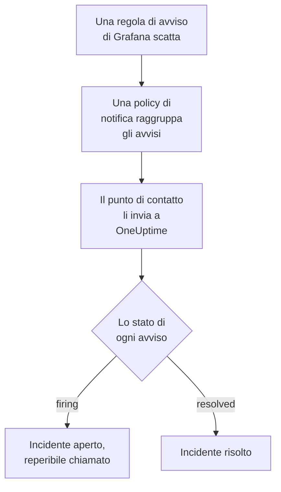

# Grafana

Invia gli avvisi di [Grafana](https://grafana.com) a OneUptime, così ogni avviso che scatta diventa un incidente che chiama il tuo team reperibile e si risolve quando l'avviso rientra. Grafana invia i suoi avvisi tramite un punto di contatto webhook, quindi non c'è nulla da installare né da una parte né dall'altra.

:::cards
- [Scegliere come OneUptime riceve gli avvisi](#scegliere-come-oneuptime-riceve-gli-avvisi): Un monitor Incoming Request o un workflow tuo.
- [Ricevere gli avvisi con un monitor](#ricevere-gli-avvisi-con-un-monitor): Un incidente per avviso, risolto al rientro.
- [Configurare Grafana](#configurare-grafana): Un punto di contatto webhook e la policy che lo usa.
- [Risoluzione dei problemi](#risoluzione-dei-problemi): Quando gli avvisi non arrivano o gli incidenti restano aperti.
:::

## Come funziona



Le policy di notifica di Grafana raggruppano gli avvisi che scattano, e un punto di contatto webhook invia ogni gruppo come una notifica JSON. Ha la stessa forma di una notifica di [Prometheus Alertmanager](/docs/integrations/prometheus-alertmanager): uno `status`, un elenco `alerts` in cui ogni avviso ha il proprio `status` e il proprio `fingerprint`, e i `commonLabels` e `commonAnnotations` che i suoi avvisi condividono. Grafana aggiunge un `title` e un `message` scritti per le persone.

## Prima di iniziare

- Grafana 9 o successivo, con Grafana Alerting, il predefinito da Grafana 9. Deve poter raggiungere il tuo OneUptime via HTTPS.
- In OneUptime, il permesso di creare monitor, o workflow se scegli quella strada.

## Scegliere come OneUptime riceve gli avvisi

Configura prima OneUptime: ti dà l'URL a cui invia Grafana.

| Strada | Usala quando |
| --- | --- |
| Un monitor Incoming Request (consigliato) | Vuoi che ogni avviso sia un incidente che chiama la reperibilità e si risolve quando l'avviso rientra. Non c'è nulla da costruire. |
| Un workflow con un trigger Webhook | Ti serve una logica tua: filtrare gli avvisi, rimodellarli o chiamare prima altri sistemi. Un workflow apre un incidente per notifica, non per avviso, e non lo risolve al rientro. |

Entrambi ricevono lo stesso JSON dallo stesso punto di contatto, quindi puoi iniziare con uno e passare all'altro in seguito cambiando un URL in Grafana.

## Ricevere gli avvisi con un monitor

Un [monitor Incoming Request](/docs/monitor/incoming-request-monitor) ti dà un URL, e i suoi criteri decidono cosa fa ogni notifica.

:::steps
### Creare il monitor

Vai su **Monitor** e fai clic su **Crea monitor**. Scegli **Incoming Request** in **Tipo di monitor**, chiamalo `Grafana` e fai clic su **Avanti**.

### Dichiarare un incidente per ogni avviso che scatta

Nel passaggio **Criteri**, apri il primo criterio, quello che segna il monitor come offline. Imposta il suo filtro su **Corpo della Richiesta**, **Contiene**, `"status":"firing"`. Questo criterio dichiara già un incidente quando il suo filtro corrisponde. Compila l'incidente:

- **Titolo dell'incidente**: `{{requestBody.commonLabels.alertname}}`.
- **Descrizione dell'incidente**, in **Descrizione**: `{{requestBody.message}}`, il testo che Grafana scrive per la notifica.
- **Gravità**: la gravità d'incidente che devono avere questi avvisi.
- **Policy di reperibilità**, in **Reperibilità**: le policy da chiamare.
- **Risoluzione automatica dell'incidente**, in **Altri campi**: lasciala attiva, com'è all'inizio. Senza, i rientri vengono ignorati e gli incidenti restano aperti.

### Aprire un incidente per avviso

Nello stesso criterio, apri **Impostazioni** e attiva **Group incidents and alerts by a payload field**. Compilalo come sotto, così ogni avviso ha il proprio incidente e il suo rientro lo risolve:

| Campo | Valore |
| --- | --- |
| **Open a separate incident for each…** | `requestBody.alerts[*].fingerprint` |
| **Field that signals recovery** | `requestBody.alerts[*].status` |
| **Value that means recovered** | `resolved` |

### Riportare il monitor online

Apri il secondo criterio, quello che segna il monitor come online, e imposta il suo filtro su **Corpo della Richiesta**, **Contiene**, `"status":"resolved"`.

### Copiare l'URL

Fai clic su **Crea monitor**. La pagina **Panoramica** del monitor mostra il suo **Heartbeat URL**. Copialo per Grafana:

```text
https://oneuptime.com/heartbeat/<secret key>
```

Un'installazione self-hosted ha il proprio host al posto di `oneuptime.com`.
:::

Ogni avviso di una notifica apre il proprio incidente, fino a **Max incidents per request** (`100` se non lo cambi), e lo `status` di ciascun avviso decide quando il suo incidente si risolve. Il `fingerprint` di Grafana identifica un avviso dalle sue etichette, quindi è il valore per cui raggruppare. Vedi [Ricevere avvisi da un altro sistema](/docs/monitor/incoming-request-monitor#ricevere-avvisi-da-un-altro-sistema) per cosa fa ogni impostazione.

> [!WARNING]
> Non raggruppare per un'etichetta che tutti gli avvisi di una notifica condividono. La policy di notifica predefinita di Grafana raggruppa gli avvisi per `grafana_folder` e `alertname`, quindi tutti gli avvisi di una notifica hanno lo stesso `alertname`: raggruppare per `requestBody.alerts[*].labels.alertname` riunisce l'intera notifica in un solo incidente.

`{{requestBody.commonLabels.alertname}}` e `{{requestBody.message}}` descrivono l'intera notifica, che con la policy predefinita è una sola regola di avviso. Anche la chiave di raggruppamento è una variabile, `{{fingerprint}}`, ma è un hash che non dice nulla a chi risponde. Vedi [Modelli di incidenti e avvisi](/docs/monitor/incident-alert-templating) per tutte le variabili che puoi usare.

## Configurare Grafana

:::steps
### Aggiungere un punto di contatto webhook

In Grafana, vai su **Alerting → Contact points** e fai clic su **+ Add contact point**. In Grafana 11 e successivi, **Alerting** si trova in **Alerts & IRM**, e **Contact points** è una scheda di **Notification configuration**.

Chiama il punto di contatto `OneUptime`, scegli **Webhook** in **Integration** e incolla in **URL** l'URL che hai copiato. Lascia **HTTP Method** su `POST` e fai clic su **Save contact point**.

### Inviargli gli avvisi

Vai su **Alerting → Notification policies**. Imposta `OneUptime` come punto di contatto della policy predefinita, oppure aggiungi una policy figlia che corrisponda agli avvisi che OneUptime deve ricevere, con `OneUptime` come punto di contatto.
:::

Grafana invia `Content-Type: application/json`, che serve al monitor per leggere i campi di una notifica. L'impostazione **Max Alerts** del punto di contatto limita gli avvisi di una notifica: lasciala a `0`, nessun limite, o al massimo al **Max incidents per request** del monitor.

## Provarlo

1. In Grafana, apri il punto di contatto `OneUptime` e fai clic su **Test**. Grafana invia un avviso di prova che scatta, e in OneUptime si apre un incidente. Un avviso di prova non rientra mai, quindi risolvi quell'incidente a mano.
2. Lascia scattare una vera regola di avviso, per esempio abbassandone la soglia per un momento, e guarda il suo incidente aprirsi e poi risolversi quando rimetti la soglia.

## Ricevere gli avvisi con un workflow

Usa un [workflow](/docs/workflows/index) quando ti servono passaggi tuoi tra Grafana e l'incidente.

:::steps
### Creare il workflow

Vai su **Flussi di lavoro**, fai clic su **Crea flusso di lavoro**, poi su **Parti da zero**. Chiamalo `Grafana alerts` e fai clic su **Crea flusso di lavoro**.

### Aggiungere il trigger Webhook

Fai clic sul blocco tratteggiato **Scegli cosa avvia questo flusso di lavoro** e scegli **Webhook**. Fai clic sul trigger, poi su **Copia URL**, e usa quell'URL nel punto di contatto in Grafana.

### Verificare che la notifica stia scattando

Fai clic su **Aggiungi componente**, aggiungi un blocco **If / Else** e collegaci il punto **Out** del trigger. Imposta **Value to check** su `{{local.components.webhook-1.returnValues.request-body.status}}`, **Comparison** su **is equal to** e **Compare with** su `firing`.

### Dichiarare l'incidente

Aggiungi un blocco **Create One Incident** e collegaci il lato **Yes** del blocco **If / Else**. In **Incident Template**, scegli un modello che imposti la gravità e le policy di reperibilità da chiamare (vedi [Modelli di incidenti](/docs/incidents/settings#modelli-di-incidenti)). In **JSON Object**, imposta ciò che arriva da Grafana:

```json
{
  "title": "{{local.components.webhook-1.returnValues.request-body.title}}",
  "description": "{{local.components.webhook-1.returnValues.request-body.message}}"
}
```

Senza un modello, **JSON Object** deve contenere anche `incidentSeverityId`, l'ID di una delle gravità d'incidente del progetto.

### Attivare il workflow

Attiva **Abilitato** in cima al **Costruttore**. Un workflow disattivato risponde a Grafana con `400`.
:::

Un'esecuzione gestisce una notifica, quindi dichiara un solo incidente, qualunque sia il numero di avvisi della notifica. Una notifica `resolved` prende il lato **No** del blocco **If / Else**, dove non è collegato nulla, quindi l'esecuzione finisce lì. Per un incidente per avviso, risolto al rientro, usa il monitor.

## Risoluzione dei problemi

:::details Non arriva nulla in OneUptime
- Fai clic su **Test** sul punto di contatto: Grafana mostra un errore quando non riesce a raggiungere l'URL. Il log del server di Grafana ha i dettagli.
- Il monitor risponde `200` subito, prima di controllare qualsiasi cosa, anche con una chiave segreta errata. Guarda la timeline del monitor per vedere se le notifiche arrivano.
- Un workflow disattivato risponde `400`. Attiva **Abilitato** in cima al suo **Costruttore**.
:::

:::details Gli incidenti si aprono ma non vengono mai risolti
- L'incidente del criterio ha bisogno di **Risoluzione automatica dell'incidente**, in **Altri campi**.
- **Field that signals recovery** deve essere `requestBody.alerts[*].status`, e **Value that means recovered** esattamente `resolved`. Il confronto distingue maiuscole e minuscole.
- I percorsi di raggruppamento devono iniziare con `requestBody.`, e solo il primo `[*]` di un percorso legge un elenco. Un percorso che viola una delle due regole non corrisponde a nulla, senza alcun errore.
:::

:::details Un solo incidente per una notifica piena di avvisi
Hai raggruppato per un'etichetta che è uguale per tutti gli avvisi di una notifica, come `alertname` con la policy predefinita. Raggruppa invece per `requestBody.alerts[*].fingerprint`.
:::

:::details L'incidente mostra un riferimento invece di un valore
Un riferimento a un campo che la notifica non ha viene lasciato com'è scritto, parentesi graffe comprese. Confronta il nome del campo con ciò che ha inviato Grafana: per un workflow, apri l'esecuzione in **Registri → Esecuzioni** e confrontala con ciò che ha ricevuto il trigger.
:::

La guida di [Prometheus Alertmanager](/docs/integrations/prometheus-alertmanager#risoluzione-dei-problemi) copre altri casi, e valgono anche per le notifiche di Grafana.

## Sicurezza

- **Tratta l'URL come una password.** Chiunque lo abbia può aprire incidenti. Se trapela, reimpostalo: **Reimposta la chiave segreta della richiesta in arrivo** nella pagina **Impostazioni** del monitor, o **Reimposta URL** nel trigger **Webhook** del workflow. Poi aggiorna l'**URL** del punto di contatto in Grafana.
- **Self-hosted?** Consenti a Grafana di raggiungere il tuo OneUptime via HTTPS attraverso il tuo firewall.

## Prossimi passi

:::cards
- [Monitor richieste in arrivo](/docs/monitor/incoming-request-monitor): Ogni impostazione del monitor che riceve i tuoi avvisi.
- [Prometheus Alertmanager](/docs/integrations/prometheus-alertmanager): La stessa configurazione, con un dead man's switch per i tuoi avvisi.
- [Monitor metriche](/docs/monitor/metrics-monitor): Avvisi sulle stesse metriche in OneUptime stesso.
- [Panoramica delle integrazioni](/docs/integrations/index): Gli altri strumenti che puoi collegare.
:::
