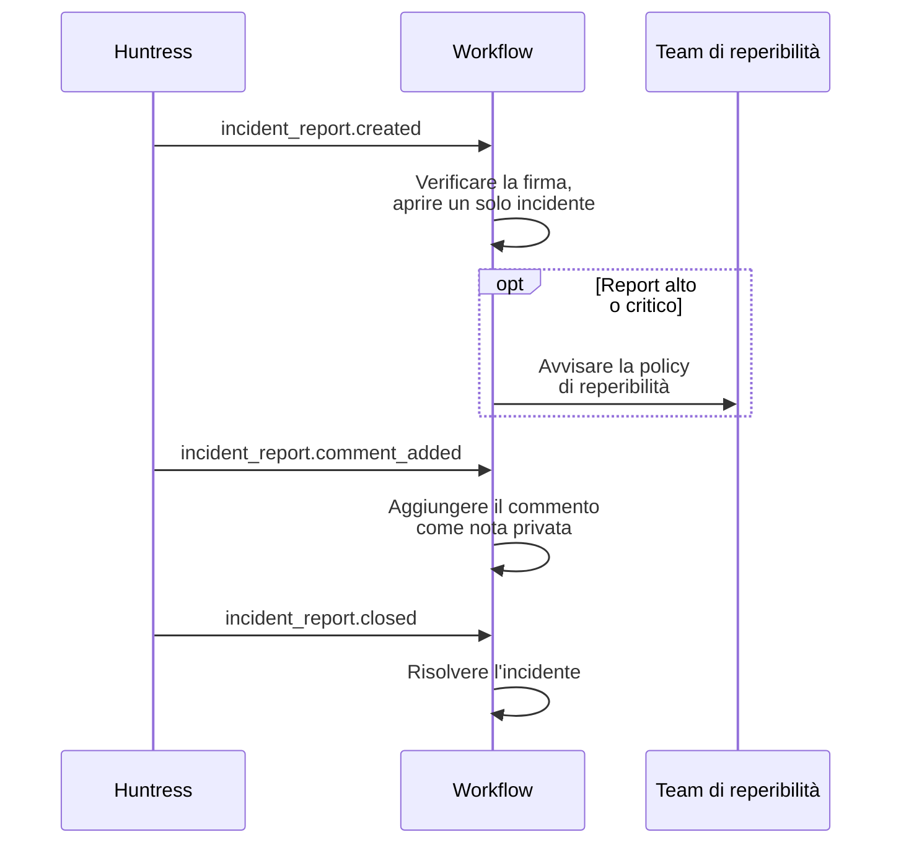

# Integrazione con Huntress

Avvisa il tuo team di reperibilità per i report di incidente di Huntress, con un workflow. Quando il SOC di Huntress invia un report di incidente su un endpoint o un'identità, il workflow apre un solo incidente per quel report, avvisa la policy di reperibilità che scegli, aggiunge i commenti fatti in Huntress come note private e risolve l'incidente quando il report viene chiuso in Huntress.

Questa integrazione è **in entrata**: Huntress invia ogni evento di un report di incidente all'URL proprio del workflow, firmato con il segreto di firma dell'endpoint. OneUptime non chiama mai Huntress, quindi non serve nessuna chiave API di Huntress.

:::cards
- [Come funziona](#come-funziona): Cosa fa il workflow con ogni evento di un report.
- [Configurazione](#configurare-lintegrazione): Creare il workflow, aggiungere l'endpoint in Huntress, salvare il suo segreto di firma, inviare un test.
- [Il trigger](#il-trigger-huntress-incident-report): I valori che un report passa al workflow, e le impostazioni del trigger.
- [Risoluzione dei problemi](#risoluzione-dei-problemi): Cosa significano gli errori del trigger e cosa cambiare.
:::

## Come funziona

Huntress invia un evento su un report di incidente quando il report viene inviato, quando qualcuno lo commenta e quando viene chiuso. Il trigger **Huntress Incident Report** avvia il workflow una volta per ogni evento, e il suo **Event** dice quale è stato: `created`, `comment-added` o `closed`.

1. **Verificare.** Una richiesta deve essere firmata con il segreto di firma dell'endpoint, non più di cinque minuti prima del suo arrivo. Tutto il resto viene rifiutato, e le impostazioni del trigger dicono perché.
2. **Avviare il workflow.** Ogni evento avvia un'esecuzione, con i campi del report come valori del trigger. Un evento che Huntress invia di nuovo non avvia più nulla.
3. **Aprire un solo incidente.** Con `created`, il workflow apre un incidente intitolato al report, ad esempio `Huntress: Incident on DESKTOP-01 (Acme Corp)`. La sua descrizione contiene il riepilogo del report, la sua gravità in Huntress, l'organizzazione, l'host o l'identità coinvolti, gli indicatori trovati da Huntress e un link al report in Huntress. L'incidente riceve un'etichetta con l'organizzazione del report e avvisa la policy di reperibilità che scegli quando il report è alto o critico.
4. **Seguire il report.** Con `comment-added`, il commento diventa una nota privata sull'incidente. Con `closed`, l'incidente viene risolto, con il motivo nella sua cronologia.

L'incidente conserva il numero del report nei suoi campi personalizzati, come `huntressReportId`: è così che il workflow lo ritrova quando Huntress commenta o chiude il report. Gli incidenti aperti così non compaiono mai su una pagina di stato, e le tue regole sugli incidenti (di reperibilità, dei proprietari, delle etichette e della privacy) si applicano a loro come a qualsiasi altro incidente.

## Prima di iniziare

- In OneUptime, un ruolo che possa creare e modificare workflow, come **Proprietario del progetto**, **Amministratore del progetto** o **Amministratore dei flussi di lavoro**.
- In Huntress, il ruolo **Account Admin**: solo gli amministratori dell'account possono aggiungere webhook.
- Una policy di reperibilità da avvisare.
- Su OneUptime Cloud, un piano con i workflow: Growth o superiore. Ogni evento inviato da Huntress è un'esecuzione del workflow.
- Per un'installazione self-hosted, un OneUptime che Huntress raggiunga da internet via HTTPS: Huntress invia webhook solo a URL `https://`.

## Configurare l'integrazione

:::steps
### Creare il workflow

Apri **Flussi di lavoro** e fai clic su **Crea flusso di lavoro**. In **Oppure parti da un modello**, scegli la categoria **Huntress**, scegli **Open an incident for each Huntress incident report**, fai clic su **Usa questo modello** e crea il workflow. Si apre nel **Costruttore**, disattivato.

### Scegliere chi avvisare

Fai clic sul passaggio **Page an On-Call Policy**, scegli le **Policy di reperibilità** da avvisare e salva il passaggio.

### Aggiungere un endpoint webhook in Huntress

Fai clic sul trigger **Huntress Incident Report** e, in **Aggiungi un endpoint webhook in Huntress**, fai clic su **Copia URL**. L'URL ha la forma `https://oneuptime.com/workflow/huntress/<key>`; in un'installazione self-hosted inizia con il tuo host.

In Huntress, apri il menu in alto a destra e scegli **Integrations**. Fai clic su **Add an Integration**, scegli **Webhooks** e fai clic su **Add Endpoint**. Incolla l'URL, attiva **Incident Reports** e salva. Lascia disattivati **Escalations**, **Platform Actions** e **Account Notices**: il trigger accetta quegli eventi e non avvia nulla per loro.

### Salvare il segreto di firma dell'endpoint

In Huntress, apri il menu dell'endpoint (⋯) e scegli **View Signing Secret**. Copialo per intero: inizia con `whsec_`. Nel trigger, fai clic su **Salva segreto di firma**, incollalo e fai clic su **Salva segreto di firma**. Il segreto viene cifrato e non viene più mostrato.

Finché il segreto non è salvato, il trigger rifiuta ogni richiesta. Huntress invia di nuovo più tardi un evento rifiutato, quindi un evento rifiutato ora arriva comunque.

### Attivare il workflow e inviare un test

Attiva **Abilitato** in alto nel **Costruttore**. In Huntress, apri il menu dell'endpoint (⋯) e scegli **Send Test**. In pochi secondi, il trigger mostra **Riceve report**.

> [!NOTE]
> Qualunque cosa contenga il test, il trigger mostra che è arrivato. Un test che contiene un report di incidente avvia il workflow come qualsiasi altro report.
:::

## Cosa fa il workflow

Il modello prende un percorso per ogni **Event**, con uno **Switch / Case** dopo il trigger:

| Event | Cosa fa il workflow |
| --- | --- |
| `created` | Apre un incidente con la **Incident Severity ID** del trigger, con l'etichetta della sua **Organization Label ID**. Per un report alto o critico, **Page an On-Call Policy** avvisa la tua policy; un report basso non avvisa nessuno. Un report che ha già un incidente non ne apre un altro. |
| `comment-added` | Trova l'incidente del report e vi aggiunge il commento come nota privata. |
| `closed` | Trova l'incidente del report e lo risolve, a meno che non sia già risolto. Il motivo è nella sua cronologia: Huntress ha chiuso il report. |

È un workflow come gli altri, quindi puoi cambiare cosa fa: avvisare solo per i report critici cambiando cosa confronta l'**If / Else** dopo **Create One Incident**, pubblicare ogni report in un canale di chat con un passaggio Slack o Microsoft Teams, oppure mandare ogni organizzazione alla propria policy di reperibilità con uno **Switch / Case** su **Organization**. Ogni esecuzione compare tra le esecuzioni del workflow, con cosa ha fatto ogni passaggio.

### Gravità

Huntress assegna a ogni report di incidente una di tre gravità. La **Incident Severity ID** del trigger è la gravità di incidente con cui si apre il report: quella scelta dalla sua impostazione, oppure l'ordine delle tue gravità di incidente, come le elenca **Incidenti → Impostazioni → Gravità incidente**:

| Gravità in Huntress | Cosa intende Huntress | Impostazione | Gravità di incidente quando l'impostazione è vuota |
| --- | --- | --- | --- |
| Critical | Attaccanti attivi alla tastiera, malware pericoloso o compromissione in corso, da contenere subito. | **Gravità per i report critici** | La più alta |
| High | Malware confermato che richiede una correzione urgente, o una compromissione dell'identità su cui agire. | **Gravità per i report alti** | La seconda |
| Low | Programmi potenzialmente indesiderati, residui di malware e rilevamenti meno recenti sulle identità. | **Gravità per i report bassi** | La terza |

Un progetto con meno gravità usa la più bassa per le restanti. Un report senza gravità viene trattato come alto. Se una gravità che hai scelto viene eliminata, decide di nuovo l'ordine.

### Organizzazioni

La **Organization Label ID** del trigger è un'etichetta con il nome dell'organizzazione Huntress del report, ad esempio _Acme Corp_, che crea la prima volta che arriva un report di quell'organizzazione. Un workflow riceve i report di tutte le organizzazioni del tuo account Huntress, e **Solo queste organizzazioni** del trigger li restringe: un nome o ID di organizzazione per riga, i nomi senza distinguere maiuscole e minuscole.

> [!TIP]
> Per avvisare il team di ogni cliente, aggiungi una regola di reperibilità degli incidenti per organizzazione, ad esempio «Se **Etichette dell'incidente** ha uno qualsiasi di _Acme Corp_», che esegua la policy di quel cliente. Vedi [Regole di reperibilità degli incidenti](/docs/incidents/settings#regole-di-reperibilità-degli-incidenti).

## Il trigger Huntress Incident Report

Il trigger si apre su Huntress: il suo URL, un segno di spunta accanto a ogni passaggio di configurazione completato e cosa ha inviato Huntress per ultimo. Le sue impostazioni, tutte facoltative, sono raccolte in **Altri campi**: **Solo queste organizzazioni**, **Gravità per i report critici**, **Gravità per i report alti** e **Gravità per i report bassi**.

| Valore | Cosa contiene |
| --- | --- |
| **Event** | `created`, `comment-added` o `closed`. Un report già chiuso o archiviato è `closed`, qualunque evento lo abbia portato. |
| **Report ID** | Il numero del report in Huntress. |
| **Severity** | `critical`, `high` o `low`. |
| **Status** | Lo stato del report in Huntress, ad esempio `sent`, `closed` o `dismissed`. |
| **Subject** | L'oggetto del report, come lo scrive Huntress. |
| **Summary** | Cosa ha scritto l'analista del SOC. |
| **Organization**, **Organization ID** | L'organizzazione Huntress di cui tratta il report. |
| **Affected** | L'host o l'identità di cui tratta il report. |
| **Platform**, **Indicators** | Dove l'ha trovato Huntress, e cosa ha trovato. |
| **Comment** | Il commento aggiunto da qualcuno, con `comment-added`. |
| **Report URL** | Dove si apre il report in Huntress. |
| **Incident Title**, **Incident Description** | Un titolo e una descrizione in Markdown per un incidente sul report. |
| **Note** | Markdown per una nota sull'evento: il commento, oppure che Huntress ha chiuso il report. |
| **Incident Severity ID**, **Organization Label ID** | La gravità di incidente e l'etichetta, come sopra. |
| **Received At** | Quando OneUptime ha ricevuto l'evento. |

**Summary** e **Comment** sono testo scritto dagli analisti di Huntress. Per inserirli in un incidente o in una nota, usa **Incident Description** e **Note**: mantengono la formattazione, e niente in essi carica un'immagine o menziona qualcuno.

Per provare il workflow senza Huntress, fai clic su **Esegui flusso di lavoro** nel **Costruttore** e scrivi un **Event**, un **Report ID** e i campi che ti servono. Usa lo stesso **Report ID** per seguire un report da `created` a `closed`.

## Connessioni Huntress create prima

Huntress si configurava prima in **Incidenti → Integrazioni → Huntress**. Ogni connessione Huntress è diventata un workflow con lo stesso nome, attivato, che fa ciò che faceva la connessione: avvisa le stesse policy di reperibilità per gli stessi report, aggiunge le stesse etichette e risolve (o annota soltanto) allo stesso modo. Il suo URL è ancora quello della connessione, `https://oneuptime.com/api/huntress/webhook/<connection-id>`, e il suo segreto di firma è lo stesso, quindi non c'è nulla da cambiare in Huntress. Gli incidenti aperti dalla connessione conservano il numero del loro report, quindi il workflow li trova quando Huntress commenta o chiude quei report.

## Sicurezza

- **Solo richieste firmate.** Il trigger verifica le intestazioni `svix-id`, `svix-timestamp` e `svix-signature` inviate da Huntress rispetto al corpo della richiesta così com'è arrivato. Una richiesta non firmata con il segreto salvato, o firmata più di cinque minuti prima o dopo, viene rifiutata.
- **Il segreto resta segreto.** Viene conservato cifrato, l'API non lo restituisce mai e non viene più mostrato. **Sostituisci segreto di firma** nel trigger ne salva un altro, ad esempio il segreto di un nuovo endpoint.
- **L'URL è un indirizzo, non una password.** Termina con la chiave del workflow; solo una richiesta firmata con il segreto dell'endpoint avvia il workflow.
- **Un endpoint per workflow.** Ogni workflow ha il proprio URL e il proprio segreto. Per ricevere i report di un secondo account Huntress, crea un secondo workflow.

## Usare invece l'email

Huntress invia i report di incidente anche via email, e un [monitor delle email in arrivo](/docs/monitor/incoming-email-monitor) può aprire incidenti da quelle email, ad esempio quando l'oggetto contiene `Critical Incident Report`. Tratta però le email come lo stato di un solo monitor: finché il suo incidente è aperto, il report successivo non ne apre nessuno, e l'incidente viene risolto dai criteri del monitor e non quando Huntress chiude il report. Il workflow apre un incidente per report e risolve ciascuno con il suo report, quindi è da preferire. Appena il workflow riceve report, smetti di inviare le email al monitor, altrimenti ogni report avvisa due volte.

## Risoluzione dei problemi

Quando il trigger rifiuta una richiesta, le sue impostazioni ne mostrano il motivo in **L'ultima richiesta è stata rifiutata**. In Huntress, **View Delivery Attempts** nel menu dell'endpoint (⋯) elenca ogni consegna con la risposta di OneUptime.

:::details "A request arrived but was refused, because no signing secret is saved for this workflow yet"
Salva il segreto di firma dell'endpoint: vedi [Configurare l'integrazione](#configurare-lintegrazione). Huntress invia di nuovo la richiesta rifiutata.
:::

:::details "The request's signature does not match the signing secret"
Il segreto salvato non è quello di questo endpoint. Ogni endpoint ha il suo: in Huntress, apri il menu dell'endpoint (⋯), scegli **View Signing Secret**, copialo per intero e salvalo con **Sostituisci segreto di firma**.
:::

:::details "The request was signed more than five minutes from now"
Gli orologi di Huntress e del tuo server OneUptime differiscono di più di cinque minuti, oppure la richiesta è una ripetizione. In un'installazione self-hosted, controlla che l'orologio del server sia corretto.
:::

:::details "A request arrived while this workflow is off"
Attiva **Abilitato** in alto nel **Costruttore**. Huntress invia di nuovo la richiesta rifiutata, e allora avvia il workflow.
:::

:::details "No Huntress workflow has this address."
Il workflow è stato eliminato o archiviato, il suo trigger non è più **Huntress Incident Report**, oppure l'URL dell'endpoint in Huntress non è quello del workflow. Copia l'URL dal trigger e incollalo di nuovo nell'endpoint in Huntress.
:::

:::details Nessun incidente è stato aperto
Apri le esecuzioni del workflow e l'esecuzione del report. Se **Create One Incident** è fallito perché la gravità dell'incidente è vuota, il progetto non ha gravità di incidente: aggiungine una in **Incidenti → Impostazioni → Gravità incidente**.
:::

:::details Nessuno è stato avvisato
Un report basso apre un incidente senza avvisare. Altrimenti, l'esecuzione del report dice cosa ha fatto **Page an On-Call Policy**, e la pagina **Esecuzioni di reperibilità** dell'incidente mostra cosa ha fatto ogni policy.
:::

## Passi successivi

:::cards
- [Trigger del workflow](/docs/workflows/triggers): Gli altri modi di avviare un workflow.
- [Regole di reperibilità degli incidenti](/docs/incidents/settings#regole-di-reperibilità-degli-incidenti): Avvisare il team di ogni organizzazione, tramite la sua etichetta.
- [Stati e gravità degli incidenti](/docs/incidents/states-and-severities): Ordinare le gravità con cui si aprono i report di Huntress.
- [Panoramica delle integrazioni](/docs/integrations/index): Gli altri strumenti che puoi collegare.
:::
