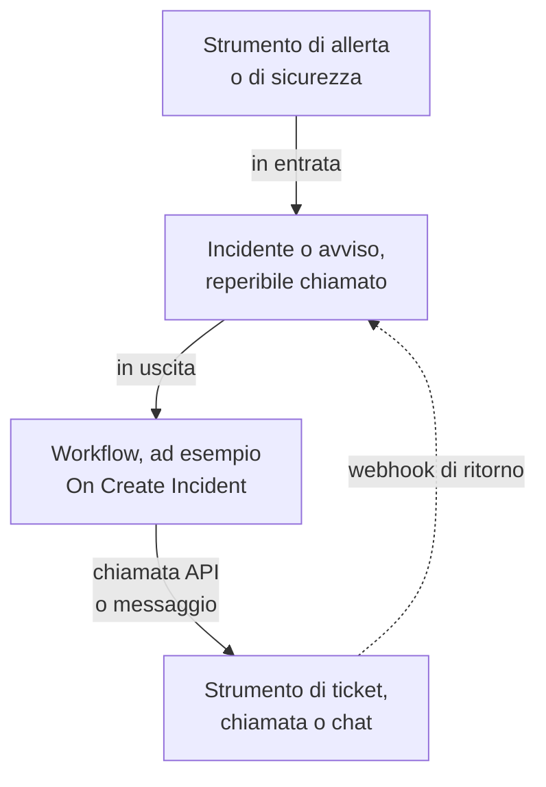

# Panoramica delle integrazioni

OneUptime funziona con gli strumenti che il tuo team usa già. Gli strumenti di allerta vi aprono incidenti, e OneUptime apre ticket, chiamate di reperibilità e messaggi di chat in altri strumenti. Alcuni strumenti si collegano da un modulo, altri da un modello di workflow pronto all'uso. Qualsiasi altro strumento con un webhook o un'API si collega tramite un workflow che costruisci tu.

:::cards
- [Scegliere come collegarsi](#scegliere-come-collegarsi): I quattro modi di integrarsi e quando usare ciascuno.
- [Catalogo](#catalogo): Ogni strumento con una guida, raggruppato per ciò che fa.
- [Costruire la propria integrazione](#costruire-la-propria-integrazione): Gli schemi in entrata e in uscita, per qualsiasi altro strumento.
- [Proteggere le credenziali](#proteggere-le-credenziali): Le variabili segrete e le intestazioni che ogni strumento si aspetta.
:::

## Come funzionano le integrazioni

Ogni integrazione sposta dati in una direzione o in entrambe. **In entrata**: un altro strumento segnala a OneUptime che qualcosa non va, e OneUptime apre un incidente o un avviso e chiama il team reperibile. **In uscita**: succede qualcosa in OneUptime, e un workflow lo comunica a un altro strumento: apre un ticket, chiama qualcuno o pubblica un messaggio.



Un'integrazione bidirezionale, come Jira o Dynamics 365, usa entrambe le direzioni: un workflow invia l'incidente all'esterno, e un altro, avviato dal webhook dell'altro strumento, riporta indietro le modifiche.

## Scegliere come collegarsi

| Modo | Ideale per | Esempi |
| --- | --- | --- |
| Una connessione integrata | Strumenti a cui OneUptime si collega da solo. Compili un modulo e non c'è nulla da costruire. | [Slack](/docs/workspace-connections/slack), [Microsoft Teams](/docs/workspace-connections/microsoft-teams), le connessioni di [Eventi di sicurezza](/docs/telemetry/security-events) |
| Un modello di workflow | Strumenti di ticketing, sincronizzati in entrambe le direzioni, problemi di monitoraggio, rapporti di incidenti di sicurezza e messaggi di chat. Scegli un modello e compili poche impostazioni. | [Jira](/docs/integrations/jira), [Microsoft Dynamics 365](/docs/integrations/microsoft-dynamics-365), [Huntress](/docs/integrations/huntress), [Zabbix](/docs/integrations/zabbix) |
| Un monitor Incoming Request | Strumenti di allerta che inviano un webhook. Ottieni un incidente per allerta, segnalato ai reperibili e risolto quando l'allerta rientra, senza workflow. | [Zabbix](/docs/integrations/zabbix), [Prometheus Alertmanager](/docs/integrations/prometheus-alertmanager), [Grafana](/docs/integrations/grafana) |
| Un workflow che costruisci tu | Qualsiasi strumento con un webhook o un'API REST, e qualsiasi logica tua. | [PagerDuty](/docs/integrations/pagerduty), [Opsgenie](/docs/integrations/opsgenie), [ServiceNow](/docs/integrations/servicenow) |

Parti dall'alto della tabella: più un modo è in alto, meno c'è da mantenere.

## Catalogo

### Strumenti di monitoraggio e di allerta

| Strumento | Direzione | Cosa fa |
| --- | --- | --- |
| [Zabbix](/docs/integrations/zabbix) | Entrambe | Trasforma i problemi di Zabbix in incidenti o avvisi, li risolve al rientro, e conferma o chiude i problemi da OneUptime. |
| [Prometheus Alertmanager](/docs/integrations/prometheus-alertmanager) | In entrata | Trasforma le notifiche di Alertmanager in incidenti. |
| [Grafana](/docs/integrations/grafana) | In entrata | Trasforma gli alert di Grafana in incidenti. |
| [Datadog](/docs/integrations/datadog) | In entrata | Trasforma gli alert dei monitor di Datadog in incidenti. |

### Strumenti di sicurezza

| Strumento | Direzione | Cosa fa |
| --- | --- | --- |
| [Huntress](/docs/integrations/huntress) | In entrata | Chiama i reperibili per i report di incidente di Huntress e risolve l'incidente quando il report si chiude. |
| [Google SecOps](/docs/integrations/google-secops) | Entrambe | Porta i rilevamenti e gli indicatori di Google SecOps in Eventi di sicurezza, e gli invia ciò che OneUptime trova. |
| [Microsoft Sentinel](/docs/integrations/microsoft-sentinel) | Entrambe | Porta gli incidenti di Microsoft Sentinel in Eventi di sicurezza, e gli invia ciò che OneUptime trova. |
| [Microsoft Defender XDR](/docs/integrations/microsoft-defender-xdr) | In entrata | Porta gli alert di Microsoft Defender XDR in Eventi di sicurezza. |
| [CrowdStrike Falcon](/docs/integrations/crowdstrike-falcon) | In entrata | Porta gli alert di CrowdStrike Falcon in Eventi di sicurezza. |
| [Splunk Enterprise Security](/docs/integrations/splunk) | Entrambe | Porta i notable event di Splunk in Eventi di sicurezza, e gli invia ciò che OneUptime trova. |
| [Elastic Security](/docs/integrations/elastic-security) | Entrambe | Porta gli alert di rilevamento di Elastic Security in Eventi di sicurezza, e gli invia ciò che OneUptime trova. |
| [AWS Security Hub](/docs/integrations/aws-security-hub) | In entrata | Porta i finding di AWS Security Hub in Eventi di sicurezza. |
| [Okta System Log](/docs/integrations/okta) | In entrata | Porta gli accessi, le modifiche agli account e i rilevamenti di minacce di Okta in Eventi di sicurezza. |
| [Microsoft Entra ID](/docs/integrations/microsoft-entra-id) | In entrata | Porta gli accessi e le modifiche alla directory di Microsoft Entra ID, e il log di audit di Microsoft 365, in Eventi di sicurezza. |
| [Google Workspace](/docs/integrations/google-workspace) | In entrata | Porta gli accessi, le modifiche degli amministratori e i rilevamenti di Google Workspace in Eventi di sicurezza. |

### Ticketing e gestione dei servizi IT

| Strumento | Direzione | Cosa fa |
| --- | --- | --- |
| [Jira](/docs/integrations/jira) | Entrambe | Apre un ticket Jira per ogni incidente o avviso, e riporta indietro i cambi di stato e i commenti. |
| [Microsoft Dynamics 365](/docs/integrations/microsoft-dynamics-365) | Entrambe | Apre un caso Dynamics 365 per ogni incidente o avviso, e riporta indietro i cambi di stato e le note. |
| [ServiceNow](/docs/integrations/servicenow) | In uscita | Apre un incidente ServiceNow per ogni incidente di OneUptime e lo risolve insieme all'incidente. |
| [GitHub](/docs/integrations/github) | In uscita | Apre una issue GitHub per un incidente. |
| [GitLab](/docs/integrations/gitlab) | In uscita | Apre una issue GitLab per un incidente. |

### Strumenti di chiamata

| Strumento | Direzione | Cosa fa |
| --- | --- | --- |
| [PagerDuty](/docs/integrations/pagerduty) | In uscita | Attiva un incidente PagerDuty per ogni incidente di OneUptime e lo risolve insieme all'incidente. |
| [Opsgenie](/docs/integrations/opsgenie) | In uscita | Crea un alert Opsgenie per ogni incidente di OneUptime e lo chiude insieme all'incidente. |

### Strumenti di chat

| Strumento | Direzione | Cosa fa |
| --- | --- | --- |
| [Slack](/docs/workspace-connections/slack) | Entrambe | Una connessione integrata: canali per gli incidenti, azioni da Slack e reperibilità. |
| [Microsoft Teams](/docs/workspace-connections/microsoft-teams) | Entrambe | Una connessione integrata: canali per gli incidenti, azioni da Teams e reperibilità. |
| [Mattermost](/docs/workflows/components#mattermost) | In uscita | Pubblica gli aggiornamenti degli incidenti in un canale Mattermost. |
| [Discord](/docs/integrations/discord) | In uscita | Pubblica gli aggiornamenti degli incidenti in un canale Discord. |
| [Telegram](/docs/integrations/telegram) | In uscita | Invia un messaggio a una chat Telegram quando scatta un avviso. |
| [IRC](/docs/integrations/irc) | In uscita | Pubblica gli aggiornamenti degli incidenti in un canale IRC. |

> [!TIP]
> Anche Slack e Microsoft Teams hanno passaggi di workflow. Usa la connessione integrata per i canali degli incidenti e la reperibilità, e un passaggio di workflow quando ti serve solo un messaggio in un canale.

### Piattaforme di hosting

| Strumento | Direzione | Cosa fa |
| --- | --- | --- |
| [Vercel](/docs/integrations/vercel) | In entrata | Aggiungi OneUptime dal Vercel Marketplace: trace, log, monitor di disponibilità e una pagina di stato per i tuoi progetti Vercel. |

## Migrare da un altro strumento

Per lasciare un altro strumento di reperibilità, di uptime o di pagine di stato, porta qui il tuo team invece di collegare i due. **Impostazioni del progetto → Avanzato → Importa da un altro strumento** legge il tuo account con una chiave API, ti mostra cosa ha trovato e crea ciò che spunti. Ogni strumento ha una guida:

- Strumenti di reperibilità e di incidenti: [Opsgenie](/docs/moving-to-oneuptime/opsgenie), [PagerDuty](/docs/moving-to-oneuptime/pagerduty), [incident.io](/docs/moving-to-oneuptime/incident-io), [Splunk On-Call](/docs/moving-to-oneuptime/splunk-on-call) e [Grafana OnCall](/docs/moving-to-oneuptime/grafana-oncall).
- Strumenti di uptime e di pagine di stato: [UptimeRobot](/docs/moving-to-oneuptime/uptimerobot), [Atlassian Statuspage](/docs/moving-to-oneuptime/atlassian-statuspage), [Better Stack](/docs/moving-to-oneuptime/better-stack), [Pingdom](/docs/moving-to-oneuptime/pingdom), [StatusCake](/docs/moving-to-oneuptime/statuscake) e [Uptime Kuma](/docs/moving-to-oneuptime/uptime-kuma).

## Costruire la propria integrazione

Uno strumento senza guida rientra comunque in uno di due schemi. Se può inviare un webhook, usa lo schema in entrata. Se ha un'API REST, usa lo schema in uscita. Entrambi sono workflow: vedi [Panoramica dei workflow](/docs/workflows/index) per iniziare.

### In entrata: un altro strumento invia dati a OneUptime

Per uno strumento di allerta, parti da un [monitor Incoming Request](/docs/monitor/incoming-request-monitor#ricevere-avvisi-da-un-altro-sistema): apre un incidente per allerta e lo risolve al rientro, senza nulla da costruire. Costruisci un workflow quando ti serve una logica tua:

:::steps
1. Apri **Flussi di lavoro**, fai clic su **Crea flusso di lavoro**, poi su **Parti da zero**. Dai un nome al workflow e fai clic su **Crea flusso di lavoro**.
2. Fai clic sul blocco tratteggiato **Scegli cosa avvia questo flusso di lavoro** e scegli **Webhook**. Fai clic sul trigger, poi su **Copia URL**.
3. Nell'altro strumento, invia il suo webhook a quell'URL come `POST` con `Content-Type: application/json`.
4. Aggiungi i blocchi che agiscono su di esso. Leggono la richiesta con riferimenti come `{{local.components.webhook-1.returnValues.request-body.status}}`: un blocco **If / Else** per controllare un campo, poi **Create One Incident** per dichiarare un incidente.
5. Attiva **Abilitato** in cima al **Costruttore**, invia una prova dall'altro strumento e apri **Registri → Esecuzioni** per vedere cosa è arrivato.
:::

L'URL è l'unica credenziale, quindi trattalo come una password. Vedi [Webhook](/docs/workflows/triggers#webhook).

### In uscita: OneUptime invia dati a un altro strumento

:::steps
1. Salva la chiave API dello strumento come variabile globale segreta, come mostrato [più sotto](#proteggere-le-credenziali).
2. Crea un workflow, fai clic sul blocco tratteggiato e scegli un trigger di evento, come **On Create Incident**. Fai clic sul trigger: i suoi **Fields to pass on** iniziano con **Titolo**, quindi fai clic su **Aggiungi campo** e scegli gli altri campi da inviare, come **Descrizione**.
3. Fai clic su **Aggiungi componente** e aggiungi un blocco **API Post (JSON)**. Collegagli il punto **Success** del trigger.
4. Compila il suo **URL**, i suoi **Request Headers** con l'intestazione `Authorization` e il suo **Request Body** con i campi dell'incidente, come `{{local.components.incident-on-create-1.returnValues.model.title}}`.
5. Fai clic su **Esegui flusso di lavoro**, scegli un incidente sotto **Incidente** ed eseguilo. Un'esecuzione di prova invia davvero la richiesta. Poi attiva **Abilitato**.
:::

Quando lo strumento vuole i dati in un'altra forma, aggiungi un blocco [Run Custom JavaScript](/docs/workflows/components#custom-code) tra i due. La ricetta è la stessa per Zendesk, New Relic, AWS (tramite SNS), StatusCake e tutti gli altri: cambiano solo l'URL e il corpo.

## Proteggere le credenziali

Non incollare mai una chiave API o un token in un blocco. Salvalo una volta come variabile globale segreta:

:::steps
1. Vai su **Flussi di lavoro → Variabili globali** e fai clic su **Crea: Flusso di lavoro Variabile**.
2. Dagli un nome, come `JIRA_AUTH`, e fai clic su **Avanti**.
3. Incolla la chiave in **Contenuto**, attiva **Segreto** e fai clic su **Crea: Flusso di lavoro Variabile**.
:::

Qualsiasi blocco la legge come `{{global.variables.JIRA_AUTH}}`. Il contenuto di una variabile non si può più rileggere una volta salvato, e quello di una variabile segreta viene sostituito da `[REDACTED]` nei log delle esecuzioni. Per i token che scadono, come quelli di Microsoft Entra ID, una [variabile OAuth 2.0](/docs/workflows/variables#variabili-oauth-20-token-che-si-rinnovano-da-soli) ne ottiene uno nuovo da sola. Vedi [Variabili del workflow](/docs/workflows/variables#variabili-globali).

### Promemoria sull'autenticazione

La maggior parte delle integrazioni in uscita mette la chiave in un'intestazione della richiesta. Le forme comuni:

| Schema | Cosa inviare | Usato da |
| --- | --- | --- |
| Token Bearer | `Authorization: Bearer {{global.variables.TOKEN}}` | GitHub e la maggior parte delle API moderne |
| Autenticazione Basic | `Authorization: Basic {{global.variables.BASE64_USER_PASS}}` | Jira Cloud, ServiceNow |
| Intestazione con chiave API | `Authorization: GenieKey {{global.variables.OPSGENIE_KEY}}` | Opsgenie |
| Intestazione con token privato | `PRIVATE-TOKEN: {{global.variables.GITLAB_TOKEN}}` | GitLab |
| Chiave nel corpo | `routing_key` nel corpo JSON | Events API di PagerDuty |
| Credenziali client OAuth 2.0 | `Authorization: Bearer {{local.variables.dynamicsAccessToken}}`, da una variabile OAuth 2.0 | Microsoft Dynamics 365 |

Per l'autenticazione Basic, codifica `username:password`, o `email:api_token`, una volta sola, e salva il risultato come segreto. Su macOS o Linux:

```bash
printf '%s' 'you@example.com:your_api_token' | base64 | tr -d '\n'
```

Usa `printf`, non `echo`: `echo` aggiunge un a capo, che viene codificato con il resto e rende le credenziali non valide. `tr` tiene un risultato lungo su una sola riga.

## Installazioni self-hosted

Un OneUptime self-hosted chiama gli altri strumenti dalla tua rete, e gli altri strumenti lo chiamano dalla loro:

- **In uscita:** le richieste dei workflow verso indirizzi di rete privati vengono rifiutate a meno che un amministratore non le consenta. Vedi [Accesso di rete in uscita](/docs/workflows/configuration#accesso-alla-rete-in-uscita).
- **In entrata:** i webhook di uno strumento devono raggiungere il tuo OneUptime via HTTPS, quindi uno strumento nel cloud ha bisogno di un indirizzo pubblico da chiamare.
- **Le integrazioni integrate** hanno ciascuna una guida di configurazione: [Slack](/docs/self-hosted/slack-integration), [Microsoft Teams](/docs/self-hosted/microsoft-teams-integration), [GitHub](/docs/self-hosted/github-integration), [Twilio](/docs/self-hosted/twilio-integration), [SendGrid Inbound Email](/docs/self-hosted/sendgrid-inbound-email) e [Push Notifications](/docs/self-hosted/push-notifications).

## Prossimi passi

:::cards
- [Panoramica dei workflow](/docs/workflows/index): Come vengono eseguiti i workflow e come costruire il primo.
- [Monitor richieste in arrivo](/docs/monitor/incoming-request-monitor): Ricevi allerte da qualsiasi strumento senza workflow.
- [Jira](/docs/integrations/jira): Un'integrazione bidirezionale completa, a partire dai modelli.
- [Variabili del workflow](/docs/workflows/variables): Passa dati tra i blocchi e tieni i segreti fuori da essi.
:::
