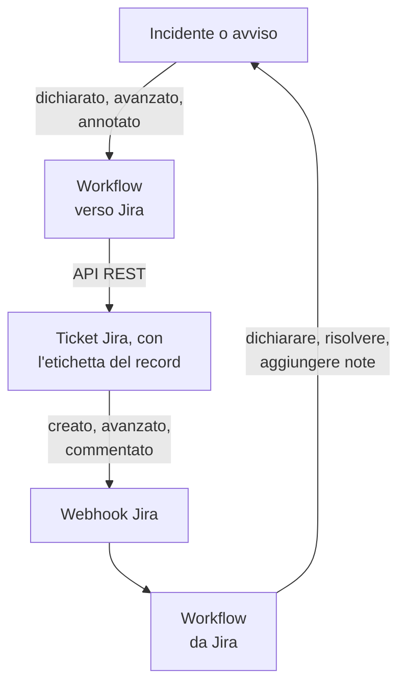

# Jira

Tieni i ticket [Jira](https://www.atlassian.com/software/jira) allineati con i tuoi incidenti e avvisi di OneUptime, in entrambe le direzioni. Modelli di workflow pronti all'uso aprono un ticket per ogni incidente o avviso, lo fanno avanzare insieme al record e vi copiano le note come commenti. Altri dichiarano incidenti dai nuovi ticket e riportano indietro cambi di stato, commenti e modifiche. Non c'è alcun plugin: i workflow chiamano l'API REST di Jira, e Jira chiama i loro URL webhook.

:::cards
- [Partire da un modello](#partire-da-un-modello): I 17 modelli, cosa chiedono e come configurarli.
- [Come funzionano i modelli](#come-funzionano-i-modelli): Come ticket e record restano collegati, senza cicli.
- [Costruirlo da soli](#costruirlo-da-soli): Ogni direzione a mano, per quando un modello non va bene.
- [Risoluzione dei problemi](#risoluzione-dei-problemi): Cosa significano le risposte di Jira.
:::

> [!NOTE]
> Atlassian sta rinominando alcune cose in Jira Cloud: un **progetto** ora si chiama **spazio** in gran parte dell'interfaccia, e un **ticket** si chiama **elemento di lavoro**. I siti usano entrambi i termini, quindi dove la terminologia conta li troverai entrambi qui.

## Come funziona



Ogni modello è un piccolo workflow, quindi prendi solo le direzioni che ti servono, per incidenti, avvisi o entrambi. I modelli OneUptime → Jira partono da un evento in OneUptime e chiamano l'API REST di Jira. I modelli Jira → OneUptime partono da un webhook di Jira. Tutti ritrovano i record degli altri tramite due etichette sul ticket.

Tutto in questa pagina è scritto per **Jira Cloud**. [Jira Data Center](#jira-data-center) elenca cosa cambia su un Jira autogestito.

## Prima di iniziare

- Un sito Jira Cloud, come `https://your-domain.atlassian.net`, e un progetto in cui aprire i ticket.
- Un utente Jira per l'integrazione e un token API per lui. Dai all'utente **Browse Projects**, **Create Issues**, **Edit Issues**, **Add Comments** e **Transition Issues** nel progetto.
- Un amministratore Jira, per registrare i webhook di cui hanno bisogno i modelli Jira → OneUptime.
- In OneUptime, il permesso di creare workflow. Su OneUptime Cloud, i workflow richiedono il piano **Growth** o superiore.

## Partire da un modello

La finestra **Crea un flusso di lavoro** ha 17 modelli Jira, sotto **Jira** nel suo elenco di categorie: nove per gli incidenti, poi otto per gli avvisi, ogni gruppo sotto la propria intestazione. Condividono una convenzione, le etichette sul ticket Jira, quindi qualsiasi loro combinazione funziona insieme.

### Modelli per gli incidenti

| Modello | Cosa fa | Cosa chiede |
| --- | --- | --- |
| **OneUptime → Jira** | | |
| Create a Jira issue when an incident is declared | Apre un ticket per ogni nuovo incidente e gli aggiunge l'ID dell'incidente come etichetta. Gli incidenti dichiarati da Jira, e gli incidenti privati, vengono saltati. | API URL, API token, project key, issue type, OneUptime URL |
| Move the Jira issue when the incident is acknowledged or resolved | Fa avanzare il ticket collegato: a uno stato In Progress quando l'incidente viene preso in carico, e a uno stato Done quando viene risolto. Non lo fa mai tornare indietro. | API URL, API token |
| Copy incident private notes to the Jira issue | Pubblica ogni nuova nota privata come commento sul ticket collegato, come commento interno in Jira Service Management. | API URL, API token |
| Copy incident public notes to the Jira issue | Pubblica ogni nuova nota pubblica come commento sul ticket collegato. | API URL, API token |
| Comment on the Jira issue when the incident is edited | Quando cambiano il titolo, la gravità, la descrizione, la causa principale o le note di rimedio dell'incidente, pubblica com'è ora l'incidente, come commento interno in Jira Service Management. | API URL, API token |
| **Jira → OneUptime** | | |
| Declare an incident when a Jira issue is created | Dichiara un incidente per ogni nuovo ticket, tenuto fuori dalle tue pagine di stato, con una gravità scelta in base alla priorità del ticket, poi etichetta il ticket per collegare i due. | Site URL, API URL, API token e un webhook Jira per **Issue created** |
| Acknowledge or resolve the incident when its Jira issue moves | Prende in carico l'incidente quando il suo ticket collegato passa a uno stato In Progress, e lo risolve quando il ticket passa a uno stato Done. | Un webhook Jira per **Issue updated** |
| Add Jira comments to the incident as private notes | Copia ogni commento di un ticket collegato sull'incidente, come nota privata. | Site URL, API URL, API token e un webhook Jira per **Comment created** |
| Add Jira issue changes to the incident as private notes | Annota ogni modifica di un ticket collegato, come la priorità, l'assegnatario o il riepilogo, sull'incidente come nota privata. I cambi di stato sono lasciati al modello qui sopra. | Site URL e un webhook Jira per **Issue updated** |

### Modelli per gli avvisi

I modelli per gli avvisi fanno gli stessi lavori per gli avvisi. Ce n'è uno in meno, perché gli avvisi non hanno note pubbliche. [Cosa cambia per gli avvisi](#cosa-cambia-per-gli-avvisi) elenca il resto.

| Modello | Cosa fa | Cosa chiede |
| --- | --- | --- |
| **OneUptime → Jira** | | |
| Create a Jira issue when an alert is created | Apre un ticket per ogni nuovo avviso, compreso ogni avviso generato da un monitor, e gli aggiunge l'ID dell'avviso come etichetta. Gli avvisi creati da Jira, e gli avvisi privati, vengono saltati. | API URL, API token, project key, issue type, OneUptime URL |
| Move the Jira issue when the alert is acknowledged or resolved | Fa avanzare il ticket collegato: a uno stato In Progress quando l'avviso viene preso in carico, e a uno stato Done quando viene risolto. Non lo fa mai tornare indietro. | API URL, API token |
| Copy alert private notes to the Jira issue | Pubblica ogni nuova nota privata come commento sul ticket collegato, come commento interno in Jira Service Management. | API URL, API token |
| Comment on the Jira issue when the alert is edited | Quando cambiano il titolo, la gravità, la descrizione, la causa principale o le note di rimedio dell'avviso, pubblica com'è ora l'avviso, come commento interno in Jira Service Management. | API URL, API token |
| **Jira → OneUptime** | | |
| Create an alert when a Jira issue is created | Crea un avviso per ogni nuovo ticket, con una gravità scelta in base alla priorità del ticket, poi etichetta il ticket per collegare i due. | Site URL, API URL, API token e un webhook Jira per **Issue created** |
| Acknowledge or resolve the alert when its Jira issue moves | Prende in carico l'avviso quando il suo ticket collegato passa a uno stato In Progress, e lo risolve quando il ticket passa a uno stato Done. | Un webhook Jira per **Issue updated** |
| Add Jira comments to the alert as private notes | Copia ogni commento di un ticket collegato sull'avviso, come nota privata. | Site URL, API URL, API token e un webhook Jira per **Comment created** |
| Add Jira issue changes to the alert as private notes | Annota ogni modifica di un ticket collegato, come la priorità, l'assegnatario o il riepilogo, sull'avviso come nota privata. I cambi di stato sono lasciati al modello qui sopra. | Site URL e un webhook Jira per **Issue updated** |

Nessuno dei modelli OneUptime → Jira invia a Jira un incidente segnato come [**Incidente privato**](/docs/incidents/declaring-incidents#passaggio-1-dettagli-dellincidente), né un avviso segnato come **Avviso privato**: né il record, né il suo stato, né le sue note, né le sue modifiche, a meno che tu non lo attivi. Vedi [Limitazioni](#limitazioni).

### Cosa cambia per gli avvisi

Ogni modello per gli avvisi è costruito come il suo gemello per gli incidenti, passo per passo. Dove gli avvisi differiscono dagli incidenti, differiscono anche i modelli:

- **Niente note pubbliche.** Gli avvisi hanno solo note private, quindi ogni commento pubblicato dai modelli per gli avvisi è un commento interno in Jira Service Management.
- **Niente pagina di stato.** Un avviso non arriva mai su una pagina di stato, quindi **Create an alert when a Jira issue is created** scrive la gravità, il titolo, la descrizione e `customFields.jiraIssueKey`, e nient'altro.
- **Due gravità, quindi Medium diventa Low.** Un nuovo progetto ha due gravità per gli avvisi, High e Low, mentre ne ha tre per gli incidenti. Il modello di creazione distribuisce le priorità di Jira sulle gravità che ha il progetto. Con le due predefinite, Highest, High, Critical e Blocker diventano High, e ogni altra priorità diventa Low, Medium e Major compresi. Per mandare Medium a High, cambia `medium: 1` in `medium: 0` in `PRIORITY_RANK` nello script `prepare-alert-1`.
- **Link ed etichette degli avvisi.** Il ticket rimanda a `/dashboard/<project id>/alerts/<alert id>` e ha l'etichetta `oneuptime-alert-<alert id>`.
- **I numeri dicono cosa numerano.** Con il prefisso predefinito `#`, un avviso e un incidente possono essere entrambi `#12`, quindi i modelli scrivono `Alert #12` o `Incident #12`. Un numero con un proprio prefisso, come `ALT-12`, viene scritto così com'è.
- **Avvisi privati.** Un avviso segnato come **Avviso privato**, a mano o da una regola di privacy degli avvisi, resta fuori da Jira a meno che tu non imposti `SYNC_PRIVATE_ALERTS` su `true`.

**I monitor generano avvisi da soli, e possono generarne molti.** **Create a Jira issue when an alert is created** apre un ticket per ognuno. A meno che ogni avviso meriti un ticket, metti una condizione davanti al passaggio Jira. Per aprire ticket solo per gli avvisi High:

1. Apri il **Costruttore** del workflow e aggiungi un blocco **If / Else**.
2. Imposta **Value to check** su `{{local.components.alert-on-create-1.returnValues.model.alertSeverity.name}}`, **Comparison** su **is equal to** e **Compare with** su `High`.
3. Rimuovi la linea da `alert-on-create-1` a `prepare-issue-1` trascinandone l'estremità fuori dal punto (vedi [Mettere in ordine](/docs/workflows/authoring#mettere-in-ordine)). Collega il **Success** del trigger al blocco **If / Else**, e il suo **Yes** a `prepare-issue-1`.

Un avviso che prende il lato **No** termina lì l'esecuzione, e per esso non viene aperto alcun ticket.

### Cosa chiedono i modelli

Il passaggio **Configura** della procedura guidata di creazione chiede fino a cinque valori. Le tabelle qui sopra mostrano quali servono a ogni modello.

- **Jira Site URL** — l'indirizzo da cui apri Jira, come `https://your-domain.atlassian.net`. Su Jira Data Center, il suo URL di base, come `https://jira.example.com:8443` o `https://example.com/jira`. I modelli che portano Jira in OneUptime collegano il ticket nella descrizione o nella nota che scrivono, e quel link va sempre a questo sito, qualunque cosa dica l'evento. Per questo il campo accetta l'indirizzo di un sito e nient'altro: uno schema, un host, una porta se c'è e, su Data Center, il percorso sotto cui gira Jira. Rifiuta l'indirizzo di una pagina del sito, una query o un nome utente, e dice cosa scrivere al loro posto. Una barra finale va bene. Se in seguito la variabile viene svuotata, il ticket viene nominato senza link.
- **Jira API URL** — dove il workflow invia le sue richieste a Jira: il tuo sito, come `https://your-domain.atlassian.net`, senza barra finale. Con un token API con ambiti, il che include ogni token di account di servizio, usa invece `https://api.atlassian.com/ex/jira/<cloudId>`. Il tuo `cloudId` è nel JSON di `https://your-domain.atlassian.net/_edge/tenant_info`. Con un token classico, è lo stesso indirizzo della **Jira Site URL**, quindi nei modelli che chiedono entrambi la procedura guidata lo compila dalla **Jira Site URL** finché non ci scrivi tu.
- **Jira API Token (base64 of email:token)** — non il token da solo, ma l'email dell'account e il token codificati insieme, che è il modo in cui Jira Cloud accetta l'autenticazione Basic. [Creare il token API](#creare-il-token-api) mostra come. I token scadono, per impostazione predefinita un anno dopo la creazione, quindi annota la data da qualche parte.
- **Jira Project Key** — il progetto (spazio) in cui vengono aperti i nuovi ticket: l'`OPS` di `OPS-123`.
- **Jira Issue Type** — il tipo di ticket da creare, scritto esattamente come in quel progetto, come `Task`, `Bug` o `Incident`.
- **OneUptime URL** — l'indirizzo da cui apri OneUptime: `https://oneuptime.com`, o il tuo host. La descrizione del ticket rimanda con esso all'incidente o all'avviso.

### Creare il token API

:::steps
1. Crea un token per un utente Jira dedicato, un normale account Atlassian usato solo dall'integrazione, invece che per una persona: ticket e commenti vengono attribuiti al proprietario del token. Accedi come quell'utente e crea il token su [id.atlassian.com/manage-profile/security/api-tokens](https://id.atlassian.com/manage-profile/security/api-tokens). Un token classico (**Create API token**) funziona con l'URL del tuo sito. Un token con ambiti (**Create API token with scopes**) funziona solo con l'indirizzo `api.atlassian.com` qui sopra. Gli ambiti classici `read:jira-work` e `write:jira-work` coprono tutte le chiamate dei modelli.
2. Codifica l'email di quell'account e il token:

   ```bash
   printf '%s' 'jira-bot@example.com:your_api_token' | base64 | tr -d '\n'
   ```

   Usa `printf`, non `echo`: `echo` aggiunge un a capo, che viene codificato con il resto, e Jira non accetta più le credenziali. Sull'URL del tuo sito questo raramente si presenta come un `401` (vedi [Limitazioni](#limitazioni)). `tr` tiene l'output su una riga: il `base64` di GNU su Linux va a capo ogni 76 caratteri, e un token attuale è abbastanza lungo da andare a capo.

3. Incolla l'output in **Jira API Token (base64 of email:token)**.
:::

Funziona anche un **account di servizio** Atlassian. Un amministratore dell'organizzazione lo crea, insieme al suo token, in [admin.atlassian.com](https://admin.atlassian.com) sotto **Directory → Service accounts**. Quel token ha sempre degli ambiti, quindi **Jira API URL** deve essere l'indirizzo `https://api.atlassian.com/ex/jira/<cloudId>` (la **Jira Site URL** resta il tuo sito), e l'email che codifichi è quella dell'account di servizio stesso. Dai all'account di servizio i permessi di progetto elencati sopra, come faresti con qualsiasi utente.

### Creare i workflow

:::steps
1. Apri **Flussi di lavoro → Crea flusso di lavoro**. In **Oppure parti da un modello**, scegli **Jira** dall'elenco delle categorie, o scrivi `Jira` in **Cerca modelli…**, e fai clic sul modello che vuoi. Si apre e mostra cosa fa e le impostazioni che chiederà. Fai clic su **Usa questo modello**.
2. **Nome** viene compilato dal modello. Cambialo se vuoi.
3. **Configura** chiede i valori qui sopra. Vengono salvati come variabili proprie del workflow, in **Variabili del flusso** nel suo menu. Il token API viene salvato come segreto: viene oscurato in **Registri → Esecuzioni** e finisce solo nell'intestazione `Authorization` delle chiamate a Jira.
4. Fai clic su **Crea flusso di lavoro**. Ogni workflow viene creato disattivato: attiva **Abilitato** in cima al suo **Costruttore**.
:::

Inizia con **Create a Jira issue when an incident is declared**, o con **Create a Jira issue when an alert is created** per gli avvisi: ogni altro modello OneUptime → Jira dello stesso tipo trova il ticket tramite l'etichetta che questo aggiunge. Attivalo, dichiara un incidente di prova o crea un avviso di prova, e apri **Registri → Esecuzioni** del workflow. L'esecuzione dovrebbe terminare come **Eseguito**, e il **Response Body** del suo ultimo passaggio, `create-issue-1`, nomina il nuovo ticket.

Ogni workflow conserva la propria copia di questi valori. Quando sostituisci il token, aggiorna `jiraBasicAuthToken` in **Variabili del flusso** in ogni workflow Jira che lo ha chiesto. Se Jira cambia indirizzo, aggiorna `jiraSiteUrl` e `jiraBaseUrl` allo stesso modo.

### Collegare i modelli con webhook

I modelli Jira → OneUptime, quattro per gli incidenti e quattro per gli avvisi, partono da un [trigger Webhook](/docs/workflows/triggers#webhook), quindi bisogna dire a Jira dove inviare i suoi eventi. Procedi in quest'ordine:

1. Crea il workflow e **attivalo per primo**. Un workflow disattivato risponde a Jira con `400`, e Jira non ritenta una consegna rifiutata con un `4xx`. Gli eventi inviati prima dell'attivazione vanno persi, non vengono messi in coda.
2. Apri il **Costruttore** del workflow, fai clic sul blocco trigger **Webhook** (`webhook-1`) e fai clic su **Copia URL** in cima alle sue impostazioni. L'URL è fatto così:

   ```text
   https://<your OneUptime host>/workflow/trigger/<webhook secret key>
   ```

3. In Jira, vai su **Settings → System → WebHooks** (in **Advanced**) e fai clic su **Create a WebHook**. Incolla l'URL, spunta l'evento della tabella qui sotto, in **Issue related events**, e inserisci un filtro JQL in modo che lo attivino solo i ticket del tuo progetto. Lascia **Exclude body** senza spunta: il workflow legge tutto dal corpo.

| Modello | Evento Jira | Filtro JQL |
| --- | --- | --- |
| **Incidenti** | | |
| Declare an incident when a Jira issue is created | **Issue created** | `project = OPS AND (labels is EMPTY OR labels != oneuptime)` |
| Acknowledge or resolve the incident when its Jira issue moves | **Issue updated** | `project = OPS` |
| Add Jira comments to the incident as private notes | **Comment created** | `project = OPS` |
| Add Jira issue changes to the incident as private notes | **Issue updated** | `project = OPS` |
| **Avvisi** | | |
| Create an alert when a Jira issue is created | **Issue created** | `project = OPS AND (labels is EMPTY OR labels != oneuptime)` |
| Acknowledge or resolve the alert when its Jira issue moves | **Issue updated** | `project = OPS` |
| Add Jira comments to the alert as private notes | **Comment created** | `project = OPS` |
| Add Jira issue changes to the alert as private notes | **Issue updated** | `project = OPS` |

Sostituisci `OPS` con la chiave del tuo progetto. Il filtro dei due modelli che creano un record impedisce che i ticket aperti da OneUptime li raggiungano: li salterebbero comunque, ma un evento che non arriva mai non costa nessuna esecuzione. `labels != oneuptime` da solo escluderebbe anche ogni ticket senza etichette, per questo c'è `labels is EMPTY`. Gli altri modelli agiscono solo sui ticket collegati, quindi per loro `project = OPS AND labels = oneuptime` è un filtro più stretto.

Ogni workflow ha il proprio URL, quindi ognuno ha bisogno del proprio webhook Jira. Due modelli su **Issue updated** significano due webhook, e quattro se usi anche le versioni per gli avvisi.

**Usi entrambi i modelli che creano un record?** **Declare an incident when a Jira issue is created** e **Create an alert when a Jira issue is created** ascoltano entrambi **Issue created**. Ciascuno controlla le etichette del ticket con Jira prima di creare qualcosa, ma le due consegne arrivano insieme, quindi un nuovo ticket può ricevere sia un incidente sia un avviso. Registra i due per ticket diversi, per progetto o per tipo di ticket:

```text
project = OPS AND issuetype = Incident AND (labels is EMPTY OR labels != oneuptime)
project = OPS AND issuetype = Alert AND (labels is EMPTY OR labels != oneuptime)
```

Usa tipi di ticket che esistono nel tuo progetto, scritti come li scrive Jira.

Prima di farci affidamento:

- **Jira chiama solo in HTTPS, sulle sue porte consentite.** OneUptime Cloud va bene. Un'installazione self-hosted deve essere raggiungibile da internet via HTTPS su una porta dell'elenco di Jira.
- **Chiunque abbia l'URL può attivare il workflow.** I webhook di Jira non portano nulla che un workflow possa verificare, quindi l'URL è l'unico segreto. Chi lo ha può dichiarare incidenti o creare avvisi (i modelli che creano un record chiedono a Jira se il ticket indicato esiste e non è ancora collegato, ma prendono titolo, descrizione e priorità dalla richiesta) e può far avanzare o annotare gli incidenti e gli avvisi di cui conosce l'ID o la chiave del ticket Jira. Ciò che dice una richiesta del genere viene scritto come testo (vedi [Limitazioni](#limitazioni)), e il link al ticket va al sito indicato dalla tua **Jira Site URL**, qualunque cosa dica la richiesta. Tieni l'URL solo in Jira. Se trapela, fai clic sul trigger **Webhook** nel **Costruttore** del workflow, fai clic su **Reimposta URL** e incolla il nuovo URL nel webhook Jira. Il vecchio URL smette subito di funzionare.
- **Ogni evento è un'esecuzione.** Su OneUptime Cloud ogni consegna conta per le esecuzioni di workflow del tuo piano, comprese quelle che un modello salta. Il filtro JQL tiene basso quel numero. Vedi [Limiti del piano](/docs/workflows/configuration#limiti-di-piano).

### Verificare che funzioni

I **Passaggi** di ogni esecuzione dicono cosa ha fatto il modello, quindi apri l'esecuzione in **Registri → Esecuzioni** e guarda come è terminata:

- **Eseguito**: ha fatto il suo lavoro, e il suo ultimo passaggio nomina il ticket, l'incidente o l'avviso.
- **Eseguito**, con il suo passaggio **Check With JavaScript** su **No**: ha saltato l'evento di proposito, e il passaggio dice perché: il ticket non è collegato a un record di questo tipo, la nota viene da Jira, il record è privato, o al nuovo stato non corrisponde alcuno stato Jira.
- **Errore**: un passaggio è fallito, e la sua voce in **Passaggi** dice perché. Per una chiamata a Jira, include la risposta di Jira.
- **Errore** a `link-issue-1`: un modello che crea un record da un ticket Jira lo ha creato, ma Jira non ha accettato le etichette di collegamento, quindi gli altri modelli non possono ancora trovarlo. Aggiungi le etichette a mano.

I salti sono normali: la maggior parte degli eventi Jira non sono di quelli su cui agisce un dato modello. Vedi [Esecuzioni del workflow](/docs/workflows/runs-and-logs).

## Come funzionano i modelli

### Come restano collegati i due lati

È Jira a conservare il collegamento. Un ticket che appartiene a un incidente o a un avviso porta due etichette:

- `oneuptime`, che segna il ticket come collegato.
- `oneuptime-incident-<incident id>` per un incidente, o `oneuptime-alert-<alert id>` per un avviso, che nomina il record. L'ID è l'ultima parte dell'indirizzo del record nella dashboard: `/dashboard/<project id>/incidents/<incident id>`.

I due modelli che creano un ticket aggiungono entrambe le etichette quando lo aprono, e i due modelli che creano un record da un ticket Jira le aggiungono appena il record esiste. Tutti gli altri modelli passano da un lato all'altro tramite loro: quelli OneUptime → Jira cercano in Jira l'etichetta del record, e quelli Jira → OneUptime leggono l'ID del record dalle etichette del ticket. Quindi non rinominarle e non rimuoverle. Per collegare un ticket aperto a mano, aggiungi tu le due etichette, ma solo quando il record non ha ancora un ticket.

**Un ticket è collegato a un incidente o a un avviso, mai a entrambi.** I modelli che creano un record saltano ogni ticket che porta `oneuptime`, o un'etichetta che inizia con `oneuptime-incident-` o `oneuptime-alert-`, e i modelli di un tipo ignorano i ticket collegati all'altro. Quando colleghi un ticket a mano, dagli una sola etichetta di record, non una per tipo.

**Un record ha un solo ticket.** I modelli che pubblicano su un ticket o lo fanno avanzare agiscono solo quando esattamente un ticket porta l'etichetta del record. Clonare un ticket in Jira ne copia le etichette, quindi il clone di un ticket collegato rivendica lo stesso record. Da quel momento quei modelli si fermano, e ogni esecuzione termina con un salto che nomina entrambi i ticket:

```text
More than one Jira issue is labelled oneuptime-incident-<id> (OPS-17, OPS-30). A cloned issue copies the label: remove it from every issue except the one filed for the incident.
```

L'altra direzione non ha questo controllo: i cambi di stato, i commenti e le modifiche del clone raggiungono il record come se fossero stati fatti sull'originale. Quindi, quando cloni un ticket collegato, togli entrambe le etichette dal clone.

Gli incidenti e gli avvisi creati da Jira conservano anche la chiave del ticket in `customFields.jiraIssueKey`, scritta alla loro creazione. È così che i modelli che creano un ticket sanno che il record ne ha già uno.

### Come i modelli evitano i cicli

Ogni scrittura in una direzione è un evento nell'altra: un commento pubblicato in Jira torna indietro come webhook **Comment created**, e una nota aggiunta in OneUptime fa scattare il trigger delle note. Tre cose fermano l'eco:

- **Marcatori nel testo.** Ogni commento che i modelli pubblicano in Jira inizia con `Synced from OneUptime`. Ogni nota scritta da Jira, e la causa principale di ogni cambio di stato fatto da Jira, inizia con `Synced from Jira`. Ogni direzione salta il testo che porta il marcatore dell'altro lato, anche in un commento scritto da qualcuno che ne cita uno.
- **Etichette sui nuovi ticket.** I ticket aperti da OneUptime portano l'etichetta `oneuptime`, e i modelli che creano un record li saltano. Chiedono a Jira le etichette del ticket prima di creare qualcosa, invece di fidarsi dell'evento. I record creati da Jira portano `customFields.jiraIssueKey`, e i modelli che creano un ticket li saltano.
- **Gli stati vanno solo avanti, su entrambi i lati.** I modelli di stato scrivono una nuova riga nella cronologia degli stati del record, come fa il pulsante **Risolvi**, e sempre verso uno stato successivo. Anche i modelli di transizione non fanno mai tornare indietro un ticket. Così, quando un lato risolve, l'altro si trova già concluso e non cambia nulla.

Mantieni i marcatori quando modifichi i modelli. Sono le costanti `FROM_ONEUPTIME` e `FROM_JIRA` nel blocco di supporto all'inizio di ogni script. Un commento o una nota scritti senza il loro marcatore vengono ricopiati subito indietro.

### Come il modello di transizione sceglie uno stato

Jira non ha una chiamata «sposta a Done». Un ticket avanza tramite una transizione, e le transizioni che ha dipendono dal suo flusso di lavoro e dal suo stato. Quindi **Move the Jira issue when the incident is acknowledged or resolved**, e il suo gemello per gli avvisi, leggono le transizioni aperte per il ticket e ne scelgono una in base allo stato a cui porta:

- **Solo in avanti.** Jira ordina gli stati in tre categorie, To Do, In Progress e Done, e il modello non sceglie mai una transizione verso una categoria precedente a quella del ticket, nemmeno per uno stato indicato in `STATE_TO_JIRA_STATUS`. Prendere in carico un incidente il cui ticket è già Done termina con `Jira issue OPS-17 is already Done, so it was not moved back to an In Progress status.`
- **Prima i nomi abituali.** Per un record risolto, vince uno stato chiamato Done, Resolved, Closed, Complete, Completed o Fixed. Per uno preso in carico, vince In Progress o Work in Progress. Uno stato con un altro nome nella categoria giusta viene usato quando è l'unico adatto.
- **Mai un tentativo che abbandona il lavoro.** Uno stato il cui nome somiglia a Canceled, Declined, Rejected, Won't Do, Duplicate, Obsolete, Waiting, Pending, Escalated, On Hold o Blocked non viene mai scelto, a meno che `STATE_TO_JIRA_STATUS` non lo indichi. Così una richiesta di Jira Service Management che può passare a Resolved o a Canceled passa a Resolved.
- **Due strade per lo stesso stato.** Quando due transizioni portano allo stesso stato, prende quella senza schermata.

Quando resta comunque incerto, non sposta nulla e dice perché: due stati vanno ugualmente bene, oppure nessuna delle transizioni è tra quelle che può scegliere da solo.

```text
Jira issue OPS-17 could move to Released or Deployed for a Done status. Name the one to use in STATE_TO_JIRA_STATUS.
Jira issue OPS-17 has no transition from In Review to a Done status that can be chosen without naming it in STATE_TO_JIRA_STATUS.
```

Allora indica lo stato in `STATE_TO_JIRA_STATUS`, all'inizio dello script `plan-transition-1`, in base ai nomi dei tuoi stati di OneUptime. Uno stato elencato lì sposta il ticket a quello stato Jira per nome, qualunque sia la sua categoria, purché non sia all'indietro:

```javascript
const STATE_TO_JIRA_STATUS = {
  Resolved: "Resolved",
  Acknowledged: "In Progress",
};
```

### Cambiare cosa fa un modello

Apri il **Costruttore** del workflow e fai clic sul blocco che vuoi cambiare. Le impostazioni che vorrai più probabilmente toccare sono costanti vicino all'inizio di uno script, il **JavaScript Code** di un blocco **Check With JavaScript**, subito sotto il blocco di supporto condiviso. Le versioni per incidenti e per avvisi di un modello tengono le stesse costanti negli stessi blocchi:

| Costante | Modello e blocco | Cosa controlla |
| --- | --- | --- |
| `STATE_TO_JIRA_STATUS` | Move the Jira issue when the incident (or alert) is acknowledged or resolved — `plan-transition-1` | Associa un nome di stato di OneUptime a un nome di stato Jira, come `{ Resolved: 'Resolved', Acknowledged: 'In Progress' }`. Gli stati non elencati vanno per significato: preso in carico sposta il ticket a uno stato In Progress, risolto a uno Done, e ogni altro stato viene saltato. Indica qui uno stato quando il log dell'esecuzione te lo chiede — vedi [Come il modello di transizione sceglie uno stato](#come-il-modello-di-transizione-sceglie-uno-stato). |
| `PREFERRED_STATUS`, `NEVER_GUESS` | Move the Jira issue when the incident (or alert) is acknowledged or resolved — `plan-transition-1` | I nomi di stato che il modello preferisce quando va per significato, e quelli che non sceglie mai a meno che `STATE_TO_JIRA_STATUS` non li indichi. Entrambi sono espressioni regolari confrontate con il nome dello stato, senza distinguere maiuscole e minuscole. |
| `SYNC_PRIVATE_INCIDENTS` | Ogni modello di incidenti OneUptime → Jira — `prepare-issue-1`, `plan-transition-1` o `build-comment-1` | `false` tiene fuori da Jira gli incidenti segnati come **Incidente privato**: per loro non viene aperto alcun ticket, il loro ticket non viene spostato, e non vengono pubblicate né le loro note né le loro modifiche. Impostala su `true` per inviarli comunque. Ogni modello ha la propria copia, quindi impostala in ogni modello che deve inviarli. |
| `SYNC_PRIVATE_ALERTS` | Ogni modello di avvisi OneUptime → Jira — `prepare-issue-1`, `plan-transition-1` o `build-comment-1` | Lo stesso per gli avvisi segnati come **Avviso privato**: `false` li tiene fuori da Jira negli stessi modi, e `true` li invia comunque. Impostala in ogni modello di avvisi che deve inviarli. |
| `JIRA_STATUS_TO_STATE` | Acknowledge or resolve the incident (or alert) when its Jira issue moves — `read-event-1` | Associa un nome di stato Jira a un nome di stato di OneUptime, come `{ 'In Review': 'Monitoring' }`. Gli stati non elencati vanno per la categoria di stato di Jira: In Progress prende in carico l'incidente o l'avviso, Done lo risolve, e To Do non corrisponde a nulla. |
| `PRIORITY_RANK` | Declare an incident when a Jira issue is created — `prepare-incident-1`; Create an alert when a Jira issue is created — `prepare-alert-1` | Associa una priorità Jira, scritta in minuscolo, a `0` (la tua gravità più alta), `1` o `2` (la più bassa), con quelle intermedie distribuite sull'intervallo. Le priorità non elencate finiscono nel mezzo. Con le due gravità per gli avvisi di un nuovo progetto, `0` è High e sia `1` sia `2` sono Low, quindi Medium diventa Low a meno che tu non lo cambi in `medium: 0`. |
| `EVENTS` | Add Jira comments to the incident (or alert) as private notes — `read-comment-1` | Gli eventi di commento che diventano note. Aggiungi `'comment_updated'` per copiare anche le modifiche — ogni modifica diventa una nuova nota — e spunta anche **Comment updated** sul webhook Jira. |
| `IGNORED_FIELDS` | Add Jira issue changes to the incident (or alert) as private notes — `read-changes-1` | I campi Jira, in minuscolo, le cui modifiche non meritano una nota. Una modifica viene esclusa quando l'ID o il nome del suo campo è nell'elenco, ed è così che `'rank'` intercetta Rank, un campo personalizzato che arriva con un ID come `customfield_10019`. Lo stato è nell'elenco perché se ne occupa il modello di stato. |

I nomi di stato usati come chiavi vanno scritti esattamente come si chiamano, maiuscole comprese. Evita `{{` nel codice: uno script viene compilato come qualsiasi altra impostazione prima di essere eseguito, quindi due parentesi graffe aperte di seguito verrebbero lette come un riferimento.

Per inviare più campi sui nuovi ticket, modifica il **Request Body** del blocco `create-issue-1` dei modelli che creano un ticket. Contiene progetto, tipo, riepilogo, etichette e descrizione del ticket, e puoi aggiungere una priorità, dei componenti, un assegnatario o dei campi personalizzati dentro `fields`, nelle forme descritte in [Compilare altri campi](#compilare-altri-campi). Mantieni entrambe le etichette. Il testo del riepilogo e della descrizione è nello script `prepare-issue-1`. La descrizione riporta gravità, stato e descrizione del record, poi la sua causa principale e le note di rimedio quando ci sono: un monitor le compila quando genera un incidente o un avviso, e spesso lo spiegano.

Le note private e i commenti di modifica sono segnati come interni dalla voce `properties`, `sd.public.comment`, nel **Request Body** del loro blocco `post-comment-1`. Solo Jira Service Management la legge. Eliminala solo se i clienti devono vedere quei commenti.

### Limitazioni

- **Solo Jira Cloud.** I modelli chiamano la REST API v3 di Jira Cloud con l'autenticazione Basic. Data Center non ha la v3 e accetta un token di accesso personale come `Bearer`, quindi ogni blocco API ha bisogno delle modifiche di [Jira Data Center](#jira-data-center): percorsi `/rest/api/2/...`, stringhe semplici invece di corpi in Atlassian Document Format, e l'intestazione. I blocchi `find-issue-1` cambiano più di tutti: Data Center non ha `/search/jql`, quindi devono fare un `POST` a `/rest/api/2/search`.
- **Gli incidenti dichiarati da Jira sono discreti.** Vengono creati nascosti dalle tue pagine di stato, senza avvisare gli iscritti alle pagine di stato, perché il testo di un ticket non è stato scritto per i clienti. Per mostrarne uno, attiva **Visibile sulla pagina di stato** nella pagina **Impostazioni** dell'incidente (vedi [Tenere un incidente fuori dalla pagina di stato](/docs/incidents/states-and-severities#tenere-un-incidente-fuori-dalla-pagina-di-stato)), oppure attiva **Show On Status Pages**, in **Altri campi**, nel blocco `incident-from-another-tool-1` del modello.
- **Gli incidenti e gli avvisi privati restano in OneUptime.** I modelli OneUptime → Jira li saltano, e ogni salto lo dice in **Registri → Esecuzioni**. Per inviarli comunque, imposta `SYNC_PRIVATE_INCIDENTS` o `SYNC_PRIVATE_ALERTS` su `true`. Rendere privato un record in seguito ferma la sincronizzazione da quel momento, ma non ritira ciò che Jira ha già. I modelli Jira → OneUptime non lo controllano, quindi commenti, modifiche e cambi di stato su un ticket collegato raggiungono comunque un record privato.
- **Nulla torna indietro.** Riaprire un ticket Jira non cambia nulla in OneUptime, e uno stato della categoria To Do non corrisponde ad alcuno stato. Vedi [L'ordine è un vincolo reale](/docs/incidents/states-and-severities#lordine-è-un-vincolo-reale-non-una-preferenza-di-visualizzazione). Nemmeno i modelli di transizione spostano mai un ticket a una categoria di stato precedente.
- **Ogni avviso riceve un ticket.** A parte gli avvisi privati, il modello per gli avvisi che crea ticket ne apre uno per ogni avviso, compreso ognuno di quelli generati da un monitor. [Cosa cambia per gli avvisi](#cosa-cambia-per-gli-avvisi) mostra come aggiungere una condizione.
- **I primi secondi possono mancare il ticket.** La ricerca di Jira si aggiorna un attimo dopo che un ticket cambia, quindi una nota, un cambio di stato o una modifica nei primi secondi dopo la creazione di un record può mancare il nuovo ticket e terminare con il salto `No Jira issue is labelled …`. Quell'esecuzione non viene ritentata. Lo stesso vale subito dopo la creazione di un record da Jira, finché non vengono aggiunte le sue etichette.
- **Privato e pubblico significano cose diverse in Jira.** In un progetto Jira Service Management, le note private e i commenti di modifica, che portano la causa principale e il rimedio, diventano commenti interni, mentre le note pubbliche di un incidente diventano commenti che il cliente può vedere. In qualsiasi altro tipo di progetto, sono tutti commenti normali che può leggere chiunque veda il ticket.
- **I commenti di modifica seguono i salvataggi, non le modifiche.** I moduli dei dettagli di incidenti e avvisi inviano titolo e gravità a ogni salvataggio, quindi salvarne uno dopo aver cambiato solo le etichette, o l'impostazione privata, pubblica comunque un commento, con gli stessi valori del precedente. Il trigger passa al workflow il record così com'è ora, non cosa è cambiato.
- **La formattazione non passa dall'altra parte.** Le note vengono pubblicate in Jira come testo semplice, quindi il Markdown arriva con i suoi caratteri grezzi. Il testo formattato di Jira arriva in OneUptime come il markup wiki che inviano i webhook di Jira, come `*bold*`, e si legge esattamente com'è stato scritto: un'immagine, un link, HTML, un diagramma o una menzione di chat come `<!channel>` scritti in un ticket, un commento, uno stato o un nome compaiono come i loro caratteri e non fanno nulla, perché un word joiner invisibile segue il carattere che li aprirebbe. Una copia del testo conserva il word joiner. Il link al ticket va al sito indicato dalla **Jira Site URL** del workflow. Un workflow conserva gli script con cui è stato creato, quindi uno creato da una versione precedente di un modello scrive il testo come faceva quella versione: ricrealo dal suo modello per ottenere questo comportamento.
- **I workflow creati prima della Jira Site URL collegano il ticket al sito indicato dall'evento.** Un workflow conserva gli script e le impostazioni con cui è stato creato, quindi un workflow di creazione da ticket, di commenti o di modifiche dei ticket creato prima che il suo modello chiedesse la **Jira Site URL** prende ancora il sito del link dall'indirizzo del ticket nell'evento. Per collegare al tuo sito, ricrea il workflow dal suo modello, che chiede la **Jira Site URL**. Attiva il nuovo workflow, incolla il suo URL webhook nel webhook Jira al posto di quello vecchio (ogni workflow ha il proprio URL), poi elimina il vecchio workflow.
- **Un token sbagliato o scaduto raramente lo dice.** Sull'URL del tuo sito, Jira risponde a una chiamata che non riesce ad autenticare come farebbe con un visitatore anonimo, non con un `401`. Quindi un token sbagliato o scaduto si presenta come il `The target project doesn't exist or you don't have permission to create issues in it` del modello di creazione (un `400`), come `Issue does not exist or you do not have permission to see it` (un `404`), o come il salto `No Jira issue is labelled oneuptime-incident-<id>, or the Jira credentials cannot see it.` Un semplice `401` è soprattutto ciò che risponde l'indirizzo `api.atlassian.com`. Per provare il valore, invialo a `/rest/api/3/myself`: risponde con il nome e l'email dell'account quando il valore funziona, e `401` quando non funziona.

  ```bash
  curl -H 'Authorization: Basic <the encoded value>' https://your-domain.atlassian.net/rest/api/3/myself
  ```

- **Lo stesso evento può arrivare due volte.** Jira ritenta una consegna fallita per un errore del server o un timeout. Se OneUptime aveva già avviato l'esecuzione, i modelli dei commenti e delle modifiche dei ticket aggiungono una seconda nota. I modelli che creano un record non ne creano un secondo: chiedono prima a Jira le etichette del ticket, e quando arriva un nuovo tentativo, la prima esecuzione ha già etichettato il ticket. Questo non aiuta quando la prima esecuzione ha creato il record ma Jira ha rifiutato le etichette: l'esecuzione fallisce a `link-issue-1`, e devi aggiungere le etichette a mano.

## Costruirlo da soli

I modelli coprono i casi comuni. Per costruire una direzione da solo, o cambiarla oltre le sue costanti, questa sezione costruisce entrambe le direzioni a mano, per gli incidenti. [Fare lo stesso per gli avvisi](#fare-lo-stesso-per-gli-avvisi) lo adatta agli avvisi.

### Salvare le credenziali di Jira

Jira Cloud accetta l'autenticazione Basic costruita con l'email dell'account e un token API, codificati insieme, come in [Cosa chiedono i modelli](#cosa-chiedono-i-modelli).

1. Vai su **Flussi di lavoro → Variabili globali** e fai clic su **Crea: Flusso di lavoro Variabile**. Chiamala `JIRA_AUTH`, incolla il valore codificato in **Contenuto**, attiva **Segreto** e creala.
2. Crea una seconda variabile, `JIRA_URL`, che contenga `https://your-domain.atlassian.net` senza barra finale, e lascia **Segreto** disattivato.

Qualsiasi blocco può allora inviare `Basic {{global.variables.JIRA_AUTH}}` come intestazione `Authorization`, e il token non compare mai nel workflow né nelle sue esecuzioni. Con un token con ambiti, `JIRA_URL` è invece `https://api.atlassian.com/ex/jira/<cloudId>`, e ogni percorso qui sotto vi si aggiunge senza modifiche.

I token scadono dopo un anno per impostazione predefinita e non si rinnovano. Per evitare di sostituirne uno a mano, un'organizzazione con la gestione centralizzata degli utenti di Atlassian può dare a un account di servizio una [credenziale OAuth 2.0](https://support.atlassian.com/user-management/docs/create-oauth-2-0-credential-for-service-accounts/): un client ID e un segreto che un workflow scambia con un token di breve durata, come fa la pagina [Microsoft Dynamics 365](/docs/integrations/microsoft-dynamics-365).

### Aprire un ticket Jira per ogni incidente

:::steps
1. Crea da zero un workflow chiamato `Incidents to Jira`. Fai clic sul blocco tratteggiato e aggiungi il trigger **On Create Incident**. I suoi **Fields to pass on** iniziano con **Titolo**: fai clic su **Aggiungi campo** e scegli **Descrizione** e **Numero dell'incidente**. L'ID viene sempre trasmesso. Lascia il suo **Identifier** come `incident-on-create-1`.
2. Fai clic su **Aggiungi componente**, aggiungi un blocco **API Post (JSON)** e collegagli il punto **Success** del trigger. Imposta il suo **Identifier** su `create-issue`, il suo **URL** su `{{global.variables.JIRA_URL}}/rest/api/3/issue` e, in **Altri campi**, i suoi **Request Headers** su `{"Authorization": "Basic {{global.variables.JIRA_AUTH}}", "Accept": "application/json"}`.
3. Imposta il suo **Request Body** sul ticket, e sostituisci `OPS` e `Bug` con la chiave del tuo progetto e un tipo di ticket di quel progetto:

   ```json
   {
     "fields": {
       "project": { "key": "OPS" },
       "issuetype": { "name": "Bug" },
       "summary": "OneUptime #{{local.components.incident-on-create-1.returnValues.model.incidentNumber}}: {{local.components.incident-on-create-1.returnValues.model.title}}",
       "labels": ["oneuptime"],
       "description": {
         "type": "doc",
         "version": 1,
         "content": [
           {
             "type": "paragraph",
             "content": [
               {
                 "type": "text",
                 "text": "{{local.components.incident-on-create-1.returnValues.model.description}}"
               }
             ]
           }
         ]
       }
     }
   }
   ```

4. Attiva **Abilitato**, dichiara un incidente di prova e apri **Registri → Esecuzioni**. Il passaggio `create-issue` mostra un `201` e un corpo con `id`, `key` e `self` del nuovo ticket.
:::

La descrizione sembra pesante perché l'API v3 di Jira Cloud accetta il testo formattato in **Atlassian Document Format**, un albero di documento invece di una stringa. Il corpo qui sopra contiene il più piccolo documento valido: un paragrafo con un nodo di testo. Lo stesso vale per `environment` e per i campi personalizzati di testo su più righe. Un blocco successivo legge la nuova chiave come `{{local.components.create-issue.returnValues.response-body.key}}`.

### Compilare altri campi

Dentro `fields` puoi aggiungere:

- **Priorità**: `"priority": { "id": "20000" }`, con un ID di priorità del tuo sito.
- **Assegnatario**: `"assignee": { "id": "<accountId>" }`. Jira Cloud indica le persone con l'ID account Atlassian.
- **Etichette**: `"labels": ["oneuptime", "sev1"]`, un elenco di stringhe senza spazi.
- **Componenti**: `"components": [{ "id": "10000" }]`.
- **Campi personalizzati**: `"customfield_10034": "..."`, con l'ID proprio del campo. Un elenco a scelta singola accetta `{"value": "red"}`, un campo di testo su più righe un documento come la descrizione.

Chiedi a Jira cosa serve a un progetto invece di indovinare. La prima chiamata elenca i tipi di ticket di un progetto, e la seconda i campi di uno di essi, quali sono obbligatori, e i loro ID `customfield_NNNNN`:

```bash
curl -u 'you@example.com:your_api_token' \
  'https://your-domain.atlassian.net/rest/api/3/issue/createmeta/OPS/issuetypes'

curl -u 'you@example.com:your_api_token' \
  'https://your-domain.atlassian.net/rest/api/3/issue/createmeta/OPS/issuetypes/10001'
```

### Portare l'ID dell'incidente in Jira

Ogni metà di una sincronizzazione bidirezionale ha bisogno che un sistema conservi l'ID dell'altro. Tieni l'ID dell'incidente sul ticket: Jira lo rimanda così con ogni evento, e il workflow in entrata lo legge dalla richiesta. Mettilo in un'etichetta, la stessa che usano i [modelli](#come-restano-collegati-i-due-lati), così i tuoi workflow e i modelli trovano i ticket gli uni degli altri:

```json
"labels": ["oneuptime", "oneuptime-incident-{{local.components.incident-on-create-1.returnValues.model._id}}"]
```

Un amministratore Jira può invece aggiungere un campo personalizzato di testo breve, chiamato ad esempio OneUptime Incident ID, che imposti come `"customfield_10050": "{{local.components.incident-on-create-1.returnValues.model._id}}"`. È più semplice da rileggere di un'etichetta.

Per dare a tutti in Jira una strada per tornare indietro, aggiungi dopo `create-issue` un blocco **API Post (JSON)** che pubblichi un link remoto su `{{global.variables.JIRA_URL}}/rest/api/3/issue/{{local.components.create-issue.returnValues.response-body.key}}/remotelink`:

```json
{
  "globalId": "system=https://oneuptime.com&id={{local.components.incident-on-create-1.returnValues.model._id}}",
  "object": {
    "url": "https://oneuptime.com/dashboard/{{local.components.incident-on-create-1.returnValues.model.projectId.value}}/incidents/{{local.components.incident-on-create-1.returnValues.model._id}}",
    "title": "OneUptime incident #{{local.components.incident-on-create-1.returnValues.model.incidentNumber}}"
  }
}
```

Per questo, nei **Fields to pass on** del trigger, fai clic su **Aggiungi campo** e scegli **ID Progetto**, e mantieni il `.value`: una colonna che contiene l'ID di un altro record arriva come `{"_type": "ObjectID", "value": "..."}`. Il `globalId` rende sicuro ripetere la chiamata: Jira aggiorna il link che lo porta invece di aggiungerne un secondo.

### Commentare e fare la transizione mentre l'incidente avanza

Costruiscilo come secondo workflow, così un errore qui non impedisce mai l'apertura dei ticket.

:::steps
1. Crea un workflow chiamato `Incident updates to Jira`, con il trigger **On Update Incident**. In **Fields to watch**, fai clic su **Aggiungi campo** e scegli **Current Incident State**. In **Fields to pass on**, fai clic su **Aggiungi campo**, apri **Current Incident State** e scegli **Nome**.
2. Aggiungi un blocco **If / Else**: **Value to check** `{{local.components.incident-on-update-1.returnValues.model.currentIncidentState.name}}`, **Comparison** **is equal to**, **Compare with** `Resolved`, o il nome del tuo stato risolto.
3. Dopo il suo lato **Yes**, trova il ticket con un blocco **API Post (JSON)** il cui **Identifier** sia `find-issue`, che pubblichi su `{{global.variables.JIRA_URL}}/rest/api/3/search/jql`:

   ```json
   {
     "jql": "project = OPS AND labels = \"oneuptime-incident-{{local.components.incident-on-update-1.returnValues.model._id}}\"",
     "fields": ["key"],
     "maxResults": 1
   }
   ```

4. Leggi l'ID del ticket come `{{local.components.find-issue.returnValues.response-body.issues[0].id}}`, e usalo nelle chiamate qui sotto.
:::

Invia la JQL nel corpo invece di metterla nell'URL: un URL viene inviato esattamente com'è scritto, senza codificarlo per te, e la JQL è piena di spazi, virgolette e segni `=`. Una query deve essere delimitata, per questo c'è la clausola `project =`. Su Cloud l'endpoint è `/rest/api/3/search/jql`; il vecchio `/rest/api/3/search` non esiste più.

- **Commento**: un blocco **API Post (JSON)** su `{{global.variables.JIRA_URL}}/rest/api/3/issue/<id>/comment`, con un documento come `body`: `{"body": {"type": "doc", "version": 1, "content": [{"type": "paragraph", "content": [{"type": "text", "text": "Resolved in OneUptime."}]}]}}`.
- **Transizione**: un blocco **API Get (JSON)** su `{{global.variables.JIRA_URL}}/rest/api/3/issue/<id>/transitions` elenca le transizioni aperte dallo stato del ticket, ciascuna con un `id`, un `name` e lo stato a cui porta, `to`. Un blocco **API Post (JSON)** sullo stesso URL con `{"transition": {"id": "31"}}` ne esegue una, e risponde `204`.

Un ID di transizione appartiene al flusso di lavoro Jira del ticket, quindi un amministratore Jira che modifica quel flusso può rompere un ID scritto a mano. Leggere l'elenco al momento dell'esecuzione, come fanno i modelli, lo evita.

### Ricevere le modifiche da Jira

Costruisci prima il workflow che riceve:

1. Crea un workflow chiamato `Jira to OneUptime`, con il trigger **Webhook**.
2. Apri il **Costruttore** del workflow, fai clic sul trigger **Webhook** e fai clic su **Copia URL** in cima alle sue impostazioni. L'URL è fatto così:

   ```text
   https://oneuptime.com/workflow/trigger/<webhook secret key>
   ```

   Un'installazione self-hosted usa il proprio host. Tratta l'URL come una password: chiunque lo abbia può avviare il workflow. Se trapela, fai clic su **Reimposta URL** nello stesso punto, e il vecchio URL smette subito di funzionare.

3. Dal trigger, aggiungi un blocco **Update One Incident**. Imposta la sua **Query** su `{"_id": "{{local.components.webhook-1.returnValues.request-body.oneuptimeIncidentId}}"}`, e il suo **Data (JSON Object)** sulla modifica, come un nuovo `currentIncidentStateId`. Un blocco **Find One Incident State** con la query `{"name": "Resolved"}` ti dà quell'ID come `{{local.components.incident-state-find-one-1.returnValues.model._id}}`.

Attivalo, poi fai in modo che Jira lo chiami, da una regola di automazione o da un webhook:

:::tabs
@tab Automation rule
1. In Jira, apri l'automazione del progetto: **Space settings → Automation**, o **Project settings → Automation** sui siti più vecchi. Per più progetti, usa **Settings → System → Global automation**.
2. Crea una regola con il trigger **Work item transitioned** (**Issue transitioned** sui siti più vecchi), impostata per partire quando lo stato passa a **Done**. Il trigger **Work item updated** esclude i cambi di stato.
3. Aggiungi l'azione **Send web request**: **Web request URL** l'URL del workflow, **HTTP method** `POST`, un'intestazione `Content-Type: application/json` e un corpo **Custom data**:

   ```json
   {
     "oneuptimeIncidentId": "{{issue.customfield_10050}}",
     "issueKey": "{{issue.key}}",
     "status": "{{issue.status.name}}"
   }
   ```

   Con un'etichetta invece di un campo personalizzato, invia `"labels": "{{issue.labels}}"` ed estrai l'ID con un blocco **Run Custom JavaScript**.

4. Attiva la regola e sposta un ticket di prova a Done. Controlla il log di audit della regola in Jira, e **Registri → Esecuzioni** in OneUptime.

Per essere sicuro che una richiesta venga dalla tua regola, aggiungi una seconda intestazione, `X-OneUptime-Secret`, con un valore che inventi tu, e usa su di essa l'opzione **Hide** dell'azione. Nel workflow, metti un blocco **If / Else** prima dell'aggiornamento: **Value to check** `{{local.components.webhook-1.returnValues.request-headers.x-oneuptime-secret}}`, **Comparison** **is equal to** e **Compare with** lo stesso valore, conservato in una variabile globale segreta.

Send web request chiama solo le porte 80, 8080, 443, 6017, 8443, 8444, 7990, 8090, 8085, 8060, 8900 e 9900. Jira Cloud conta le esecuzioni delle regole su una quota mensile che dipende dal tuo piano, quindi una regola su ogni transizione di un progetto molto attivo pesa.
@tab Jira webhook
1. Come amministratore Jira, vai su **Settings → System → WebHooks** (in **Advanced**) e fai clic su **Create a WebHook**.
2. Incolla l'URL del workflow, spunta **Issue updated** e inserisci un filtro JQL, come `project = OPS AND labels = oneuptime`.
3. Nel workflow, leggi il payload proprio di Jira: `issue` contiene il ticket, e `changelog.items` contiene ogni campo modificato, prima e dopo. Per un cambio di stato, prendi l'elemento il cui `field` è `status`. Un blocco **Run Custom JavaScript** è il modo più semplice per leggerlo.

Un webhook può portare un segreto, e allora Jira firma il corpo in un'intestazione `X-Hub-Signature`. Un workflow non può verificarla, perché il trigger Webhook passa un corpo già letto come JSON. Jira ritenta una consegna fallita fino a cinque volte, quindi il workflow deve reggere lo stesso evento due volte.
:::

In entrambi i casi, l'URL del workflow è una credenziale: tienilo in Jira e reimpostalo se trapela.

### Fare lo stesso per gli avvisi

Parti dai modelli per gli avvisi di [Partire da un modello](#partire-da-un-modello). Per costruire a mano un workflow per gli avvisi, segui i passaggi qui sopra con la versione per gli avvisi di ogni blocco e campo:

| Incidente | Avviso |
| --- | --- |
| **On Create Incident** (`incident-on-create-1`) | **On Create Alert** (`alert-on-create-1`) |
| **On Update Incident** (`incident-on-update-1`) | **On Update Alert** (`alert-on-update-1`) |
| **On Create Incident Internal Note** | **On Create Alert Internal Note** |
| **On Create Incident Public Note** | Nessuno: gli avvisi non hanno note pubbliche |
| `incidentNumber`, `currentIncidentState`, `incidentSeverity` | `alertNumber`, `currentAlertState`, `alertSeverity` |
| **Find One Incident State** | **Find One Alert State** |
| **Update One Incident** | **Update One Alert** |
| Etichetta `oneuptime-incident-<incident id>` | Etichetta `oneuptime-alert-<alert id>` |
| `/dashboard/<project id>/incidents/<incident id>` | `/dashboard/<project id>/alerts/<alert id>` |

Un workflow ha esattamente un trigger, quindi incidenti e avvisi hanno bisogno di un workflow ciascuno. Per fare lo stesso lavoro su Jira per entrambi, costruiscilo una volta in un workflow con un trigger **Manual** e avvialo da entrambi con un blocco **Execute Workflow**.

## Jira Data Center

Jira autogestito funziona allo stesso modo con una manciata di sostituzioni. Jira Server ha raggiunto la fine del supporto a febbraio 2024, quindi Data Center è la destinazione autogestita.

| Cloud | Data Center |
| --- | --- |
| `/rest/api/3/...` | `/rest/api/2/...`: su Data Center non c'è la v3 |
| `POST /rest/api/3/search/jql` per cercare con la JQL | `POST /rest/api/2/search`: su Data Center non c'è `/search/jql`. Il corpo mantiene `jql`, `fields` e `maxResults`; invia `expand` come elenco, `["transitions"]` |
| `description` come documento Atlassian Document Format | `description` come stringa semplice in markup wiki |
| `Authorization: Basic base64(email:api_token)` | `Authorization: Bearer <personal access token>` |
| Token API da id.atlassian.com | **Profile → Personal access tokens → Create token** sul tuo account Jira |
| Azione di automazione **Send web request** | Azione di automazione **Send outgoing web request** |

Quindi il blocco che crea il ticket diventa un `POST` a `/rest/api/2/issue`, con una descrizione semplice:

```json
{
  "fields": {
    "project": { "key": "OPS" },
    "issuetype": { "name": "Bug" },
    "summary": "OneUptime #123: Checkout is down",
    "description": "Plain text goes straight in here."
  }
}
```

Altre differenze da prevedere:

- **La Jira Site URL è il tuo URL di base**, come lo mostra **Administration → System → General configuration**, con la sua porta e il percorso sotto cui gira Jira: `https://jira.example.com:8443` o `https://example.com/jira`. I modelli collegano un ticket a `<base URL>/browse/<key>`. Il campo accetta un percorso di un solo segmento, come `/jira`, e ne rifiuta uno più lungo, che sarebbe l'indirizzo di una pagina di Jira e non il suo URL di base.
- **I token di accesso personali** esistono da Jira Core e Jira Software 8.14 e da Jira Service Management 4.15. Scadono, per impostazione predefinita dopo 365 giorni. L'autenticazione Basic con password funziona ancora, ma pochi accessi falliti attivano un CAPTCHA che blocca l'account sulla REST API finché qualcuno non lo supera in un browser. Preferisci un token.
- **L'automazione è integrata** da Jira Data Center 10.0. Prima era l'app Automation for Jira, installata a parte.
- **La consegna dei webhook è asincrona** da Data Center 10.0, quindi gli eventi possono arrivare fuori ordine. Fai in modo che il workflow che li riceve ne tenga conto.

## Risoluzione dei problemi

Apri prima il passaggio che non riesce in **Registri → Esecuzioni**. Jira risponde con un corpo JSON che nomina ciò che ha rifiutato, e il blocco API lo conserva in `response-body`.

:::details 401 Unauthorized
Codifica di nuovo `email:api_token` con `printf`, non `echo`, e aggiorna il token: un a capo finale è la causa abituale. Poi verifica che l'account del token possa creare ticket nel progetto. Su Data Center, verifica di inviare `Bearer`, non `Basic`. Sull'URL di un sito Cloud, le credenziali sbagliate somigliano più spesso al caso successivo.
:::

:::details Jira dice che un progetto o un ticket esistente non esiste, o una ricerca non trova nulla
Sull'URL di un sito Cloud di solito è colpa delle credenziali, non dei dati: Jira risponde a una chiamata che non riesce ad autenticare come farebbe con un visitatore anonimo. Invia il valore codificato a `/rest/api/3/myself`, come mostra [Limitazioni](#limitazioni). Se risponde `401`, codificalo di nuovo o sostituisci il token. Se risponde con l'account giusto, a quell'account manca un permesso nel progetto: **Browse Projects** per vederne i ticket, **Create Issues** per aprirne uno.
:::

:::details 400 Bad Request che nomina un campo
Il tipo di ticket non esiste nel progetto, oppure il progetto ha un campo obbligatorio che non stai inviando. Esegui le chiamate `createmeta` di [Compilare altri campi](#compilare-altri-campi) su quel progetto e quel tipo di ticket, e confronta. Un `400` su `description` significa che l'API v3 di Cloud ha ricevuto una stringa invece di un documento Atlassian Document Format.
:::

:::details 404 Not Found
Controlla l'URL di base e la versione dell'API: `/rest/api/3/...` su Cloud, `/rest/api/2/...` su Data Center.
:::

:::details 429 Too Many Requests
Jira sta limitando la velocità con cui lo chiami. La risposta porta `Retry-After`, in secondi. Le scritture su un singolo ticket hanno un limite stretto, quindi un workflow che commenta e fa una transizione in rapida successione può superarlo. Metti un blocco **Sleep** tra le chiamate, o sposta il lavoro in blocco in un workflow pianificato.
:::

:::details La chiamata di transizione risponde 400
L'ID di transizione non è aperto dallo stato attuale del ticket. Recupera `/transitions` per quel ticket e usa un ID della risposta.
:::

:::details Jira mostra che la regola o il webhook sono partiti, ma a OneUptime non arriva nulla
Controlla prima la porta: Jira chiama solo le sue porte consentite. Poi invia tu stesso una richiesta all'URL del workflow con `curl`, e cercala in **Registri → Esecuzioni**. Se la tua arriva e quella di Jira no, il problema è dalla parte di Jira. Se l'esecuzione c'è ma è stata rifiutata, verifica che il workflow sia attivo.
:::

:::details Il workflow viene eseguito, ma l'incidente non cambia
Un blocco **Update One Incident** riporta `Items Updated: 0` quando la sua query non ha trovato nulla, e questo è un successo, non un errore. Verifica che l'ID nella richiesta sia davvero quello dell'incidente di OneUptime, e che la query sia su `_id`.
:::

:::details Un riferimento compare così com'è scritto in un ticket Jira
Un riferimento che non si risolve viene inviato così com'è scritto, parentesi graffe comprese, invece di essere svuotato. Nella scheda **Passaggi** dell'esecuzione, l'impostazione in cui si trovava è segnata **Did not resolve**: di solito un identificatore di blocco scritto male o una variabile rinominata.
:::

## Prossimi passi

:::cards
- [Microsoft Dynamics 365](/docs/integrations/microsoft-dynamics-365): La stessa sincronizzazione bidirezionale per i casi di Dynamics 365.
- [Variabili del workflow](/docs/workflows/variables): I segreti, e come leggere i valori di un blocco dal successivo.
- [Configurazione e sicurezza del workflow](/docs/workflows/configuration): La sicurezza dei webhook, l'accesso di rete in uscita e i limiti del piano.
- [Panoramica delle integrazioni](/docs/integrations/index): Gli altri strumenti che puoi collegare.
:::
