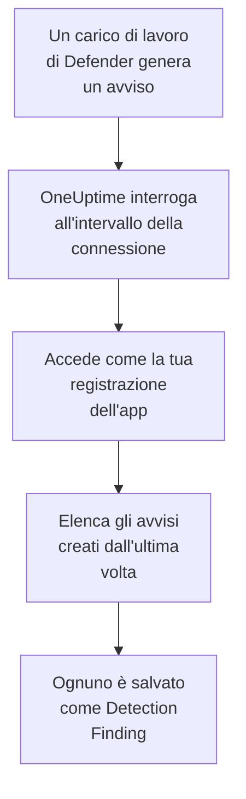

# Microsoft Defender XDR

Importa gli avvisi di ogni carico di lavoro di [Microsoft Defender XDR](https://learn.microsoft.com/en-us/defender-xdr/), da endpoint, identità, posta e app cloud, negli eventi di sicurezza di OneUptime. Lì li cerchi accanto a log, trace e metriche, li correli con ogni altra fonte e chiami la reperibilità per quelli che contano. OneUptime li legge tramite l'API di sicurezza di Microsoft Graph con una registrazione dell'app che crei tu: non servono agenti, playbook né un'area di lavoro di Sentinel.

:::cards
- [Configurare la connessione](#configurare-la-connessione): Una registrazione dell'app, un'autorizzazione e il modulo della connessione.
- [Cosa viene importato](#cosa-viene-importato): Come ogni avviso di Defender diventa un evento di sicurezza.
- [Come funziona il polling](#come-funziona-il-polling): La finestra che legge ogni interrogazione, e cosa le fa un tenant molto attivo.
- [Risoluzione dei problemi](#risoluzione-dei-problemi): Cosa significa ogni errore e cosa cambiare.
:::

## Come funziona



Ogni minuto, OneUptime interroga ogni connessione abilitata il cui intervallo di polling è trascorso. Un'interrogazione accede a Microsoft Entra ID come la tua registrazione dell'app, chiede a Microsoft Graph gli avvisi creati dall'ultima interrogazione ([List alerts_v2](https://learn.microsoft.com/en-us/graph/api/security-list-alerts_v2)) e salva ognuno come un evento [OCSF](https://schema.ocsf.io/) Detection Finding (classe `2004`). Regole di rilevamento, monitor e dashboard lo trattano poi come un evento di sicurezza di qualsiasi altra fonte.

## Prima di iniziare

- In OneUptime, il ruolo Project Owner, Project Admin o Security Admin. I ruoli Security Member e Security Viewer vedono le connessioni e la cronologia delle loro esecuzioni, ma non possono modificarle.
- Un tenant Microsoft Entra con una licenza Microsoft Defender XDR: qualsiasi carico di lavoro di Defender integrato nel portale Microsoft Defender, come Defender for Endpoint, for Identity, for Office 365 o for Cloud Apps.
- Un ruolo Entra che può registrare applicazioni, come Amministratore applicazione, e un Amministratore globale o un Amministratore ruolo con privilegi per concedere il consenso dell'amministratore.
- HTTPS in uscita dall'app e dai worker di OneUptime verso `login.microsoftonline.com` e `graph.microsoft.com`, o verso `login.microsoftonline.us` e `graph.microsoft.us` per Azure Government.

## Configurare la connessione

La connessione accede con il [flusso delle credenziali client di OAuth 2.0](https://learn.microsoft.com/en-us/entra/identity-platform/v2-oauth2-client-creds-grant-flow): come applicazione, mai come persona, con un'unica autorizzazione dell'applicazione.

:::steps
### Registrare un'applicazione

1. Accedi al [portale di Azure](https://portal.azure.com) e apri **Microsoft Entra ID**.
2. Vai su **App registrations → New registration**. Chiamala `OneUptime Security Events`, lascia **Supported account types** su **Accounts in this organizational directory only**, lascia vuoto l'URI di reindirizzamento e seleziona **Register**.
3. Nella pagina **Overview** dell'app, copia l'**ID applicazione (client)** e il **ID directory (tenant)**.

### Permetterle di leggere gli avvisi

1. Vai su **API permissions → Add a permission → Microsoft Graph → Application permissions**, scegli `SecurityAlert.Read.All` e seleziona **Add permissions**. È l'autorizzazione con meno privilegi che la chiamata [List alerts_v2](https://learn.microsoft.com/en-us/graph/api/security-list-alerts_v2#permissions) accetta per un'applicazione: non aggiungere `SecurityAlert.ReadWrite.All`.
2. Seleziona **Grant admin consent for** il tuo tenant e conferma. Lo stato dell'autorizzazione deve indicare **Granted**: senza consenso, ogni lettura viene rifiutata con `403`.

### Creare un segreto client

Vai su **Certificates & secrets → Client secrets → New client secret**, scegli quando scade e seleziona **Add**. Copia il **Value** del segreto, non il suo **Secret ID**, prima di lasciare la pagina: non viene più mostrato.

Annota quando scade il segreto. Quel giorno il polling si ferma con `Microsoft Defender XDR token request failed (HTTP 401)` finché non lo sostituisci con **Update credentials**.

### Aggiungere la connessione in OneUptime

Apri **Prodotti → Security Events → Connections** (`/dashboard/{projectId}/security-events/connections`), fai clic su **Aggiungi connessione**, scegli **Microsoft Defender XDR** in **EDR / XDR** e fai clic su **Avanti**. Compila le impostazioni della tabella qui sotto, fai clic su **Avanti** e incolla il valore del segreto in **Client secret**.

### Provarla prima di salvare

Fai clic su **Test these settings** in **Testa prima di salvare**. Il test accede e legge gli avvisi con i valori del modulo, e non salva nulla, quindi un segreto errato o un consenso mancante emergono prima che la connessione esista. Poi fai clic su **Avanti**, dai alla connessione un **Nome** e creala.
:::

| Impostazione | Dove trovarla |
| --- | --- |
| **ID directory (tenant)** | La pagina **Overview** dell'app. Il GUID del tenant, o un dominio verificato come `contoso.onmicrosoft.com`. |
| **ID applicazione (client)** | La pagina **Overview** dell'app. Il GUID dell'app che ha `SecurityAlert.Read.All`. |
| **Cloud** | **Cloud pubblico di Azure**, che serve anche Microsoft 365 GCC, o **Azure Government (USA)** per GCC High (`login.microsoftonline.us` e `graph.microsoft.us`). Microsoft 365 DoD e il cloud 21Vianet in Cina non sono supportati. |
| **Client secret** | Il **Value** del segreto. È cifrato, mai restituito dall'API e mai più mostrato. Sostituiscilo con **Update credentials** sulla connessione. |

Il passaggio **Polling** ha anche una **Descrizione** facoltativa, il **Poll Interval (Minutes)**, un numero intero da `1` a `1440` che parte da `5`, e **Abilitato**, che parte attivo.

## Cosa viene importato

Ogni [avviso](https://learn.microsoft.com/en-us/graph/api/resources/security-alert) di Defender XDR diventa un evento Detection Finding (classe OCSF `2004`), con il fornitore `Microsoft` e il prodotto `Microsoft Defender XDR`, attribuito al servizio di telemetria `Microsoft Defender XDR`:

| Colonna OCSF | Campo dell'avviso |
| --- | --- |
| `eventUid` | `id`, l'ID dell'avviso di Graph, che serve anche a scartare i duplicati |
| `time` | `firstActivityDateTime`, o `createdDateTime` se manca |
| `message`, `ruleName` | `title` |
| `ruleId` | `detectorId`, o `alertPolicyId` se manca |
| `severityName` | `severity`: `informational`, `low`, `medium` o `high`, e `unknown` resta Unknown |
| `statusName` | `status`: `new` diventa New, `inProgress` In Progress, `resolved` Resolved |
| `mitreTechniques` | `mitreTechniques` |
| `mitreTactics` | `categories` o `category`, quando è una tattica ATT&CK: `CredentialAccess` diventa `TA0006`. Le altre categorie restano in `attributes`. |
| `principalHost`, `principalUser`, `principalIp`, `principalProcess` | L'`evidence` con il ruolo `source`, `attacker` o `compromised`, altrimenti la prima di ogni tipo |
| `processName`, `processPath`, `processCommandLine`, `parentProcessName`, `parentProcessPath` | L'evidenza di processo da cui viene `principalProcess`: il suo `imageFile`, `processCommandLine` e `parentProcessImageFile`. Graph non fornisce la riga di comando del processo padre. |
| `targetHost`, `targetUser`, `targetIp`, `targetResource` | L'`evidence` con un ruolo di destinazione, come `destination` o `attacked`. URL, caselle di posta e risorse cloud riempiono `targetResource`. |
| `observables` | Ogni nome host, IP, utente, nome file, SHA-1 e SHA-256, URL, dominio, casella di posta e ID risorsa in `evidence` |
| `attributes` | L'intero avviso, appiattito in chiavi puntate come `evidence.0.hostName`, `serviceSource` e `incidentId` |

Vengono importati gli avvisi di ogni `serviceSource`, anche quelli di Microsoft Sentinel una volta che Sentinel è collegato al portale di Defender. Gli incidenti non vengono importati, ma ogni avviso conserva il suo `incidentId` e il suo `incidentWebUrl` in `attributes`.

## Come funziona il polling

Ogni interrogazione elenca gli avvisi creati nella sua finestra, 100 per pagina, e segue l'`@odata.nextLink` di Graph finché non ha letto l'intera finestra:

```text
GET https://graph.microsoft.com/v1.0/security/alerts_v2?$filter=createdDateTime ge {start} and createdDateTime lt {end}&$top=100
```

- **L'ora di creazione è il cursore.** Defender crea spesso un avviso ore dopo il suo `firstActivityDateTime`, e un cursore sull'ora di attività salterebbe ognuno di questi avvisi.
- **La prima interrogazione guarda indietro di 24 ore**, così una nuova connessione mostra subito i suoi avvisi recenti.
- **Ogni interrogazione successiva parte 1 minuto prima del cursore salvato**, così un avviso creato al confine tra due finestre viene letto due volte e importato una.
- **Un'interrogazione legge al massimo 24 ore oltre il cursore.** Una connessione il cui cursore è rimasto indietro, mentre i worker erano fermi o il tenant era limitato, recupera in una serie di finestre di 24 ore.
- **I duplicati vengono scartati in base all'`id` dell'avviso** tra gli eventi del progetto provenienti da `Microsoft` / `Microsoft Defender XDR`, così la sovrapposizione, una finestra ripetuta e un'importazione non salvano mai un avviso due volte.
- **Un'esecuzione fallita non cambia nulla.** Dopo un errore di rete, o uno stato di errore di Graph, il cursore e la lunghezza della finestra restano com'erano, e l'interrogazione successiva rilegge la stessa finestra. L'unica eccezione è una richiesta scaduta: il cursore resta, ma la finestra successiva è lunga la metà, perché una finestra troppo pesante per ricevere risposta in tempo scadrebbe a ogni tentativo.

### Quando una finestra contiene più di quanto un'interrogazione possa leggere

Un'interrogazione legge al massimo 20 pagine da 100 avvisi: 2.000 avvisi. Quando questo limite la ferma prima della fine della sua finestra, l'esecuzione è **Partial**, con questo avviso:

```text
Stopped after 20 alerts requests (the per-run request limit) before reading the whole window. Microsoft Graph lists alerts newest first and documents no way to sort them oldest first, so this run cannot name a point to resume from.
```

[List alerts_v2](https://learn.microsoft.com/en-us/graph/api/security-list-alerts_v2) documenta `$filter`, `$top`, `$skip` e `$count`, ma non `$orderby`, e restituisce prima gli avvisi più recenti. I 2.000 avvisi letti da un'esecuzione fermata sono i più recenti della sua finestra, quindi spostare il cursore oltre di loro salterebbe quelli più vecchi che non ha mai raggiunto. OneUptime accorcia invece la finestra:

1. **Restringere.** L'interrogazione successiva legge una finestra lunga la metà, dallo stesso punto di partenza, e continua a dimezzarla finché una finestra non viene letta per intero, fino a un minuto. L'avviso dell'esecuzione lo dice: `This window holds more records than one poll can read; the next poll reads a {n} minute window from the same starting point.` Gli avvisi già importati dalla finestra più lunga vengono saltati come duplicati.
2. **Tornare a crescere.** Dopo che una finestra è stata letta per intero, il cursore passa alla sua fine, e la finestra successiva è di nuovo lunga il doppio, fino a 24 ore.
3. **Superare un singolo minuto.** Se anche un solo minuto contiene più di 2.000 avvisi, il polling lo supera, così gli avvisi più recenti continuano ad arrivare. L'esecuzione resta **Partial**, e **Ultimo errore** riporta `More records were created in the one minute from {cursor} to {end} than one poll can read. Polling moved past this minute so newer records keep arriving; use Import this time range in Diagnostics on this minute to recover what one run can read.` Importa quel minuto con **Import this time range** per recuperare ciò che un'esecuzione può leggere.

Un'esecuzione **Partial** per un altro motivo, come un avviso che non è stato possibile leggere come evento di sicurezza, viene riprovata allo stesso modo, dallo stesso punto di partenza. Cambiare il **Poll Interval (Minutes)** non cambia nulla di tutto questo: decide quanto spesso parte un'interrogazione, non dove inizia la sua finestra.

### Eseguire, visualizzare in anteprima e importare su richiesta

Fai clic su **Diagnostics** su una connessione per vederne le esecuzioni recenti e lavorarci a mano. Chi può modificare la connessione può avviare queste azioni; chi può vederla può leggerne la cronologia.

- **Run now** avvia subito un'interrogazione, con il cursore abituale, anche quando la connessione non è **Abilitato**.
- **Preview alerts** legge un intervallo di tempo fino a 7 giorni e non importa nulla.
- **Import this time range** importa un intervallo fino a 7 giorni, dopo la tua conferma, senza spostare il cursore. Gli avvisi già importati vengono saltati.
- **Copy diagnostics** su un'esecuzione copia il suo rapporto per il supporto. Non contiene mai credenziali.

## Testare la connessione

**Testa la connessione** sulla riga di una connessione, e **Test these settings** nel modulo, vengono eseguiti nel processo dell'API, non in un worker in background, così un test risponde anche quando il problema sono i worker. Esegue questi controlli, in ordine:

| Controllo | Cosa verifica |
| --- | --- |
| **Configurazione** | Le quattro impostazioni sono presenti e ben formate. Non viene contattato nulla quando questo fallisce. |
| **Authenticate with Microsoft Entra** | Microsoft Entra ID rilascia un token per Microsoft Graph, nel cloud che hai scelto. Fallisce con un segreto errato o scaduto, un ID tenant o client errato, o il cloud sbagliato. |
| **Read alerts from Microsoft Graph** | Si può leggere un avviso creato nelle ultime 24 ore (`$top=1`). Un `403` qui è l'autorizzazione `SecurityAlert.Read.All` mancante, il consenso dell'amministratore mancante o un tenant senza Defender XDR. |
| **Alerts available to import** | Quanti avvisi sono stati creati nelle ultime 24 ore e negli ultimi 7 giorni, una pagina da 100 ciascuno, quindi `100+` significa di più. Nessuno in 7 giorni è un avviso, non un errore. |
| **Background workers**, **Poll scheduler**, **Security event storage** | Il lato di OneUptime stesso: un processo prende i job della coda Worker, il job di polling gira ogni minuto e l'archivio degli eventi di sicurezza risponde. |
| **Scheduled polling** | Per una connessione salvata: il polling è attivo, nessuna esecuzione è bloccata in attesa di un worker e le interrogazioni girano in orario. |

Ogni richiesta di un test ha una scadenza di 20 secondi. Un test non importa mai nulla e non sposta mai il cursore, e ogni controllo fallito dice cosa cambiare.

## Risoluzione dei problemi

Il **Ultimo errore** della connessione conserva il messaggio di errore completo, con le credenziali oscurate, dietro un prefisso che nomina il passaggio fallito. Quando una connessione ha un errore, seleziona **Visualizza errore** nella sua colonna **Azioni** per leggerlo, e **Copia errore** nella finestra di dialogo per copiarlo. Leggi prima il prefisso.

:::details Last Error inizia con `Microsoft Defender XDR token request`
- `Microsoft Defender XDR token request failed (HTTP ...)`: Microsoft Entra ID si è rifiutato di rilasciare un token, quindi Graph non è mai stato contattato. Il messaggio termina con un suggerimento, in base al codice `error` di Entra:
  - `invalid_client` (`AADSTS7000215`): il segreto è errato, scaduto o appartiene a un'altra app. Creane uno nuovo in **Certificates & secrets** e salvalo con **Update credentials**.
  - `unauthorized_client` (`AADSTS700016`): l'**ID applicazione (client)** non si trova in quel **ID directory (tenant)**, oppure **Cloud** è errato.
  - `AADSTS90002`: quel tenant non esiste.
  - `invalid_scope`: l'ambito di Graph non esiste nel cloud che hai scelto. Controlla **Cloud**.
- `Microsoft Defender XDR token request returned ...`: Microsoft Entra ID ha risposto con qualcosa di inutilizzabile, un corpo che non è JSON o senza `access_token`. Di solito è un proxy o un gateway nel mezzo, non le credenziali.
- `Microsoft Defender XDR token request did not complete: ...`: l'endpoint dei token non era raggiungibile, o non ha risposto in tempo. Controlla l'HTTPS in uscita dall'app e dai worker di OneUptime verso `login.microsoftonline.com`, o `login.microsoftonline.us`.
:::

:::details Last Error inizia con `Microsoft Defender XDR alerts request`
- `Microsoft Defender XDR alerts request failed (HTTP ...)`: Graph si è rifiutato di elencare gli avvisi. Il messaggio nomina il codice di errore di Graph, e un suggerimento:
  - `403` (`Authorization_RequestDenied`): mancano `SecurityAlert.Read.All` o il suo consenso dell'amministratore, oppure il tenant non ha una licenza Defender XDR. Il consenso richiede qualche minuto per applicarsi.
  - `401` (`InvalidAuthenticationToken`) dopo il rilascio di un token: di solito **Cloud** non corrisponde al tenant.
  - `429` (`TooManyRequests`): Graph sta limitando l'app, e l'interrogazione successiva rilegge la stessa finestra. Il messaggio non può citare il `Retry-After` di Graph, perché il client HTTP di OneUptime non conserva le intestazioni di risposta in caso di errore. Se continua a succedere, aumenta il **Poll Interval (Minutes)**.
  - `5xx`: un problema dal lato di Graph. L'interrogazione successiva riprova.
  - `400`: Graph non ha voluto eseguire la query, che costruisce OneUptime e non le tue impostazioni. Copia il messaggio per il supporto di OneUptime.
- `Microsoft Defender XDR alerts request returned ...`: Graph ha risposto `200`, ma con qualcosa che il connettore non poteva usare: un corpo che non è JSON, nessun elenco `value`, o un `@odata.nextLink` che non è un link `https://` sull'host Graph del tuo cloud. Un link così viene rifiutato, così il token non viene mai inviato altrove. Viene segnalato invece di essere preso per una finestra vuota, così il cursore non supera mai avvisi che nessuno ha letto.
- `Microsoft Defender XDR alerts request did not complete: ...`: Graph non era raggiungibile, o non ha risposto in tempo: 60 secondi per un'interrogazione, 20 per un test. Controlla l'HTTPS in uscita verso `graph.microsoft.com`, o `graph.microsoft.us`.
:::

:::details Il test riesce, ma Last Polled è Never
Il job di polling non è mai stato eseguito. Leggi i controlli **Background workers** e **Poll scheduler**. Su un'installazione self-hosted, la causa abituale è `DISABLE_QUEUE_WORKERS=true` sull'app, senza un deployment separato dei worker che prenda i job: impostalo su `false`, oppure esegui il deployment dei worker (Helm: `worker.enabled: true`, che è `false` per impostazione predefinita).
:::

:::details Le interrogazioni riescono, ma manca un avviso che conosci
Confronta il `createdDateTime` dell'avviso nel portale di Defender con la finestra dell'esecuzione in **Diagnostics**: le finestre si basano sull'ora di creazione, non sull'ora di attività.

- Un avviso creato prima che la connessione esistesse è più vecchio del primo sguardo indietro di 24 ore. Importalo con **Import this time range**.
- Un'esecuzione **Partial** è stata fermata dal limite di 2.000 avvisi. L'interrogazione successiva legge una finestra più corta dallo stesso inizio, quindi l'avviso viene importato non appena una finestra che lo contiene viene letta per intero.
- Se **Ultimo errore** nomina un minuto che il polling ha superato, importa quel minuto con **Import this time range**.
:::

:::details Lo stesso avviso compare due volte
Non è colpa della sovrapposizione di 1 minuto: la seconda lettura conta come duplicato e non viene salvata. Due eventi con lo stesso `eventUid` sono stati importati con prodotti diversi, come lo stesso avviso che arriva anche da una connessione Microsoft Sentinel. I duplicati vengono scartati per fornitore e prodotto.
:::

## Cosa ottieni

- **Ricerca.** Filtra gli avvisi di Defender per gravità, stato, tecnica MITRE, host, utente, IP o qualsiasi osservabile nell'esploratore degli eventi di sicurezza, accanto ai log e alle metriche di quell'host.
- **Correlazione.** Le prove di ogni avviso, i suoi dispositivi, utenti, IP, file e URL, vengono indicizzate come osservabili, quindi una ricerca trova tutto ciò che menziona un host in ogni fonte.
- **Regole di rilevamento.** Regole Sigma che girano secondo una pianificazione sui tuoi eventi di sicurezza, e aprono avvisi che chiamano la reperibilità.
- **Monitor.** I monitor degli eventi di sicurezza contano gli eventi corrispondenti, e aprono incidenti o avvisi oltre una soglia.

Gli eventi di sicurezza sono fatturati come il resto della tua telemetria, per GB acquisito. Vedi i [prezzi](https://oneuptime.com/pricing).

## Prossimi passi

:::cards
- [Eventi di sicurezza](/docs/telemetry/security-events): Cerca, correla e genera avvisi su ciò che importi.
- [Microsoft Sentinel](/docs/integrations/microsoft-sentinel): Importa anche gli incidenti di un'area di lavoro di Sentinel.
- [Ruoli](/docs/permissions/reference#ruoli): Cosa possono vedere e modificare i ruoli Security.
- [Panoramica delle integrazioni](/docs/integrations/index): Gli altri strumenti che puoi collegare.
:::
