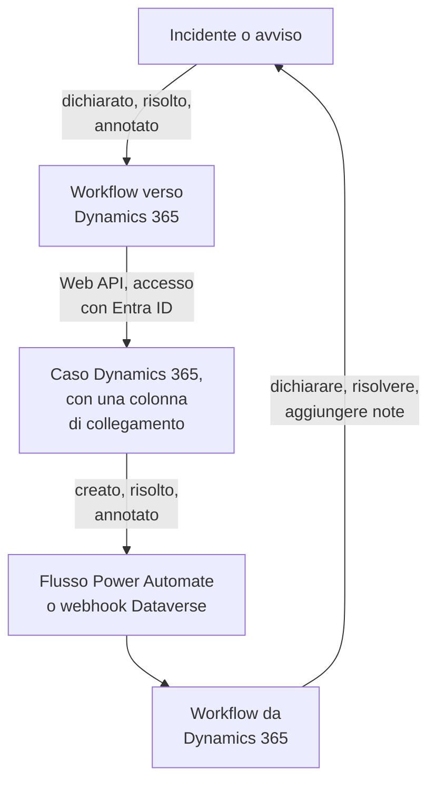

# Microsoft Dynamics 365

Tieni i casi di [Microsoft Dynamics 365](https://www.microsoft.com/dynamics-365) allineati con i tuoi incidenti e avvisi di OneUptime, in entrambe le direzioni. Modelli di workflow pronti all'uso aprono un caso per ogni incidente o avviso, lo chiudono quando il record viene risolto e vi copiano le note. Altri dichiarano incidenti dai nuovi casi e riportano indietro risoluzioni e note. Non c'è alcun plugin: i workflow chiamano la Web API di Dataverse, e Dynamics 365 chiama i loro URL webhook.

:::cards
- [Preparare Dynamics 365](#preparare-dynamics-365): Una registrazione dell'app, un utente applicazione e una colonna di collegamento.
- [Partire da un modello](#partire-da-un-modello): I 13 modelli, cosa chiedono e come configurarli.
- [Come funzionano i modelli](#come-funzionano-i-modelli): Come casi e record restano collegati, senza cicli.
- [Costruirlo da soli](#costruirlo-da-soli): Ogni direzione a mano, per quando un modello non va bene.
:::

## Come funziona



Ogni modello è un piccolo workflow, quindi prendi solo le direzioni che ti servono, per incidenti, avvisi o entrambi. I modelli OneUptime → Dynamics 365 chiamano la Web API di Dataverse, con accesso come applicazione tramite Microsoft Entra ID. I modelli Dynamics 365 → OneUptime partono quando un flusso Power Automate o un webhook Dataverse li chiama. Una colonna di testo che aggiungi alla tabella Case collega ogni caso al suo record.

## Prima di iniziare

- Un ambiente Dynamics 365 con la tabella **Case**. I casi vengono da Dynamics 365 Customer Service: un ambiente Dataverse senza di esso non ha alcuna tabella `incident` in cui scrivere.
- Il diritto di registrare un'applicazione in **Microsoft Entra ID** e di creare un utente applicazione nell'ambiente. Spesso sono due amministratori diversi.
- In OneUptime, il permesso di creare workflow. Su OneUptime Cloud, i workflow richiedono il piano **Growth** o superiore.

> [!NOTE]
> Questa pagina usa i nomi di Dataverse, non le etichette dei moduli di Dynamics. Un caso è la tabella `incident`, la sua raccolta in un URL è `incidents`, la sua chiave è `incidentid` e la sua colonna del titolo è `title`. Il numero di caso che vedi è `ticketnumber`.

## Preparare Dynamics 365

Ne hanno bisogno sia i modelli sia un workflow costruito da te. OneUptime accede come applicazione, non come persona, con il flusso client credentials di OAuth 2.0.

:::steps
### Registrare un'applicazione in Microsoft Entra ID

1. Accedi al [portale di Azure](https://portal.azure.com) come amministratore del tenant del tuo ambiente Dynamics e apri **Microsoft Entra ID**.
2. Vai su **App registrations → New registration**. Chiamala `OneUptime Integration`, lascia **Supported account types** su **Accounts in this organizational directory only** e seleziona **Register**.
3. Dalla pagina **Overview** dell'app, copia l'**Application (client) ID** e il **Directory (tenant) ID**.
4. Vai su **Certificates & secrets → Client secrets → New client secret** e copia il **Value** del segreto, non il suo ID, prima di lasciare la pagina: non viene più mostrato. Un client secret dura al massimo 24 mesi, quindi annota quando scade.

Non aggiungere permessi API e non concedere il consenso amministratore: senza un utente connesso, non servono a nulla. È Dynamics 365 a decidere cosa può fare l'applicazione, tramite il suo utente applicazione.

### Creare l'utente applicazione

1. Nell'[interfaccia di amministrazione di Power Platform](https://admin.powerplatform.microsoft.com/), seleziona **Manage → Environments**, poi il tuo ambiente.
2. Seleziona **Settings → Users + permissions → Application users**, poi **+ New app user** e **+ Add an app**. Scegli la registrazione e seleziona **Add**.
3. Scegli una **Business unit**, poi assegnagli un ruolo di sicurezza personalizzato con l'icona di modifica accanto a **Security roles**. A livello Organization, il ruolo ha bisogno di:
   - **Case**: Create, Read, Write, Append e Append To.
   - **Note**: Create, Read e Append, per i modelli delle note.
   - **Activity**: Create, Read e Append, perché chiudere un caso registra una Case Resolution, che è un'attività.
   - **Account**, e **Contact** se i casi vengono aperti a nome di un contatto: Read e Append To.
4. Seleziona **Save**, poi **Create**.

Un utente applicazione può avere solo un ruolo personalizzato: copiane uno esistente e riducilo. Senza questo utente, Microsoft Entra ID rilascia comunque i token, ma ogni chiamata a Dynamics 365 fallisce con `403` e `0x80072560`, «The user isn't a member of the organization».

### Aggiungere una colonna di collegamento alla tabella Case

Dataverse non ha nulla di simile alle etichette di Jira, quindi un caso e un record di OneUptime si trovano tramite una colonna che aggiungi tu.

1. In [make.powerapps.com](https://make.powerapps.com), scegli il tuo ambiente, apri **Tables → Case → Columns** e seleziona **New column**.
2. Chiamala `OneUptime Link`, lascia **Data type** su **Single line of text** e salva. La lunghezza massima predefinita di 100 è più che sufficiente: i modelli scrivono al massimo 55 caratteri.
3. Apri la nuova colonna e copia il suo **Logical name**, come `new_oneuptimelink`. Il prefisso viene dall'autore della tua soluzione, quindi il tuo può essere diverso, come `cr4f2_oneuptimelink`.

Aggiungi la colonna al modulo Case se gli agenti devono vedere il collegamento.
:::

## Partire da un modello

La finestra **Crea un flusso di lavoro** ha 13 modelli Dynamics 365, sotto **Dynamics 365** nel suo elenco di categorie: sette per gli incidenti, poi sei per gli avvisi, ogni gruppo sotto la propria intestazione. Condividono la colonna di collegamento, quindi qualsiasi loro combinazione funziona insieme.

### Modelli per gli incidenti

| Modello | Cosa fa | Cosa chiede |
| --- | --- | --- |
| **OneUptime → Dynamics 365** | | |
| Create a Dynamics 365 case when an incident is declared | Apre un caso per ogni nuovo incidente, con una priorità scelta in base alla sua gravità e l'ID dell'incidente nella colonna di collegamento. Gli incidenti dichiarati da Dynamics 365, e gli incidenti privati, vengono saltati. | Le cinque impostazioni di Dynamics 365, il cliente per i nuovi casi e l'URL di OneUptime |
| Resolve the Dynamics 365 case when the incident is resolved | Chiude il caso collegato come **Problem Solved** quando l'incidente viene risolto, registrando una Case Resolution come fa la risoluzione a mano. Non riapre mai un caso. | Le cinque impostazioni di Dynamics 365 |
| Copy incident private notes to the Dynamics 365 case | Aggiunge ogni nuova nota privata al caso collegato come nota. | Le cinque impostazioni di Dynamics 365 |
| Copy incident public notes to the Dynamics 365 case | Aggiunge ogni nuova nota pubblica al caso collegato come nota, così gli agenti possono dire ai clienti cosa riporta la pagina di stato. | Le cinque impostazioni di Dynamics 365 |
| **Dynamics 365 → OneUptime** | | |
| Declare an incident when a Dynamics 365 case is created | Dichiara un incidente per ogni nuovo caso, tenuto fuori dalle tue pagine di stato, con una gravità scelta in base alla priorità del caso, poi scrive l'ID dell'incidente nella colonna di collegamento del caso. | Le cinque impostazioni di Dynamics 365, e un flusso o un webhook per i nuovi casi |
| Resolve the incident when its Dynamics 365 case is resolved | Risolve l'incidente quando il suo caso collegato viene risolto. | Le cinque impostazioni di Dynamics 365, e un flusso o un webhook per i cambi di stato dei casi |
| Add Dynamics 365 case notes to the incident as private notes | Copia ogni nota che un agente aggiunge a un caso collegato sull'incidente, come nota privata. | Le cinque impostazioni di Dynamics 365, e un flusso o un webhook per le nuove note |

### Modelli per gli avvisi

I modelli per gli avvisi fanno gli stessi lavori per gli avvisi. Ce n'è uno in meno, perché gli avvisi non hanno note pubbliche, e **Create an alert when a Dynamics 365 case is created** non scrive alcuna impostazione della pagina di stato, perché un avviso non arriva mai su una pagina di stato.

| Modello | Cosa fa | Cosa chiede |
| --- | --- | --- |
| **OneUptime → Dynamics 365** | | |
| Create a Dynamics 365 case when an alert is created | Apre un caso per ogni nuovo avviso, compreso ogni avviso generato da un monitor. Gli avvisi creati da Dynamics 365, e gli avvisi privati, vengono saltati. | Le cinque impostazioni di Dynamics 365, il cliente per i nuovi casi e l'URL di OneUptime |
| Resolve the Dynamics 365 case when the alert is resolved | Chiude il caso collegato come **Problem Solved** quando l'avviso viene risolto. | Le cinque impostazioni di Dynamics 365 |
| Copy alert private notes to the Dynamics 365 case | Aggiunge ogni nuova nota privata al caso collegato come nota. | Le cinque impostazioni di Dynamics 365 |
| **Dynamics 365 → OneUptime** | | |
| Create an alert when a Dynamics 365 case is created | Crea un avviso per ogni nuovo caso, con una gravità scelta in base alla priorità del caso, poi scrive l'ID dell'avviso nella colonna di collegamento del caso. | Le cinque impostazioni di Dynamics 365, e un flusso o un webhook per i nuovi casi |
| Resolve the alert when its Dynamics 365 case is resolved | Risolve l'avviso quando il suo caso collegato viene risolto. | Le cinque impostazioni di Dynamics 365, e un flusso o un webhook per i cambi di stato dei casi |
| Add Dynamics 365 case notes to the alert as private notes | Copia ogni nota che un agente aggiunge a un caso collegato sull'avviso, come nota privata. | Le cinque impostazioni di Dynamics 365, e un flusso o un webhook per le nuove note |

Nessuno dei modelli OneUptime → Dynamics 365 invia a Dynamics 365 un incidente segnato come **Incidente privato**, né un avviso segnato come **Avviso privato**: né il record, né il suo stato, né le sue note, a meno che tu non lo attivi. Vedi [Cambiare cosa fa un modello](#cambiare-cosa-fa-un-modello).

**I monitor generano avvisi da soli, e possono generarne molti.** **Create a Dynamics 365 case when an alert is created** apre un caso per ognuno. A meno che ogni avviso meriti un caso, metti un blocco **If / Else** tra il trigger e il resto del workflow, ad esempio su `{{local.components.alert-on-create-1.returnValues.model.alertSeverity.name}}`, e collega in avanti solo il suo lato **Yes**.

### Cosa chiedono i modelli

Il passaggio **Configura** della procedura guidata di creazione chiede fino a sette valori: ogni modello chiede i primi cinque, le impostazioni di Dynamics 365, e i due modelli che creano un caso chiedono anche gli ultimi due. Controlla la forma di ogni impostazione di Dynamics 365 prima che venga creato qualcosa e dice cosa scrivere al suo posto, perché un valore con la forma sbagliata non dà errore da nessuna parte fino a un'esecuzione.

- **Dynamics 365 Environment URL** — l'indirizzo del tuo ambiente, come `https://yourorg.crm.dynamics.com`, dall'[interfaccia di amministrazione di Power Platform](https://admin.powerplatform.microsoft.com/) in **Environments**, il tuo ambiente, **Environment URL**. Solo l'indirizzo: non l'endpoint della Web API, che termina con `/api/data/v9.2`, e senza barra finale.
- **Directory (Tenant) ID** — dalla pagina **Overview** della registrazione dell'app.
- **Application (Client) ID** — dalla stessa pagina.
- **Client Secret Value** — il **Value** del client secret, da **Certificates & secrets**. Non il suo **Secret ID**, che è un GUID: qui la procedura guidata rifiuta un GUID.
- **Case Link Column** — il nome logico della colonna di collegamento, come `new_oneuptimelink`.
- **Customer for New Cases** — lo chiedono solo i due modelli che creano un caso. Ogni caso ha bisogno di un cliente, e un incidente di OneUptime non ne ha, quindi tutti i nuovi casi vengono aperti a nome di uno solo: incolla l'ID di un account, o `contacts(<id>)` per un contatto. Apri il record in Dynamics 365: il suo ID è la parte dopo `id=` nell'indirizzo.
- **OneUptime URL** — lo chiedono solo i due modelli che creano un caso: l'indirizzo da cui apri OneUptime, come `https://oneuptime.com`. La descrizione del caso rimanda con esso all'incidente o all'avviso.

**Come accedono i modelli.** La procedura guidata salva il tenant, il client ID e il segreto in un'unica [variabile OAuth 2.0](/docs/workflows/variables#variabili-oauth-20-token-che-si-rinnovano-da-soli), `dynamicsAccessToken`, in **Variabili del flusso** del workflow: Client Credentials, l'URL del token `https://login.microsoftonline.com/<tenant>/oauth2/v2.0/token`, l'ambito `<environment URL>/.default` e il client secret, inviato nel corpo della richiesta e salvato cifrato. Ogni chiamata a Dynamics 365 invia `Authorization: Bearer {{local.variables.dynamicsAccessToken}}`. OneUptime ottiene il token la prima volta che un passaggio ne ha bisogno, ne ottiene uno nuovo prima che scada e lo sostituisce con `[REDACTED]` nei log delle esecuzioni e nelle tracce dei passaggi.

Per verificare l'accesso prima che parta qualcosa, apri **Variabili del flusso**, fai clic su **Visualizza** su `dynamicsAccessToken` e fai clic su **Aggiorna ora**. **Access Token Fetched** significa che la registrazione dell'app è corretta. Altrimenti l'errore di Microsoft Entra ID nomina cosa non va, come `AADSTS7000215: Invalid client secret provided`.

Ogni workflow conserva la propria copia. Quando sostituisci il client secret, apri `dynamicsAccessToken` in ogni workflow Dynamics 365 e usa **Aggiorna le credenziali**.

### Creare i workflow

:::steps
1. Apri **Flussi di lavoro → Crea flusso di lavoro**. In **Oppure parti da un modello**, scegli **Dynamics 365** dall'elenco delle categorie, o scrivi `Dynamics` in **Cerca modelli…**, e fai clic sul modello che vuoi. Si apre e mostra cosa fa e le impostazioni che chiederà. Fai clic su **Usa questo modello**.
2. **Nome** viene compilato dal modello. Cambialo se vuoi.
3. **Configura** chiede i valori qui sopra.
4. Fai clic su **Crea flusso di lavoro**. Ogni workflow viene creato disattivato: attiva **Abilitato** in cima al suo **Costruttore**.
:::

Inizia con **Create a Dynamics 365 case when an incident is declared**, o con **Create a Dynamics 365 case when an alert is created** per gli avvisi: ogni altro modello OneUptime → Dynamics 365 dello stesso tipo trova il caso tramite il collegamento che questo scrive. Attivalo, dichiara un incidente di prova o crea un avviso di prova, e apri **Registri → Esecuzioni** del workflow. L'ultimo passaggio dell'esecuzione dovrebbe dire `✅ Opened Dynamics 365 case CAS-01001-X1Y2Z3 for INC-42, linked as oneuptime-incident-<id>.`

### Collegare i modelli Dynamics 365 → OneUptime

I modelli Dynamics 365 → OneUptime, tre per gli incidenti e tre per gli avvisi, partono da un [trigger Webhook](/docs/workflows/triggers#webhook), quindi bisogna dire a Dynamics 365 dove inviare i suoi eventi. Procedi in quest'ordine:

1. Crea il workflow e **attivalo per primo**. Un workflow disattivato rifiuta le consegne, e non vengono messe in coda.
2. Apri il **Costruttore** del workflow, fai clic sul blocco trigger **Webhook** (`webhook-1`) e fai clic su **Copia URL** in cima alle sue impostazioni. L'URL è fatto così:

   ```text
   https://<your OneUptime host>/workflow/trigger/<webhook secret key>
   ```

3. Fai in modo che Dynamics 365 invii a quell'URL, da un flusso Power Automate o da un webhook Dataverse.

Ogni modello ha solo bisogno di sapere quale riga è cambiata. Rilegge quella riga da Dynamics 365 prima di fare qualsiasi cosa, quindi non prende mai dalla richiesta il titolo, lo stato o il collegamento di un caso, e non gli importa quale dei due la invii.

:::tabs
@tab Power Automate flow
In [Power Automate](https://make.powerautomate.com), crea un **Automated cloud flow** con il trigger **When a row is added, modified or deleted** di **Microsoft Dataverse**, impostato come qui sotto, con **Scope** su **Organization**. Aggiungi l'azione predefinita **HTTP**: **Method** `POST`, **URI** l'URL del workflow, un'intestazione `Content-Type: application/json` e il corpo qui sotto, con l'ID della riga preso dal contenuto dinamico del trigger.

| Modello | Change type | Table name | Select columns | Body |
| --- | --- | --- | --- | --- |
| Dichiarare un incidente / creare un avviso quando viene creato un caso | Added | Cases | | `{"incidentid": "<Case>"}` |
| Risolvere l'incidente / l'avviso quando il suo caso viene risolto | Modified | Cases | `statecode,statuscode` | `{"incidentid": "<Case>"}` |
| Aggiungere le note del caso all'incidente / all'avviso come note private | Added | Notes | | `{"annotationid": "<Note>"}` |

Per inviare solo alcuni casi, usa **Filter rows** del trigger, come `prioritycode eq 1` per i casi ad alta priorità. Puoi anche inviare l'intero output del trigger: i modelli ne leggono l'ID della riga e il suo `SdkMessage` allo stesso modo.
@tab Dataverse webhook
Registra l'URL con il [Plug-in Registration Tool](https://learn.microsoft.com/en-us/power-apps/developer/data-platform/register-web-hook): **Register New WebHook**, con autenticazione **HttpHeader** e un'intestazione tua; il segreto è l'URL stesso. Poi registra su di esso un passaggio per ogni evento qui sotto, con **Event Pipeline Stage of Execution** su **PostOperation** ed **Execution Mode** su **Asynchronous**.

| Modello | Message | Primary Entity | Filtering Attributes |
| --- | --- | --- | --- |
| Dichiarare un incidente / creare un avviso quando viene creato un caso | `Create` | `incident` | |
| Risolvere l'incidente / l'avviso quando il suo caso viene risolto | `Close`, e `Update` per i cambi di stato fatti da altri | `incident` | `statecode, statuscode` (Update) |
| Aggiungere le note del caso all'incidente / all'avviso come note private | `Create` | `annotation` | |

Risolvere un caso genera il messaggio **Close**, non **Update**, per questo quel modello li richiede entrambi. Un webhook invia il contesto di esecuzione del plug-in, che indica la riga in `PrimaryEntityId`, o, per **Close**, nella sua `IncidentResolution`, e i modelli la leggono da lì. Un webhook Dataverse chiama solo le porte 80 e 443, e non ha un proprio filtro sulle righe: ogni nuovo caso raggiunge il modello di creazione, a meno che tu non lo restringa con `ONLY_PRIORITIES`.
:::

Prima di affidarti all'uno o all'altro:

- **Chiunque abbia l'URL può attivare il workflow.** Poiché i modelli rileggono ogni riga da Dynamics 365, una richiesta può solo far loro guardare un caso o una nota reali. Può comunque far agire i modelli di creazione su un caso non ancora collegato. Tieni l'URL solo nel flusso o nel webhook. Se trapela, fai clic sul trigger **Webhook** nel **Costruttore** del workflow, fai clic su **Reimposta URL** e incolla il nuovo URL nel flusso o nel webhook. Il vecchio URL smette subito di funzionare.
- **Ogni evento è un'esecuzione**, comprese quelle che un modello salta. Su OneUptime Cloud ognuna conta per le esecuzioni di workflow del tuo piano, e filtrare nel flusso tiene basso quel numero. Vedi [Limiti del piano](/docs/workflows/configuration#limiti-di-piano).
- **Usi entrambi i modelli che creano un record da un caso?** **Declare an incident when a Dynamics 365 case is created** e **Create an alert when a Dynamics 365 case is created** agiscono entrambi su ogni caso che ricevono. Ciascuno controlla prima la colonna di collegamento, ma due consegne per lo stesso nuovo caso arrivano insieme, quindi il caso può ritrovarsi con un incidente e un avviso. Invia ai due casi diversi, ad esempio per tipo di caso.

### Verificare che funzioni

Ogni modello termina con un passaggio **Log** che dice cosa è successo, quindi l'ultimo passaggio di un'esecuzione in **Registri → Esecuzioni** è il posto dove guardare:

- `✅` — ha fatto il suo lavoro e nomina il caso, l'incidente o l'avviso.
- `ℹ️` — ha saltato l'evento di proposito e dice perché: il caso non è collegato a un record di questo tipo, la nota viene dall'altro lato, il record è privato, o al nuovo stato non corrisponde alcuno stato del caso.
- `❌` — una chiamata è fallita. Per una chiamata a Dynamics 365, la riga include la risposta di Dynamics 365.
- `⚠️` — un modello che crea un record da un caso lo ha creato, ma Dynamics 365 non ha accettato il collegamento, quindi gli altri modelli non possono ancora trovarlo. Scrivi a mano il collegamento nella colonna del caso.

Se un'esecuzione si ferma al primo passaggio Dynamics 365 con `Could not get an OAuth 2.0 access token for {{local.variables.dynamicsAccessToken}}`, le impostazioni di accesso sono sbagliate, e il messaggio riporta la risposta di Microsoft Entra ID. Vedi [Cosa chiedono i modelli](#cosa-chiedono-i-modelli).

## Come funzionano i modelli

### Come restano collegati i due lati

È il caso a conservare il collegamento. Un caso che appartiene a un incidente ha `oneuptime-incident-<incident id>` nella sua colonna di collegamento, e uno che appartiene a un avviso ha `oneuptime-alert-<alert id>`. L'ID è l'ultima parte dell'indirizzo del record nella dashboard.

I modelli che creano un caso lo scrivono quando aprono il caso, e i modelli che creano un record da un caso lo scrivono appena il record esiste. Tutti gli altri modelli passano da un lato all'altro tramite esso: quelli OneUptime → Dynamics 365 cercano il caso tramite il suo collegamento, e quelli Dynamics 365 → OneUptime leggono l'ID del record dal caso. Per collegare un caso aperto a mano, scrivi tu il valore nella sua colonna di collegamento, ma solo quando il record non ha ancora un caso.

**Un caso è collegato a un incidente o a un avviso, mai a entrambi.** Una sola colonna serve a entrambi i tipi. I modelli per gli incidenti ignorano un caso collegato a un avviso, e viceversa, e i modelli che creano un record da un caso lasciano stare ogni caso la cui colonna di collegamento contenga qualcosa.

**Un record ha un solo caso.** I modelli che scrivono su un caso agiscono solo quando esattamente un caso contiene il collegamento del record. Se il collegamento viene copiato in un secondo caso, si fermano, e ogni esecuzione termina con un salto che nomina entrambi:

```text
More than one Dynamics 365 case holds the link oneuptime-incident-<id> (CAS-01001-X1Y2Z3, CAS-01002-K4L5M6). Clear it on every case except the one opened for the incident.
```

Gli incidenti e gli avvisi creati da un caso conservano anche l'ID e il numero del caso in `customFields.dynamicsCaseId` e `customFields.dynamicsCaseNumber`, scritti alla loro creazione. È così che i modelli che creano un caso sanno che il record ne ha già uno.

### Come i modelli evitano i cicli

Ogni scrittura in una direzione è un evento nell'altra: una nota aggiunta a un caso torna indietro come nuova nota, e una nota privata aggiunta in OneUptime fa scattare il trigger delle note. Quattro cose fermano l'eco:

- **Marcatori nel testo.** Ogni nota che i modelli aggiungono a un caso ha il titolo `Synced from OneUptime: …`, come l'oggetto di ogni Case Resolution che registrano. Ogni nota scritta da Dynamics 365, e la causa principale di ogni cambio di stato fatto da lì, inizia con `Synced from Dynamics 365`. Ogni direzione salta il testo che porta il marcatore dell'altro lato, anche in una nota scritta da qualcuno che ne cita uno.
- **Il collegamento dal primo salvataggio.** Un caso aperto da OneUptime contiene il suo collegamento dal momento in cui esiste, quindi quando torna il suo **Create**, il modello che crea un record da un caso lo trova collegato e non fa nulla.
- **`customFields.dynamicsCaseId`.** Un record creato da un caso lo porta, e i modelli che creano un caso saltano questi record.
- **Gli stati vanno solo avanti, su entrambi i lati.** Risolvere il record chiude il caso, e il **Close** del caso trova allora il record già risolto. Quando il caso viene risolto per primo, il record viene risolto, e il suo aggiornamento trova il caso già chiuso. Un caso già risolto o annullato non viene mai riaperto.

Mantieni i marcatori quando modifichi i modelli. Sono le costanti `FROM_ONEUPTIME` e `FROM_DYNAMICS` nel blocco di supporto all'inizio di ogni script.

### Cambiare cosa fa un modello

Apri il **Costruttore** del workflow e fai clic sul blocco che vuoi cambiare. Le impostazioni che vorrai più probabilmente toccare sono costanti vicino all'inizio di uno script, il **JavaScript Code** di un blocco **Run Custom JavaScript**, subito sotto il blocco di supporto condiviso. Le versioni per incidenti e per avvisi tengono le stesse costanti negli stessi blocchi.

| Costante | Modello e blocco | Cosa controlla |
| --- | --- | --- |
| `SYNC_PRIVATE_INCIDENTS`, `SYNC_PRIVATE_ALERTS` | Ogni modello OneUptime → Dynamics 365 — `prepare-case-1`, `plan-case-1`, `build-note-1` | `false` tiene i record privati fuori da Dynamics 365: per loro non viene aperto alcun caso, il loro caso non viene modificato, e le loro note non vengono aggiunte. Impostala su `true` in ogni modello che deve inviarli. |
| `SEVERITY_TO_PRIORITY`, `DEFAULT_PRIORITY` | Creare un caso Dynamics 365 — `prepare-case-1` | Le gravità del progetto vengono distribuite sulle priorità dei casi in base al loro ordine: la più grave apre un caso High (`1`), la meno grave uno Low (`3`), e quelle intermedie casi Normal (`2`). Indica una gravità per nome, in minuscolo, per sceglierne tu la priorità, come `{ 'major incident': 1 }`. `DEFAULT_PRIORITY` (`2`) vale per una gravità che non è nell'elenco del progetto, o per un progetto che ne ha una sola. |
| `CASE_ORIGIN`, `CASE_TYPE` | Creare un caso Dynamics 365 — `prepare-case-1` | Il `caseorigincode` (`3`, Web) e il `casetypecode` (`2`, Problem) del nuovo caso. Per impostare qualsiasi altra colonna, aggiungila a `CASE` nello stesso script, con il suo nome logico. |
| `MAX_TITLE_LENGTH`, `MAX_DESCRIPTION_LENGTH` | Creare un caso Dynamics 365 — `prepare-case-1` | I limiti propri della tabella Case, 200 e 2000 caratteri. La descrizione mantiene il link di ritorno a OneUptime per quanto venga tagliata. Alzali se la tua tabella Case ne consente di più. |
| `RESOLVED_CASE_STATUS` | Risolvere il caso Dynamics 365 — `plan-case-1` | Lo stato con cui un record risolto chiude il suo caso: `5` è Problem Solved, `1000` Information Provided. |
| `STATE_TO_CASE_STATUS` | Risolvere il caso Dynamics 365 — `plan-case-1` | Sposta il caso quando il record raggiunge un altro stato, per nome dello stato: `{ Acknowledged: 4 }` lo sposta a Researching quando l'incidente viene preso in carico. Gli stati attivi di Dynamics 365 sono `1` In Progress, `2` On Hold, `3` Waiting for Details e `4` Researching. Uno stato risolto elencato qui chiude il caso con lo stato che indica. |
| `PRIORITY_RANK` | Creare da un caso Dynamics 365 — `prepare-incident-1`, `prepare-alert-1` | Associa una priorità del caso (`1` High, `2` Normal, `3` Low) a `0` (la tua gravità più alta), `1` o `2` (la più bassa). Le priorità non elencate finiscono nel mezzo. Con le due gravità per gli avvisi di un nuovo progetto, Normal diventa Low a meno che tu non cambi `2: 1` in `2: 0`. |
| `ONLY_PRIORITIES` | Creare da un caso Dynamics 365 — `prepare-incident-1`, `prepare-alert-1` | Vuota, accetta ogni caso inviato dal flusso o dal webhook. `[1]` crea record solo per i casi ad alta priorità. |
| `CASE_STATUS_TO_STATE`, `CASE_STATE_TO_STATE_FLAG` | Risolvere quando il caso Dynamics 365 viene risolto — `decide-state-1` | Uno stato del caso, per nome, verso uno stato di OneUptime, come `{ Researching: 'Acknowledged' }`. Altrimenti decide lo stato del caso: Resolved risolve il record. Aggiungi `2: 'isResolvedState'` per risolverlo anche quando il suo caso viene annullato. |
| `MESSAGES` | Ogni modello Dynamics 365 → OneUptime — `read-event-1` | Gli eventi su cui agisce il modello. Aggiungi `'Update'` all'elenco del modello delle note per copiare anche le note modificate: ogni modifica diventa una nuova nota. |
| `MAX_NOTE_LENGTH` | I modelli delle note — `build-note-1`, `read-note-1` | La nota più lunga che ciascuno scrive: 100.000 caratteri verso Dynamics 365, che è il limite proprio di una nota, e 30.000 verso OneUptime. |

I nomi di stato usati come chiavi vanno scritti esattamente come si chiamano, maiuscole comprese. Evita `{{` nel codice: uno script viene compilato come qualsiasi altra impostazione prima di essere eseguito, quindi due parentesi graffe aperte di seguito verrebbero lette come un riferimento.

### Limitazioni

- **Il cloud commerciale di Microsoft.** L'URL del token è `login.microsoftonline.com`. Per i cloud US Government (GCC High, DoD) o Cina, apri `dynamicsAccessToken`, usa **Modifica impostazioni** e cambia l'URL del token con l'host di accesso del tuo cloud, come `login.microsoftonline.us`.
- **Dynamics 365 può rifiutarsi di risolvere un caso.** Le tue impostazioni di Customer Service possono impedire che un caso venga risolto finché ha attività aperte o casi figli aperti, e anche una regola di business o un plug-in possono rifiutarlo. L'esecuzione termina con `❌ Dynamics 365 did not resolve the case`, con il motivo dato da Dynamics 365, e il caso resta com'era.
- **Record e casi non tornano mai indietro.** Riaprire un caso non cambia nulla in OneUptime, e un record risolto non viene mai riaperto. Un caso già risolto o annullato non viene mai riaperto per essere chiuso di nuovo.
- **Note e descrizioni sono testo semplice.** Una nota scritta nell'editor di testo formattato di Dynamics 365 arriva in OneUptime come il testo che mostra, e lo stesso vale per la descrizione di un caso scritta nell'editor o presa da un'email: paragrafi e a capo restano, mentre formattazione, immagini e stili propri dell'email si perdono. Una nota di OneUptime arriva in Dynamics 365 con i suoi caratteri grezzi, Markdown compreso. Il testo che viene da Dynamics 365 — il titolo e la descrizione di un caso, una nota, i nomi di stati, priorità, clienti e persone — si legge esattamente com'è stato scritto: un'immagine, un link, HTML, un diagramma o una menzione di chat come `<!channel>` scritti al suo interno compaiono come i loro caratteri e non fanno nulla, perché un word joiner invisibile segue il carattere che li aprirebbe. Una copia del testo conserva il word joiner. Un workflow conserva gli script con cui è stato creato, quindi uno creato da una versione precedente di un modello scrive il testo come faceva quella versione: ricrealo dal suo modello per ottenere questo comportamento. Gli allegati restano in Dynamics 365; la nota in OneUptime nomina il file.
- **Le note modificate non vengono copiate**, solo quelle nuove, a meno che tu non aggiunga `'Update'` a `MESSAGES`.
- **Gli incidenti e gli avvisi privati restano in OneUptime**, ma i modelli Dynamics 365 → OneUptime non lo controllano: note e cambi di stato su un caso collegato raggiungono comunque un record privato.
- **Ogni caso riceve un record.** A meno che tu non filtri il flusso o imposti `ONLY_PRIORITIES`, i modelli che creano un record da un caso creano un incidente o un avviso per ogni nuovo caso che ricevono. In un ambiente di assistenza clienti molto attivo, sono tanti.
- **Lo stesso evento può arrivare due volte.** Un webhook Dataverse ritenta una volta quando OneUptime risponde `502`, `503` o `504`. Un **Create** ritentato che arriva dopo che la prima esecuzione ha collegato il caso viene lasciato stare. Uno che arriva mentre la prima esecuzione è ancora in corso può creare un secondo record.

## Costruirlo da soli

I modelli coprono i casi comuni. Per costruire una direzione da solo, questa sezione le costruisce entrambe a mano, per gli incidenti, dopo [Preparare Dynamics 365](#preparare-dynamics-365). [Fare lo stesso per gli avvisi](#fare-lo-stesso-per-gli-avvisi) lo adatta agli avvisi.

### Accedere con una variabile OAuth 2.0

Crea il token una volta, per tutti i workflow, come [variabile OAuth 2.0](/docs/workflows/variables#variabili-oauth-20-token-che-si-rinnovano-da-soli):

1. Vai su **Flussi di lavoro → Variabili globali**, apri il menu **Altro** (**⋯**) accanto a **Crea: Flusso di lavoro Variabile** e scegli **Create OAuth 2.0 Variable**. Chiamala `DYNAMICS_TOKEN`.
2. In **Provider**, scegli **Microsoft Entra ID**, sostituisci `{tenant-id}` nell'**URL del token** con il tuo Directory (tenant) ID e scegli **Client Credentials**.
3. In **Credenziali**, inserisci il **Client ID** e il **Client Secret**. In **Avanzato**, imposta l'ambito su `https://yourorg.crm.dynamics.com/.default`, poi crea la variabile.

Qualsiasi blocco invia allora `Bearer {{global.variables.DYNAMICS_TOKEN}}` nella sua intestazione `Authorization`. OneUptime ottiene il token, ne ottiene uno nuovo prima che scada e lo tiene fuori dai log delle esecuzioni.

L'ambito deve essere l'URL del tuo ambiente seguito da `/.default`. Un URL di ambiente sbagliato è la causa abituale di `AADSTS70011: The provided value for the input parameter 'scope' is not valid`.

### Aprire un caso per ogni incidente

:::steps
1. Crea da zero un workflow chiamato `Incidents to Dynamics 365`. Fai clic sul blocco tratteggiato e aggiungi il trigger **On Create Incident**. I suoi **Fields to pass on** iniziano con **Titolo**: fai clic su **Aggiungi campo** e scegli **Descrizione** e **Numero dell'incidente**. L'ID viene sempre trasmesso.
2. Fai clic su **Aggiungi componente**, aggiungi un blocco **API Post (JSON)** e collegagli il punto **Success** del trigger. Imposta il suo **Identifier** su `create-case` e il suo **URL** su `https://yourorg.crm.dynamics.com/api/data/v9.2/incidents?$select=incidentid,ticketnumber`.
3. In **Altri campi**, imposta i suoi **Request Headers** su:

   ```json
   {
     "Authorization": "Bearer {{global.variables.DYNAMICS_TOKEN}}",
     "OData-MaxVersion": "4.0",
     "OData-Version": "4.0",
     "Accept": "application/json",
     "If-None-Match": "null",
     "Prefer": "return=representation"
   }
   ```

4. Imposta il suo **Request Body** sul caso, con il GUID dell'account a cui appartengono i tuoi casi:

   ```json
   {
     "title": "OneUptime #{{local.components.incident-on-create-1.returnValues.model.incidentNumber}}: {{local.components.incident-on-create-1.returnValues.model.title}}",
     "description": "{{local.components.incident-on-create-1.returnValues.model.description}}",
     "caseorigincode": 3,
     "prioritycode": 1,
     "new_oneuptimelink": "oneuptime-incident-{{local.components.incident-on-create-1.returnValues.model._id}}",
     "customerid_account@odata.bind": "/accounts(00000000-0000-0000-0000-000000000000)"
   }
   ```

5. Attiva **Abilitato**, dichiara un incidente di prova e apri **Registri → Esecuzioni**. Il passaggio `create-case` mostra un `201` e un corpo con il nuovo `incidentid` e il `ticketnumber`.
:::

Ogni caso ha bisogno di un cliente, quindi `customerid` è obbligatorio. Può puntare a un account o a un contatto, per questo scrivi `customerid_account@odata.bind` o `customerid_contact@odata.bind`, esattamente così. `Prefer: return=representation` fa sì che la risposta sia `201` con il caso stesso, così il blocco successivo può leggere `{{local.components.create-case.returnValues.response-body.incidentid}}`. Senza di essa, Dynamics 365 risponde `204` senza corpo.

`new_oneuptimelink` è la colonna di collegamento di [Preparare Dynamics 365](#preparare-dynamics-365), con lo stesso valore che scrivono i modelli, così i tuoi workflow e i modelli trovano i casi gli uni degli altri. Usa il nome logico della tua colonna.

### Mappare priorità e stato

Dynamics 365 include `severitycode` con una sola opzione, quindi imposta invece `prioritycode`, e dirama in base alla gravità dell'incidente con un blocco **If / Else** per avere una priorità per gravità. Invia queste colonne come numeri:

| Colonna | Valori |
| --- | --- |
| `prioritycode` | `1` High, `2` Normal, `3` Low |
| `caseorigincode` | `1` Phone, `2` Email, `3` Web, `2483` Facebook, `3986` Twitter, `700610000` IoT |
| `casetypecode` | `1` Question, `2` Problem, `3` Request |
| `statecode` | `0` Active, `1` Resolved, `2` Cancelled |
| `statuscode` | `1` In Progress, `2` On Hold, `3` Waiting for Details, `4` Researching, `5` Problem Solved, `6` Cancelled, `1000` Information Provided, `2000` Merged |

`statuscode` si può personalizzare, quindi il tuo ambiente può avere valori propri.

### Risolvere il caso quando l'incidente viene risolto

Costruiscilo come secondo workflow, così un errore qui non impedisce mai l'apertura dei casi.

:::steps
1. Crea un workflow chiamato `Close Dynamics 365 cases`, con il trigger **On Update Incident**. In **Fields to watch**, fai clic su **Aggiungi campo** e scegli **Current Incident State**. In **Fields to pass on**, fai clic su **Aggiungi campo**, apri **Current Incident State** e scegli **Is Resolved State**.
2. Aggiungi un blocco **If / Else**: **Value to check** `{{local.components.incident-on-update-1.returnValues.model.currentIncidentState.isResolvedState}}`, **Comparison** **is true**.
3. Dopo il suo lato **Yes**, aggiungi un blocco **API Get (JSON)** con l'**Identifier** `find-case`, le stesse intestazioni senza `Prefer` e questo **URL**:

   ```text
   https://yourorg.crm.dynamics.com/api/data/v9.2/incidents?$select=incidentid&$filter=new_oneuptimelink%20eq%20'oneuptime-incident-{{local.components.incident-on-update-1.returnValues.model._id}}'
   ```

4. Aggiungi dopo di esso un blocco **API Post (JSON)** su `https://yourorg.crm.dynamics.com/api/data/v9.2/CloseIncident`, con le stesse intestazioni e questo corpo:

   ```json
   {
     "IncidentResolution": {
       "@odata.type": "Microsoft.Dynamics.CRM.incidentresolution",
       "subject": "Resolved in OneUptime",
       "incidentid@odata.bind": "/incidents({{local.components.find-case.returnValues.response-body.value[0].incidentid}})"
     },
     "Status": 5
   }
   ```
:::

L'URL viene inviato esattamente com'è scritto, quindi gli spazi in `$filter` sono scritti come `%20`. Una query risponde con un elenco `value`, e `value[0]` è il suo primo caso. `Status` è uno `statuscode` dello stato Resolved: `5` è Problem Solved.

Usa `CloseIncident` per risolvere, invece di un `PATCH` di `statecode`: registra la Case Resolution che un caso risolto deve avere, e un `PATCH` viene rifiutato dove un amministratore ha configurato le transizioni di stato. Per tutto il resto, come una priorità o un titolo, invia un blocco **API Patch (JSON)** a `https://yourorg.crm.dynamics.com/api/data/v9.2/incidents(<the case id>)` con un'intestazione `If-Match: *`, che gli impedisce di creare un nuovo caso, e solo le colonne che cambi.

### Ricevere le modifiche da Dynamics 365

Costruisci prima il workflow che riceve:

1. Crea un workflow chiamato `Dynamics 365 to OneUptime`, con il trigger **Webhook**.
2. Apri il **Costruttore** del workflow, fai clic sul trigger **Webhook** e fai clic su **Copia URL** in cima alle sue impostazioni. L'URL è fatto così:

   ```text
   https://oneuptime.com/workflow/trigger/<webhook secret key>
   ```

   Su un'installazione self-hosted, l'URL ha il tuo host. Tratta l'URL come una password: chiunque lo abbia può avviare il workflow. Se trapela, fai clic su **Reimposta URL** nello stesso punto, e il vecchio URL smette subito di funzionare.

3. Aggiungi un blocco **If / Else** che controlli un segreto condiviso prima di tutto: **Value to check** `{{local.components.webhook-1.returnValues.request-headers.x-oneuptime-secret}}`, **Comparison** **is equal to**, **Compare with** un valore che inventi tu, conservato in una variabile globale segreta.
4. Dopo il suo lato **Yes**, aggiungi un blocco **Update One Incident**. Imposta la sua **Query** su `{"_id": "{{local.components.webhook-1.returnValues.request-body.oneuptimeIncidentId}}"}`, e il suo **Data (JSON Object)** sulla modifica, come un nuovo `currentIncidentStateId`. Un blocco **Find One Incident State** con la query `{"name": "Resolved"}` ti dà quell'ID come `{{local.components.incident-state-find-one-1.returnValues.model._id}}`.

Attivalo, poi fai in modo che Dynamics 365 lo chiami:

:::tabs
@tab Power Automate flow
1. In [Power Automate](https://make.powerautomate.com), crea un **Automated cloud flow** con il trigger **When a row is added, modified or deleted** di **Microsoft Dataverse**: **Change type** `Modified`, **Table name** `Cases`, **Scope** `Organization` e **Select columns** `statecode,statuscode`, così scatta solo sui cambi di stato.
2. Aggiungi **Get a row by ID** su `Cases`, con l'ID della riga dal trigger: un aggiornamento porta solo le colonne cambiate.
3. Aggiungi l'azione predefinita **HTTP**: **Method** `POST`, **URI** l'URL del workflow, le intestazioni `Content-Type: application/json` e `X-OneUptime-Secret: <your secret>`, e un corpo costruito dalla riga: `oneuptimeIncidentId` è la colonna di collegamento senza `oneuptime-incident-`, come `replace(<link column>, 'oneuptime-incident-', '')`, accanto a `ticketnumber` e `statecode`.
4. Salva il flusso e attivalo.

Il connettore Microsoft Dataverse è premium: il proprietario del flusso ha bisogno della licenza, e il flusso si ferma se scade. La consegna di solito richiede pochi secondi.
@tab Dataverse webhook
1. Registra l'URL del workflow con il [Plug-in Registration Tool](https://learn.microsoft.com/en-us/power-apps/developer/data-platform/register-web-hook): **Register New WebHook**, con autenticazione **HttpHeader** e l'intestazione `X-OneUptime-Secret`.
2. Registra un passaggio per il messaggio **Update** su `incident`, con **Filtering Attributes** limitato alle colonne che ti servono, **PostOperation** e **Asynchronous**.
3. Nel workflow, leggi il payload: è il contesto di esecuzione del plug-in, in cui `InputParameters` è un elenco di coppie `{key, value}` e la riga modificata si trova sotto `Target`. Un blocco **Run Custom JavaScript** è il modo più semplice per leggerlo.

Dataverse chiama solo le porte 80 e 443, aspetta una risposta per 60 secondi e ritenta una volta, solo su `502`, `503` e `504`. Un aggiornamento porta solo le colonne cambiate, quindi registra una post-image per le altre.
:::

### Fare lo stesso per gli avvisi

Gli avvisi funzionano allo stesso modo. Cambia il tipo di record, e non cambia nient'altro:

| Incidente | Avviso |
| --- | --- |
| **On Create Incident** (`incident-on-create-1`) | **On Create Alert** (`alert-on-create-1`) |
| **On Update Incident** (`incident-on-update-1`) | **On Update Alert** (`alert-on-update-1`) |
| `incidentNumber`, `currentIncidentState`, `incidentSeverity` | `alertNumber`, `currentAlertState`, `alertSeverity` |
| **Find One Incident State** | **Find One Alert State** |
| **Update One Incident** | **Update One Alert** |

Un workflow ha esattamente un trigger, quindi incidenti e avvisi hanno bisogno di un workflow ciascuno. Per fare lo stesso lavoro su Dynamics 365 per entrambi, costruiscilo una volta in un workflow con un trigger **Manual** e avvialo da entrambi con un blocco **Execute Workflow**.

## Risoluzione dei problemi

Apri prima il passaggio che non riesce in **Registri → Esecuzioni**. Entrambi gli endpoint di Microsoft rispondono con un corpo JSON che spiega il problema, e il blocco API lo conserva in `response-body`.

:::details 400 con AADSTS70011, l'ambito non è valido
L'ambito non è l'URL del tuo ambiente seguito da `/.default`. Copia l'URL dall'interfaccia di amministrazione di Power Platform e togli ogni barra finale e ogni percorso `/api/data/...`.
:::

:::details 401 Unauthorized da Dynamics 365
L'intestazione `Authorization` manca o è malformata. Deve contenere `Bearer`, uno spazio, poi il token.
:::

:::details 403 Forbidden con 0x80072560
«The user isn't a member of the organization»: l'utente applicazione manca, o appartiene a un'altra registrazione dell'app. Il token va bene. Crea l'utente come in [Preparare Dynamics 365](#preparare-dynamics-365).
:::

:::details 403 Forbidden con un errore di privilegio
L'utente applicazione esiste, ma al suo ruolo di sicurezza manca un privilegio di cui la chiamata ha bisogno, come Create, Read o Write su **Case**.
:::

:::details 400 Bad Request sul cliente
`customerid` è obbligatorio. Invia `customerid_account@odata.bind` o `customerid_contact@odata.bind`, esattamente così, con un indirizzo come `/accounts(<guid>)`.
:::

:::details 404 Not Found su CloseIncident
`CloseIncident` viene con Dynamics 365 Customer Service, non con il solo Dataverse. Cercalo nel `$metadata` del tuo ambiente.
:::

:::details 412 Precondition Failed con DuplicateRecord
Una regola di rilevamento dei duplicati ha trovato una corrispondenza. Restringi la regola, o smetti di inviare il campo su cui si basa.
:::

:::details 429 Too Many Requests
I limiti di protezione del servizio di Dataverse consentono circa 6.000 richieste, e 20 minuti di tempo di esecuzione, per utente in qualsiasi intervallo di cinque minuti. La risposta porta `Retry-After`, in secondi. Metti un blocco **Sleep** in un workflow che invia raffiche, o sposta il lavoro in un workflow pianificato.
:::

:::details In OneUptime non arriva nulla
Invia tu stesso una richiesta all'URL del webhook con `curl`, e cercala in **Registri → Esecuzioni**. Se la tua arriva e quella di Dynamics 365 no, guarda a monte: la cronologia delle esecuzioni del flusso stesso, o i System Jobs falliti di un webhook Dataverse.
:::

:::details Il workflow viene eseguito, ma l'incidente non cambia
Un blocco **Update One Incident** riporta `Items Updated: 0` quando la sua query non ha trovato nulla, e questo è un successo, non un errore. Verifica che l'ID nella richiesta sia davvero quello dell'incidente di OneUptime, e che la query sia su `_id`.
:::

## Prossimi passi

:::cards
- [Jira](/docs/integrations/jira): La stessa sincronizzazione bidirezionale per i ticket Jira.
- [Variabili del workflow](/docs/workflows/variables#variabili-oauth-20-token-che-si-rinnovano-da-soli): Le variabili OAuth 2.0 e i token che tengono aggiornati.
- [Configurazione e sicurezza del workflow](/docs/workflows/configuration): La sicurezza dei webhook, l'accesso di rete in uscita e i limiti del piano.
- [Indirizzi IP](/docs/configuration/ip-addresses): Gli indirizzi in uscita di OneUptime, se Dynamics 365 si trova dietro una lista di indirizzi consentiti.
:::
