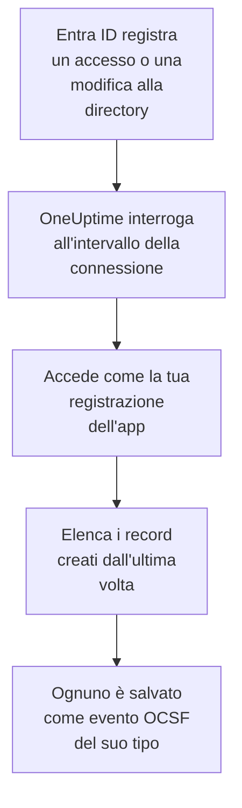

# Microsoft Entra ID

Importa gli accessi e le modifiche alla directory di [Microsoft Entra ID](https://learn.microsoft.com/en-us/entra/identity/) negli eventi di sicurezza di OneUptime e, se vuoi, l'attività di Exchange, SharePoint, OneDrive e Teams del [log di audit di Microsoft 365](https://learn.microsoft.com/en-us/purview/audit-log-activities). Lì li cerchi accanto a log, trace e metriche, li correli con ogni altra fonte e chiami la reperibilità per quelli che contano. OneUptime li legge con una registrazione dell'app che crei tu, e non cambia nulla nel tuo tenant.

:::cards
- [Configurare la connessione](#configurare-la-connessione): Una registrazione dell'app, le sue autorizzazioni e il modulo della connessione.
- [Cosa viene importato](#cosa-viene-importato): Quali record, e come ognuno diventa un evento di sicurezza.
- [Come funziona il polling](#come-funziona-il-polling): La finestra che legge ogni interrogazione, e perché si sovrappone di 30 minuti alla precedente.
- [Risoluzione dei problemi](#risoluzione-dei-problemi): Cosa significa ogni errore e cosa cambiare.
:::

## Come funziona

Ogni minuto, OneUptime interroga ogni connessione abilitata il cui intervallo di polling è trascorso. Un'interrogazione accede a Microsoft Entra ID come la tua registrazione dell'app e legge, in quest'ordine, le modifiche alla directory ([List directoryAudits](https://learn.microsoft.com/en-us/graph/api/directoryaudit-list)) e gli accessi ([List signIns](https://learn.microsoft.com/en-us/graph/api/signin-list)) registrati dall'ultima interrogazione, poi, quando l'opzione **Log di audit di Microsoft 365** è attiva, il nuovo contenuto del log di audit ([Office 365 Management Activity API](https://learn.microsoft.com/en-us/office/office-365-management-api/office-365-management-activity-api-reference)). Ogni record viene salvato come un evento [OCSF](https://schema.ocsf.io/): un accesso come un evento Authentication, un ruolo assegnato come un evento User Access Management, un verdetto di phishing come un Detection Finding.

## Prima di iniziare

- In OneUptime, il ruolo Project Owner, Project Admin o Security Admin. I ruoli Security Member e Security Viewer vedono le connessioni e la cronologia delle loro esecuzioni, ma non possono modificarle.
- Per gli accessi, Microsoft Entra ID P1 o P2, inclusi in Microsoft 365 E3, E5 e Business Premium: Microsoft Graph fornisce gli accessi solo a questi tenant. Le modifiche alla directory si leggono in qualsiasi tenant.
- Un ruolo Entra che può registrare applicazioni, come Amministratore applicazione, e un Amministratore globale o un Amministratore ruolo con privilegi per concedere il consenso dell'amministratore.
- Per il log di audit di Microsoft 365, l'audit attivato per il tenant, come lo è per impostazione predefinita: nel [portale di Microsoft Purview](https://purview.microsoft.com), **Audit** non deve proporre **Start recording user and admin activity**.
- HTTPS in uscita dall'app e dai worker di OneUptime verso `login.microsoftonline.com`, `graph.microsoft.com` e `manage.office.com`, oppure verso `login.microsoftonline.us`, `graph.microsoft.us` e `manage.office365.us` per Azure Government.

## Configurare la connessione

La connessione accede con il [flusso delle credenziali client di OAuth 2.0](https://learn.microsoft.com/en-us/entra/identity-platform/v2-oauth2-client-creds-grant-flow): come applicazione, mai come persona, con autorizzazioni di sola lettura.

:::steps
### Registrare un'applicazione

1. Accedi all'[interfaccia di amministrazione di Microsoft Entra](https://entra.microsoft.com) e apri **App registrations**.
2. Seleziona **New registration**. Chiamala `OneUptime Security Events`, lascia **Supported account types** su **Accounts in this organizational directory only**, lascia vuoto l'URI di reindirizzamento e seleziona **Register**.
3. Nella pagina **Overview** dell'app, copia l'**ID applicazione (client)** e il **ID directory (tenant)**.

### Permetterle di leggere i log

1. Vai su **API permissions → Add a permission → Microsoft Graph → Application permissions**, scegli `AuditLog.Read.All` e seleziona **Add permissions**. Microsoft documenta che il suo elenco degli accessi può richiedere anche `Directory.Read.All`: aggiungilo se gli accessi vengono rifiutati con `403` una volta concesso il consenso.
2. Per il log di audit di Microsoft 365, aggiungi una seconda autorizzazione: **Add a permission → Office 365 Management APIs → Application permissions**, poi `ActivityFeed.Read`.
3. Perché i playbook possano disabilitare, abilitare e disconnettere utenti (vedi [Contenimento](/docs/telemetry/security-cases#contenimento)), aggiungi allo stesso modo `User.Read.All`, `User.EnableDisableAccount.All` e `User.RevokeSessions.All`. Microsoft lascia modificare l'account di un amministratore solo a un'app che ha anche il ruolo Privileged Authentication Administrator.
4. Seleziona **Grant admin consent for** il tuo tenant e conferma. Lo stato di ogni autorizzazione deve indicare **Granted**: senza consenso, ogni lettura viene rifiutata con `403`.

### Creare un segreto client

Vai su **Certificates & secrets → Client secrets → New client secret**, scegli quando scade e seleziona **Add**. Copia il **Value** del segreto, non il suo **Secret ID**, prima di lasciare la pagina: non viene più mostrato. Il giorno in cui scade, il polling si ferma con `Microsoft Entra ID token request failed (HTTP 401)` finché non lo sostituisci con **Aggiorna le credenziali**.

### Aggiungere la connessione in OneUptime

Apri **Prodotti → Security Events → Connessioni** (`/dashboard/{projectId}/security-events/connections`), fai clic su **Aggiungi connessione**, scegli **Microsoft Entra ID** in **Identità** e fai clic su **Avanti**. Compila le impostazioni della tabella qui sotto, fai clic su **Avanti** e incolla il valore del segreto in **Segreto client**. Nel passaggio **Interrogazione**, attiva **Log di audit di Microsoft 365** per leggere anche quello.

### Provarla prima di salvare

Fai clic su **Prova queste impostazioni** in **Testa prima di salvare**. Il test accede e legge ogni log con i valori del modulo, e non salva nulla, quindi un segreto errato o un consenso mancante emergono prima che la connessione esista. Poi fai clic su **Avanti**, dai alla connessione un **Nome** e creala.
:::

| Impostazione | Dove trovarla |
| --- | --- |
| **ID directory (tenant)** | La pagina **Overview** dell'app. Il GUID del tenant, o un dominio verificato come `contoso.onmicrosoft.com`. Con **Log di audit di Microsoft 365** attivo, il GUID: la Management API identifica un tenant solo con quello. |
| **ID applicazione (client)** | La pagina **Overview** dell'app. Il GUID dell'app che ha `AuditLog.Read.All`. |
| **Cloud** | **Cloud pubblico di Azure**, o **Azure Government (USA)** per GCC High (`login.microsoftonline.us`, `graph.microsoft.us` e `manage.office365.us`). |
| **Log di audit di Microsoft 365** | Facoltativo, disattivato per impostazione predefinita. Se attivo, ogni interrogazione legge anche il log di audit di Microsoft 365. L'app ha bisogno di `ActivityFeed.Read`. |
| **Segreto client** | Il **Value** del segreto. È cifrato, mai restituito dall'API e mai più mostrato. Sostituiscilo con **Aggiorna le credenziali** sulla connessione. |

Il passaggio **Interrogazione** ha anche una **Descrizione** facoltativa, il **Intervallo di interrogazione (minuti)**, un numero intero da `1` a `1440` che parte da `5`, e **Abilitato**, che parte attivo.

## Cosa viene importato

Ogni evento ha il fornitore `Microsoft` e il prodotto `Microsoft Entra ID`. Il suo attributo `entra.log` dice da quale log proviene un accesso o una modifica, e il `microsoft365.contentType` di un record di Microsoft 365 il suo tipo di contenuto.

| Record | Classe OCSF | Gravità |
| --- | --- | --- |
| Un accesso riuscito | Authentication (`3002`), stato `Success` | Informational |
| Un accesso in attesa di un secondo passaggio, come l'MFA (`50074`, `50076`) o la richiesta di cambiare la password | Authentication (`3002`), stato `Interrupted` | Informational: un passaggio, non un errore |
| Un accesso non riuscito, con il motivo e il codice di errore di Entra | Authentication (`3002`), stato `Failure` | Low |
| Un accesso che Identity Protection ha valutato a rischio medio o alto | Authentication (`3002`) | Medium o High |
| Un utente, un gruppo o un ruolo modificato, secondo la sua categoria | Account Change (`3001`), Group Management (`3006`), User Access Management (`3005`), o Entity Management (`3004`) per il resto | Medium per un ruolo con privilegi, come Global Administrator; Low per una modifica non riuscita |

Con **Log di audit di Microsoft 365** attivo, da esso vengono importati i record su cui agisce un team di sicurezza, e il resto, come un file aperto o una mail letta, viene solo contato:

| Record di Microsoft 365 | Classe OCSF | Gravità |
| --- | --- | --- |
| Un cmdlet di Exchange, come `New-InboxRule` o `Set-Mailbox`, una regola della posta in arrivo creata in Outlook, o posta inviata come un'altra persona | API Activity (`6003`) | Medium quando inoltra la posta, con `microsoft365.forwardsMail` impostato su `true` |
| Un'autorizzazione su una cassetta postale concessa, come `Add-MailboxPermission` | User Access Management (`3005`) | Low |
| Un file condiviso in SharePoint o OneDrive | File Hosting Activity (`6006`) | Low con un ospite o un link che chiunque può aprire, con `microsoft365.sharedOutside` impostato su `true` |
| Un amministratore di raccolta siti aggiunto o rimosso | User Access Management (`3005`) | Low |
| Posta con malware o phishing trovata da Microsoft Defender for Office 365 | Detection Finding (`2004`) | High per il malware, Medium per il phishing |
| Un avviso generato da Microsoft 365 | Detection Finding (`2004`) | Quella dell'avviso |
| Un'app, un bot o un connettore aggiunto a un team | Application Lifecycle (`6002`) | Low |

Le attività di manutenzione di Exchange, eseguite con il suo account di sistema, vengono escluse a meno che non inoltrino la posta. Ogni evento conserva l'intero record, appiattito in chiavi puntate come `status.errorCode` o `Parameters.ForwardTo`, così una regola legge qualsiasi campo con il nome che gli dà Microsoft. Le regole della libreria per Entra ID li leggono come vengono importati qui.

Gli stessi accessi e le stesse modifiche alla directory possono invece arrivare a OneUptime come log, esportati da un'impostazione di diagnostica di Azure e letti da [I tuoi log](/docs/telemetry/security-events#trovare-eventi-di-sicurezza-nei-tuoi-log). Ogni record riceve lo stesso ID evento in entrambi i modi, ma un record letto in entrambi i modi viene salvato due volte: leggi Entra ID in un solo modo.

## Come funziona il polling

- **I record vengono letti in base a quando Entra ID li ha registrati**, `activityDateTime` per una modifica e `createdDateTime` per un accesso.
- **La prima interrogazione guarda indietro di 24 ore**, così una nuova connessione mostra subito i suoi record recenti.
- **Ogni interrogazione successiva parte 30 minuti prima del cursore salvato.** Microsoft documenta che entrambi i log arrivano con minuti di ritardo, quindi la sovrapposizione legge un record in ritardo all'interrogazione successiva, e i duplicati vengono scartati in base all'ID del record all'interno del progetto.
- **Un'interrogazione legge al massimo 24 ore oltre il cursore.** Una connessione il cui cursore è rimasto indietro recupera in una serie di finestre di 24 ore.
- **Un tenant senza Microsoft Entra ID P1 o P2** importa le sue modifiche alla directory, e il controllo **Read sign-ins** di ogni esecuzione avvisa che gli accessi non sono stati letti.
- **Un'esecuzione fallita non cambia nulla.** Dopo un errore di rete, o uno stato di errore di Graph, il cursore e la lunghezza della finestra restano com'erano, e l'interrogazione successiva rilegge la stessa finestra. L'unica eccezione è una richiesta scaduta: il cursore resta, ma la finestra successiva è lunga la metà, perché una finestra troppo pesante per ricevere risposta in tempo scadrebbe a ogni tentativo.

Il log di audit di Microsoft 365 viene letto in base a quando Microsoft ha reso disponibile ogni blob di contenuto, un giorno alla volta, e non oltre i 7 giorni che Microsoft lo conserva. La prima interrogazione iscrive l'app a `Audit.Exchange`, `Audit.SharePoint` e `Audit.General`, e Microsoft rende disponibili i primi record di una nuova sottoscrizione entro 12 ore. Il log di audit non ferma mai i log di Entra ID: un'autorizzazione mancante è un avviso e la finestra va avanti, mentre un errore dal lato di Microsoft, come `HTTP 503`, rende l'esecuzione **Parziale** così la finestra viene riletta.

### Quando una finestra contiene più di quanto un'interrogazione possa leggere

Ogni log ha un budget proprio: 10 pagine da 500 modifiche alla directory, 20 pagine da 500 accessi e, per il log di audit di Microsoft 365, 120 richieste e 10.000 record. Un'interrogazione si ferma dopo 4 minuti. Quando un budget ferma un log prima della fine della sua finestra, l'esecuzione è **Parziale**, e il suo avviso nomina il log e il budget. Microsoft Graph elenca prima i record più recenti, quindi OneUptime accorcia la finestra invece di spostare il cursore oltre record che non ha mai raggiunto:

1. **Restringere.** L'interrogazione successiva legge una finestra lunga la metà, dallo stesso punto di partenza, e continua a dimezzarla finché una finestra non viene letta per intero, fino a un minuto. L'avviso dell'esecuzione lo dice: `This window holds more records than one poll can read; the next poll reads a {n} minute window from the same starting point.` I record già importati dalla finestra più lunga vengono saltati come duplicati.
2. **Tornare a crescere.** Dopo che una finestra è stata letta per intero, il cursore passa alla sua fine, e la finestra successiva è di nuovo lunga il doppio, fino a 24 ore.
3. **Superare un singolo minuto.** Se anche un solo minuto contiene più di quanto un'interrogazione possa leggere, il polling lo supera, così i record più recenti continuano ad arrivare. L'esecuzione resta **Parziale**, e **Ultimo errore** riporta `More records were created in the one minute from {cursor} to {end} than one poll can read. Polling moved past this minute so newer records keep arriving; use Import this time range in Diagnostics on this minute to recover what one run can read.` Importa quel minuto con **Import this time range** per recuperare ciò che un'esecuzione può leggere.

Cambiare l'**Intervallo di interrogazione (minuti)** non cambia nulla di tutto questo: decide quanto spesso parte un'interrogazione, non dove inizia la sua finestra.

### Eseguire, visualizzare in anteprima e importare su richiesta

Fai clic su **Diagnostica** su una connessione per vederne le esecuzioni recenti e lavorarci a mano. Chi può modificare la connessione può avviare queste azioni; chi può vederla può leggerne la cronologia.

- **Esegui ora** avvia subito un'interrogazione, con il cursore abituale, anche quando la connessione non è **Abilitato**.
- **Preview records** legge un intervallo di tempo fino a 7 giorni e non importa nulla.
- **Import this time range** importa un intervallo fino a 7 giorni, dopo la tua conferma, senza spostare il cursore. I record già importati vengono saltati. Microsoft Entra ID conserva 30 giorni di accessi e modifiche alla directory con P1 o P2, e 7 giorni senza.
- **Copy diagnostics** su un'esecuzione copia il suo rapporto per il supporto. Non contiene mai credenziali.

## Testare la connessione

**Testa la connessione** sulla riga di una connessione, e **Prova queste impostazioni** nel modulo, vengono eseguiti nel processo dell'API, non in un worker in background, così un test risponde anche quando il problema sono i worker. Esegue questi controlli, in ordine:

| Controllo | Cosa verifica |
| --- | --- |
| **Configurazione** | Ogni impostazione è presente e ben formata. Non viene contattato nulla quando questo fallisce. |
| **Authenticate with Microsoft Entra** | Entra ID rilascia all'app un token per Microsoft Graph, nel cloud che hai scelto. |
| **Read sign-ins** | Gli accessi delle ultime 24 ore si possono leggere. Un avviso, non un errore, in un tenant senza P1 o P2. |
| **Read directory changes** | Le modifiche alla directory delle ultime 24 ore si possono leggere. |
| **Read the Microsoft 365 audit log** | Solo con l'opzione attiva: la Management API risponde, e a quali tipi di contenuto è iscritta l'app. |
| **Records available to import** | Quanti accessi e modifiche alla directory contengono le ultime 24 ore, al massimo 500 ciascuno, quindi `500+` significa di più. Nessuno è un avviso. |
| **Background workers**, **Poll scheduler**, **Security event storage** | Il lato di OneUptime stesso: un processo prende i job della coda Worker, il job di polling gira ogni minuto e l'archivio degli eventi di sicurezza risponde. |
| **Scheduled polling** | Per una connessione salvata: il polling è attivo, nessuna esecuzione è bloccata in attesa di un worker e le interrogazioni girano in orario. |

Ogni richiesta di un test ha una scadenza di 20 secondi. Un test non importa mai nulla e non sposta mai il cursore, e ogni controllo fallito dice cosa cambiare.

## Risoluzione dei problemi

L'**Ultimo errore** della connessione conserva il messaggio di errore completo, con le credenziali oscurate. Quando una connessione ha un errore, seleziona **Visualizza errore** nella sua colonna **Azioni** per leggerlo, e **Copia errore** nella finestra di dialogo per copiarlo. Ogni messaggio inizia con `Microsoft Entra ID`, poi nomina la richiesta fallita, e cita il codice di errore di Microsoft quando c'è.

:::details Ultimo errore dice `token request failed`
- `HTTP 401` con `invalid_client`: il segreto client è errato o scaduto. Creane uno nuovo e salvalo con **Aggiorna le credenziali**.
- `HTTP 400` che nomina l'ID applicazione (client) o il tenant: controlla entrambi nella pagina **Overview** dell'app, e che il **Cloud** sia quello del tenant.
:::

:::details Ultimo errore dice `sign-ins request failed (HTTP 403)` o `audit logs request failed (HTTP 403)`
- Codice di errore `Authorization_RequestDenied`: all'app manca `AuditLog.Read.All`, o il consenso non è stato concesso. Concedi il consenso dell'amministratore, attendi qualche minuto e riprova. Per gli accessi, concedi anche `Directory.Read.All`.
- Codice di errore `Authentication_RequestFromNonPremiumTenantOrB2CTenant`: il tenant non ha Microsoft Entra ID P1 o P2. Le modifiche alla directory vengono comunque importate.
:::

:::details Il log di audit di Microsoft 365 non viene letto
- `subscriptions request failed (HTTP 401)` o `(HTTP 403)`, con `AF10001`: all'app manca `ActivityFeed.Read` delle Office 365 Management APIs, o il consenso non è stato concesso.
- Da `AF20010` a `AF20013`: la Management API non conosce l'**ID directory (tenant)**. Usa il GUID del tenant.
- `subscription start failed` con `AF20023`: un amministratore ha disattivato la sottoscrizione. Un tipo di contenuto a cui non ci si può iscrivere viene nominato negli avvisi dell'esecuzione, e gli altri vengono comunque letti.
- Nessun record per ore dopo la prima interrogazione: Microsoft rende disponibile il primo contenuto di una nuova sottoscrizione entro 12 ore.
:::

:::details Ultimo errore dice `did not complete`
La richiesta non ha ricevuto risposta: un timeout, un nome che non si risolve o un indirizzo rifiutato. Verifica che l'app e i worker di OneUptime possano raggiungere gli host di [Prima di iniziare](#prima-di-iniziare), attraverso qualsiasi proxy che usi.
:::

:::details Il test riesce, ma Last Polled è Never
Il job di polling non è mai stato eseguito. Leggi i controlli **Background workers** e **Poll scheduler**. Su un'installazione self-hosted, la causa abituale è `DISABLE_QUEUE_WORKERS=true` sull'app, senza un deployment separato dei worker che prenda i job: impostalo su `false`, oppure esegui il deployment dei worker (Helm: `worker.enabled: true`, che è `false` per impostazione predefinita).
:::

## Prossimi passi

:::cards
- [Eventi di sicurezza](/docs/telemetry/security-events): Cerca, correla e genera avvisi su ciò che importi.
- [Log di sistema Okta](/docs/integrations/okta): Importa gli accessi di un altro provider di identità.
- [Google Workspace](/docs/integrations/google-workspace): Importa gli accessi e le modifiche di amministrazione di Google.
- [Panoramica delle integrazioni](/docs/integrations/index): Gli altri strumenti che puoi collegare.
:::
