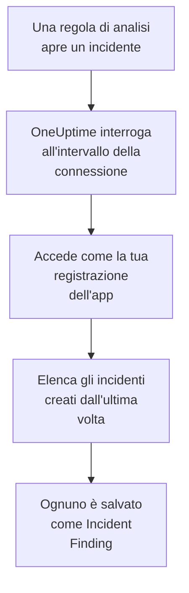

# Microsoft Sentinel

Importa gli incidenti che aprono le tue regole di analisi di [Microsoft Sentinel](https://learn.microsoft.com/en-us/azure/sentinel/overview) negli eventi di sicurezza di OneUptime. Lì li cerchi accanto a log, trace e metriche, li correli con ogni altra fonte e chiami la reperibilità per quelli che contano. OneUptime li legge con una registrazione dell'app che crei tu, e non cambia nulla in Azure.

:::cards
- [Configurare la connessione](#configurare-la-connessione): Una registrazione dell'app, un ruolo e il modulo della connessione.
- [Cosa viene importato](#cosa-viene-importato): Come ogni incidente di Sentinel diventa un evento di sicurezza.
- [Come funziona il polling](#come-funziona-il-polling): La finestra che legge ogni interrogazione, e cosa le fa un'area di lavoro molto attiva.
- [Risoluzione dei problemi](#risoluzione-dei-problemi): Cosa significa ogni errore e cosa cambiare.
:::

## Come funziona



Ogni minuto, OneUptime interroga ogni connessione abilitata il cui intervallo di polling è trascorso. Un'interrogazione accede a Microsoft Entra ID come la tua registrazione dell'app, chiede ad Azure Resource Manager gli incidenti creati dall'ultima interrogazione e salva ognuno come un evento [OCSF](https://schema.ocsf.io/) Incident Finding (classe `2005`). Regole di rilevamento, monitor e dashboard lo trattano poi come un evento di sicurezza di qualsiasi altra fonte.

## Prima di iniziare

- In OneUptime, il ruolo Project Owner, Project Admin o Security Admin. I ruoli Security Member e Security Viewer vedono le connessioni e la cronologia delle loro esecuzioni, ma non possono modificarle.
- Un'area di lavoro Log Analytics con Microsoft Sentinel abilitato, nel cloud pubblico di Azure o in Azure Government (US).
- In Microsoft Entra ID, il permesso di creare una registrazione dell'app e un segreto client.
- Sul gruppo di risorse che contiene l'area di lavoro, il permesso di assegnare ruoli, come Proprietario o Amministratore Accesso utenti.

## Configurare la connessione

La connessione accede con il flusso delle credenziali client di OAuth 2.0: come applicazione, mai come persona. Il suo accesso viene da un ruolo di Azure, quindi la registrazione dell'app non ha bisogno di autorizzazioni API.

:::steps
### Registrare un'applicazione

1. Accedi al [portale di Azure](https://portal.azure.com) e apri **Microsoft Entra ID**.
2. Vai su **App registrations → New registration**. Chiamala `OneUptime Sentinel connector`, lascia **Supported account types** su **Accounts in this organizational directory only**, lascia vuoto l'URI di reindirizzamento e seleziona **Register**.
3. Nella pagina **Overview** dell'app, copia l'**Application (client) ID** e il **Directory (tenant) ID**.
4. Vai su **Certificates & secrets → Client secrets → New client secret**, scegli quando scade e seleziona **Add**. Copia il **Value** del segreto, non il suo **Secret ID**, prima di lasciare la pagina: non viene più mostrato.

### Permetterle di leggere gli incidenti

1. Nel portale di Azure, apri il gruppo di risorse che contiene la tua area di lavoro Log Analytics.
2. Seleziona **Access control (IAM) → Add → Add role assignment**.
3. Nella scheda **Role**, scegli **Microsoft Sentinel Reader**.
4. Nella scheda **Members**, scegli **User, group, or service principal**, fai clic su **Select members** e scegli la tua registrazione dell'app per nome.
5. Seleziona **Review + assign**.

Il ruolo permette all'app di leggere gli incidenti (`Microsoft.SecurityInsights/incidents/read`) e di non scrivere nulla. Microsoft consiglia di assegnarlo sul gruppo di risorse invece che sull'area di lavoro, così copre anche la soluzione `SecurityInsights` da cui vengono serviti gli incidenti. Una nuova assegnazione può richiedere qualche minuto per applicarsi.

### Trovare i dati dell'area di lavoro

Apri l'area di lavoro Log Analytics nel portale di Azure. La sua pagina **Overview** mostra il **Subscription ID**, il **Resource group** e il nome dell'area di lavoro. L'ID risorsa dell'area di lavoro contiene gli stessi tre:

```text
/subscriptions/{Subscription ID}/resourceGroups/{Resource group}/providers/Microsoft.OperationalInsights/workspaces/{Workspace name}
```

### Aggiungere la connessione in OneUptime

Apri **Prodotti → Security Events → Connections** (`/dashboard/{projectId}/security-events/connections`), fai clic su **Aggiungi connessione**, scegli **Microsoft Sentinel** e fai clic su **Avanti**. Compila le impostazioni della tabella qui sotto, fai clic su **Avanti** e incolla il valore del segreto in **Client secret**.

### Provarla prima di salvare

Fai clic su **Test these settings** in **Testa prima di salvare**. Il test accede e legge gli incidenti con i valori del modulo, e non salva nulla, quindi un segreto errato o un ruolo mancante emergono prima che la connessione esista. Poi fai clic su **Avanti**, dai alla connessione un **Nome** e creala.
:::

| Impostazione | Dove trovarla |
| --- | --- |
| **Directory (tenant) ID** | La pagina **Overview** dell'app. Il GUID del tenant, o un dominio verificato come `contoso.onmicrosoft.com`. |
| **Application (client) ID** | La pagina **Overview** dell'app. Un GUID. |
| **Subscription ID** | La pagina **Overview** dell'area di lavoro. Un GUID. |
| **Resource group** | La pagina **Overview** dell'area di lavoro. Da 1 a 90 lettere, cifre, trattini bassi, trattini, punti o parentesi, senza un punto finale. |
| **Workspace name** | La pagina **Overview** dell'area di lavoro. Da 3 a 90 lettere, cifre o trattini, che iniziano e finiscono con una lettera o una cifra. |
| **Cloud** | **Azure public cloud** (`login.microsoftonline.com`, `management.azure.com`) o **Azure Government (US)** (`login.microsoftonline.us`, `management.usgovcloudapi.net`). |
| **Client secret** | Il **Value** del segreto. È cifrato, mai restituito dall'API e mai più mostrato. Sostituiscilo con **Update credentials** sulla connessione. |

Il passaggio **Polling** ha anche una **Descrizione** facoltativa, il **Poll Interval (Minutes)**, un numero intero da `1` a `1440` che parte da `5`, e **Abilitato**, che parte attivo.

## Cosa viene importato

Ogni incidente di Sentinel diventa un evento Incident Finding (classe OCSF `2005`, attività `Create`), attribuito al servizio di telemetria `Microsoft Sentinel`:

| Colonna OCSF | Campo dell'incidente di Sentinel |
| --- | --- |
| `time` | `properties.createdTimeUtc`, quando Sentinel ha creato l'incidente |
| `eventUid` | `name`, il GUID dell'incidente, che serve anche a scartare i duplicati |
| `message`, `ruleName` | `properties.title` |
| `ruleId` | Il GUID della regola alla fine della prima voce di `properties.relatedAnalyticRuleIds` |
| `severityName` | `properties.severity`: `High`, `Medium`, `Low` o `Informational` |
| `statusName` | `properties.status`: `New`, `Active` o `Closed` |
| `mitreTactics` | `properties.additionalData.tactics`, come ID ATT&CK: `Persistence` diventa `TA0003` |
| `principalUser` | `properties.owner.userPrincipalName`, o `properties.owner.email` |
| `targetResource` | `properties.incidentUrl`, un link all'incidente nel portale di Azure |
| `observables` | L'UPN, l'email e l'ID oggetto del proprietario, e il nome di ogni etichetta |
| `attributes` | L'intero incidente, appiattito in chiavi puntate come `properties.classification` e `properties.firstActivityTimeUtc` |

Anche gli incidenti chiusi creati nella finestra di un'interrogazione vengono importati. Filtra su `statusName` nell'esploratore degli eventi di sicurezza per vedere solo quelli aperti.

## Come funziona il polling

Ogni interrogazione elenca gli incidenti creati nella sua finestra, dal più vecchio, 50 per pagina, e segue il `nextLink` dell'API finché non ha letto l'intera finestra:

```text
GET https://management.azure.com/subscriptions/{sub}/resourceGroups/{rg}/providers/Microsoft.OperationalInsights/workspaces/{ws}/providers/Microsoft.SecurityInsights/incidents
    ?api-version=2024-03-01
    &$filter=(properties/createdTimeUtc ge {windowStart}) and (properties/createdTimeUtc lt {windowEnd})
    &$orderby=properties/createdTimeUtc asc
    &$top=50
```

- **L'ora di creazione è il cursore.** Una regola di analisi pianificata che gira ogni ora apre il suo incidente molto dopo l'attività che ha individuato, e il `firstActivityTimeUtc` dell'incidente può essere precedente di ore o giorni. Un cursore sull'ora di attività salterebbe ognuno di questi incidenti. Le ore di attività restano in `attributes`, e i campioni della diagnostica le mostrano entrambe.
- **La prima interrogazione guarda indietro di 24 ore**, così una nuova connessione mostra subito i suoi incidenti recenti.
- **Ogni interrogazione successiva parte 1 minuto prima del cursore salvato**, così un incidente creato al confine tra due finestre non viene mai saltato.
- **Un'interrogazione legge al massimo 24 ore oltre il cursore.** Una connessione il cui cursore è rimasto indietro recupera in una serie di finestre di 24 ore, e la sua **Health** indica **Catching up**.
- **I duplicati vengono scartati in base al GUID dell'incidente** (`name`) all'interno del progetto, così la sovrapposizione, una finestra ripetuta e un'importazione non salvano mai un incidente due volte.

### Quando una finestra contiene più di quanto un'interrogazione possa leggere

Un'interrogazione legge al massimo 20 pagine da 50 incidenti: 1.000 incidenti. Quando questo limite la ferma prima della fine della sua finestra, l'esecuzione è **Partial**, con un avviso come questo:

```text
Stopped after 20 incidents requests (the per-run request limit) before reading the whole window. Incidents are read oldest first; every incident created before 2026-09-14T08:12:44.000Z was read.
```

Gli incidenti vengono letti dal più vecchio al più recente, quindi OneUptime sposta il cursore all'ora di creazione dell'ultimo incidente letto, e l'interrogazione successiva parte da lì, con la stessa lunghezza di finestra. Un'area di lavoro molto attiva recupera circa 1.000 incidenti per interrogazione, invece di rileggere gli stessi. Gli incidenti creati in quello stesso istante vengono letti due volte, e il controllo dei duplicati scarta la seconda copia.

Quando un'esecuzione non riesce affatto a superare il cursore salvato, OneUptime accorcia invece la finestra:

1. **Restringere.** L'interrogazione successiva legge una finestra lunga la metà, dallo stesso punto di partenza, e continua a dimezzarla finché una finestra non viene letta per intero, fino a un minuto. L'avviso dell'esecuzione lo dice: `This window holds more records than one poll can read; the next poll reads a {n} minute window from the same starting point.`
2. **Tornare a crescere.** Dopo che una finestra è stata letta per intero, la successiva è di nuovo lunga il doppio, fino a 24 ore.
3. **Superare un singolo minuto.** Se anche un solo minuto contiene più di quanto un'interrogazione possa leggere, il polling lo supera, così gli incidenti più recenti continuano ad arrivare. L'esecuzione resta **Partial**, e **Ultimo errore** riporta `More records were created in the one minute from {cursor} to {end} than one poll can read. Polling moved past this minute so newer records keep arriving; use Import this time range in Diagnostics on this minute to recover what one run can read.` Importa quel minuto con **Import this time range** per recuperare ciò che un'esecuzione può leggere.

Un'esecuzione che fallisce del tutto, con un errore di Microsoft Entra ID o di Azure Resource Manager, mantiene il cursore e la lunghezza della finestra, e l'interrogazione successiva rilegge la stessa finestra. L'unica eccezione è una richiesta scaduta: il cursore resta, ma la finestra successiva è lunga la metà, perché una finestra troppo pesante per ricevere risposta in tempo scadrebbe a ogni tentativo. Cambiare il **Poll Interval (Minutes)** non cambia nulla di tutto questo: decide quanto spesso parte un'interrogazione, non dove inizia la sua finestra.

### Eseguire, visualizzare in anteprima e importare su richiesta

Fai clic su **Diagnostics** su una connessione per vederne le esecuzioni recenti e lavorarci a mano. Chi può modificare la connessione può avviare queste azioni; chi può vederla può leggerne la cronologia.

- **Run now** avvia subito un'interrogazione, con il cursore abituale, anche quando la connessione non è **Abilitato**.
- **Preview incidents** legge un intervallo di tempo fino a 7 giorni e non importa nulla.
- **Import this time range** importa un intervallo fino a 7 giorni, dopo la tua conferma, senza spostare il cursore. Gli incidenti già importati vengono saltati.
- **Copy diagnostics** su un'esecuzione copia il suo rapporto per il supporto. Non contiene mai credenziali.

## Testare la connessione

**Testa la connessione** sulla riga di una connessione, e **Test these settings** nel modulo, vengono eseguiti nel processo dell'API, non in un worker in background, così un test risponde anche quando il problema sono i worker. Esegue questi controlli, in ordine:

| Controllo | Cosa verifica |
| --- | --- |
| **Configurazione** | Ogni impostazione è presente e ben formata. Non viene contattato nulla quando questo fallisce. |
| **Authenticate with Microsoft Entra** | Microsoft Entra ID rilascia alla tua registrazione dell'app un token per Azure Resource Manager. |
| **Read incidents** | Si può leggere un incidente creato nelle ultime 24 ore (`$top=1`). Questo dimostra il ruolo e i dati dell'area di lavoro. |
| **Incidents available to import** | Quanti incidenti sono stati creati nelle ultime 24 ore e negli ultimi 7 giorni, una pagina da 50 ciascuno, quindi `50+` significa di più. Nessuno in 7 giorni è un avviso, non un errore. |
| **Background workers**, **Poll scheduler**, **Security event storage** | Il lato di OneUptime stesso: un processo prende i job della coda Worker, il job di polling gira ogni minuto e l'archivio degli eventi di sicurezza risponde. |
| **Scheduled polling** | Per una connessione salvata: il polling è attivo, nessuna esecuzione è bloccata in attesa di un worker e le interrogazioni girano in orario. |

Ogni richiesta di un test ha una scadenza di 20 secondi. Un test non importa mai nulla e non sposta mai il cursore, e ogni controllo fallito dice cosa cambiare.

## Risoluzione dei problemi

Il **Ultimo errore** della connessione conserva il messaggio di errore completo, con le credenziali oscurate, dietro un prefisso che nomina il passaggio fallito. Quando una connessione ha un errore, seleziona **Visualizza errore** nella sua colonna **Azioni** per leggerlo, e **Copia errore** nella finestra di dialogo per copiarlo. Leggi prima il prefisso.

:::details Last Error inizia con `Microsoft Sentinel token request`
- `Microsoft Sentinel token request failed (HTTP ...)`: Microsoft Entra ID si è rifiutato di rilasciare un token, quindi Azure non è mai stato contattato. Il messaggio cita il codice di Entra:
  - `AADSTS7000215` o `invalid_client`: il **Client secret** è errato o scaduto, oppure è l'ID del segreto invece del suo valore. Crea un nuovo segreto e salvalo con **Update credentials**.
  - `AADSTS700016` o `unauthorized_client`: l'**Application (client) ID** non si trova nel **Directory (tenant) ID** indicato. Confronta entrambi con la pagina **Overview** dell'app.
  - `AADSTS90002` o `HTTP 404`: quel tenant non esiste. Il **Directory (tenant) ID** è errato, oppure si trova nell'altro cloud: controlla **Cloud**.
  - `HTTP 429` o `HTTP 5xx`: Microsoft Entra ID sta limitando le richieste o non è disponibile. L'interrogazione successiva riprova.
- `Microsoft Sentinel token request returned ...`: Microsoft Entra ID ha risposto con qualcosa di inutilizzabile, per esempio un corpo che non è JSON o senza `access_token`. Di solito è un proxy o un gateway nel mezzo.
- `Microsoft Sentinel token request failed:`, senza stato, o `Microsoft Sentinel token request timed out after ... seconds with no response`: la richiesta non ha ricevuto risposta. Controlla DNS, TLS e HTTPS in uscita dall'app e dai worker di OneUptime verso `login.microsoftonline.com`.
:::

:::details Last Error inizia con `Microsoft Sentinel incidents list`
- `Microsoft Sentinel incidents list failed (HTTP ...)`: Azure Resource Manager ha rifiutato la richiesta.
  - `HTTP 401`: non ha accettato il token. Quasi sempre **Cloud** non corrisponde al tenant, oppure la registrazione dell'app è stata eliminata. Un token che scade tra due pagine viene rinnovato e riprovato una volta da solo.
  - `HTTP 403` o `AuthorizationFailed`: l'app non ha ancora **Microsoft Sentinel Reader** sul gruppo di risorse. Assegnalo e attendi qualche minuto.
  - `HTTP 404`: nessuna area di lavoro ha quel **Subscription ID**, quel **Resource group** e quel **Workspace name**, oppure Microsoft Sentinel non è abilitato lì. Copiali dalla pagina **Overview** dell'area di lavoro.
  - `HTTP 429` o `HTTP 5xx`: Azure Resource Manager sta limitando le richieste o non è disponibile. L'interrogazione successiva riprova.
  - `HTTP 400`: Azure Resource Manager ha rifiutato la richiesta, che costruisce OneUptime e non le tue impostazioni. Invia il messaggio al supporto di OneUptime.
- `Microsoft Sentinel incidents list returned ...`: Azure ha risposto `200`, ma senza una pagina di incidenti leggibile, o con un `nextLink` verso un altro host, che la connessione rifiuta così il token non lascia mai Azure Resource Manager. Viene segnalato invece di essere preso per una finestra vuota, così il cursore non supera mai incidenti che nessuno ha letto.
- `Microsoft Sentinel incidents list failed:`, senza stato, o `Microsoft Sentinel incidents list timed out after ... seconds with no response`: la richiesta non ha ricevuto risposta. Controlla l'HTTPS in uscita dai worker di OneUptime verso `management.azure.com`, o `management.usgovcloudapi.net`.
:::

:::details Last Polled è Never e Last Error è vuoto
Nessuna interrogazione è terminata per questa connessione. Esegui **Testa la connessione**: i suoi controlli **Background workers** e **Poll scheduler** nominano la causa. Su un'installazione self-hosted, la causa abituale è `DISABLE_QUEUE_WORKERS=true` sull'app, senza un deployment separato dei worker che prenda i job: impostalo su `false`, oppure esegui il deployment dei worker (Helm: `worker.enabled: true`).
:::

:::details Un'esecuzione è Partial
- `Stopped after 20 incidents requests (the per-run request limit) before reading the whole window`: la finestra conteneva più dei 1.000 incidenti che legge un'esecuzione. Non si perde nulla: l'interrogazione successiva parte dopo l'ultimo incidente letto. Una connessione che resta **Partial** un'interrogazione dopo l'altra sta recuperando un arretrato, e il suo **Last Polled** e il suo **Last Event Imported** continuano ad avanzare.
- `Microsoft Sentinel returned incidents out of creation-time order, so this run cannot name a point to resume from.`: l'API ha ignorato l'ordine dal più vecchio al più recente, quindi l'esecuzione non può spostare il cursore sul suo ultimo incidente, e l'interrogazione successiva legge invece una finestra più corta. Se si ripete, invia il rapporto dell'esecuzione al supporto di OneUptime.
- `More records were created in the one minute from ... than one poll can read`: il polling ha superato quel minuto. Importalo con **Import this time range** in **Diagnostics**. Un'importazione legge quanto un'interrogazione.
:::

:::details Il test riesce, ma non viene importato nulla
Leggi **Incidents available to import** nel rapporto del test. `0` negli ultimi 7 giorni significa che le regole di analisi dell'area di lavoro non hanno aperto incidenti, il che non è un difetto della connessione. In Microsoft Sentinel, controlla che le regole siano abilitate e impostate per creare incidenti.
:::

## Azure Government

Imposta **Cloud** su **Azure Government (US)**. La connessione accede allora a `login.microsoftonline.us` con l'ambito `https://management.usgovcloudapi.net/.default`, e legge gli incidenti da `management.usgovcloudapi.net`. Tutto il resto, compresa l'assegnazione del ruolo, è uguale.

## Cosa ottieni

- **Ricerca.** Filtra gli incidenti per gravità, stato, proprietario, etichetta o tattica nell'esploratore degli eventi di sicurezza, accanto a ogni altra fonte.
- **Correlazione.** Il proprietario e le etichette di ogni incidente vengono indicizzati come osservabili, quindi una ricerca trova tutto ciò che li menziona.
- **Regole di rilevamento.** Regole Sigma che girano secondo una pianificazione sui tuoi eventi di sicurezza, e aprono avvisi che chiamano la reperibilità.
- **Monitor.** I monitor degli eventi di sicurezza contano gli eventi corrispondenti, come i nuovi incidenti High, e aprono incidenti o avvisi oltre una soglia.

Gli eventi di sicurezza sono fatturati come il resto della tua telemetria, per GB acquisito. Vedi i [prezzi](https://oneuptime.com/pricing).

## Prossimi passi

:::cards
- [Eventi di sicurezza](/docs/telemetry/security-events): Cerca, correla e genera avvisi su ciò che importi.
- [Microsoft Defender XDR](/docs/integrations/microsoft-defender-xdr): Importa anche gli avvisi di ogni carico di lavoro di Defender.
- [Ruoli](/docs/permissions/reference#ruoli): Cosa possono vedere e modificare i ruoli Security.
- [Panoramica delle integrazioni](/docs/integrations/index): Gli altri strumenti che puoi collegare.
:::
