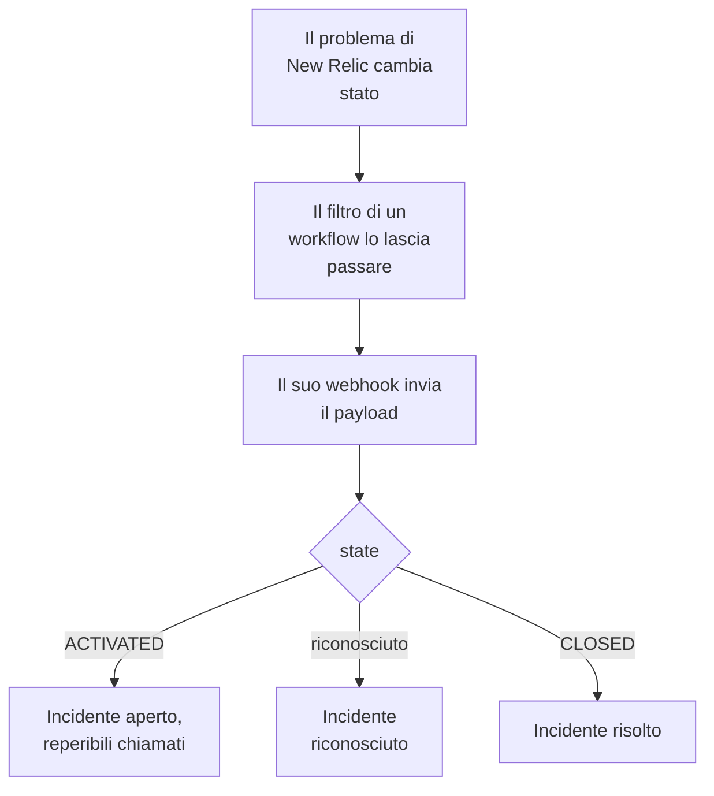

# New Relic

Invia i problemi di [New Relic](https://newrelic.com) a OneUptime, così ognuno diventa un incidente o un avviso che chiama il tuo team reperibile, viene riconosciuto quando qualcuno riconosce il problema e si risolve quando il problema si chiude. New Relic invia i suoi problemi tramite una [destinazione webhook](https://docs.newrelic.com/docs/alerts/get-notified/notification-integrations/), quindi non c'è nulla da installare né da una parte né dall'altra.

:::cards
- [Partire dal modello](#partire-dal-modello): Scegli chi chiamare, copia l'URL e vedi cosa fa ogni problema.
- [Configurare New Relic](#configurare-new-relic): Una destinazione webhook e il workflow che la notifica.
- [Provarlo](#provarlo): Invia un problema tu stesso, poi uno da New Relic.
- [Risoluzione dei problemi](#risoluzione-dei-problemi): Quando i problemi non arrivano o gli incidenti restano aperti.
:::

## Come funziona



Un workflow di New Relic sceglie i problemi da inviare con il suo filtro, e notifica una destinazione webhook quando uno viene attivato, riconosciuto o chiuso, con un payload JSON che New Relic compila. L'ID del problema è il modo in cui OneUptime trova l'incidente che ha aperto.

## Prima di iniziare

- Un account New Relic in cui puoi creare destinazioni e workflow.
- In OneUptime, il permesso di creare workflow. Su OneUptime Cloud, i workflow richiedono il piano **Growth** o superiore.

## Partire dal modello

Configura prima OneUptime: ti dà l'URL a cui invia New Relic. La finestra **Crea un flusso di lavoro** ha due modelli New Relic, sotto **New Relic** nel suo elenco di categorie: **Declare an incident for each New Relic issue**, e **Create an alert for each New Relic issue** per gli avvisi. Entrambi fanno lo stesso, ciascuno con il proprio tipo di record.

:::steps
1. Vai su **Flussi di lavoro** e fai clic su **Crea flusso di lavoro**. In **Oppure parti da un modello**, scegli **New Relic** nell'elenco di categorie, fai clic su **Declare an incident for each New Relic issue**, o su **Create an alert for each New Relic issue**, e poi su **Usa questo modello**.
2. In **Who to page for new New Relic issues**, scegli le policy di reperibilità da chiamare, o nessuna per non chiamare nessuno, e fai clic su **Crea flusso di lavoro**. Il workflow si apre nel **Costruttore**, disattivato.
3. Fai clic sul trigger **Webhook**, poi su **Copia URL**, e conserva l'URL per New Relic.
4. Attiva **Abilitato** in cima al **Costruttore**. Un workflow disattivato risponde a New Relic con `400`.
:::

Poi [configura New Relic](#configurare-new-relic) perché invii i suoi problemi a quell'URL. Il passo `read-event-1` del workflow si apre con la stessa configurazione, per quando ci torni nel **Costruttore**.

### Cosa fa il workflow

Dopo il trigger **Webhook**, il passo **Check With JavaScript** `read-event-1` legge lo `state` che New Relic invia, e **Incident From Another Tool**, o **Alert From Another Tool** nel modello degli avvisi, fa ciò che significa, tramite l'ID del problema. L'incidente conserva l'ID nel suo campo personalizzato `newRelicIssueId`.

| Cosa invia New Relic | Cosa fa il workflow |
| --- | --- |
| `state` è `ACTIVATED` o `CREATED` | Dichiara un incidente intitolato `New Relic: <issue>`, alla gravità a cui corrisponde la priorità del problema, fuori dalle tue pagine di stato. La sua descrizione collega il problema in New Relic e riporta la priorità, le entità, le policy e le condizioni. Chiama le policy di reperibilità che hai scelto. Lo stesso problema di nuovo, ad esempio quando New Relic lo porta a CRITICAL, non apre un secondo incidente e non chiama nessuno di nuovo. |
| `state` è `ACTIVATED` e `isAcknowledged` è `true` | Riconosce l'incidente del problema, così la reperibilità smette di inoltrarlo in escalation. Il motivo è nella sua cronologia. |
| `state` è `CLOSED` | Risolve l'incidente del problema, a meno che non sia già risolto. Il motivo è nella sua cronologia. |

Un riconoscimento o una chiusura per un problema senza incidente non cambia nulla. Tutto il resto, come una richiesta di un altro strumento, viene lasciato com'è: `read-event-1` prende **No**, e i **Passaggi** dell'esecuzione dicono perché. Nulla torna a New Relic: chiude da solo i suoi problemi quando il segnale rientra, ed è questo che risolve l'incidente.

### Priorità e chiamate

Ogni nuovo problema chiama le policy di reperibilità che hai scelto, qualunque sia la sua priorità: New Relic porta un problema da HIGH a CRITICAL sul posto, sullo stesso problema, quindi aspettare CRITICAL non chiamerebbe mai nessuno per un problema aperto come HIGH e poi peggiorato. Per chiamare per meno problemi, restringi il filtro del workflow in New Relic: arriva a OneUptime solo ciò che lo supera. In un nuovo progetto, le priorità corrispondono a queste gravità di incidente e di avviso:

| Priorità di New Relic | Incidente | Avviso | Reperibili |
| --- | --- | --- | --- |
| CRITICAL | Critical Incident | High | Chiamati |
| HIGH | Major Incident | Low | Chiamati |
| MEDIUM | Minor Incident | Low | Chiamati |
| LOW | Minor Incident | Low | Chiamati |

Con gravità tue, CRITICAL va alla più grave, HIGH a quella di mezzo, e MEDIUM e LOW alla meno grave. Un incidente mantiene la gravità con cui si è aperto quando New Relic alza il suo problema.

Per mappare una priorità su una delle tue per nome, modifica `SEVERITY_BY_NAME` nel passo `read-event-1`, ad esempio `{ HIGH: 'Critical Incident' }`.

## Configurare New Relic

:::steps
### Aggiungere la destinazione webhook

In New Relic, vai su **Alerts → Destinations** e aggiungi una destinazione **Webhook**. Imposta **Webhook name** su `OneUptime` e **Endpoint URL** sull'URL che hai copiato da OneUptime, e salvala. Lascia **Use authorization** disattivato: l'URL è l'unica credenziale.

### Aggiungere il workflow

Vai su **Alerts → Workflows** e fai clic su **Add a workflow**. Chiamalo `OneUptime`. Il suo filtro decide quali problemi arrivano a OneUptime, come solo quelli CRITICAL, o quelli di un team.

### Notificare la destinazione

Aggiungi al workflow la destinazione **Webhook** che hai creato. Lascia il payload che New Relic compila, e aggiungi una riga per `isAcknowledged` dopo `state`, così l'incidente viene riconosciuto con il suo problema:

```json
{
  "id": {{ json issueId }},
  "issueUrl": {{ json issuePageUrl }},
  "title": {{ json annotations.title.[0] }},
  "priority": {{ json priority }},
  "impactedEntities": {{ json entitiesData.names }},
  "totalIncidents": {{ json totalIncidents }},
  "state": {{ json state }},
  "isAcknowledged": {{ json isAcknowledged }},
  "trigger": {{ json triggerEvent }},
  "isCorrelated": {{ json isCorrelated }},
  "createdAt": {{ createdAt }},
  "updatedAt": {{ updatedAt }},
  "sources": {{ json accumulations.source }},
  "alertPolicyNames": {{ json accumulations.policyName }},
  "alertConditionNames": {{ json accumulations.conditionName }},
  "workflowName": {{ json workflowName }}
}
```

La riga da aggiungere è `"isAcknowledged": {{ json isAcknowledged }},`. Poi fai clic su **Update message**.

### Notificare quando attivato, riconosciuto e chiuso

Fai clic sui tre puntini della destinazione e scegli **Notify when**. Lascia attivi **Activated**, **Acknowledged** e **Closed**.

### Attivare il workflow

Fai clic su **Activate workflow**.
:::

Il workflow di OneUptime legge questi campi del payload e lascia stare gli altri:

| Campo | Cosa ci mette New Relic |
| --- | --- |
| `id` | L'ID del problema. |
| `issueUrl` | Un link al problema in New Relic. |
| `title` | Il titolo del problema. |
| `priority` | Quanto è urgente il problema: `CRITICAL`, `HIGH`, `MEDIUM` o `LOW`. |
| `state` | A che punto è il problema: `CREATED`, `ACTIVATED` o `CLOSED`. |
| `isAcknowledged` | `true` quando qualcuno riconosce il problema in New Relic. |
| `impactedEntities` | I nomi delle entità a cui si riferisce il problema. |
| `alertPolicyNames` | I nomi delle policy all'origine del problema. |
| `alertConditionNames` | I nomi delle condizioni all'origine del problema. |

## Provarlo

Invia un problema all'URL che hai copiato, come farebbe New Relic:

```bash
curl -X POST "<url>" \
  -H "Content-Type: application/json" \
  -d '{
    "id": "7d4a2e1c-3b5f-4c8e-9a1d-2f6b8c0e4a71",
    "issueUrl": "https://radar-api.service.newrelic.com/accounts/1234567/issues/7d4a2e1c-3b5f-4c8e-9a1d-2f6b8c0e4a71?notifier=WEBHOOK",
    "title": "High CPU on checkout-service",
    "priority": "CRITICAL",
    "impactedEntities": ["checkout-service"],
    "state": "ACTIVATED",
    "isAcknowledged": false,
    "alertPolicyNames": ["Production"],
    "alertConditionNames": ["CPU above 90%"]
  }'
```

Si apre un incidente intitolato `New Relic: High CPU on checkout-service`, e le policy di reperibilità che hai scelto vengono chiamate. Invia la stessa richiesta con `isAcknowledged` impostato su `true`, e l'incidente viene riconosciuto. Invialo con `state` impostato su `CLOSED`, e l'incidente si risolve.

Poi prova da New Relic: apri il messaggio webhook del workflow e fai clic su **Send test notification**. Per vedere che è arrivato, apri **Registri → Esecuzioni** del workflow di OneUptime.

## Risoluzione dei problemi

:::details Non arriva nulla in OneUptime
- Verifica che il workflow in New Relic sia attivo e che il suo filtro lasci passare il problema.
- Verifica che l'**Endpoint URL** della destinazione sia l'URL del trigger **Webhook**.
- Un workflow disattivato risponde `400`. Attiva **Abilitato** in cima al suo **Costruttore**.
:::

:::details Il workflow gira, ma non apre nulla
Apri l'esecuzione in **Registri → Esecuzioni**. La voce `read-event-1` nei suoi **Passaggi** dice perché ha preso **No**.

- `New Relic named no issue ID`: lascia la riga `"id": {{ json issueId }},` nel payload.
- `is in no state`: lascia la riga `"state": {{ json state }},` nel payload.
:::

:::details Gli incidenti non vengono riconosciuti
- Il payload ha bisogno della riga `"isAcknowledged": {{ json isAcknowledged }},`. Senza, un incidente si apre e si risolve con il suo problema, ma non viene mai riconosciuto.
- Il workflow in New Relic deve avere **Acknowledged** attivo in **Notify when**.
:::

:::details Gli incidenti si aprono ma non vengono mai risolti
- Il workflow in New Relic deve avere **Closed** attivo in **Notify when**.
- Apri l'esecuzione della chiusura in **Registri → Esecuzioni**: il suo ultimo passo dice perché. L'`id` della chiusura deve essere quello del problema, quindi lascia `"id": {{ json issueId }},` così com'è nel payload.
:::

:::details I reperibili vengono chiamati per troppi problemi
Ogni nuovo problema che arriva a OneUptime chiama. Restringi il filtro del workflow in New Relic, così che arrivino solo i problemi che devono chiamare. Vedi [Priorità e chiamate](#priorità-e-chiamate).
:::

:::details I reperibili non vengono chiamati
- Una notifica per un problema che ha già il suo incidente non chiama nessuno di nuovo, quindi un passaggio a CRITICAL non chiama nessuno.
- Se nella finestra **Crea un flusso di lavoro** non hai scelto nessuno, il workflow non ha alcun passo che chiami.
:::

## Sicurezza

- **Tratta l'URL come una password.** Chiunque lo abbia può aprire incidenti. Se trapela, fai clic su **Reimposta URL** nel trigger **Webhook** del workflow. Poi aggiorna l'**Endpoint URL** della destinazione in New Relic.
- **I link portano a New Relic.** Il modello collega un problema solo su un sito New Relic, qualunque cosa dica una richiesta, e scrive ciò che New Relic ha inviato come testo.
- **Self-hosted?** New Relic invia i webhook da internet, quindi il tuo OneUptime deve essere raggiungibile da lì via HTTPS.

## Prossimi passi

:::cards
- [Modelli di workflow](/docs/workflows/authoring): Crea un workflow da un modello e modificalo nel Costruttore.
- [Datadog](/docs/integrations/datadog): Lo stesso modello, per i monitor di Datadog.
- [Regole di escalation](/docs/on-call/escalation-rules): Decidi chi chiama una policy di reperibilità, e quando.
- [Panoramica delle integrazioni](/docs/integrations/index): Gli altri strumenti che puoi collegare.
:::
