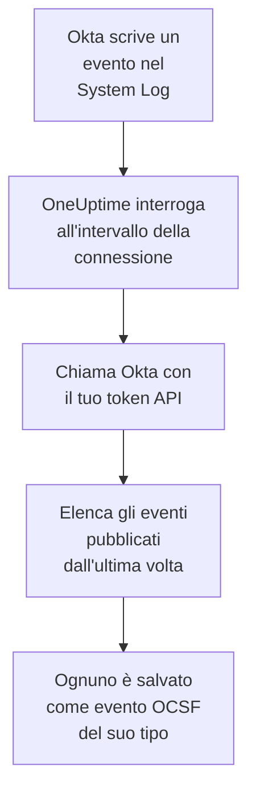

# Log di sistema Okta

Importa l'[Okta System Log](https://developer.okta.com/docs/reference/system-log-query/) negli eventi di sicurezza di OneUptime: accessi, verifiche MFA, modifiche ad account e gruppi, e i rilevamenti di minacce di Okta stesso. Lì li cerchi accanto a log, trace e metriche, li correli con ogni altra fonte e chiami la reperibilità per quelli che contano. OneUptime li legge con un token API che crei tu, e non modifica nulla in Okta.

:::cards
- [Configurare la connessione](#configurare-la-connessione): Un token API e il modulo della connessione.
- [Cosa viene importato](#cosa-viene-importato): Quali eventi, e come ognuno diventa un evento di sicurezza.
- [Come funziona il polling](#come-funziona-il-polling): La finestra che legge ogni interrogazione, e perché si sovrappone di 15 minuti alla precedente.
- [Risoluzione dei problemi](#risoluzione-dei-problemi): Cosa significa ogni errore e cosa cambiare.
:::

## Come funziona



Ogni minuto, OneUptime interroga ogni connessione abilitata il cui intervallo di polling è trascorso. Un'interrogazione chiede a Okta gli eventi del System Log pubblicati dall'ultima interrogazione, e salva ognuno come un evento [OCSF](https://schema.ocsf.io/): un accesso come evento Authentication, una modifica dell'account come Account Change, e un rilevamento di Okta come Detection Finding. Regole di rilevamento, monitor e dashboard lo trattano poi come un evento di sicurezza di qualsiasi altra fonte. Funziona con ogni cella Okta, `okta.com`, `oktapreview.com` e `okta-emea.com`, e con un'organizzazione su un dominio personalizzato.

## Prima di iniziare

- In OneUptime, il ruolo Project Owner, Project Admin o Security Admin. I ruoli Security Member e Security Viewer vedono le connessioni e la cronologia delle loro esecuzioni, ma non possono modificarle.
- Un amministratore Okta che possa vedere il System Log, per creare il token. Un token può fare ciò che può il suo amministratore, quindi usa un Read-only Administrator: legge il System Log e non modifica nulla. Un amministratore in sola lettura vede anche utenti, gruppi, app e impostazioni, quindi custodisci il token come una password.
- Idealmente, un account di servizio per quell'amministratore. Okta disattiva un token quando il suo amministratore viene disattivato, e quando resta inutilizzato per 30 giorni. Il polling lo usa ogni pochi minuti, quindi resta in uso finché la connessione è abilitata.
- Se la tua organizzazione accetta chiamate API solo da una zona di rete, una zona che contenga gli indirizzi da cui chiama OneUptime: su OneUptime Cloud, i suoi indirizzi in uscita, e su un'installazione self-hosted, l'indirizzo pubblico dei tuoi host dell'app e dei worker.

## Configurare la connessione

:::steps
### Creare un token API

1. Accedi alla **Admin Console** di Okta come amministratore in sola lettura.
2. Apri **Security → API**, poi la scheda **Tokens**, e seleziona **Create token**.
3. Dagli un nome, per esempio `OneUptime security events`. Lascia **Any IP** come provenienza consentita delle sue chiamate, a meno che la tua organizzazione non richieda una zona.
4. Seleziona **Create token** e copia il **Token Value**. Okta lo mostra una sola volta.

Ogni token può usare una quota del rate limit API dell'organizzazione, che la sua riga nella scheda **Tokens** mostra. Un'interrogazione fa al massimo 20 richieste, quindi la quota predefinita basta e avanza, a meno che altri strumenti non usino lo stesso token.

### Aggiungere la connessione in OneUptime

Apri **Prodotti → Security Events → Connessioni** (`/dashboard/{projectId}/security-events/connections`), fai clic su **Aggiungi connessione**, scegli **Okta System Log** e fai clic su **Avanti**. Compila le impostazioni della tabella qui sotto, fai clic su **Avanti** e incolla il token in **API token**.

### Provarla prima di salvare

Fai clic su **Prova queste impostazioni** sotto **Testa prima di salvare**. Il test accede e legge gli eventi con i valori del modulo, senza salvare nulla, così un URL sbagliato o un filtro non valido emerge prima che la connessione esista. Poi fai clic su **Avanti**, dai un **Nome** alla connessione e creala.
:::

| Impostazione | Cosa inserire |
| --- | --- |
| **Okta organization URL** | L'indirizzo a cui accedono i tuoi utenti, per esempio `https://acme.okta.com`, `https://acme.oktapreview.com` o `https://login.example.com`. Deve usare `https`, senza percorso. Non l'indirizzo `-admin` della Admin Console, che non serve l'API. |
| **Event filter** | Facoltativo. Un [filtro del System Log](https://developer.okta.com/docs/reference/core-okta-api/#filter) che sceglie gli eventi da importare, per esempio `eventType sw "user.session" or eventType sw "security"`. Vuoto importa le famiglie qui sotto. Al massimo 2.000 caratteri, su una sola riga, e non su `published`: OneUptime imposta da sé l'intervallo di tempo. |
| **API token** | Il valore del token, da solo: OneUptime aggiunge da sé lo schema `SSWS`. È cifrato, mai restituito dall'API e mai più mostrato. Sostituiscilo con **Aggiorna le credenziali** sulla connessione. |

Il passaggio **Interrogazione** ha anche una **Descrizione** facoltativa, il **Intervallo di interrogazione (minuti)**, un numero intero da `1` a `1440` che parte da `5`, e **Abilitato**, che parte attivo.

## Cosa viene importato

Senza **Event filter**, OneUptime importa le famiglie di eventi che un team di sicurezza tiene d'occhio, per prefisso di `eventType`. Un filtro tuo sostituisce questo elenco, invece di aggiungersi:

| Prefisso | Eventi |
| --- | --- |
| `user.session` | Accessi e disconnessioni, accesso alla Admin Console, impersonificazione |
| `user.authentication` | Risultati di autenticazione, single sign-on compreso |
| `user.mfa` | Registrazione, verifiche e reimpostazioni dei fattori |
| `user.account` | Modifiche e reimpostazioni delle password, blocchi, modifiche di profilo e di privilegi |
| `user.lifecycle` | Utenti creati, attivati, sospesi, disattivati ed eliminati |
| `security.` | ThreatInsight, segnalazioni di attività sospette e gli altri rilevamenti di Okta |
| `policy.` | Valutazioni delle policy di accesso, e modifiche alle policy |
| `system.api_token` | Token API creati e revocati |
| `application.user_membership` | Assegnazioni di app |
| `group.user_membership` | Modifiche all'appartenenza ai gruppi |

Ogni evento diventa un evento OCSF, con il fornitore `Okta` e il prodotto `Okta System Log`, della classe richiesta dal suo `eventType`:

| `eventType` | Classe OCSF | Attività |
| --- | --- | --- |
| `user.session.start` | Authentication (`3002`) | `Logon` |
| `user.session.end` | Authentication (`3002`) | `Logoff` |
| `user.authentication.*` | Authentication (`3002`) | `Logon` |
| `user.mfa.*` | Authentication (`3002`) | `Authentication Ticket` |
| Altri eventi `user.session.*` | Authentication (`3002`) | `Other` |
| `user.account.*`, `user.lifecycle.*` | Account Change (`3001`) | L'ultima parte del tipo di evento, per esempio `Update Password` |
| `group.*` | Group Management (`3006`) | L'ultima parte del tipo di evento, per esempio `Add` |
| `security.*`, e una `policy.evaluate_sign_on` che ha negato l'accesso | Detection Finding (`2004`) | `Create`, con il tipo di evento come nome della regola |
| Tutto il resto | `0`, con il nome del tipo di evento | L'ultima parte del tipo di evento |

Un evento che non rientra in nessuna di queste classi conserva comunque ogni campo, e resta consultabile tramite ognuno di essi. Ogni evento riempie queste colonne:

| Campo di Okta | Colonna di OneUptime |
| --- | --- |
| `uuid` | UID dell'evento, che serve anche a scartare i duplicati |
| `published`, quando è avvenuto l'evento | Ora dell'evento |
| `displayMessage`, altrimenti il tipo di evento e `outcome.reason` | Messaggio |
| `severity`: `DEBUG` e `INFO` sono Informational, `WARN` Medium, `ERROR` High | Gravità |
| `outcome.result`, come `SUCCESS`, `FAILURE`, `ALLOW` o `DENY` | Stato |
| `actor.alternateId`, altrimenti `actor.displayName`; `client.ipAddress` | Utente e IP dell'attore |
| L'`alternateId` dello `User` in `target` | Utente di destinazione |
| L'`alternateId` della `AppInstance` in `target` | Risorsa di destinazione |
| L'attore, ogni destinazione e l'IP del client | Osservabili |
| L'intero evento, appiattito in chiavi puntate, come `client.userAgent.browser` e `debugContext.debugData.requestUri` | `attributes` |

Un accesso fallito o negato a livello `INFO` viene alzato a Low, così si distingue da uno riuscito. Il System Log non contiene riferimenti MITRE ATT&CK, quindi quelle colonne restano vuote.

## Come funziona il polling

Ogni interrogazione elenca gli eventi pubblicati nella sua finestra, dal più vecchio, 1.000 per pagina, e segue il link `next` che invia Okta fino all'ultima pagina:

```text
GET {Okta organization URL}/api/v1/logs?since={window start}&until={window end}&sortOrder=ASCENDING&limit=1000&filter={Event filter}
```

- **L'ora di pubblicazione è il cursore.** Un evento del System Log è l'attività stessa, quindi `published` è sia il momento in cui è avvenuta sia ciò che legge il polling.
- **La prima interrogazione guarda indietro di 24 ore**, così una nuova connessione mostra subito i suoi eventi recenti.
- **Ogni interrogazione successiva parte 15 minuti prima del cursore salvato.** Okta avverte che una richiesta con un'ora di fine può tralasciare eventi in ritardo, cosa che definisce rara. La sovrapposizione li legge all'interrogazione successiva. Uno in ritardo di più di 15 minuti può finire dietro il cursore: importa il suo intervallo di tempo per recuperarlo.
- **Un'interrogazione legge al massimo 24 ore oltre il cursore.** Una connessione il cui cursore è rimasto indietro recupera in una serie di finestre di 24 ore, e la sua **Integrità** indica **Catching up**.
- **I duplicati vengono scartati in base a `uuid`** all'interno del progetto, così la sovrapposizione, una finestra ripetuta e un'importazione non salvano mai un evento due volte.

Un link `next` che punta altrove rispetto al tuo **Okta organization URL** non viene mai seguito, perché il token accompagna ogni richiesta.

### Quando una finestra contiene più di quanto un'interrogazione possa leggere

Un'interrogazione legge al massimo 10.000 eventi, in al massimo 20 richieste. Quando una finestra ne contiene di più, l'esecuzione è **Parziale**, con un avviso come questo:

```text
Stopped after collecting 10000 events; the window holds more. The last event read was published at 2026-09-14T08:12:44.000Z.
```

Gli eventi vengono letti dal più vecchio, quindi OneUptime sposta il cursore all'ora di pubblicazione dell'ultimo evento letto, e l'interrogazione successiva parte da lì, senza la sovrapposizione di 15 minuti, con la stessa lunghezza di finestra. Un'organizzazione molto attiva recupera 10.000 eventi per interrogazione, invece di rileggere gli stessi. La sovrapposizione torna quando il cursore è avanzato di 15 minuti oltre quel punto.

Quando un'esecuzione non riesce affatto a superare il cursore salvato, per esempio perché i soli 15 minuti di sovrapposizione contengono più di 10.000 eventi, OneUptime accorcia invece la finestra:

1. **Restringere.** L'interrogazione successiva legge una finestra lunga la metà, dallo stesso punto di partenza, e continua a dimezzarla finché una finestra non viene letta per intero, fino a un minuto. L'avviso dell'esecuzione lo dice: `This window holds more records than one poll can read; the next poll reads a {n} minute window from the same starting point.`
2. **Tornare a crescere.** Dopo che una finestra è stata letta per intero, la successiva è di nuovo lunga il doppio, fino a 24 ore.
3. **Superare un singolo minuto.** Se anche un solo minuto contiene più di quanto un'interrogazione possa leggere, il polling lo supera, così gli eventi più recenti continuano ad arrivare, e la sovrapposizione delle interrogazioni successive non vi risale più. L'esecuzione resta **Parziale**, e **Ultimo errore** riporta `More records were created in the one minute from {cursor} to {end} than one poll can read. Polling moved past this minute so newer records keep arriving; use Import this time range in Diagnostics on this minute to recover what one run can read.` Importa quel minuto con **Import this time range** per recuperare ciò che un'esecuzione può leggere, oppure restringi l'**Event filter**.

Un'esecuzione che fallisce del tutto, con un errore di Okta, mantiene il cursore e la lunghezza della finestra, e l'interrogazione successiva rilegge la stessa finestra. L'unica eccezione è una richiesta scaduta: il cursore resta, ma la finestra successiva è lunga la metà, perché una finestra troppo pesante per ricevere risposta in tempo scadrebbe a ogni tentativo. Cambiare il **Intervallo di interrogazione (minuti)** non cambia nulla di tutto questo: decide quanto spesso parte un'interrogazione, non dove inizia la sua finestra.

### Eseguire, visualizzare in anteprima e importare su richiesta

Fai clic su **Diagnostica** su una connessione per vederne le esecuzioni recenti e lavorarci a mano. Chi può modificare la connessione può avviare queste azioni; chi può vederla può leggerne la cronologia.

- **Esegui ora** avvia subito un'interrogazione, con il cursore abituale, anche quando la connessione non è **Abilitato**.
- **Preview log events** legge un intervallo di tempo fino a 7 giorni e non importa nulla.
- **Import this time range** importa un intervallo fino a 7 giorni, dopo la tua conferma, senza spostare il cursore. Gli eventi già importati vengono saltati. Okta conserva 90 giorni di System Log.
- **Copy diagnostics** su un'esecuzione copia il suo rapporto per il supporto. Non contiene mai credenziali.

## Testare la connessione

**Testa la connessione** sulla riga di una connessione, e **Prova queste impostazioni** nel modulo, vengono eseguiti nel processo dell'API, non in un worker in background, così un test risponde anche quando il problema sono i worker. Esegue questi controlli, in ordine:

| Controllo | Cosa verifica |
| --- | --- |
| **Configurazione** | Ogni impostazione è presente e ben formata. Non viene contattato nulla quando questo fallisce. |
| **Authenticate with Okta** | Okta accetta il token per il System Log, con un evento letto e nessun filtro. |
| **Read System Log events** | Si può leggere un evento delle ultime 24 ore attraverso il filtro che usa il polling, il tuo o quello predefinito, così un **Event filter** non valido fallisce qui invece che alla prima interrogazione. |
| **Events available to import** | Quanti eventi sono stati pubblicati nelle ultime 24 ore e negli ultimi 7 giorni, una pagina da 1.000 ciascuno, quindi `1000+` significa di più. Nessuno in 7 giorni è un avviso, non un errore. |
| **Background workers**, **Poll scheduler**, **Security event storage** | Il lato di OneUptime stesso: un processo prende i job della coda Worker, il job di polling gira ogni minuto e l'archivio degli eventi di sicurezza risponde. |
| **Scheduled polling** | Per una connessione salvata: il polling è attivo, nessuna esecuzione è bloccata in attesa di un worker e le interrogazioni girano in orario. |

Ogni richiesta di un test ha una scadenza di 20 secondi. Un test non importa mai nulla e non sposta mai il cursore, e ogni controllo fallito dice cosa cambiare.

## Risoluzione dei problemi

Il **Ultimo errore** della connessione conserva il messaggio di errore completo, con le credenziali oscurate, dietro un prefisso che nomina il passaggio fallito. Quando una connessione ha un errore, seleziona **Visualizza errore** nella sua colonna **Azioni** per leggerlo, e **Copia errore** nella finestra di dialogo per copiarlo. Ogni messaggio inizia con `Okta System Log events request`, e cita il codice di errore di Okta stesso dopo lo stato; leggi ciò che segue.

:::details Last Error dice `failed (HTTP 400)`
Okta ha rifiutato i parametri della richiesta, `E0000053`. Quando il token ha funzionato, è quasi sempre l'**Event filter**: controlla i suoi operatori, `eq`, `ne`, `co`, `sw`, `ew`, `pr`, `gt`, `ge`, `lt` e `le`, i suoi `and` e `or`, e le virgolette doppie intorno ai suoi valori, oppure svuotalo per usare le famiglie predefinite. In un'importazione, può anche significare che l'intervallo inizia più di 180 giorni fa.
:::

:::details Last Error dice `failed (HTTP 401)` o `failed (HTTP 403)`
- `HTTP 401`: Okta non ha accettato il token, `E0000011`. È stato revocato, è rimasto inutilizzato per 30 giorni, o è stato disattivato con il suo amministratore; oppure è stato incollato con `SSWS` o con un carattere in più. Crea un nuovo token come amministratore in sola lettura e salvalo con **Aggiorna le credenziali**.
- `HTTP 403`: il token accede, ma il suo amministratore non può leggere il System Log, `E0000006`. Crealo come Read-only Administrator o Super Administrator, e verifica che la sua zona di rete consenta gli indirizzi da cui chiama OneUptime.
:::

:::details Last Error dice `failed (HTTP ...)` con un altro stato
- `HTTP 404`: l'URL non serve l'API di Okta. Usa l'indirizzo proprio dell'organizzazione, per esempio `https://acme.okta.com`, senza percorso e non quello `-admin`.
- `HTTP 3xx`: Okta ha reindirizzato la richiesta, e i reindirizzamenti vengono rifiutati, perché il token accompagna ogni richiesta. Usa l'indirizzo proprio dell'organizzazione.
- `HTTP 429`: Okta sta limitando il token, `E0000047`. L'interrogazione successiva riprova. Se continua a succedere, aumenta la quota del rate limit del token nella scheda **Tokens**, dai a OneUptime un token suo, oppure interroga meno spesso.
- `HTTP 5xx`: Okta ha fallito, oppure la query ha superato il limite di 30 secondi di Okta, `E0000009`. L'interrogazione successiva riprova; se continua a succedere, controlla [status.okta.com](https://status.okta.com).
:::

:::details Last Error dice `returned` o `did not complete`
- `returned a non-JSON body.` o `returned an unrecognized response shape`: ha risposto qualcosa di diverso dall'API di Okta, per esempio una pagina di accesso o un proxy, oppure Okta ha risposto con un errore. Viene segnalato invece di essere preso per una finestra vuota, così il cursore non supera mai eventi che nessuno ha letto.
- `returned a next link outside the Okta organization URL`: un link `next` puntava altrove, e non è stato seguito. Okta stesso non lo fa mai: cerca un proxy che riscrive le intestazioni.
- `did not complete`: la richiesta non ha ricevuto risposta: un timeout, un nome che non si risolve, un certificato di cui OneUptime non si fida, o un indirizzo rifiutato. Verifica che l'app e i worker di OneUptime possano raggiungere la tua organizzazione in HTTPS, attraverso l'eventuale proxy che usi.
:::

:::details Last Polled è Never e Last Error è vuoto
Nessuna interrogazione è terminata per questa connessione. Esegui **Testa la connessione**: i suoi controlli **Background workers** e **Poll scheduler** nominano la causa. Su un'installazione self-hosted, la causa abituale è `DISABLE_QUEUE_WORKERS=true` sull'app, senza un deployment separato dei worker che prenda i job: impostalo su `false`, oppure esegui il deployment dei worker (Helm: `worker.enabled: true`).
:::

:::details Un'esecuzione è Partial
- `Stopped after collecting 10000 events`: la finestra conteneva più dei 10.000 eventi che legge un'esecuzione. Non si perde nulla: l'interrogazione successiva parte dopo l'ultimo evento letto. Una connessione che resta **Parziale** un'interrogazione dopo l'altra sta recuperando un arretrato, e i suoi **Ultima interrogazione** e **Ultimo evento importato** continuano ad avanzare. Se non recupera mai, l'organizzazione pubblica più eventi corrispondenti di quanti ne possa contenere un intervallo di polling: restringi l'**Event filter**, oppure accorcia il **Intervallo di interrogazione (minuti)**.
- `More records were created in the one minute from ... than one poll can read`: il polling ha superato quel minuto. Importalo con **Import this time range** in **Diagnostica**. Un'importazione legge quanto un'interrogazione.
:::

:::details Il test riesce, ma non viene importato nulla
Leggi **Events available to import** nel rapporto del test. Con il filtro predefinito, un'organizzazione con degli utenti pubblica accessi di continuo, quindi `0` negli ultimi 7 giorni significa che l'URL è una sandbox o un'organizzazione inutilizzata. Con un tuo **Event filter**, significa che il filtro non ha trovato nulla: confrontalo con i tipi di evento nel System Log della Admin Console.
:::

## Cosa ottieni

- **Ricerca.** Filtra accessi, risultati MFA, modifiche agli account e rilevamenti di Okta per gravità, stato, utente, IP o qualsiasi osservabile nell'esploratore degli eventi di sicurezza, accanto a ogni altra fonte.
- **Correlazione.** Gli utenti, le app e gli IP di ogni evento vengono indicizzati come osservabili, quindi una ricerca trova tutto ciò che ha fatto un utente, accanto ai log della sua app.
- **Regole di rilevamento.** Regole Sigma che girano secondo una pianificazione sui tuoi eventi di sicurezza, come gli accessi falliti per IP o i rifiuti MFA per utente, e aprono avvisi che chiamano la reperibilità.
- **Monitor.** I monitor degli eventi di sicurezza contano gli eventi corrispondenti, e aprono incidenti o avvisi oltre una soglia.

Gli eventi di sicurezza sono fatturati come il resto della tua telemetria, per GB acquisito. Vedi i [prezzi](https://oneuptime.com/pricing).

## Prossimi passi

:::cards
- [Eventi di sicurezza](/docs/telemetry/security-events): Cerca, correla e genera avvisi su ciò che importi.
- [AWS Security Hub](/docs/integrations/aws-security-hub): Importa anche i finding del tuo cloud.
- [Ruoli](/docs/permissions/reference#ruoli): Cosa possono vedere e modificare i ruoli Security.
- [Panoramica delle integrazioni](/docs/integrations/index): Gli altri strumenti che puoi collegare.
:::
