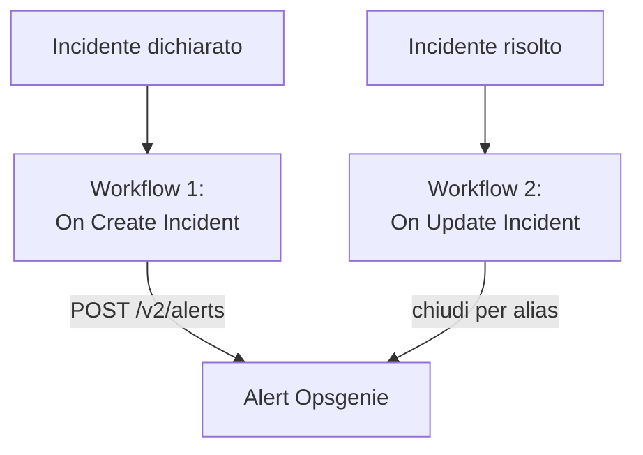

# Opsgenie

Invia gli incidenti di OneUptime a [Opsgenie](https://www.atlassian.com/software/opsgenie). Un workflow crea un alert Opsgenie quando viene dichiarato un incidente di OneUptime, e un secondo lo chiude quando l'incidente di OneUptime viene risolto. Usalo finché è Opsgenie a chiamare il tuo team e OneUptime a sorvegliare i tuoi sistemi.

:::cards
- [Salvare la chiave API](#salvare-la-chiave-api): Tieni la chiave di Opsgenie fuori dai tuoi workflow.
- [Creare alert Opsgenie](#creare-un-alert-opsgenie-per-ogni-incidente): Un workflow, due blocchi.
- [Chiuderli](#chiudere-lalert-opsgenie): Un secondo workflow che segue lo stato dell'incidente.
- [Risoluzione dei problemi](#risoluzione-dei-problemi): Quando Opsgenie rifiuta una richiesta.
:::

> [!IMPORTANT]
> Atlassian ha smesso di vendere Opsgenie a giugno 2025 e ne termina il supporto ad aprile 2027. Anche OneUptime chiama le persone, con policy di reperibilità, turni e regole di escalation. Per portare qui il tuo team, vedi [Migrare da Opsgenie](/docs/moving-to-oneuptime/opsgenie): un'importazione porta qui i tuoi utenti, i team, i turni e le escalation.

## Come funziona



Entrambi i workflow chiamano la [Alert API di Opsgenie](https://docs.opsgenie.com/docs/alert-api). Il primo dà all'alert un `alias` ricavato dall'ID dell'incidente di OneUptime, e il secondo chiude l'alert tramite quell'alias.

## Prima di iniziare

- Un'integrazione Opsgenie di tipo **API** e la sua **API Key**. Aggiungine una in **Settings → Integrations** in Opsgenie, o nelle **Integrations** di un team per inviare gli alert a quel team.
- La tua regione Opsgenie. Gli account in Europa, che accedono da `app.eu.opsgenie.com`, usano `api.eu.opsgenie.com`. Tutti gli altri usano `api.opsgenie.com`.
- In OneUptime, il permesso di creare workflow e variabili globali. Su OneUptime Cloud, i workflow richiedono il piano **Growth** o superiore.

## Salvare la chiave API

:::steps
1. Vai su **Flussi di lavoro → Variabili globali** e fai clic su **Crea: Flusso di lavoro Variabile**.
2. Chiamala `OPSGENIE_KEY` e fai clic su **Avanti**.
3. Incolla la chiave API in **Contenuto**, attiva **Segreto** e fai clic su **Crea: Flusso di lavoro Variabile**.
:::

Una variabile segreta viene sostituita da `[REDACTED]` nei log delle esecuzioni, quindi la chiave non compare mai in un'esecuzione.

## Creare un alert Opsgenie per ogni incidente

:::steps
### Creare il workflow

Vai su **Flussi di lavoro**, fai clic su **Crea flusso di lavoro**, poi su **Parti da zero**. Chiamalo `Incidents to Opsgenie` e fai clic su **Crea flusso di lavoro**.

### Aggiungere il trigger

Fai clic sul blocco tratteggiato **Scegli cosa avvia questo flusso di lavoro** e scegli **On Create Incident**. Fai clic sul trigger: i suoi **Fields to pass on** iniziano con **Titolo**, quindi fai clic su **Aggiungi campo** e scegli **Descrizione**.

### Creare l'alert

Fai clic su **Aggiungi componente**, aggiungi un blocco **API Post (JSON)** e collegagli il punto **Success** del trigger. Imposta il suo **URL** su `https://api.opsgenie.com/v2/alerts`, o `https://api.eu.opsgenie.com/v2/alerts` in Europa. In **Altri campi**, imposta i suoi **Request Headers** su:

```json
{ "Authorization": "GenieKey {{global.variables.OPSGENIE_KEY}}" }
```

E il suo **Request Body** su:

```json
{
  "message": "{{local.components.incident-on-create-1.returnValues.model.title}}",
  "alias": "oneuptime-{{local.components.incident-on-create-1.returnValues.model._id}}",
  "description": "{{local.components.incident-on-create-1.returnValues.model.description}}",
  "priority": "P1",
  "source": "OneUptime"
}
```

### Provarlo, poi attivarlo

Fai clic su **Esegui flusso di lavoro**, scegli un incidente di prova sotto **Incidente** ed eseguilo. Il passaggio **API Post (JSON)** mostra una risposta `202`, e l'alert compare in Opsgenie un attimo dopo. Poi attiva **Abilitato** in cima al **Costruttore**.
:::

Lo schema di Opsgenie è la parola `GenieKey`, uno spazio, poi la chiave. Opsgenie limita `message` a 130 caratteri, e le sue priorità vanno da `P1` a `P5`: per inviare quella di ogni incidente, vedi [Mappare le priorità](#mappare-le-priorità).

## Chiudere l'alert Opsgenie

Un workflow ha un solo trigger, quindi per chiudere serve un secondo workflow, avviato quando cambia lo stato di un incidente.

:::steps
### Aggiungere il trigger On Update Incident

Crea un workflow chiamato `Close Opsgenie alerts` e scegli **On Update Incident** come trigger. In **Fields to watch**, fai clic su **Aggiungi campo** e scegli **Current Incident State**, così viene eseguito solo quando cambia lo stato. In **Fields to pass on**, chiedi se il nuovo stato è uno stato risolto: fai clic su **Aggiungi campo**, apri **Current Incident State** e scegli **Is Resolved State**. Oppure fai clic su **Modifica come JSON** e sostituisci il JSON con:

```json
{ "_id": true, "currentIncidentState": { "isResolvedState": true } }
```

### Controllare che l'incidente sia risolto

Aggiungi un blocco **If / Else** dopo il trigger. Imposta **Value to check** su `{{local.components.incident-on-update-1.returnValues.model.currentIncidentState.isResolvedState}}` e **Comparison** su **is true**.

### Chiudere l'alert

Aggiungi un blocco **API Post (JSON)** dopo il lato **Yes**, con gli stessi **Request Headers** e questo **URL**:

```text
https://api.opsgenie.com/v2/alerts/oneuptime-{{local.components.incident-on-update-1.returnValues.model._id}}/close?identifierType=alias
```

Imposta il suo **Request Body** su `{ "source": "OneUptime", "note": "Resolved in OneUptime" }`.

### Attivarlo

Attiva **Abilitato**, poi risolvi un incidente di prova in OneUptime. Opsgenie chiude il suo alert.
:::

`identifierType=alias` dice a Opsgenie che l'indirizzo indica l'alert tramite il suo alias, non tramite il suo ID.

## Mappare le priorità

Per inviare la gravità di ogni incidente come priorità di Opsgenie, aggiungi un blocco **Run Custom JavaScript** tra il trigger e il blocco **API Post (JSON)**.

1. Nei **Fields to pass on** del trigger, fai clic su **Aggiungi campo**, apri **Gravità incidente** e scegli **Nome**.
2. Imposta gli **Arguments** del blocco su `{ "severity": "{{local.components.incident-on-create-1.returnValues.model.incidentSeverity.name}}" }` e il suo **JavaScript Code** su:

   ```javascript
   // Your incident severities, by name, to Opsgenie's priorities.
   const PRIORITY = {
     "Critical Incident": "P1",
     "Major Incident": "P2",
     "Minor Incident": "P3",
   };

   return { priority: PRIORITY[args.severity] || "P3" };
   ```

3. Nel corpo della richiesta, imposta `"priority"` su `"{{local.components.javascript-1.returnValues.returnValue.priority}}"`.

I nomi qui sopra sono le tre gravità con cui parte un nuovo progetto. Usa i tuoi se li hai rinominati.

## Risoluzione dei problemi

:::details Opsgenie risponde 401 o 403
La chiave è sbagliata, o appartiene all'altra regione. Verifica che l'intestazione contenga `GenieKey`, uno spazio e la chiave, che la chiave sia quella di un'integrazione **API**, e che l'host corrisponda alla tua regione: `api.opsgenie.com` o `api.eu.opsgenie.com`.
:::

:::details La chiusura risponde 404
Nessun alert ha quell'alias. Entrambi i workflow devono costruire l'alias allo stesso modo, `oneuptime-` seguito dall'`_id` dell'incidente, e l'URL deve terminare con `?identifierType=alias`.
:::

:::details L'alert non compare mai, anche se il passaggio mostra 202
Opsgenie risponde `202` prima di elaborare la richiesta, quindi una richiesta che rifiuta in seguito mostra comunque `202`. Cerca la richiesta nei log di Opsgenie per vedere perché è stata rifiutata, ad esempio un'integrazione disattivata.
:::

:::details Il workflow non viene mai eseguito
Verifica che sia attivo: **Abilitato**, in cima al suo **Costruttore**. Poi apri **Registri → Esecuzioni**: un'esecuzione che ha preso il lato **No** del blocco **If / Else** è un aggiornamento che non era una risoluzione.
:::

## Prossimi passi

:::cards
- [Migrare da Opsgenie](/docs/moving-to-oneuptime/opsgenie): Porta qui il tuo team, i turni e le escalation prima della fine di Opsgenie.
- [Regole di escalation](/docs/on-call/escalation-rules): Chiama le persone direttamente da OneUptime.
- [PagerDuty](/docs/integrations/pagerduty): Gli stessi due workflow per PagerDuty.
- [Panoramica delle integrazioni](/docs/integrations/index): Gli schemi dietro ogni integrazione.
:::
