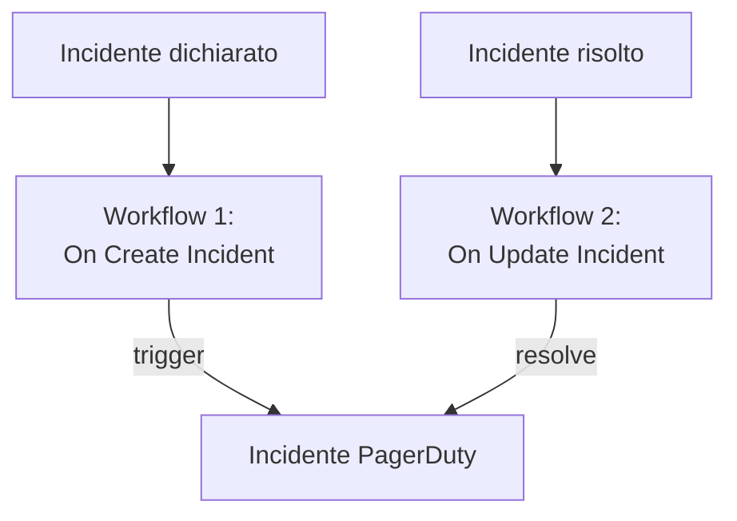

# PagerDuty

Invia gli incidenti di OneUptime a [PagerDuty](https://www.pagerduty.com). Un workflow attiva un incidente PagerDuty quando viene dichiarato un incidente di OneUptime, e un secondo lo risolve quando l'incidente di OneUptime viene risolto. Usalo quando è PagerDuty a chiamare il tuo team e OneUptime a sorvegliare i tuoi sistemi.

:::cards
- [Salvare la routing key](#salvare-la-routing-key): Tieni la chiave di PagerDuty fuori dai tuoi workflow.
- [Attivare incidenti PagerDuty](#attivare-un-incidente-pagerduty-per-ogni-incidente): Un workflow, due blocchi.
- [Risolverli](#risolvere-lincidente-pagerduty): Un secondo workflow che segue lo stato dell'incidente.
- [Risoluzione dei problemi](#risoluzione-dei-problemi): Quando PagerDuty rifiuta un evento.
:::

> [!TIP]
> Anche OneUptime chiama le persone, con policy di reperibilità, turni e regole di escalation. Per portare il tuo team fuori da PagerDuty, vedi [Migrare da PagerDuty](/docs/moving-to-oneuptime/pagerduty): un'importazione porta qui i tuoi utenti, i turni e le policy di escalation.

## Come funziona



Entrambi i workflow chiamano la [Events API v2](https://developer.pagerduty.com/docs/events-api-v2/overview/) di PagerDuty con la stessa `dedup_key`, ricavata dall'ID dell'incidente di OneUptime. Grazie a quella chiave PagerDuty sa che l'evento di risoluzione chiude l'incidente aperto dall'evento di attivazione.

## Prima di iniziare

- Un servizio PagerDuty con un'integrazione Events API v2. In PagerDuty, apri il servizio, poi **Integrations**, fai clic su **Add an integration** e scegli **Events API V2**. Copia la sua **Integration Key**: la Events API la chiama routing key.
- In OneUptime, il permesso di creare workflow e variabili globali. Su OneUptime Cloud, i workflow richiedono il piano **Growth** o superiore.

## Salvare la routing key

:::steps
1. Vai su **Flussi di lavoro → Variabili globali** e fai clic su **Crea: Flusso di lavoro Variabile**.
2. Chiamala `PAGERDUTY_ROUTING_KEY` e fai clic su **Avanti**.
3. Incolla la chiave di integrazione in **Contenuto**, attiva **Segreto** e fai clic su **Crea: Flusso di lavoro Variabile**.
:::

Una variabile segreta viene sostituita da `[REDACTED]` nei log delle esecuzioni, quindi la chiave non compare mai in un'esecuzione.

## Attivare un incidente PagerDuty per ogni incidente

:::steps
### Creare il workflow

Vai su **Flussi di lavoro**, fai clic su **Crea flusso di lavoro**, poi su **Parti da zero**. Chiamalo `Incidents to PagerDuty` e fai clic su **Crea flusso di lavoro**.

### Aggiungere il trigger

Fai clic sul blocco tratteggiato **Scegli cosa avvia questo flusso di lavoro** e scegli **On Create Incident**. Fai clic sul trigger: i suoi **Fields to pass on** iniziano con **Titolo**, quindi fai clic su **Aggiungi campo** e scegli **Descrizione**.

### Inviare l'evento di attivazione

Fai clic su **Aggiungi componente**, aggiungi un blocco **API Post (JSON)** e collegagli il punto **Success** del trigger. Imposta il suo **URL** su `https://events.pagerduty.com/v2/enqueue` e il suo **Request Body** su:

```json
{
  "routing_key": "{{global.variables.PAGERDUTY_ROUTING_KEY}}",
  "event_action": "trigger",
  "dedup_key": "oneuptime-{{local.components.incident-on-create-1.returnValues.model._id}}",
  "payload": {
    "summary": "{{local.components.incident-on-create-1.returnValues.model.title}}",
    "source": "OneUptime",
    "severity": "critical",
    "custom_details": {
      "description": "{{local.components.incident-on-create-1.returnValues.model.description}}"
    }
  }
}
```

### Provarlo, poi attivarlo

Fai clic su **Esegui flusso di lavoro**, scegli un incidente di prova sotto **Incidente** ed eseguilo. Il passaggio **API Post (JSON)** mostra una risposta `202` con `"status": "success"`, e PagerDuty apre un incidente. Poi attiva **Abilitato** in cima al **Costruttore**.
:::

Il blocco invia JSON, quindi non serve un'intestazione `Content-Type`. La `severity` di PagerDuty è una tra `critical`, `error`, `warning` e `info`: per inviare quella di ogni incidente, vedi [Mappare le gravità](#mappare-le-gravità).

## Risolvere l'incidente PagerDuty

Un workflow ha un solo trigger, quindi per risolvere serve un secondo workflow, avviato quando cambia lo stato di un incidente.

:::steps
### Aggiungere il trigger On Update Incident

Crea un workflow chiamato `Resolve PagerDuty incidents` e scegli **On Update Incident** come trigger. In **Fields to watch**, fai clic su **Aggiungi campo** e scegli **Current Incident State**, così viene eseguito solo quando cambia lo stato. In **Fields to pass on**, chiedi se il nuovo stato è uno stato risolto: fai clic su **Aggiungi campo**, apri **Current Incident State** e scegli **Is Resolved State**. Oppure fai clic su **Modifica come JSON** e sostituisci il JSON con:

```json
{ "_id": true, "currentIncidentState": { "isResolvedState": true } }
```

### Controllare che l'incidente sia risolto

Aggiungi un blocco **If / Else** dopo il trigger. Imposta **Value to check** su `{{local.components.incident-on-update-1.returnValues.model.currentIncidentState.isResolvedState}}` e **Comparison** su **is true**.

### Inviare l'evento di risoluzione

Aggiungi un blocco **API Post (JSON)** dopo il lato **Yes**, con lo stesso **URL** e questo **Request Body**:

```json
{
  "routing_key": "{{global.variables.PAGERDUTY_ROUTING_KEY}}",
  "event_action": "resolve",
  "dedup_key": "oneuptime-{{local.components.incident-on-update-1.returnValues.model._id}}"
}
```

### Attivarlo

Attiva **Abilitato**, poi risolvi un incidente di prova in OneUptime. PagerDuty risolve il suo incidente.
:::

Controllare `isResolvedState` invece del nome di uno stato continua a funzionare quando rinomini i tuoi stati. Vedi [Stati e gravità degli incidenti](/docs/incidents/states-and-severities).

## Mappare le gravità

Per inviare la gravità di ogni incidente, aggiungi un blocco **Run Custom JavaScript** tra il trigger e il blocco **API Post (JSON)**, e leggi la sua risposta nel corpo.

1. Nei **Fields to pass on** del trigger, fai clic su **Aggiungi campo**, apri **Gravità incidente** e scegli **Nome**.
2. Imposta gli **Arguments** del blocco su `{ "severity": "{{local.components.incident-on-create-1.returnValues.model.incidentSeverity.name}}" }` e il suo **JavaScript Code** su:

   ```javascript
   // Your incident severities, by name, to PagerDuty's.
   const SEVERITY = {
     "Critical Incident": "critical",
     "Major Incident": "error",
     "Minor Incident": "warning",
   };

   return { severity: SEVERITY[args.severity] || "info" };
   ```

3. Nel corpo della richiesta, imposta `"severity"` su `"{{local.components.javascript-1.returnValues.returnValue.severity}}"`.

I nomi qui sopra sono le tre gravità con cui parte un nuovo progetto. Usa i tuoi se li hai rinominati.

## Risoluzione dei problemi

:::details PagerDuty risponde 400
Il corpo della risposta dice cosa ha rifiutato PagerDuty, e il passaggio **API Post (JSON)** dell'esecuzione lo mostra. Di solito la routing key non è una chiave di integrazione Events API v2: copiala di nuovo dalle **Integrations** del servizio. Viene rifiutato anche un evento senza `summary`, `source` o `severity`.
:::

:::details L'evento di risoluzione non chiude nulla
Entrambi gli eventi devono portare esattamente la stessa `dedup_key`. Verifica che entrambi i corpi la costruiscano con `oneuptime-` seguito dall'`_id` dell'incidente, e che il workflow di risoluzione sia attivo.
:::

:::details Il workflow non viene mai eseguito
Verifica che sia attivo: **Abilitato**, in cima al suo **Costruttore**. Poi apri **Registri → Esecuzioni**: un'esecuzione che ha preso il lato **No** del blocco **If / Else** è un aggiornamento che non era una risoluzione.
:::

:::details PagerDuty mostra un riferimento invece di un valore
Un riferimento che non si risolve viene inviato così com'è scritto, parentesi graffe comprese. Controlla l'identificatore del blocco, il nome del campo e il nome della variabile, che distingue tra maiuscole e minuscole. Nella scheda **Passaggi** dell'esecuzione, un'impostazione con un riferimento del genere è segnata **Did not resolve**.
:::

## Prossimi passi

:::cards
- [Migrare da PagerDuty](/docs/moving-to-oneuptime/pagerduty): Porta qui il tuo team, i turni e le policy di escalation.
- [Regole di escalation](/docs/on-call/escalation-rules): Chiama le persone direttamente da OneUptime.
- [Opsgenie](/docs/integrations/opsgenie): Gli stessi due workflow per Opsgenie.
- [Panoramica delle integrazioni](/docs/integrations/index): Gli schemi dietro ogni integrazione.
:::
