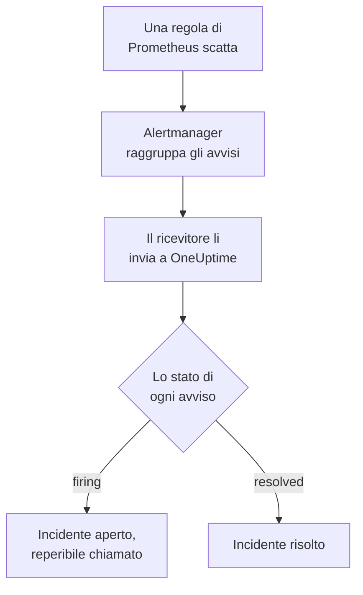

# Prometheus Alertmanager

Invia gli avvisi di [Prometheus Alertmanager](https://prometheus.io/docs/alerting/latest/alertmanager/) a OneUptime, così ogni avviso che scatta diventa un incidente che chiama il tuo team reperibile e si risolve quando l'avviso rientra. Alertmanager pubblica le sue notifiche su un ricevitore webhook, quindi non c'è nulla da installare né da una parte né dall'altra.

:::cards
- [Scegliere come OneUptime riceve gli avvisi](#scegliere-come-oneuptime-riceve-gli-avvisi): Un monitor Incoming Request o un workflow tuo.
- [Ricevere gli avvisi con un monitor](#ricevere-gli-avvisi-con-un-monitor): Un incidente per avviso, risolto al rientro.
- [Configurare Alertmanager](#configurare-alertmanager): Un ricevitore webhook e la route che lo usa.
- [Risoluzione dei problemi](#risoluzione-dei-problemi): Quando gli avvisi non arrivano o gli incidenti restano aperti.
:::

## Come funziona



Prometheus valuta le tue regole di avviso e invia ad Alertmanager gli avvisi che scattano. Alertmanager li raggruppa per le etichette del `group_by` della tua route e invia ogni gruppo al ricevitore webhook come una notifica JSON. L'elenco `alerts` della notifica contiene ogni avviso del gruppo, ciascuno con il proprio `status`, `firing` o `resolved`, le sue etichette e annotazioni, e un `fingerprint` che lo identifica.

## Prima di iniziare

- Un Alertmanager di cui puoi modificare `alertmanager.yml` e che può raggiungere il tuo OneUptime via HTTPS.
- In OneUptime, il permesso di creare monitor, o workflow se scegli quella strada.

## Scegliere come OneUptime riceve gli avvisi

Configura prima OneUptime: ti dà l'URL a cui invia Alertmanager.

| Strada | Usala quando |
| --- | --- |
| Un monitor Incoming Request (consigliato) | Vuoi che ogni avviso sia un incidente che chiama la reperibilità e si risolve quando l'avviso rientra. Non c'è nulla da costruire. |
| Un workflow con un trigger Webhook | Ti serve una logica tua: filtrare gli avvisi, rimodellarli o chiamare prima altri sistemi. Un workflow apre un incidente per notifica, non per avviso, e non lo risolve al rientro. |

Entrambi ricevono lo stesso JSON dallo stesso ricevitore, quindi puoi iniziare con uno e passare all'altro in seguito cambiando un URL in `alertmanager.yml`.

## Ricevere gli avvisi con un monitor

Un [monitor Incoming Request](/docs/monitor/incoming-request-monitor) ti dà un URL, e i suoi criteri decidono cosa fa ogni notifica.

:::steps
### Creare il monitor

Vai su **Monitor** e fai clic su **Crea monitor**. Scegli **Incoming Request** in **Tipo di monitor**, chiamalo `Alertmanager` e fai clic su **Avanti**.

### Dichiarare un incidente per ogni avviso che scatta

Nel passaggio **Criteri**, apri il primo criterio, quello che segna il monitor come offline. Imposta il suo filtro su **Corpo della Richiesta**, **Contiene**, `"status":"firing"`. Questo criterio dichiara già un incidente quando il suo filtro corrisponde. Compila l'incidente:

- **Titolo dell'incidente**: `{{requestBody.commonLabels.alertname}} on {{requestBody.commonLabels.instance}}`.
- **Gravità**: la gravità d'incidente che devono avere questi avvisi.
- **Policy di reperibilità**, in **Reperibilità**: le policy da chiamare.
- **Risoluzione automatica dell'incidente**, in **Altri campi**: lasciala attiva, com'è all'inizio. Senza, i rientri vengono ignorati e gli incidenti restano aperti.

### Aprire un incidente per avviso

Nello stesso criterio, apri **Impostazioni** e attiva **Group incidents and alerts by a payload field**. Compilalo come sotto, così ogni avviso ha il proprio incidente e il suo rientro lo risolve:

| Campo | Valore |
| --- | --- |
| **Open a separate incident for each…** | `requestBody.alerts[*].fingerprint` |
| **Field that signals recovery** | `requestBody.alerts[*].status` |
| **Value that means recovered** | `resolved` |

### Riportare il monitor online

Apri il secondo criterio, quello che segna il monitor come online, e imposta il suo filtro su **Corpo della Richiesta**, **Contiene**, `"status":"resolved"`.

### Copiare l'URL

Fai clic su **Crea monitor**. La pagina **Panoramica** del monitor mostra il suo **Heartbeat URL**. Copialo per Alertmanager:

```text
https://oneuptime.com/heartbeat/<secret key>
```

Un'installazione self-hosted ha il proprio host al posto di `oneuptime.com`.
:::

`[*]` legge ogni avviso di una notifica, quindi una notifica di tre avvisi può aprire tre incidenti, fino a **Max incidents per request** (`100` se non lo cambi). Lo `status` di ciascun avviso decide cosa succede al suo incidente: quando un avviso di una notifica si risolve e due scattano ancora, si chiude solo l'incidente dell'avviso risolto. Vedi [Ricevere avvisi da un altro sistema](/docs/monitor/incoming-request-monitor#ricevere-avvisi-da-un-altro-sistema) per cosa fa ogni impostazione.

> [!WARNING]
> Raggruppa per un valore che cambia da un avviso all'altro all'interno di una notifica. Il `fingerprint` di Alertmanager è un hash dell'intero insieme di etichette di un avviso, quindi cambia sempre. Un'etichetta nel `group_by` della tua route non cambia mai: è ciò che mette gli avvisi in una stessa notifica. Raggruppare per `requestBody.alerts[*].labels.alertname` con la route qui sotto riunisce ogni avviso di una notifica in un solo incidente, che prende lo stato del primo avviso.

## Dare un nome agli incidenti

Il titolo sopra legge le etichette che tutti gli avvisi della notifica condividono: `commonLabels` contiene quelle etichette, e `commonAnnotations` le annotazioni che condividono. Con la route qui sotto, che raggruppa per `alertname` e `instance`, ci sono entrambe. In **Descrizione**, dai all'incidente una **Descrizione dell'incidente** come questa:

```text
{{requestBody.commonAnnotations.summary}}

{{requestBody.commonAnnotations.description}}
Severity: {{requestBody.commonLabels.severity}}
Alertmanager: {{requestBody.externalURL}}
```

- Anche la chiave di raggruppamento è una variabile, che prende il nome dall'ultimo segmento del suo percorso: `{{fingerprint}}`. È un hash, quindi non dice nulla a chi risponde.
- `{{requestBody.alerts[0].annotations.summary}}` legge il primo avviso della notifica, che non è sempre l'avviso per cui è stato aperto l'incidente.
- Un riferimento a un campo che la notifica non ha viene lasciato com'è scritto, parentesi graffe comprese, invece di essere svuotato.

Vedi [Modelli di incidenti e avvisi](/docs/monitor/incident-alert-templating) per tutte le variabili che puoi usare.

## Configurare Alertmanager

:::steps
### Aggiungere un ricevitore webhook

In `alertmanager.yml`, aggiungi un ricevitore che invii all'URL che hai copiato e rendilo il ricevitore della route:

```yaml title="alertmanager.yml"
route:
  receiver: oneuptime
  group_by: ["alertname", "instance"]

receivers:
  - name: oneuptime
    webhook_configs:
      - url: "https://oneuptime.com/heartbeat/<secret key>"
        send_resolved: true
```

`send_resolved: true` è il valore predefinito di Alertmanager, scritto perché resti attivo: senza, OneUptime non sa mai che un avviso è rientrato. Alertmanager invia `Content-Type: application/json`, che serve al monitor per leggere i campi di una notifica.

### Ricaricare Alertmanager

Ricarica la configurazione o riavvia Alertmanager:

```bash
curl -X POST http://localhost:9093/-/reload
```
:::

La route mantiene i tempi predefiniti di Alertmanager. Attende `30s` prima di inviare un nuovo gruppo (`group_wait`), `5m` prima di inviare di nuovo un gruppo che contiene nuovi avvisi (`group_interval`) e `4h` prima di ripetere una notifica che non è cambiata (`repeat_interval`).

## Provarlo

Invia a OneUptime una notifica di due avvisi che scattano, come farebbe Alertmanager:

```bash
curl -X POST "https://oneuptime.com/heartbeat/<secret key>" \
  -H "Content-Type: application/json" \
  -d '{
    "version": "4",
    "status": "firing",
    "receiver": "oneuptime",
    "groupLabels": { "alertname": "DiskFull", "instance": "web-1" },
    "commonLabels": { "alertname": "DiskFull", "instance": "web-1", "severity": "critical" },
    "commonAnnotations": { "summary": "Disk almost full on web-1" },
    "externalURL": "http://alertmanager:9093",
    "alerts": [
      {
        "status": "firing",
        "labels": { "alertname": "DiskFull", "instance": "web-1", "severity": "critical", "device": "/dev/sda1" },
        "fingerprint": "a1b2c3d4e5f60001"
      },
      {
        "status": "firing",
        "labels": { "alertname": "DiskFull", "instance": "web-1", "severity": "critical", "device": "/dev/sdb1" },
        "fingerprint": "a1b2c3d4e5f60002"
      }
    ]
  }'
```

Si aprono due incidenti, uno per `fingerprint`, ciascuno intitolato `DiskFull on web-1`. Invia la stessa richiesta con ogni `status` impostato su `resolved` ed entrambi si risolvono.

Per provare l'intero percorso da Alertmanager, fai scattare un avviso con `amtool`. Alertmanager lo invia dopo `group_wait`, poi invia il suo rientro quando l'avviso scade qualche minuto dopo:

```bash
amtool alert add test_alert severity=warning \
  --annotation=summary="Test from Alertmanager" \
  --alertmanager.url=http://localhost:9093
```

## Ricevere gli avvisi con un workflow

Usa un [workflow](/docs/workflows/index) quando ti servono passaggi tuoi tra Alertmanager e l'incidente.

:::steps
### Creare il workflow

Vai su **Flussi di lavoro**, fai clic su **Crea flusso di lavoro**, poi su **Parti da zero**. Chiamalo `Alertmanager alerts` e fai clic su **Crea flusso di lavoro**.

### Aggiungere il trigger Webhook

Fai clic sul blocco tratteggiato **Scegli cosa avvia questo flusso di lavoro** e scegli **Webhook**. Fai clic sul trigger, poi su **Copia URL**, e usa quell'URL nel ricevitore di `alertmanager.yml`.

### Verificare che la notifica stia scattando

Fai clic su **Aggiungi componente**, aggiungi un blocco **If / Else** e collegaci il punto **Out** del trigger. Imposta **Value to check** su `{{local.components.webhook-1.returnValues.request-body.status}}`, **Comparison** su **is equal to** e **Compare with** su `firing`.

### Dichiarare l'incidente

Aggiungi un blocco **Create One Incident** e collegaci il lato **Yes** del blocco **If / Else**. In **Incident Template**, scegli un modello che imposti la gravità e le policy di reperibilità da chiamare (vedi [Modelli di incidenti](/docs/incidents/settings#modelli-di-incidenti)). In **JSON Object**, imposta ciò che arriva da Alertmanager:

```json
{
  "title": "{{local.components.webhook-1.returnValues.request-body.commonLabels.alertname}}",
  "description": "{{local.components.webhook-1.returnValues.request-body.commonAnnotations.summary}}\nAlertmanager: {{local.components.webhook-1.returnValues.request-body.externalURL}}"
}
```

Senza un modello, **JSON Object** deve contenere anche `incidentSeverityId`, l'ID di una delle gravità d'incidente del progetto.

### Attivare il workflow

Attiva **Abilitato** in cima al **Costruttore**. Un workflow disattivato risponde ad Alertmanager con `400`.
:::

Un'esecuzione gestisce una notifica, quindi dichiara un solo incidente, qualunque sia il numero di avvisi della notifica. Una notifica `resolved` prende il lato **No** del blocco **If / Else**, dove non è collegato nulla, quindi l'esecuzione finisce lì. Per un incidente per avviso, risolto al rientro, usa il monitor.

## Sorvegliare Alertmanager stesso

Nessuna delle due strade si accorge quando Prometheus o Alertmanager smettono di funzionare: non ricevere avvisi sembra esattamente che vada tutto bene. Invia quindi un avviso che scatta sempre a un secondo monitor, che dichiara un incidente quando quell'avviso smette di arrivare. [kube-prometheus-stack](https://github.com/prometheus-community/helm-charts/tree/main/charts/kube-prometheus-stack) include un avviso così, chiamato `Watchdog`. Su un Prometheus semplice, aggiungi una regola di avviso chiamata `Watchdog` la cui espressione è sempre vera, come `vector(1)`.

:::steps
### Creare il monitor watchdog

Crea un secondo monitor Incoming Request, chiamato `Alertmanager watchdog`. Imposta il filtro del suo primo criterio, quello che segna il monitor come offline, su **Incoming Request**, **Not Recieved In Minutes**, `10`, e il filtro del suo secondo criterio su **Incoming Request**, **Recieved In Minutes**, `10`. La dashboard li scrive entrambi così. Copia l'**Heartbeat URL** del nuovo monitor.

### Indirizzarvi l'avviso watchdog

Aggiungi un ricevitore per l'URL del monitor watchdog e una route che gli invii `Watchdog` ogni cinque minuti. Una route figlia viene controllata prima del ricevitore del suo genitore, quindi `Watchdog` va al monitor watchdog e tutti gli altri avvisi vanno ancora al primo:

```yaml title="alertmanager.yml"
route:
  receiver: oneuptime
  group_by: ["alertname", "instance"]
  routes:
    - receiver: oneuptime-watchdog
      matchers:
        - alertname = "Watchdog"
      group_wait: 0s
      group_interval: 5m
      repeat_interval: 5m

receivers:
  - name: oneuptime
    webhook_configs:
      - url: "https://oneuptime.com/heartbeat/<secret key>"
        send_resolved: true
  - name: oneuptime-watchdog
    webhook_configs:
      - url: "https://oneuptime.com/heartbeat/<watchdog secret key>"
```
:::

Quando l'avviso watchdog non arriva da dieci minuti, il monitor watchdog va offline e dichiara un incidente. La notifica watchdog successiva riporta il monitor online e risolve l'incidente.

## Risoluzione dei problemi

:::details Non arriva nulla in OneUptime
- Cerca nel log di Alertmanager gli errori di consegna al ricevitore.
- Il monitor risponde `200` subito, prima di controllare qualsiasi cosa, anche con una chiave segreta errata. Guarda la timeline del monitor per vedere se le notifiche arrivano.
- Un workflow disattivato risponde `400`. Attiva **Abilitato** in cima al suo **Costruttore**.
:::

:::details Gli incidenti si aprono ma non vengono mai risolti
- Verifica che nessun ricevitore imposti `send_resolved: false`: in quel caso Alertmanager non invia mai un rientro.
- L'incidente del criterio ha bisogno di **Risoluzione automatica dell'incidente**, in **Altri campi**.
- **Field that signals recovery** deve essere `requestBody.alerts[*].status`, e **Value that means recovered** esattamente `resolved`. Il confronto distingue maiuscole e minuscole.
- Gli avvisi di una notifica oltre **Max incidents per request** non vengono letti affatto, quindi anche i loro rientri vanno persi.
- Un rientro saltato in una raffica (vedi sotto) lascia il suo incidente aperto per sempre: Alertmanager ripete gli avvisi che scattano, ma mai un rientro. Risolvi quell'incidente a mano.
:::

:::details Non si apre nessun incidente
I percorsi di raggruppamento devono iniziare con `requestBody.`, e solo il primo `[*]` di un percorso legge un elenco. Un percorso che viola una delle due regole non corrisponde a nulla, senza alcun errore.
:::

:::details Un solo incidente per una notifica piena di avvisi
Hai raggruppato per un'etichetta che è uguale per tutti gli avvisi di una notifica, di solito un'etichetta del `group_by` della tua route. Raggruppa invece per `requestBody.alerts[*].fingerprint`.
:::

:::details L'incidente mostra un riferimento invece di un valore
Un riferimento a un campo che la notifica non ha viene lasciato com'è scritto, parentesi graffe comprese. Le regole impostano annotazioni diverse, quindi usa i campi che impostano le tue regole: in `commonAnnotations`, o nelle `annotations` di ogni avviso.
:::

:::details Troppi incidenti
Raggruppa la tua route per meno etichette, o aumenta `group_interval`, così Alertmanager invia insieme gli avvisi correlati. Abbassare **Max incidents per request** limita gli incidenti di una notifica, ma gli avvisi oltre il limite non vengono letti, quindi anche i loro rientri vanno persi.
:::

:::details Alcune notifiche vengono saltate durante una raffica
Quando una richiesta più recente raggiunge un monitor prima che ne venga valutata una precedente, OneUptime valuta solo la più recente, così un singolo mittente non può sommergere un monitor. L'ultima notifica di una raffica viene sempre valutata, ma una precedente su altri avvisi può essere saltata, perché Alertmanager invia ogni gruppo allo stesso URL. Aumenta `group_wait` e `group_interval` per distanziare le notifiche. Su un'installazione self-hosted, imposta `INCOMING_REQUEST_INGEST_COALESCE_ENABLED=false` nell'ambiente dell'app OneUptime per valutare ogni richiesta.
:::

## Sicurezza

- **Tratta l'URL come una password.** Chiunque lo abbia può aprire incidenti. Se trapela, reimpostalo: **Reimposta la chiave segreta della richiesta in arrivo** nella pagina **Impostazioni** del monitor, o **Reimposta URL** nel trigger **Webhook** del workflow. Poi aggiorna l'`url` del ricevitore in `alertmanager.yml`.
- **Self-hosted?** Consenti ad Alertmanager di raggiungere il tuo OneUptime via HTTPS attraverso il tuo firewall.

## Prossimi passi

:::cards
- [Monitor richieste in arrivo](/docs/monitor/incoming-request-monitor): Ogni impostazione del monitor che riceve i tuoi avvisi.
- [Grafana](/docs/integrations/grafana): La stessa configurazione, per gli avvisi di Grafana.
- [Regole di escalation](/docs/on-call/escalation-rules): Decidi chi chiama una policy di reperibilità, e quando.
- [Panoramica delle integrazioni](/docs/integrations/index): Gli altri strumenti che puoi collegare.
:::
