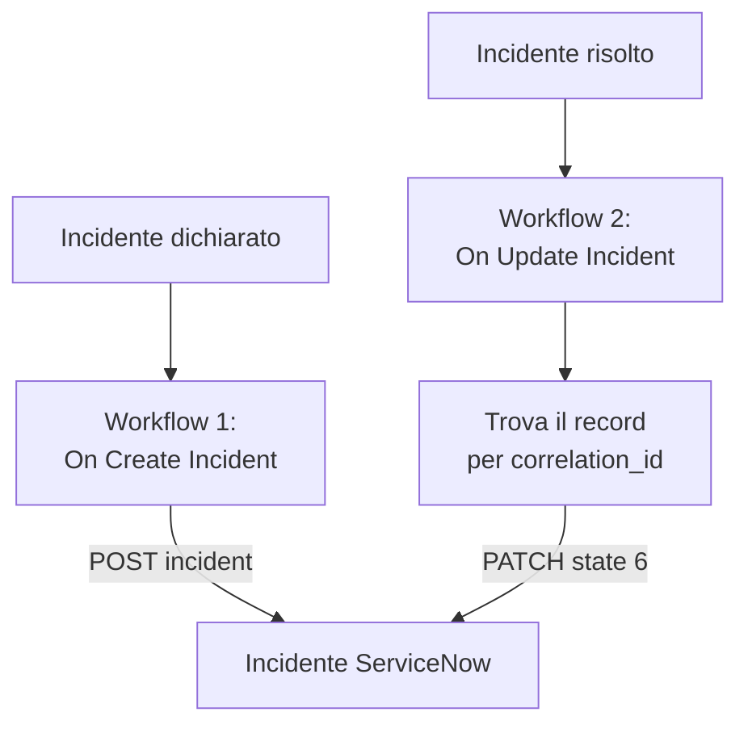

# ServiceNow

Apri un incidente [ServiceNow](https://www.servicenow.com) per ogni incidente di OneUptime e risolvilo quando l'incidente di OneUptime viene risolto, così il tuo service desk segue ciò che vede il tuo monitoraggio. Due workflow chiamano la [Table API](https://developer.servicenow.com/dev.do#!/reference/api/latest/rest/c_TableAPI) di ServiceNow.

:::cards
- [Salvare le credenziali](#salvare-le-credenziali): Tieni la password di ServiceNow fuori dai tuoi workflow.
- [Aprire incidenti ServiceNow](#aprire-un-incidente-servicenow-per-ogni-incidente): Un workflow, due blocchi.
- [Risolverli](#risolvere-lincidente-servicenow): Trovare il record, poi chiuderlo.
- [Risoluzione dei problemi](#risoluzione-dei-problemi): Quando ServiceNow rifiuta una richiesta.
:::

## Come funziona



Il primo workflow scrive l'ID dell'incidente di OneUptime nel `correlation_id` del record. Il secondo trova il record tramite quell'ID, poi lo risolve.

## Prima di iniziare

- Un'istanza ServiceNow, come `https://your-instance.service-now.com`.
- Un utente ServiceNow per l'integrazione che possa creare e aggiornare record nella tabella `incident`, di solito con il ruolo `itil`. Il suo nome e la sua password firmano le richieste.
- In OneUptime, il permesso di creare workflow e variabili globali. Su OneUptime Cloud, i workflow richiedono il piano **Growth** o superiore.

## Salvare le credenziali

La Table API accetta l'autenticazione Basic: il nome e la password dell'utente, codificati insieme.

:::steps
1. Codificali una volta, su macOS o Linux:

   ```bash
   printf '%s' 'integration.user:password' | base64 | tr -d '\n'
   ```

   Usa `printf`, non `echo`: `echo` aggiunge un a capo, che viene codificato con il resto e rende le credenziali non valide.

2. In OneUptime, vai su **Flussi di lavoro → Variabili globali** e fai clic su **Crea: Flusso di lavoro Variabile**. Chiamala `SERVICENOW_AUTH` e fai clic su **Avanti**.
3. Incolla il valore codificato in **Contenuto**, attiva **Segreto** e fai clic su **Crea: Flusso di lavoro Variabile**.
:::

## Aprire un incidente ServiceNow per ogni incidente

:::steps
### Creare il workflow

Vai su **Flussi di lavoro**, fai clic su **Crea flusso di lavoro**, poi su **Parti da zero**. Chiamalo `Incidents to ServiceNow` e fai clic su **Crea flusso di lavoro**.

### Aggiungere il trigger

Fai clic sul blocco tratteggiato **Scegli cosa avvia questo flusso di lavoro** e scegli **On Create Incident**. Fai clic sul trigger: i suoi **Fields to pass on** iniziano con **Titolo**, quindi fai clic su **Aggiungi campo** e scegli **Descrizione**.

### Creare il record

Fai clic su **Aggiungi componente**, aggiungi un blocco **API Post (JSON)** e collegagli il punto **Success** del trigger. Imposta il suo **URL** su `https://your-instance.service-now.com/api/now/table/incident`. In **Altri campi**, imposta i suoi **Request Headers** su:

```json
{
  "Authorization": "Basic {{global.variables.SERVICENOW_AUTH}}",
  "Accept": "application/json"
}
```

E il suo **Request Body** su:

```json
{
  "short_description": "OneUptime: {{local.components.incident-on-create-1.returnValues.model.title}}",
  "description": "{{local.components.incident-on-create-1.returnValues.model.description}}",
  "urgency": "1",
  "impact": "1",
  "correlation_id": "oneuptime-{{local.components.incident-on-create-1.returnValues.model._id}}"
}
```

### Provarlo, poi attivarlo

Fai clic su **Esegui flusso di lavoro**, scegli un incidente di prova sotto **Incidente** ed eseguilo. Il passaggio **API Post (JSON)** mostra una risposta `201` con il nuovo record, il suo `sys_id` e il suo `number`, come `INC0012345`. Poi attiva **Abilitato** in cima al **Costruttore**.
:::

`urgency` e `impact` accettano `1` per alto, `2` per medio e `3` per basso, e ServiceNow ricava la priorità dai due. Qualsiasi altra colonna della tabella `incident` può andare nel corpo, con il suo nome di colonna.

## Risolvere l'incidente ServiceNow

Un workflow ha un solo trigger, quindi per risolvere serve un secondo workflow, avviato quando cambia lo stato di un incidente.

:::steps
### Aggiungere il trigger On Update Incident

Crea un workflow chiamato `Resolve ServiceNow incidents` e scegli **On Update Incident** come trigger. In **Fields to watch**, fai clic su **Aggiungi campo** e scegli **Current Incident State**, così viene eseguito solo quando cambia lo stato. In **Fields to pass on**, chiedi se il nuovo stato è uno stato risolto: fai clic su **Aggiungi campo**, apri **Current Incident State** e scegli **Is Resolved State**. Oppure fai clic su **Modifica come JSON** e sostituisci il JSON con:

```json
{ "_id": true, "currentIncidentState": { "isResolvedState": true } }
```

### Controllare che l'incidente sia risolto

Aggiungi un blocco **If / Else** dopo il trigger. Imposta **Value to check** su `{{local.components.incident-on-update-1.returnValues.model.currentIncidentState.isResolvedState}}` e **Comparison** su **is true**.

### Trovare il record

Aggiungi un blocco **API Get (JSON)** dopo il lato **Yes**, con gli stessi **Request Headers** e questo **URL**:

```text
https://your-instance.service-now.com/api/now/table/incident?sysparm_query=correlation_id=oneuptime-{{local.components.incident-on-update-1.returnValues.model._id}}&sysparm_fields=sys_id&sysparm_limit=1
```

### Risolvere il record

Aggiungi un blocco **API Patch (JSON)** dopo il **Success** del blocco di ricerca, con gli stessi **Request Headers** e questo **URL**:

```text
https://your-instance.service-now.com/api/now/table/incident/{{local.components.api-get-1.returnValues.response-body.result[0].sys_id}}
```

Imposta il suo **Request Body** su:

```json
{
  "state": "6",
  "close_code": "Solution provided",
  "close_notes": "Resolved in OneUptime"
}
```

### Attivarlo

Attiva **Abilitato**, poi risolvi un incidente di prova in OneUptime. Il suo incidente ServiceNow passa a Resolved.
:::

`state` `6` è Resolved negli stati di incidente predefiniti di ServiceNow. `close_code` deve essere uno dei codici di risoluzione della tua istanza. Molte istanze non risolvono un incidente senza codice di risoluzione e note, quindi invia entrambi.

## Risoluzione dei problemi

:::details ServiceNow risponde 401
Le credenziali sono sbagliate. Codifica di nuovo `username:password` con `printf`, non `echo`, e sostituisci il contenuto di `SERVICENOW_AUTH`.
:::

:::details ServiceNow risponde 403
L'utente non può scrivere nella tabella `incident`. Dagli il ruolo `itil`, o un ruolo con gli stessi diritti, e verifica che nessuna regola di controllo degli accessi gli blocchi la Table API.
:::

:::details ServiceNow risponde 400, o la risoluzione non cambia nulla
Un nome di colonna o un valore non si adatta alla tua istanza: un elenco `state` personalizzato, o un `close_code` che la tua istanza non ha. Confronta con la tabella `incident` in **System Definition → Tables** in ServiceNow, e con il modulo del record stesso.
:::

:::details La risoluzione risponde 404
Il passaggio di ricerca non ha trovato alcun record, quindi l'URL ha mantenuto il riferimento così com'è scritto. Verifica che il primo workflow abbia scritto `correlation_id`, e che entrambi i workflow lo costruiscano allo stesso modo: `oneuptime-` seguito dall'`_id` dell'incidente.
:::

## Prossimi passi

:::cards
- [Jira](/docs/integrations/jira): Un'integrazione bidirezionale, tenuta allineata da modelli pronti all'uso.
- [Componenti del workflow](/docs/workflows/components#api): Ogni impostazione dei blocchi API.
- [Esecuzioni del workflow](/docs/workflows/runs-and-logs): Leggi cosa ha inviato e ricevuto ogni richiesta.
- [Panoramica delle integrazioni](/docs/integrations/index): Gli schemi dietro ogni integrazione.
:::
