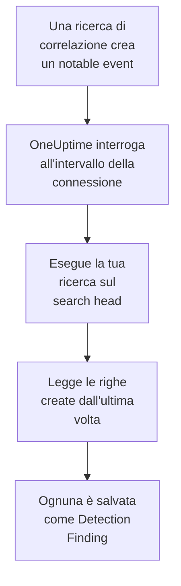

# Splunk Enterprise Security

Importa i notable event che creano le ricerche di correlazione di [Splunk Enterprise Security](https://www.splunk.com/en_us/products/enterprise-security.html) negli eventi di sicurezza di OneUptime. Lì li cerchi accanto a log, trace e metriche, li correli con ogni altra fonte e chiami la reperibilità per quelli che contano. OneUptime li legge eseguendo una ricerca sul tuo search head, come un utente Splunk che crei tu, e non modifica nulla in Splunk. Poiché è solo una ricerca, importa qualsiasi indice o l'output di qualsiasi ricerca salvata, non solo i notable event.

:::cards
- [Configurare la connessione](#configurare-la-connessione): Un token, un ruolo e il modulo della connessione.
- [Cosa viene importato](#cosa-viene-importato): Come ogni riga della ricerca diventa un evento di sicurezza.
- [Come funziona il polling](#come-funziona-il-polling): La finestra che legge ogni interrogazione, e cosa le fa un search head molto attivo.
- [Risoluzione dei problemi](#risoluzione-dei-problemi): Cosa significa ogni errore e cosa cambiare.
:::

## Come funziona



Ogni minuto, OneUptime interroga ogni connessione abilitata il cui intervallo di polling è trascorso. Un'interrogazione esegue la tua ricerca tramite l'API REST del search head, sulle righe create dall'ultima interrogazione, e salva ogni riga come un evento [OCSF](https://schema.ocsf.io/) Detection Finding (classe `2004`). Regole di rilevamento, monitor e dashboard lo trattano poi come un evento di sicurezza di qualsiasi altra fonte.

## Prima di iniziare

- In OneUptime, il ruolo Project Owner, Project Admin o Security Admin. I ruoli Security Member e Security Viewer vedono le connessioni e la cronologia delle loro esecuzioni, ma non possono modificarle.
- Un search head con Splunk Enterprise 9.0.1 o successivo, o Splunk Cloud Platform. OneUptime parla con la sua API REST sulla porta di gestione, di solito `8089`. Splunk Web, sulla porta `8000`, non serve l'API REST.
- Un utente Splunk per OneUptime, il cui ruolo abbia la capability `search` e possa leggere l'indice che legge la ricerca: `notable` per i notable event. I ruoli `ess_analyst` e `ess_user` di Enterprise Security concedono entrambe le cose. La connessione legge soltanto, quindi il ruolo non ha bisogno d'altro.
- Un search head che OneUptime possa raggiungere in HTTPS. OneUptime Cloud si collega da internet, quindi il search head ha bisogno di un indirizzo pubblico: gli indirizzi privati vengono rifiutati. Un OneUptime self-hosted si collega dai suoi container dell'app e dei worker, e può raggiungere un search head nella tua rete privata, a meno che `DATA_SOURCE_BLOCK_PRIVATE_ADDRESSES` non sia `true`.

## Configurare la connessione

La connessione si autentica con un token di autenticazione di Splunk, oppure con un nome utente e una password.

:::steps
### Creare un token di autenticazione

1. In Splunk Web, apri **Settings → Tokens**. Se Splunk dice che l'autenticazione con token è disattivata, seleziona prima **Enable Token Authentication**.
2. Seleziona **New Token**. In **User**, inserisci l'utente Splunk creato per OneUptime, e in **Audience**, indica a cosa serve il token, per esempio `OneUptime security events`.
3. Scegli una **Expiration**, o nessuna. Un token che scade ferma la connessione finché non lo sostituisci.
4. Seleziona **Create** e copia il token. Splunk lo mostra una sola volta.

Per autenticarti invece con una password, salta questo passo e tieni a portata di mano il nome e la password dell'utente.

### Aggiungere la connessione in OneUptime

Apri **Prodotti → Security Events → Connections** (`/dashboard/{projectId}/security-events/connections`), fai clic su **Aggiungi connessione**, scegli **Splunk Enterprise Security** e fai clic su **Avanti**. Compila le impostazioni della tabella qui sotto, fai clic su **Avanti** e incolla il token in **Authentication token**, oppure la password in **Password**.

### Provarla prima di salvare

Fai clic su **Test these settings** sotto **Testa prima di salvare**. Il test si autentica ed esegue la tua ricerca con i valori del modulo, senza salvare nulla, così una porta sbagliata o un ruolo mancante emerge prima che la connessione esista. Poi fai clic su **Avanti**, dai un **Nome** alla connessione e creala.
:::

| Impostazione | Cosa inserire |
| --- | --- |
| **Splunk management URL** | L'API REST del search head, per esempio `https://splunk.example.com:8089`. Deve usare `https`, senza query string. Un percorso viene mantenuto, per un reverse proxy che serve l'API sotto un percorso. |
| **Cerca** | La ricerca che sceglie cosa importare, `index=notable` finché non la cambi. Restringila, per esempio con `index=notable urgency IN (high, critical)`. OneUptime aggiunge da sé l'intervallo di tempo, quindi la ricerca non può impostare `earliest` né `latest`, né iniziare con una pipe. Un `search` iniziale viene tolto. |
| **Nome utente** | Il nome dell'utente Splunk, solo se si autentica con una password. |
| **Authentication token** | Il token del primo passo. Quando è salvato un token, viene usato quello, e non il nome utente né la password. |
| **Password** | La password dell'utente Splunk, solo quando non si usa nessun token. |

**Authentication token** e **Password** sono cifrati, mai restituiti dall'API e mai più mostrati. Sostituiscine uno con **Update credentials** sulla connessione. Per passare da un tipo di autenticazione all'altro, inserisci lì quello nuovo e attiva **Remove the stored Authentication token** o **Remove the stored Password**.

Il passaggio **Polling** ha anche una **Descrizione** facoltativa, il **Poll Interval (Minutes)**, un numero intero da `1` a `1440` che parte da `5`, e **Abilitato**, che parte attivo.

## Cosa viene importato

Ogni riga che la ricerca restituisce diventa un evento Detection Finding (classe OCSF `2004`), con il fornitore `Splunk` e il prodotto `Splunk Enterprise Security`. Per un notable event:

| Campo di Splunk | Colonna di OneUptime |
| --- | --- |
| `event_id`, altrimenti `_bkt` e `_cd`, altrimenti un hash della riga | UID dell'evento, che serve anche a scartare i duplicati |
| `_time`, quando la ricerca di correlazione ha creato il notable event | Ora dell'evento |
| `rule_name`, altrimenti `search_name`, altrimenti `source` | Nome della regola |
| `search_name`, altrimenti `source`, altrimenti `rule_name` | ID della regola |
| `rule_title`, altrimenti `rule_description`, altrimenti il nome della regola | Messaggio |
| `urgency`, altrimenti `severity` | Gravità |
| `status_label`, altrimenti `status_description`, altrimenti il nome dello stato di revisione contenuto in `status` | Stato |
| `annotations.mitre_attack`, e campi come `mitre_technique_id` e `mitre_tactic` | Tattiche e tecniche MITRE ATT&CK |
| `user` o `src_user`; `src`, `src_ip` o `src_host`; `process`, `process_name` o `parent_process` | Utente, IP, host e processo dell'attore |
| `process_name` o `process_exec`, `process_path` e `process`; `parent_process_name` o `parent_process_exec`, `parent_process_path` e `parent_process` | Nome, percorso e riga di comando del processo; nome, percorso e riga di comando del processo padre |
| `dest_user`; `dest`, `dest_ip` o `dest_host`; `dest_port` | Utente, IP, host e porta della destinazione |
| `file_path`, `url` o `risk_object` | Risorsa di destinazione |
| Ogni utente, host e IP, più `dvc`, `host`, `file_hash`, `file_name`, `url`, `domain`, `query` e `risk_object` | Osservabili |
| Ogni campo della riga, per esempio `security_domain`, `owner`, `orig_sid` e `_raw` | `attributes`, con il nome proprio del campo |

Una riga di un altro indice viene importata allo stesso modo. Le colonne che i suoi campi non riempiono restano vuote, e ogni campo resta consultabile in `attributes`.

## Come funziona il polling

Ogni interrogazione esegue una ricerca di export sulla sua finestra, dalla più vecchia:

```text
POST {Splunk management URL}/services/search/v2/jobs/export
    search=search index=notable | fields * | sort 0 _time | head 10001
    earliest_time={window start}
    latest_time={window end}
    output_mode=json
```

- **L'ora di creazione è il cursore.** La finestra riguarda `_time`, che per un notable event è quando la ricerca di correlazione l'ha creato, non quando è avvenuta l'attività che ha trovato. Una ricerca che gira ogni ora data i suoi notable event all'ora della sua esecuzione, quindi nessuno finisce dietro il cursore.
- **La prima interrogazione guarda indietro di 24 ore**, così una nuova connessione mostra subito i suoi notable event recenti.
- **Ogni interrogazione successiva parte 1 minuto prima del cursore salvato**, così una riga creata al confine tra due finestre non viene mai persa.
- **Un'interrogazione legge al massimo 24 ore oltre il cursore.** Una connessione il cui cursore è rimasto indietro recupera in una serie di finestre di 24 ore, e la sua **Health** indica **Catching up**.
- **I duplicati vengono scartati in base a `event_id`**, o ai `_bkt` e `_cd` propri di Splunk, all'interno del progetto, così la sovrapposizione, una finestra ripetuta e un'importazione non salvano mai una riga due volte.

Un search head precedente alla 9.0.1 risponde `404` alla richiesta a `search/v2/jobs/export`. OneUptime la invia allora a `search/jobs/export`, deprecato, e l'esecuzione lo segnala in un avviso. Aggiorna il search head: le versioni attuali disattivano quell'endpoint.

### Quando una finestra contiene più di quanto un'interrogazione possa leggere

Un'interrogazione legge al massimo 10.000 righe. Quando una finestra ne contiene di più, l'esecuzione è **Partial**, con un avviso come questo:

```text
Stopped after collecting 10000 records; the window holds more. Records are read oldest first, and the last one read was created at 2026-09-14T08:12:44.000Z, where the next poll can resume.
```

La ricerca ordina la finestra per `_time`, dalla più vecchia, quindi OneUptime sposta il cursore all'ora di creazione dell'ultima riga letta, e l'interrogazione successiva parte da lì con la stessa lunghezza di finestra. Un search head molto attivo recupera 10.000 righe per interrogazione, invece di rileggere le stesse. Le righe create nello stesso istante vengono lette due volte, e il controllo dei duplicati scarta la seconda copia. Splunk ordina l'intera finestra prima di restituire una riga, quindi una ricerca in **Cerca** che trova molto più del necessario rallenta ogni interrogazione. Tienila mirata.

Quando un'esecuzione non riesce affatto a superare il cursore salvato, OneUptime accorcia invece la finestra:

1. **Restringere.** L'interrogazione successiva legge una finestra lunga la metà, dallo stesso punto di partenza, e continua a dimezzarla finché una finestra non viene letta per intero, fino a un minuto. L'avviso dell'esecuzione lo dice: `This window holds more records than one poll can read; the next poll reads a {n} minute window from the same starting point.`
2. **Tornare a crescere.** Dopo che una finestra è stata letta per intero, la successiva è di nuovo lunga il doppio, fino a 24 ore.
3. **Superare un singolo minuto.** Se anche un solo minuto contiene più di quanto un'interrogazione possa leggere, il polling lo supera, così i notable event più recenti continuano ad arrivare. L'esecuzione resta **Partial**, e **Ultimo errore** riporta `More records were created in the one minute from {cursor} to {end} than one poll can read. Polling moved past this minute so newer records keep arriving; use Import this time range in Diagnostics on this minute to recover what one run can read.` Importa quel minuto con **Import this time range** per recuperare ciò che un'esecuzione può leggere.

Un'esecuzione che fallisce del tutto, con un errore di Splunk, mantiene il cursore e la lunghezza della finestra, e l'interrogazione successiva rilegge la stessa finestra. L'unica eccezione è una richiesta scaduta: il cursore resta, ma la finestra successiva è lunga la metà, perché una finestra troppo pesante per ricevere risposta in tempo scadrebbe a ogni tentativo. Cambiare il **Poll Interval (Minutes)** non cambia nulla di tutto questo: decide quanto spesso parte un'interrogazione, non dove inizia la sua finestra.

### Eseguire, visualizzare in anteprima e importare su richiesta

Fai clic su **Diagnostics** su una connessione per vederne le esecuzioni recenti e lavorarci a mano. Chi può modificare la connessione può avviare queste azioni; chi può vederla può leggerne la cronologia.

- **Run now** avvia subito un'interrogazione, con il cursore abituale, anche quando la connessione non è **Abilitato**.
- **Preview notable events** legge un intervallo di tempo fino a 7 giorni e non importa nulla.
- **Import this time range** importa un intervallo fino a 7 giorni, dopo la tua conferma, senza spostare il cursore. Le righe già importate vengono saltate.
- **Copy diagnostics** su un'esecuzione copia il suo rapporto per il supporto. Non contiene mai credenziali.

## Testare la connessione

**Testa la connessione** sulla riga di una connessione, e **Test these settings** nel modulo, vengono eseguiti nel processo dell'API, non in un worker in background, così un test risponde anche quando il problema sono i worker. Esegue questi controlli, in ordine:

| Controllo | Cosa verifica |
| --- | --- |
| **Configurazione** | Ogni impostazione è presente e ben formata. Non viene contattato nulla quando questo fallisce. |
| **Authenticate with Splunk** | Splunk accetta il token, oppure il nome utente e la password, e indica l'utente e i suoi ruoli, così puoi confrontarli con il ruolo che volevi concedere. |
| **Run the search on Splunk** | La ricerca di **Cerca** viene eseguita sulle ultime 24 ore, per una riga, e indica quale endpoint di export ha risposto. |
| **Notable events available to import** | Quante righe trova la ricerca di **Cerca** nelle ultime 24 ore e negli ultimi 7 giorni. Nessuna in 7 giorni è un avviso, non un errore. |
| **Background workers**, **Poll scheduler**, **Security event storage** | Il lato di OneUptime stesso: un processo prende i job della coda Worker, il job di polling gira ogni minuto e l'archivio degli eventi di sicurezza risponde. |
| **Scheduled polling** | Per una connessione salvata: il polling è attivo, nessuna esecuzione è bloccata in attesa di un worker e le interrogazioni girano in orario. |

Ogni richiesta di un test ha una scadenza di 20 secondi. Un test non importa mai nulla e non sposta mai il cursore, e ogni controllo fallito dice cosa cambiare.

## Inviare eventi di sicurezza a Splunk

OneUptime può anche inviare ciò che trova a Splunk, tramite il suo HTTP Event Collector (HEC), così le tue ricerche e le tue dashboard vedono i rilevamenti di OneUptime accanto ai tuoi. Ogni evento di sicurezza è un evento HEC con il sourcetype `oneuptime:security`, con i campi chiamati come li chiama il Common Information Model di Splunk: `src`, `src_ip`, `src_user`, `dest`, `dest_ip`, `dest_port`, `user`, `signature` e `severity`.

:::steps
### Creare un token HEC

In Splunk Web, apri **Settings → Data inputs → HTTP Event Collector** e fai clic su **New Token**. Dagli un nome, scegli gli indici in cui può scrivere e il suo indice predefinito, e copia il valore del token. Su Splunk Cloud, HEC è in ascolto su `https://http-inputs-<stack>.splunkcloud.com`; su Splunk Enterprise, sulla porta `8088` quando **Global Settings** attiva i token.

### Aggiungere la destinazione

Apri **Prodotti → Security Events → Connections**. In **Invia al tuo SIEM**, fai clic su **Aggiungi destinazione**, scegli Splunk in **SIEM** e fai clic su **Avanti**. Inserisci l'**URL HEC** e incolla il token in **Token HEC**. **Index** e **Tipo di origine** sono facoltativi: se restano vuoti, gli eventi vanno nell'indice predefinito del token con il sourcetype `oneuptime:security`.

### Inviare un evento di prova e iniziare a inviare

Fai clic su **Invia un evento di prova**: un evento informativo arriva a Splunk con le impostazioni del modulo, e non viene salvato nulla. Cercalo con `sourcetype="oneuptime:security"`. Poi, in **Cosa inviare**, lascia **Solo rilevamenti** o scegli **Tutti gli eventi di sicurezza**, e fai clic su **Inizia a inviare**.
:::

- L'**URL HEC** deve usare `https`, con un certificato di cui OneUptime si fida: i controlli del certificato non vengono mai saltati.
- Gli eventi partono in lotti di massimo 500. Un evento che Splunk rifiuta viene escluso e indicato in **Visualizza errore**, un collector occupato (`503`) viene riprovato, e un token o un indice rifiutato ferma l'invio finché non lo correggi.
- I notable event che OneUptime ha importato da Splunk non gli vengono mai rimandati.

## Risoluzione dei problemi

Il **Ultimo errore** della connessione conserva il messaggio di errore completo, con le credenziali oscurate, dietro un prefisso che nomina il passaggio fallito. Quando una connessione ha un errore, seleziona **Visualizza errore** nella sua colonna **Azioni** per leggerlo, e **Copia errore** nella finestra di dialogo per copiarlo. Leggi prima il prefisso.

:::details Last Error inizia con `Splunk Enterprise Security authentication request`
- `Splunk Enterprise Security authentication request failed (HTTP ...)`: Splunk si è rifiutato di dire chi è il chiamante.
  - `HTTP 401`: Splunk non ha accettato le credenziali. Il token è sbagliato, scaduto o eliminato, l'autenticazione con token è disattivata sul search head, oppure il nome utente o la password sono sbagliati. Crea un nuovo token e salvalo con **Update credentials**.
  - `HTTP 404`: la **Splunk management URL** non è l'API REST. Punta a Splunk Web sulla porta `8000`, oppure ha un percorso che il search head non serve.
- `Splunk Enterprise Security authentication request returned ...`: ha risposto qualcosa di diverso dall'API REST del search head, per esempio l'HTML di Splunk Web sulla porta `8000` o la pagina di un proxy. Fai puntare l'URL alla porta di gestione.
:::

:::details Last Error inizia con `Splunk Enterprise Security search export` o `Splunk Enterprise Security count search`
- `Splunk Enterprise Security search export failed (HTTP ...)`: Splunk si è rifiutato di eseguire la ricerca.
  - `HTTP 400`: Splunk non riesce ad analizzare la ricerca. Esegui la ricerca di **Cerca** in Splunk Web per leggerne l'errore.
  - `HTTP 403`: al ruolo dell'utente manca la capability `search`, oppure non può leggere l'indice. Aggiungi `notable`, o il tuo indice, agli indici in cui il ruolo può cercare.
  - `HTTP 404`: nessuno dei due endpoint di export esiste a quell'URL, quindi non è la porta di gestione di un search head.
  - `HTTP 429` o `HTTP 5xx`: Splunk sta limitando l'utente, è sovraccarico, oppure la ricerca ha raggiunto uno dei suoi limiti. L'interrogazione successiva riprova.
- `Splunk Enterprise Security search export was rejected by Splunk on an HTTP 200`: Splunk ha risposto, ma ha fermato la ricerca con un errore. Il messaggio lo cita.
- `Splunk Enterprise Security search export returned a body that is not newline-delimited JSON.`: ha risposto qualcosa di diverso dall'API REST, per esempio Splunk Web o la pagina di accesso di un proxy. Viene segnalato invece di essere preso per una finestra vuota, così il cursore non supera mai righe che nessuno ha letto.
- `Splunk Enterprise Security count search ...`: gli stessi errori, dal conteggio di **Notable events available to import**, che esegue solo un test.
:::

:::details Last Error termina con `did not complete`
`Splunk Enterprise Security search export did not complete`, e lo stesso per gli altri passi, significa che la richiesta non ha ricevuto risposta: un timeout, un nome che non si risolve, un certificato di cui OneUptime non si fida, o un indirizzo privato rifiutato. Verifica che l'app OneUptime e i worker possano aprire una connessione HTTPS verso la porta di gestione. Un search head che risponde alle altre richieste ma va in timeout sulla ricerca sta ordinando troppo: l'interrogazione successiva legge una finestra lunga la metà, e una ricerca più mirata in **Cerca** risolve il problema per sempre.
:::

:::details Last Polled è Never e Last Error è vuoto
Nessuna interrogazione è terminata per questa connessione. Esegui **Testa la connessione**: i suoi controlli **Background workers** e **Poll scheduler** nominano la causa. Su un'installazione self-hosted, la causa abituale è `DISABLE_QUEUE_WORKERS=true` sull'app, senza un deployment separato dei worker che prenda i job: impostalo su `false`, oppure esegui il deployment dei worker (Helm: `worker.enabled: true`).
:::

:::details Un'esecuzione è Partial
- `Stopped after collecting 10000 records; the window holds more`: la finestra conteneva più delle 10.000 righe che legge un'esecuzione. Non si perde nulla: l'interrogazione successiva parte dopo l'ultima riga letta. Una connessione che resta **Partial** un'interrogazione dopo l'altra sta recuperando un arretrato, e i suoi **Last Polled** e **Last Event Imported** continuano ad avanzare. Se non recupera mai, la ricerca di **Cerca** trova più di 10.000 righe per intervallo di polling: restringila, oppure accorcia il **Poll Interval (Minutes)**.
- `More records were created in the one minute from ... than one poll can read`: il polling ha superato quel minuto. Importalo con **Import this time range** in **Diagnostics**. Un'importazione legge quanto un'interrogazione.
:::

:::details Il test riesce, ma non viene importato nulla
Leggi **Notable events available to import** nel rapporto del test. `0` negli ultimi 7 giorni significa che la ricerca di **Cerca** non ha trovato nulla in Splunk: verifica in Incident Review che le ricerche di correlazione siano abilitate e creino notable event, e che la ricerca di **Cerca** non sia più stretta di quanto volevi.
:::

## Cosa ottieni

- **Ricerca.** Filtra i notable event per urgenza, stato, regola, utente, host o qualsiasi osservabile nell'esploratore degli eventi di sicurezza, accanto a ogni altra fonte.
- **Correlazione.** Gli utenti, gli host, gli IP e i domini di ogni riga vengono indicizzati come osservabili, quindi una ricerca trova tutto ciò che li menziona.
- **Regole di rilevamento.** Regole Sigma che girano secondo una pianificazione sui tuoi eventi di sicurezza, e aprono avvisi che chiamano la reperibilità.
- **Monitor.** I monitor degli eventi di sicurezza contano gli eventi corrispondenti, per esempio i nuovi notable event critici, e aprono incidenti o avvisi oltre una soglia.

Gli eventi di sicurezza sono fatturati come il resto della tua telemetria, per GB acquisito. Vedi i [prezzi](https://oneuptime.com/pricing).

## Prossimi passi

:::cards
- [Eventi di sicurezza](/docs/telemetry/security-events): Cerca, correla e genera avvisi su ciò che importi.
- [Elastic Security](/docs/integrations/elastic-security): Importa anche gli alert di rilevamento di uno stack Elastic.
- [Ruoli](/docs/permissions/reference#ruoli): Cosa possono vedere e modificare i ruoli Security.
- [Panoramica delle integrazioni](/docs/integrations/index): Gli altri strumenti che puoi collegare.
:::
