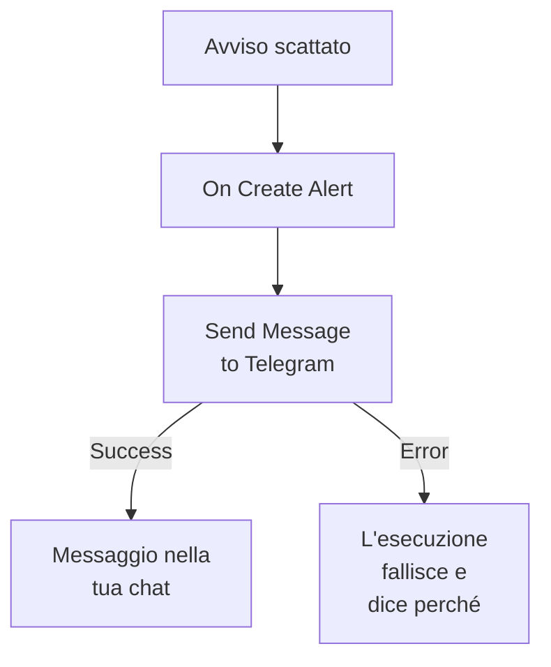

# Telegram

Invia un messaggio a una chat, un gruppo o un canale [Telegram](https://telegram.org) quando scatta un avviso o si apre un incidente. Il passo di workflow **Send Message to Telegram** di OneUptime lo invia come un bot che crei tu, e un modello pronto costruisce il workflow per gli avvisi. Questa integrazione è **in uscita**: il bot invia messaggi e non legge quello che si dice nella chat.

:::cards
- [Come funziona](#come-funziona): Cosa fa il workflow quando scatta un avviso.
- [Configurazione](#configurare-lintegrazione): Un bot, la sua chat, poi il workflow: dal modello o da zero.
- [Suggerimenti](#suggerimenti): Testo semplice, messaggi lunghi e incidenti.
- [Risoluzione dei problemi](#risoluzione-dei-problemi): Cosa significano gli errori di Telegram e cosa cambiare.
:::

## Come funziona



Il passo invia il **Message Text** alla chat, come il tuo bot, tramite la Bot API di Telegram. Prende la sua uscita **Success** quando Telegram accetta il messaggio, e la sua uscita **Error**, con il motivo di Telegram, quando Telegram lo rifiuta. Senza nulla collegato a **Error**, come nel modello, un'esecuzione che non è riuscita a inviare fallisce, e i suoi **Passaggi** dicono perché.

## Prima di iniziare

- Un account Telegram, per creare il bot e aggiungerlo alla chat.
- In OneUptime, il diritto di creare workflow e variabili. Su OneUptime Cloud, i workflow richiedono il piano **Growth** o superiore.

## Configurare l'integrazione

:::steps
### Creare un bot

In Telegram, invia `/newbot` a [@BotFather](https://t.me/BotFather) e rispondi alle sue domande. Ti dà il token del bot, per esempio `123456789:ABCdefGhIJKlmnoPQRstuVWxyz`. Chiunque abbia il token può inviare messaggi come il tuo bot, quindi custodiscilo come una password.

### Trovare l'ID della chat

1. Aggiungi il bot al gruppo, oppure rendilo amministratore del canale. Per scrivere a una persona, questa avvia prima una chat con il bot.
2. Invia nel gruppo un messaggio che menziona il bot, per esempio `/start@your_bot`, così il bot lo vede.
3. Apri `https://api.telegram.org/bot<token>/getUpdates` in un browser, con il token del bot al posto di `<token>`.
4. Cerca `"chat":{"id":` nella risposta. Il numero che segue è l'ID della chat. L'ID di un gruppo inizia con `-`, e quello di un gruppo grande con `-100`.

Un canale pubblico si può indicare con il suo `@username` invece di un ID.

### Costruire il workflow

Parti dal modello, che costruisce l'intero workflow per gli avvisi, oppure da zero.

:::tabs
@tab Dal modello
1. Apri **Flussi di lavoro** e fai clic su **Crea flusso di lavoro**.
2. Digita `Telegram` in **Cerca modelli…**, fai clic su **Tell Telegram when an alert fires**, poi su **Usa questo modello**.
3. Mantieni il nome **Notify Telegram on new alert** o cambialo, e fai clic su **Avanti**.
4. Incolla il token in **Telegram Bot Token** e l'ID in **Telegram Chat ID**, e fai clic su **Crea flusso di lavoro**.

Il workflow si apre nel **Costruttore** con due passi: **On Create Alert** e **Send Message to Telegram**, che invia il numero, il titolo, la gravità e lo stato dell'avviso. Il token viene salvato come variabile segreta `telegramBotToken` del workflow, e l'ID come `telegramChatId`.
@tab Da zero
1. Salva il token come variabile globale segreta: vai su **Flussi di lavoro → Variabili globali**, fai clic su **Crea: Flusso di lavoro Variabile**, chiamala `TELEGRAM_BOT_TOKEN` e fai clic su **Avanti**. Incolla il token in **Contenuto**, attiva **Segreto** e fai clic su **Crea: Flusso di lavoro Variabile**.
2. Vai su **Flussi di lavoro**, fai clic su **Crea flusso di lavoro**, scegli **Parti da zero**, dai un nome al workflow e fai clic su **Crea flusso di lavoro**.
3. Nel **Costruttore**, fai clic su **Scegli cosa avvia questo flusso di lavoro** e scegli **On Create Alert** sotto **Popolari**. Fai clic sul trigger: i suoi **Fields to pass on** iniziano con **Titolo**, quindi fai clic su **Aggiungi campo** e scegli gli altri campi che mostra il tuo messaggio, per esempio **Alert Number With Prefix**.
4. Fai clic su **Aggiungi componente**, cerca `telegram` e fai clic su **Send Message to Telegram**. Collega l'uscita **Success** del trigger a questo passo.
5. Fai clic sul nuovo passo. In **Telegram Bot Token**, fai clic su **{ }** e scegli `TELEGRAM_BOT_TOKEN` sotto **Global variables**. Inserisci l'ID della chat in **Chat ID**, scrivi il messaggio in **Message Text** e inserisci i campi dell'avviso con **{ }**.
:::

Un messaggio costruito da zero legge i campi dell'avviso con riferimenti come questi:

```text
🚨 Alert {{local.components.alert-on-create-1.returnValues.model.alertNumberWithPrefix}} fired
Title: {{local.components.alert-on-create-1.returnValues.model.title}}
```

### Attivarlo e provarlo

Attiva l'interruttore **Abilitato** in cima al **Costruttore**. Da quel momento, ogni nuovo avviso viene inviato alla chat.

Per provarlo senza far scattare un avviso, fai clic su **Esegui flusso di lavoro** e scegli un avviso che hai già sotto **Avviso**: sono elencati i più recenti, e digitando il suo numero o parte del suo titolo ne trovi un altro. Fai clic su **Esegui manualmente il flusso di lavoro** e conferma con **Esegui**. Il pannello **Esecuzione del flusso di lavoro** segue l'esecuzione, e il messaggio compare nella chat. Se invece il passo prende **Error**, l'esecuzione fallisce, e la voce del passo in **Passaggi** dice perché: vedi [Risoluzione dei problemi](#risoluzione-dei-problemi).
:::

## Suggerimenti

- **Testo semplice.** Il passo invia il testo così come è scritto, senza la formattazione di Telegram, quindi `*` e `_` appaiono così come sono.
- **Tenere conto del limite di 4.096 caratteri.** Telegram accetta messaggi fino a 4.096 caratteri. Uno più lungo viene tagliato, e termina con "… (truncated — see OneUptime for the full text)", invece di essere rifiutato.
- **Anche gli incidenti.** Costruisci lo stesso workflow su **On Create Incident**, o su **On Update Incident** per i cambi di stato. Per inviare solo alcuni avvisi, metti un blocco **If / Else** prima del passo.
- **La forma del token viene verificata.** Un token che non ha la forma `123456789:ABCdef…` ferma l'esecuzione prima che venga inviato qualcosa, e il token non viene mai scritto nel log.

## Risoluzione dei problemi

Quando il passo prende **Error**, l'esecuzione fallisce, e la voce del passo nei **Passaggi** dell'esecuzione riporta il motivo di Telegram. Il bot deve essere nella chat, quindi controlla prima questo.

:::details Telegram risponde "Bad Request: chat not found"
La **Chat ID** è sbagliata, oppure il bot non vede la chat: aggiungi il bot al gruppo, rendilo amministratore del canale, oppure chiedi alla persona di avviare una chat con il bot. L'ID di un gruppo inizia con `-`.
:::

:::details Telegram risponde "Forbidden: bot was blocked by the user" o "bot is not a member"
La persona ha bloccato il bot, oppure il bot è stato rimosso dal gruppo o dal canale. Aggiungilo di nuovo, oppure invia a un'altra chat.
:::

:::details Telegram risponde "Unauthorized"
Telegram non ha accettato il token: è stato revocato in @BotFather, oppure copiato male. Copia il token attuale del bot da @BotFather e sostituisci il valore della variabile.
:::

:::details Telegram risponde "Too Many Requests: retry after"
Telegram limita la velocità con cui un bot invia, soprattutto verso un gruppo. Una raffica di avvisi può raggiungere il limite: invia meno messaggi, per esempio solo per alcune gravità.
:::

## Prossimi passi

:::cards
- [Componenti del workflow](/docs/workflows/components#telegram): Ogni impostazione del passo e cosa significano le sue uscite.
- [Discord](/docs/integrations/discord): La stessa idea, in un canale Discord.
- [Esecuzioni del workflow](/docs/workflows/runs-and-logs): Leggi cosa ha fatto ogni esecuzione del workflow.
- [Panoramica delle integrazioni](/docs/integrations/index): Il modello in uscita e gli altri strumenti che puoi collegare.
:::
