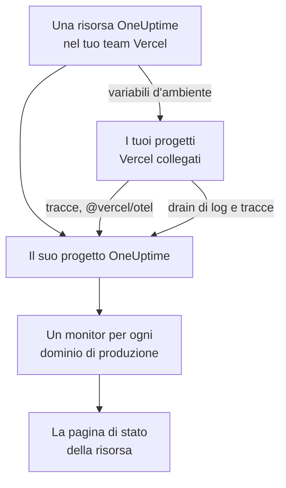

# Vercel

Aggiungi OneUptime al tuo team Vercel dal [Vercel Marketplace](https://vercel.com/marketplace). Accedi con il tuo account Vercel e paghi sulla tua fattura Vercel, e i tuoi progetti Vercel ottengono in OneUptime tracce, log, monitoraggio della disponibilità e una pagina di stato, senza nulla da configurare a mano.

:::cards
- [Aggiungere OneUptime al tuo team Vercel](#aggiungere-oneuptime-al-tuo-team-vercel): Una risorsa, un piano e i tuoi progetti, nella dashboard di Vercel.
- [Inviare tracce con @vercel/otel](#inviare-tracce-con-vercelotel): Le variabili d'ambiente ci sono già.
- [Inviare log e tracce con i drain](#inviare-log-e-tracce-con-i-drain): I log e gli span di Vercel stesso, su Pro ed Enterprise.
- [Piani e fatturazione](#piani-e-fatturazione): I piani di OneUptime, sulla tua fattura Vercel.
:::

## Come funziona

Ogni risorsa OneUptime che aggiungi in Vercel è un progetto OneUptime a sé. Vercel dà a ogni progetto Vercel che colleghi alla risorsa le variabili d'ambiente di quest'ultima, che inviano le tracce del progetto a OneUptime. I drain inviano i log e gli span di Vercel, e il dominio di produzione di ogni progetto collegato riceve un monitor di disponibilità sulla pagina di stato della risorsa.



L'integrazione è pensata per OneUptime Cloud (`oneuptime.com`). Un OneUptime self-hosted non si può aggiungere dal Vercel Marketplace: vedi [OneUptime self-hosted](#oneuptime-self-hosted).

## Prima di iniziare

- **Un team Vercel**, con qualsiasi piano. I drain di log e di tracce richiedono il piano Pro o Enterprise di Vercel; le tracce da `@vercel/otel` funzionano con ogni piano.
- **Un indirizzo email verificato** sul tuo account Vercel. OneUptime ti fa accedere con questo indirizzo, e lo usa per creare il tuo account OneUptime se non ne hai uno.
- **Un metodo di pagamento in Vercel**, per ogni piano: monitor e telemetria si pagano a consumo, piano Free compreso. Vedi [Piani e fatturazione](#piani-e-fatturazione).

## Aggiungere OneUptime al tuo team Vercel

:::steps
### Aprire OneUptime sul Vercel Marketplace

Nella dashboard di Vercel, apri **Integrations**, poi **Browse Marketplace**, e trova OneUptime in **Observability**. Fai clic su **Installazione** e accetta i termini di OneUptime.

### Scegliere un piano

Scegli **Gratis**, **Growth** o **Scale**. Sono i piani di OneUptime stesso, ai prezzi indicati su [oneuptime.com/pricing](https://oneuptime.com/pricing).

### Dare un nome alla risorsa e sceglierne le impostazioni

Dai alla risorsa il nome di ciò che monitora, ad esempio `storefront`: il suo progetto OneUptime e la sua pagina di stato prendono il suo nome. Due impostazioni partono attive:

- **Monitor production domains**: un monitor di sito web per il dominio di produzione di ogni progetto Vercel che colleghi.
- **Create a status page**: una pagina di stato pubblica per la risorsa, che mostra quei monitor.

### Collegare i tuoi progetti

Scegli i progetti Vercel che inviano a questa risorsa, e gli ambienti che ricevono le sue variabili d'ambiente. Non dare alla connessione un prefisso personalizzato: `@vercel/otel` legge le variabili con i loro nomi originali.
:::

La risorsa è pronta in pochi secondi. Fai clic su **Open in OneUptime** per vederne il progetto.

## Cosa ti dà ogni risorsa

| Cosa | Dove trovarlo |
| --- | --- |
| Un progetto OneUptime, con il nome della risorsa | Ne sei il proprietario. I membri del tuo team ne entrano a far parte quando lo aprono da Vercel. |
| Una chiave di acquisizione chiamata `Vercel` | **Impostazioni del progetto → Telemetria e APM → Chiavi di acquisizione** |
| Variabili d'ambiente in ogni progetto Vercel collegato | **Settings → Environment Variables** del progetto, in Vercel |
| Un monitor di sito web per ogni progetto collegato | **Monitor**, con il nome del progetto Vercel |
| Una pagina di stato pubblica | **Pagine di stato**, con il nome della risorsa |

Le variabili d'ambiente sono le stesse in ogni progetto collegato:

| Variabile | Valore |
| --- | --- |
| `OTEL_EXPORTER_OTLP_ENDPOINT` | `https://oneuptime.com/otlp` |
| `OTEL_EXPORTER_OTLP_HEADERS` | `x-oneuptime-token=` seguito dalla chiave di acquisizione della risorsa |
| `OTEL_EXPORTER_OTLP_PROTOCOL` | `http/protobuf` |
| `ONEUPTIME_TELEMETRY_INGESTION_KEY` | La sola chiave di acquisizione, che è ciò che i drain inviano |

Un deployment riceve le variabili al momento della build: distribuisci di nuovo dopo aver collegato un progetto.

## Inviare tracce con @vercel/otel

`@vercel/otel` è il pacchetto OpenTelemetry di Vercel per Next.js e per gli altri framework che Vercel esegue. Legge le variabili `OTEL_EXPORTER_OTLP_*`, quindi a un progetto collegato alla risorsa serve solo il pacchetto.

:::steps
### Installare il pacchetto

```bash
npm install @vercel/otel @opentelemetry/api @opentelemetry/api-logs
```

### Registrarlo

Crea `instrumentation.ts` nella radice del progetto, o in `src` se il progetto ha questa cartella, e dai un nome al servizio:

```ts title="instrumentation.ts"
import { registerOTel } from "@vercel/otel";

export function register(): void {
  registerOTel({ serviceName: "storefront" });
}
```

### Distribuire

Distribuisci il progetto. Le sue tracce compaiono in **Tracce**, sotto il nome del servizio.
:::

Sui piani Pro ed Enterprise di Vercel, aggiungi anche un drain di tracce: Vercel invia allora a OneUptime i propri span per ogni richiesta, insieme a quelli della tua applicazione, e `@vercel/otel` li lascia al drain, così nulla arriva due volte.

## Inviare log e tracce con i drain

Un drain invia a OneUptime ciò che Vercel registra sui tuoi progetti: un drain di log i loro log di build, di funzioni, di edge e di richieste, e un drain di tracce i loro span. I drain richiedono il piano Pro o Enterprise di Vercel, e Vercel addebita sulla tua fattura Vercel i dati che inviano.

:::steps
### Aggiungere un drain

In Vercel, apri **Team Settings → Drains** e fai clic su **Add Drain**. Scegli **Logs** o **Traces**, e poi OneUptime in **Native Integrations**.

### Scegliere i progetti

Scegli i progetti e, per i log, le sorgenti e gli ambienti. Il drain invia con la chiave di acquisizione della risorsa: non c'è nulla da digitare.
:::

Ogni progetto Vercel è un servizio in OneUptime, con il nome del progetto. Un log mantiene ora, livello e messaggio, e i dati della sua richiesta con i nomi di OpenTelemetry:

| Campo Vercel | In OneUptime |
| --- | --- |
| `projectName` | Il servizio, `service.name` |
| `timestamp`, `level`, `message` | L'ora, la gravità e il corpo del log |
| `deploymentId`, `environment` | `vercel.deployment.id`, `deployment.environment.name` |
| `proxy.method`, `proxy.path`, `proxy.statusCode` | `http.request.method`, `url.path`, `vercel.proxy.status_code` |
| `traceId`, `spanId` | La traccia del log, collegata alla traccia in **Tracce** |
| Ogni altro campo | Un attributo sotto `vercel.`, come `vercel.source` |

## Monitor di disponibilità e pagina di stato

Quando colleghi un progetto Vercel, OneUptime crea un monitor di sito web per il suo dominio di produzione, controllato dalle sonde di OneUptime, e lo aggiunge alla pagina di stato della risorsa. Un progetto collegato prima del suo primo deployment di produzione non ha ancora un dominio: il suo monitor viene creato con quel deployment. Scollegare il progetto ne elimina il monitor.

Ogni monitor è un monitor attivo, fatturato come qualsiasi altro, e funziona come uno creato da te: vedi [Monitor sito web](/docs/monitor/website-monitor). Per non crearne nessuno, disattiva **Monitor production domains** nelle impostazioni della risorsa in Vercel. Riattivandolo vengono creati i monitor che ancora mancano.

## Aprire OneUptime da Vercel

Fai clic su **Open in OneUptime** sulla risorsa, o su uno qualsiasi dei suoi link in Vercel, e accedi a OneUptime con l'indirizzo email del tuo account Vercel. La prima volta entri nel progetto della risorsa: come amministratore se sei proprietario o membro del team Vercel, e come membro se hai uno dei suoi ruoli di sola lettura.

Se esiste già un account OneUptime con quell'indirizzo email, accedi a quello. Se ha l'autenticazione a due fattori attiva, o appartiene a un amministratore di OneUptime, accedi invece con la sua password. Sei comunque nel progetto.

## Piani e fatturazione

| | Come funziona |
| --- | --- |
| Piani | **Gratis**, **Growth** e **Scale**, ai prezzi di oneuptime.com: il prezzo del piano per utente, i monitor attivi a $1 per monitor al mese e la telemetria per GB. |
| Dove paghi | Sulla tua fattura Vercel, una volta al mese, per ogni risorsa. Vercel mostra sulla risorsa l'utilizzo del mese fino a quel momento, aggiornato ogni ora. |
| Prove | Nessun addebito finché dura la prova del piano: né per i suoi utenti, né per i suoi monitor, né per la sua telemetria. |
| Cambiare piano | In Vercel, sulla risorsa, oppure in OneUptime in **Impostazioni del progetto → Fatturazione e fatture → Fatturazione**. Una modifica in uno dei due posti vale per entrambi. |
| Fatture non pagate | Vercel riprova il pagamento per 15 giorni. Dopodiché il progetto non è più disponibile finché la fattura non viene pagata: i suoi dati vengono conservati, e non si elimina nulla. |

Sulla fattura, ogni risorsa ha una riga per i suoi utenti, i suoi monitor attivi, la sua telemetria e le eventuali ricariche del saldo, in unità di utilizzo da $0.01.

## Rimuovere OneUptime

| Tu | Che cosa succede |
| --- | --- |
| Elimini una risorsa in Vercel | Il suo progetto viene eliminato, dopo che ne è stato fatturato l'utilizzo fino a quel momento. I progetti Vercel collegati perdono le variabili d'ambiente della risorsa al loro deployment successivo. |
| Disinstalli OneUptime dal team | Il progetto di ogni risorsa viene eliminato, e viene inviata la fattura finale. |
| Elimini il progetto in OneUptime | La risorsa viene eliminata anche in Vercel. |

> [!CAUTION]
> Eliminare un progetto ne elimina per sempre i monitor, la pagina di stato, gli incidenti e la telemetria. Esporta prima tutto ciò che vuoi conservare.

## OneUptime self-hosted

Un OneUptime self-hosted non si può aggiungere dal Vercel Marketplace, che fornisce solo OneUptime Cloud. I tuoi progetti Vercel possono comunque inviargli dati:

- **Tracce**: in **Settings → Environment Variables** del progetto Vercel, imposta le variabili di [Cosa ti dà ogni risorsa](#cosa-ti-dà-ogni-risorsa), con `https://YOUR-ONEUPTIME-HOST/otlp` come endpoint e una chiave di acquisizione del tuo progetto.
- **Log**: aggiungi un drain di log personalizzato in **Team Settings → Drains**, verso `https://YOUR-ONEUPTIME-HOST/telemetry/vercel/v1/logs`, in JSON o NDJSON. Aggiungi l'intestazione `x-oneuptime-token` con la tua chiave di acquisizione, e imposta il segreto di firma del drain sulla stessa chiave: OneUptime accetta solo le consegne che Vercel ha firmato con essa.

Lo stesso drain personalizzato funziona su OneUptime Cloud, con `oneuptime.com` come host.

## Risoluzione dei problemi

:::details Non arriva nessuna traccia
- Distribuisci di nuovo il progetto: un deployment compilato prima che il progetto fosse collegato non ha le variabili `OTEL_EXPORTER_OTLP_*`.
- Controlla i nomi delle variabili in **Settings → Environment Variables** del progetto. Una connessione creata con un prefisso personalizzato le rinomina, e `@vercel/otel` non le legge più: collega di nuovo il progetto senza prefisso.
- Verifica che `instrumentation.ts` chiami `registerOTel` e, su Next.js 14 e precedenti, che `experimental.instrumentationHook` sia attivo in `next.config.js`.
:::

:::details Vercel mostra il drain in errore
Vercel mostra la risposta di OneUptime alle consegne del drain:

- `403` con `x-vercel-signature` nel messaggio: Vercel non ha firmato la consegna con la chiave che invia. Per un drain personalizzato, controlla la sua intestazione `x-oneuptime-token` e imposta il suo segreto di firma sulla stessa chiave.
- `401`: OneUptime non conosce nessun progetto con la chiave che il drain invia: è stata eliminata, oppure digitata male in entrambi i posti. Usa una chiave di **Impostazioni del progetto → Telemetria e APM → Chiavi di acquisizione**.
- `422`: la chiave è stata disattivata. Riattivala nella stessa pagina, o usane un'altra.
:::

:::details Un progetto collegato non ha un monitor
- **Monitor production domains** è disattivato nelle impostazioni della risorsa in Vercel.
- Il progetto non ha ancora un dominio di produzione: il suo monitor viene creato al suo primo deployment di produzione.
- Il progetto ha già tutti i monitor attivi che il suo piano consente: passa a un piano superiore, poi disattiva e riattiva **Monitor production domains**.
:::

:::details Vercel chiede di verificare il tuo indirizzo email
OneUptime ha bisogno di un indirizzo email verificato da Vercel, e anche un account OneUptime esistente con quell'indirizzo deve avere il proprio indirizzo verificato. Verifica l'indirizzo, poi aggiungi la risorsa o apri di nuovo OneUptime.
:::

## Prossimi passi

:::cards
- [Esploratore tracce](/docs/telemetry/traces-explorer): Trova una richiesta lenta e i suoi span.
- [Esploratore log](/docs/telemetry/logs-explorer): Cerca nei tuoi log Vercel.
- [Pagine di stato](/docs/status-pages/index): Personalizza la pagina di stato della risorsa con il tuo marchio, e aggiungi iscritti.
- [Chiavi di acquisizione](/docs/telemetry/ingestion-keys): Ruota o disattiva la chiave della risorsa.
:::
