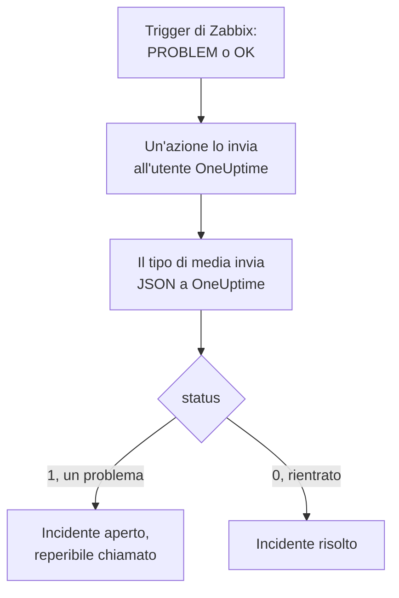

# Zabbix

Invia i problemi di [Zabbix](https://www.zabbix.com) a OneUptime, così ogni problema diventa un incidente che chiama il tuo team reperibile e si risolve quando Zabbix rientra. Zabbix invia ogni problema tramite un tipo di media webhook, quindi non c'è nulla da installare né da una parte né dall'altra.

:::cards
- [Scegliere come OneUptime riceve i problemi](#scegliere-come-oneuptime-riceve-i-problemi): Un monitor Incoming Request o un workflow tuo.
- [Ricevere i problemi con un monitor](#ricevere-i-problemi-con-un-monitor): Un incidente per problema, risolto al rientro.
- [Configurare Zabbix](#configurare-zabbix): Un tipo di media, un utente e un'azione.
- [Risoluzione dei problemi](#risoluzione-dei-problemi): Quando i problemi non arrivano o gli incidenti restano aperti.
:::

## Come funziona



Zabbix invia un problema a un utente, tramite i media di quell'utente. Qui il media è un tipo di media webhook chiamato **OneUptime**: il suo script invia a OneUptime un piccolo documento JSON con l'ID evento, il nome, l'host, la gravità e lo stato del problema. Lo stato è `1` per un problema e `0` per il suo rientro.

## Prima di iniziare

- Un server Zabbix che amministri. Questa guida è scritta per Zabbix 6.0 LTS e 7.0 LTS. I tipi di media webhook funzionano allo stesso modo da Zabbix 5.0.
- Un server Zabbix in grado di raggiungere il tuo OneUptime via HTTPS.
- In OneUptime, il permesso di creare monitor, o workflow se scegli quella strada.

## Scegliere come OneUptime riceve i problemi

Configura prima OneUptime: ti dà l'URL a cui invia Zabbix.

| Modo | Usalo quando |
| --- | --- |
| Un monitor Incoming Request (consigliato) | Vuoi che ogni problema di Zabbix sia un incidente che chiama i reperibili e si risolve quando Zabbix rientra. Non c'è nulla da costruire. |
| Un workflow con un trigger Webhook | Ti serve una logica tua: filtrare i problemi, dar loro un'altra forma o chiamare prima altri sistemi. Un workflow non risolve da solo l'incidente al rientro. |

Entrambi ricevono lo stesso JSON dallo stesso tipo di media, quindi puoi iniziare con uno e passare all'altro in seguito cambiando un solo URL in Zabbix.

## Ricevere i problemi con un monitor

Un [monitor Incoming Request](/docs/monitor/incoming-request-monitor) ti dà un URL, e i suoi criteri decidono cosa fa ogni richiesta.

:::steps
### Creare il monitor

Vai su **Monitor** e fai clic su **Crea monitor**. Scegli **Incoming Request** in **Tipo di monitor**, chiamalo `Zabbix` e fai clic su **Avanti**.

### Dichiarare un incidente per ogni problema

Nel passaggio **Criteri**, apri il primo criterio, quello che segna il monitor come offline. Imposta il suo filtro su **Corpo della Richiesta**, **Contiene**, `"status":"1"`. Questo criterio dichiara già un incidente quando il suo filtro corrisponde. Compila l'incidente:

- **Titolo dell'incidente**: `Zabbix: {{requestBody.name}} on {{requestBody.host}}`.
- **Gravità**: la gravità di incidente che devono avere i problemi di Zabbix.
- **Policy di reperibilità**, in **Reperibilità**: le policy da chiamare.
- **Risoluzione automatica dell'incidente**, in **Altri campi**: lasciala attiva, com'è all'inizio. Senza di essa, i rientri vengono ignorati e gli incidenti restano aperti.

### Aprire un incidente per problema

Nello stesso criterio, apri **Impostazioni** e attiva **Group incidents and alerts by a payload field**. Compilalo come qui sotto, così ogni problema ha il suo incidente e il suo rientro lo risolve:

| Campo | Valore |
| --- | --- |
| **Open a separate incident for each…** | `requestBody.event_id` |
| **Field that signals recovery** | `requestBody.status` |
| **Value that means recovered** | `0` |

### Riportare il monitor online

Apri il secondo criterio, quello che segna il monitor come online, e imposta il suo filtro su **Corpo della Richiesta**, **Contiene**, `"status":"0"`.

### Copiare l'URL

Fai clic su **Crea monitor**. La pagina **Panoramica** del monitor mostra il suo **Heartbeat URL**. Copialo per Zabbix:

```text
https://oneuptime.com/heartbeat/<secret key>
```

Un'installazione self-hosted ha il proprio host al posto di `oneuptime.com`.
:::

Il monitor legge il JSON della richiesta così com'è scritto: `"status":"1"`, senza spazi. Vedi [Ricevere allerte da un altro sistema](/docs/monitor/incoming-request-monitor#ricevere-avvisi-da-un-altro-sistema) per sapere cosa fa ogni impostazione.

## Ricevere i problemi con un workflow

Usa un [workflow](/docs/workflows/index) quando ti servono passaggi tuoi tra Zabbix e l'incidente.

:::steps
### Creare il workflow

Vai su **Flussi di lavoro**, fai clic su **Crea flusso di lavoro**, poi su **Parti da zero**. Chiamalo `Zabbix problems` e fai clic su **Crea flusso di lavoro**.

### Aggiungere il trigger Webhook

Fai clic sul blocco tratteggiato **Choose what starts this workflow** e scegli **Webhook**. Fai clic sul trigger, poi su **Copia URL**, e conserva l'URL per Zabbix.

### Controllare che sia un problema

Fai clic su **Aggiungi componente**, aggiungi un blocco **If / Else** e collegagli il punto **Out** del trigger. Imposta **Value to check** su `{{local.components.webhook-1.returnValues.request-body.status}}`, **Comparison** su **is equal to** e **Compare with** su `1`.

### Dichiarare l'incidente

Aggiungi un blocco **Create One Incident** e collegagli il lato **Yes** del blocco **If / Else**. In **Incident Template**, scegli un modello che imposti la gravità e le policy di reperibilità da chiamare (vedi [Modelli di incidente](/docs/incidents/settings#modelli-di-incidenti)). In **JSON Object**, imposta ciò che arriva da Zabbix:

```json
{
  "title": "Zabbix: {{local.components.webhook-1.returnValues.request-body.name}}",
  "description": "Host: {{local.components.webhook-1.returnValues.request-body.host}}\nSeverity: {{local.components.webhook-1.returnValues.request-body.severity}}\nZabbix event: {{local.components.webhook-1.returnValues.request-body.event_id}}"
}
```

Senza un modello, **JSON Object** richiede anche `incidentSeverityId`, l'ID di una delle gravità di incidente del progetto.

### Attivarlo

Attiva **Abilitato** in cima al **Costruttore**. Un workflow disattivato risponde a Zabbix con `400`.
:::

Un rientro prende il lato **No** del blocco **If / Else**, dove non è collegato nulla, quindi l'esecuzione finisce lì. Per risolvere gli incidenti al rientro, usa il monitor.

## Configurare Zabbix

Zabbix ha bisogno di tre cose: un tipo di media che invii a OneUptime, un utente a cui inviarlo e un'azione che invii i problemi a quell'utente.

:::steps
### Creare il tipo di media OneUptime

1. Vai su **Alerts → Media types**, o su **Administration → Media types** in Zabbix 6.0, e fai clic su **Create media type**.
2. Imposta **Name** su `OneUptime` e **Type** su **Webhook**.
3. Aggiungi questi **Parameters**. Ognuno porta una [macro](https://www.zabbix.com/documentation/current/en/manual/appendix/macros/supported_by_location) di Zabbix nella richiesta:

   | Nome | Valore |
   | --- | --- |
   | `url` | `{ALERT.SENDTO}` |
   | `event_id` | `{EVENT.ID}` |
   | `event_name` | `{EVENT.NAME}` |
   | `event_value` | `{EVENT.VALUE}` |
   | `event_severity` | `{EVENT.SEVERITY}` |
   | `host` | `{HOST.NAME}` |
   | `event_date` | `{EVENT.DATE}` |
   | `event_time` | `{EVENT.TIME}` |

4. Incolla questo in **Script**:

   ```javascript
   var params = JSON.parse(value);
   var request = new HttpRequest();
   request.addHeader("Content-Type: application/json");

   var payload = {
     source: "zabbix",
     event_id: params.event_id,
     name: params.event_name,
     host: params.host,
     severity: params.event_severity,
     // "1" for a problem, "0" for its recovery.
     status: params.event_value,
     date: params.event_date,
     time: params.event_time,
   };

   var response = request.post(params.url, JSON.stringify(payload));

   if (request.getStatus() < 200 || request.getStatus() >= 300) {
     throw (
       "OneUptime responded with HTTP " + request.getStatus() + ": " + response
     );
   }

   return "OK";
   ```

5. Nella scheda **Message templates**, aggiungi un modello per **Problem** e uno per **Problem recovery**. Lascia vuoto il loro testo: lo script costruisce la richiesta. Zabbix usa un tipo di media solo per i tipi di evento per cui ha un modello.
6. Fai clic su **Add**.

### Creare un utente che riceva i problemi

1. Vai su **Users → Users**, o su **Administration → Users** in Zabbix 6.0, e fai clic su **Create user**. Chiamalo `OneUptime` e dagli un gruppo di utenti e un ruolo che possa ricevere notifiche, come **User role**.
2. Nella scheda **Media**, fai clic su **Add**. Imposta **Type** su `OneUptime` e **Send to** sull'URL che hai copiato da OneUptime. Lascia **When active** e le gravità come sono, o togli la spunta alle gravità che OneUptime non deve ricevere.
3. Fai clic su **Add**, poi di nuovo su **Add** per salvare l'utente.

### Inviare i problemi a OneUptime con un'azione

1. Vai su **Alerts → Actions → Trigger actions**, o su **Configuration → Actions** in Zabbix 6.0, e fai clic su **Create action**. Chiamala `Notify OneUptime`.
2. In **Conditions**, restringila se vuoi, ad esempio con **Trigger severity is greater than or equals Warning**. Senza condizioni, viene inviato ogni problema.
3. Nella scheda **Operations**, aggiungi un'operazione che invii all'utente `OneUptime` tramite il tipo di media `OneUptime`.
4. Aggiungi la stessa operazione in **Recovery operations**, così vengono inviati anche i rientri.
5. Fai clic su **Add** e verifica che l'azione sia abilitata.
:::

## Provarlo

1. In Zabbix, apri **Alerts → Media types** e fai clic su **Test** accanto a `OneUptime`. Inserisci l'URL che hai copiato e valori di esempio come `event_id` `12345`, `event_name` `Test problem`, `host` `web-1` e `event_value` `1`. Fai clic su **Test**: Zabbix mostra la risposta dello script, `OK`, o l'errore che ha generato.
2. In OneUptime, apri il monitor e verifica che si sia aperto un incidente, oppure apri **Registri → Esecuzioni** del workflow e controlla l'esecuzione.
3. Prova di nuovo con `event_value` `0` e lo stesso `event_id`. Con il monitor, l'incidente viene risolto.

Poi lascia scattare un trigger reale, ad esempio abbassando per un momento una soglia, e osserva il problema arrivare.

## Mappare le gravità di Zabbix

Zabbix invia la gravità come testo: `Not classified`, `Information`, `Warning`, `Average`, `High` o `Disaster`.

- **Con il monitor**, fai clic su **Aggiungi criteri** per ogni gruppo di gravità e trascina il nuovo criterio sopra il primo: i criteri vengono controllati dall'alto, e decide il primo che corrisponde. Dai a ciascuno due filtri, `"status":"1"` e una gravità come `"severity":"Disaster"`, con **Condizione di corrispondenza** su **Tutti**. Dai a ciascuno un incidente con la propria **Gravità** e **Risoluzione automatica dell'incidente**, e le stesse impostazioni di raggruppamento.
- **Con il workflow**, aggiungi un blocco [Switch / Case](/docs/workflows/components#switch-case) su `{{local.components.webhook-1.returnValues.request-body.severity}}`, con un caso per ogni gravità, e un blocco **Create One Incident**, con il proprio modello, dopo ogni caso.

## Risoluzione dei problemi

:::details Non arriva nulla in OneUptime
- In Zabbix, apri **Reports → Action log** e verifica che l'azione abbia inviato il problema, e cosa è tornato indietro.
- Dal server Zabbix, invia tu stesso una richiesta: `curl -i -X POST <url> -H 'Content-Type: application/json' -d '{"status":"1","event_id":"1","name":"Test","host":"test"}'`.
- Il monitor risponde subito `200`, prima di controllare qualsiasi cosa, anche con una chiave segreta sbagliata. Controlla la cronologia del monitor per vedere se le richieste arrivano.
- Un workflow disattivato risponde `400`. Attiva **Abilitato** in cima al suo **Costruttore**.
:::

:::details Zabbix segnala un errore dello script
Apri il tipo di media e usa **Test**: Zabbix mostra il risultato dello script o l'errore che ha generato. Lo script genera un errore con il relativo stato per ogni risposta di OneUptime diversa da `2xx`, quindi controlla prima l'URL.
:::

:::details Gli incidenti si aprono ma non vengono mai risolti
- L'azione ha bisogno di **Recovery operations**, altrimenti Zabbix non invia mai il rientro.
- L'incidente del criterio ha bisogno di **Risoluzione automatica dell'incidente**, in **Altri campi**.
- **Field that signals recovery** deve essere `requestBody.status`, e **Value that means recovered** esattamente `0`.
- Un workflow non risolve gli incidenti al rientro. Usa il monitor.
:::

:::details L'incidente mostra un riferimento invece di un valore
Un riferimento a un campo che la richiesta non ha viene lasciato così com'è scritto, parentesi graffe comprese, invece di essere svuotato. Verifica che Zabbix invii `Content-Type: application/json` e che i nomi di campo che usi (`name`, `host`, `severity`, `status`, `event_id`) corrispondano al payload dello script. Per un workflow, apri l'esecuzione in **Registri → Esecuzioni** e confrontala con ciò che il trigger ha ricevuto. Vedi [Insidie](/docs/workflows/variables#trappole).
:::

:::details Ogni problema arriva due volte
Probabilmente l'azione ha due operazioni che inviano allo stesso utente, come un primo passo e un passo di escalation. Controlla le **Operations** dell'azione.
:::

## Sicurezza

- **Tratta l'URL come una password.** Chiunque lo abbia può aprire incidenti. Se trapela, reimpostalo: **Reimposta la chiave segreta della richiesta in arrivo** nella pagina **Impostazioni** del monitor, o **Reimposta URL** nel trigger **Webhook** del workflow. Poi aggiorna **Send to** nel media dell'utente Zabbix.
- **Invia solo ciò che richiede un incidente.** Usa le condizioni dell'azione, o le gravità del media dell'utente, per lasciare in Zabbix i problemi di bassa gravità.
- **Self-hosted?** Lascia che il tuo server Zabbix raggiunga il tuo OneUptime via HTTPS attraverso il firewall.

## Prossimi passi

:::cards
- [Monitor richieste in arrivo](/docs/monitor/incoming-request-monitor): Ogni impostazione del monitor che riceve i problemi di Zabbix.
- [Regole di escalation](/docs/on-call/escalation-rules): Decidi chi chiama una policy di reperibilità, e quando.
- [Trigger del workflow](/docs/workflows/triggers#webhook): Come funziona l'URL webhook di un workflow.
- [Panoramica delle integrazioni](/docs/integrations/index): Gli altri strumenti che puoi collegare.
:::
