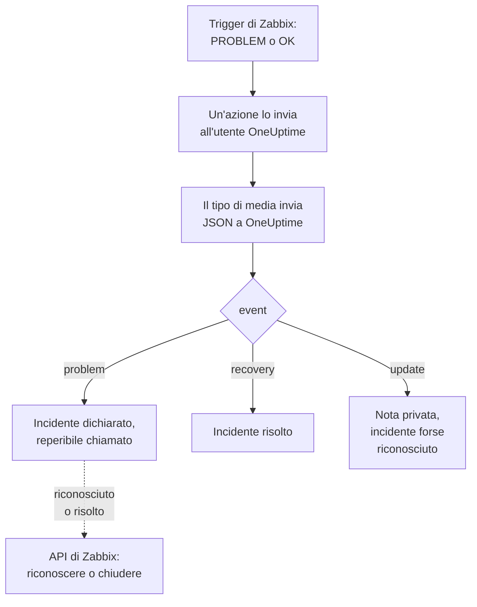

# Zabbix

Invia i problemi di [Zabbix](https://www.zabbix.com) a OneUptime, così ogni problema diventa un incidente che chiama il tuo team reperibile e si risolve quando Zabbix rientra. Modelli di workflow pronti all'uso mantengono allineate le due parti: ciò che le persone fanno in Zabbix viene annotato sull'incidente, e riconoscere o risolvere l'incidente riconosce o chiude il problema in Zabbix. Zabbix invia ogni problema tramite un tipo di media webhook, quindi non c'è nulla da installare né da una parte né dall'altra.

:::cards
- [Scegliere come OneUptime riceve i problemi](#scegliere-come-oneuptime-riceve-i-problemi): Modelli di workflow o un monitor Incoming Request.
- [Partire dai modelli](#partire-dai-modelli): Sei modelli, cosa fanno e cosa chiedono.
- [Configurare Zabbix](#configurare-zabbix): Un tipo di media, un utente e un'azione.
- [Risoluzione dei problemi](#risoluzione-dei-problemi): Quando i problemi non arrivano o gli incidenti restano aperti.
:::

## Come funziona



Zabbix invia un problema a un utente, tramite i media di quell'utente. Qui il media è un tipo di media webhook chiamato **OneUptime**: il suo script invia a OneUptime un piccolo documento JSON per ogni problema, per il suo rientro e per ogni aggiornamento che qualcuno vi fa in Zabbix, con l'ID evento, il nome, l'host e la gravità del problema. È con l'ID evento che OneUptime trova l'incidente aperto da un problema.

## Prima di iniziare

- Un server Zabbix che amministri. Questa guida è scritta per Zabbix 6.0 LTS e 7.0 LTS. I tipi di media webhook funzionano allo stesso modo da Zabbix 5.0. I modelli che chiamano l'API di Zabbix richiedono Zabbix 6.4 o successivo, oppure [una modifica su Zabbix 6.0](#su-zabbix-60).
- Un server Zabbix in grado di raggiungere il tuo OneUptime via HTTPS e, per i modelli che chiamano Zabbix, un OneUptime in grado di raggiungere Zabbix.
- In OneUptime, il permesso di creare workflow, o monitor se scegli quella strada. Su OneUptime Cloud, i workflow richiedono il piano **Growth** o superiore.

## Scegliere come OneUptime riceve i problemi

Configura prima OneUptime: ti dà l'URL a cui invia Zabbix.

| Modo | Usalo quando |
| --- | --- |
| I modelli di workflow (consigliati) | Vuoi ogni problema come un incidente o un avviso alla sua gravità di Zabbix, con i reperibili chiamati per High e Disaster, risolto al rientro, con ciò che le persone fanno in Zabbix annotato sopra, e Zabbix riconosciuto o chiuso da OneUptime. |
| Un monitor Incoming Request | Vuoi incidenti senza un workflow, con qualsiasi piano, e un monitor il cui stato segue Zabbix. Nulla torna a Zabbix. |

Entrambi ricevono lo stesso JSON dallo stesso tipo di media, quindi puoi iniziare con uno e passare all'altro in seguito cambiando un solo URL in Zabbix.

## Partire dai modelli

La finestra **Crea un flusso di lavoro** ha sei modelli Zabbix, sotto **Zabbix** nel suo elenco di categorie: tre per gli incidenti, poi gli stessi tre per gli avvisi.

| Modello | Cosa fa | Cosa chiede |
| --- | --- | --- |
| **Incidenti** | | |
| Declare an incident for each Zabbix problem | Il workflow a cui Zabbix invia ogni evento. Dichiara un incidente per ogni problema, chiama i reperibili per High e Disaster, annota gli aggiornamenti fatti in Zabbix e risolve l'incidente al rientro. | Zabbix URL |
| Acknowledge or close the Zabbix problem with the incident | Quando l'incidente viene riconosciuto, riconosce il suo problema. Quando viene risolto, chiude il problema, o lo riconosce dove Zabbix non permette di chiuderlo a mano. | Zabbix URL, Zabbix API Token |
| Copy incident private notes to the Zabbix problem | Aggiunge ogni nota privata dell'incidente al suo problema come messaggio. | Zabbix URL, Zabbix API Token |
| **Avvisi** | | |
| Create an alert for each Zabbix problem | Come per gli incidenti, con un avviso per ogni problema. | Zabbix URL |
| Acknowledge or close the Zabbix problem with the alert | Come per gli incidenti, in base allo stato dell'avviso. | Zabbix URL, Zabbix API Token |
| Copy alert private notes to the Zabbix problem | Aggiunge ogni nota privata dell'avviso al suo problema come messaggio. | Zabbix URL, Zabbix API Token |

Inizia con **Declare an incident for each Zabbix problem**, o con **Create an alert for each Zabbix problem** per gli avvisi: l'incidente o l'avviso che apre conserva l'ID evento del problema nel suo campo personalizzato `zabbixEventId`, e gli altri due modelli trovano il problema tramite esso.

### Cosa chiedono i modelli

- **Zabbix URL**: l'indirizzo a cui apri Zabbix, come `https://zabbix.example.com`, o `https://example.com/zabbix` quando Zabbix gira sotto un percorso. I link a un problema portano lì, e i modelli che chiamano Zabbix inviano le loro richieste al suo `api_jsonrpc.php`. Il campo rifiuta l'indirizzo di una pagina dentro Zabbix.
- **Zabbix API Token**: un token API dell'utente Zabbix con cui agisce il workflow. [Creare il token API](#creare-il-token-api) spiega come. Viene salvato come variabile segreta, e inviato solo a Zabbix: nell'header `Authorization`, o nel corpo della richiesta su Zabbix 6.0.

### Ricevere i problemi con il modello

:::steps
1. Vai su **Flussi di lavoro** e fai clic su **Crea flusso di lavoro**. In **Oppure parti da un modello**, scegli **Zabbix** nell'elenco di categorie, fai clic su **Declare an incident for each Zabbix problem** e poi su **Usa questo modello**.
2. Compila **Zabbix URL**. In **Who to page for High and Disaster problems**, scegli le policy di reperibilità da chiamare, o nessuna per non chiamare nessuno, e fai clic su **Crea flusso di lavoro**. Il workflow si apre nel **Costruttore**, disattivato.
3. Fai clic sul trigger **Webhook**, poi su **Copia URL**, e conserva l'URL per Zabbix.
4. Attiva **Abilitato** in cima al **Costruttore**. Un workflow disattivato risponde a Zabbix con `400`.
:::

Poi [configura Zabbix](#configurare-zabbix) perché invii i suoi problemi a quell'URL.

### Cosa fa il workflow

Dopo il trigger **Webhook**, il passo **Check With JavaScript** `read-event-1` legge l'`event` che il tipo di media invia, e **Incident From Another Tool**, o **Alert From Another Tool** nel modello degli avvisi, fa ciò che significa, tramite l'ID evento del problema:

| Evento | Cosa fa il workflow |
| --- | --- |
| `problem` | Dichiara un incidente intitolato `Zabbix: <problem> on <host>`, alla gravità a cui corrisponde la gravità di Zabbix, fuori dalle tue pagine di stato. La sua descrizione collega il problema in Zabbix e riporta l'host, la gravità, quando è iniziato, i suoi dati operativi e i suoi tag. Per un problema High o Disaster, chiama la policy di reperibilità che hai scelto. Un problema che Zabbix invia di nuovo, con lo stesso ID evento, non apre un secondo incidente. |
| `recovery` | Risolve l'incidente del problema, a meno che non sia già risolto. Il motivo è nella sua cronologia. |
| `update` | Aggiunge all'incidente, come nota privata, ciò che è stato fatto in Zabbix: chi l'ha fatto, cosa ha fatto e cosa ha scritto. Quando l'aggiornamento ha riconosciuto il problema, riconosce anche l'incidente, così la reperibilità smette di inoltrarlo in escalation. |

Tutto il resto, come una richiesta di un altro strumento, viene lasciato com'è: `read-event-1` prende **No**, e i **Passaggi** dell'esecuzione dicono perché. Un passo che fallisce fa fallire l'esecuzione, e la sua voce in **Passaggi** dice perché.

### Gravità

In un nuovo progetto, il modello mappa le sei gravità di Zabbix su queste gravità di incidente e di avviso:

| Gravità di Zabbix | Incidente | Avviso | Reperibili |
| --- | --- | --- | --- |
| Disaster | Critical Incident | High | Chiamati |
| High | Critical Incident | High | Chiamati |
| Average | Major Incident | Low | Non chiamati |
| Warning | Major Incident | Low | Non chiamati |
| Information | Minor Incident | Low | Non chiamati |
| Not classified | Minor Incident | Low | Non chiamati |

Con gravità tue, Disaster e High vanno alla più grave, Average e Warning a quella di mezzo, e Information e Not classified alla meno grave. Zabbix numera le sue gravità da 0 (Not classified) a 5 (Disaster), e il modello legge il numero, quindi rinominare una gravità in Zabbix non cambia nulla.

- Per mappare una gravità su una delle tue per nome, modifica `SEVERITY_BY_NAME` nel passo `read-event-1`, ad esempio `{ 2: 'Minor Incident' }` per Warning.
- Per chiamare i reperibili anche per i problemi Average, imposta **Compare with** del passo `if-page-1` **If / Else** a `3`.

### Rimandare riconoscimenti e note a Zabbix

:::steps
1. [Crea il token API](#creare-il-token-api).
2. Crea un workflow da **Acknowledge or close the Zabbix problem with the incident**. Compila **Zabbix URL** e **Zabbix API Token**, fai clic su **Crea flusso di lavoro** e attiva **Abilitato**.
3. Se vuoi anche le note in Zabbix, fai lo stesso con **Copy incident private notes to the Zabbix problem**.
:::

Il modello di stato chiede prima a Zabbix del problema, quindi un problema che Zabbix ha già riconosciuto o risolto viene lasciato com'è. Per chiudere un problema, il suo trigger ha bisogno di **Allow manual close** in Zabbix. Senza, il problema viene invece riconosciuto, con un messaggio che dice che l'incidente è stato risolto, e Zabbix lo chiude al rientro. Gli incidenti che nessun problema di Zabbix ha aperto, e quelli segnati come **Incidente privato**, non vengono mai inviati a Zabbix.

### Creare il token API

:::steps
1. Usa l'utente `OneUptime` che [riceve i problemi](#creare-un-utente-che-riceva-i-problemi). Zabbix non invia a un utente i suoi stessi aggiornamenti, quindi con il token di questo utente i riconoscimenti e i messaggi di OneUptime non tornano mai a OneUptime come aggiornamenti.
2. Controlla il ruolo dell'utente in **Users → User roles**. Gli serve **Access to API** attivo, e **Acknowledge problems**, **Add problem comments** e **Close problems** consentiti. Lo **User role** li consente, a meno che qualcuno non l'abbia cambiato.
3. Controlla il gruppo dell'utente in **Users → User groups**. Il permesso **Read** sui gruppi di host basta per riconoscere i problemi e aggiungere messaggi. Per chiudere i problemi, serve **Read-write**.
4. Vai su **Users → API tokens** e fai clic su **Create API token**. Scegli l'utente `OneUptime`, togli la spunta a **Set expiration date and time** o annota la data, e fai clic su **Add**.
5. Copia il valore di **Auth token**: Zabbix lo mostra una sola volta. Incollalo in **Zabbix API Token**.
:::

### Su Zabbix 6.0

Zabbix 6.0 legge il token API dal corpo della richiesta, non dal suo header `Authorization`. Nel passo **Update Zabbix Problem** di ogni modello che chiama Zabbix, attiva **Zabbix 6.0**, in **Altri campi**. Zabbix 7.2 e successivi rifiutano un token nel corpo, quindi disattivalo di nuovo quando aggiorni.

## Ricevere i problemi con un monitor

Un [monitor Incoming Request](/docs/monitor/incoming-request-monitor) ti dà un URL, e i suoi criteri decidono cosa fa ogni richiesta.

:::steps
### Creare il monitor

Vai su **Monitor** e fai clic su **Crea monitor**. Scegli **Incoming Request** in **Tipo di monitor**, chiamalo `Zabbix` e fai clic su **Avanti**.

### Dichiarare un incidente per ogni problema

Nel passaggio **Criteri**, apri il primo criterio, quello che segna il monitor come offline. Imposta il suo filtro su **Corpo della Richiesta**, **Contiene**, `"status":"1"`. Questo criterio dichiara già un incidente quando il suo filtro corrisponde. Compila l'incidente:

- **Titolo dell'incidente**: `Zabbix: {{requestBody.name}} on {{requestBody.host}}`.
- **Gravità**: la gravità di incidente che devono avere i problemi di Zabbix.
- **Policy di reperibilità**, in **Reperibilità**: le policy da chiamare.
- **Risoluzione automatica dell'incidente**, in **Altri campi**: lasciala attiva, com'è all'inizio. Senza di essa, i rientri vengono ignorati e gli incidenti restano aperti.

### Aprire un incidente per problema

Nello stesso criterio, apri **Impostazioni** e attiva **Group incidents and alerts by a payload field**. Compilalo come qui sotto, così ogni problema ha il suo incidente e il suo rientro lo risolve:

| Campo | Valore |
| --- | --- |
| **Open a separate incident for each…** | `requestBody.event_id` |
| **Field that signals recovery** | `requestBody.status` |
| **Value that means recovered** | `0` |

### Riportare il monitor online

Apri il secondo criterio, quello che segna il monitor come online, e imposta il suo filtro su **Corpo della Richiesta**, **Contiene**, `"status":"0"`.

### Copiare l'URL

Fai clic su **Crea monitor**. La pagina **Panoramica** del monitor mostra il suo **Heartbeat URL**. Copialo per Zabbix:

```text
https://oneuptime.com/heartbeat/<secret key>
```

Un'installazione self-hosted ha il proprio host al posto di `oneuptime.com`.
:::

Il monitor legge il JSON della richiesta così com'è scritto: `"status":"1"`, senza spazi. Vedi [Ricevere allerte da un altro sistema](/docs/monitor/incoming-request-monitor#ricevere-avvisi-da-un-altro-sistema) per sapere cosa fa ogni impostazione. Anche un aggiornamento fatto in Zabbix viene inviato con `"status":"1"`, che il monitor legge di nuovo come il problema, senza aprire un secondo incidente.

## Configurare Zabbix

Zabbix ha bisogno di tre cose: un tipo di media che invii a OneUptime, un utente a cui inviarlo e un'azione che invii i problemi a quell'utente.

:::steps
### Creare il tipo di media OneUptime

1. Vai su **Alerts → Media types**, o su **Administration → Media types** in Zabbix 6.0, e fai clic su **Create media type**.
2. Imposta **Name** su `OneUptime` e **Type** su **Webhook**.
3. Aggiungi questi **Parameters**. Ognuno porta una [macro](https://www.zabbix.com/documentation/current/en/manual/appendix/macros/supported_by_location) di Zabbix nella richiesta:

   | Nome | Valore |
   | --- | --- |
   | `url` | `{ALERT.SENDTO}` |
   | `event_id` | `{EVENT.ID}` |
   | `event_name` | `{EVENT.NAME}` |
   | `event_value` | `{EVENT.VALUE}` |
   | `event_severity` | `{EVENT.SEVERITY}` |
   | `event_nseverity` | `{EVENT.NSEVERITY}` |
   | `host` | `{HOST.NAME}` |
   | `event_date` | `{EVENT.DATE}` |
   | `event_time` | `{EVENT.TIME}` |
   | `event_opdata` | `{EVENT.OPDATA}` |
   | `event_tags` | `{EVENT.TAGSJSON}` |
   | `trigger_id` | `{TRIGGER.ID}` |
   | `event_update_status` | `{EVENT.UPDATE.STATUS}` |
   | `event_update_action` | `{EVENT.UPDATE.ACTION}` |
   | `event_update_message` | `{EVENT.UPDATE.MESSAGE}` |
   | `event_update_user` | `{USER.FULLNAME}` |

4. Incolla questo in **Script**:

   ```javascript
   var params = JSON.parse(value);

   // Zabbix leaves a macro it has no value for as it is written, such as
   // {EVENT.UPDATE.MESSAGE} on a problem: it is sent as nothing.
   function given(text) {
     var written = String(text === undefined || text === null ? "" : text);
     return /^\{[A-Z0-9_.]+\}$/.test(written) || written === "*UNKNOWN*"
       ? ""
       : written;
   }

   var isUpdate = given(params.event_update_status) === "1";
   var payload = {
     source: "zabbix",
     // "problem", "recovery" or "update".
     event: isUpdate
       ? "update"
       : params.event_value === "0"
         ? "recovery"
         : "problem",
     event_id: params.event_id,
     name: params.event_name,
     host: params.host,
     severity: params.event_severity,
     // 0 Not classified, 1 Information, 2 Warning, 3 Average, 4 High, 5 Disaster.
     severity_number: params.event_nseverity,
     // "1" for a problem, "0" for its recovery.
     status: params.event_value,
     date: params.event_date,
     time: params.event_time,
     opdata: given(params.event_opdata),
     tags: [],
     trigger_id: params.trigger_id,
   };

   try {
     var tags = JSON.parse(given(params.event_tags) || "[]");
     payload.tags = Array.isArray(tags) ? tags : [];
   } catch (error) {
     payload.tags = [];
   }

   if (isUpdate) {
     payload.update = {
       action: given(params.event_update_action),
       message: given(params.event_update_message),
       user: given(params.event_update_user),
     };
   }

   var request = new HttpRequest();
   request.addHeader("Content-Type: application/json");

   var response = request.post(params.url, JSON.stringify(payload));

   if (request.getStatus() < 200 || request.getStatus() >= 300) {
     throw (
       "OneUptime responded with HTTP " + request.getStatus() + ": " + response
     );
   }

   return "OK";
   ```

5. Nella scheda **Message templates**, aggiungi un modello per **Problem**, uno per **Problem recovery** e uno per **Problem update**. Lascia vuoto il loro testo: lo script costruisce la richiesta. Zabbix usa un tipo di media solo per i tipi di evento per cui ha un modello.
6. Fai clic su **Add**.

### Creare un utente che riceva i problemi

1. Vai su **Users → Users**, o su **Administration → Users** in Zabbix 6.0, e fai clic su **Create user**. Chiamalo `OneUptime` e dagli un gruppo di utenti e un ruolo che possa ricevere notifiche, come **User role**.
2. Nella scheda **Media**, fai clic su **Add**. Imposta **Type** su `OneUptime` e **Send to** sull'URL che hai copiato da OneUptime. Lascia **When active** e le gravità come sono, o togli la spunta alle gravità che OneUptime non deve ricevere.
3. Fai clic su **Add**, poi di nuovo su **Add** per salvare l'utente.

### Inviare i problemi a OneUptime con un'azione

1. Vai su **Alerts → Actions → Trigger actions**, o su **Configuration → Actions** in Zabbix 6.0, e fai clic su **Create action**. Chiamala `Notify OneUptime`.
2. In **Conditions**, restringila se vuoi, ad esempio con **Trigger severity is greater than or equals Warning**. Senza condizioni, viene inviato ogni problema.
3. Nella scheda **Operations**, aggiungi un'operazione che invii all'utente `OneUptime` tramite il tipo di media `OneUptime`.
4. Aggiungi la stessa operazione in **Recovery operations**, così vengono inviati anche i rientri, e in **Update operations**, così vengono inviati i riconoscimenti e i commenti fatti in Zabbix.
5. Fai clic su **Add** e verifica che l'azione sia abilitata.
:::

Per inviare alcuni problemi al modello per gli incidenti e altri a quello per gli avvisi, dai all'utente `OneUptime` due media di tipo `OneUptime`: ognuno invia all'URL di un workflow, con le gravità che deve ricevere.

## Provarlo

1. In Zabbix, apri **Alerts → Media types** e fai clic su **Test** accanto a `OneUptime`. Inserisci l'URL che hai copiato e valori di esempio come `event_id` `12345`, `event_name` `Test problem`, `host` `web-1`, `event_nseverity` `4` e `event_value` `1`. Fai clic su **Test**: Zabbix mostra la risposta dello script, `OK`, o l'errore che ha generato.
2. In OneUptime, apri **Registri → Esecuzioni** del workflow e controlla l'esecuzione, oppure apri il monitor e verifica che si sia aperto un incidente.
3. Prova di nuovo con `event_value` `0` e lo stesso `event_id`. L'incidente viene risolto.

Poi lascia scattare un trigger reale, ad esempio abbassando per un momento una soglia, e osserva il problema arrivare. Per provare un aggiornamento, riconosci il problema in Zabbix con un messaggio: l'incidente riceve una nota privata e viene riconosciuto.

## Mappare le gravità di Zabbix

Zabbix invia la gravità come testo: `Not classified`, `Information`, `Warning`, `Average`, `High` o `Disaster`.

- **Con i modelli**, le gravità vengono mappate per te: vedi [Gravità](#gravità).
- **Con il monitor**, fai clic su **Aggiungi criteri** per ogni gruppo di gravità e trascina il nuovo criterio sopra il primo: i criteri vengono controllati dall'alto, e decide il primo che corrisponde. Dai a ciascuno due filtri, `"status":"1"` e una gravità come `"severity":"Disaster"`, con **Condizione di corrispondenza** su **Tutti**. Dai a ciascuno un incidente con la propria **Gravità** e **Risoluzione automatica dell'incidente**, e le stesse impostazioni di raggruppamento.

## Risoluzione dei problemi

:::details Non arriva nulla in OneUptime
- In Zabbix, apri **Reports → Action log** e verifica che l'azione abbia inviato il problema, e cosa è tornato indietro.
- Dal server Zabbix, invia tu stesso una richiesta: `curl -i -X POST <url> -H 'Content-Type: application/json' -d '{"source":"zabbix","event":"problem","event_id":"1","name":"Test","host":"test","severity_number":"4","status":"1"}'`.
- Il monitor risponde subito `200`, prima di controllare qualsiasi cosa, anche con una chiave segreta sbagliata. Controlla la cronologia del monitor per vedere se le richieste arrivano.
- Un workflow disattivato risponde `400`. Attiva **Abilitato** in cima al suo **Costruttore**.
:::

:::details Zabbix segnala un errore dello script
Apri il tipo di media e usa **Test**: Zabbix mostra il risultato dello script o l'errore che ha generato. Lo script genera un errore con il relativo stato per ogni risposta di OneUptime diversa da `2xx`, quindi controlla prima l'URL.
:::

:::details Gli incidenti si aprono ma non vengono mai risolti
- L'azione ha bisogno di **Recovery operations**, altrimenti Zabbix non invia mai il rientro.
- Con il modello, apri **Registri → Esecuzioni** del workflow e l'esecuzione del rientro: il suo ultimo passo dice perché. Il rientro di un problema che non ha aperto alcun incidente non cambia nulla.
- Con il monitor, l'incidente del criterio ha bisogno di **Risoluzione automatica dell'incidente**, in **Altri campi**. **Field that signals recovery** deve essere `requestBody.status`, e **Value that means recovered** esattamente `0`.
:::

:::details Il problema di Zabbix non viene riconosciuto né chiuso
Apri l'esecuzione del modello di stato in **Registri → Esecuzioni**: il suo ultimo passo dice cosa ha risposto Zabbix.

- `Not authorized`: il token API è errato, scaduto o disattivato, oppure Zabbix è precedente alla 6.4 (vedi [Su Zabbix 6.0](#su-zabbix-60)).
- `Cannot close problem: trigger does not allow manual closing`: attiva **Allow manual close** sul trigger. Il modello già riconosce questi problemi invece di chiuderli.
- `No permissions to referred object or it does not exist!`: l'utente vede il problema, ma ha bisogno del permesso **Read-write** per chiuderlo.
- `Zabbix has no problem with event ID`: l'utente non vede l'host del problema. Dai al suo gruppo di utenti il permesso **Read** sul gruppo di host.
:::

:::details L'incidente mostra un riferimento invece di un valore
Un riferimento a un campo che la richiesta non ha viene lasciato così com'è scritto, parentesi graffe comprese, invece di essere svuotato. Verifica che Zabbix invii `Content-Type: application/json` e che i nomi di campo che usi (`name`, `host`, `severity`, `status`, `event_id`) corrispondano al payload dello script. Per un workflow, apri l'esecuzione in **Registri → Esecuzioni** e confrontala con ciò che il trigger ha ricevuto. Vedi [Insidie](/docs/workflows/variables#trappole).
:::

:::details Ogni problema arriva due volte
Probabilmente l'azione ha due operazioni che inviano allo stesso utente, come un primo passo e un passo di escalation. Il modello apre un solo incidente per ID evento qualunque cosa arrivi, ma ogni consegna è un'esecuzione. Controlla le **Operations** dell'azione.
:::

## Sicurezza

- **Tratta l'URL come una password.** Chiunque lo abbia può aprire incidenti. Se trapela, reimpostalo: **Reimposta URL** nel trigger **Webhook** del workflow, o **Reimposta la chiave segreta della richiesta in arrivo** nella pagina **Impostazioni** del monitor. Poi aggiorna **Send to** nel media dell'utente Zabbix.
- **I link portano al tuo Zabbix.** Il modello collega un problema sul sito indicato dal suo **Zabbix URL**, qualunque cosa dica una richiesta, e scrive ciò che Zabbix ha inviato come testo.
- **Limita il token API a ciò che fa il workflow.** È una variabile segreta, oscurata nei log delle esecuzioni e inviata solo a Zabbix, nell'header `Authorization` a meno che **Zabbix 6.0** non sia attivo. Dai al suo utente un ruolo con nient'altro che le azioni qui sopra, ed elimina il token in **Users → API tokens** se trapela.
- **Invia solo ciò che richiede un incidente.** Usa le condizioni dell'azione, o le gravità del media dell'utente, per lasciare in Zabbix i problemi di bassa gravità.
- **Self-hosted?** Lascia che il tuo server Zabbix raggiunga il tuo OneUptime via HTTPS attraverso il firewall. Per chiamare uno Zabbix su una rete privata, il workflow ha bisogno di [accesso di rete in uscita](/docs/workflows/configuration#accesso-alla-rete-in-uscita).

## Prossimi passi

:::cards
- [Modelli di workflow](/docs/workflows/authoring): Crea un workflow da un modello e modificalo nel Costruttore.
- [Monitor richieste in arrivo](/docs/monitor/incoming-request-monitor): Ogni impostazione del monitor che riceve i problemi di Zabbix.
- [Regole di escalation](/docs/on-call/escalation-rules): Decidi chi chiama una policy di reperibilità, e quando.
- [Panoramica delle integrazioni](/docs/integrations/index): Gli altri strumenti che puoi collegare.
:::
