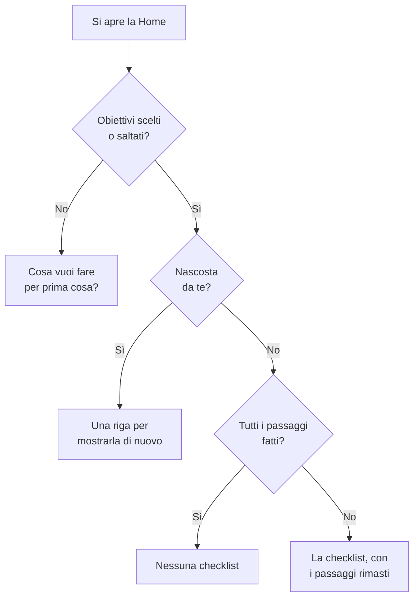

# Home page e scorciatoie

La home è la prima pagina che vedi in un progetto. Ti dice a colpo d'occhio se in questo momento qualcosa ha bisogno di te, e guida un nuovo progetto nella sua prima configurazione. Questa pagina spiega cosa mostra la home, come trovare qualsiasi prodotto, pagina o azione nella dashboard, e le scorciatoie da tastiera che ti risparmiano giri nei menu.

:::cards
- [Cosa mostra la home](#cosa-mostra-la-home): Se qualcosa non va, cosa ha bisogno di te, cosa contiene il progetto e tutti i prodotti.
- [Orientarsi](#orientarsi): Il menu Prodotti e le barre in cima a ogni pagina.
- [Cercare](#cercare-una-pagina-unimpostazione-o-unazione): Trovare qualsiasi pagina, impostazione o azione digitandone il nome.
- [Scorciatoie da tastiera](#scorciatoie-da-tastiera): Andare alla home, ai monitor o agli incidenti con due tasti.
:::

## Cosa mostra la home

Apri **Home** nella barra in alto, oppure premi `g` e poi `h` da qualsiasi punto. La home è la panoramica del tuo progetto, una sola pagina senza menu laterale. Dall'alto verso il basso, mostra:

1. Una casella di ricerca, con accanto **Dichiara incidente** e **Crea**.
2. Una riga che dice se qualcosa non va, sopra cinque numeri che contano ciò che richiede attenzione.
3. **Benvenuto in OneUptime 👋**, un elenco per un nuovo progetto, finché non è completato.
4. **Richiede attenzione**, ogni problema aperto in questo momento, per nome.
5. **Il tuo progetto**, di cosa è fatto il progetto, e **Prossime manutenzioni** quando ce n'è qualcuna in programma.
6. **Esplora OneUptime**, tutti i prodotti, una categoria alla volta.

### Cercare e creare

La casella di ricerca apre la ricerca, come `Mod` + `K`: digita il nome di qualsiasi pagina, monitor, incidente, avviso, pagina di stato o policy di reperibilità. Vedi la sezione [Cercare](#cercare-una-pagina-unimpostazione-o-unazione). **Dichiara incidente** apre il modulo per dichiarare un incidente. **Crea** offre **Crea monitor**, **Pianifica manutenzione** e **Crea annuncio**. Ognuno viene mostrato solo a chi ha il permesso di usarlo.

### Il titolo

La riga in alto nomina la cosa più urgente tra quelle aperte, in un colore corrispondente:

| Quando | La home dice |
| --- | --- |
| C'è un incidente aperto | Quanti incidenti sono attivi, in rosso |
| Nessun incidente è aperto, ma ci sono avvisi aperti, monitor non operativi o SLO a rischio | Quanti problemi richiedono attenzione, in ambra |
| Non c'è nessun problema e una manutenzione è in corso | Quanti eventi di manutenzione sono in corso |
| I monitor sono attivi e non c'è nulla di aperto | **Tutti i sistemi sono operativi** |
| Il progetto non ha ancora monitor | **Non c'è ancora nulla sotto monitoraggio** |

Accanto, la home dice quando ha caricato il progetto l'ultima volta, e **Aggiorna** lo ricarica. Quando torni a una scheda della home dopo un minuto o più, si aggiorna da sola.

Finché non c'è ancora nulla sotto monitoraggio, la riga termina con il pulsante **Crea il tuo primo monitor**, che apre la configurazione guidata **Sapere quando il mio sito web o la mia API non funziona**. Lo vede solo chi può creare monitor.

### I cinque numeri

Ogni numero conta qualcosa, dice se richiede la tua attenzione e apre l'elenco che c'è dietro, nel prodotto a cui appartiene.

| Numero | Cosa conta | Quando il numero è zero | Apre |
| --- | --- | --- | --- |
| **Incidenti attivi** | Gli incidenti non risolti | **Tutto a posto** | **Incidenti → Incidenti attivi** |
| **Avvisi attivi** | Gli avvisi non risolti | **Tutto a posto** | **Avvisi → Avvisi attivi** |
| **Monitor non operativi** | I monitor il cui stato non è operativo. I monitor archiviati, e quelli con il monitoraggio disattivato, non contano. | **Tutti operativi** | **Monitor → Non operativo** |
| **Manutenzione in corso** | Gli eventi di manutenzione in corso | **Nessuna in corso** | **Manutenzione programmata → Eventi di manutenzione in corso** |
| **SLO a rischio** | Gli SLO attivi che sono a rischio o hanno esaurito il loro error budget | **Budget in salute** | **SLOs** |

Un numero sopra lo zero mostra **Richiede attenzione**, oppure **In corso** e **Budget in esaurimento** per manutenzione e SLO. Finché un SLO è a rischio, **SLO a rischio** apre l'elenco **SLOs** filtrato su quegli SLO. Un progetto senza monitor vede **Nessun monitor ancora**, e uno senza SLO vede **Nessun SLO ancora**: un progetto vuoto non è un progetto sano. Questi due aprono allora gli elenchi **Monitor** e **SLOs**, dove ne crei uno.

### L'elenco di benvenuto

La prima volta che un proprietario o un amministratore del progetto apre la Home di un nuovo progetto, la scheda chiede **Cosa vuoi fare per prima cosa?** Spunta uno o più obiettivi, come **Sapere quando il mio sito web o la mia API non funziona** o **Do solo un'occhiata**, e fai clic su **Continua**: la checklist conterrà i passaggi che servono a quegli obiettivi. **Salta** dà i quattro passaggi che riceve ogni progetto. Per rispondere di nuovo in seguito, fai clic su **Cambia** nella checklist. A un progetto che usa già monitor, telemetria o reperibilità non viene chiesto.

Ogni passaggio si spunta da solo quando la cosa funziona, non quando esiste un record, e chiunque configuri il progetto vede la stessa lista, su ogni dispositivo:

| Passaggio | Completato quando | Apre |
| --- | --- | --- |
| **Importa dal tuo strumento attuale** | Un'importazione da un altro strumento termina. | **Importa da un altro strumento** |
| **Crea il tuo primo monitor** | Arriva il suo primo controllo. | La configurazione guidata **Sapere quando il mio sito web o la mia API non funziona**, o l'elenco **Monitor** per chi non può creare monitor. |
| **Collega un server o un cluster** | Arrivano le sue prime metriche. | **Host** |
| **Invia i tuoi primi log, metriche o trace** | Arrivano i primi log, metriche, trace, eccezioni o profili del progetto. | La configurazione guidata **Invia registri, metriche e tracce, poi ricevi avvisi** |
| **Configura una policy di reperibilità** | Un avviso di prova viene confermato, un avviso raggiunge qualcuno, o una regola di reperibilità esegue una policy che può raggiungere qualcuno. | La configurazione guidata **Avvisare la persona giusta quando qualcosa si guasta** |
| **Pubblica una pagina di stato** | Una pagina di stato mostra un monitor. | La configurazione guidata **Pubblica una pagina di stato**, o l'elenco **Pagine di stato** per chi non può creare pagine di stato. |
| **Invita il tuo team** | Qualcuno accetta il tuo invito. | **Utenti** |

Il passaggio da fare per primo è segnato con **Prossimo passaggio**. Con il piano Free di OneUptime Cloud, che include una persona, **Invita il tuo team** dice che serve il piano Growth e apre **Fatturazione**. Su un server self-hosted che non può ancora inviare email, gli amministratori del server vedono prima **Questo server non può ancora inviare email**, che apre la dashboard di amministrazione.

Una configurazione guidata fa tutto il lavoro in una sola pagina, un passaggio alla volta, e termina con ciò che ha configurato e cosa fare dopo. Per riaprirne una più tardi, cerca il suo nome.

Sotto i passaggi, **Come funziona OneUptime** mostra i quattro prodotti principali nell'ordine in cui un problema li attraversa: **Monitor**, **Incidenti e avvisi**, **Reperibilità** e **Pagine di stato**. Fai clic su uno per aprirlo. Sotto dice cosa alimenta questo ciclo, la telemetria e l'infrastruttura, e rimanda a [Concetti fondamentali](/docs/introduction/core-concepts) e [Glossario](/docs/introduction/glossary).

La checklist sparisce per tutti quando ogni passaggio è fatto. Per nasconderla prima, fai clic su **Nascondi**: resta nascosta solo per te, su ogni dispositivo, e rimane una riga con **Mostralo** e **Come funziona OneUptime**. Chi è stato invitato nel progetto come membro non vede la checklist. **Come funziona OneUptime** resta a un clic, in qualsiasi progetto: aprilo da **Aiuto** o con il pulsante accanto a **Esplora OneUptime**.

### Richiede attenzione

**Richiede attenzione** elenca per nome ciò che i numeri contano: gli incidenti aperti, gli avvisi aperti, i monitor non operativi, gli SLO a rischio e le manutenzioni in corso, prima i più urgenti. Ogni riga mostra la gravità o lo stato, dice quando è iniziato un incidente o un avviso e quando termina una manutenzione, e apre l'elemento. Per ogni tipo ne mostra fino a cinque, con **Mostra tutti** per gli altri, che apre lo stesso elenco del suo numero. Quando non c'è nulla di aperto, dice **Nulla richiede la tua attenzione**.

### Stato della configurazione

Quando qualcosa nella configurazione del progetto impedirebbe di avvisare le persone, **Richiede attenzione** termina con **Configurazione**: quante cose meritano un'occhiata. Apre **Stato della configurazione**, che elenca ciò che è configurato male, il più grave per primo, sotto **Gli avvisi non arriveranno**, **Da correggere** e **Suggerimenti**: un monitor che non avvisa nessuno, una policy di reperibilità che nulla esegue, una persona che non può essere avvisata, gli SMS disattivati, una pianificazione di reperibilità senza nessuno reperibile, una pagina di stato che non mostra alcun monitor. Ogni rilevamento dice in una frase cosa non va, con il pulsante che apre la sua correzione, e i rilevamenti di un monitor sono le interruzioni che nomina la sua scheda **Quando va giù**. Un rilevamento che il tuo team lascia così di proposito può essere nascosto con un motivo, per tutti, e ripristinato da **Ignorato**. La ricerca trova la pagina come **Stato della configurazione**, e Chiedi all'IA risponde a "la mia configurazione va bene?" partendo da essa.

### Il tuo progetto

**Il tuo progetto** conta i **Monitor**, le **Pagine di stato**, le **Policy di reperibilità**, gli **SLOs**, i **Servizi**, le **Dashboard** e i **Flussi di lavoro** del progetto, esclusi quelli archiviati. Ogni riga apre il suo elenco. Un tipo di cui il progetto non ha nessun elemento mostra **Configura** al posto di un numero.

**Prossime manutenzioni** elenca le prossime tre finestre di manutenzione programmata, prima la più vicina. Non compare quando non c'è nulla in programma.

### Esplora OneUptime

**Esplora OneUptime** mostra i prodotti del menu **Prodotti** una categoria alla volta, a partire dagli essenziali. Ogni prodotto dice a cosa serve e si apre quando ci fai clic. I prodotti che il tuo progetto nasconde non compaiono.

## Orientarsi

Tutto in OneUptime si trova sotto **Prodotti** nella barra in alto. Il menu presenta i suoi gruppi come le righe di un unico elenco, e si apre sempre con il primo di essi, gli essenziali, espanso: Monitor, Incidenti, Avvisi, Reperibilità, Pagine di stato, Manutenzione programmata e SLOs. Ogni altro gruppo (Osservabilità, Sicurezza, IA, Codice, Risorse, Infrastruttura, Cloud, Dashboard e automazione e Impostazioni) è compresso in una riga dello stesso elenco. Ogni riga nomina i prodotti del gruppo e dice quanti sono. Fai clic su una riga per espanderla o comprimerla, oppure raggiungila con i tasti freccia e premi **Enter**.

- **La ricerca trova tutto.** Digita nella casella di ricerca del menu per trovare qualsiasi prodotto per nome, per ciò che fa, o per una parola familiare come `k8s` o `RUM`. La ricerca guarda anche dentro i gruppi compressi.
- **Parti da dove sei.** Il gruppo della pagina in cui ti trovi si espande da solo, e i prodotti che hai aperto di recente sono elencati in alto.
- **Le tue scelte restano.** Il menu ricorda, nel tuo browser, quali degli altri gruppi hai espanso o compresso. Gli essenziali sono di nuovo espansi ogni volta che apri il menu, anche se li avevi compressi.
- **Su un telefono**, il pulsante del menu elenca i prodotti allo stesso modo: gli essenziali espansi in alto, e ogni altro gruppo come una riga che si apre con un tocco.
- **Prodotti che il progetto non usa.** Un proprietario o un amministratore del progetto può nasconderli in **Impostazioni del progetto → Base → Prodotti**. Un prodotto nascosto passa in **Altri prodotti**, l'ultima riga del menu: la ricerca lo trova ancora, le sue pagine funzionano e i suoi dati continuano ad arrivare. Quando uno inizia a ricevere dati, la Home lo dice a chi può mostrarlo di nuovo.
- **Fissare.** Tieni un prodotto nella barra in alto, accanto a **Home** e **Prodotti**: premi la puntina sulla sua scheda nel menu, oppure **Fissa** accanto al titolo della sua pagina. Puoi fissarne cinque, e ti seguono in ogni browser. Su un telefono, i prodotti fissati vengono per primi nel menu.
- **Cosa è in uso.** In ogni gruppo tranne gli essenziali e le impostazioni, i prodotti che il tuo progetto usa vengono per primi, e uno che non hai ancora configurato dice **Non configurato**. Su OneUptime Cloud, un prodotto che il tuo piano non include nomina il piano che lo include.

### Le barre in alto

Due barre attraversano la parte alta di ogni pagina.

| Dove | Cosa c'è |
| --- | --- |
| In alto a sinistra | Il selettore di progetti: passare a un altro dei tuoi progetti, o crearne uno nuovo. |
| In alto a destra | **Cerca** e **Chiedi all'IA**, la campanella delle notifiche con ciò che ti aspetta ora (incidenti e avvisi attivi, le policy di reperibilità in cui sei di turno, gli inviti in sospeso), **Aiuto**, e la tua foto, che apre il menu del tuo [account](/docs/introduction/your-account). |
| Sotto | **Home** e **Prodotti** a sinistra, **Impostazioni utente** a destra: come OneUptime ti raggiunge in questo progetto. |

**Aiuto** inizia da ciò che aiuta a imparare: **Guida rapida**, **Come funziona OneUptime**, **Glossario** e questa documentazione (**Documentazione**). Sotto ci sono l'elenco **Scorciatoie da tastiera** e il supporto via e-mail e su Slack. Su un tablet o in una finestra stretta, **Chiedi all'IA** viene tolto per fare spazio: si trova tra le azioni di **Cerca**. Su un telefono, **Cerca** e **Aiuto** passano nell'elenco del pulsante del menu, in cima e in fondo; la campanella e la tua foto restano.

Una parola con una linea tratteggiata sotto, come **Sonde** nel modulo di un nuovo monitor, dice cosa significa quando la indichi, la raggiungi con Tab o la tocchi. Il suo **Leggi di più** apre la parola nel [Glossario](/docs/introduction/glossary).

### Pagine ed elenchi

Sopra il titolo di ogni pagina, un percorso come *Progetto › Docker › Impostazioni › Regole del proprietario* dice dove si trova la pagina. Ogni passo prima dell'ultimo apre la sua pagina.

- **Gli elenchi si aggiornano da soli.** Quando un incidente o un avviso viene creato, preso in carico o risolto ovunque, gli elenchi di incidenti, avvisi ed episodi lo mostrano in pochi secondi, senza ricaricare. Mentre sei nel mezzo di qualcosa in un elenco, ad esempio con righe selezionate o una finestra di dialogo aperta, l'elenco aspetta e si aggiorna quando hai finito.
- **Su un telefono i chip dei filtri si richiudono** dietro **Filtro**, così l'elenco comincia più in alto. I chip che hai impostato restano in vista, con **Cancella tutto**. Premi **Filtro** per vedere tutti i chip, e di nuovo per richiuderli.
- La voce **Colonne** nel menu **⋯** di un elenco sceglie quali colonne mostra l'elenco e in che ordine, e le conserva per te in questo browser. Un proprietario o un amministratore del progetto può anche spuntare lì **Mostra queste colonne a tutti in questo progetto**: chi non ha scelto le proprie colonne per quell'elenco vede queste, e **Reimposta i valori predefiniti del progetto** riporta le tue a queste.
- La voce **Righe compatte**, nello stesso menu, disegna più basse le righe di ogni elenco, così un elenco lungo ne mostra circa un quinto in più. La scelta resta in questo browser.
- **Su un telefono, o in un riquadro troppo stretto per le sue righe, un elenco si mostra come riquadri, uno per riga.** La fascia sopra di essi dice in che ordine sono, ad esempio **Ordinato per Nome**: premila per scegliere la colonna di ordinamento, e **Crescente** o **Decrescente**.
- **Le pagine di un incidente si aprono con il suo numero.** Il titolo, il suo passo nel percorso e la scheda del browser mostrano `INC-42 Checkout is down`, e così le finestre di dialogo che lo nominano, perciò gli incidenti con lo stesso titolo si distinguono. Avvisi, eventi di manutenzione ed episodi fanno lo stesso.

## Cercare una pagina, un'impostazione o un'azione

Premi **Cmd+K** (Mac) o **Ctrl+K** (Windows e Linux), oppure fai clic sull'icona di ricerca nella barra in alto, e inizia a digitare. La ricerca trova:

- **Ogni pagina dei menu**, con il nome che il menu le dà: Chiavi API, Zona pericolosa, Pianificazioni di reperibilità, Gravità incidente, i tuoi Metodi di notifica. Ogni risultato dice dove si trova, per esempio *Impostazioni del progetto › Avanzato*, così le pagine con lo stesso nome (Campi personalizzati in Incidenti, Avvisi e Monitor) si distinguono facilmente.
- **Le impostazioni di una pagina**, con il nome che mostra la loro scheda o il loro interruttore: *Richiedi l'SSO per l'accesso* trova SSO, e *Configurazioni SMTP personalizzate* trova Canali di notifica. Digita il nome in inglese o nella tua lingua.
- **Azioni**, in base a ciò che vuoi fare: Dichiara incidente, Crea monitor, o Delete Project, che apre la Zona pericolosa. Un'azione che modifica qualcosa viene offerta solo a chi ha il permesso di farla.
- **I tuoi monitor, incidenti, avvisi, pagine di stato e policy di reperibilità**, per nome, e incidenti e avvisi anche per numero, come `INC-42`. Ogni risultato di un incidente o di un avviso comincia con il suo numero, così due con lo stesso titolo si distinguono.
- **La documentazione**, in un gruppo *Documentazione* sotto tutto il resto: le pagine e le sezioni le cui parole corrispondono a ciò che digiti, nella tua lingua, anche con un errore di battitura. Ognuna si apre in una nuova scheda, così non perdi il punto in cui eri.

La ricerca legge ciò che digiti come lo intendi:

- Maiuscole, accenti, spazi e trattini non contano: *on-call*, *on call* e *oncall* trovano le stesse pagine, e le parole possono essere in qualsiasi ordine.
- Conosce altre parole per molte pagine, in inglese: *pager* o *escalation* per Policy di reperibilità, *rota* per Pianificazioni di reperibilità, *2fa* per l'autenticazione a due fattori, *delete project* per la Zona pericolosa.
- Aggiungi il nome del prodotto per restringere una ricerca: *incident custom fields* trova la pagina Campi personalizzati degli incidenti.
- Un piccolo errore di battitura, come *incidnet*, trova comunque ciò che intendevi quando nulla corrisponde esattamente.

Con la casella di ricerca vuota, la ricerca elenca le pagine aperte di recente, le azioni e i prodotti.

## Scorciatoie da tastiera

Premi `?` in qualsiasi punto della dashboard per vedere tutte le scorciatoie, oppure apri **Aiuto** e scegli **Scorciatoie da tastiera**. Su un Mac, `Mod` è il tasto Comando; su Windows e Linux è Ctrl.

| Tasti | Cosa fanno |
| --- | --- |
| `Mod` + `K` | Aprire la palette dei comandi: cercare qualsiasi pagina, impostazione o azione. |
| `Mod` + `I` | Chiedere all'IA di ciò che stai guardando. |
| `/` | Cercare nell'elenco di questa pagina. |
| `?` | Mostrare le scorciatoie da tastiera. |
| `Esc` | Chiudere una finestra di dialogo o un pannello. |

### Andare a un prodotto

Premi `g` e poi una lettera per andare direttamente a un prodotto. Premi la lettera entro un secondo e mezzo da `g`.

| Tasti | Va a |
| --- | --- |
| `g` poi `h` | Home |
| `g` poi `m` | Monitor |
| `g` poi `i` | Incidenti |
| `g` poi `a` | Avvisi |
| `g` poi `o` | Reperibilità |
| `g` poi `s` | Pagine di stato |
| `g` poi `e` | Manutenzione programmata |
| `g` poi `d` | Dashboard |
| `g` poi `l` | Log |
| `g` poi `t` | Tracce |

Le scorciatoie non ti intralciano. `?`, `/` e `g` non fanno nulla mentre digiti in un campo, e nulla ti porta via dalla pagina mentre una finestra di dialogo è aperta, così un tasto premuto per sbaglio non può farti perdere un modulo compilato a metà. Ogni altro prodotto è a una ricerca di distanza con `Mod` + `K`.

## Passaggi successivi

:::cards
- [Guida rapida](/docs/introduction/quickstart): Seguire l'elenco di benvenuto, passaggio per passaggio.
- [Il tuo account](/docs/introduction/your-account): Il tuo profilo, la sicurezza dell'accesso, la lingua e il tema.
- [Chiedi all'IA](/docs/ai/ask-ai): Cosa può rispondere e fare per te Ask AI.
- [Concetti fondamentali](/docs/introduction/core-concepts): Cosa sono monitor, incidenti, avvisi e reperibilità.
:::
