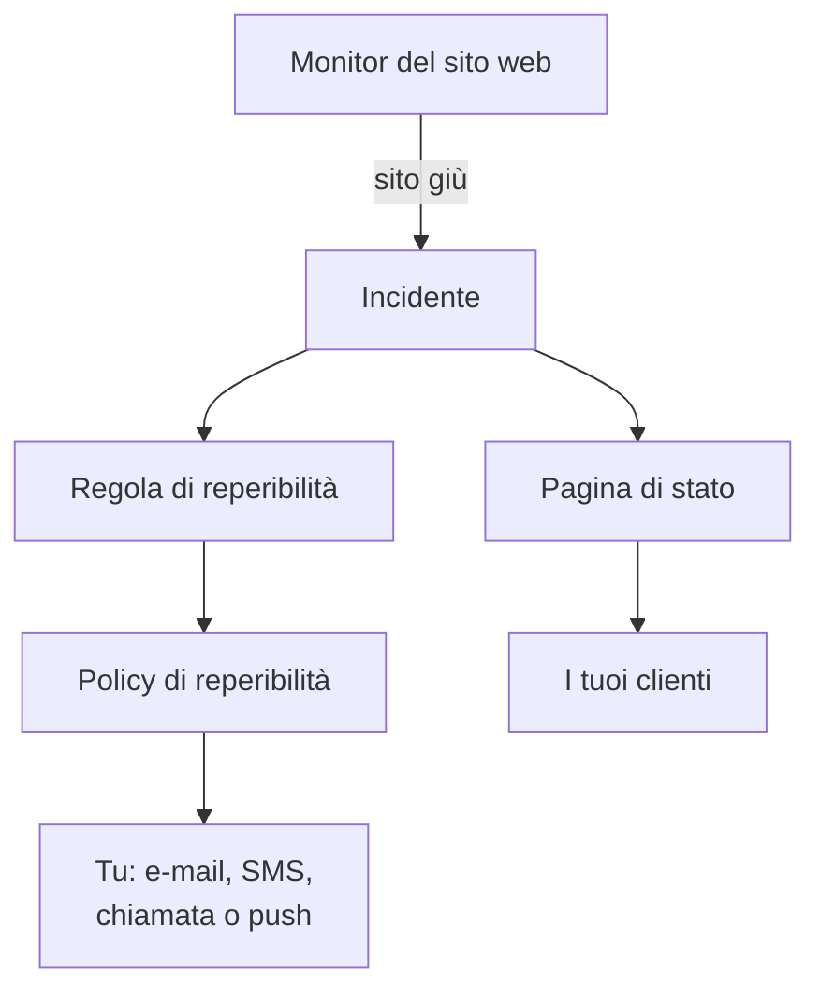

# Guida rapida

Questa guida ti porta da un account nuovo a una configurazione funzionante in circa quindici minuti: un monitor che controlla il tuo sito web ogni cinque minuti, una policy di reperibilità che ti avvisa quando il sito va giù, e una pagina di stato che informa i tuoi clienti. Segue l'elenco **Benvenuto in OneUptime 👋** nella home page del tuo progetto, e le configurazioni guidate che i suoi passaggi aprono.

Arrivi da un altro strumento? [Importa la tua configurazione](/docs/introduction/getting-started#se-arrivi-da-un-altro-strumento) per prima cosa: i tuoi monitor, le pianificazioni di reperibilità e le pagine di stato vengono con te.

## Prima di iniziare

- **Un account.** Su OneUptime Cloud, registrati su [oneuptime.com](https://oneuptime.com/accounts/register) e apri il link nell'e-mail che ricevi. Sulla tua installazione, aprila nel browser e registrati: il primo account diventa l'amministratore principale. Per installarne una, vedi [Docker Compose](/docs/installation/docker-compose).
- **Un sito web da tenere sotto controllo.** Qualsiasi indirizzo che risponde in HTTP o HTTPS, come la home page della tua azienda.

## Creare un progetto

In OneUptime tutto vive in un progetto: i tuoi monitor, gli incidenti, le policy di reperibilità, le pagine di stato e le persone che ci lavorano.

:::steps
### Iniziare un nuovo progetto

Al primo accesso, OneUptime mostra **Nessun progetto**. Fai clic su **Crea nuovo progetto**. Se qualcuno ti ha già invitato in un progetto, accetta invece l'invito nella stessa pagina.

### Dargli un nome

Inserisci un **Nome del progetto**, per esempio il nome della tua azienda. Su OneUptime Cloud, scegli anche un piano subito sotto: Free è già selezionato, e i piani a pagamento iniziano con una prova gratuita.

### Crearlo

Fai clic su **Crea progetto**. Si apre la home page del tuo progetto, con l'elenco **Benvenuto in OneUptime 👋** in alto. Prima chiede **Cosa vuoi fare per prima cosa?**: spunta **Sapere quando il mio sito web o la mia API non funziona**, **Avvisare la persona giusta quando qualcosa si guasta** e **Informare i clienti con una pagina di stato**, e fai clic su **Continua**.
:::

## Monitorare il tuo sito web

:::steps
### Aprire la configurazione del sito web

Nell'elenco, fai clic su **Crea il tuo primo monitor**. Si apre la configurazione guidata **Sapere quando il mio sito web o la mia API non funziona**, che controlla il tuo sito, sceglie chi viene avvisato e invia un test, in una sola pagina. Chi non può creare monitor vede invece l'elenco **Monitor**.

### Inserire l'indirizzo

In **Cosa dobbiamo controllare?**, inserisci l'indirizzo completo del tuo sito in **Indirizzo del sito web o dell'API**, per esempio `https://example.com`, e fai clic su **Inizia il controllo**. Le sonde lo controllano subito, poi ogni 5 minuti: quando il sito non risponde, o risponde con un errore, il monitor passa a **Offline** e dichiara un incidente. Fai clic su **Continua**.

Con il piano Free di OneUptime Cloud, i monitor vengono addebitati in base all'uso, quindi il progetto ha bisogno di un metodo di pagamento prima di poter controllare il tuo sito: senza, il passaggio ti chiede di [aggiungere un metodo di pagamento](/docs/configuration/billing#metodi-di-pagamento).

### Scegliere chi viene avvisato

In **Chi deve essere avvisato?**, sei già in **Chi viene chiamato**. Fai clic su **Salva e continua**: così viene creata `Default on-call policy`, che ti chiama per ogni nuovo incidente e ogni nuovo avviso del progetto, via e-mail per cominciare. Per chiamare anche membri del team che sono già nel progetto, fai prima clic su **Aggiungi membri del team**.

### Inviarti un test

In **Invia un test**, fai clic su **Inviami una chiamata di test**, scegli una **Gravità** e fai clic su **Invia chiamata di test**. Apri il link nell'e-mail, che riporta TEST, e conferma lì la chiamata. Poi fai clic su **Fatto** nella finestra di dialogo, e su **Continua**: la configurazione termina con un riepilogo di ciò che ha impostato.
:::

Per impostare tu ogni opzione, o per controllare qualcosa che non sia un sito web, apri **Monitor** dal menu **Prodotti** e fai clic su **Crea monitor**. [Creare un monitor](/docs/monitor/create-monitor) descrive il modulo e ogni tipo di monitor.

Per controllare anche un'API, e sapere cosa fare quando il primo controllo non torna mai, segui [Sapere quando il tuo sito web o la tua API smette di funzionare](/docs/guides/website-down).

## Essere avvisati quando va giù

La configurazione del sito web ha già creato `Default on-call policy`, che ti chiama via e-mail per ogni nuovo incidente e ogni nuovo avviso, quindi l'elenco segna **Configura una policy di reperibilità** come completato. La sua configurazione guidata aggiunge comunque il tuo telefono, le persone chiamate insieme a te e cosa succede quando nessuno risponde.

:::steps
### Aprire la configurazione della reperibilità

Premi `Ctrl+K` (`Cmd+K` su un Mac), digita `get paged` e scegli **Avvisare la persona giusta quando qualcosa si guasta**. Finché l'elenco non ha segnato **Configura una policy di reperibilità**, quel passaggio apre la stessa configurazione guidata.

### Scegliere come essere raggiunto

In **Come dobbiamo raggiungerti?**, la tua e-mail di accesso è già elencata. Per le notifiche push, installa l'app OneUptime On-Call dall'App Store o da Google Play, accedi e fai clic su **Ricontrolla**. Per ricevere anche SMS e chiamate, fai clic su **Attiva SMS e chiamate**, inserisci il tuo numero in **Il tuo numero di telefono** e fai clic su **Inviami un codice via SMS**: su OneUptime Cloud, SMS e chiamate si pagano con il credito del progetto, quindi il passaggio ti chiede prima di aggiungerne. Fai clic su **Continua**.

### Scegliere chi altro viene chiamato

In **Chi altro è reperibile?**, lascia `Default on-call policy` in **Policy di reperibilità**. Per chiamare membri del team insieme a te, aggiungili in **Aggiungi alla prima regola di escalation**. Fai clic su **Salva e continua**.

### Decidere cosa succede se nessuno risponde

In **E se nessuno risponde?**, scegli **Richiama le stesse persone** finché sei l'unica persona nel progetto. Quando ci sono membri del team, **Chiama qualcun altro** chiama la persona che scegli in **Chiamati dopo**. Su OneUptime Cloud, solo i piani a pagamento offrono questa scelta. Fai clic su **Salva e continua**.

### Inviare una chiamata di test

In **Invia una chiamata di test**, fai clic su **Testa questa policy**, scegli una **Gravità** e fai clic su **Invia chiamata di test**. Conferma la chiamata dall'e-mail, dall'SMS o dalla telefonata, poi fai clic su **Fatto** nella finestra di dialogo, e su **Continua**. La configurazione termina su **Le chiamate sono configurate**.
:::

> [!NOTE]
> SMS e chiamate sono disattivati in un nuovo progetto. Un proprietario del progetto, un Billing Admin o chi ha Manage Billing li attiva nella scheda **Canali di notifica**, in **Impostazioni del progetto → Notifiche → Canali di notifica**.

Due regole di reperibilità attivano la policy: una per ogni nuovo incidente e una per ogni nuovo avviso. Per vedere la prima, apri **Incidenti** dal menu **Prodotti**, espandi **Regole** nel menu laterale e scegli **Regole di reperibilità**: corrisponde a **Tutti gli incidenti**. Per attivare la policy solo per alcuni incidenti, come quelli critici, modifica lì la regola, oppure fai clic su **Crea: Incident On-Call Rule** per aggiungerne una tua.

Per creare invece una policy campo per campo, apri **Reperibilità** dal menu **Prodotti** e fai clic su **Crea: Policy di reperibilità**. Per altri livelli, turni e quanto attende ogni livello, vedi [Regole di escalation](/docs/on-call/escalation-rules) e [Pianificazioni di reperibilità](/docs/on-call/schedules).

Per ogni schermata della configurazione, e cosa fare quando una chiamata non arriva, segui [Essere avvisati per chiamata, SMS o push](/docs/guides/paging).

## Pubblicare una pagina di stato

:::steps
### Aprire la configurazione della pagina di stato

Nell'elenco, fai clic su **Pubblica una pagina di stato**. Si apre la configurazione guidata **Pubblica una pagina di stato**, che dà un nome alla pagina, ci mette il tuo monitor e mostra ciò che vedono i tuoi clienti. Chi non può creare pagine di stato vede invece l'elenco **Pagine di stato**. Il riepilogo della configurazione del sito web apre la stessa configurazione, come **Mostralo su una pagina di stato**.

### Darle un nome e scegliere il tuo monitor

In **Dalle un nome e scegli cosa mostra**, tieni il **Nome della pagina di stato** che propone, o inserisci il tuo. In **Cosa mostra**, spunta il monitor del tuo sito web, e fai clic su **Crea la pagina di stato**. Da questo momento la pagina è pubblica al suo link: chiunque abbia il suo indirizzo può aprirla.

### Aprire la pagina

In **Questo è ciò che vedono i tuoi clienti**, apri l'indirizzo sotto **Link pubblico**: il tuo sito web risulta operativo. Tornato nella configurazione, fai clic su **Va bene**. La configurazione termina con un riepilogo di cosa fare dopo.
:::

Per creare invece una pagina a mano, apri **Pagine di stato** dal menu **Prodotti** e fai clic su **Crea pagina di stato**, poi aggiungi il tuo monitor con **Aggiungi monitor** nella sua **Panoramica**. Per dare alla pagina il tuo logo e i tuoi colori, vedi [Branding e domini della pagina di stato](/docs/status-pages/branding-and-domains).

Per portare la pagina di stato sul tuo dominio, in HTTPS, segui [Pubblicare una pagina di stato](/docs/guides/status-page).

## Invitare il tuo team

Nell'elenco, fai clic su **Invita il tuo team**, oppure apri **Utenti** dal menu **Prodotti**, in **Impostazioni**. Fai clic su **Invita utente**, inserisci la sua **E-mail** e scegli un **Team**: all'inizio è scelto il team dei membri. Fai clic su **Invita**. OneUptime gli invia l'invito via e-mail, e il team decide cosa può fare. Vedi [Utenti, team e autorizzazioni](/docs/permissions/index).

## Provarlo

Dichiara un incidente di prova per vedere funzionare tutta la catena.

:::steps
### Dichiarare un incidente di prova

Apri **Incidenti** e fai clic su **Dichiara incidente**. Inserisci un **Titolo**, per esempio `Test incident`, scegli una **Gravità incidente** e fai clic su **Avanti**. In **Monitor**, scegli il monitor del tuo sito web, così l'incidente compare sulla tua pagina di stato. Fai clic su **Avanti** fino al riepilogo, poi su **Dichiara incidente**.

### Guardare cosa succede

Entro un paio di minuti, la tua policy di reperibilità ti avvisa e l'incidente compare sulla tua pagina di stato.

### Risolverlo

Nella pagina dell'incidente, fai clic su **Risolvi**. Gli avvisi si fermano e l'incidente lascia la tua pagina di stato.
:::

> [!WARNING]
> Chiunque apra la tua pagina di stato vede l'incidente di prova finché non lo risolvi. Fai la prova prima di condividere l'indirizzo della pagina.

## Risoluzione dei problemi

:::details Non sono stato avvisato
Apri l'incidente e scegli **Esecuzioni di reperibilità** nel suo menu laterale: lì vedi se la tua policy è stata eseguita e chi ha avvisato. Se non è stata eseguita, controlla che la tua regola di reperibilità sia attiva e indichi la policy. Se è stata eseguita, controlla che i tuoi metodi in **Impostazioni utente → Metodi di notifica** siano verificati.
:::

:::details L'incidente non compare sulla mia pagina di stato
Una pagina di stato mostra un incidente quando uno dei monitor dell'incidente è sulla pagina. Controlla che l'incidente elenchi il tuo monitor tra le risorse interessate, e che il monitor sia sulla pagina di stato.
:::

:::details Il monitor dice offline, ma il mio sito funziona
Apri il monitor e controlla cosa hanno ricevuto le sonde. Vedi la sezione sulla risoluzione dei problemi di [Monitor sito web](/docs/monitor/website-monitor).
:::

## Passaggi successivi

:::cards
- [Concetti fondamentali](/docs/introduction/core-concepts): Le idee dietro ciò che hai appena configurato.
- [Glossario](/docs/introduction/glossary): Ogni parola che hai incontrato lungo il percorso, in una o due frasi.
- [Pianificazioni di reperibilità](/docs/on-call/schedules): Condividere la reperibilità con il tuo team.
- [Branding e domini della pagina di stato](/docs/status-pages/branding-and-domains): Rendere tua la pagina di stato.
- [OpenTelemetry](/docs/telemetry/open-telemetry): Inviare log, metriche e tracce dalle tue applicazioni.
:::
