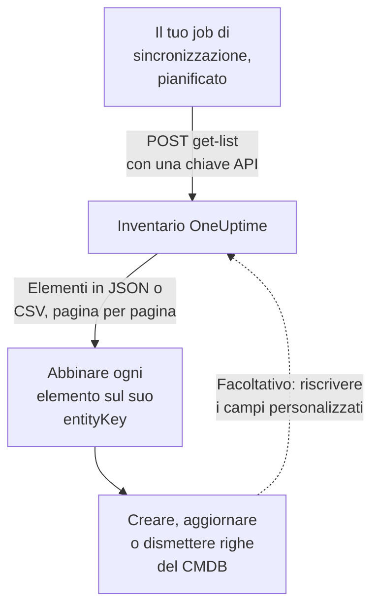

# Esportare in un CMDB

Se gestisci già un CMDB o un registro degli asset, OneUptime non cerca di sostituirlo. Ciò che ha e che a un CMDB di solito manca è un'immagine di ciò che è davvero in esecuzione, tenuta aggiornata senza che nessuno la curi: scoperta dalla telemetria e dai poller che già osservano la tua rete e i tuoi account cloud. Questa pagina è la ricetta per portare quell'immagine nel tuo sistema di riferimento.

:::cards
- [Come funziona una sincronizzazione](#come-funziona-una-sincronizzazione): Un job pianificato che legge l'elenco e abbina su una chiave stabile.
- [Recuperare il catalogo](#recuperare-il-catalogo): La richiesta, pagina per pagina, in JSON o CSV.
- [Dettagli dell'asset](#dettagli-dellasset): Gli stessi dati e le stesse chiavi per host e dispositivi di rete.
- [Riscrivere](#riscrivere): Portare i tuoi tag degli asset in OneUptime e aggiungere ciò che non può vedere.
:::

## Come funziona una sincronizzazione

Una sincronizzazione è un job che esegui secondo una pianificazione. Legge l'elenco dell'inventario tramite l'API REST con una chiave API, abbina ogni elemento a una riga del tuo CMDB tramite la sua chiave d'identità e crea, aggiorna o dismette righe di conseguenza. Può anche riscrivere valori nei campi personalizzati degli elementi.



## Cosa puoi recuperare

Tre risorse REST, ognuna con gli endpoint standard dell'[API di OneUptime](/docs/api-reference/api-reference):

| Risorsa | Endpoint | Cosa contiene |
| --- | --- | --- |
| Elemento dell'inventario | `/api/inventory-item` | Una riga per ogni cosa dell'infrastruttura |
| Definizioni dei campi personalizzati | `/api/inventory-item-custom-field` | Il vocabolario di campi proprio del tuo progetto |
| Relazioni | `/api/inventory-item-relationship` | I collegamenti orientati tra gli elementi |

Le colonne utili di un elemento dell'inventario:

| Colonna | Significato |
| --- | --- |
| `_id` | L'ID di OneUptime: usalo come riferimento esterno |
| `entityType` | `host`, `k8s.pod`, `network.device`, `appliance`, … |
| `entityKey` | Un hash d'identità stabile. Sopravvive alle rinomine, quindi è la chiave migliore per abbinare |
| `displayName` | Il nome che leggono le persone |
| `source` | `discovered`, `inventory` o `manual` |
| `description` | Testo libero |
| `identifyingAttributes` | Gli attributi che fanno dell'elemento ciò che è, e che non cambiano mai |
| `descriptiveAttributes` | Tutto il resto osservato su di esso: vedi [Dettagli dell'asset](#dettagli-dellasset), [Attributi di asset degli host](#attributi-di-asset-degli-host) e [Attributi di asset dei dispositivi di rete](#attributi-di-asset-dei-dispositivi-di-rete) più sotto |
| `customFields` | I tuoi campi, indicizzati per nome del campo |
| `resourceType` / `resourceId` | Un puntatore al record più completo di OneUptime, quando esiste |
| `firstSeenAt` / `lastSeenAt` | Quando è stato osservato la prima e l'ultima volta |
| `isArchived` | Se è stato tolto dall'elenco attivo |

## Prima di iniziare

Una sincronizzazione ha bisogno di una chiave API che possa leggere l'inventario. Su OneUptime Cloud, le chiavi API richiedono il piano **Growth** o superiore.

:::steps
### Creare una chiave API

Apri **Impostazioni del progetto → Avanzato → Chiavi API** e fai clic su **Crea: Chiave API**. Dagli un **Nome** e in **Accesso** scegli **Visualizzatore** per leggere tutto il progetto, oppure **Scegli le autorizzazioni più tardi** per darle solo ciò che serve a una sincronizzazione.

### Darle solo ciò che le serve

Un'esportazione in sola lettura ha bisogno di una sola autorizzazione, **Read Telemetry Service**: l'inventario condivide le autorizzazioni della telemetria invece di averne di proprie. Nella pagina della chiave, fai clic su **Aggiungi autorizzazione** e sceglila. Per riscrivere valori, aggiungi anche **Edit Telemetry Service**.

### Copiare la chiave

Copia la **Chiave API** dalla pagina della chiave e rendila disponibile al tuo job:

```bash
export ONEUPTIME_API_KEY="your-api-key"
```
:::

La chiave viene inviata nell'intestazione `ApiKey` di ogni richiesta e legge l'inventario del proprio progetto, quindi una richiesta non nomina alcun progetto.

## Recuperare il catalogo

Fai una `POST` all'endpoint di elenco con le colonne che vuoi. `select` è obbligatorio: l'API restituisce solo ciò che chiedi.

```bash
curl -X POST 'https://oneuptime.com/api/inventory-item/get-list' \
  -H "ApiKey: $ONEUPTIME_API_KEY" \
  -H 'Content-Type: application/json' \
  -d '{
    "query": { "isArchived": false },
    "select": {
      "_id": true,
      "entityType": true,
      "entityKey": true,
      "displayName": true,
      "source": true,
      "customFields": true,
      "descriptiveAttributes": true,
      "lastSeenAt": true
    },
    "sort": { "displayName": "ASC" },
    "limit": 100,
    "skip": 0
  }'
```

Su un'installazione self-hosted, usa il tuo indirizzo di OneUptime al posto di `https://oneuptime.com`. La risposta è `{ "data": [...], "count": ... }`, dove `count` è quanti elementi corrispondono in totale. Scorri le pagine aumentando `skip` del tuo `limit` finché non li hai tutti; `limit` arriva fino a 10.000. Le date e gli ID diversi da `_id` tornano incapsulati, come `{ "_type": "DateTime", "value": "..." }` e `{ "_type": "ObjectID", "value": "..." }`: leggili da `value`.

### Solo i dispositivi di rete

Restringi l'elenco con `entityType`:

```bash
curl -X POST 'https://oneuptime.com/api/inventory-item/get-list' \
  -H "ApiKey: $ONEUPTIME_API_KEY" \
  -H 'Content-Type: application/json' \
  -d '{
    "query": { "entityType": "network.device", "isArchived": false },
    "select": { "_id": true, "entityKey": true, "displayName": true, "customFields": true },
    "limit": 100,
    "skip": 0
  }'
```

I `descriptiveAttributes` di ogni dispositivo di rete portano il suo hostname, indirizzo IP, numero di serie, indirizzo MAC, marca, modello, firmware, sistema operativo, ruolo, sito e posizione: vedi [Attributi di asset dei dispositivi di rete](#attributi-di-asset-dei-dispositivi-di-rete) più sotto. Il resto di ciò che sa il poller, come interfacce e vicini, si trova sul record Network Device stesso: segui `resourceId` fino a `/api/network-device/:id/get-item`, oppure recupera direttamente `/api/network-device/get-list`.

### In CSV

Qualsiasi endpoint di elenco risponde in CSV invece che in JSON con `?output-type=csv`:

```bash
curl -X POST 'https://oneuptime.com/api/inventory-item/get-list?output-type=csv' \
  -H "ApiKey: $ONEUPTIME_API_KEY" \
  -H 'Content-Type: application/json' \
  -d '{ "query": {}, "select": { "displayName": true, "entityType": true, "customFields": true }, "limit": 500, "skip": 0 }' \
  -o inventory.csv
```

L'elenco **All Items** della dashboard esporta allo stesso modo, con le colonne di campi personalizzati che hai attivato. Ogni [dettaglio dell'asset](#dettagli-dellasset) è lì anche una colonna: **Hostname**, **Indirizzo IP**, **Numero di serie**, **Modello** e le altre partono nascoste, quindi attivale dal selettore di colonne, e l'esportazione contiene una colonna per dato, che una riga sia un host o un dispositivo di rete.

## Dettagli dell'asset

Host e dispositivi di rete sono descritti dagli stessi dati, memorizzati con le stesse chiavi. Una colonna del CMDB contiene il numero di serie che una riga sia un server o uno switch, e la scheda **Dettagli dell'asset** di un elemento nella dashboard mostra ogni dato nello stesso ordine per entrambi. Un dato che nulla ha segnalato si legge **Sconosciuto** invece di essere omesso, così una lacuna resta visibile.

| Dato | Chiave | Su un host | Su un dispositivo di rete |
| --- | --- | --- | --- |
| Hostname | `host.name` | Il nome dell'host. È l'identità dell'host, quindi si trova in `identifyingAttributes` | Il nome proprio del dispositivo: il suo `sysName` SNMP, altrimenti il nome NetBIOS o DNS trovato dalla scoperta. Mai il suo indirizzo IP |
| Indirizzo IP | `host.ip` | Ogni indirizzo segnalato dal collector | L'indirizzo che OneUptime interroga, quando è un indirizzo IP, altrimenti l'indirizzo in cui la sua sonda ha risolto quel nome DNS |
| Indirizzo MAC | `host.mac` | Rilevato | Inserito sul dispositivo, o appreso dalla tabella ARP di un router percorso |
| Numero di serie | `host.serial_number` | Apposto | ENTITY-MIB |
| Manufacturer | `device.manufacturer` | Apposto | ENTITY-MIB, altrimenti ciò che nominano `sysDescr` o `sysObjectID` |
| Modello | `device.model.name` | Apposto | ENTITY-MIB, altrimenti ciò che nomina `sysDescr` |
| Versione firmware | `device.firmware.version` | Apposta | ENTITY-MIB, altrimenti ciò che nomina `sysDescr` |
| Sistema operativo | `os.name` | `os.description` (o `os.type`) | Ciò che nomina `sysDescr`: Cisco IOS, Junos OS, Arista EOS, Linux |
| Versione OS | `os.version` | Rilevata | ENTITY-MIB, altrimenti ciò che nomina `sysDescr` |
| Device Type | `device.type` | Apposto. Altrimenti la scheda lo classifica in base al sistema operativo e al nome (Server, Firewall, ...) | Il suo ruolo: quello che hai assegnato, altrimenti quello con cui lo disegna la mappa della topologia |
| Location | `device.location` | Apposta. Altrimenti la scheda mostra la sua zona cloud | `sysLocation`. La scheda mostra prima il suo sito |

La [tabella degli host](#attributi-di-asset-degli-host) e la [tabella dei dispositivi di rete](#attributi-di-asset-dei-dispositivi-di-rete) qui sotto dicono in dettaglio da dove viene ogni valore.

## Attributi di asset degli host

`descriptiveAttributes` su un host porta i dati di asset che una riga del CMDB di solito vuole, indicizzati per nome dell'attributo OpenTelemetry:

| Campo | Chiave | Raccolto per impostazione predefinita? |
| --- | --- | --- |
| Indirizzi IP | `host.ip` | Sì: separati da virgole quando la macchina ne ha più di uno |
| Indirizzi MAC | `host.mac` | Sì: separati da virgole, uno per ogni interfaccia attiva, come `AC-DE-48-23-45-67` |
| Architettura | `host.arch` | Sì |
| ID della macchina | `host.id` | Sì: il GUID della macchina su Windows, `/etc/machine-id` su Linux |
| Sistema operativo | `os.type`, `os.description`, `os.version` | Sì |
| Collocazione cloud | `cloud.provider`, `cloud.region`, `cloud.availability_zone` | Solo con un rilevatore cloud |
| Numero di serie | `host.serial_number` | Richiede un passaggio di configurazione |
| Marca | `device.manufacturer` | Richiede un passaggio di configurazione |
| Modello | `device.model.name` | Richiede un passaggio di configurazione |
| Versione del firmware (BIOS o UEFI) | `device.firmware.version` | Richiede un passaggio di configurazione |
| Nome del sistema operativo | `os.name` | Solo dagli SDK che lo segnalano: altrimenti `os.description` nomina il sistema |
| Tipo di dispositivo | `device.type` | Facoltativo: apponilo allo stesso modo (`Hypervisor`, `Workstation`) |
| Posizione | `device.location` | Facoltativa: apponila allo stesso modo (`Frankfurt DC, Rack B4`) |

Tutto ciò che è segnato con Sì viene dal processore `resourcedetection` del collector, ed è già nella configurazione che OneUptime genera per te.

Le chiavi `cloud.*` richiedono un rilevatore cloud in quel processore: `detectors: [system, env, ec2]`, oppure `gcp` o `azure` per gli altri. La configurazione fornita esegue solo `[system, env]`, quindi quelle tre restano vuote finché non ne aggiungi uno.

Numero di serie, marca, modello e firmware non hanno un rilevatore di risorse: risiedono nel firmware della macchina, letti tramite WMI su Windows e DMI su Linux, quindi vengono apposti una volta sulla risorsa, quando la macchina viene predisposta. Un tipo di dispositivo o una posizione che vuoi sulla riga si appone allo stesso modo. [Attributi di inventario](/docs/telemetry/host-otel-collector#attributi-di-inventario-ip-mac-numero-di-serie-produttore-modello-firmware) contiene il frammento esatto per ogni sistema operativo. `host.manufacturer`, `host.model.name`, `host.firmware.version` e `host.bios.version` sono accettati come grafie alternative e memorizzati con le chiavi `device.*` (e `device.serial_number` con `host.serial_number`), quindi una sincronizzazione legge sempre una sola chiave per dato.

`host.id` merita un'occhiata come chiave di abbinamento se il tuo CMDB usa già un identificativo hardware: a differenza di `entityKey`, è l'ID proprio della macchina, quindi corrisponde a ciò che uno strumento di gestione degli endpoint segnala per la stessa macchina.

Gli attributi si aggiungono e non si svuotano mai: uno che smette di essere segnalato resta sulla riga, quindi un valore che la tua sincronizzazione ha già letto non sparisce mai in silenzio.

## Attributi di asset dei dispositivi di rete

Un dispositivo di rete (`entityType: network.device`) viene replicato dal suo record Network Device, e i suoi `descriptiveAttributes` usano le stesse chiavi che un host usa per gli stessi dati, quindi una colonna del CMDB contiene il numero di serie che la riga sia un server o uno switch:

| Campo | Chiave | Da dove viene |
| --- | --- | --- |
| Hostname | `host.name` | Il nome proprio del dispositivo: il suo `sysName` SNMP, altrimenti il nome NetBIOS o DNS inverso trovato dalla scoperta. Omesso quando solo il suo indirizzo IP lo nomina |
| Indirizzo IP | `host.ip` | L'indirizzo che OneUptime interroga, quando è un indirizzo IP. Per un dispositivo interrogato tramite un nome DNS, l'indirizzo in cui la sua sonda ha risolto quel nome l'ultima volta |
| Nome DNS | `net.device.dns_name` | Il nome DNS inverso trovato alla scoperta, o il nome DNS che OneUptime interroga |
| Indirizzo MAC | `host.mac` | Inserito sul dispositivo, o appreso dalla tabella ARP di un router percorso |
| Marca | `device.manufacturer` | ENTITY-MIB `entPhysicalMfgName`, altrimenti il produttore che nomina `sysDescr`, altrimenti il fornitore del `sysObjectID` |
| Modello | `device.model.name` | ENTITY-MIB `entPhysicalModelName`, altrimenti il modello che nomina `sysDescr` |
| Numero di serie | `host.serial_number` | ENTITY-MIB `entPhysicalSerialNum` |
| Versione firmware | `device.firmware.version` | ENTITY-MIB `entPhysicalFirmwareRev`, altrimenti il firmware che `sysDescr` nomina sui dispositivi Ubiquiti, HPE e Aruba |
| Sistema operativo | `os.name` | Il sistema operativo che nomina `sysDescr` |
| Versione del software o dell'OS | `os.version` | ENTITY-MIB `entPhysicalSoftwareRev`, altrimenti la release che nomina `sysDescr` |
| Descrizione del sistema | `os.description` | `sysDescr` |
| Tipo di dispositivo | `device.type` | Il ruolo che hai assegnato al dispositivo, altrimenti il ruolo con cui lo classifica la mappa della topologia, con il nome che il tuo progetto gli dà |
| Posizione | `device.location` | `sysLocation`, a meno che non sia il valore predefinito di un agente come «Sitting on the Dock of the Bay» di Net-SNMP |
| Sito | `oneuptime.site.name` | Il Network Site a cui è assegnato il dispositivo |
| Indirizzo interrogato | `net.device.hostname` | L'indirizzo che OneUptime interroga: un indirizzo IP o un nome DNS. Mantenuto per le sincronizzazioni scritte prima che esistessero `host.name` e `host.ip` |

Le righe ENTITY-MIB si compilano dopo il primo walk SNMP del dispositivo. Un dispositivo che non viene percorso, perché è monitorato solo con ping o non ancora interrogato, ricava comunque nome, marca, sistema operativo e posizione da ciò che l'ultima scansione di rilevamento del suo indirizzo ha letto via SNMP, e il suo indirizzo MAC dalla tabella ARP di un router percorso. Un dispositivo che non implementa ENTITY-MIB non ha numero di serie né firmware da segnalare. Il suo `sysDescr` nomina comunque modello e sistema operativo per molte piattaforme: un Cisco Meraki MX segnala `Meraki MX85`, che compila marca e modello. Una piattaforma il cui `sysDescr` non ha una forma nota non aggiunge nulla, invece di tirare a indovinare.

Un valore salvato sul dispositivo, digitato o impostato tramite l'API, non viene mai sostituito da ciò che legge il rilevamento. Tra un valore letto dal walk del dispositivo stesso e uno letto da una scansione, si usa il più recente. Ciò che legge una scansione si usa solo se la scansione ha trovato la stessa macchina all'indirizzo: quando il nome di sistema, il `sysObjectID` o il nome NetBIOS che ha letto contraddice quello del dispositivo, non si usa nulla di ciò che vi ha letto. La scheda **Dettagli dell'asset** dell'elemento indica da dove viene ogni valore e quando.

L'hostname non è mai l'indirizzo IP. Un dispositivo che solo il suo indirizzo nomina ha `host.ip` e nessun `host.name`. Quando il suo walk SNMP segnala un nome di sistema, `host.name` arriva al passaggio successivo.

Questi valori vengono copiati dal record Network Device ogni quindici minuti, e **sostituiscono** i valori precedenti invece di aggiungersi, quindi un valore cancellato sul dispositivo (un indirizzo MAC rimosso, per esempio) lascia anche l'elemento dell'inventario.

Non esiste una versione di *aggiornamento disponibile*: SNMP non ha un oggetto standard per questo, quindi OneUptime registra la versione in esecuzione sul dispositivo.

## Abbinare gli elementi alle righe del CMDB

Abbina su `entityKey`, non su `displayName`. È un hash degli attributi identificativi dell'elemento, quindi sopravvive alle rinomine e ai nuovi tag: un host rietichettato mantiene la stessa chiave mentre il suo nome visualizzato cambia. `_id` è altrettanto stabile, ed è la chiave esterna più semplice se parli sempre con un solo progetto.

Le date in `customFields` sono stringhe ISO-8601 in UTC, e l'esportazione CSV le scrive così invece che nella forma più leggibile mostrata dalla dashboard, così si importano senza sorprese di parsing.

## Tenerlo aggiornato

Non c'è un feed delle modifiche. Interroga l'endpoint di elenco all'intervallo che preferisci e confronta su `entityKey`. `lastSeenAt` dice quando un elemento è stato osservato l'ultima volta, ed è di solito il modo meno costoso per individuare ciò che è diventato silenzioso dall'ultima esecuzione.

Un elemento che scompare tra due esecuzioni è scaduto (un elemento scoperto rimasto in silenzio oltre la sua finestra) oppure ha visto eliminare il suo record di origine. Un elemento replicato che porta valori di campi personalizzati viene archiviato invece che eliminato quando il suo record scompare, quindi interroga con `"isArchived": true` per vedere ciò che è stato dismesso senza perdere i dati di asset collegati.

## Riscrivere

Gli stessi endpoint accettano scritture, quindi una sincronizzazione può inviare valori in `customFields`: per esempio il tag dell'asset che il tuo CMDB gestisce già, apposto sull'elemento OneUptime corrispondente. Per questo la chiave ha bisogno di **Edit Telemetry Service**.

Puoi anche aggiungere elementi per cose che OneUptime non può vedere, con `POST /api/inventory-item`, un `entityType` tra `external.service`, `external.database` o `appliance`, e un `displayName`. OneUptime ricava la chiave d'identità per te, e quegli elementi non scadono mai. Per questo la chiave ha bisogno di **Create Telemetry Service**.

## Risoluzione dei problemi

:::details Ogni richiesta viene rifiutata con 402 Payment Required
Su OneUptime Cloud, le chiavi API funzionano solo finché il progetto è sul piano **Growth** o superiore. Niente viene eliminato: la chiave torna a funzionare così com'è appena il progetto torna sul piano. Vedi [Chiavi API e SCIM sotto il loro piano](/docs/api-reference/api-reference#chiavi-api-e-scim-sotto-il-loro-piano).
:::

:::details Ogni richiesta risponde 422 You do not have permissions
La chiave non ha alcuna autorizzazione che legga l'inventario. Una chiave creata con **Scegli le autorizzazioni più tardi** non può fare nulla finché non ne riceve una: aggiungi **Read Telemetry Service** sulla sua pagina, come in [Prima di iniziare](#prima-di-iniziare).
:::

:::details L'elenco torna senza le colonne che mi servono
L'elenco restituisce solo le colonne che nomina `select`, più `_id`. Aggiungi a `select` ogni colonna che leggi, compresi `descriptiveAttributes` e `customFields`.
:::

:::details Manca un elemento che mi aspettavo
Gli elementi archiviati vengono omessi quando invii `"isArchived": false`. Un elemento scoperto viene rimosso quando resta in silenzio oltre la sua finestra, e uno replicato se ne va con il suo record. Chiedi `"isArchived": true` per vedere quelli archiviati.
:::

## Passaggi successivi

:::cards
- [Panoramica dell'inventario](/docs/inventory/overview): Da dove vengono gli elementi e quanto resta ciascuno.
- [Campi personalizzati dell'inventario](/docs/inventory/custom-fields): Definire i campi che la tua sincronizzazione legge e scrive.
- [Riferimento API di OneUptime](/docs/api-reference/api-reference): Richieste, codici di stato e le regole che ogni scrittura segue.
:::
