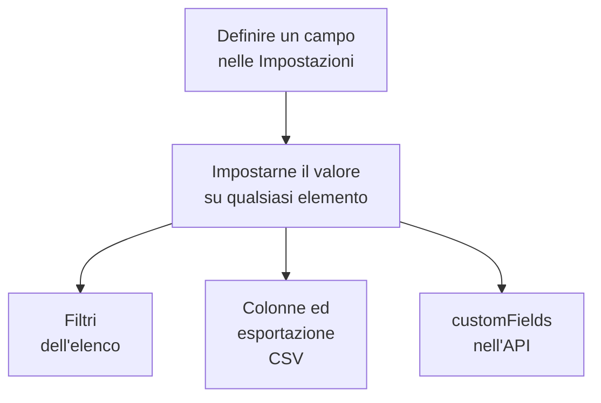

# Campi personalizzati dell'inventario

OneUptime scopre cosa c'è nella tua infrastruttura. I campi personalizzati registrano ciò che nessuna osservazione può dirgli: il numero di serie sull'etichetta, la data di scadenza della garanzia, quale team possiede una cosa, se è in servizio o in un cassetto di ricambi. Definisci i campi una volta per il progetto, poi compilali su ogni elemento.

:::cards
- [Come funzionano i campi personalizzati](#come-funzionano-i-campi-personalizzati): Un vocabolario, su ogni elemento, qualunque sia la sua fonte.
- [Definire i campi](#definire-i-campi): Creare un campo, sceglierne il tipo, elencare le opzioni di un menu a tendina.
- [Filtrare l'elenco](#filtrare-lelenco): Trovare cosa scade il prossimo trimestre in due clic.
- [Note e limiti](#note-e-limiti): Rinomine, duplicati, date e campi eliminati.
:::

## Come funzionano i campi personalizzati

Un campo si definisce una volta per il progetto, e ogni elemento può portarne un valore: quelli che OneUptime ha scoperto, quelli che replica e quelli che hai aggiunto a mano. Un campo diventa un filtro sopra l'elenco, una colonna facoltativa e una colonna dell'esportazione CSV. L'API legge e scrive gli stessi valori, in `customFields` di ogni elemento.

> [!NOTE]
> Su OneUptime Cloud, i campi personalizzati fanno parte del piano **Growth** e superiori. Sotto di esso, i campi non possono essere definiti, elencati né modificati: l'API risponde `402 Payment Required`, e l'elenco non mostra filtri né colonne di campi personalizzati.

## Definire i campi

:::steps
### Aprire la pagina dei campi personalizzati

Vai su **Prodotti → Risorse → Inventario**, apri **Impostazioni** nel menu laterale, poi **Campi personalizzati**.

### Creare un campo

Fai clic su **Crea: Inventory Item Custom Field**. Dagli un **Nome del campo**, una **Descrizione del campo** facoltativa e un **Tipo di campo** dalla tabella qui sotto.

### Elencare le opzioni di un menu a tendina

Per un tipo menu a tendina, aggiungi le sue opzioni in **Opzioni del menu a discesa**. Ogni opzione può avere un colore, usato allo stesso modo nella cella della tabella e nel filtro: scegli uno dei colori con nome, **Nessun colore**, o **Colore personalizzato** per un codice colore esatto. Trascina un'opzione per la sua maniglia per cambiarne la posizione nell'elenco.
:::

| Tipo | Usalo per |
| --- | --- |
| **Testo** | Numero di serie, tag dell'asset, posizione nel rack, numero d'ordine d'acquisto |
| **Numero** | Costo, unità rack, numero di porte |
| **Booleano** | Sotto supporto, nel perimetro PCI |
| **Menu a tendina (selezione singola)** | Stato del ciclo di vita, ambiente, criticità: una risposta da un elenco fisso |
| **Menu a tendina (selezione multipla)** | Ambiti di conformità, tag: più risposte da un elenco fisso |
| **Data** | Data d'acquisto, scadenza della garanzia, data di fine vita |
| **Data e ora** | Ultimo audit il, dismesso il |
| **Testo lungo** | Istruzioni di accesso, note: più righe di testo semplice |
| **Testo formattato (Markdown)** | Note con formattazione e link, scritte nell'editor Markdown |
| **File** | Un certificato di garanzia, un ordine d'acquisto firmato, una foto dell'etichetta del rack: un file |
| **Più file** | Manuali, fatture e foto: fino a 10 file |

## Un vocabolario di asset completo

Un tipico registro di asset hardware si traduce direttamente in questi campi:

| Nome del campo | Tipo | Esempio |
| --- | --- | --- |
| `Serial Number` | Testo | `FDO24160ABC` |
| `Asset Tag` | Testo | `IT-004821` |
| `Purchase Date` | Data | 2024-03-11 |
| `Warranty Expiry` | Data | 2027-03-10 |
| `Lifecycle Status` | Menu a tendina | In servizio, Ricambio, In riparazione, Dismesso |
| `Assigned Site` | Menu a tendina | Data center di Londra, Data center di Francoforte, Sede centrale |
| `Owner Team` | Menu a tendina | Rete, Piattaforma, Sicurezza |
| `Cost Centre` | Testo | `CC-4410` |

Imposta i valori nella pagina **Campi personalizzati** di un elemento. Qualsiasi elemento li accetta, qualunque sia la sua fonte, quindi gli switch che OneUptime ha scoperto e i dispositivi di rete che replica portano lo stesso vocabolario di asset delle appliance che hai aggiunto a mano.

## Filtrare l'elenco

Ogni campo personalizzato diventa un filtro sopra l'elenco **All Items**, e il filtro offre i confronti adatti al suo tipo:

| Tipo di campo | Confronti |
| --- | --- |
| **Testo**, **Testo lungo**, **Testo formattato (Markdown)** | è, non è, contiene, non contiene, inizia con, termina con, è vuoto, non è vuoto |
| **Numero** | è, non è, è maggiore di, è maggiore o uguale a, è minore di, è minore o uguale a, è vuoto, non è vuoto |
| **Booleano**, **Menu a tendina (selezione singola)**, **Menu a tendina (selezione multipla)** | è, non è, è vuoto, non è vuoto |
| **Data**, **Data e ora** | è, è prima di, è dopo, è tra, è vuoto, non è vuoto |
| **File**, **Più file** | è |

Un chip **File** o **Più file** chiede una cosa sola: se il campo è **Con file** o con **Nessun file**.

I filtri si combinano con E, quindi «Warranty Expiry è prima di 2026-10-01 E Lifecycle Status è In servizio» è un'unica vista dell'elenco. È la domanda a cui un registro di asset esiste per rispondere, e il motivo per usare i tipi data invece di una data in un campo di testo: un campo di testo memorizza volentieri `2026-10-01`, poi non sa dirti cosa scade il prossimo trimestre.

Le colonne dei campi personalizzati partono nascoste: attivale dal selettore di colonne. Non si possono ordinare, perché i valori stanno insieme in un'unica colonna JSON che l'elenco non sa ordinare.

## Note e limiti

- I valori sono memorizzati su ogni elemento con il nome del campo. Rinominare un campo non sposta i valori già memorizzati con il vecchio nome. I campi personalizzati degli incidenti sono l'eccezione: rinominarne uno sposta i suoi valori (vedi [Rinominare un campo](/docs/incidents/settings#rinominare-un-campo)).
- Le opzioni di un menu a tendina si possono aggiungere, rinominare, riordinare trascinandole e rimuovere dopo che gli elementi hanno valori. Rinominare un'opzione la cambia su ogni elemento che la ha; un'opzione rimossa resta sugli elementi che la hanno, mostrata come non più un'opzione, a meno che tu non ne scelga un'altra per loro (vedi [Cambiare le opzioni di un menu a tendina](/docs/incidents/settings#cambiare-le-opzioni-di-un-menu-a-tendina)).
- Niente rende unico un valore. Due elementi possono avere lo stesso numero di serie, e niente te lo impedisce.
- Le date sono memorizzate come timestamp ISO-8601 in UTC e mostrate nel tuo fuso orario.
- Eliminare un campo lo toglie dall'elenco e dalla barra dei filtri. I valori già scritti restano sugli elementi.
- Un campo **File** o **Più file** accetta file di 10 MB al massimo ciascuno, dei tipi elencati in [Campi file](/docs/incidents/settings#campi-file), caricati nel progetto. Solo chi può vedere l'elemento può scaricarli, e un file viene eliminato appena niente lo trattiene più.

## Passaggi successivi

:::cards
- [Panoramica dell'inventario](/docs/inventory/overview): Da dove vengono gli elementi e cosa mostra ogni pagina.
- [Esportare in un CMDB](/docs/inventory/cmdb-sync): Portare gli elementi e i loro campi personalizzati in un altro sistema.
- [Campi personalizzati degli incidenti](/docs/incidents/settings#campi-personalizzati): Gli stessi tipi di campo sugli incidenti, con qualche extra.
:::
