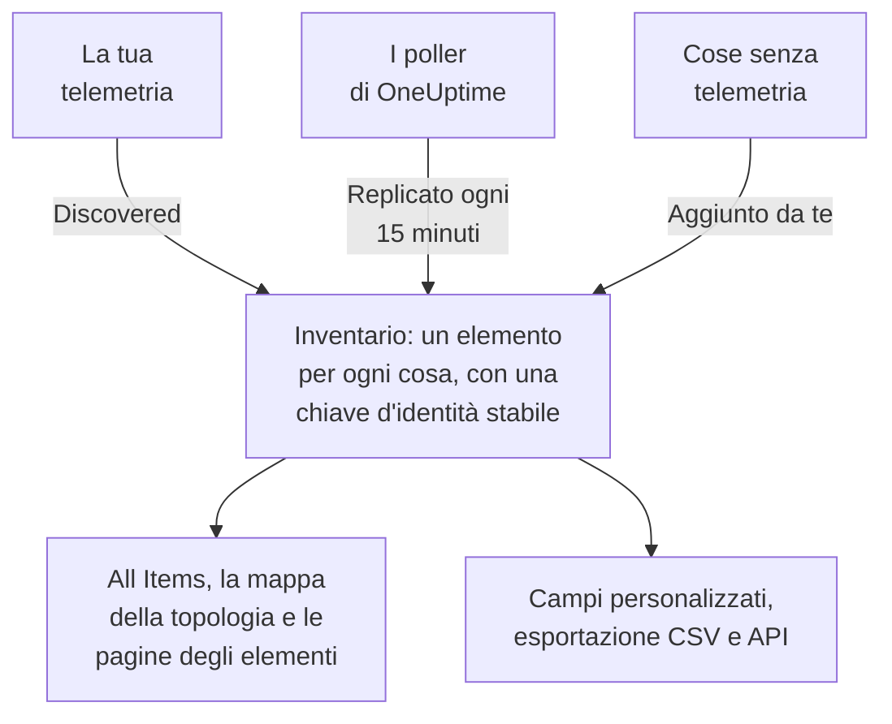

# Panoramica dell'inventario

L'inventario è un unico elenco di tutto ciò che OneUptime sa della tua infrastruttura: servizi, host, oggetti Kubernetes, macchine virtuali, dispositivi di rete, risorse cloud, dispositivi IoT, funzioni serverless e le cose che non inviano alcuna telemetria. Quasi tutto si compila da solo a partire da ciò che OneUptime già osserva. Tu aggiungi ciò che l'osservazione non può dirgli: a cosa serve una cosa, di chi è, quando scade la sua garanzia. Il [Glossario](/docs/introduction/glossary#cosa-tieni-sotto-controllo) spiega cos'è ogni tipo di record che contiene.

:::cards
- [Come gli elementi entrano nell'inventario](#come-gli-elementi-entrano-nellinventario): Scoperti, replicati o aggiunti da te.
- [Orientarsi](#orientarsi): Le pagine dell'inventario e le pagine di ogni elemento.
- [Importare dispositivi da Esper](#importare-dispositivi-da-esper): Ogni dispositivo Android registrato dal tuo tenant Esper, sempre aggiornato.
- [Aggiungere qualcosa a mano](#aggiungere-qualcosa-a-mano): Un'API di terze parti, un database esterno o un'appliance.
- [Archiviare invece di eliminare](#archiviare-invece-di-eliminare): Il modo di riordinare l'elenco che dura nel tempo.
:::

## Come gli elementi entrano nell'inventario

OneUptime osserva già la tua infrastruttura per monitorarla, quindi il catalogo nasce da ciò che vede e non da ciò che qualcuno si è ricordato di scrivere. Ogni elemento ha una fonte, e la fonte decide a chi appartiene l'elemento: se puoi modificarlo e se può sparire da solo.

| Fonte | Nell'API | Da dove viene | Quanto resta |
| --- | --- | --- | --- |
| **Rilevato** | `discovered` | Gli attributi di risorsa OpenTelemetry, letti all'arrivo della telemetria: un servizio, un host, un oggetto Kubernetes o una macchina virtuale che invia telemetria. | Registrato di nuovo a ogni batch. Rimosso quando resta in silenzio più a lungo della finestra del suo tipo (vedi sotto). |
| **Replicato** | `inventory` | Un record che un poller di OneUptime mantiene: dispositivi di rete, risorse cloud, dispositivi IoT, funzioni serverless, applicazioni RUM, host Docker, host Podman e i dispositivi Android importati da una connessione Esper. Copiato ogni 15 minuti; un dispositivo Esper, ogni volta che viene letta la sua connessione. | Finché esiste il suo record. Elimina il record e l'elemento se ne va con lui. |
| **Aggiunto da te** | `manual` | Aggiunto da te, per qualcosa che OneUptime non può vedere: un'API di terze parti, un database gestito da un fornitore, un'appliance in un rack. | Finché non lo elimini. Niente lo fa scadere. |

Un elemento scoperto o replicato non può essere rinominato né cambiare tipo: la sua fonte sovrascriverebbe la modifica al passaggio successivo. La pagina **Impostazioni** dell'elemento indica invece dove fare una modifica duratura. Quello che puoi sempre aggiungere a qualsiasi elemento, qualunque sia la sua fonte, sono i valori dei campi personalizzati: vedi [Campi personalizzati dell'inventario](/docs/inventory/custom-fields).

### Quanto resta un elemento silenzioso

Un elemento scoperto ha un battito. Ogni volta che arriva telemetria per lui, la sua ora dell'ultima osservazione avanza, e la colonna **Stato** dell'elenco dice quanto è recente. Lo stesso vale per un dispositivo Android di Esper: ogni volta che contatta Esper. Gli altri elementi replicati e quelli che hai aggiunto non hanno battito, quindi il loro stato resta vuoto invece di allarmare.

| Stato | Cosa significa |
| --- | --- |
| **In diretta** | Visto negli ultimi 30 minuti. |
| **Recente** | Visto nell'ultimo giorno. |
| **Non aggiornato** | Non visto da più di un giorno. La pagina **In silenzio** li elenca. |

Ogni tre ore, OneUptime rimuove gli elementi scoperti rimasti in silenzio più a lungo della finestra del loro tipo, archiviati compresi, e i loro valori dei campi personalizzati se ne vanno con loro. Gli elementi replicati e quelli che hai aggiunto non vengono mai rimossi in questo modo.

| Tipo di elemento | Rimosso dopo questo tempo senza telemetria |
| --- | --- |
| Pod, deployment, guest Proxmox e macchine virtuali VMware | 1 giorno |
| Nodi e namespace Kubernetes, nodi Proxmox, host, cluster e datastore VMware, e i database e i servizi remoti chiamati dalle tue tracce | 7 giorni |
| Servizi, host, cluster Kubernetes, Proxmox e Ceph, array di storage, vCenters e cluster Docker Swarm | 30 giorni |

Una relazione che OneUptime ha scoperto viene rimossa quando non viene rivista per 30 giorni.

## Orientarsi

Apri **Prodotti → Risorse → Inventario**. Il suo menu laterale ha queste pagine. **Per origine**, **Impostazioni**, **Aiuto** e **Avanzato** partono chiusi: fai clic sul titolo di una sezione per aprirla.

| Pagina | Cosa trovi |
| --- | --- |
| **Panoramica** | Quanti elementi hai, cosa sono, quanti sono diventati silenziosi e cosa è stato aggiunto più di recente. |
| **Tutti gli elementi** | Ogni elemento. Cerca per nome, descrizione o chiave d'identità, filtra l'elenco per tipo, fonte, stato o campo personalizzato e aggiungi un elemento a mano. |
| **Dispositivi gestiti** | Le tue connessioni Esper e ogni dispositivo Android che importano, con il suo stato, il gruppo, il modello e la versione di Android. |
| **Mappa della topologia** | Come sono collegati gli elementi: i servizi, cosa chiamano e gli host, i pod e i dispositivi su cui girano. |
| **In silenzio** | Gli elementi di cui non si hanno notizie da più di un giorno: elementi scoperti che non hanno inviato telemetria e dispositivi che hanno smesso di contattare Esper. |
| **Per origine** | Gli elementi di una fonte: **Rilevato**, **Replicato** o **Aggiunto da te**. |
| **Impostazioni → Campi personalizzati** | I campi che il tuo progetto tiene su ogni elemento. |
| **Aiuto → Documentazione** | Una breve guida all'inventario, con i tipi di elemento che riconosce. |
| **Avanzato → Archiviato** | Gli elementi che hai archiviato. Ripristinali da qui. |

Apri un elemento e il suo menu laterale ha la sua **Panoramica** (tipo, fonte e stato, e ogni attributo osservato su di esso), le sue **Connessioni** e i suoi **Campi personalizzati**; i suoi **Log**, **Tracce**, **Metriche**, **Profili** ed **Eccezioni**; e i suoi **Incidenti**, **Avvisi** e **Manutenzione programmata**. In **Avanzato** ci sono le sue **Impostazioni**, i suoi **Log di audit** e **Elimina elemento**. Le pagine di telemetria mostrano ciò che l'elemento stesso ha inviato. Gli incidenti, gli avvisi e gli eventi di manutenzione sono quelli del servizio, dell'host o del cluster Kubernetes che l'elemento rappresenta; su qualsiasi altro elemento, quelle pagine dicono quale risorsa guardare.

### Dettagli dell'asset

Un host o un dispositivo di rete ha una scheda **Dettagli dell'asset** che li descrive entrambi allo stesso modo: hostname, indirizzo IP, indirizzo MAC, numero di serie, produttore, modello, versione del firmware, sistema operativo, versione del sistema operativo, tipo di dispositivo e posizione. Un dato che nulla ha segnalato si legge **Sconosciuto**, e la scheda spiega perché accade e come si compilano quelli sconosciuti: un dispositivo che non li segnala via SNMP, un dispositivo non ancora letto, o un dispositivo Meraki la cui dashboard li contiene.

- I dati di un host vengono dagli attributi di risorsa della sua telemetria: i suoi indirizzi IP e MAC, l'architettura e il sistema operativo fin da subito, e il numero di serie, la marca, il modello e il firmware una volta che li apponi.
- I dati di un dispositivo di rete vengono dal suo polling SNMP, dal suo ruolo e dal suo sito. Ciò che il suo polling non ha letto viene dal rilevamento: l'ultima scansione del suo indirizzo, la tabella ARP di un router o la risoluzione DNS della sua sonda. Un dispositivo senza ENTITY-MIB, come un Meraki MX, ricava comunque marca, modello e sistema operativo dalla sua descrizione di sistema, e il suo indirizzo MAC dalle sue porte. Il suo indirizzo IP non viene mai mostrato come hostname.
- Un dispositivo Meraki prende anche dalla dashboard di Meraki ciò che il suo polling lascia vuoto, tra cui numero di serie, modello e firmware, quando una [connessione Meraki](/docs/monitor/network-traffic#cisco-meraki-senza-netflow) legge la sua organizzazione.

La scheda indica da dove viene ogni dato e quando. La fonte condivisa dalla maggior parte dei dati, come il collector di un host, il polling SNMP proprio di un dispositivo di rete o la scansione di rilevamento che lo ha letto, viene nominata una sola volta, sotto i dati. Qualsiasi altra fonte, come la tabella ARP di un router o un valore salvato sul dispositivo, viene nominata sotto il suo dato. Un valore salvato su un dispositivo di rete non viene mai sostituito da ciò che legge il rilevamento, e quando i due differiscono, la scheda li mostra entrambi.

La scheda di un dispositivo di rete ha un pulsante **Aggiorna** per chi può modificare i dispositivi di rete. Rilegge subito il dispositivo: la sua sonda lo interroga entro un minuto e la sua connessione Meraki rilegge l'organizzazione. La scheda dice quando è arrivata la nuova lettura, o che la sonda non è riuscita a raggiungere il dispositivo, e l'elemento viene copiato dal dispositivo non appena arriva la lettura.

Gli stessi dati sono colonne dell'elenco **Tutti gli elementi**, nascoste finché non le attivi, e finiscono nella sua esportazione CSV. [Esportare in un CMDB](/docs/inventory/cmdb-sync#dettagli-dellasset) elenca le loro chiavi.

### Connessioni

La pagina **Connessioni** di un elemento elenca i suoi vicini in entrambe le direzioni, raggruppati in **Chiamate**, **Chiamato da**, **Eseguito su** e **Correlati**. Ogni gruppo mostra il suo totale (un gruppo con più di 100.000 connessioni mostra «100.000+»), e **Mostra di più** scorre il resto, così un cluster, un namespace o un nodo molto affollato mostra ogni connessione e non solo le prime. La pagina non è limitata a un intervallo di tempo: include le relazioni aggiunte a mano tramite l'API e i vicini archiviati. Un vicino che non è più nell'inventario viene mostrato con la sua chiave.

## Importare dispositivi da Esper

Collega un tenant Esper, e ogni dispositivo Android che registra è nell'inventario, compresi i dispositivi la cui app non è mai partita. Ogni dispositivo è un host, con ciò che solo Esper sa di lui: il suo gruppo, la sua versione di Android, la build e il livello patch di sicurezza, il numero di serie e l'IMEI, la batteria e l'archiviazione, e le app installate. Esper non invia nulla da solo, quindi OneUptime lo legge secondo una pianificazione: i dispositivi ogni 15 minuti, e le app di ogni dispositivo ogni 6 ore.

:::steps
### Creare una chiave API in Esper

Nella console di Esper, crea una chiave in API Key Management. OneUptime si limita a leggere, quindi basta la chiave di un utente il cui ruolo Esper consente di leggere dispositivi, gruppi e app. Una chiave smette di funzionare non appena viene sostituita, o non appena il suo utente viene eliminato.

### Collegare il tenant

Vai su **Prodotti → Risorse → Inventario**, poi su **Dispositivi gestiti**, e fai clic su **Collega Esper**. Inserisci il **Tenant**, cioè il nome che precede `.esper.cloud` nell'indirizzo della tua console Esper (`acme` per `acme.esper.cloud`), e la **Chiave API**. **Altri campi** contiene il nome della connessione e ogni quanto viene letta.

### Controllare la prima lettura

**Collega** verifica la chiave prima di salvare qualsiasi cosa: dice quanti dispositivi Android importerà una lettura, oppure cosa non va e come risolverlo. La prima lettura inizia entro un minuto, e la riga della connessione dice com'è andata.
:::

| Cosa segnala Esper | Dove compare |
| --- | --- |
| Modello, produttore, numero di serie, versione di Android, build, e indirizzi IP e MAC | La scheda **Dettagli dell'asset** del dispositivo e le colonne di **Tutti gli elementi** |
| Stato, ultimo contatto, gruppo, livello patch di sicurezza, IMEI, batteria, archiviazione e agente Esper | La scheda **Esper** del dispositivo e l'elenco **Dispositivi** di **Dispositivi gestiti** |
| Le app e le loro versioni | L'elenco **App installate** del dispositivo |

### Un dispositivo, non due

Un'app o l'Agent Android che invia telemetria da un dispositivo si unisce al dispositivo che Esper importa in un unico elemento quando chiama il dispositivo come lo chiama Esper. Imposta questi attributi di risorsa dalla configurazione gestita che Esper compila su ogni dispositivo:

| Attributo di risorsa | Valore della configurazione gestita | Che cos'è |
| --- | --- | --- |
| `host.name` | `${esper.deviceName}` | Il nome del dispositivo in Esper, come `ESP-ID-AAAAW`. Obbligatorio. |
| `host.serial_number` | `${esper.serialNumber}` | Il numero di serie del dispositivo. Facoltativo. |

OneUptime trova l'elemento di un dispositivo per il suo nome in Esper, poi per il suo numero di serie, e ne crea uno solo quando nessuno corrisponde. L'Agent Android imposta entrambi dalle sue impostazioni `device_name` e `device_serial`, e [Configurazione Android](/docs/rum/android-setup#importare-la-flotta-da-esper) mostra la configurazione gestita di un'app.

### Quando un dispositivo tace o lascia Esper

Un dispositivo che non contatta Esper da 30 minuti è **Offline**, e dice quanto tempo è passato dal suo ultimo contatto. Lo **Stato** del suo elemento segue il suo ultimo contatto, o la sua telemetria quando è più recente, quindi un dispositivo silenzioso da un giorno compare nella pagina **In silenzio**.

Un dispositivo rimosso da Esper viene contrassegnato come **Rimosso**, e il suo elemento viene archiviato: esce dall'elenco e resta in attesa in **Avanzato → Archiviato**. Un dispositivo che torna in Esper torna nell'elenco. 30 giorni dopo la sua uscita, il dispositivo viene eliminato, e con lui il suo elemento, a meno che non gli sia stato aggiunto qualcosa, dalla telemetria o da te.

### Ricevere un avviso quando un dispositivo smette di comunicare

In **Dispositivi gestiti**, fai clic su **Configura gli avvisi** nella riga della connessione e crea **Esper Device Stopped Checking In**. Apre un avviso per ogni dispositivo che non contatta Esper da più di un'ora, con il nome del dispositivo, e lo risolve appena il dispositivo torna a comunicare.

Ogni lettura della connessione registra quanti minuti fa ogni dispositivo ha contattato Esper l'ultima volta, come metrica `oneuptime.managed_device.check_in.age`, e il monitor controlla l'ultimo valore di ogni dispositivo ogni 5 minuti. Un dispositivo su cui gira anche l'Agent Android è lasciato a **Host Stopped Reporting**, così non genera mai due avvisi, e un dispositivo rimosso da Esper risolve il suo avviso. Una lettura che non riesce non registra nulla, quindi nessun avviso si apre né si risolve fino alla successiva. Per una flotta che viene spenta di notte, alza la soglia del monitor.

## Aggiungere qualcosa a mano

Aggiungi un elemento per qualcosa che OneUptime non vedrà mai da solo, così che una dipendenza finisca su qualcosa di reale e la cosa possa portare i tuoi campi personalizzati.

:::steps
### Aprire Tutti gli elementi

Vai su **Prodotti → Risorse → Inventario**, poi su **Tutti gli elementi**.

### Aggiungere l'elemento

Fai clic su **Aggiungi: Elemento**. Scegli il suo **Tipo**, dagli un **Nome** e, se vuoi, una **Descrizione**. Nome e tipo insieme sono l'identità dell'elemento, quindi due elementi dello stesso tipo non possono avere lo stesso nome.

### Compilare i suoi campi personalizzati

Apri il nuovo elemento. La sua fonte indica **Aggiunto da te**, e la sua pagina **Campi personalizzati** accoglie i valori che il tuo progetto segue.
:::

Puoi aggiungere a mano tre tipi:

- `external.service` (**Servizio esterno**): un'API di terze parti o una dipendenza software-as-a-service.
- `external.database` (**Database esterno**): un database che non è un server che OneUptime può modellare. Un server di database, self-hosted o gestito, da PostgreSQL a Snowflake, va invece in **Database → Crea: Database** ([Database](/docs/telemetry/databases)): quel record si collega alle tracce, ai container e alle metriche del motore che nominano lo stesso indirizzo, cosa che un elemento dell'inventario non fa mai, e aggiungere lo stesso server in entrambi i modi lascia due record scollegati.
- `appliance` (**Appliance**): hardware o software senza agente.

La restrizione evita i duplicati. Un elemento creato a mano di un tipo che OneUptime può osservare, come un host, sarebbe identificato dal nome che hai scritto, mentre l'elemento scoperto della stessa macchina è identificato dagli attributi che segnala. I due non si unirebbero mai, e lo stesso host comparirebbe due volte nel tuo elenco, per sempre.

## Archiviare invece di eliminare

Archiviare toglie un elemento dall'elenco mentre conserva la sua identità, la sua cronologia e i valori dei suoi campi personalizzati. Dice: l'ho visto e non lo voglio nel mio elenco. Un elemento archiviato continua a raccogliere telemetria.

| Fonte | Archiviare | Eliminare |
| --- | --- | --- |
| **Rilevato** | Resta archiviato. | Torna con il prossimo batch della sua telemetria. |
| **Replicato** | Resta archiviato. | Torna con la copia successiva. Elimina invece il record originale. |
| **Aggiunto da te** | Resta archiviato. | Sparisce per sempre. |

Per archiviare elementi, selezionali in **Tutti gli elementi** e archiviali in un colpo solo, oppure apri un elemento e usa la scheda **Archivia** della sua pagina **Impostazioni**. Gli elementi archiviati si trovano in **Inventario → Avanzato → Archiviato**, dove puoi selezionarli e ripristinarli.

> [!NOTE]
> Quando un dispositivo replicato viene rimosso dal suo record di origine, OneUptime rimuove anche il suo elemento, a meno che l'elemento porti valori di campi personalizzati che hai inserito. Quei valori sono l'unica copia e non c'è modo di annullare, quindi l'elemento viene archiviato invece che eliminato. Lo troverai in **Avanzato → Archiviato** con tutto ciò che hai scritto intatto.

## Relazioni e topologia

OneUptime collega gli elementi con relazioni orientate man mano che le osserva. **Inventario → Mappa della topologia** le disegna, e la pagina **Connessioni** di un elemento elenca le sue. Vedi [Topologia](/docs/telemetry/topology).

| Relazione | Per esempio |
| --- | --- |
| `runs-on` | Un pod gira su un nodo; una macchina virtuale gira sul suo host. |
| `member-of` | Un pod, un nodo o un namespace è membro di un cluster. |
| `hosted-on` | Un servizio è ospitato su un host. |
| `part-of` | Un pod fa parte del suo deployment. |
| `depends-on` | Un servizio ne chiama un altro, secondo gli span che passano dall'uno all'altro. |

## Passaggi successivi

:::cards
- [Campi personalizzati dell'inventario](/docs/inventory/custom-fields): Tenere traccia di numeri di serie, date di garanzia, proprietari e stato del ciclo di vita.
- [Esportare in un CMDB](/docs/inventory/cmdb-sync): Portare il catalogo nel tuo sistema di riferimento.
- [Database](/docs/telemetry/databases): Monitorare i server di database usati dai tuoi servizi.
:::
