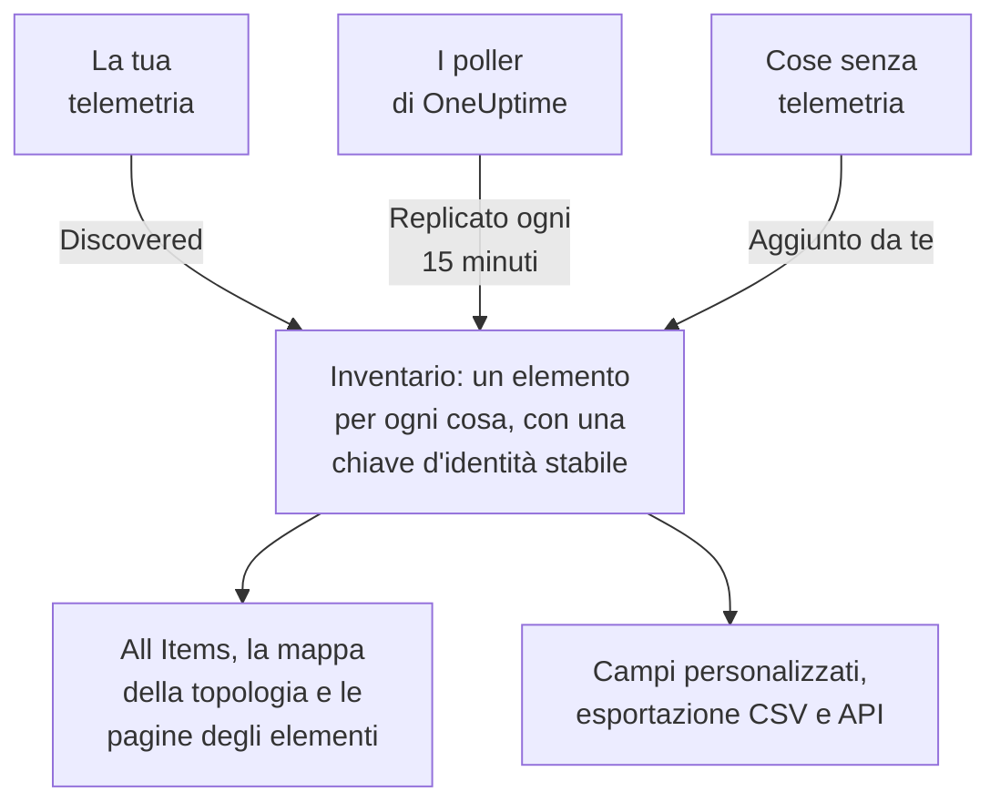

# Panoramica dell'inventario

L'inventario è un unico elenco di tutto ciò che OneUptime sa della tua infrastruttura: servizi, host, oggetti Kubernetes, macchine virtuali, dispositivi di rete, risorse cloud, dispositivi IoT, funzioni serverless e le cose che non inviano alcuna telemetria. Quasi tutto si compila da solo a partire da ciò che OneUptime già osserva. Tu aggiungi ciò che l'osservazione non può dirgli: a cosa serve una cosa, di chi è, quando scade la sua garanzia.

:::cards
- [Come gli elementi entrano nell'inventario](#come-gli-elementi-entrano-nellinventario): Scoperti, replicati o aggiunti da te.
- [Orientarsi](#orientarsi): Le pagine dell'inventario e le pagine di ogni elemento.
- [Aggiungere qualcosa a mano](#aggiungere-qualcosa-a-mano): Un'API di terze parti, un database esterno o un'appliance.
- [Archiviare invece di eliminare](#archiviare-invece-di-eliminare): Il modo di riordinare l'elenco che dura nel tempo.
:::

## Come gli elementi entrano nell'inventario

OneUptime osserva già la tua infrastruttura per monitorarla, quindi il catalogo nasce da ciò che vede e non da ciò che qualcuno si è ricordato di scrivere. Ogni elemento ha una fonte, e la fonte decide a chi appartiene l'elemento: se puoi modificarlo e se può sparire da solo.

| Fonte | Nell'API | Da dove viene | Quanto resta |
| --- | --- | --- | --- |
| **Discovered** | `discovered` | Gli attributi di risorsa OpenTelemetry, letti all'arrivo della telemetria: un servizio, un host, un oggetto Kubernetes o una macchina virtuale che invia telemetria. | Registrato di nuovo a ogni batch. Rimosso quando resta in silenzio più a lungo della finestra del suo tipo (vedi sotto). |
| **Mirrored** | `inventory` | Un record che un poller di OneUptime mantiene: dispositivi di rete, risorse cloud, dispositivi IoT, funzioni serverless, applicazioni RUM, host Docker e host Podman. Copiato ogni 15 minuti. | Finché esiste il suo record. Elimina il record e l'elemento se ne va con lui. |
| **Added by you** | `manual` | Aggiunto da te, per qualcosa che OneUptime non può vedere: un'API di terze parti, un database gestito da un fornitore, un'appliance in un rack. | Finché non lo elimini. Niente lo fa scadere. |

Un elemento scoperto o replicato non può essere rinominato né cambiare tipo: la sua fonte sovrascriverebbe la modifica al passaggio successivo. La pagina **Impostazioni** dell'elemento indica invece dove fare una modifica duratura. Quello che puoi sempre aggiungere a qualsiasi elemento, qualunque sia la sua fonte, sono i valori dei campi personalizzati: vedi [Campi personalizzati dell'inventario](/docs/inventory/custom-fields).

### Quanto resta un elemento silenzioso

Un elemento scoperto ha un battito. Ogni volta che arriva telemetria per lui, la sua ora dell'ultima osservazione avanza, e la colonna **Stato** dell'elenco dice quanto è recente. Gli elementi replicati e quelli che hai aggiunto non hanno battito, quindi il loro stato resta vuoto invece di allarmare.

| Stato | Cosa significa |
| --- | --- |
| **In diretta** | Visto negli ultimi 30 minuti. |
| **Recent** | Visto nell'ultimo giorno. |
| **Non aggiornato** | Non visto da più di un giorno. La pagina **Gone Quiet** li elenca. |

Ogni tre ore, OneUptime rimuove gli elementi scoperti rimasti in silenzio più a lungo della finestra del loro tipo, archiviati compresi, e i loro valori dei campi personalizzati se ne vanno con loro. Gli elementi replicati e quelli che hai aggiunto non vengono mai rimossi in questo modo.

| Tipo di elemento | Rimosso dopo questo tempo senza telemetria |
| --- | --- |
| Pod, deployment, guest Proxmox e macchine virtuali VMware | 1 giorno |
| Nodi e namespace Kubernetes, nodi Proxmox, host, cluster e datastore VMware, e i database e i servizi remoti chiamati dalle tue tracce | 7 giorni |
| Servizi, host, cluster Kubernetes, Proxmox e Ceph, array di storage, vCenters e cluster Docker Swarm | 30 giorni |

Una relazione che OneUptime ha scoperto viene rimossa quando non viene rivista per 30 giorni.

## Orientarsi

Apri **Prodotti → Risorse → Inventario**. Il suo menu laterale ha queste pagine. **By Source**, **Impostazioni**, **Aiuto** e **Avanzato** partono chiusi: fai clic sul titolo di una sezione per aprirla.

| Pagina | Cosa trovi |
| --- | --- |
| **Panoramica** | Quanti elementi hai, cosa sono, quanti sono diventati silenziosi e cosa è stato aggiunto più di recente. |
| **All Items** | Ogni elemento. Cerca per nome, descrizione o chiave d'identità, filtra l'elenco per tipo, fonte, stato o campo personalizzato e aggiungi un elemento a mano. |
| **Topology Map** | Come sono collegati gli elementi: i servizi, cosa chiamano e gli host, i pod e i dispositivi su cui girano. |
| **Gone Quiet** | Gli elementi scoperti che non inviano telemetria da più di un giorno. |
| **By Source** | Gli elementi di una fonte: **Discovered**, **Mirrored** o **Added by You**. |
| **Impostazioni → Campi personalizzati** | I campi che il tuo progetto tiene su ogni elemento. |
| **Aiuto → Documentazione** | Una breve guida all'inventario, con i tipi di elemento che riconosce. |
| **Avanzato → Archiviato** | Gli elementi che hai archiviato. Ripristinali da qui. |

Apri un elemento e il suo menu laterale ha la sua **Panoramica** (tipo, fonte e stato, e ogni attributo osservato su di esso), le sue **Connessioni** e i suoi **Campi personalizzati**; i suoi **Registri**, **Tracce**, **Metriche**, **Profili di prestazioni** ed **Eccezioni**; e i suoi **Incidenti**, **Avvisi** e **Manutenzione programmata**. In **Avanzato** ci sono le sue **Impostazioni**, i suoi **Registri di audit** e **Delete Item**. Le pagine di telemetria mostrano ciò che l'elemento stesso ha inviato. Gli incidenti, gli avvisi e gli eventi di manutenzione sono quelli del servizio, dell'host o del cluster Kubernetes che l'elemento rappresenta; su qualsiasi altro elemento, quelle pagine dicono quale risorsa guardare.

### Dettagli dell'asset

Un host o un dispositivo di rete ha una scheda **Dettagli dell'asset** che li descrive entrambi allo stesso modo: hostname, indirizzo IP, indirizzo MAC, numero di serie, produttore, modello, versione del firmware, sistema operativo, versione del sistema operativo, tipo di dispositivo e posizione. Un dato che nulla ha segnalato si legge **Sconosciuto**, e la scheda spiega come si compilano quelli sconosciuti.

- I dati di un host vengono dagli attributi di risorsa della sua telemetria: i suoi indirizzi IP e MAC, l'architettura e il sistema operativo fin da subito, e il numero di serie, la marca, il modello e il firmware una volta che li apponi.
- I dati di un dispositivo di rete vengono dal suo polling SNMP, dal suo ruolo e dal suo sito. Ciò che il suo polling non ha letto viene dal rilevamento: l'ultima scansione del suo indirizzo, la tabella ARP di un router o la risoluzione DNS della sua sonda. Un dispositivo senza ENTITY-MIB, come un Meraki MX, ricava comunque marca e modello dalla sua descrizione di sistema. Il suo indirizzo IP non viene mai mostrato come hostname.

La scheda indica da dove viene ogni dato e quando. La fonte condivisa dalla maggior parte dei dati, come il collector di un host, il polling SNMP proprio di un dispositivo di rete o la scansione di rilevamento che lo ha letto, viene nominata una sola volta, sotto i dati. Qualsiasi altra fonte, come la tabella ARP di un router o un valore salvato sul dispositivo, viene nominata sotto il suo dato. Un valore salvato su un dispositivo di rete non viene mai sostituito da ciò che legge il rilevamento, e quando i due differiscono, la scheda li mostra entrambi.

Gli stessi dati sono colonne dell'elenco **All Items**, nascoste finché non le attivi, e finiscono nella sua esportazione CSV. [Esportare in un CMDB](/docs/inventory/cmdb-sync#dettagli-dellasset) elenca le loro chiavi.

### Connessioni

La pagina **Connessioni** di un elemento elenca i suoi vicini in entrambe le direzioni, raggruppati in **Chiamate**, **Chiamato da**, **Eseguito su** e **Correlati**. Ogni gruppo mostra il suo totale (un gruppo con più di 100.000 connessioni mostra «100.000+»), e **Mostra di più** scorre il resto, così un cluster, un namespace o un nodo molto affollato mostra ogni connessione e non solo le prime. La pagina non è limitata a un intervallo di tempo: include le relazioni aggiunte a mano tramite l'API e i vicini archiviati. Un vicino che non è più nell'inventario viene mostrato con la sua chiave.

## Aggiungere qualcosa a mano

Aggiungi un elemento per qualcosa che OneUptime non vedrà mai da solo, così che una dipendenza finisca su qualcosa di reale e la cosa possa portare i tuoi campi personalizzati.

:::steps
### Aprire All Items

Vai su **Prodotti → Risorse → Inventario**, poi su **All Items**.

### Aggiungere l'elemento

Fai clic su **Aggiungi: Item**. Scegli il suo **Tipo**, dagli un **Nome** e, se vuoi, una **Descrizione**. Nome e tipo insieme sono l'identità dell'elemento, quindi due elementi dello stesso tipo non possono avere lo stesso nome.

### Compilare i suoi campi personalizzati

Apri il nuovo elemento. La sua fonte indica **Added by you**, e la sua pagina **Campi personalizzati** accoglie i valori che il tuo progetto segue.
:::

Puoi aggiungere a mano tre tipi:

- `external.service` (**Servizio esterno**): un'API di terze parti o una dipendenza software-as-a-service.
- `external.database` (**Database esterno**): un database che non è un server che OneUptime può modellare. Un server di database, self-hosted o gestito, da PostgreSQL a Snowflake, va invece in **Databases → Crea: Database** ([Database](/docs/telemetry/databases)): quel record si collega alle tracce, ai container e alle metriche del motore che nominano lo stesso indirizzo, cosa che un elemento dell'inventario non fa mai, e aggiungere lo stesso server in entrambi i modi lascia due record scollegati.
- `appliance` (**Appliance**): hardware o software senza agente.

La restrizione evita i duplicati. Un elemento creato a mano di un tipo che OneUptime può osservare, come un host, sarebbe identificato dal nome che hai scritto, mentre l'elemento scoperto della stessa macchina è identificato dagli attributi che segnala. I due non si unirebbero mai, e lo stesso host comparirebbe due volte nel tuo elenco, per sempre.

## Archiviare invece di eliminare

Archiviare toglie un elemento dall'elenco mentre conserva la sua identità, la sua cronologia e i valori dei suoi campi personalizzati. Dice: l'ho visto e non lo voglio nel mio elenco. Un elemento archiviato continua a raccogliere telemetria.

| Fonte | Archiviare | Eliminare |
| --- | --- | --- |
| **Discovered** | Resta archiviato. | Torna con il prossimo batch della sua telemetria. |
| **Mirrored** | Resta archiviato. | Torna con la copia successiva. Elimina invece il record originale. |
| **Added by you** | Resta archiviato. | Sparisce per sempre. |

Per archiviare elementi, selezionali in **All Items** e archiviali in un colpo solo, oppure apri un elemento e usa la scheda **Archivia** della sua pagina **Impostazioni**. Gli elementi archiviati si trovano in **Inventario → Avanzato → Archiviato**, dove puoi selezionarli e ripristinarli.

> [!NOTE]
> Quando un dispositivo replicato viene rimosso dal suo record di origine, OneUptime rimuove anche il suo elemento, a meno che l'elemento porti valori di campi personalizzati che hai inserito. Quei valori sono l'unica copia e non c'è modo di annullare, quindi l'elemento viene archiviato invece che eliminato. Lo troverai in **Avanzato → Archiviato** con tutto ciò che hai scritto intatto.

## Relazioni e topologia

OneUptime collega gli elementi con relazioni orientate man mano che le osserva. **Inventario → Topology Map** le disegna, e la pagina **Connessioni** di un elemento elenca le sue. Vedi [Topologia](/docs/telemetry/topology).

| Relazione | Per esempio |
| --- | --- |
| `runs-on` | Un pod gira su un nodo; una macchina virtuale gira sul suo host. |
| `member-of` | Un pod, un nodo o un namespace è membro di un cluster. |
| `hosted-on` | Un servizio è ospitato su un host. |
| `part-of` | Un pod fa parte del suo deployment. |
| `depends-on` | Un servizio ne chiama un altro, secondo gli span che passano dall'uno all'altro. |

## Passaggi successivi

:::cards
- [Campi personalizzati dell'inventario](/docs/inventory/custom-fields): Tenere traccia di numeri di serie, date di garanzia, proprietari e stato del ciclo di vita.
- [Esportare in un CMDB](/docs/inventory/cmdb-sync): Portare il catalogo nel tuo sistema di riferimento.
- [Database](/docs/telemetry/databases): Monitorare i server di database usati dai tuoi servizi.
:::
