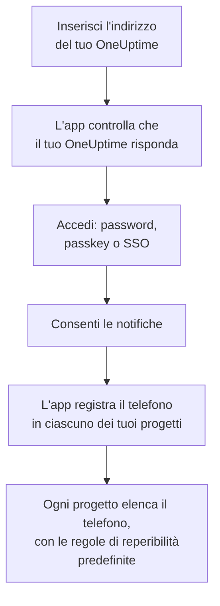
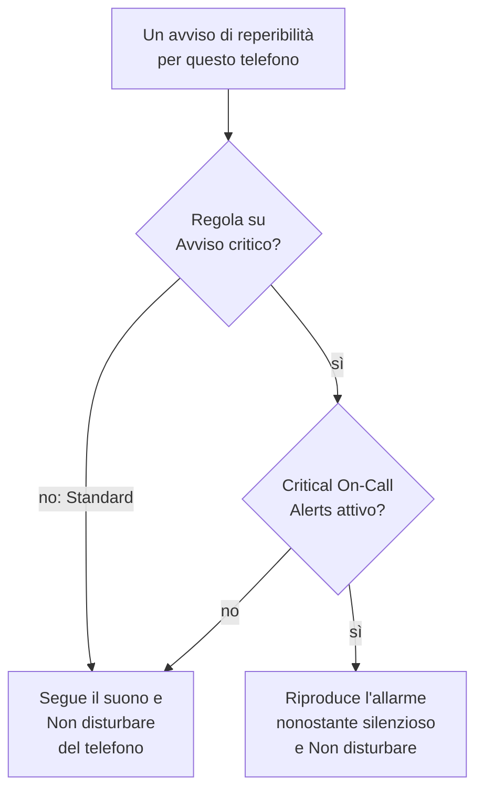

# Installazione Android

Installa **OneUptime On-Call** su un telefono o tablet Android, collegalo al tuo OneUptime e accedi. Poi inviati una notifica di test, e lascia che gli avvisi di reperibilità urgenti suonino nonostante la modalità silenziosa e Non disturbare.

:::cards
- [Installare l'app](#installare-lapp): Da Google Play, o l'APK su un telefono che non ha Google Play.
- [Accedere](#accedere): L'indirizzo del tuo OneUptime, poi il tuo account.
- [Controllare che gli avvisi arrivino al telefono](#controllare-che-gli-avvisi-arrivino-al-telefono): Trovare il telefono nella dashboard e provarlo.
- [Suonare in modalità silenziosa](#suonare-in-modalità-silenziosa): Gli avvisi critici e il suono di allarme.
- [Risoluzione dei problemi](#risoluzione-dei-problemi): Problemi di accesso, notifiche e installazione.
:::

## Prima di iniziare

- Un telefono o tablet con Android 7.0 o successivo.
- Un account in un progetto OneUptime. Per ricevere avvisi devi anche essere reperibile: vedi [Regole di escalation](/docs/on-call/escalation-rules).
- L'indirizzo del tuo OneUptime: `https://oneuptime.com` su OneUptime Cloud, o il tuo, ad esempio `https://oneuptime.example.com`. L'app si connette solo in HTTPS.

## Installare l'app

:::tabs
@tab Google Play
1. Sul telefono, apri [OneUptime On-Call su Google Play](https://play.google.com/store/apps/details?id=com.oneuptime.oncall), o cerca OneUptime On-Call in Google Play.
2. Tocca **Installa**, poi **Apri**.

Google Play mantiene l'app aggiornata.
@tab APK
Per un telefono senza Google Play. L'APK viene compilato dallo stesso codice per ogni versione di OneUptime e allegato alla versione su GitHub.

1. Sul telefono, apri [l'APK più recente](https://github.com/OneUptime/oneuptime/releases/latest/download/oneuptime-on-call-android-app.apk).
2. Apri il file scaricato. Se Android lo chiede, consenti al browser di installare app sconosciute, poi tocca **Installa**.
3. Apri OneUptime On-Call dalle tue app.

Un APK non si aggiorna da solo: installa ogni tanto il più recente sopra quello che hai. Accesso e impostazioni restano.
:::

## Accedere

:::steps
### Inserire l'indirizzo del tuo OneUptime
Apri l'app. Su **Connect your workspace**, lascia `https://oneuptime.com` per OneUptime Cloud, o inserisci l'indirizzo del tuo OneUptime, e tocca **Connect**. L'app prosegue appena `https://<your-oneuptime>/api/status` risponde.

### Accedere al tuo account
Usa il modo in cui accede il tuo account:

- Email e password, poi **Sign In**. **Forgot password?** ti invia per email un link per impostarne una nuova.
- **Sign in with a passkey**, dopo averne aggiunta una nella dashboard: vedi [Aggiungere una passkey](/docs/introduction/your-account#aggiungere-una-passkey). Il browser si apre per confermarla, poi ti riporta nell'app.
- **Sign in with SSO**, se la tua organizzazione usa il single sign-on. Scegli il tuo provider, o inserisci l'email di lavoro e tocca **Continue**. Si apre un browser sicuro, e torni nell'app appena hai effettuato l'accesso.

Con l'autenticazione a due fattori attiva, inserisci il codice a sei cifre della tua app di autenticazione, o uno dei tuoi codici di backup. Una chiave di sicurezza non si può usare nell'app. Se l'amministratore richiede l'autenticazione a due fattori e non l'hai ancora configurata, l'app configura prima con te un'app di autenticazione.

### Consentire le notifiche
Quando Android chiede se OneUptime On-Call può inviare notifiche, tocca **Consenti**. Android 13 e successivi lo chiedono; le versioni precedenti le consentono finché non le disattivi.

L'app registra poi il telefono in ciascuno dei tuoi progetti. Ogni progetto lo elenca tra i tuoi dispositivi push, con le regole di reperibilità predefinite, così da ora i tuoi avvisi gli arrivano.
:::

L'app mostra un progetto alla volta: tocca il nome del progetto in cima a una schermata per cambiarlo. Un progetto che richiede il single sign-on risulta **SSO Required** in **Settings → Manage Projects** finché non tocchi lì **Authenticate with SSO**.

## Controllare che gli avvisi arrivino al telefono

:::steps
### Trovare il telefono nella dashboard
Nella dashboard, apri **Impostazioni utente → Metodi di notifica** e la scheda **Push Notifications**. Il telefono compare in **Dispositivi per notifiche push** con il nome del modello. Ogni progetto tiene un suo elenco.

### Inviare un test
Fai clic su **Notifica di test** sulla riga del telefono. Sul telefono arriva una notifica; toccala per aprire l'app.
:::

Le tue regole di reperibilità decidono quali avvisi vanno al telefono, e con quale rapidità: vedi **Impostazioni utente → Regole di reperibilità**. Un nuovo telefono riceve le stesse regole predefinite di qualsiasi altro metodo che aggiungi.

## Suonare in modalità silenziosa

Per impostazione predefinita un avviso di reperibilità segue le impostazioni audio del telefono: un telefono silenziato resta muto, e Non disturbare trattiene l'avviso. Gli avvisi critici fanno suonare gli avvisi di reperibilità nonostante entrambi. Sono disattivati finché non li attivi, telefono per telefono.

:::steps
### Attivare Critical On-Call Alerts
Nell'app, apri **Settings** e attiva **Critical On-Call Alerts** sotto **Notifications**.

### Consentire l'accesso a Non disturbare
Android apre il suo elenco **Accesso Non disturbare**. Attiva l'accesso per OneUptime On-Call, poi torna all'app: controlla l'accesso e indica sotto l'interruttore se gli avvisi suoneranno.

### Scegliere un suono di allarme
Tocca **Alarm sound** sotto l'interruttore. Oltre al suono del telefono, offre Klaxon, Siren, Digital alarm, Smoke alarm e Rising alarm, che parte piano e cresce. Tocca riproduci accanto a un suono per ascoltarlo. Un avviso critico suona al volume della sveglia del telefono, quindi tienilo alto.
:::

Suonano comunque solo gli avvisi di reperibilità, e solo quelli delle regole di reperibilità impostate su **Avviso critico**, il valore predefinito. Una regola su **Standard** segue le impostazioni del telefono qualunque cosa dica l'interruttore, così puoi essere svegliato per un incidente critico e avvisato in silenzio per uno minore. Invia una **Notifica di test** con il telefono silenziato per sentire cosa farà un avviso.

## Evitare che gli avvisi arrivino in ritardo

OneUptime invia gli avvisi di reperibilità ad alta priorità, che Android consegna anche a un telefono inattivo da ore. Un telefono che limita l'uso della batteria dell'app può comunque trattenerli:

- Apri **Impostazioni → App → OneUptime On-Call → Batteria** e scegli **Senza restrizioni**. Alcuni telefoni lo chiamano **Utilizzo batteria app**.
- Controlla che le notifiche dell'app siano attive, in **Impostazioni → App → OneUptime On-Call → Notifiche**.
- Escludi OneUptime On-Call da qualsiasi elenco di risparmio energetico o di app in sospensione del tuo telefono.

## Bloccare l'app

Attiva **Biometrics Login** in **Settings** nell'app, e a ogni avvio ti chiederà l'impronta, il volto o il blocco schermo del telefono. L'interruttore compare quando sul telefono è configurato lo sblocco con impronta o con volto. **Appearance**, nella stessa schermata, sceglie l'aspetto chiaro o scuro, o segue il telefono.

## Aggiornare, uscire o disinstallare

- **Aggiornare.** Google Play aggiorna l'app. Per l'APK, installa sopra il più recente. La versione dell'app è in fondo alla sua schermata **Settings**.
- **Uscire.** **Settings → Log Out** ti disconnette e rimuove il telefono dai tuoi dispositivi push in ogni progetto, insieme alle sue regole di reperibilità. Se accedi di nuovo, torna con le regole predefinite.
- **Disinstallare.** Rimuovi l'app come qualsiasi altra. Se eri ancora connesso, il telefono resta nel tuo elenco finché un push verso di esso non fallisce: OneUptime lo segna allora come **Non riceve notifiche**. Elimina quella voce con **Elimina**: se reinstalli l'app e accedi, il telefono viene aggiunto come nuova voce, con le regole predefinite.

## Risoluzione dei problemi

:::details «Could not connect to the server»
L'app non è riuscita a raggiungere `https://<your-oneuptime>/api/status`. Controlla l'indirizzo, compreso `https://`. Se il tuo OneUptime è su una rete privata, collega prima il telefono a quella rete, ad esempio tramite la VPN. Apri quell'indirizzo nel browser del telefono: mostra `{"status":"ok"}` quando il telefono raggiunge OneUptime.
:::

:::details Non arriva nessuna notifica
- Controlla nelle impostazioni di Android che le notifiche dell'app siano attive, e che Non disturbare sia disattivato o gli avvisi critici attivi.
- Controlla che il telefono compaia in **Push Notifications** in **Impostazioni utente → Metodi di notifica**, e inviagli una **Notifica di test**.
- Se il telefono è segnato **Non riceve notifiche**, apri l'app da connesso. Registra di nuovo il telefono; vedi [Quando un telefono deve registrarsi di nuovo](/docs/mobile-desktop-apps/faq-troubleshooting#quando-un-telefono-deve-registrarsi-di-nuovo).
- Controlla le tue regole di reperibilità in **Impostazioni utente → Regole di reperibilità**.
- Su un OneUptime self-hosted, controlla che il server raggiunga il suo relay push: vedi [Notifiche push](/docs/self-hosted/push-notifications#accesso-di-rete).
:::

:::details Gli avvisi critici restano muti con Non disturbare
Apri **Settings** nell'app: la riga sotto **Critical On-Call Alerts** dice cosa manca. Di solito non è stato consentito l'accesso a Non disturbare: consentilo in **Impostazioni → Notifiche → Accesso Non disturbare**, poi torna all'app. Se hai scelto un suono di allarme, anche il canale di notifica di quel suono deve poter ignorare Non disturbare.
:::

:::details «App non installata» quando installi l'APK
OneUptime On-Call è già sul telefono da un'altra fonte, come Google Play, e Android non installa l'una sopra l'altra. Disinstallala, installa l'APK e accedi di nuovo.
:::

:::details Manca l'interruttore Biometrics Login
L'interruttore compare quando lo sblocco con impronta o con volto è configurato nelle impostazioni di Android.
:::

## Passi successivi

:::cards
- [FAQ e risoluzione dei problemi](/docs/mobile-desktop-apps/faq-troubleshooting): Cosa fare quando un telefono smette di ricevere avvisi.
- [Installazione iOS](/docs/mobile-desktop-apps/ios-installation): La stessa app su un iPhone o iPad.
- [Regole di escalation](/docs/on-call/escalation-rules): Decidere chi viene avvisato, e quando.
- [Notifiche push](/docs/self-hosted/push-notifications): Come un OneUptime self-hosted invia gli avvisi ai telefoni.
:::
