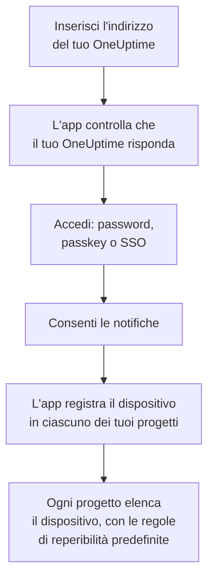

# Installazione iOS

Installa **OneUptime On-Call** dall'App Store su un iPhone o iPad, collegalo al tuo OneUptime e accedi. Poi inviati una notifica di test, e lascia che gli avvisi di reperibilità urgenti suonino nonostante la modalità silenziosa e le modalità Full immersion.

:::cards
- [Installare l'app](#installare-lapp): Dall'App Store.
- [Accedere](#accedere): L'indirizzo del tuo OneUptime, poi il tuo account.
- [Controllare che gli avvisi arrivino al dispositivo](#controllare-che-gli-avvisi-arrivino-al-dispositivo): Trovarlo nella dashboard e provarlo.
- [Suonare in modalità silenziosa](#suonare-in-modalità-silenziosa): Gli avvisi critici, il suono di allarme e il suo volume.
- [Risoluzione dei problemi](#risoluzione-dei-problemi): Problemi di accesso, notifiche e avvisi critici.
:::

## Prima di iniziare

- Un iPhone o iPad con iOS 16.4 o successivo, o iPadOS 16.4 o successivo.
- Un account in un progetto OneUptime. Per ricevere avvisi devi anche essere reperibile: vedi [Regole di escalation](/docs/on-call/escalation-rules).
- L'indirizzo del tuo OneUptime: `https://oneuptime.com` su OneUptime Cloud, o il tuo, ad esempio `https://oneuptime.example.com`. L'app si connette solo in HTTPS.

## Installare l'app

1. Sull'iPhone o iPad, apri [OneUptime On-Call nell'App Store](https://apps.apple.com/us/app/oneuptime-on-call/id6759615391), o cerca OneUptime On-Call nell'App Store.
2. Tocca **Ottieni** e conferma con Face ID, Touch ID o la password del tuo account Apple.
3. Tocca **Apri**, oppure apri OneUptime On-Call dalla schermata Home.

L'App Store mantiene l'app aggiornata finché **Aggiornamenti app** è attivo, in **Impostazioni → App Store**.

## Accedere



:::steps
### Inserire l'indirizzo del tuo OneUptime
Apri l'app. Su **Connect your workspace**, lascia `https://oneuptime.com` per OneUptime Cloud, o inserisci l'indirizzo del tuo OneUptime, e tocca **Connect**. L'app prosegue appena `https://<your-oneuptime>/api/status` risponde.

### Accedere al tuo account
Usa il modo in cui accede il tuo account:

- Email e password, poi **Sign In**. **Forgot password?** ti invia per email un link per impostarne una nuova.
- **Sign in with a passkey**, dopo averne aggiunta una nella dashboard: vedi [Aggiungere una passkey](/docs/introduction/your-account#aggiungere-una-passkey). Si apre un riquadro del browser per confermarla, poi ti riporta nell'app.
- **Sign in with SSO**, se la tua organizzazione usa il single sign-on. Scegli il tuo provider, o inserisci l'email di lavoro e tocca **Continue**. Si apre un browser sicuro, e torni nell'app appena hai effettuato l'accesso.

Con l'autenticazione a due fattori attiva, inserisci il codice a sei cifre della tua app di autenticazione, o uno dei tuoi codici di backup. Una chiave di sicurezza non si può usare nell'app. Se l'amministratore richiede l'autenticazione a due fattori e non l'hai ancora configurata, l'app configura prima con te un'app di autenticazione.

### Consentire le notifiche
Quando iOS chiede se OneUptime On-Call può inviarti notifiche, tocca **Consenti**.

L'app registra poi l'iPhone o iPad in ciascuno dei tuoi progetti. Ogni progetto lo elenca tra i tuoi dispositivi push, con le regole di reperibilità predefinite, così da ora i tuoi avvisi gli arrivano.
:::

L'app mostra un progetto alla volta: tocca il nome del progetto in cima a una schermata per cambiarlo. Un progetto che richiede il single sign-on risulta **SSO Required** in **Settings → Manage Projects** finché non tocchi lì **Authenticate with SSO**.

## Controllare che gli avvisi arrivino al dispositivo

:::steps
### Trovare il dispositivo nella dashboard
Nella dashboard, apri **Impostazioni utente → Metodi di notifica** e la scheda **Push Notifications**. L'iPhone o iPad compare in **Dispositivi per notifiche push** con il nome del modello. Ogni progetto tiene un suo elenco.

### Inviare un test
Fai clic su **Notifica di test** sulla riga del dispositivo. Sul dispositivo arriva una notifica; toccala per aprire l'app.
:::

Le tue regole di reperibilità decidono quali avvisi vanno al dispositivo, e con quale rapidità: vedi **Impostazioni utente → Regole di reperibilità**. Un nuovo dispositivo riceve le stesse regole predefinite di qualsiasi altro metodo che aggiungi.

## Suonare in modalità silenziosa

Per impostazione predefinita un avviso di reperibilità segue le impostazioni audio del dispositivo: la modalità silenziosa lo tiene muto, e una modalità Full immersion come Non disturbare lo trattiene. Gli avvisi critici fanno suonare gli avvisi di reperibilità nonostante entrambi. Sono disattivati finché non li attivi, dispositivo per dispositivo.

```mermaid title="Se un avviso di reperibilità suona comunque su un iPhone o iPad"
flowchart TB
    Page["Un avviso di reperibilità<br/>per questo dispositivo"]
    Rule{"La sua regola di reperibilità<br/>è su Avviso critico?"}
    Device{"Critical On-Call Alerts è<br/>attivo su questo dispositivo?"}
    Quiet["Segue le impostazioni di suono,<br/>silenzioso e Full immersion<br/>del dispositivo"]
    Loud["Riproduce il tuo suono<br/>di allarme, al tuo volume,<br/>nonostante silenzioso<br/>e Full immersion"]
    Page --> Rule
    Rule -->|"no: Standard"| Quiet
    Rule -->|"sì"| Device
    Device -->|"no"| Quiet
    Device -->|"sì"| Loud
```

:::steps
### Attivare Critical On-Call Alerts
Nell'app, apri **Settings** e attiva **Critical On-Call Alerts** sotto **Notifications**.

### Consentire gli avvisi critici
Quando iOS chiede se OneUptime On-Call può inviare avvisi critici, tocca **Consenti**. iOS aggiunge allora un interruttore **Avvisi critici** per l'app in **Impostazioni → Notifiche → OneUptime On-Call**, dove potrai cambiare idea in seguito. La riga sotto l'interruttore dell'app dice se gli avvisi suoneranno.

### Scegliere un suono di allarme e il suo volume
Tocca **Alarm sound** sotto l'interruttore. Oltre al suono di avviso critico del dispositivo, offre Klaxon, Siren, Digital alarm, Smoke alarm e Rising alarm, che parte piano e cresce. Tocca riproduci accanto a un suono per ascoltarlo. Poi scegli il volume a cui suona un avviso: 25%, 50%, 75% o 100%, il valore predefinito.
:::

Suonano comunque solo gli avvisi di reperibilità, e solo quelli delle regole di reperibilità impostate su **Avviso critico**, il valore predefinito. Una regola su **Standard** segue le impostazioni del dispositivo qualunque cosa dica l'interruttore, così puoi essere svegliato per un incidente critico e avvisato in silenzio per uno minore. Invia una **Notifica di test** con il dispositivo in silenzioso per sentire cosa farà un avviso. L'anteprima della schermata **Alarm sound** suona al volume della suoneria, e per niente in silenzioso; un avviso vero suona nonostante la modalità silenziosa al volume che hai scelto.

> [!NOTE]
> Gli avvisi critici richiedono OneUptime On-Call 1.5.0 o successivo dall'App Store. Le versioni precedenti sono state compilate senza il permesso di Apple per gli avvisi critici, quindi iOS non ha mai offerto loro l'interruttore.

## Evitare che gli avvisi vengano trattenuti

Senza avvisi critici, una modalità Full immersion o un riepilogo possono trattenere gli avvisi:

- **Full immersion.** Aggiungi OneUptime On-Call alle app consentite da ogni modalità, in **Impostazioni → Full immersion**.
- **Riepilogo programmato.** Lascia fuori OneUptime On-Call, in **Impostazioni → Notifiche → Riepilogo programmato**: una notifica nel riepilogo aspetta il prossimo orario del riepilogo.
- **Notifiche.** Tieni attivo **Consenti notifiche**, in **Impostazioni → Notifiche → OneUptime On-Call**.

## Bloccare l'app

Attiva **Biometrics Login** in **Settings** nell'app, e a ogni avvio ti chiederà Face ID, Touch ID o il codice. L'interruttore compare quando Face ID o Touch ID è configurato sul dispositivo. **Appearance**, nella stessa schermata, sceglie l'aspetto chiaro o scuro, o segue il dispositivo.

## Aggiornare, uscire o eliminare l'app

- **Aggiornare.** L'App Store aggiorna l'app; puoi anche aggiornarla dal tuo account nell'App Store. La versione dell'app è in fondo alla sua schermata **Settings**.
- **Uscire.** **Settings → Log Out** ti disconnette e rimuove il dispositivo dai tuoi dispositivi push in ogni progetto, insieme alle sue regole di reperibilità. Se accedi di nuovo, torna con le regole predefinite.
- **Eliminare.** Tocca e tieni premuta l'icona dell'app, poi tocca **Rimuovi app** e **Elimina app**. Se eri ancora connesso, il dispositivo resta nel tuo elenco finché un push verso di esso non fallisce: OneUptime lo segna allora come **Non riceve notifiche**. Se reinstalli l'app e accedi, quella voce di solito torna, con le sue regole; se non usi più il dispositivo, elimina la voce con **Elimina**.

## Risoluzione dei problemi

:::details «Could not connect to the server»
L'app non è riuscita a raggiungere `https://<your-oneuptime>/api/status`. Controlla l'indirizzo, compreso `https://`. Se il tuo OneUptime è su una rete privata, collega prima il dispositivo a quella rete, ad esempio tramite la VPN. Apri quell'indirizzo in Safari sul dispositivo: mostra `{"status":"ok"}` quando il dispositivo raggiunge OneUptime.
:::

:::details Non arriva nessuna notifica
- Controlla che **Consenti notifiche** sia attivo in **Impostazioni → Notifiche → OneUptime On-Call**, e che nessuna modalità Full immersion trattenga gli avvisi.
- Controlla che il dispositivo compaia in **Push Notifications** in **Impostazioni utente → Metodi di notifica**, e inviagli una **Notifica di test**.
- Se il dispositivo è segnato **Non riceve notifiche**, apri l'app da connesso. Registra di nuovo il dispositivo; vedi [Quando un telefono deve registrarsi di nuovo](/docs/mobile-desktop-apps/faq-troubleshooting#quando-un-telefono-deve-registrarsi-di-nuovo).
- Controlla le tue regole di reperibilità in **Impostazioni utente → Regole di reperibilità**.
- Su un OneUptime self-hosted, controlla che il server raggiunga il suo relay push: vedi [Notifiche push](/docs/self-hosted/push-notifications#accesso-di-rete).
:::

:::details Nessun interruttore Avvisi critici nelle Impostazioni di iOS
Attiva prima **Critical On-Call Alerts** nell'app: iOS aggiunge il suo interruttore solo dopo che l'app ha chiesto gli avvisi critici. Se l'app dice che questa versione non può ricevere avvisi critici, aggiorna OneUptime On-Call dall'App Store.
:::

:::details Gli avvisi critici restano muti
Apri **Settings** nell'app: la riga sotto **Critical On-Call Alerts** dice cosa manca. Controlla che **Avvisi critici** sia attivo in **Impostazioni → Notifiche → OneUptime On-Call**, e che il volume nella schermata **Alarm sound** dell'app non sia basso.
:::

:::details Manca l'interruttore Biometrics Login
L'interruttore compare quando Face ID o Touch ID è configurato in **Impostazioni → Face ID e codice** o **Impostazioni → Touch ID e codice**.
:::

## Passi successivi

:::cards
- [FAQ e risoluzione dei problemi](/docs/mobile-desktop-apps/faq-troubleshooting): Cosa fare quando un telefono smette di ricevere avvisi.
- [Installazione Android](/docs/mobile-desktop-apps/android-installation): La stessa app su Android.
- [Regole di escalation](/docs/on-call/escalation-rules): Decidere chi viene avvisato, e quando.
- [Notifiche push](/docs/self-hosted/push-notifications): Come un OneUptime self-hosted invia gli avvisi ai telefoni.
:::
