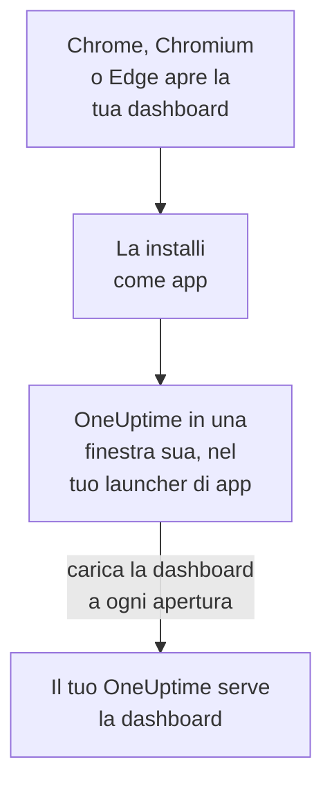

# Installazione Linux

La dashboard di OneUptime si installa su Linux come app, da Google Chrome, Chromium o Microsoft Edge. Si apre in una finestra tutta sua, con una sua voce nel launcher di app del tuo desktop, e può mostrare notifiche. Non c'è niente da scaricare: l'app è la dashboard del tuo OneUptime, ed è aggiornata non appena lo è il tuo OneUptime.

:::cards
- [Installare l'app](#installare-lapp): Da Chrome, Chromium o Edge.
- [Aprirla dal launcher](#aprirla-dal-launcher): Come qualsiasi altra app desktop.
- [Ricevere notifiche su questo computer](#ricevere-notifiche-su-questo-computer): Registrare il browser per le notifiche push.
- [Risoluzione dei problemi](#risoluzione-dei-problemi): Nessuna icona di installazione, nessuna notifica, nessuna voce nel launcher.
:::

## Come funziona l'app desktop

L'app installata condivide con il suo browser l'accesso, le impostazioni e il permesso per le notifiche. Chiudi il browser e l'app continua a funzionare nella sua finestra.

## Prima di iniziare

- Un desktop Linux con un Google Chrome, Chromium o Microsoft Edge recente.
- L'indirizzo del tuo OneUptime, in HTTPS: `https://oneuptime.com` su OneUptime Cloud, o il tuo, ad esempio `https://oneuptime.example.com`.
- Un account con cui accedere alla dashboard.

## Installare l'app

:::tabs
@tab Chrome
1. Apri il tuo OneUptime in Chrome o Chromium e accedi.
2. In qualsiasi pagina della dashboard, fai clic sull'icona di installazione a destra della barra degli indirizzi, poi su **Installa**. Oppure apri **⋮ → Trasmetti, salva e condividi → Installa pagina come app…**.
3. Chrome apre OneUptime in una finestra sua e lo aggiunge al tuo launcher di app.
@tab Edge
1. Apri il tuo OneUptime in Edge e accedi.
2. In qualsiasi pagina della dashboard, fai clic sull'icona di installazione a destra della barra degli indirizzi, poi su **Installa**. Oppure apri **Impostazioni e altro (…) → Altri strumenti → App → Installa questo sito come app**.
3. Edge apre OneUptime in una finestra sua e lo aggiunge al tuo launcher di app.
:::

Installa da una pagina della dashboard, dopo aver effettuato l'accesso: la pagina di accesso non è l'app.

## Aprirla dal launcher

Il browser aggiunge una voce desktop per l'app, un file `.desktop` in `~/.local/share/applications`, così OneUptime compare in GNOME, KDE Plasma e negli altri launcher. Da lì aggiungilo al tuo dock o pannello, come qualsiasi altra app.

## Ricevere notifiche su questo computer

L'app mostra notifiche tramite il suo browser, una volta che hai registrato il browser per le notifiche push in ogni progetto da cui vuoi riceverle.

:::steps
### Aprire i tuoi dispositivi push
Nell'app, apri **Impostazioni utente → Metodi di notifica** e la scheda **Push Notifications**.

### Registrare questo browser
Fai clic su **Registra dispositivo**, mantieni il valore proposto in **Nome del dispositivo**, ad esempio `Chrome on Linux`, o modificalo, e fai di nuovo clic su **Registra dispositivo**. Quando il browser chiede se OneUptime può mostrare notifiche, scegli **Consenti**.

### Inviare un test
Nella finestra di dialogo **Browser Registered**, fai clic su **Send Test Notification**. Il tuo desktop la mostra tramite il suo servizio di notifiche; se non compare nulla, vedi [Risoluzione dei problemi](#risoluzione-dei-problemi).
:::

Un browser non può suonare nonostante il Non disturbare del tuo desktop. Per gli avvisi che devono svegliarti, usa l'app mobile con gli avvisi critici: vedi [Installazione Android](/docs/mobile-desktop-apps/android-installation#suonare-in-modalità-silenziosa).

Su un OneUptime self-hosted, le notifiche del browser richiedono le chiavi VAPID del server: vedi [Notifiche push](/docs/self-hosted/push-notifications#configurazione-self-hosted).

## Aggiornamenti

Non c'è niente da aggiornare. L'app carica la dashboard dal tuo OneUptime a ogni apertura, quindi cambia quando il tuo OneUptime viene aggiornato. Se una finestra è aperta dall'aggiornamento, ricaricala con Ctrl+R.

## Disinstallare

:::tabs
@tab Chrome
Nella finestra dell'app, apri il menu **⋮**, scegli la voce che disinstalla l'app, poi **Rimuovi**.
@tab Edge
Apri `edge://apps` in Edge, scegli **Dettagli** su OneUptime, poi **Disinstalla**.
:::

Disinstallare l'app non annulla la registrazione del suo browser: continua a ricevere notifiche. Per fermarle, elimina il browser in **Impostazioni utente → Metodi di notifica**, nella scheda **Push Notifications**, con **Elimina**.

## Risoluzione dei problemi

:::details Nessuna icona di installazione nella barra degli indirizzi
Apri una pagina della dashboard dopo l'accesso, non la pagina di accesso, e controlla che l'indirizzo inizi con `https://`: i browser installano app solo da siti sicuri. Se l'icona ancora non compare, usa il menu del browser come sopra. Altri browser potrebbero non installare siti come app; usa Chrome, Chromium o Edge.
:::

:::details Non compare nessuna notifica
- In **Impostazioni utente → Metodi di notifica**, scheda **Push Notifications**, controlla che questo browser sia elencato, e inviagli una **Notifica di test**.
- Controlla che il Non disturbare del tuo desktop sia disattivato e che le sue impostazioni di notifica consentano il browser.
- Se il browser blocca le notifiche per OneUptime, fai clic sull'icona a sinistra della barra degli indirizzi, consenti le notifiche per il sito e registra di nuovo il browser.
- Su un OneUptime self-hosted, la finestra di dialogo **Registra dispositivo** indica quando il server non ha le chiavi VAPID.
:::

:::details L'app manca nel launcher
Aprila invece dal browser: `chrome://apps` in Chrome o Chromium, `edge://apps` in Edge. Un launcher che legge le voci desktop solo all'accesso la mostra dopo che sei uscito e rientrato.
:::

## Passi successivi

:::cards
- [Installazione Android](/docs/mobile-desktop-apps/android-installation): Ricevere gli avvisi sul telefono, con gli avvisi critici.
- [Installazione Windows](/docs/mobile-desktop-apps/windows-installation): La stessa app su Windows.
- [FAQ e risoluzione dei problemi](/docs/mobile-desktop-apps/faq-troubleshooting): Risposte su entrambe le app.
- [Il tuo account](/docs/introduction/your-account): Come OneUptime ti raggiunge in ogni progetto.
:::
