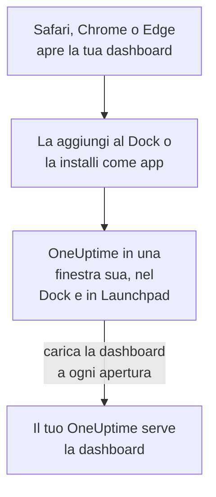

# Installazione macOS

La dashboard di OneUptime si installa su un Mac come app: aggiungila al Dock da Safari, o installala da Google Chrome o Microsoft Edge. Si apre in una finestra tutta sua, con la sua icona nel Dock e in Launchpad, e può mostrare notifiche. Non c'è niente da scaricare: l'app è la dashboard del tuo OneUptime, ed è aggiornata non appena lo è il tuo OneUptime.

:::cards
- [Installare l'app](#installare-lapp): Da Safari, Chrome o Edge.
- [Tenerla nel Dock](#tenerla-nel-dock): Aprirla con un clic, o al login.
- [Ricevere notifiche su questo Mac](#ricevere-notifiche-su-questo-mac): Registrare l'app per le notifiche push.
- [Risoluzione dei problemi](#risoluzione-dei-problemi): Nessun Aggiungi al Dock, nessuna notifica, nuovo accesso.
:::

## Come funziona l'app desktop

Un'app web di Safari ha un suo accesso, suoi cookie e sue impostazioni, separati da Safari. Un'app installata da Chrome o Edge li condivide con quel browser.

## Prima di iniziare

- macOS Sonoma 14 o successivo per Safari. Chrome ed Edge installano app su qualsiasi macOS su cui funzionano.
- L'indirizzo del tuo OneUptime, in HTTPS: `https://oneuptime.com` su OneUptime Cloud, o il tuo, ad esempio `https://oneuptime.example.com`.
- Un account con cui accedere alla dashboard.

## Installare l'app

:::tabs
@tab Safari
1. Apri il tuo OneUptime in Safari e accedi.
2. In qualsiasi pagina della dashboard, scegli **Archivio → Aggiungi al Dock**, oppure fai clic sul pulsante Condividi nella barra degli strumenti e poi su **Aggiungi al Dock**.
3. Mantieni il nome o modificalo, e fai clic su **Aggiungi**.
4. Apri OneUptime dal Dock e accedi ancora una volta: l'app web non condivide l'accesso di Safari.
@tab Chrome
1. Apri il tuo OneUptime in Chrome e accedi.
2. In qualsiasi pagina della dashboard, fai clic sull'icona di installazione a destra della barra degli indirizzi, poi su **Installa**. Oppure apri **⋮ → Trasmetti, salva e condividi → Installa pagina come app…**.
3. Chrome apre OneUptime in una finestra sua e lo aggiunge a Launchpad.
@tab Edge
1. Apri il tuo OneUptime in Edge e accedi.
2. In qualsiasi pagina della dashboard, fai clic sull'icona di installazione a destra della barra degli indirizzi, poi su **Installa**. Oppure apri **Impostazioni e altro (…) → Altri strumenti → App → Installa questo sito come app**.
3. Edge apre OneUptime in una finestra sua e lo aggiunge a Launchpad.
:::

Installa da una pagina della dashboard, dopo aver effettuato l'accesso: la pagina di accesso non è l'app. Safari salva l'app web nella cartella Applicazioni della tua cartella Inizio.

## Tenerla nel Dock

- **Dock.** Con l'app aperta, fai clic sulla sua icona nel Dock tenendo premuto Ctrl e scegli **Opzioni → Mantieni nel Dock**. Un'app web di Safari è già nel Dock.
- **Apertura al login.** Fai clic sull'icona nel Dock tenendo premuto Ctrl e scegli **Opzioni → Apri al login**.
- **Spotlight.** Premi Comando-Spazio e digita OneUptime.

## Ricevere notifiche su questo Mac

L'app mostra notifiche una volta che l'hai registrata per le notifiche push, in ogni progetto da cui vuoi riceverle. Registra l'app web di Safari dall'interno dell'app web: è un browser a sé. Un'app installata da Chrome o Edge si registra con il suo browser.

:::steps
### Aprire i tuoi dispositivi push
Nell'app, apri **Impostazioni utente → Metodi di notifica** e la scheda **Push Notifications**.

### Registrare questa app
Fai clic su **Registra dispositivo**, mantieni il valore proposto in **Nome del dispositivo**, ad esempio `Safari on macOS`, o modificalo, e fai di nuovo clic su **Registra dispositivo**. Quando macOS o il browser chiede se OneUptime può inviare notifiche, scegli **Consenti**.

### Inviare un test
Nella finestra di dialogo **Browser Registered**, fai clic su **Send Test Notification**. Se non compare nulla, guarda le impostazioni di notifica del Mac: vedi [Risoluzione dei problemi](#risoluzione-dei-problemi).
:::

Un browser non può suonare nonostante una modalità Full immersion come Non disturbare. Per gli avvisi che devono svegliarti, usa l'app mobile con gli avvisi critici: vedi [Installazione iOS](/docs/mobile-desktop-apps/ios-installation#suonare-in-modalità-silenziosa).

Su un OneUptime self-hosted, le notifiche del browser richiedono le chiavi VAPID del server: vedi [Notifiche push](/docs/self-hosted/push-notifications#configurazione-self-hosted).

## Aggiornamenti

Non c'è niente da aggiornare. L'app carica la dashboard dal tuo OneUptime a ogni apertura, quindi cambia quando il tuo OneUptime viene aggiornato. Se una finestra è aperta dall'aggiornamento, ricaricala con Comando-R.

## Disinstallare

:::tabs
@tab Safari
Nel Finder, apri la tua cartella Inizio, poi la sua cartella Applicazioni, e trascina OneUptime nel Cestino.
@tab Chrome
Nella finestra dell'app, apri il menu **⋮**, scegli la voce che disinstalla l'app, poi **Rimuovi**.
@tab Edge
Apri `edge://apps` in Edge, scegli **Dettagli** su OneUptime, poi **Disinstalla**.
:::

Disinstallare l'app non ne annulla la registrazione: il suo browser continua a ricevere notifiche. Per fermarle, eliminala in **Impostazioni utente → Metodi di notifica**, nella scheda **Push Notifications**, con **Elimina**.

## Risoluzione dei problemi

:::details Nessun Aggiungi al Dock in Safari
Safari aggiunge app web al Dock a partire da macOS Sonoma 14. Aggiorna macOS, oppure installa l'app da Chrome o Edge.
:::

:::details Non compare nessuna notifica
- In **Impostazioni utente → Metodi di notifica**, scheda **Push Notifications**, controlla che l'app o il suo browser sia elencato, e inviagli una **Notifica di test**.
- Sul Mac, apri **Impostazioni di Sistema → Notifiche** e controlla che OneUptime, o il browser da cui è stato installato, possa inviare notifiche, e che nessuna modalità Full immersion le trattenga.
- Se il browser blocca le notifiche per OneUptime, consentile nelle sue impostazioni per il sito e registra di nuovo.
- Su un OneUptime self-hosted, la finestra di dialogo **Registra dispositivo** indica quando il server non ha le chiavi VAPID.
:::

:::details L'app ti chiede di accedere di nuovo
Un'app web di Safari ha un suo accesso: accedi dentro l'app. Un'app installata da Chrome o Edge condivide l'accesso del suo browser, quindi uscire nel browser, o cancellarne i cookie, disconnette anche lei.
:::

## Passi successivi

:::cards
- [Installazione iOS](/docs/mobile-desktop-apps/ios-installation): Ricevere gli avvisi sull'iPhone, con gli avvisi critici.
- [Installazione Windows](/docs/mobile-desktop-apps/windows-installation): La stessa app su Windows.
- [FAQ e risoluzione dei problemi](/docs/mobile-desktop-apps/faq-troubleshooting): Risposte su entrambe le app.
- [Il tuo account](/docs/introduction/your-account): Come OneUptime ti raggiunge in ogni progetto.
:::
