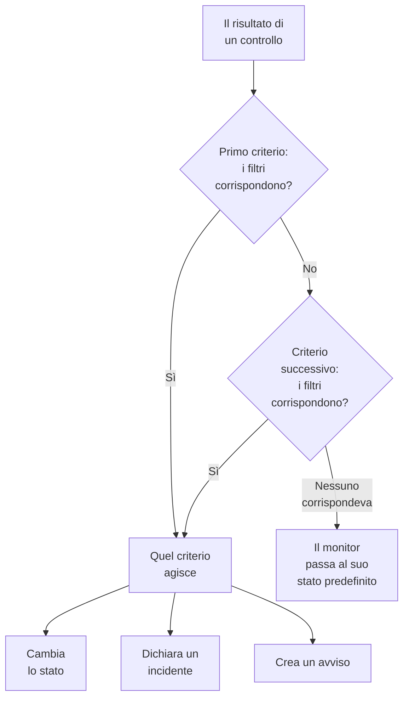
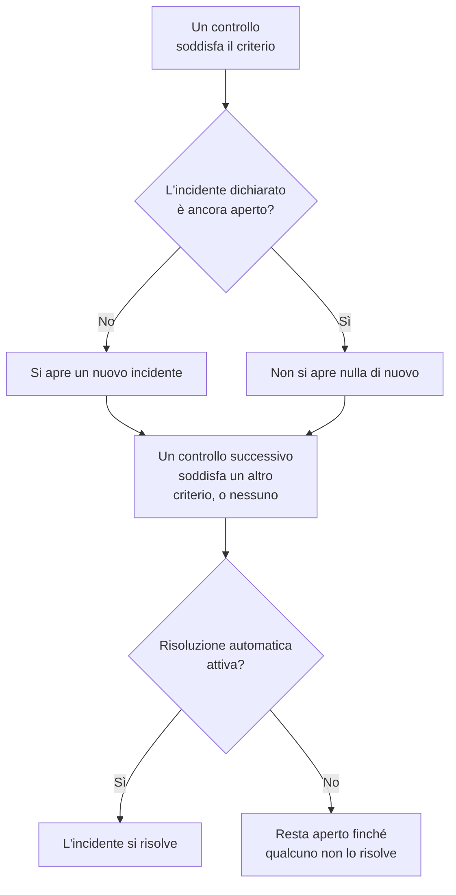

# Criteri e stati

I criteri di un monitor decidono cosa significa ogni controllo: se il monitor è attivo o fuori servizio, e se OneUptime dichiara un incidente o crea un avviso. Gli stati sono l'elenco del vostro progetto di ciò che un monitor può essere, da **Operativo** a **Offline**. Questa pagina spiega entrambi per ogni tipo di monitor; la pagina di ciascun tipo elenca i filtri che offre.

:::cards
- [Come decidono i criteri](#come-decidono-i-criteri): Dall'alto verso il basso, e vince la prima corrispondenza.
- [Cosa contiene un criterio](#cosa-contiene-un-criterio): Filtri, una condizione di corrispondenza, azioni e impostazioni.
- [Giudicare una finestra di controlli](#giudicare-una-finestra-di-controlli): Contare i controlli falliti, individuare l'instabilità, leggere un percentile.
- [Modificare i criteri di un monitor](#modificare-i-criteri-di-un-monitor): Modificare, aggiungere, riordinare e testare i criteri.
- [Stati dei monitor](#stati-dei-monitor): Gli stati integrati e gli stati personalizzati.
:::

## Come decidono i criteri

Ogni volta che un monitor viene controllato, i suoi criteri giudicano il risultato dall'alto dell'elenco verso il basso. Il primo criterio i cui filtri corrispondono decide cosa succede, e i criteri sottostanti non vengono considerati per quel controllo. Se nessuno corrisponde, il monitor passa al suo **Stato predefinito del monitor**. Mantiene invece il suo stato finché un criterio che lo riporta indietro non ha ancora corrisposto: vedi [Quando un criterio si ripristina](#quando-un-criterio-si-ripristina).

L'ordine fa parte della regola. Un nuovo monitor elenca i suoi criteri dal caso peggiore: offline, poi un avvertimento se il suo tipo ne ha uno (un certificato o un dominio in scadenza), poi online. Un criterio sano e ampio, come **Online** impostato su **Vero**, corrisponde a quasi ogni controllo, quindi va per ultimo: sopra gli altri, corrisponderebbe per primo ogni volta e gli altri non agirebbero mai.

Un criterio che corrisponde ma non cambia alcuno stato decide comunque il controllo: il monitor mantiene il suo stato, e i criteri sottostanti attendono il controllo successivo. Lo **Stato predefinito del monitor** si applica solo quando nessun criterio corrisponde. Per un nuovo monitor è **Operativo**; modificatelo sotto **Altri campi**, sotto i criteri.

> [!NOTE]
> Un monitor che apre un incidente o un avviso per ogni host, container, disco o interfaccia giudica tutti i criteri a ogni controllo, così due host possono corrispondere a due criteri diversi contemporaneamente. È un monitor la cui query ha un **Raggruppa per**, come un monitor di metriche o di log, oppure un criterio che indica `*` per ogni disco o interfaccia. Lo è anche un monitor di metriche che osserva un'espressione PromQL: ogni serie che l'espressione restituisce viene giudicata da sola. Un monitor di richieste in ingresso che raggruppa gli incidenti per un campo del payload si ferma comunque alla prima corrispondenza.
>
> Un monitor del genere ha comunque un solo stato, impostato dal primo criterio che corrisponde. Un criterio che lo riporta soltanto al suo **Stato predefinito del monitor**, senza aprire incidenti né avvisi, attende gli host che hanno soddisfatto un criterio che imposta un altro stato: corrisponde quando ciascuno di essi lo soddisfa, qualunque cosa facciano gli altri host. Fino ad allora il monitor mantiene il suo stato, anche quando nessun criterio corrisponde, mentre gli incidenti e gli avvisi di ogni host continuano a risolversi ciascuno per conto proprio.

## Cosa contiene un criterio

Aprite un criterio: ha un nome e tre sezioni, ognuna delle quali si chiude in un riepilogo di una riga.

| Parte | Cosa contiene |
| --- | --- |
| **Nome dei criteri** | Il nome nell'elenco dei criteri e nella causa principale di ogni incidente e avviso che il criterio apre. **Aggiungi criteri** dà a un nuovo criterio il nome dei suoi filtri, e il nome li segue finché non ne digitate uno vostro. |
| **Filtri** | Ciò che il controllo deve mostrare, come uno o più filtri. I monitor Kubernetes e di metriche li chiamano **Regole degli avvisi**. |
| **Azioni** | Cosa succede quando i filtri corrispondono: cambiare lo stato, creare un avviso, dichiarare un incidente o qualsiasi combinazione. |
| **Impostazioni** | **Abilita questi criteri**, una **Descrizione** facoltativa, quando si ripristina e quando viene giudicato e, sui monitor delle richieste in arrivo, **Group incidents and alerts by a payload field**. |

### Filtri

Un filtro legge un dato dal controllo e lo confronta: un **Tipo di filtro** (cosa leggere, come **Codice di stato della risposta**), una **Condizione del filtro** (come confrontare, come **Maggiore di**) e un **Valore**. I monitor che confrontano metriche, come i monitor Kubernetes e di metriche, chiedono invece una **Condizione** e un **Soglia**. Ogni tipo di monitor offre i propri tipi di filtro, elencati nella sua pagina, per esempio [Monitor sito web](/docs/monitor/website-monitor#criteri-di-monitoraggio).

Con due o più filtri, sotto di essi compare la **Condizione di corrispondenza**: **Tutti** significa che ogni filtro deve corrispondere, **Qualsiasi** che ne basta uno. Un nuovo criterio parte da **Tutti**.

I filtri che misurano ogni controllo, come **Online**, **Codice di stato della risposta** e **Tempo di risposta (in ms)**, offrono **Valuta questo criterio su un periodo di tempo**. Giudica una finestra di controlli recenti invece del solo ultimo, e parte dagli ultimi 5 minuti con **Tutti i valori**, che corrisponde solo quando ogni controllo della finestra ha corrisposto. La finestra può durare fino a 24 ore e contare i controlli, come spiega [Giudicare una finestra di controlli](#giudicare-una-finestra-di-controlli). Vedere [Valutare su un periodo di tempo](/docs/monitor/website-monitor#valutare-su-un-periodo-di-tempo).

### Azioni

Ogni azione è un interruttore sotto **Azioni**:

| Interruttore | Cosa fa |
| --- | --- |
| **Quando i filtri corrispondono, modifica lo stato del monitor.** | Porta il monitor allo stato scelto in **Cambia lo stato del monitor in**. |
| **Quando i filtri corrispondono, crea un avviso.** | Crea gli avvisi impostati sotto **Crea avviso**. Un avviso informa il vostro team e non compare mai su una pagina di stato. |
| **Quando i filtri corrispondono, dichiara un incidente.** | Dichiara gli incidenti impostati sotto **Crea incidente**. Le vostre pagine di stato possono mostrarli. |

Un incidente o un avviso chiede un titolo, una **Gravità** e, nelle sezioni chiuse, una descrizione, proprietari, etichette e policy di reperibilità. Titoli e descrizioni possono contenere valori del controllo, come `{{monitorName}}`: vedere [Modelli di incidenti e avvisi](/docs/monitor/incident-alert-templating). Per allertare qualcuno quando il criterio corrisponde, scegliete una policy sotto **Reperibilità**: vedere [Policy di reperibilità](/docs/on-call/policies).

### Impostazioni

**Abilita questi criteri** è attivo per ogni nuovo criterio. Disattivatelo per tenere un criterio senza usarlo: viene saltato a ogni controllo, non cambia alcuno stato, non apre nulla e la sua intestazione mostra **Disabilitato**.

**Group incidents and alerts by a payload field** apre un incidente per ogni valore trovato in una richiesta in ingresso, così un unico indirizzo di webhook può tenere aperti più incidenti. Vedere [Attivare il raggruppamento degli incidenti](/docs/monitor/incoming-request-monitor#attivare-il-raggruppamento-degli-incidenti).

**Ripristina solo quando è soddisfatta una condizione propria** e **Valuta questi criteri solo in determinati giorni e orari** sono disattivati per un nuovo criterio. Vedi [Quando un criterio si ripristina](#quando-un-criterio-si-ripristina) e [Solo in certi giorni e orari](#solo-in-certi-giorni-e-orari).

## Giudicare una finestra di controlli

Con **Valuta questo criterio su un periodo di tempo** selezionato, **Valuta** dice come vengono giudicati i controlli della finestra, e **Nell'ultimo periodo di** quanto è lunga la finestra, da 2 minuti a 24 ore. La condizione del filtro stesso, come **Online** impostato su **Falso**, dice cosa deve mostrare ogni controllo.

| Valuta | Corrisponde quando |
| --- | --- |
| **Tutti i valori** | Ogni controllo della finestra ha soddisfatto la condizione. |
| **Qualsiasi valore** | Almeno un controllo della finestra ha soddisfatto la condizione. |
| **Media**, **Somma**, **Valore massimo**, **Valore minimo** | Quel valore, calcolato sui valori della finestra, soddisfa la condizione, come un tempo di risposta medio sopra i 300 ms. |
| **Percentile** | Il percentile scelto in **Percentile**, da p50 a p99, soddisfa la condizione: p95 sopra i 300 ms significa che il 5% più lento dei controlli supera i 300 ms. |
| **Conteggio** | Il numero di controlli che hanno soddisfatto la condizione si confronta come impostato in **Controlli corrispondenti**: **Maggiore di** 30, ad esempio. |
| **Percentuale** | La loro quota sui controlli della finestra si confronta come impostato in **Quota di controlli corrispondenti**: **Maggiore di** 10%, ad esempio. |
| **Cambi di stato** | Il numero di volte in cui i controlli sono passati dal soddisfare la condizione al non soddisfarla, o viceversa, si confronta come impostato in **Volte che è cambiato**. Un dispositivo che cade e torna su cambia due volte. |

Una frase sotto le impostazioni della finestra rilegge il filtro così come è impostato: «Verifica se "Online" è falso in più di 30 controlli dell'ultimo periodo di 8 ore».

- **Ogni sonda per conto suo.** **Conteggio**, **Percentuale** e **Cambi di stato** contano i controlli della sonda che ha eseguito il controllo, quindi un monitor controllato da tre sonde non conta tre volte più in fretta, e le sue sonde devono poi concordare come per qualsiasi criterio.
- **Una finestra non ancora piena.** Finché i controlli non risalgono all'inizio della finestra, un monitor appena avviato ha meno controlli di quanti ne avrà. **Conteggio** e **Cambi di stato** corrispondono in anticipo quando superano già **Maggiore di** o **Maggiore o uguale a**, perché altri controlli possono solo aumentarli; tutto il resto attende una finestra piena.
- **Una finestra senza controlli.** Finché la finestra non ha controlli, o non è ancora piena, decide **Se nessun dato**: **Ignore** attende, **Trigger** corrisponde, e **Treat As Zero** la giudica come se i controlli mancanti non avessero soddisfatto la condizione.

Le medie e i percentili leggono i valori dei controlli di tutte le sonde, come **Media** ha sempre fatto. **Conteggio**, **Percentuale** e **Cambi di stato** sono offerti per ogni filtro a cui è offerta una finestra: sui monitor Website, API, Ping, IP e Port, per CPU, memoria, dischi e carico di un server, per **Dispositivo SNMP online** e il tempo di risposta di un dispositivo di rete, e sui monitor DNS, NTP, di database, di pagina di stato esterna e di stato delle sonde. **Online** di un monitor di server non viene contato: è giudicato in base al tempo trascorso dall'ultima segnalazione del server. I monitor di metriche e gli altri monitor di telemetria giudicano invece l'intervallo di tempo della loro query, con l'aggregazione propria della query, che legge anche i percentili.

### Esempio: un access point fuori servizio e uno instabile

Un monitor Ping controlla ogni minuto un access point d'ufficio. Prima che le finestre potessero contare i controlli, un access point che continuava a cadere sembrava uno fuori servizio, oppure niente di strano. Questi tre criteri, in questo ordine, distinguono i due casi:

| Criterio | Filtro | Valuta | Cambia lo stato in |
| --- | --- | --- | --- |
| L'access point è fuori servizio | **Online** è **Falso** | **Tutti i valori**, **Nell'ultimo periodo di** 5 minuti | **Offline**, e dichiara un incidente di interruzione |
| L'access point è instabile | **Online** è **Falso** | **Cambi di stato**, **Maggiore di** 5, **Nell'ultimo periodo di** 1 ora | **Degradato**, e dichiara un incidente di instabilità |
| L'access point è online | **Online** è **Vero** | Non su un periodo di tempo | **Operativo** |

Per il secondo, attiva **Ripristina solo quando è soddisfatta una condizione propria** con **Cambi di stato**, **Minore o uguale a** 1, **Nell'ultimo periodo di** 1 ora: l'incidente di instabilità resta aperto finché l'access point non è stabile da un'ora, invece di chiudersi il primo minuto in cui risponde. Per ricevere un avviso quando fallisce più di 30 ping in 8 ore, imposta invece il secondo criterio su **Conteggio**, **Maggiore di** 30, **Nell'ultimo periodo di** 8 ore.

## Quando un criterio si ripristina

Un criterio smette di agire non appena i suoi filtri smettono di corrispondere: in quel controllo il suo incidente e il suo avviso si risolvono, quando **Risoluzione automatica dell'incidente** e **Risoluzione automatica dell'avviso** sono attivi, e il monitor passa al criterio successivo che corrisponde.

**Ripristina solo quando è soddisfatta una condizione propria** mantiene il criterio in vigore dopo che i suoi filtri smettono di corrispondere, finché non corrispondono i filtri sotto **Si ripristina quando**. Partono come l'opposto dei filtri del criterio, negli ultimi 10 minuti, e possono usare tutto ciò che offre un filtro, come una finestra che conta i controlli. Un criterio è in vigore finché il monitor ha lo stato che imposta o è aperto un incidente o un avviso che ha dichiarato. Finché resta in vigore, conta come una corrispondenza al suo posto nell'elenco: un criterio sopra di esso che corrisponde prende comunque il sopravvento.

Quando nessun criterio corrisponde, un monitor che un criterio ha spostato dal suo **Stato predefinito del monitor** mantiene lo stato che ha, purché abbia anche un criterio che lo riporti soltanto a quello stato senza aprire nulla. È il margine di ripristino: i modelli scattano sopra il 90% e tornano all'81% o meno, quindi all'89% il monitor resta dov'è. I suoi incidenti e avvisi si risolvono comunque quando il loro criterio smette di corrispondere. Un monitor senza un criterio del genere passa al suo **Stato predefinito del monitor**, come sempre.

## Solo in certi giorni e orari

**Valuta questi criteri solo in determinati giorni e orari** imposta i giorni, **Ora di inizio** e **Ora di fine**, e **Fuso orario**, che parte dal tuo. Fuori da quegli orari il criterio viene saltato come un criterio disattivato: non corrisponde a nulla, quindi ciò che ha aperto si risolve, e il log di valutazione indica che era fuori dai suoi orari. Gli orari si leggono sull'orologio di quel fuso orario, quindi le 08:00 restano le 08:00 dopo il cambio dell'ora, e gli orari che finiscono prima di iniziare proseguono fino al mattino seguente.

## Quando incidenti e avvisi si aprono e si chiudono

Un criterio che dichiara incidenti ne apre uno quando corrisponde. Quando il monitor si riprende, l'incidente si chiude da solo se il criterio lo prevede.

- **Uno alla volta.** Finché un incidente dichiarato da un criterio è ancora aperto, lo stesso criterio che corrisponde di nuovo non ne dichiara un altro. Gli avvisi funzionano allo stesso modo. Un monitor che raggruppa per host o per campo del payload ne tiene uno aperto per host o per valore, e un criterio di un monitor di email in ingresso con **Apri un nuovo incidente per ogni email** ne apre uno per ogni email.
- **La chiusura.** A un controllo successivo in cui corrisponde un altro criterio, o nessuno, viene risolto un incidente il cui criterio ha attivo **Risoluzione automatica dell'incidente**, e così un avviso con **Risoluzione automatica dell'avviso**. Entrambi si trovano sotto **Altri campi** nell'incidente o nell'avviso, e i criteri con cui parte un nuovo monitor li hanno attivi.
- **Più sonde.** Un monitor controllato da più di una sonda cambia solo quando le sue sonde concordano. Vedere [Come vengono valutati i criteri](/docs/monitor/create-monitor#come-vengono-valutati-i-criteri).
- **Un monitor padre fuori servizio.** Nella pagina **Configurazione → Dipendenze** di un monitor, **Monitor da cui dipende** indica i monitor da cui dipende. Finché uno di essi è in uno stato elencato in **Sospendi quando lo stato del padre è** (qualsiasi stato offline, se lasciato vuoto), il monitor non apre incidenti né avvisi. Il suo stato continua a cambiare, e ciò che è aperto continua a risolversi.
- **La manutenzione programmata.** Un monitor incluso in un evento di manutenzione in corso non viene controllato, quindi i suoi criteri non vengono eseguiti. Vedere [Panoramica della manutenzione programmata](/docs/scheduled-maintenance/index).

Per vedere come è stato giudicato un controllo, aprite la **Panoramica** del monitor: la scheda **Riepilogo del monitor** mostra quale criterio ha corrisposto e cosa ha fatto ciascuno, compreso un incidente saltato perché ce n'era già uno aperto.

## Chi viene avvisato quando va giù

**Quando va giù** dice in poche frasi cosa succede quando il monitor si guasta e chi viene avvisato: lo stato che imposta, l'incidente o l'avviso che apre, chi riceve un'email e chi avvisa, per nome. Ogni cosa che impedirebbe di avvisare qualcuno è su una riga a sé, con un link alla pagina che la risolve. Si trova nella **Panoramica** di un monitor, sotto i suoi criteri nella pagina **Criteri**, nel passaggio dei criteri di **Crea monitor** per il monitor che stai configurando, e nella configurazione guidata dei siti web.

Ricostruisce la catena come fa un vero incidente o avviso: con le regole del proprietario, le regole di privacy, le regole etichette e le regole di reperibilità del tuo progetto, la regola di incidente degli avvisi che trasforma un avviso in un incidente, e chi raggiunge in questo momento la prima regola di escalation di ogni policy di reperibilità. Una regola di reperibilità che chiede chi è il proprietario di un avviso (**Proprietario dell'avviso**) viene confrontata con i proprietari che l'avviso avrà: le persone e i team indicati dai suoi criteri, i proprietari del dispositivo di rete che il monitor controlla e quelli che aggiungono le regole del proprietario. Un segnaposto del titolo che solo un controllo compila viene mostrato così com'è scritto. **Mostra la catena** la apre riga per riga:

| Riga | Cosa dice |
| --- | --- |
| **Stato** | Lo stato che i criteri impostano. |
| **Apre** | L'incidente o l'avviso, la sua gravità tra parentesi e il suo titolo. |
| **E-mail** | Chi raggiunge la sua email di creazione: i suoi proprietari, quelli che aggiungono le regole del proprietario, o i Proprietari del progetto se non ne ha. Chi viene raggiunto prima dall'avviso di reperibilità non riceve anche l'email come proprietario. |
| **Regole del proprietario** | Le regole del proprietario che aggiungono i suoi proprietari. |
| **Privato** | Perché è privato: una regola di privacy o i criteri. Un incidente privato non compare in nessuna pagina di stato e non avvisa nessun iscritto, e solo i suoi proprietari, i Proprietari del progetto e gli Amministratori del progetto possono vederlo. |
| **Regole etichette** | Le regole etichette le cui etichette cambiano quali regole di reperibilità si attivano. |
| **Regole di reperibilità** | Le regole di reperibilità che vi corrispondono. Per una regola che confronta chi è il proprietario di un avviso, indica quale proprietario la fa corrispondere. |
| **Policy di reperibilità** | Ogni policy che quelle regole attivano: chi raggiunge in questo momento la sua prima regola di escalation e con quale mezzo, e chi non raggiunge, e perché. |
| **Pagine di stato** | Le pagine di stato che lo mostrano, ciascuna con il gruppo di monitor attraverso cui mostra il monitor. |
| **Regola di incidente** | Per un avviso: la regola di incidente degli avvisi che ne dichiara un incidente, subito o quando l'avviso è rimasto aperto, e quell'incidente, descritto come ogni incidente. |

### Cosa impedisce di avvisare

| Cosa lo impedisce | Link |
| --- | --- |
| Nessun criterio cambia lo stato o apre un incidente o un avviso. | **Apri criteri** |
| Nessuno viene avvisato: nessuna regola di reperibilità corrisponde, o il progetto non ha ancora una policy di reperibilità. | **Configura gli avvisi di reperibilità** |
| Il monitor apre avvisi, e solo gli incidenti hanno regole di reperibilità. | **Configura gli avvisi di reperibilità** |
| Una policy di reperibilità non ha regole di escalation. | **Apri policy di reperibilità** |
| Una policy di reperibilità non raggiunge nessuno in questo momento. | **Apri policy di reperibilità** |
| Qualcuno che una policy avvisa non è raggiungibile: si è disiscritto, non ha metodi verificati, o non ha regole per la gravità in un progetto senza ripiego. | **Apri prontezza** |
| SMS, chiamate, WhatsApp o Telegram sono disattivati nel progetto. | **Apri canali di notifica** |
| Il progetto non ha più credito per SMS e chiamate (OneUptime Cloud). | **Apri fatturazione** |
| Il server non può ancora inviare email o SMS, né fare chiamate. | **Apri il Pannello amministratore**, per gli amministratori del server |

Un avviso che una regola di incidente degli avvisi trasforma in un incidente che avvisa qualcuno non è un'interruzione: vengono controllate le policy dell'incidente.

I proprietari che non ricevono email sono elencati dopo le interruzioni, ciascuno con il motivo e il punto in cui è indicato: qualcuno che non è membro del progetto, un team senza nessun membro del progetto (**Apri team**), o un team di un altro progetto, indicato nei criteri (**Apri criteri**), sul dispositivo di rete che il monitor controlla (**Apri dispositivo di rete**) o da una regola del proprietario (**Apri regole del proprietario**). L'email parte comunque, ai proprietari che raggiunge o ai Proprietari del progetto, quindi non sono interruzioni. Anche lo stato della configurazione li elenca, come punti da correggere.

### Ricontrollare, e cosa puoi vedere

La risposta ha al massimo un minuto, e **Ricontrolla** la ricalcola. Quando un nuovo controllo non riesce, la scheda mantiene l'ultima risposta e dice sotto perché.

La scheda nomina solo ciò che puoi leggere. Una policy di reperibilità, una regola, una pagina di stato o un gruppo di monitor che non puoi vedere mantiene il suo posto senza il nome, e un incidente o un avviso privato che non potrai vedere dice solo che si apre e che è privato.

## Che cosa conserva un incidente o un avviso del controllo

Un incidente o un avviso aperto da un monitor conserva il controllo che lo ha aperto, così potete vedere il perché molto dopo che i log del monitor sono stati eliminati. Sotto la sua causa principale, la sezione **Dettagli della valutazione** indica il criterio che ha corrisposto e, per ogni filtro che ha corrisposto, che cosa ha trovato il controllo. **Mostra dettagli** aggiunge il resto delle prove, i filtri che non hanno corrisposto e il controllo stesso: la richiesta, quando è stato eseguito, da quale sonda e che cosa è tornato. Ciò che un filtro ha trovato può essere:

- **Il campo.** Il punto di un corpo JSON in cui un filtro **Corpo della Risposta** ha corrisposto, come `checks[1].status`, o l'intestazione in cui ha corrisposto un filtro **Valore dell'intestazione della risposta**.
- **I valori.** Che cosa conteneva ogni valore letto da una **Espressione JavaScript** quando è stata valutata, come `responseBody.status = "down"`.
- **Un estratto.** Un breve tratto della risposta intorno alla corrispondenza, evidenziata: mai l'intero corpo.

Segreti e dati personali vengono mascherati prima di conservare qualsiasi cosa: intestazioni come `Authorization`, `Cookie` e `Set-Cookie`, campi il cui nome dice `password`, `token`, `key`, `session` o `email`, e testo che sembra un token bearer, un JWT, un numero di carta o un indirizzo email. L'URL della richiesta è quello con cui è stato configurato il monitor, quindi `{{monitorSecrets.NAME}}` resta un nome e un valore segreto della query viene mascherato. I **Log di monitoraggio** del monitor, e ogni valore che una causa principale cita, vengono mascherati allo stesso modo. Un incidente o un avviso aperto a mano, o prima che i dettagli della valutazione venissero conservati, non ne ha.

> [!TIP]
> Quando le risposte di un monitor di siti web o API sono sensibili di per sé, disattivate **Conserva il contenuto della risposta** nella scheda **Contenuto della risposta** della sua pagina **Avanzato → Impostazioni**. I suoi log di monitoraggio, incidenti e avvisi conservano allora quali filtri hanno corrisposto, il codice di stato e il tempo di risposta, e nessuna parte della risposta. Un monitor di richieste in ingresso ha lo stesso interruttore per le richieste che riceve: **Conserva il contenuto della richiesta**, nella scheda **Contenuto della richiesta**. L'interruttore vale per i controlli eseguiti, e per gli incidenti e gli avvisi aperti, dopo averlo cambiato. L'ultima richiesta nella panoramica di un monitor di richieste in ingresso segue subito l'interruttore.

## Quanto dura ogni controllo

Il riepilogo di valutazione di ogni controllo, in **Visualizza riepilogo** nei **Log di monitoraggio** del monitor e, per l'ultimo controllo, nella sua **Panoramica**, dice quando il controllo è stato valutato, quanto è durata la sua valutazione e, per un monitor che giudica ogni host, container o gruppo separatamente, quante serie ha valutato. Il tempo va da quando OneUptime ha iniziato a leggere i dati che il controllo giudica fino a quando ne ha scritto il log: la lettura dei dati, la valutazione dei criteri e l'apertura di incidenti e avvisi.

Quando una valutazione dura troppo per il suo monitor, il suo riepilogo ti avvisa. Troppo è più di un decimo del tempo tra due controlli del monitor, mai meno di 5 secondi e mai più di un minuto:

| Monitor controllato | Avvisa dopo |
| --- | --- |
| Ogni minuto | 6 secondi |
| Ogni 5 minuti | 30 secondi |
| Ogni 10 minuti o meno spesso | 1 minuto |
| All'arrivo dei suoi risultati, come richieste ed email in arrivo | 5 secondi |

Un decimo lascia a un monitor lo spazio per crescere di dieci volte prima che i suoi controlli si sovrappongano e restino indietro, così lo sai presto. Sotto i 5 secondi, un controllo va bene per quanto sia grande: valutare 16.000 serie richiede circa 2,5 secondi. Oltre un minuto, occupa un worker e i database che legge per tutto quel tempo, qualunque sia il suo intervallo. Per velocizzarlo, restringi i filtri delle sue query, raggruppa per meno attributi o controllalo meno spesso.

## Modificare i criteri di un monitor

:::steps
### Aprire la pagina dei criteri

Andate in **Monitor** e aprite il monitor. Espandete **Configurazione** nel suo menu laterale e fate clic su **Criteri**. La scheda **Criteri** mostra ogni criterio, cosa controlla e cosa fa.

### Fare clic su Modifica criteri di monitoraggio

L'editor mostra ogni criterio aperto. Fate clic sull'intestazione di un criterio per chiuderlo su una riga: il suo nome, quanti filtri ha e cosa fa.

### Aggiungere, modificare o riordinare i criteri

**Aggiungi criteri** ne aggiunge uno in fondo, aperto e con il nome del suo filtro. Trascinate un criterio per la maniglia alla sua sinistra per spostarlo: vince la prima corrispondenza, quindi mettete per primo il caso peggiore. **Elimina criteri** ne rimuove uno; un monitor conserva almeno un criterio.

### Salvare i criteri

Fate clic su **Salva modifiche**. Il controllo successivo viene giudicato con i nuovi criteri.

### Testare il monitor

Su un monitor controllato dalle sonde, fate clic su **Testa il monitor** nella scheda: il test parte da una sonda che controlla il monitor. Se volete, sceglietene un'altra in **Seleziona sonda**, poi fate clic su **Esegui test**. **Risultato del test del monitor** mostra cosa ha trovato il controllo. Dice anche quale criterio soddisfa la risposta e cosa ne seguirebbe: lo stato, l'incidente o l'avviso, e chi viene avvisato.
:::

Un monitor manuale non ha criteri: impostate voi il suo stato. Vedere [Aggiornare lo stato](/docs/monitor/manual-monitor#aggiornare-lo-stato).

## Stati dei monitor

Un monitor è sempre in uno degli stati del vostro progetto. Un nuovo progetto ne ha tre, dal più sano al peggiore:

| Stato | Posizione | Colore | Cosa ne fa OneUptime |
| --- | --- | --- | --- |
| **Operativo** | 1 | Verde | I nuovi monitor partono da qui, ed è lo **Stato predefinito del monitor** di un nuovo monitor. Integrato. |
| **Degradato** | 2 | Giallo | Nulla da solo: è un vostro criterio a portarci un monitor. |
| **Offline** | 3 | Rosso | Il criterio offline di un nuovo monitor lo porta qui, e OneUptime considera fuori servizio un monitor in questo stato. Integrato. |

L'elenco è un ordine. Dove i monitor sono mostrati insieme vince lo stato più in basso nell'elenco: un gruppo di monitor, un gruppo di una pagina di stato e lo stato complessivo di una pagina di stato mostrano ciascuno lo stato peggiore dei loro monitor.

### Dove conta uno stato

| Dove | Cosa decide lo stato |
| --- | --- |
| L'elenco **Monitor** | Lo stato attuale di ogni monitor. **Non operativo** elenca i monitor in qualsiasi stato tranne quello operativo, con un contatore rosso accanto. I monitor con il monitoraggio disattivato sono esclusi: niente li controlla, e **Disabilitato** li elenca. **Disabilitato** si trova sotto **Tutti i monitor** nel menu laterale, con un contatore grigio: disattivare il monitoraggio è una scelta, non un guasto. Accanto a **Non operativo**, sotto **Attenzione richiesta**, **Sonde disconnesse** elenca i monitor le cui sonde abilitate sono tutte disconnesse, e **Nessuna sonda abilitata** i monitor che nessuna sonda abilitata controlla: le loro sonde sono tutte disabilitate, oppure non ne hanno. |
| Pagine di stato | Il colore di ogni riga e la sua disponibilità: contano contro di essa solo gli stati in **Conta come inattività** della pagina. Una nuova pagina di stato parte con tutti gli stati tranne quello operativo. Vedere [Scegliere cosa mostra la pagina](/docs/status-pages/index#scegliere-che-cosa-compare-sulla-pagina). |
| Gruppi di monitor | Lo stato del gruppo: il peggiore dei suoi monitor. Vedere [Gruppi di monitor](/docs/monitor/monitor-groups). |
| SLO | Il tempo di inattività che uno SLO conta, in base al proprio elenco di stati. Vedere [Quali stati contano come inattività](/docs/slo/introduction#quali-stati-contano-come-inattività). |
| Dipendenze | Se un monitor padre trattiene gli incidenti e gli avvisi dei monitor che dipendono da lui: per impostazione predefinita, finché è in uno stato offline. |

Uno stato che aggiungete in seguito non viene aggiunto all'elenco **Conta come inattività** di una pagina di stato esistente: aggiungetelo voi lì.

### Aggiungere uno stato personalizzato

:::steps
### Aprire Stato del monitor

Andate in **Monitor → Impostazioni → Stato del monitor**. **Impostazioni** è chiuso nel menu laterale: espandetelo prima. La scheda **Stati dei monitor** elenca gli stati dal più sano al peggiore.

### Creare lo stato

Fate clic su **Crea: Stato del monitor** e compilate **Nome**, **Descrizione** e **Colore**. Il nuovo stato si posiziona subito sopra lo stato offline, così un'interruzione resta il caso peggiore.

### Metterlo al suo posto

Trascinate lo stato per la sua maniglia. Uno stato più in basso nell'elenco conta come peggiore di ogni stato sopra di esso.

### Usarlo in un criterio

Uno stato non fa nulla finché un criterio non vi porta dei monitor. Sceglietelo in **Cambia lo stato del monitor in** nel criterio che deve impostarlo.
:::

Gli stati operativo e offline sono contrassegnati come **Integrato**: potete rinominarli e cambiarne il colore, ma non eliminarli. Su OneUptime Cloud, creare o modificare uno stato richiede il piano Growth. Gestire gli stati richiede il ruolo Proprietario del progetto, Amministratore del progetto o Amministratore dei monitor, oppure un ruolo personalizzato con il permesso corrispondente per gli stati dei monitor.

### La cronologia degli stati

Ogni cambio di stato resta nella **Cronologia di stato** del monitor: quando è iniziato, quanto è durato e **Visualizza causa** per il criterio che lo ha impostato. **Crea: Evento di stato del monitor** aggiunge uno stato a mano. Su un monitor controllato dalle sonde, il controllo successivo che corrisponde a un criterio con uno stato reimposta quello stato.

Un cambio di stato avvisa i proprietari del monitor solo se hanno attivato **Stato del monitor modificato** nelle loro impostazioni di notifica: all'inizio è disattivato. Un monitor che torna al suo **Stato predefinito del monitor** perché nessun criterio ha corrisposto non avvisa nessuno. Vedere [Cosa è attivo per un nuovo membro](/docs/notifications/notification-settings#cosa-è-attivo-per-un-nuovo-membro).

## Archiviare uno stato del monitor

Archivia uno stato che il tuo team non deve più usare, invece di eliminarlo. L'archiviazione non modifica alcun monitor: un monitor in quello stato vi resta finché il suo stato non cambia, e la sua cronologia degli stati lo mostra ancora.

- **Archivia** si trova nel menu **⋯** della riga. Chiede prima conferma ed elenca i criteri dei monitor, i modelli e le pagine di stato configurati per usare lo stato: continuano a usarlo finché non li modifichi.
- **Nessuno può più sceglierlo.** Un criterio, il menu di stato di un monitor, lo stato del monitor di un incidente o di un evento di manutenzione e gli stati di inattività di una pagina di stato lo escludono. L'API, Terraform e MCP lo rifiutano.
- **Gli stati archiviati sono elencati a parte**, nella sezione compressa **Stati del monitor archiviati** sotto la tabella. **Annulla archiviazione** ne ripristina uno com'era.
- **Gli stati predefiniti non possono essere archiviati.** I nuovi monitor iniziano nello stato operativo, e OneUptime considera inattivo un monitor nello stato offline. Il loro **Archivia** è bloccato, con il motivo.

## Risoluzione dei problemi

:::details Il sito è fuori servizio, ma il monitor resta Operativo
Un criterio più in alto nell'elenco ha corrisposto per primo. Aprite **Configurazione → Criteri** e controllate l'ordine: il criterio sano va per ultimo. Controllate anche che il criterio offline abbia attivo **Abilita questi criteri**, e che la sua azione **Quando i filtri corrispondono, modifica lo stato del monitor.** sia attiva con uno stato scelto.
:::

:::details Non si è aperto alcun incidente quando il monitor è andato giù
Controllate il criterio che ha corrisposto: **Quando i filtri corrispondono, dichiara un incidente.** deve essere attivo. Un incidente non viene dichiarato finché l'incidente dello stesso criterio è ancora aperto, finché un monitor padre in **Monitor da cui dipende** è fuori servizio, o finché il monitor è in manutenzione programmata. La scheda **Riepilogo del monitor** nella **Panoramica** del monitor indica quale.
:::

:::details L'incidente resta aperto dopo che il monitor si è ripreso
Aprite il criterio dell'incidente ed espandete **Altri campi** nel suo incidente: **Risoluzione automatica dell'incidente** deve essere attivo. Un incidente di un criterio che avete poi eliminato non viene risolto dal monitor: risolvetelo a mano.
:::

:::details Il pulsante di eliminazione di Offline è bloccato
**Operativo** e **Offline** sono integrati: OneUptime vi porta i monitor, quindi possono essere rinominati ma non eliminati. Eliminate invece uno dei vostri stati, oppure rinominate quello integrato.
:::

## Passaggi successivi

:::cards
- [Creare un monitor](/docs/monitor/create-monitor): I tre passaggi di un nuovo monitor.
- [Modelli di incidenti e avvisi](/docs/monitor/incident-alert-templating): Inserire valori del controllo in titoli e descrizioni.
- [Gruppi di monitor](/docs/monitor/monitor-groups): Riunire più monitor in un unico stato.
- [Panoramica degli incidenti](/docs/incidents/index): Cosa succede dopo che un criterio dichiara un incidente.
:::
