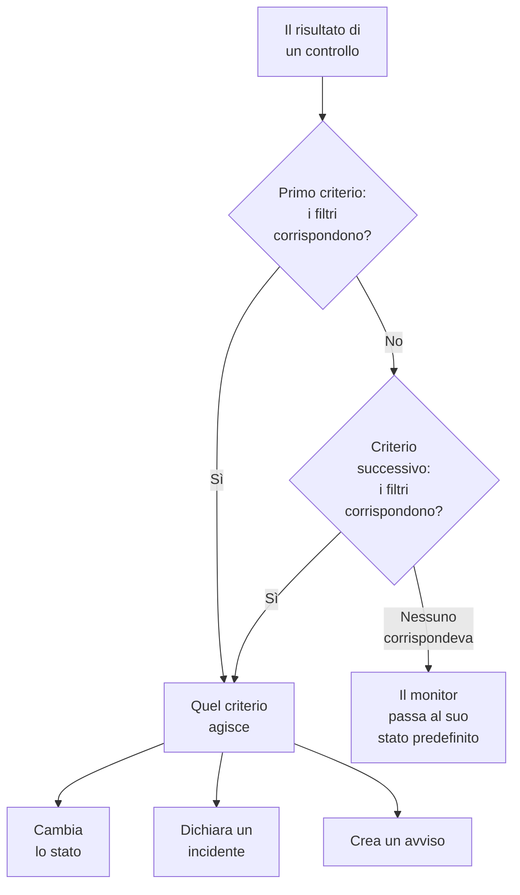
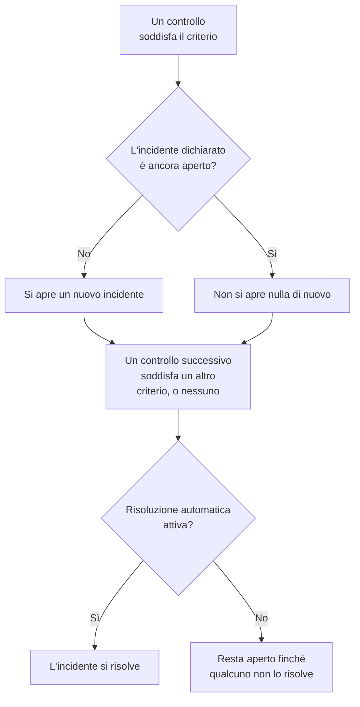

# Criteri e stati dei monitor

I criteri di un monitor decidono cosa significa ogni controllo: se il monitor è attivo o fuori servizio, e se OneUptime dichiara un incidente o crea un avviso. Gli stati sono l'elenco del vostro progetto di ciò che un monitor può essere, da **Operativo** a **Offline**. Questa pagina spiega entrambi per ogni tipo di monitor; la pagina di ciascun tipo elenca i filtri che offre.

:::cards
- [Come decidono i criteri](#come-decidono-i-criteri): Dall'alto verso il basso, e vince la prima corrispondenza.
- [Cosa contiene un criterio](#cosa-contiene-un-criterio): Filtri, una condizione di corrispondenza, azioni e impostazioni.
- [Modificare i criteri di un monitor](#modificare-i-criteri-di-un-monitor): Modificare, aggiungere, riordinare e testare i criteri.
- [Stati dei monitor](#stati-dei-monitor): Gli stati integrati e gli stati personalizzati.
:::

## Come decidono i criteri

Ogni volta che un monitor viene controllato, i suoi criteri giudicano il risultato dall'alto dell'elenco verso il basso. Il primo criterio i cui filtri corrispondono decide cosa succede, e i criteri sottostanti non vengono considerati per quel controllo. Se nessuno corrisponde, il monitor passa al suo **Stato predefinito del monitor**.

L'ordine fa parte della regola. Un nuovo monitor elenca i suoi criteri dal caso peggiore: offline, poi un avvertimento se il suo tipo ne ha uno (un certificato o un dominio in scadenza), poi online. Un criterio sano e ampio, come **Is Online** impostato su **Vero**, corrisponde a quasi ogni controllo, quindi va per ultimo: sopra gli altri, corrisponderebbe per primo ogni volta e gli altri non agirebbero mai.

Un criterio che corrisponde ma non cambia alcuno stato decide comunque il controllo: il monitor mantiene il suo stato, e i criteri sottostanti attendono il controllo successivo. Lo **Stato predefinito del monitor** si applica solo quando nessun criterio corrisponde. Per un nuovo monitor è **Operativo**; modificatelo sotto **Altri campi**, sotto i criteri.

> [!NOTE]
> Un monitor che apre un incidente o un avviso per ogni host, container, disco o interfaccia giudica tutti i criteri a ogni controllo, così due host possono corrispondere a due criteri diversi contemporaneamente. È un monitor la cui query ha un **Raggruppa per**, come un monitor di metriche o di log, oppure un criterio che indica `*` per ogni disco o interfaccia. Un monitor di richieste in ingresso che raggruppa gli incidenti per un campo del payload si ferma comunque alla prima corrispondenza.

## Cosa contiene un criterio

Aprite un criterio: ha un nome e tre sezioni, ognuna delle quali si chiude in un riepilogo di una riga.

| Parte | Cosa contiene |
| --- | --- |
| **Nome dei criteri** | Il nome nell'elenco dei criteri e nella causa principale di ogni incidente e avviso che il criterio apre. **Aggiungi criteri** dà a un nuovo criterio il nome dei suoi filtri, e il nome li segue finché non ne digitate uno vostro. |
| **Filtri** | Ciò che il controllo deve mostrare, come uno o più filtri. I monitor Kubernetes e di metriche li chiamano **Alert Rules**. |
| **Azioni** | Cosa succede quando i filtri corrispondono: cambiare lo stato, creare un avviso, dichiarare un incidente o qualsiasi combinazione. |
| **Impostazioni** | **Abilita questi criteri**, una **Descrizione** facoltativa e, sui monitor di richieste in ingresso, **Group incidents and alerts by a payload field**. |

### Filtri

Un filtro legge un dato dal controllo e lo confronta: un **Tipo di filtro** (cosa leggere, come **Codice di stato della risposta**), una **Condizione del filtro** (come confrontare, come **Maggiore di**) e un **Valore**. I monitor che confrontano metriche, come i monitor Kubernetes e di metriche, chiedono invece una **Condizione** e un **Soglia**. Ogni tipo di monitor offre i propri tipi di filtro, elencati nella sua pagina, per esempio [Monitor sito web](/docs/monitor/website-monitor#criteri-di-monitoraggio).

Con due o più filtri, sotto di essi compare la **Condizione di corrispondenza**: **Tutti** significa che ogni filtro deve corrispondere, **Qualsiasi** che ne basta uno. Un nuovo criterio parte da **Tutti**.

I filtri che misurano ogni controllo, come **Is Online**, **Codice di stato della risposta** e **Tempo di risposta (in ms)**, offrono **Valuta questo criterio su un periodo di tempo**. Giudica una finestra di controlli recenti invece del solo ultimo, e parte dagli ultimi 5 minuti con **All Values**, che corrisponde solo quando ogni controllo della finestra ha corrisposto. Vedere [Valutare su un periodo di tempo](/docs/monitor/website-monitor#valutare-su-un-periodo-di-tempo).

### Azioni

Ogni azione è un interruttore sotto **Azioni**:

| Interruttore | Cosa fa |
| --- | --- |
| **Quando i filtri corrispondono, modifica lo stato del monitor.** | Porta il monitor allo stato scelto in **Cambia lo stato del monitor in**. |
| **Quando i filtri corrispondono, crea un avviso.** | Crea gli avvisi impostati sotto **Crea avviso**. Un avviso informa il vostro team e non compare mai su una pagina di stato. |
| **Quando i filtri corrispondono, dichiara un incidente.** | Dichiara gli incidenti impostati sotto **Crea incidente**. Le vostre pagine di stato possono mostrarli. |

Un incidente o un avviso chiede un titolo, una **Gravità** e, nelle sezioni chiuse, una descrizione, proprietari, etichette e policy di reperibilità. Titoli e descrizioni possono contenere valori del controllo, come `{{monitorName}}`: vedere [Modelli di incidenti e avvisi](/docs/monitor/incident-alert-templating). Per allertare qualcuno quando il criterio corrisponde, scegliete una policy sotto **Reperibilità**: vedere [Policy di reperibilità](/docs/on-call/policies).

### Impostazioni

**Abilita questi criteri** è attivo per ogni nuovo criterio. Disattivatelo per tenere un criterio senza usarlo: viene saltato a ogni controllo, non cambia alcuno stato, non apre nulla e la sua intestazione mostra **Disabilitato**.

**Group incidents and alerts by a payload field** apre un incidente per ogni valore trovato in una richiesta in ingresso, così un unico indirizzo di webhook può tenere aperti più incidenti. Vedere [Attivare il raggruppamento degli incidenti](/docs/monitor/incoming-request-monitor#attivare-il-raggruppamento-degli-incidenti).

## Quando incidenti e avvisi si aprono e si chiudono

Un criterio che dichiara incidenti ne apre uno quando corrisponde. Quando il monitor si riprende, l'incidente si chiude da solo se il criterio lo prevede.

- **Uno alla volta.** Finché un incidente dichiarato da un criterio è ancora aperto, lo stesso criterio che corrisponde di nuovo non ne dichiara un altro. Gli avvisi funzionano allo stesso modo. Un monitor che raggruppa per host o per campo del payload ne tiene uno aperto per host o per valore, e un criterio di un monitor di email in ingresso con **Apri un nuovo incidente per ogni email** ne apre uno per ogni email.
- **La chiusura.** A un controllo successivo in cui corrisponde un altro criterio, o nessuno, viene risolto un incidente il cui criterio ha attivo **Risoluzione automatica dell'incidente**, e così un avviso con **Risoluzione automatica dell'avviso**. Entrambi si trovano sotto **Altri campi** nell'incidente o nell'avviso, e i criteri con cui parte un nuovo monitor li hanno attivi.
- **Più sonde.** Un monitor controllato da più di una sonda cambia solo quando le sue sonde concordano. Vedere [Come vengono valutati i criteri](/docs/monitor/create-monitor#come-vengono-valutati-i-criteri).
- **Un monitor padre fuori servizio.** Nella pagina **Configurazione → Dipendenze** di un monitor, **Depends On Monitors** indica i monitor da cui dipende. Finché uno di essi è in uno stato elencato in **Suppress When Parent Status Is** (qualsiasi stato offline, se lasciato vuoto), il monitor non apre incidenti né avvisi. Il suo stato continua a cambiare, e ciò che è aperto continua a risolversi.
- **La manutenzione programmata.** Un monitor incluso in un evento di manutenzione in corso non viene controllato, quindi i suoi criteri non vengono eseguiti. Vedere [Panoramica della manutenzione programmata](/docs/scheduled-maintenance/index).

Per vedere come è stato giudicato un controllo, aprite la **Panoramica** del monitor: la scheda **Riepilogo del monitor** mostra quale criterio ha corrisposto e cosa ha fatto ciascuno, compreso un incidente saltato perché ce n'era già uno aperto.

## Modificare i criteri di un monitor

:::steps
### Aprire la pagina dei criteri

Andate in **Monitor** e aprite il monitor. Espandete **Configurazione** nel suo menu laterale e fate clic su **Criteri**. La scheda **Criteri di monitoraggio** mostra ogni criterio, cosa controlla e cosa fa.

### Fare clic su Modifica criteri di monitoraggio

L'editor mostra ogni criterio aperto. Fate clic sull'intestazione di un criterio per chiuderlo su una riga: il suo nome, quanti filtri ha e cosa fa.

### Aggiungere, modificare o riordinare i criteri

**Aggiungi criteri** ne aggiunge uno in fondo, aperto e con il nome del suo filtro. Trascinate un criterio per la maniglia alla sua sinistra per spostarlo: vince la prima corrispondenza, quindi mettete per primo il caso peggiore. **Elimina criteri** ne rimuove uno; un monitor conserva almeno un criterio.

### Salvare i criteri

Fate clic su **Salva modifiche**. Il controllo successivo viene giudicato con i nuovi criteri.

### Testare il monitor

Su un monitor controllato dalle sonde, fate clic su **Testa il monitor** nella scheda, scegliete una sonda in **Seleziona sonda** e fate clic su **Esegui test**. **Risultato del test del monitor** mostra cosa ha trovato il controllo.
:::

Un monitor manuale non ha criteri: impostate voi il suo stato. Vedere [Aggiornare lo stato](/docs/monitor/manual-monitor#aggiornare-lo-stato).

## Stati dei monitor

Un monitor è sempre in uno degli stati del vostro progetto. Un nuovo progetto ne ha tre, dal più sano al peggiore:

| Stato | Posizione | Colore | Cosa ne fa OneUptime |
| --- | --- | --- | --- |
| **Operativo** | 1 | Verde | I nuovi monitor partono da qui, ed è lo **Stato predefinito del monitor** di un nuovo monitor. Integrato. |
| **Degradato** | 2 | Giallo | Nulla da solo: è un vostro criterio a portarci un monitor. |
| **Offline** | 3 | Rosso | Il criterio offline di un nuovo monitor lo porta qui, e OneUptime considera fuori servizio un monitor in questo stato. Integrato. |

L'elenco è un ordine. Dove i monitor sono mostrati insieme vince lo stato più in basso nell'elenco: un gruppo di monitor, un gruppo di una pagina di stato e lo stato complessivo di una pagina di stato mostrano ciascuno lo stato peggiore dei loro monitor.

### Dove conta uno stato

| Dove | Cosa decide lo stato |
| --- | --- |
| L'elenco **Monitor** | Lo stato attuale di ogni monitor. **Non operativo** elenca i monitor in qualsiasi stato tranne quello operativo, con un contatore rosso accanto. |
| Pagine di stato | Il colore di ogni riga e la sua disponibilità: contano contro di essa solo gli stati in **Conta come inattività** della pagina. Una nuova pagina di stato parte con tutti gli stati tranne quello operativo. Vedere [Scegliere cosa mostra la pagina](/docs/status-pages/index#scegliere-che-cosa-compare-sulla-pagina). |
| Gruppi di monitor | Lo stato del gruppo: il peggiore dei suoi monitor. Vedere [Gruppi di monitor](/docs/monitor/monitor-groups). |
| SLO | Il tempo di inattività che uno SLO conta, in base al proprio elenco di stati. Vedere [Quali stati contano come inattività](/docs/slo/introduction#quali-stati-contano-come-inattività). |
| Dipendenze | Se un monitor padre trattiene gli incidenti e gli avvisi dei monitor che dipendono da lui: per impostazione predefinita, finché è in uno stato offline. |

Uno stato che aggiungete in seguito non viene aggiunto all'elenco **Conta come inattività** di una pagina di stato esistente: aggiungetelo voi lì.

### Aggiungere uno stato personalizzato

:::steps
### Aprire Stato del monitor

Andate in **Monitor → Impostazioni → Stato del monitor**. **Impostazioni** è chiuso nel menu laterale: espandetelo prima. La scheda **Monitor Stati** elenca gli stati dal più sano al peggiore.

### Creare lo stato

Fate clic su **Crea: Stato del monitor** e compilate **Nome**, **Descrizione** e **Colore**. Il nuovo stato si posiziona subito sopra lo stato offline, così un'interruzione resta il caso peggiore.

### Metterlo al suo posto

Trascinate lo stato per la sua maniglia. Uno stato più in basso nell'elenco conta come peggiore di ogni stato sopra di esso.

### Usarlo in un criterio

Uno stato non fa nulla finché un criterio non vi porta dei monitor. Sceglietelo in **Cambia lo stato del monitor in** nel criterio che deve impostarlo.
:::

Gli stati operativo e offline sono contrassegnati come **Integrato**: potete rinominarli e cambiarne il colore, ma non eliminarli. Su OneUptime Cloud, creare o modificare uno stato richiede il piano Growth. Gestire gli stati richiede il ruolo Project Owner, Project Admin o Monitor Admin, oppure un ruolo personalizzato con il permesso corrispondente per gli stati dei monitor.

### La cronologia degli stati

Ogni cambio di stato resta nella **Cronologia di stato** del monitor: quando è iniziato, quanto è durato e **Visualizza causa** per il criterio che lo ha impostato. **Crea: Monitor Stato Evento** aggiunge uno stato a mano. Su un monitor controllato dalle sonde, il controllo successivo che corrisponde a un criterio con uno stato reimposta quello stato.

Un cambio di stato avvisa i proprietari del monitor solo se hanno attivato **Stato del monitor modificato** nelle loro impostazioni di notifica: all'inizio è disattivato. Un monitor che torna al suo **Stato predefinito del monitor** perché nessun criterio ha corrisposto non avvisa nessuno. Vedere [Cosa è attivo per un nuovo membro](/docs/notifications/notification-settings#cosa-è-attivo-per-un-nuovo-membro).

## Archiviare uno stato del monitor

Archivia uno stato che il tuo team non deve più usare, invece di eliminarlo. L'archiviazione non modifica alcun monitor: un monitor in quello stato vi resta finché il suo stato non cambia, e la sua cronologia degli stati lo mostra ancora.

- **Archivia** si trova nel menu **⋯** della riga. Chiede prima conferma ed elenca i criteri dei monitor, i modelli e le pagine di stato configurati per usare lo stato: continuano a usarlo finché non li modifichi.
- **Nessuno può più sceglierlo.** Un criterio, il menu di stato di un monitor, lo stato del monitor di un incidente o di un evento di manutenzione e gli stati di inattività di una pagina di stato lo escludono. L'API, Terraform e MCP lo rifiutano.
- **Gli stati archiviati sono elencati a parte**, nella sezione compressa **Stati del monitor archiviati** sotto la tabella. **Annulla archiviazione** ne ripristina uno com'era.
- **Gli stati predefiniti non possono essere archiviati.** I nuovi monitor iniziano nello stato operativo, e OneUptime considera inattivo un monitor nello stato offline. Il loro **Archivia** è bloccato, con il motivo.

## Risoluzione dei problemi

:::details Il sito è fuori servizio, ma il monitor resta Operativo
Un criterio più in alto nell'elenco ha corrisposto per primo. Aprite **Configurazione → Criteri** e controllate l'ordine: il criterio sano va per ultimo. Controllate anche che il criterio offline abbia attivo **Abilita questi criteri**, e che la sua azione **Quando i filtri corrispondono, modifica lo stato del monitor.** sia attiva con uno stato scelto.
:::

:::details Non si è aperto alcun incidente quando il monitor è andato giù
Controllate il criterio che ha corrisposto: **Quando i filtri corrispondono, dichiara un incidente.** deve essere attivo. Un incidente non viene dichiarato finché l'incidente dello stesso criterio è ancora aperto, finché un monitor padre in **Depends On Monitors** è fuori servizio, o finché il monitor è in manutenzione programmata. La scheda **Riepilogo del monitor** nella **Panoramica** del monitor indica quale.
:::

:::details L'incidente resta aperto dopo che il monitor si è ripreso
Aprite il criterio dell'incidente ed espandete **Altri campi** nel suo incidente: **Risoluzione automatica dell'incidente** deve essere attivo. Un incidente di un criterio che avete poi eliminato non viene risolto dal monitor: risolvetelo a mano.
:::

:::details Il pulsante di eliminazione di Offline è bloccato
**Operativo** e **Offline** sono integrati: OneUptime vi porta i monitor, quindi possono essere rinominati ma non eliminati. Eliminate invece uno dei vostri stati, oppure rinominate quello integrato.
:::

## Passaggi successivi

:::cards
- [Creare un monitor](/docs/monitor/create-monitor): I tre passaggi di un nuovo monitor.
- [Modelli di incidenti e avvisi](/docs/monitor/incident-alert-templating): Inserire valori del controllo in titoli e descrizioni.
- [Gruppi di monitor](/docs/monitor/monitor-groups): Riunire più monitor in un unico stato.
- [Panoramica degli incidenti](/docs/incidents/index): Cosa succede dopo che un criterio dichiara un incidente.
:::
