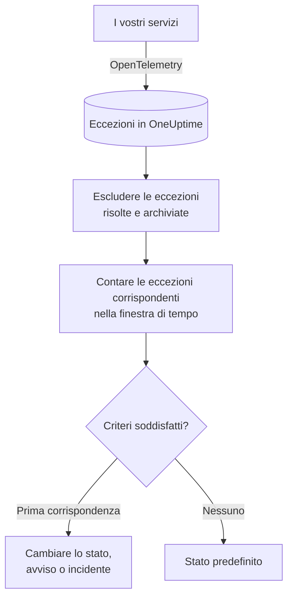

# Monitor eccezioni

Un monitor eccezioni conta, in una finestra di tempo, le eccezioni che i vostri servizi segnalano a OneUptime e che corrispondono ai vostri filtri (messaggio, tipo di eccezione, ambiente, servizio). Quando il conteggio soddisfa i vostri criteri, cambia lo stato del monitor, crea un avviso o dichiara un incidente. Usatelo per essere avvisati di ogni nuovo crash in produzione, di un tipo di eccezione preciso o di un improvviso aumento degli errori.

:::cards
- [Creare il monitor](#creare-un-monitor-eccezioni): Scegliere quali eccezioni contare e quando avvisare.
- [Ambienti](#ambienti): Limitare il monitor a `production`.
- [Come viene valutato](#come-viene-valutato): Cosa viene contato e cosa comporta risolvere un'eccezione.
- [Criteri](#criteri): Le condizioni e i valori predefiniti.
:::

## Come funziona



Ogni minuto, OneUptime conta le eccezioni che corrispondono ai filtri del monitor e si sono verificate nella sua finestra di tempo, escludendo quelle che avete contrassegnato come risolte o archiviato. Confronta quel conteggio con i criteri del monitor dall'alto verso il basso, e il primo criterio che corrisponde decide cosa succede. Se nessuno corrisponde, il monitor torna al suo stato predefinito.

## Prima di iniziare

- I vostri servizi inviano eccezioni a OneUptime tramite OpenTelemetry. Vedete [OpenTelemetry](/docs/telemetry/open-telemetry).
- Per limitare un monitor a un ambiente, i vostri servizi devono impostare l'attributo di risorsa `deployment.environment`.

## Creare un monitor eccezioni

:::steps
### Iniziare un nuovo monitor

Andate in **Monitor** e fate clic su **Crea monitor**. Oppure, nella pagina di un'eccezione, fate clic su **Crea monitor** accanto a **Risolvi**: il nuovo monitor parte osservando il tipo di quell'eccezione nel suo servizio, e avvisa quando si ripresenta.

### Scegliere Exceptions

In **Tipo di monitor**, fate clic su **Altri tipi di monitor** e scegliete **Eccezioni** sotto **Telemetria**, oppure digitate `exceptions` nella casella di ricerca. Inserite un **Nome**, poi fate clic su **Avanti**.

### Scegliere di cosa vi informa il monitor

In **Di cosa deve informarti questo monitor?**, scegliete **Qualsiasi eccezione** o **Troppe eccezioni**. Ogni scelta compila la regola, che potete modificare più in basso. Scegliete **Qualcos'altro** per impostarla voi. **Una nuova eccezione**, **Torna un'eccezione risolta** e **Picco di eccezioni** avvisano su un'eccezione vista per la prima volta, su una tornata dopo che l'avete risolta e su un aumento molto sopra ciò che è normale per quell'ora della settimana.

### Scegliere le eccezioni da contare

In **Eccezioni da osservare**, impostate **Il messaggio contiene**, **Tipi di eccezione** e **Ambienti**. Un filtro lasciato vuoto corrisponde a tutte le eccezioni. **Eccezioni corrispondenti**, sotto i filtri, mostra le eccezioni a cui corrispondono in questo momento.

### Restringere il campo (facoltativo)

Aprite **Altri campi** per filtrare per servizio di telemetria o entità dell'infrastruttura, oppure per contare anche le eccezioni risolte e archiviate.

### Dire quando avvisare

In **Quando avvisare**, scegliete una **Condizione**, il **Numero di eccezioni** e una **Finestra temporale**. La frase sotto di essi ripete la regola con parole semplici. Il grafico sotto la frase conta le eccezioni corrispondenti in ogni finestra nelle ultime ore, disegna il numero della regola come una linea e dice quante volte la regola avrebbe avvisato. Il suo pulsante propone un numero che la regola non avrebbe superato in quel periodo. **Avvisa su** sceglie cosa confronta la regola: **Eccezioni**, **Nuove eccezioni**, **Eccezioni tornate** o **Un aumento rispetto al solito**. Il grafico viene disegnato solo per **Eccezioni**. Con **Insolitamente alto**, come imposta **Picco di eccezioni**, non c'è alcun numero da inserire: scegliete invece una **Sensibilità**.

### Scegliere cosa succede

In **Cosa succede**, scegliete **Crea un avviso**, **Dichiara un incidente** o **Entrambi**, e dategli un titolo e una gravità. Finché la regola corrisponde, il monitor mostra lo stato indicato in **Altri campi**; quando smette di corrispondere, il monitor torna al suo stato predefinito e l'avviso o l'incidente si risolve da solo.

### Creare il monitor

Fate clic su **Crea monitor**. Il monitor si apre sulla sua pagina **Panoramica**, e la sua prima valutazione avviene entro un minuto.
:::

## Cosa interroga

| Campo | A cosa corrisponde | Predefinito |
| --- | --- | --- |
| **Il messaggio contiene** | Eccezioni il cui messaggio contiene questo testo, senza distinzione tra maiuscole e minuscole. | Vuoto: tutte le eccezioni |
| **Tipi di eccezione** | Eccezioni di uno qualsiasi di questi tipi, separati da virgole, come `TypeError, NullReferenceException`. Il nome del tipo deve corrispondere esattamente. | Vuoto: tutti i tipi |
| **Ambienti** | Eccezioni di uno qualsiasi di questi ambienti, separati da virgole (vedete [Ambienti](#ambienti)). | Vuoto: tutti gli ambienti |
| **Finestra temporale** (in **Quando avvisare**) | Eccezioni degli ultimi 5 secondi fino alle ultime 24 ore. | **Ultimi 5 minuti** |
| **Filtra per servizio** (in **Altri campi**) | Eccezioni di uno qualsiasi dei servizi scelti. | Vuoto: tutti i servizi |
| **Filtra per entità dell'infrastruttura** (in **Altri campi**) | Eccezioni di uno qualsiasi degli host, pod, container e altre entità scelti. | Vuoto: tutte le entità |
| **Includi eccezioni risolte** (in **Altri campi**) | Contare anche le eccezioni contrassegnate come risolte. | Disattivato |
| **Includi eccezioni archiviate** (in **Altri campi**) | Contare anche le eccezioni archiviate. | Disattivato |

Tutti i filtri che impostate devono corrispondere perché un'eccezione venga contata.

### Ambienti

Gli ambienti derivano dall'attributo di risorsa OpenTelemetry `deployment.environment` di ogni eccezione, lo stesso valore che l'esploratore delle eccezioni filtra con `env:production`. Inserite un ambiente, o più ambienti separati da virgole; un'eccezione viene contata quando il suo ambiente corrisponde a uno di essi.

La corrispondenza è esatta e distingue tra maiuscole e minuscole: `production` non corrisponde a `Production` né a `prod`. Le eccezioni senza ambiente non vengono contate quando questo filtro è impostato. Lasciatelo vuoto per contare le eccezioni di tutti gli ambienti, comprese quelle senza ambiente.

Il filtro dell'ambiente si combina con tutti gli altri filtri, quindi un monitor limitato a un servizio di telemetria e a `production` conta solo le eccezioni di produzione di quel servizio.

Quando create il monitor tramite l'API, impostate `environments` nell'`exceptionMonitor` del passaggio come elenco di nomi di ambiente:

```json
{
  "exceptionMonitor": {
    "telemetryServiceIds": [],
    "environments": ["production"],
    "exceptionTypes": [],
    "message": "",
    "includeResolved": false,
    "includeArchived": false,
    "lastXSecondsOfExceptions": 300
  }
}
```

## Come viene valutato

- **Ogni minuto.** Un monitor eccezioni non viene controllato da sonde, quindi non ha un intervallo da impostare né una pagina **Sonde e intervallo**.
- **Occorrenze, non tipi di eccezione.** Il monitor conta ogni volta che un'eccezione corrispondente si è verificata entro la **Finestra temporale**. Un'eccezione lanciata 40 volte conta 40.
- **Le eccezioni risolte e archiviate vengono escluse.** A meno che non attiviate **Includi eccezioni risolte** o **Includi eccezioni archiviate**, le occorrenze di un'eccezione che avete contrassegnato come risolta o archiviato non contano. Contrassegnare un'eccezione come risolta può quindi chiudere l'incidente che ha aperto. Quando un'eccezione risolta si ripresenta, torna automaticamente non risolta e viene contata di nuovo.
- **Nessuna eccezione significa un conteggio di 0.**
- **L'interruzione di OneUptime stesso non è silenzio.** Finché la finestra di tempo contiene un periodo in cui OneUptime stesso non riceveva dati (si stava riavviando, veniva aggiornato o recuperava un arretrato), il controllo attende: lo stato non cambia e nessun incidente o avviso viene aperto o risolto. Vedete [Quando OneUptime non riceve dati](/docs/monitor/when-oneuptime-is-not-receiving).
- **Criteri dall'alto verso il basso.** Decide il primo criterio che corrisponde, quindi mettete per primo il più grave.

Ogni cambio di stato, con il suo motivo, viene registrato nella **Cronologia di stato** del monitor.

## Criteri

I criteri di un monitor eccezioni hanno quattro valori di **Tipo di filtro**: **Numero di eccezioni**, il numero di eccezioni che hanno corrisposto nella finestra, e **Nuove eccezioni**, **Eccezioni in regressione** e **Aumento delle eccezioni (in %)**, descritti più sotto. **Quando avvisare** imposta un criterio, la cui **Condizione** è **Più di**, **Almeno**, **Meno di**, **Al massimo**, **Esattamente**, **Insolitamente alto**, **Insolitamente basso** o **Insolitamente alto o basso**. Per più criteri, o per uno con più di un filtro, fate clic su **Modifica come criteri personalizzati** in **Altri campi** di **Cosa succede**: lì ogni criterio ha una **Condizione del filtro** e un **Valore**.

| Condizione del filtro | Corrisponde quando il conteggio delle eccezioni è… |
| --- | --- |
| **Maggiore di** | sopra il valore |
| **Maggiore o uguale a** | pari al valore o superiore |
| **Minore di** | sotto il valore |
| **Minore o uguale a** | pari al valore o inferiore |
| **Uguale a** | esattamente il valore |
| **Diverso da** | qualsiasi cosa tranne il valore |
| **Anomalmente alto** | sopra l'intervallo atteso per quest'ora della settimana |
| **Anomalmente basso** | sotto quell'intervallo |
| **Anomalo** | fuori da quell'intervallo, in un senso o nell'altro |

Le condizioni di anomalia non hanno un **Valore**. Scegliete una **Sensibilità** (Basso, Medio, quella predefinita, oppure Alto) e, nei criteri personalizzati, una **Finestra di riferimento** di 14 (quella predefinita), 28, 60 o 90 giorni. Solo **Numero di eccezioni** le ha: vedete [Picchi rispetto alla norma](#picchi-rispetto-alla-norma).

Un monitor eccezioni creato in Crea monitor parte con la regola di ciò che avete scelto in **Di cosa deve informarti questo monitor?**:

| Scelta | Regola | Cosa succede |
| --- | --- | --- |
| **Qualsiasi eccezione** | **Più di** `0` in **Ultimi 5 minuti** | Crea un avviso, che si risolve da solo |
| **Troppe eccezioni** | **Più di** `20` in **Ultimi 5 minuti** | Crea un avviso, che si risolve da solo |
| **Una nuova eccezione** | **Nuove eccezioni**: **Più di** `0` in **Ultimi 10 minuti** | Crea un avviso, che si risolve da solo |
| **Torna un'eccezione risolta** | **Eccezioni tornate**: **Più di** `0` in **Ultimi 10 minuti** | Crea un avviso, che si risolve da solo |
| **Picco di eccezioni** | **Insolitamente alto** in **Ultimi 15 minuti** | Crea un avviso, che si risolve da solo |

Un monitor eccezioni creato tramite l'API o Terraform senza criteri parte con questi criteri:

| Criterio | Filtro | Effetto |
| --- | --- | --- |
| Check if … has exceptions | **Numero di eccezioni** **Maggiore di** `0` | Mette il monitor offline e dichiara un incidente, risolto automaticamente |
| Check if … has no exceptions | **Numero di eccezioni** **Uguale a** `0` | Mette il monitor online |

## Eccezioni nuove, tornate e in aumento

Oltre al numero di eccezioni, un monitor eccezioni può avvisare su ciò che un sistema di tracciamento errori mette al primo posto. Ognuno viene letto solo quando un criterio lo controlla.

| Tipo di filtro | Cosa conta nella finestra |
| --- | --- |
| **Nuove eccezioni** | Le eccezioni corrispondenti viste per la prima volta, né risolte né archiviate. |
| **Eccezioni in regressione** | Le eccezioni corrispondenti che avete risolto, tornate e ancora aperte. |
| **Aumento delle eccezioni (in %)** | Di quanto il numero di eccezioni corrispondenti supera il solito: il giorno prima della finestra, per finestra della stessa durata, almeno una. Dieci eccezioni dopo un giorno tranquillo danno 900%. |

Le eccezioni nuove e tornate sono filtrate per servizio, tipo di eccezione, ambiente e messaggio, e anche per entità di infrastruttura: un'eccezione conta quando una delle sue occorrenze nella finestra è arrivata da una delle entità scelte.

## Picchi rispetto alla norma

**Picco di eccezioni** confronta la finestra con le stesse ore delle settimane precedenti, non con un numero fisso. Un picco del lunedì mattina è normale di lunedì mattina, lo stesso conteggio alle 3 di una domenica no, e una salita lenta su più giorni si vede appena esce dall'intervallo della settimana scorsa.

| Impostazione | Cosa fa | Predefinito |
| --- | --- | --- |
| **Sensibilità** | Quanto una finestra deve uscire dall'intervallo abituale: 4 deviazioni standard con Basso, 3 con Medio, 2 con Alto. | Medio |
| **Finestra di riferimento** (in **Altri campi**) | Quanto storico usare per imparare: 14, 28, 60 o 90 giorni. | 14 giorni |
| **Deviazioni standard** (in **Altri campi**) | Un numero vostro al posto di quello che imposta **Sensibilità**. | Vuoto |
| **Minimo di eccezioni** (in **Altri campi**) | Il numero minimo di eccezioni in una finestra che può avvisare: 20 con Basso, 10 con Medio, 5 con Alto. | Vuoto |

- **Usa i vostri filtri.** Lo storico viene letto con i filtri del monitor, quindi un monitor su un tipo di eccezione viene confrontato con lo storico di quel tipo, e le eccezioni risolte e archiviate restano fuori da entrambi.
- **Anche la calma conta.** Una finestra senza eccezioni fa parte della norma, quindi l'intervallo di un servizio tranquillo resta piccolo. Le sue prime eccezioni non avvisano, per via di **Minimo di eccezioni**, e una vera raffica sì.
- **Un nuovo servizio attende.** Finché un servizio non ha due settimane di storico, il criterio sta ancora imparando e non scatta, per quante eccezioni lanci. Lo storico arriva solo fin dove OneUptime conserva le eccezioni: 15 giorni se non lo avete cambiato, e un servizio conservato per meno di due settimane non ne ha mai abbastanza.
- **L'avviso dice perché.** Indica l'intervallo atteso e quanto la finestra ne era fuori. Ogni controllo scrive lo stesso nella **Cronologia di stato**, oppure che sta ancora imparando.

## Esempio pratico: solo le eccezioni di produzione

Volete un incidente ogni volta che l'API lancia un'eccezione in produzione, e niente per lo staging. Scegliete **Qualsiasi eccezione**, impostate **Ambienti** su `production`, lasciate la **Finestra temporale** su **Ultimi 5 minuti** e scegliete **Dichiara un incidente** in **Cosa succede**. Negli ultimi cinque minuti:

| Eccezioni | Ambiente | Stato | Contate? |
| --- | --- | --- | --- |
| `TypeError` × 3 | `production` | Attiva | Sì: 3 |
| `TypeError` × 40 | `staging` | Attiva | No: un altro ambiente |
| `TimeoutError` × 2 | nessuno | Attiva | No: nessun ambiente |
| `NullReferenceException` × 4 | `production` | Risolta dopo che si è verificata | No: risolta |

Il **Numero di eccezioni** è 3, quindi **Più di** `0` corrisponde: il monitor va offline e viene dichiarato un incidente. Quando passano cinque minuti senza eccezioni di produzione attive, la regola smette di corrispondere, il monitor torna al suo stato predefinito e l'incidente si risolve da solo.

## Risoluzione dei problemi

:::details Le eccezioni compaiono nell'esploratore, ma il monitor conta 0
Confrontate il valore di **Ambienti** con il filtro `env:` dell'esploratore: la corrispondenza è esatta e distingue tra maiuscole e minuscole, e le eccezioni senza ambiente vengono escluse quando il filtro è impostato. Controllate poi se quelle eccezioni sono risolte o archiviate. Aprite la pagina **Criteri** del monitor (sotto **Configurazione**) e fate clic su **Modifica criteri**: **Eccezioni corrispondenti** mostra a cosa corrispondono i filtri.
:::

:::details L'incidente si è risolto quando ho risolto l'eccezione
È il comportamento previsto. Le eccezioni risolte non vengono contate, quindi il conteggio è sceso e il criterio ha smesso di corrispondere. Se l'eccezione si ripresenta, torna non risolta e viene contata di nuovo. Attivate **Includi eccezioni risolte** per contarle comunque.
:::

:::details Un filtro per tipo di eccezione non corrisponde a nulla
I **Tipi di eccezione** vengono confrontati esattamente con il nome del tipo con cui l'eccezione è stata segnalata, come `TypeError`. Copiate il tipo dall'esploratore delle eccezioni.
:::

:::details Una regola sul picco di eccezioni non avvisa mai
Controllate la **Cronologia di stato**: indica l'intervallo atteso, il conteggio necessario per avvisare o che la regola sta ancora imparando. Un servizio ha bisogno di due settimane di storico, quindi una conservazione inferiore a due settimane lo lascia in apprendimento. Se il conteggio resta sotto **Minimo di eccezioni**, abbassatelo in **Altri campi** o scegliete una **Sensibilità** più alta.
:::

## Passaggi successivi

:::cards
- [Monitor tracce](/docs/monitor/traces-monitor): Avvisare su span ed endpoint non riusciti.
- [Monitor log](/docs/monitor/logs-monitor): Avvisare sul volume e sul contenuto dei log.
- [Modelli di incidenti e avvisi](/docs/monitor/incident-alert-templating): Scrivere titoli e descrizioni degli avvisi utili.
- [OpenTelemetry](/docs/telemetry/open-telemetry): Inviare eccezioni a OneUptime.
:::
