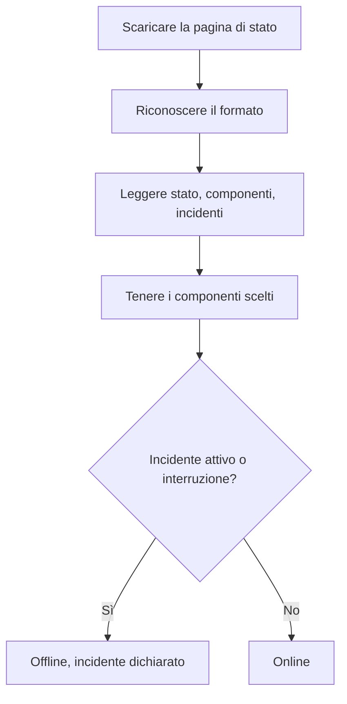

# Monitor pagina di stato esterna

Un monitor di pagina di stato esterna tiene d'occhio la pagina di stato pubblica di un servizio da cui dipendete (AWS, GCP, Azure, GitHub, OpenAI, Anthropic e molti altri) e vi avvisa quando quel provider segnala un'interruzione o prestazioni degradate. Usatelo per sapere dei problemi a monte appena il provider li segnala, e per distinguerli dai vostri.

Legge anche le pagine di stato create con OneUptime, risorsa per risorsa, e distingue una manutenzione pianificata da un'interruzione: tenete d'occhio il progetto di un altro team, o un provider la cui pagina di stato gira su OneUptime.

:::cards
- [Creare il monitor](#creare-un-monitor-di-pagina-di-stato-esterna): Incollate l'URL di una pagina di stato e scegliete cosa controllare.
- [Scegliere i componenti](#componenti): Controllate solo i componenti da cui dipendete.
- [Criteri](#criteri-di-monitoraggio): Cosa conta come guasto, fin dall'inizio.
- [Pagine di stato OneUptime](#pagine-di-stato-oneuptime): Le risorse di un altro progetto, e la sua manutenzione.
- [Pagine di stato più diffuse](#url-di-pagine-di-stato-più-diffuse): Gli URL dei servizi da cui dipende la maggior parte dei team.
:::

## Come funziona

A ogni controllo, una sonda scarica la pagina di stato, ne riconosce il formato e legge lo stato generale, i componenti e gli incidenti attivi. Se avete scelto dei componenti, o un gruppo di componenti, contano solo quelli. Poi i criteri decidono se il monitor è online oppure offline.

Potete usarlo per:

- Monitorare la disponibilità dei servizi di terze parti da cui dipende la vostra applicazione
- Ricevere avvisi quando i provider a monte hanno interruzioni
- Seguire lo stato dei singoli componenti
- Controllare solo i componenti da cui dipendete (ad es. Git Operations e Pull Requests di GitHub, o il gruppo "APIs" di OpenAI), così incidenti estranei altrove nella pagina non fanno scattare il vostro monitor
- Rilevare prestazioni degradate prima che colpiscano i vostri utenti
- Mettere in relazione i vostri incidenti con i problemi dei provider a monte

## Provider supportati

| Provider | Descrizione |
| ------------------------ | ---------------------------------------------------------------------- |
| **Auto** (predefinito) | Riconosce automaticamente il formato della pagina di stato |
| **Atlassian Statuspage** | Pagine di stato basate su Atlassian Statuspage (API JSON) |
| **incident.io** | Pagine di stato basate su incident.io (ad es. `https://status.openai.com`) |
| **OneUptime Status Page** | Pagine di stato create con OneUptime: lo stato di ogni risorsa, e cosa è in manutenzione |
| **RSS** | Pagine di stato che offrono un feed RSS |
| **Atom** | Pagine di stato che offrono un feed Atom |

### Riconoscimento automatico

Con **Auto**, OneUptime riconosce automaticamente il formato della pagina di stato, in quest'ordine:

1. Prima prova l'API delle pagine di stato di incident.io (`/proxy/<host>`).
2. Poi prova l'API JSON di Atlassian Statuspage (`/api/v2/status.json`, `/api/v2/components.json` e `/api/v2/incidents/unresolved.json`).
3. Poi chiede il riepilogo di una pagina di stato OneUptime (`/status-page-api/summary/<page>`).
4. Se falliscono, cerca di leggere la pagina come feed RSS o Atom.
5. Come ultima risorsa, esegue un semplice controllo di raggiungibilità HTTP.

> [!NOTE]
> incident.io viene controllato per primo perché alcune pagine di stato di incident.io (come `https://status.openai.com`) espongono anche un endpoint limitato compatibile con Atlassian, che omette i gruppi di componenti e gli incidenti attivi. Controllare prima incident.io garantisce che si usino i dati più completi, che conoscono i gruppi.

Il controllo di raggiungibilità è anche l'ultima risorsa quando un provider scelto esplicitamente fallisce. Dice solo se la pagina risponde (online con una risposta `2xx` o `3xx`) e non riporta componenti né incidenti.

## Creare un monitor di pagina di stato esterna

:::steps
### Iniziare un nuovo monitor

Andate in **Monitor** e fate clic su **Crea monitor**. In **Tipo di monitor**, fate clic su **Altri tipi di monitor** e scegliete **External Status Page** sotto **Basic Monitoring**, oppure digitate `statuspage` nella casella di ricerca. Inserite un **Nome**, poi fate clic su **Avanti**.

### Inserire l'URL della pagina di stato

Inserite l'**URL della pagina di stato**. Lasciate il **Provider** su **Auto** a meno che non conosciate il formato.

### Scegliere i componenti, se serve

Aprite **Componenti** e scegliete dall'elenco della pagina i componenti da cui dipendete, come `Git Operations` e `Pull Requests` su quella di GitHub; lasciatelo vuoto per controllare l'intera pagina. Per controllare invece un gruppo, aprite **Altri campi** e inserite un **Component Group Filter**, come `APIs`.

### Testarlo

Fate clic su **Testa il monitor** per scaricare la pagina una volta, e controllate provider, componenti e incidenti trovati.

### Rivedere i criteri

Il passaggio dei criteri parte con [i criteri predefiniti](#criteri-predefiniti), che segnano il monitor offline quando il provider segnala un incidente attivo o un'interruzione nell'ambito controllato. Modificateli se serve, poi fate clic su **Avanti**.

### Scegliere le sonde e creare

Selezionate le **Sonde** e un **Intervallo di monitoraggio** (parte da **Ogni 5 minuti**), poi fate clic su **Crea monitor**.
:::

## Opzioni di configurazione

| Opzione | Cosa inserire | Predefinito |
| --- | --- | --- |
| **URL della pagina di stato** | L'URL della pagina di stato. Per i siti basati su Atlassian Statuspage e incident.io è di solito l'URL radice (ad es. `https://status.example.com`). Per i feed RSS/Atom, inserite direttamente l'URL del feed. | — |
| **Provider** | **Auto** per riconoscere il formato, oppure **Atlassian Statuspage**, **incident.io**, **OneUptime Status Page**, **RSS** o **Atom** se lo conoscete. | **Auto** |
| **Componenti** | I componenti da controllare, scelti dall'elenco della pagina o digitati. | L'intera pagina |
| **Component Group Filter** | Il gruppo a cui limitare il monitor. In **Altri campi**. | Tutti i gruppi |
| **Timeout (ms)** | Il tempo massimo di attesa della pagina di stato. In **Altri campi**. | `10000` (10 secondi) |
| **Tentativi** | Quante volte ritentare, a un secondo di distanza, dopo che il primo tentativo fallisce; `0` significa un solo tentativo. In **Altri campi**. | `3` (fino a 4 tentativi) |

### Componenti

Scegliete i componenti da cui dipendete e il monitor controlla solo quelli: **External Status Page Component Status** confronta solo i loro stati, lo stato generale è il peggiore dei loro e **External Status Page Active Incidents** conta solo gli incidenti che ne riguardano almeno uno. Resta un solo controllo della pagina, quanti che ne scegliate.

Quando aprite **Componenti**, il vostro browser legge l'elenco della pagina da una Atlassian Statuspage, una pagina incident.io o una pagina di stato OneUptime, e lo mostra nei gruppi della pagina; ogni componente non operativo dice come sta. Un nome scelto controlla il componente con esattamente quel nome, senza distinguere maiuscole e minuscole: `Copilot` sulla pagina di GitHub non è `Copilot AI Model Providers`.

Quando l'elenco non si può leggere (una pagina interna, una pagina che non condivide il suo elenco con il vostro browser, un feed RSS o Atom), digitate un nome e premete Invio. Un `*` sta per qualsiasi testo: `*us-east-1*` controlla ogni componente con `us-east-1` nel nome. Su un feed RSS o Atom, un elemento conta quando il suo titolo contiene uno dei nomi.

Un incidente che non nomina alcun componente non conta finché controllate componenti scelti: nulla dice che li riguardi. Senza nulla di scelto, il monitor controlla l'intera pagina e ogni incidente conta.

Un monitor salvato con il vecchio Filtro nome componente continua a controllare ciò che controllava: il filtro compare in **Componenti** come quel nome tra asterischi, ad esempio `*API*`, che corrisponde a ogni componente il cui nome lo contiene.

> [!WARNING]
> Un nome che non corrisponde a nulla non controlla nulla, e sembra sano. **Componenti** e **Testa il monitor** nominano entrambi i componenti scelti che la pagina non elenca.

### Component Group Filter

Se la pagina di stato organizza i componenti in gruppi, potete limitare il monitor a un solo gruppo. Per esempio, su `https://status.openai.com`, inserire `APIs` limita il monitor ai servizi API di OpenAI.

Quando è impostato un gruppo di componenti, il **numero di incidenti attivi** e lo **stato generale** vengono calcolati solo sui componenti di quel gruppo: un incidente che riguarda un gruppo estraneo (per esempio ChatGPT) non farà scattare un monitor limitato al gruppo "APIs". Se sono scelti anche dei componenti, contano solo i componenti scelti del gruppo.

Il filtro per gruppo di componenti è supportato per i provider **Atlassian Statuspage**, **incident.io** e **OneUptime Status Page**. I feed RSS e Atom non espongono gruppi di componenti.

## Criteri di monitoraggio

Potete configurare criteri per decidere quando il servizio esterno è considerato online oppure offline, in base a:

| Tipo di filtro | Cosa controlla | Condizioni del filtro |
| --- | --- | --- |
| **External Status Page Is Online** | Se la pagina di stato è raggiungibile e restituisce dati di stato | Vero o Falso |
| **External Status Page Overall Status** | Lo stato generale indicato dalla pagina | Uguale a, Diverso da, Contiene, Non contiene, Inizia con, Finisce con |
| **External Status Page Component Status** | Lo stato di ogni componente dell'ambito (i componenti scelti, o quelli del gruppo, se impostati): Operativo, Under Maintenance, Degraded Performance, Partial Outage, Major Outage o Full Outage | Uguale a, Diverso da, Contiene, Non contiene, Inizia con, Finisce con |
| **External Status Page Active Incidents** | Il numero di incidenti attualmente attivi riportati sulla pagina di stato (solo quelli che riguardano un componente dell'ambito, quando sono scelti dei componenti o un gruppo) | Uguale a, Diverso da e i confronti numerici |
| **External Status Page Response Time (in ms)** | Quanto tempo serve a scaricare i dati della pagina di stato | Maggiore di, Minore di, Maggiore o uguale a, Minore o uguale a |

Lo stato generale è ciò che dice la pagina, quindi i suoi valori variano a seconda del provider: una Atlassian Statuspage riporta la propria descrizione, come `All Systems Operational`; una pagina di stato OneUptime, lo stato peggiore tra i suoi componenti nell'ambito, come `under_maintenance`; un feed riporta `operational` o `degraded_performance`; il controllo di raggiungibilità riporta `reachable` o `unreachable`. Con dei componenti o un gruppo scelti, è lo stato peggiore tra loro, su qualsiasi pagina. Questi confronti distinguono maiuscole e minuscole. Per avvisare delle interruzioni, **External Status Page Active Incidents** ed **External Status Page Component Status** sono di solito più affidabili.

Su un feed RSS o Atom, gli elementi delle ultime 24 ore contano come incidenti attivi: un elemento RSS in base alla data di pubblicazione, una voce Atom in base alla data di aggiornamento. Un elemento con una data futura non conta fino a quella data.

### Criteri predefiniti

Per impostazione predefinita, OneUptime crea criteri basati su ciò che conta davvero per una pagina di stato (i suoi incidenti attivi e la salute dei suoi componenti) e non sulla semplice raggiungibilità:

| Criterio | Filtri | Effetto |
| --- | --- | --- |
| Offline | **Qualsiasi** tra: la pagina non è online; c'è almeno un incidente attivo nell'ambito; un componente dell'ambito segnala Degraded Performance, Partial Outage, Major Outage o Full Outage | Segna il monitor offline e dichiara un incidente, che si risolve da solo quando il criterio smette di corrispondere |
| Online | **Tutti** tra: la pagina è online; non ci sono incidenti attivi nell'ambito | Segna il monitor online |

Poiché il numero di incidenti attivi e gli stati dei componenti rispettano i componenti e il gruppo scelti, questi criteri predefiniti si concentrano automaticamente solo sui componenti che vi interessano.

## Pagine di stato OneUptime

Scegliete **OneUptime Status Page** come provider, o lasciate **Auto**, per tenere d'occhio una pagina di stato creata con OneUptime: il progetto di un altro team, o la pagina di un provider su OneUptime Cloud o su un OneUptime self-hosted. Inserite l'indirizzo della pagina stessa in **URL della pagina di stato**: il suo dominio, come `https://status.example.com`, oppure `https://oneuptime.com/status-page/<status-page-id>` per una pagina che non ne ha uno.

Il monitor legge il riepilogo della pagina, `/status-page-api/summary/<page>` (vedete [Leggere il riepilogo](/docs/status-pages/public-api#leggere-il-riepilogo)): solo ciò che la pagina mostra ai suoi visitatori, e nient'altro dell'altro progetto. Ogni risorsa della pagina, un monitor o un gruppo di monitor, è un componente, con il nome che la pagina le dà, nel gruppo della pagina; un gruppo dentro un altro si legge `Core / Databases`. Scegliete le risorse in **Componenti**, o tenete d'occhio un gruppo con **Component Group Filter**.

Lo stato di un componente è il valore che rappresenta il suo stato sulla pagina, così i criteri sullo stato dei componenti funzionano come su qualsiasi pagina di stato:

| Sulla pagina | Stato del componente |
| --- | --- |
| Lo stato operativo del progetto | `operational` |
| Uno stato chiamato `Degraded` | `degraded_performance` |
| Uno stato chiamato `Offline`, `Down` o `Major Outage` | `major_outage` |
| Uno stato chiamato `Partial Outage` | `partial_outage` |
| Uno stato chiamato `Full Outage` | `full_outage` |
| Uno stato chiamato `Maintenance` | `under_maintenance` |
| Qualsiasi altro stato | `degraded_performance` |
| Uno stato che la pagina nasconde, con **Show current status** disattivato | `unknown` |

Finché un evento di manutenzione pianificata in corso riguarda una risorsa, perché nomina uno dei suoi monitor o un monitor del suo gruppo di monitor, il componente è `under_maintenance`, qualunque sia lo stato dei suoi monitor: un monitor non viene controllato finché un evento lo trattiene. Un evento ancora da venire, o concluso, non cambia nulla. Gli incidenti attivi della pagina contano per le risorse che riguardano.

I [criteri predefiniti](#criteri-predefiniti) non scambiano mai una manutenzione per un'interruzione: il monitor resta online durante i lavori pianificati dell'altro progetto.

### Mostrare sul vostro monitor la manutenzione dell'altro progetto

:::steps
### Aggiungere il criterio

Nei criteri del monitor, fate clic su **Aggiungi criteri**. Dategli il filtro **External Status Page Component Status**, **Uguale a**, **Under Maintenance**, e scegliete il vostro stato di manutenzione in **Cambia lo stato del monitor in**.

### Portarlo in cima

Trascinate il nuovo criterio sopra gli altri: vince il primo criterio che corrisponde.

### Verificarlo con Testa il monitor

Fate clic su **Testa il monitor** mentre l'altro progetto ha una manutenzione in corso: il componente che riguarda mostra **Under Maintenance**.
:::

### Cosa una pagina di stato OneUptime lascia leggere al monitor

Una pagina che chiunque può aprire viene letta come la vedono i suoi visitatori. Una pagina privata, che chiede un accesso, l'SSO o una password, non può essere letta: con **OneUptime Status Page** scelto, il controllo fallisce e lo dice. Una pagina con una lista di IP consentiti deve lasciar entrare l'indirizzo della sonda: tenetela d'occhio da una sonda all'interno di quella rete.

## Variabili del modello

Quando create incidenti o avvisi da monitor di pagina di stato esterna, potete usare queste variabili in titoli, descrizioni e note di rimedio (consultate [Modelli di incidenti e avvisi](/docs/monitor/incident-alert-templating)):

| Variabile | Descrizione |
| ------------------------- | ------------------------------------------------------------------------------- |
| `{{isOnline}}`            | Se la pagina di stato è online (true/false) |
| `{{responseTimeInMs}}`    | Tempo di risposta in millisecondi |
| `{{failureCause}}`        | Motivo del guasto, se presente |
| `{{overallStatus}}`       | Il valore dell'indicatore di stato generale |
| `{{activeIncidentCount}}` | Numero di incidenti attivi (dei componenti che controlla, se ne ha scelti) |
| `{{componentStatuses}}`   | Array JSON degli stati dei componenti (`name`, `status`, `description`, `groupName`) |
| `{{provider}}`            | Provider riconosciuto (Atlassian Statuspage, incident.io, OneUptime Status Page, RSS, Atom); vuoto dopo un controllo di raggiungibilità |
| `{{componentGroup}}`      | Gruppo di componenti a cui è limitato il monitor, se presente |
| `{{componentName}}`       | I componenti che il monitor controlla, separati da virgole, se ne ha scelti |

## URL di pagine di stato più diffuse

Ecco un elenco di pagine di stato di servizi diffusi. Molte usano Atlassian Statuspage o incident.io, quindi il provider **Auto** le riconosce automaticamente. Una pagina costruita su nessuno dei due, e che non è un feed, riceve solo il controllo di raggiungibilità: per quelle, monitorate invece il feed RSS o Atom del provider, se ne pubblica uno.

| Servizio | URL della pagina di stato |
| ---------------------------- | --------------------------------------------- |
| AWS                          | `https://health.aws.amazon.com/health/status` |
| Google Cloud Platform        | `https://status.cloud.google.com`             |
| Microsoft Azure              | `https://status.azure.com`                    |
| GitHub                       | `https://www.githubstatus.com`                |
| OpenAI                       | `https://status.openai.com`                   |
| Anthropic                    | `https://status.anthropic.com`                |
| Cloudflare                   | `https://www.cloudflarestatus.com`            |
| Datadog                      | `https://status.datadoghq.com`                |
| PagerDuty                    | `https://status.pagerduty.com`                |
| Twilio                       | `https://status.twilio.com`                   |
| Stripe                       | `https://status.stripe.com`                   |
| Slack                        | `https://status.slack.com`                    |
| Atlassian (Jira, Confluence) | `https://status.atlassian.com`                |
| Vercel                       | `https://www.vercel-status.com`               |
| Netlify                      | `https://www.netlifystatus.com`               |
| DigitalOcean                 | `https://status.digitalocean.com`             |
| Heroku                       | `https://status.heroku.com`                   |
| MongoDB Atlas                | `https://status.cloud.mongodb.com`            |
| Fastly                       | `https://status.fastly.com`                   |
| New Relic                    | `https://status.newrelic.com`                 |
| Sentry                       | `https://status.sentry.io`                    |
| CircleCI                     | `https://status.circleci.com`                 |

## Buone pratiche

- **Usate il provider Auto** a meno che non conosciate il formato esatto: il riconoscimento automatico funziona bene per la maggior parte delle pagine di stato.
- **Scegliete i componenti da cui dipendete** (ad es. Git Operations e Pull Requests di GitHub), così gli incidenti estranei non fanno rumore.
- **Controllate un intero gruppo** quando dipendete da tutto il gruppo (ad es. le "APIs" di OpenAI), così vengono controllati anche i componenti che vi si aggiungono in seguito.
- **Combinatelo con i vostri monitor**: abbinate i monitor di pagina di stato esterna ai vostri monitor di API e di siti web. Quando entrambi cadono insieme, la pagina di stato a monte vi porta prima alla causa principale.

## Risoluzione dei problemi

:::details Il monitor è offline, ma l'incidente riguarda una parte del servizio che non uso
Scegliete in **Componenti** i componenti da cui dipendete, o un gruppo in **Component Group Filter**. Il numero di incidenti attivi e gli stati dei componenti contano allora solo quelli; un incidente che non nomina alcun componente non conta.
:::

:::details Il monitor non va mai offline, nemmeno durante un'interruzione
Forse un nome scelto non corrisponde a nulla sulla pagina, il che sembra sano, oppure la pagina riceve solo il controllo di raggiungibilità. Eseguite **Testa il monitor**: mostra il provider e i componenti trovati, e nomina ogni componente scelto che la pagina non elenca.
:::

:::details Auto sceglie il formato sbagliato, o non trova componenti
Impostate il **Provider** su quello che sapete essere usato dalla pagina. Per un feed RSS o Atom, inserite l'URL del feed stesso invece di quello della pagina di stato.
:::

:::details L'elenco di Componenti non si carica
Il vostro browser legge l'elenco direttamente dalla pagina di stato. Una pagina interna che il vostro browser non raggiunge, una pagina che non condivide il suo elenco con altri siti e un feed RSS o Atom non hanno un elenco da cui scegliere: digitate il nome di ogni componente come lo mostra la pagina e premete Invio. Le sonde leggono la pagina come prima.
:::

:::details Una pagina di stato OneUptime non mostra componenti
Scegliete **OneUptime Status Page** come **Provider** e fate clic su **Testa il monitor**: il risultato dice se la pagina è privata, o se la sua lista di IP consentiti tiene fuori la sonda. Un OneUptime self-hosted che non viene aggiornato da un po' non serve ancora un riepilogo: fino ad allora, la pagina riceve il controllo di raggiungibilità, o viene letta come feed.
:::

:::details Una pagina di stato interna non è raggiungibile
Una sonda rifiuta gli indirizzi di rete privata, a meno che non sia autorizzata a raggiungerli. Impostate `PROBE_ALLOW_PRIVATE_NETWORK_MONITORS=true` su una sonda all'interno della vostra rete: consultate [Accesso alla rete privata](/docs/self-hosted/private-network-access).
:::

## Passi successivi

:::cards
- [Modelli di incidenti e avvisi](/docs/monitor/incident-alert-templating): Inserite lo stato del provider nei titoli dei vostri incidenti.
- [Monitor API](/docs/monitor/api-monitor): Controllate i vostri endpoint accanto allo stato del vostro provider.
- [Creare un monitor](/docs/monitor/create-monitor): I passaggi comuni a tutti i tipi di monitor.
:::
