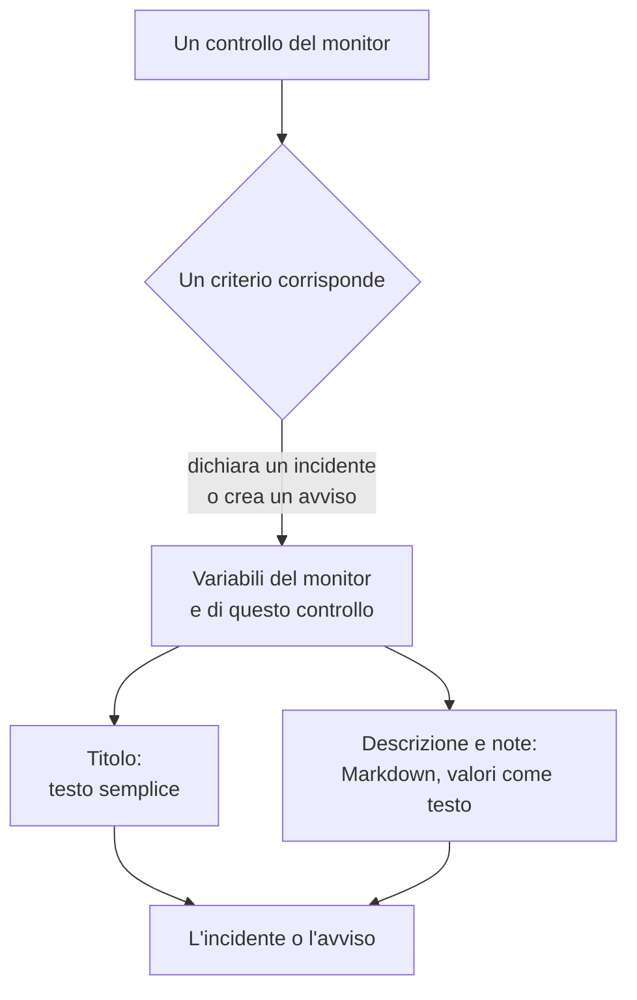

# Modelli di incidenti e avvisi

Quando i criteri di un monitor dichiarano un incidente o creano un avviso, ne compilano il titolo, la descrizione e le note di rimedio a partire da un modello che scrivi tu. Inserisci segnaposto `{{variable}}`, come `{{monitorName}}` o `{{responseStatusCode}}`, e ogni incidente dice cosa è andato storto, con i valori del controllo che lo ha aperto.

:::cards
- [Dove si scrive un modello](#dove-si-scrive-un-modello): Il titolo, la descrizione e le note di rimedio dell'incidente o dell'avviso di un criterio.
- [Uso di base](#uso-di-base): Segnaposto, percorsi negli oggetti e liste.
- [Variabili di ogni monitor](#variabili-di-ogni-monitor): Il nome del monitor e la risorsa che ha superato la soglia.
- [Variabili per tipo di monitor](#variabili-per-tipo-di-monitor): Che cosa riporta ogni tipo di controllo.
:::

## Come funzionano i modelli

Un modello viene compilato una sola volta, quando il criterio crea l'incidente o l'avviso. OneUptime raccoglie le variabili dal monitor e dal controllo che ha trovato corrispondenza, mette ogni valore al posto del suo segnaposto e salva il risultato. Modificare il modello in seguito cambia gli incidenti e gli avvisi creati da quel momento, non quelli già aperti.



- **Il titolo è testo semplice.** Ovunque venga mostrato, si legge esattamente come l'ha prodotto il modello.
- **La descrizione e le note di rimedio sono Markdown.** Il Markdown che scrivi viene visualizzato, e ogni valore inviato dal sistema monitorato viene inserito come testo, così nulla al suo interno può aggiungere un link, un'immagine o una menzione. Vedi [Valori nelle descrizioni e nelle note di rimedio](#valori-nelle-descrizioni-e-nelle-note-di-rimedio).
- **Un monitor raggruppato compila ogni incidente per la propria serie.** Un monitor che apre un incidente per host, pod o dispositivo compila ogni modello con i valori di quella serie, e aggiunge il nome della serie al titolo quando il tuo modello non lo dice già.

## Dove si scrive un modello

:::steps
### Aprire i criteri del monitor

Vai su **Monitor**, apri il monitor e fai clic su **Criteri** nel suo menu laterale. Fai clic su **Modifica: Criteri di monitoraggio**.

### Attivare l'incidente o l'avviso

In un criterio, sotto **Azioni**, attiva **Quando i filtri corrispondono, dichiara un incidente.** oppure **Quando i filtri corrispondono, crea un avviso.** Sotto si apre il modulo dell'incidente o dell'avviso.

### Scrivere il titolo

Scrivi il titolo in **Titolo dell'incidente** o **Titolo dell'avviso**, ad esempio `{{monitorName}} is down`. **Learn about dynamic templates**, lì accanto, apre **Dynamic Template Variables**: ogni variabile del tipo di questo monitor, con ciò che contiene. Fai clic su una variabile per copiarla.

### Scrivere la descrizione e le note di rimedio

Apri **Descrizione** per **Descrizione dell'incidente** o **Descrizione dell'avviso**, e **Altri campi** per **Note di rimedio**. Questi editor offrono direttamente le variabili: **Variabili del modello** le elenca sotto l'editor, **Inserisci variabile** nella sua barra degli strumenti apre lo stesso elenco, e digitare `{{` lo apre al cursore.

### Salvare i criteri

Fai clic su **Salva modifiche**. Il prossimo incidente o avviso creato da questo criterio usa i nuovi modelli.
:::

## Uso di base

Un segnaposto è il nome di una variabile tra doppie parentesi graffe. Quando l'incidente viene creato, OneUptime lo sostituisce con il valore della variabile e lascia il testo intorno come l'hai scritto.

```text title="Title template"
{{monitorName}} returned {{responseStatusCode}} in {{responseTimeInMs}} ms
```

Se il monitor si chiama `Checkout API`, il codice di stato della risposta è `502` e la risposta ha impiegato `842` millisecondi, l'incidente si intitola:

```text title="Title as created"
Checkout API returned 502 in 842 ms
```

### Percorsi negli oggetti e nelle liste

Una variabile che contiene un oggetto o una lista si legge con un percorso, come nelle [espressioni JavaScript](/docs/monitor/javascript-expression):

| Scrivi | Per leggere | Esempio |
| --- | --- | --- |
| `{{object.field}}` | Un campo di un oggetto, a qualsiasi profondità | `{{responseBody.error.message}}` |
| `{{list[0]}}` o `{{list.0}}` | Un elemento di una lista, contando da 0 | `{{diskMetrics[0].usagePercent}}` |
| `{{list[last]}}` | L'ultimo elemento di una lista | `{{processes[last].name}}` |
| `{{object}}` | L'intero oggetto o l'intera lista, come JSON | `{{responseBody}}` |

Il nome di un campo può contenere un trattino, come in `{{responseHeaders.content-type}}`. Un indice negativo, come `[-1]`, non legge nulla: usa `[last]`.

### Quando un valore manca

Un segnaposto il cui percorso non porta da nessuna parte resta nel testo come l'hai scritto, parentesi comprese: se la risposta non ha un campo `error`, `{{responseBody.error.id}}` compare così com'è nel titolo. Lo stesso vale per una variabile che questo controllo non ha riportato, come `failureCause` in un controllo che non è fallito. Un valore che il controllo ha riportato come testo vuoto viene sostituito con niente.

Per scrivere un modello che funzioni sia che il monitor sia raggruppato sia che non lo sia, usa le variabili della [risorsa interessata](#risorsa-interessata): esistono sempre e sono vuote quando il monitor non è raggruppato.

### Valori nelle descrizioni e nelle note di rimedio

Una descrizione e le note di rimedio sono Markdown: vengono mostrate nella pagina dell'incidente o dell'avviso, nelle email e nei suoi canali Slack e Microsoft Teams. I valori che un modello vi inserisce sono ciò che il sistema monitorato ha inviato - un corpo o un'intestazione di risposta, una richiesta o un'email in arrivo, le etichette di un dispositivo o di una serie -, quindi ognuno viene inserito come testo. Si legge esattamente come è stato inviato, ovunque il modello lo metta, e un link, un'immagine, un tag HTML o una menzione Slack come `<!channel>` al suo interno appare come testo invece di agire. Un indirizzo web nudo in un valore diventa comunque un link, che mostra dove porta. Il Markdown che scrivi nel modello stesso viene visualizzato come l'hai scritto.

Un valore può avere qualsiasi dimensione - un corpo di risposta o un log di molti megabyte - e la notifica parte comunque con esso. Ogni canale trasporta ciò che accetta, e una descrizione troppo lunga per esso viene tagliata, a un a capo se ce n'è uno, e termina con «… (truncated — see OneUptime for the full text)»:

- **Email**: ogni descrizione, nota o causa principale trasporta fino a circa 256 KB del testo dell'email, e la nota alla fine di un testo più lungo rimanda all'incidente o all'avviso. Un'email intera - il testo e gli screenshot - resta sotto i 3 MB, che ogni server di posta e Microsoft Graph accettano: uno screenshot che non ci sta accanto al testo viene omesso, con una nota al suo posto.
- **La pagina dell'incidente o dell'avviso** mostra tutto. Una descrizione di oltre 128 KB che richiederebbe molto tempo per essere impaginata viene mostrata come testo semplice, riga per riga.
- **Slack** trasporta al massimo ciò che Slack mostra di un messaggio (circa 30.000 caratteri). **Microsoft Teams** trasporta circa 40.000 caratteri in un messaggio dell'app OneUptime, e circa 12.000 tramite un webhook in ingresso (iscritti alle pagine di stato, workflow) - misurati al momento dell'invio, quindi una tabella conta come l'HTML che diventa.
- **SMS, chiamate telefoniche, notifiche push, WhatsApp e Telegram** trasportano ciò che accettano i loro fornitori: vedi [Come i livelli avvisano le persone](/docs/on-call/escalation-rules#come-i-livelli-avvisano-le-persone).

Ogni canale visualizza il testo in un tempo che cresce con la sua lunghezza. Una parte che richiederebbe a un renderer molto più tempo - una riga di oltre 64 KB, un lungo paragrafo di righe semplici, un paragrafo pieno di `*`, `_` o `[` che non si chiudono mai, citazioni o elenchi annidati oltre sedici livelli e, nella pagina dell'incidente o dell'avviso, una tabella o un elenco di oltre mille righe - si legge come testo semplice dove si trova, e il resto della descrizione viene visualizzato come al solito.

## Uso avanzato

### Scorrere una lista

`{{#each path}}` ripete il testo fino a `{{/each}}` una volta per ogni elemento della lista in `path`:

```text title="Loop syntax"
{{#each arrayPath}}
  ...text with {{field}} placeholders for each item...
{{/each}}
```

Dentro il ciclo:

- `{{field}}` e `{{field.nested}}` leggono l'elemento corrente. Un nome che l'elemento non ha viene cercato nell'elemento che lo contiene, poi nelle variabili dell'intero modello.
- `{{@index}}` è la posizione dell'elemento, contando da 0.
- `{{this}}` è l'elemento stesso, per una lista di valori semplici come stringhe.
- Un ciclo su un percorso che non è una lista, o su una lista vuota, non scrive nulla.
- I cicli si annidano: un `{{#each}}` dentro un altro legge la lista interna di ogni elemento esterno.

Per esempio, un [monitor delle richieste in arrivo](/docs/monitor/incoming-request-monitor) che riceve questa notifica di avviso:

```json title="Request body"
{
  "receiver": "payments",
  "alerts": [
    { "status": "firing", "labels": { "alertname": "HighLatency" } },
    { "status": "resolved", "labels": { "alertname": "DiskFull" } }
  ]
}
```

e ha questo modello di descrizione:

```text title="Description template"
Alerts for {{requestBody.receiver}}:
{{#each requestBody.alerts}}
- {{@index}}: {{labels.alertname}} ({{status}})
{{/each}}
```

crea un incidente la cui descrizione è quella qui sotto. Ogni elemento mantiene gli a capo che lo circondano, quindi una riga vuota separa gli elementi, e la descrizione mostra comunque un solo elenco:

```text title="Description as created"
Alerts for payments:

- 0: HighLatency (firing)

- 1: DiskFull (resolved)
```

### Valori di un monitor raggruppato

Un monitor basato su metriche con attributi in **Group by** apre un incidente per serie, e il valore di ogni attributo è una variabile con il nome dell'attributo. Raggruppare per `host.name` dà `{{host.name}}`, e raggruppare per `resource.k8s.pod.name` dà `{{resource.k8s.pod.name}}`. `{{seriesLabels}}` li contiene tutti, come oggetto.

Un [monitor dei log](/docs/monitor/logs-monitor) raggruppato funziona allo stesso modo: il valore di ogni attributo di raggruppamento è una variabile con la sua chiave.

## Variabili di ogni monitor

### Monitor

| Variabile | Cosa contiene | Esempio |
| --- | --- | --- |
| `monitorName` | Il nome del monitor. | `Checkout API` |
| `monitorId` | L'ID del monitor. | `a0f78958-da0a-4775-9fd9-c9fc63d3456f` |
| `monitorType` | Il tipo del monitor. | `Website`, `Synthetic Monitor` |

### Risorsa interessata

Queste variabili descrivono la serie per cui un monitor raggruppato ha aperto l'incidente: un pod, un container, un host, un disco. Sono vuote per un monitor non raggruppato, quindi un modello può usarle su qualsiasi monitor.

| Variabile | Cosa contiene |
| --- | --- |
| `seriesResourceSuffix` | L'identità della serie, preceduta da un separatore, da mettere alla fine di un titolo. |
| `seriesResourceSummary` | La stessa identità senza il separatore, da mettere in una frase. |
| `seriesResourceBlock` | Ogni etichetta della serie, come elenco Markdown. Ideale in una descrizione. |
| `seriesDebugCommands` | Comandi in sola lettura per questa risorsa precisa, come `kubectl` o `docker`, come elenco Markdown. |

## Variabili per tipo di monitor

### Monitor di siti web e API

| Variabile | Cosa contiene | Tipo |
| --- | --- | --- |
| `responseBody` | Il corpo della risposta: un oggetto quando è JSON, altrimenti il testo. | `JSON` o `string` |
| `responseHeaders` | Le intestazioni della risposta, per nome in minuscolo. | `Dictionary<string>` |
| `responseStatusCode` | Il codice di stato HTTP. | `number` |
| `responseTimeInMs` | Il tempo di risposta, in millisecondi. | `number` |
| `isOnline` | Se il monitor ha considerato la risposta come online. | `boolean` |

### Monitor delle richieste in arrivo

| Variabile | Cosa contiene | Tipo |
| --- | --- | --- |
| `requestBody` | Il corpo della richiesta: un oggetto quando è JSON. | `JSON` o `string` |
| `requestHeaders` | Le intestazioni della richiesta, per nome in minuscolo. | `Dictionary<string>` |
| `requestMethod` | Il metodo HTTP, come `POST`. | `string` |
| `incomingRequestReceivedAt` | Quando è stata ricevuta la richiesta, come timestamp ISO 8601. | `string` |

Quando il criterio ha **Group incidents and alerts by a payload field** attivato, anche la chiave di raggruppamento è una variabile, con il nome dell'**ultimo segmento** del percorso di raggruppamento: raggruppare per `requestBody.alerts[*].labels.alertname` dà `{{alertname}}`, e raggruppare per `requestBody.alerts[*].fingerprint` dà `{{fingerprint}}`. L'intero `requestBody` resta disponibile accanto.

> [!NOTE]
> `[*]` funziona solo nei campi del percorso di raggruppamento. In un modello non legge nulla, quindi il segnaposto resta come scritto. `{{requestBody.alerts[0].annotations.summary}}` legge sempre il primo avviso del payload, non quello per cui è stato aperto l'incidente: usa la variabile di raggruppamento e i campi condivisi del payload, come `commonLabels` e `commonAnnotations`. Vedi [Monitor richieste in arrivo](/docs/monitor/incoming-request-monitor).

### Monitor delle email in arrivo

| Variabile | Cosa contiene | Tipo |
| --- | --- | --- |
| `emailSubject` | L'oggetto dell'email. | `string` |
| `emailFrom` | L'indirizzo email del mittente. | `string` |
| `emailTo` | A chi è stata inviata l'email, con l'indirizzo del monitor stesso mascherato. | `string` |
| `emailBody` | Il corpo dell'email in testo semplice. | `string` |
| `emailReceivedAt` | Quando è stata ricevuta l'email, come timestamp ISO 8601 in UTC. | `string` |

In un titolo, ognuna viene tagliata a una riga di al massimo 150 caratteri. Le descrizioni e le note di rimedio ricevono il valore completo. Vedi [Monitor email in arrivo](/docs/monitor/incoming-email-monitor#variabili-del-modello).

### Monitor ping, IP e porta

| Variabile | Cosa contiene | Tipo |
| --- | --- | --- |
| `isOnline` | Se la destinazione ha risposto. | `boolean` |
| `responseTimeInMs` | Il tempo di risposta, in millisecondi. Per una porta, la risoluzione DNS e la connessione TCP insieme. | `number` |
| `failureCause` | Perché il controllo è fallito, quando è fallito. | `string` |
| `isTimeout` | Se il controllo è andato in timeout. | `boolean` |

### Monitor NTP

| Variabile | Cosa contiene | Tipo |
| --- | --- | --- |
| `isOnline` | Se il server dell'ora ha risposto alla richiesta della sonda. | `boolean` |
| `isSynchronized` | Se ha risposto con uno stratum da 1 a 15, senza l'allarme leap e con timestamp reali. | `boolean` |
| `stratum` | Lo stratum riportato dal server: 1 per un server primario, 16 quando non è sincronizzato, 0 per un kiss-o'-death. | `number` |
| `clockOffsetInMs` | Quanto l'orologio del server si discosta da quello della sonda, in millisecondi. Positivo significa che il server è avanti. | `number` |
| `referenceId` | A cosa si sincronizza il server: una sorgente come `GPS` allo stratum 1, o l'indirizzo del suo server a monte. | `string` |
| `leapIndicator` | Da 0 a 2 quando va tutto bene, 3 quando il server dice che il suo orologio non è sincronizzato. | `number` |
| `kissCode` | Con lo stratum 0, il codice di quattro lettere che il server ha inviato al posto dell'ora, come `RATE`. | `string` |
| `responseTimeInMs` | Il tempo tra la richiesta e la risposta, in millisecondi. | `number` |
| `roundTripDelayInMs` | Il tempo di andata e ritorno in rete dello scambio, senza il tempo di elaborazione del server. | `number` |
| `rootDelayInMs` | Il tempo di andata e ritorno dal server al suo orologio di riferimento, in millisecondi. | `number` |
| `rootDispersionInMs` | La stima del server stesso del suo errore massimo, in millisecondi. | `number` |
| `serverTime` | L'orologio del server quando ha inviato la risposta, come timestamp ISO 8601. | `string` |
| `referenceTime` | Quando l'orologio del server è stato impostato o corretto l'ultima volta, come timestamp ISO 8601. | `string` |
| `serverAddress` | L'indirizzo a cui è andata la richiesta. | `string` |
| `port` | La porta UDP a cui è andata la richiesta. | `number` |
| `failureCause` | Perché il server non ha risposto, o perché non è sincronizzato. | `string` |
| `isTimeout` | Se il server non ha risposto in tempo. | `boolean` |

### Monitor dei certificati SSL

| Variabile | Cosa contiene | Tipo |
| --- | --- | --- |
| `isOnline` | Se il controllo del certificato è riuscito. | `boolean` |
| `isSelfSigned` | Se il certificato è autofirmato. | `boolean` |
| `createdAt` | Quando è stato emesso il certificato, come timestamp ISO 8601. | `string` |
| `expiresAt` | Quando scade il certificato, come timestamp ISO 8601. | `string` |
| `commonName` | Il nome comune (CN) del certificato. | `string` |
| `organizationalUnit` | La sua unità organizzativa (OU). | `string` |
| `organization` | La sua organizzazione (O). | `string` |
| `locality` | La sua località (L). | `string` |
| `state` | Il suo stato o provincia (ST). | `string` |
| `country` | Il suo paese (C). | `string` |
| `serialNumber` | Il suo numero di serie. | `string` |
| `fingerprint` | La sua impronta SHA-1. | `string` |
| `fingerprint256` | La sua impronta SHA-256. | `string` |
| `failureCause` | Perché il controllo è fallito, quando è fallito. | `string` |

### Monitor DNS

| Variabile | Cosa contiene | Tipo |
| --- | --- | --- |
| `isOnline` | Se la query ha ricevuto risposta. | `boolean` |
| `responseTimeInMs` | Il tempo della query, in millisecondi. | `number` |
| `isTimeout` | Se la query è andata in timeout. | `boolean` |
| `isDnssecValid` | Il risultato della convalida DNSSEC. | `boolean` |
| `records` | I record restituiti, ognuno come `{type, value, ttl}`. | `Array<Object>` |
| `recordValues` | Solo i valori dei record. | `Array<string>` |
| `failureCause` | Perché la query è fallita, quando è fallita. | `string` |

### Monitor DNSSEC

| Variabile | Cosa contiene | Tipo |
| --- | --- | --- |
| `isOnline` | Se il controllo è stato completato. | `boolean` |
| `domainName` | La zona controllata. | `string` |
| `isZoneSigned` | Se la zona ha record DNSKEY. | `boolean` |
| `isParentDsPresent` | Se la zona padre ha record DS per essa. | `boolean` |
| `isChainValid` | Se la catena di fiducia è valida. | `boolean` |
| `resolverConsensusAd` | Se ogni resolver ha restituito il flag AD. | `boolean` |
| `isNameserverConsistent` | Se ogni nameserver autoritativo ha restituito lo stesso seriale SOA. | `boolean` |
| `earliestSignatureExpiration` | Quando scade la prima firma RRSIG, come timestamp ISO 8601. | `string` |
| `daysUntilSignatureExpiry` | I giorni che mancano alla scadenza di quella firma. | `number` |
| `dnskeyCount` | Il numero di record DNSKEY. | `number` |
| `dsRecordCount` | Il numero di record DS presso la zona padre. | `number` |
| `rrsigCount` | Il numero di record RRSIG visti. | `number` |
| `responseTimeInMs` | Quanto è durato il controllo, in millisecondi. | `number` |
| `failureCause` | Perché il controllo è fallito, quando è fallito. | `string` |

### Monitor dei domini

| Variabile | Cosa contiene | Tipo |
| --- | --- | --- |
| `isOnline` | Se la ricerca della registrazione è riuscita. | `boolean` |
| `domainName` | Il dominio cercato. | `string` |
| `lookupMethod` | Il protocollo che ha risposto: RDAP o WHOIS. | `string` |
| `registrar` | Il registrar. | `string` |
| `createdDate` | Quando è stato registrato il dominio. | `string` |
| `updatedDate` | Quando la registrazione è cambiata l'ultima volta. | `string` |
| `expiresDate` | Quando scade la registrazione. | `string` |
| `nameServers` | I nameserver del dominio. | `Array<string>` |
| `domainStatus` | I codici di stato del registro, come `clientTransferProhibited`. | `Array<string>` |
| `dnssec` | Lo stato DNSSEC del registro. | `string` |
| `responseTimeInMs` | Quanto è durata la ricerca, in millisecondi. | `number` |
| `failureCause` | Perché la ricerca è fallita, quando è fallita. | `string` |

### Monitor di server / VM

| Variabile | Cosa contiene | Tipo |
| --- | --- | --- |
| `hostname` | Il nome host del server. | `string` |
| `requestReceivedAt` | Quando è stato ricevuto il report del server, come timestamp ISO 8601. | `string` |
| `cpuUsagePercent` | CPU in uso, da 0 a 100. | `number` |
| `cpuCores` | Il numero di core della CPU. | `number` |
| `memoryUsagePercent` | Memoria in uso, da 0 a 100. | `number` |
| `memoryFreePercent` | Memoria libera, da 0 a 100. | `number` |
| `memoryTotalBytes` | Memoria totale, in byte. | `number` |
| `diskMetrics` | Una voce per ogni disco montato. | `Array<Object>` |
| `diskMetrics[].diskPath` | Il punto di montaggio del disco. | `string` |
| `diskMetrics[].usagePercent` | Spazio in uso sul disco, da 0 a 100. | `number` |
| `diskMetrics[].freePercent` | Spazio libero sul disco, da 0 a 100. | `number` |
| `diskMetrics[].totalBytes` | La dimensione del disco, in byte. | `number` |
| `processes` | I processi in esecuzione riportati dall'agente. | `Array<Object>` |
| `processes[].pid` | L'ID del processo. | `number` |
| `processes[].name` | Il nome del processo. | `string` |
| `processes[].command` | Il comando con cui è stato avviato il processo. | `string` |
| `failureCause` | Perché il controllo è fallito, quando è fallito. | `string` |

### Monitor sintetici

Un monitor sintetico esegue il suo script una volta per ogni browser e dimensione dello schermo che è impostato a usare, come Chromium su uno schermo desktop e Firefox su uno mobile. `syntheticResponses` contiene una voce per esecuzione: leggi un'esecuzione per posizione, come in `{{syntheticResponses[0].browserType}}`, oppure tutte con `{{#each syntheticResponses}}`.

| Variabile | Cosa contiene | Tipo |
| --- | --- | --- |
| `failureCause` | Perché il controllo è fallito, quando è fallito. | `string` |
| `syntheticResponses` | Una voce per ogni browser e dimensione dello schermo su cui è stato eseguito lo script. | `Array<Object>` |
| `syntheticResponses[].executionTimeInMs` | Quanto è durata l'esecuzione, in millisecondi. | `number` |
| `syntheticResponses[].result` | Ciò che lo script ha restituito. | `string`, `number`, `boolean` o `JSON` |
| `syntheticResponses[].scriptError` | L'errore con cui è terminata l'esecuzione, se presente. | `string` |
| `syntheticResponses[].logMessages` | Ciò che l'esecuzione ha registrato nel log. | `Array<string>` |
| `syntheticResponses[].screenshots` | Gli screenshot acquisiti dall'esecuzione, per nome, ognuno come testo base64. Vedi [Mostrare uno screenshot](#mostrare-uno-screenshot). | `Object` |
| `syntheticResponses[].browserType` | Il browser dell'esecuzione. | `string` |
| `syntheticResponses[].screenSizeType` | La dimensione dello schermo dell'esecuzione. | `string` |

#### Mostrare uno screenshot

Ogni voce di `screenshots` è uno screenshot acquisito dallo script, con il nome che lo script gli ha dato (`screenshots["login-page"] = await page.screenshot()`), come testo base64. Per mostrarne uno nella descrizione o nelle note di rimedio di un incidente o di un avviso, scrivi un'immagine intorno:

```text title="Description template"
{{syntheticResponses[0].scriptError}}


```

Lo screenshot compare quindi nella pagina dell'incidente o dell'avviso, nelle pagine di stato che mostrano l'incidente, nelle notifiche email che lo riguardano e nei messaggi Slack e Microsoft Teams che lo riguardano. In un'email viene allegato e mostrato nel corpo, che Gmail, Outlook e Apple Mail visualizzano, così chi è di turno può vedere com'era la pagina senza aprire OneUptime.

- Vengono mostrati screenshot PNG, JPEG, GIF e WebP. `image/png` funziona anche per uno screenshot JPEG (`page.screenshot({ type: "jpeg" })`).
- Un'email trasporta al massimo 2 MB di immagini, e al massimo 20. Un'immagine che non ci sta viene sostituita da una nota con il suo testo alternativo, quindi dai un testo alternativo a ogni immagine. Uno screenshot JPEG è molto più piccolo di uno PNG, e uno screenshot dell'esecuzione fallita di solito dice più di tutti gli screenshot di tutte le esecuzioni.
- In Slack e Microsoft Teams lo screenshot viene mostrato dove la descrizione lo mette: un'immagine su una riga a sé prende il posto di quella riga, e un'immagine in mezzo a una frase, a un elenco o a una tabella lascia lì il suo testo alternativo e viene mostrata dopo. Slack mostra screenshot PNG, JPEG e GIF, al massimo 10 e 10 MB per messaggio; l'app OneUptime carica ciascuno nel tuo workspace Slack, in modo privato, e lo mostra nel messaggio. Teams mostra screenshot PNG, JPEG e GIF fino a 1 MB ciascuno dentro la scheda del messaggio, al massimo 10 e 2 MB per messaggio.
- Il caricamento su Slack richiede il permesso `files:write` dell'app. Se il tuo workspace ha collegato Slack prima che OneUptime lo chiedesse, ricollega Slack in **Impostazioni del progetto → Area di lavoro → Slack** (su un server self-hosted, aggiungi prima il permesso alla tua app Slack - vedi [Integrazione Slack](/docs/self-hosted/slack-integration#immagini-nei-messaggi)).
- Uno screenshot che una chat non può mostrare - un WebP, uno oltre quei limiti, uno che Slack o Teams rifiutano, o qualsiasi screenshot in un messaggio inviato tramite un webhook in ingresso - viene mostrato come il suo testo alternativo, o «[image]» quando non ne ha, quindi dai un testo alternativo a ogni immagine. Il base64 dell'immagine non raggiunge mai la chat.
- Viene mostrata solo un'immagine che scrivi nel modello. Un'immagine in un valore riportato dalla pagina o dallo script monitorato - un messaggio di errore, una riga di log - appare comunque come testo (vedi [Valori nelle descrizioni e nelle note di rimedio](#valori-nelle-descrizioni-e-nelle-note-di-rimedio)).
- OneUptime AI legge il testo intorno a uno screenshot, non lo screenshot. Ciò che un'indagine, un postmortem o una nota redatti, il passaggio AI di un runbook o il passaggio AI di un workflow danno al modello ha una breve nota al posto dell'immagine, come `[image omitted: PNG, 340 KB]`: un modello legge testo, non immagini, e il base64 di uno screenshot sarebbe centinaia di migliaia di token a ogni chiamata. L'attività dell'indagine indica cosa è stato omesso.

Per mostrare lo screenshot di ogni esecuzione fallita, metti l'immagine in un ciclo. Qui lo script salva ogni screenshot come `screenshots["failure"]`:

```text title="Description template"
### What the page looked like
{{#each syntheticResponses}}
**{{browserType}} / {{screenSizeType}}**: {{scriptError}}


{{/each}}
```

### Monitor di codice JavaScript personalizzato

| Variabile | Cosa contiene | Tipo |
| --- | --- | --- |
| `result` | Ciò che lo script ha restituito. Leggi un campo con un percorso, come in `{{result.status}}`. | `string`, `number`, `boolean` o `JSON` |
| `executionTimeInMs` | Quanto è durato lo script, in millisecondi. | `number` |
| `scriptError` | L'errore con cui è terminato lo script, se presente. | `string` |
| `logMessages` | Ciò che lo script ha registrato con `console.log`. | `Array<string>` |
| `failureCause` | Perché il controllo è fallito, quando è fallito. | `string` |

### Monitor dei dispositivi di rete

| Variabile | Cosa contiene | Tipo |
| --- | --- | --- |
| `isOnline` | Se il dispositivo è raggiungibile, tramite ping **o** SNMP. Impostato a ogni interrogazione. | `boolean` |
| `responseTimeInMs` | Il tempo di risposta della **scansione** SNMP, in millisecondi. Mai il tempo di andata e ritorno del ping. | `number` |
| `failureCause` | Perché la scansione SNMP è fallita, quando è fallita. | `string` |
| `isTimeout` | Se la scansione SNMP è andata in timeout. | `boolean` |
| `oidResponses` | Gli OID interrogati, ognuno come `{oid, name, value, type}`. | `Array<Object>` |
| `{{OID_NAME}}` | Il valore di un OID con nome, per nome, come in `{{sysUpTime}}`. | `string` o `number` |
| `sysName` | Il nome del dispositivo, dal gruppo di sistema SNMP. | `string` |
| `sysDescr` | La descrizione del dispositivo, dal gruppo di sistema SNMP. | `string` |
| `sysObjectId` | L'OID enterprise registrato del produttore: l'impronta del dispositivo. | `string` |
| `sysLocation` | La posizione del dispositivo, dal gruppo di sistema SNMP. | `string` |
| `downInterfaces` | Le interfacce attive amministrativamente ma non operative, ognuna come `{name, alias, interfaceIndex}`. Richiede il monitoraggio delle interfacce. | `Array<Object>` |
| `interfacesTotal` | Il numero di interfacce scansionate. | `number` |
| `interfacesUp` | Le interfacce attive sia amministrativamente sia operativamente. | `number` |
| `interfacesDown` | Le interfacce attive amministrativamente ma non operative. | `number` |
| `interfaceWalkFailure` | L'errore, quando la scansione delle interfacce è fallita. | `string` |
| `tables` | Le tabelle SNMP del dispositivo, per chiave: `rowCount`, `rows`, `unhealthyRowCount` e `unhealthyRows` di ciascuna, come in `{{tables.ipsec_tunnels.unhealthyRowCount}}`. | `Object` |
| `snmpTable` | La tabella SNMP a cui si riferisce un avviso per riga. | `string` |
| `snmpTableRow` | La riga a cui si riferisce un avviso per riga: un tunnel, una radio, un vicino. | `string` |
| `trapOid` | L'OID del trap. Solo quando un trap SNMP ha avviato il controllo. | `string` |
| `trapSourceIp` | L'indirizzo da cui è arrivato il trap. Solo quando un trap SNMP ha avviato il controllo. | `string` |
| `trapVarbinds` | I varbind del trap, ognuno come `{oid, value}`. Solo quando un trap SNMP ha avviato il controllo. | `Array<Object>` |

Un dispositivo di rete riceve un ping a ogni interrogazione e viene scansionato via SNMP solo quando ha credenziali, quindi **`isOnline` è l'unica variabile qui sopra che un dispositivo solo ping compila**: tutte le altre vengono dalla scansione SNMP e, senza di essa, restano come scritte. Comincia con `{{isOnline}}` e il nome del dispositivo nei modelli che possono essere usati per dispositivi senza credenziali. Vedi [Monitor dispositivi di rete](/docs/monitor/network-device-monitor#what-a-poll-actually-does) per cosa raccoglie ogni tipo di interrogazione.

### Monitor di salute dei database

| Variabile | Cosa contiene | Tipo |
| --- | --- | --- |
| `isOnline` | Se la sonda ha potuto connettersi ed eseguire la query di base. Le metriche mancanti non lo rendono mai falso. | `boolean` |
| `responseTimeInMs` | Il tempo per connettersi ed eseguire la query di base, in millisecondi. | `number` |
| `failureCause` | Perché il controllo è fallito, quando è fallito. | `string` |
| `connectionError` | L'errore di connessione, senza credenziali né stringa di connessione. | `string` |
| `engineVersion` | La versione riportata dal server del database. | `string` |
| `collectedGroups` | I gruppi di metriche che hanno prodotto valori in questo controllo. | `Array<string>` |
| `unavailableGroups` | I gruppi che non è stato possibile raccogliere, ognuno come `{group, reason, message, remediation}`. | `Array<Object>` |
| `collectionIssueSummary` | Una riga su ogni gruppo non disponibile, pronta per un titolo. Vuota quando è stato raccolto tutto. | `string` |
| `metrics` | I valori raccolti, per nome di serie. | `Object` |

I nomi delle serie in `metrics` contengono punti, come `oneuptime.monitor.database.connections.used.percent`, e un percorso legge ogni punto come un passo dentro un oggetto, quindi un modello non può estrarre un singolo valore da `metrics`. Inserisci `{{metrics}}` intero, come JSON, oppure usa `{{collectionIssueSummary}}`. Una metrica che non è stata raccolta manca da `metrics`, non vale zero. Per agire su un valore, confrontalo nel criterio con un'[espressione JavaScript](/docs/monitor/javascript-expression).

### Monitor delle pagine di stato esterne

| Variabile | Cosa contiene | Tipo |
| --- | --- | --- |
| `overallStatus` | Lo stato complessivo della pagina di stato, come `major_outage`. | `string` |
| `activeIncidentCount` | Il numero di incidenti aperti sulla pagina di stato. | `number` |
| `componentStatuses` | I suoi componenti, ognuno come `{name, status, description, groupName}`. | `Array<Object>` |
| `provider` | Il tipo di pagina di stato: Atlassian Statuspage, incident.io, RSS o Atom. | `string` |
| `componentGroup` | Il gruppo di componenti che il monitor osserva, se ne osserva uno. | `string` |
| `componentName` | Il componente che il monitor osserva, se ne osserva uno. | `string` |
| `isOnline` | Se la pagina di stato ha risposto. | `boolean` |
| `responseTimeInMs` | Quanto ha impiegato la pagina di stato a rispondere, in millisecondi. | `number` |
| `failureCause` | Perché il controllo è fallito, quando è fallito. | `string` |

### Monitor di metriche e infrastruttura

I monitor Metrics, Kubernetes, Docker, Host, Podman, Docker Swarm, Proxmox, VMware, Ceph, Storage Array e IoT Device hanno una variabile propria:

| Variabile | Cosa contiene | Tipo |
| --- | --- | --- |
| `metricName` | Il nome della metrica che legge la prima query del monitor, come `container.cpu.time`. | `string` |

Se raggruppati, hanno anche il valore di ogni attributo di **Group by**, e `seriesLabels`: vedi [Valori di un monitor raggruppato](#valori-di-un-monitor-raggruppato). I modelli del monitor IoT Device raggruppano per dispositivo, quindi un monitor creato da uno di essi ha anche `{{device.id}}`.

### Altri tipi di monitor

I monitor Logs, Traces, Exceptions, Security Events, AI / LLM e SQL Query non hanno variabili proprie. Usa le [variabili di ogni monitor](#variabili-di-ogni-monitor) e, su un monitor Logs raggruppato, i [valori del gruppo](#valori-di-un-monitor-raggruppato).

## Esempi

### Un'API lenta

```text title="Title"
{{monitorName}} is slow: {{responseTimeInMs}} ms
```

```text title="Description"
### API error
Status: **{{responseStatusCode}}**
Latency: **{{responseTimeInMs}} ms**
Message: `{{responseBody.error.message}}`
```

### Un certificato in scadenza

```text title="Title"
Certificate for {{commonName}} expires {{expiresAt}}
```

### Un server che sta finendo lo spazio

```text title="Description"
### {{hostname}}
CPU: **{{cpuUsagePercent}}%**
Memory: **{{memoryUsagePercent}}%**

**Disks:**
{{#each diskMetrics}}
- {{diskPath}}: {{usagePercent}}% used ({{freePercent}}% free)
{{/each}}

**Processes:**
{{#each processes}}
- [{{pid}}] {{name}}: {{command}}
{{/each}}
```

### Un controllo ping, IP o porta fallito

```text title="Description"
{{monitorName}} could not be reached: {{failureCause}}
Timed out: {{isTimeout}}
Response time: {{responseTimeInMs}} ms
```

### Ogni esecuzione di un monitor sintetico

```text title="Description"
### Synthetic monitor results
{{#each syntheticResponses}}
- **{{browserType}} / {{screenSizeType}}**: {{result}} in {{executionTimeInMs}} ms
  - Script error: {{scriptError}}
  - First log line: {{logMessages[0]}}
{{/each}}
```

### Un controllo con codice personalizzato

```text title="Description"
The script ran for {{executionTimeInMs}} ms and returned {{result}}.
Last log line: {{logMessages[last]}}
```

### Un dispositivo di rete

Questi esempi presuppongono che il dispositivo abbia credenziali SNMP: su un dispositivo solo ping, tutto tranne `{{isOnline}}` resta come scritto.

```text title="Title"
{{sysName}}: {{interfacesDown}} interfaces down
```

```text title="Description"
### {{sysName}} ({{sysLocation}})
Online: {{isOnline}}
SNMP walk: {{responseTimeInMs}} ms

{{#each downInterfaces}}
- {{name}} ({{alias}}) is down
{{/each}}
```

### Avvisi di Alertmanager o Grafana

```text title="Title"
[{{requestBody.status}}] {{requestBody.receiver}}
```

```text title="Description"
### Alerts from {{requestBody.receiver}}
{{#each requestBody.alerts}}
**Alert {{@index}}**: {{labels.alertname}}
- Status: {{status}}
- Summary: {{annotations.summary}}
- Source: {{generatorURL}}
{{/each}}
```

## Risoluzione dei problemi

:::details Il titolo mostra il segnaposto, parentesi comprese
Il percorso non porta a un valore in questo controllo. Verifica il nome della variabile e le maiuscole con le tabelle qui sopra, oppure apri **Learn about dynamic templates** nel criterio: elenca le variabili del tipo di questo monitor. Un percorso nel corpo di una risposta o di una richiesta deve corrispondere al corpo così come è stato inviato, e `[*]` e gli indici negativi come `[-1]` non leggono nulla: usa `[0]` o `[last]`.
:::

:::details Un valore appare come JSON
Il percorso si ferma su un oggetto o una lista, quindi viene inserito per intero come JSON. Aggiungi al percorso il campo che ti serve, come in `{{responseBody.error.message}}`, oppure scorri una lista con `{{#each}}`.
:::

:::details Un ciclo non scrive nulla
Il percorso dopo `#each` non è una lista in questo controllo, o la lista è vuota. Verifica il percorso rispetto al payload, e che ogni `{{#each}}` abbia il suo `{{/each}}`.
:::

:::details Il Markdown in un valore appare come testo
È voluto: un valore inviato dal sistema monitorato viene inserito come testo, così non può mai aggiungere un link, un'immagine o una menzione alla descrizione. Scrivi invece la formattazione nel modello, intorno al valore. Vedi [Valori nelle descrizioni e nelle note di rimedio](#valori-nelle-descrizioni-e-nelle-note-di-rimedio).
:::

:::details Uno screenshot non appare in Slack, Microsoft Teams o nell'email
Verifica il formato e la dimensione dell'immagine con [Mostrare uno screenshot](#mostrare-uno-screenshot). In Slack, l'app OneUptime ha bisogno del permesso `files:write`: ricollega Slack in **Impostazioni del progetto → Area di lavoro → Slack** se il tuo workspace lo ha collegato prima che OneUptime lo chiedesse.
:::

## Passaggi successivi

:::cards
- [Espressioni JavaScript](/docs/monitor/javascript-expression): Gli stessi segnaposto, nelle condizioni di un criterio.
- [Dichiarare un incidente](/docs/incidents/declaring-incidents): Cosa succede dopo che un criterio ne dichiara uno.
- [Monitor sintetico](/docs/monitor/synthetic-monitor): Acquisire gli screenshot che una descrizione può mostrare.
- [Monitor richieste in arrivo](/docs/monitor/incoming-request-monitor): Trasformare i webhook in incidenti con il nome di ogni avviso.
:::
