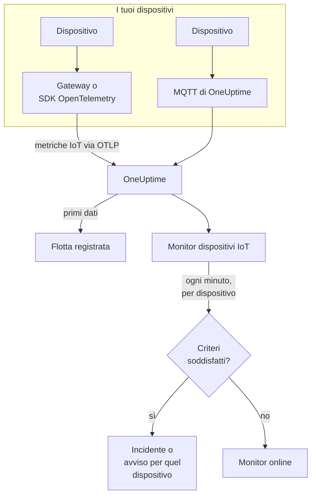

# Monitor dispositivi IoT

Un monitor di dispositivi IoT osserva una flotta di dispositivi e ti avvisa quando un dispositivo va offline, la sua batteria si scarica, il suo segnale si indebolisce, si surriscalda o la sua CPU resta occupata. Legge le metriche `iot_*` che i tuoi dispositivi inviano a OneUptime, tramite OpenTelemetry o MQTT, quindi nulla viene controllato dall'esterno e non è coinvolta alcuna sonda.

:::cards
- [Creare il monitor](#creare-un-monitor-di-dispositivi-iot): Sei passaggi nella dashboard.
- [Modelli](#modelli-di-avviso-predefiniti): Cinque avvisi pronti, un incidente per dispositivo.
- [Rilevamento offline](#rilevamento-offline): Come si nota un dispositivo guasto o silenzioso.
- [Metriche](#metriche-raccolte): Le serie `iot_*` che il monitor legge.
:::

## Come funziona

I tuoi dispositivi, o il gateway con cui comunicano, inviano le loro letture a OneUptime: tramite OpenTelemetry, o direttamente all'endpoint MQTT di OneUptime. Ogni lettura porta il nome della flotta, `iot.fleet.name`, e l'ID del dispositivo stesso, `device.id`. I primi dati registrano la flotta.

Un monitor di dispositivi IoT è legato a una flotta. Ogni minuto esegue la sua query sulle metriche di quella flotta e confronta il risultato con i suoi criteri. I modelli raggruppano per `device.id`, quindi 30 sensori offline aprono 30 incidenti, ognuno con il nome del suo dispositivo, e ognuno si risolve da solo quando il suo dispositivo rientra.



## Prima di iniziare

- **Fai inviare dati ai tuoi dispositivi.** La [guida ai dispositivi IoT](/docs/telemetry/iot-devices) mostra come inviare metriche con un SDK o un Collector OpenTelemetry, oppure tramite MQTT.
- **Verifica che la flotta sia registrata.** Compare in **Prodotti → Infrastruttura → IoT → All Fleets**, con il nome dello `iot.fleet.name` che inviano i dispositivi.
- **Registra i dispositivi che ti aspetti**, nel **Device Registry** della flotta, per essere avvisato quando uno smette di trasmettere: vedi [Rilevamento offline](#rilevamento-offline).

## Creare un monitor di dispositivi IoT

:::steps
### Iniziare un nuovo monitor

Vai su **Monitor** e fai clic su **Crea monitor**.

### Scegliere IoT Device

In **Tipo di monitor**, fai clic su **Altri tipi di monitor** e scegli **IoT Device** sotto **Infrastruttura**, oppure digita `iot` nella casella di ricerca. Inserisci un **Nome** - viene usato nei titoli di incidenti e avvisi - e fai clic su **Avanti**.

### Scegliere la flotta

In **IoT Monitor Configuration**, scegli la flotta da **IoT Fleet**. Ogni flotta che ha inviato dati è nell'elenco.

### Scegliere cosa osservare

Scegli una delle tre schede:

- **Quick Setup** - fai clic su un [modello](#modelli-di-avviso-predefiniti). Imposta la metrica, l'aggregazione, l'intervallo di tempo, un raggruppamento su `device.id` e le soglie, e sostituisce i criteri qui sotto con i propri. Puoi comunque cambiare l'**Intervallo di tempo**.
- **Custom Metric** - scegli una metrica da **IoT Metric**, poi imposta **Aggregazione** e **Intervallo di tempo**. I [filtri](#impostazioni-del-monitor) la restringono a un dispositivo o a un tipo di dispositivo. Una metrica personalizzata non è raggruppata: valuta la flotta nel suo insieme.
- **Avanzato** - costruisci tu query e formule in **Seleziona metriche**, anche su nomi di metriche tuoi, per esempio la memoria in uso come percentuale della memoria di un dispositivo. Usa **Group by** `device.id` per valutare ogni dispositivo separatamente.

### Controllare i criteri

Apri ogni criterio in **Criteri del monitor** e controlla **Select Metric Variable**, **Aggregazione**, **Condizione** e **Threshold**. Un modello li compila. Con **Custom Metric** o **Avanzato**, il monitor parte con i [criteri predefiniti](#criteri-predefiniti), che notano solo una metrica che scende a zero, quindi imposta la tua soglia.

### Creare il monitor

Fai clic su **Crea monitor**. OneUptime apre la pagina del monitor e lo valuta ogni minuto. Gli incidenti e gli avvisi che genera raggiungono le tue politiche di reperibilità, Slack, Microsoft Teams, email, SMS e webhook come quelli di qualsiasi altro monitor.
:::

> [!TIP]
> Per impostare più modelli in una volta, apri la flotta da **Prodotti → Infrastruttura → IoT** e vai su **Recommendations**. Scegli i modelli che vuoi, decidi chi viene avvisato, e OneUptime crea un monitor per ogni modello.

## Impostazioni del monitor

| Campo | Scheda | Cosa fa |
| --- | --- | --- |
| **IoT Fleet** | Tutte | Obbligatorio. Limita ogni query a `resource.iot.fleet.name`. |
| **Ambito della risorsa** | Custom Metric, Avanzato | Facoltativo. **Dispositivo** o **Fleet**: una corrispondenza esatta sull'attributo `iot.scope`. Scegliere una metrica lo imposta su **Dispositivo**. |
| **Device ID** | Custom Metric, Avanzato | Facoltativo. Un dispositivo, tramite il suo `device.id`, come `sensor-001`. |
| **Device Type** | Custom Metric, Avanzato | Facoltativo. I dispositivi che segnalano questo `iot.device.type`, come `sensor` o `gateway`. |
| **IoT Metric** | Custom Metric | Una metrica del [catalogo](#metriche-raccolte). |
| **Aggregazione** | Custom Metric | Come vengono combinati i campioni: **Media**, **Massimo**, **Minimo**, **Somma** o **Conteggio**. Parte dall'aggregazione abituale della metrica. |
| **Intervallo di tempo** | Tutte | La finestra mobile che la query legge, da **Past 1 Minute** a **Past 365 Days**. Un nuovo monitor parte da **Past 1 Minute**; i modelli impostano la propria. |
| **Seleziona metriche** | Avanzato | Il generatore di query: **Metrica**, **Aggregate by**, **Filter by attributes**, **Group by**, più **Aggiungi metrica** e **Aggiungi formula** per combinare le query. |

I filtri agiscono insieme: con un **Device ID** e un **Device Type**, un dispositivo di un altro tipo non corrisponde a nulla.

## Modelli di avviso predefiniti

**Quick Setup** offre 5 modelli. Ognuno costruisce un monitor completo: la query della metrica, un raggruppamento su `device.id`, un criterio che scatta e uno che rientra. Le soglie sono punti di partenza che puoi modificare.

Un criterio scatta solo quando la condizione vale per ogni minuto della sua finestra - tranne **Device Offline**, che scatta alla prima lettura sotto 1. Un criterio di soglia rientra il 10 % oltre la sua soglia, così un valore che oscila attorno alla linea non va avanti e indietro.

| Modello | Categoria | Gravità | Osserva | Scatta quando | Rientra quando |
| --- | --- | --- | --- | --- | --- |
| Device Offline | Disponibilità | Critico | `iot_device_up`, Min per `device.id`, ultimi 30 minuti | Una lettura è sotto 1, oppure un dispositivo registrato non invia nulla per tutta la finestra | Di nuovo a 1 |
| Low Battery | Power | Warning | `iot_battery_percent`, Avg per `device.id`, ultimi 5 minuti | Sotto il 20 % | Al 22 % o più |
| Weak Signal | Connectivity | Warning | `iot_signal_strength_dbm`, Avg per `device.id`, ultimi 5 minuti | Sotto -100 dBm | A -90 dBm o più |
| High Temperature | Ambiente | Critico | `iot_temperature_celsius`, Max per `device.id`, ultimi 5 minuti | Sopra 70 °C | A 63 °C o meno |
| High CPU Usage | System | Warning | `iot_cpu_usage_ratio`, Avg per `device.id`, ultimi 5 minuti | Sopra 0.9 (il 90 % della sua CPU) | A 0.81 o meno |

**Gravità** è l'etichetta che mostra il selettore. L'incidente e l'avviso creati da un modello partono dalla gravità di incidente e di avviso più alta del tuo progetto; cambiale nel criterio.

- **Device Offline legge 30 minuti** così che un dispositivo che segnala ogni pochi minuti non venga considerato offline tra due segnalazioni. Un dispositivo che segnala meno spesso di circa ogni 15 minuti ha bisogno di una finestra più lunga.
- **High Temperature usa Max** in ogni minuto, così una lettura calda non viene nascosta da quelle più fresche dello stesso minuto. Deve comunque restare calda per ogni minuto della finestra.
- **High CPU Usage confronta un rapporto:** `iot_cpu_usage_ratio` va da 0 a 1, quindi 0.9 è il 90 %.

## Rilevamento offline

**Device Offline** scatta quando un dispositivo segnala `iot_device_up = 0`. Un dispositivo guasto o silenzioso lo fa scattare in tre modi:

| Come | Cosa succede |
| --- | --- |
| **Il gateway lo segnala** | Il gateway o il collector invia `iot_device_up = 0` per un dispositivo che non riesce più a raggiungere. |
| **MQTT Last Will** | Un dispositivo collegato all'endpoint MQTT di OneUptime registra un Last Will sul suo topic `status`. Quando il dispositivo si spegne, il broker invia `iot_device_up = 0` per esso nel momento in cui la sessione cade: nessun polling, nessuna attesa di una segnalazione mancata. Vedi [Inviare metriche tramite MQTT](/docs/telemetry/iot-devices#invio-delle-metriche-tramite-mqtt). |
| **Il dispositivo è registrato** | Un dispositivo nel **Device Registry** della flotta è atteso. Quando non invia nulla per tutta la finestra, il monitor lo tratta come se segnalasse `0`, quindi riceve un proprio incidente, che si risolve da solo quando il dispositivo segnala di nuovo. |

Un dispositivo registrato viene anche mantenuto come offline nell'inventario della flotta, mentre uno non registrato viene rimosso dopo 15 minuti di silenzio. Il rilevamento del silenzio richiede la politica per i dati mancanti **Treat As Zero** sul criterio di `iot_device_up`, che hanno i monitor Device Offline creati dal modello. Un monitor Device Offline creato prima che esistesse la registrazione dei dispositivi deve averla impostata a mano, o essere ricreato dal modello.

> [!NOTE]
> Un dispositivo non registrato che diventa silenzioso, senza un Last Will né una segnalazione del gateway, smette solo di inviare dati, e un monitor raggruppato per dispositivo non può individuarlo. Registra i tuoi dispositivi, oppure dai a un dispositivo critico un monitor tutto suo (**Custom Metric**, con il suo **Device ID**) e imposta **Se nessun dato** su **Trigger**. Il rilevamento del silenzio richiede anche che almeno un altro dispositivo della flotta continui a segnalare: una flotta che si spegne del tutto, per esempio durante un guasto del gateway, genera un solo incidente per il monitor, non uno per dispositivo.

## Metriche raccolte

Ogni serie porta l'etichetta `device.id` del dispositivo, e gli attributi `iot.scope`, `iot.device.type` e `iot.device.kind`.

| Metrica | Unità | Descrizione |
| --- | --- | --- |
| `iot_device_up` | — | 1 quando il dispositivo è attivo, 0 quando è guasto o offline. |
| `iot_battery_percent` | `%` | Carica residua della batteria, da 0 a 100. Un livello in calo significa che il dispositivo smetterà presto di segnalare. |
| `iot_signal_strength_dbm` | `dBm` | Intensità del segnale wireless. Più vicino a 0 è più forte; un segnale debole precede le connessioni perse. |
| `iot_temperature_celsius` | `°C` | La temperatura del dispositivo. Una lettura alta può indicare un hardware surriscaldato o un problema nell'ambiente circostante. |
| `iot_cpu_usage_ratio` | `ratio` | CPU in uso, da 0 a 1, dove 1 è l'uso completo. |
| `iot_memory_usage_bytes` | `bytes` | Memoria in uso. Confrontala con la memoria del dispositivo per vedere la pressione sulla memoria. |
| `iot_uptime_seconds` | `s` | Da quanto tempo il dispositivo è in funzione. Torna a zero quando si riavvia. |

## Criteri di monitoraggio

Un criterio confronta una delle query o formule del monitor con una soglia. I criteri di un monitor di dispositivi IoT offrono un solo **Tipo di filtro**, **Metric Value**: ogni regola controlla il valore della metrica, con questi campi.

| Campo | Cosa fa |
| --- | --- |
| **Tipo di filtro** | Sempre **Metric Value**, l'unico controllo che questo monitor offre. |
| **Select Metric Variable** | La query o la formula da controllare, tramite il nome della sua variabile. |
| **Aggregazione** | Come i valori della finestra diventano un'unica risposta: **Media**, **Somma**, **Maximum Value**, **Minimum Value**, **All Values** (ogni valore deve corrispondere) o **Any Value** (ne basta uno). |
| **Condizione** | **Greater Than**, **Less Than**, **Greater Than Or Equal To**, **Less Than Or Equal To** o **Equal To** — oppure una condizione di anomalia: **Anomalously High**, **Anomalously Low** o **Anomalous**. |
| **Threshold** | Il valore con cui confrontare. Accanto c'è un elenco di unità quando la metrica ha un'unità. Non mostrato per le condizioni di anomalia. |
| **Sensibilità** | Solo condizioni di anomalia. **Bassa** (4σ), **Media** (3σ, il predefinito) o **Alta** (2σ). |
| **Finestra di riferimento** | Solo condizioni di anomalia. 14 giorni (il predefinito), 28, 60 o 90 giorni di storico. |
| **Se nessun dato** | In **Altri campi**. Cosa succede quando una serie non ha campioni nella finestra: **Ignore** (il predefinito) la salta, **Treat As Zero** la legge come `0`, e **Trigger** fa corrispondere il criterio. |

Le condizioni di anomalia confrontano ogni valore con la stessa ora della settimana nel riferimento. Restano in uno stato «Learning», e non generano nulla, finché la finestra di riferimento non contiene abbastanza storico.

### Criteri predefiniti

Un monitor che non costruisci da un modello parte con due criteri:

| Ordine | Criterio | Corrisponde quando | Poi |
| --- | --- | --- | --- |
| 1 | Check if _monitor name_ is offline | Un valore qualsiasi della prima query è `0` | Segna il monitor come **Offline** e dichiara l'incidente «_monitor name_ is offline», che si risolve da solo quando il monitor rientra. |
| 2 | Check if _monitor name_ is online | Un valore qualsiasi è sopra `0` | Segna il monitor come **Operativo**. |

> [!IMPORTANT]
> Il silenzio non corrisponde a nessuno dei due criteri: una flotta che smette di inviare dati lascia il monitor com'era. Per essere avvisato quando i dati si fermano, imposta **Se nessun dato** su **Trigger** in un criterio. Il tempo in cui OneUptime stesso non stava ricevendo non conta mai come assenza di dati: un controllo la cui finestra lo contiene aspetta invece, come spiega [Quando OneUptime non riceve dati](/docs/monitor/when-oneuptime-is-not-receiving).

## Terraform

Il [provider Terraform di OneUptime](/docs/terraform/monitor-steps) porta la configurazione di un passaggio di monitor di dispositivi IoT nell'attributo `iot_monitor`: il JSON grezzo della configurazione `iotMonitor` (`fleetIdentifier`, `resourceFilters`, `metricViewConfig`, `rollingTime`), scritto con `jsonencode()`:

```hcl title="main.tf"
monitor_steps = [{
  iot_monitor = jsonencode({
    fleetIdentifier = "building-a-sensors"
    resourceFilters = {}
    rollingTime     = "Past 5 Minutes"
    metricViewConfig = {
      queryConfigs = [{
        metricAliasData = { metricVariable = "battery_percent", title = "Battery", description = "", legend = "" }
        metricQueryData = {
          filterData = {
            metricName     = "iot_battery_percent"
            attributes     = {}
            aggegationType = "Avg"
            aggregateBy    = {}
          }
          groupByAttributeKeys = ["device.id"]
        }
      }]
      formulaConfigs = []
    }
  })
  criteria = [ /* ... */ ]
}]
```

`fleetIdentifier` è lo `iot.fleet.name` della flotta, non il suo ID in OneUptime.

## Risoluzione dei problemi

:::details La flotta non è nell'elenco IoT Fleet
Le flotte si registrano da sole a partire dai dati dei dispositivi. Verifica che i dispositivi inviino `iot.fleet.name`, e segui la [guida ai dispositivi IoT](/docs/telemetry/iot-devices) per confermare che i dati arrivino.
:::

:::details Scatta un incidente per l'intera flotta invece di uno per dispositivo
La query non è raggruppata. I monitor **Custom Metric** valutano la flotta nel suo insieme; usa un modello, oppure **Avanzato** con **Group by** `device.id`.
:::

:::details Un dispositivo si è spento ma Device Offline non è scattato
Il dispositivo non ha inviato alcun Last Will e nessun gateway lo ha segnalato, quindi è solo diventato silenzioso. Registralo nel **Device Registry** della flotta, e verifica che **Se nessun dato** del criterio di `iot_device_up` sia su **Treat As Zero**. Vedi [Rilevamento offline](#rilevamento-offline).
:::

:::details Device Offline scatta per dispositivi che funzionano
Segnalano meno spesso di quanto copra la finestra di 30 minuti, quindi alcune finestre non contengono nulla da loro. Allunga l'**Intervallo di tempo**, oppure fai segnalare i dispositivi più spesso. Sull'endpoint MQTT via WebSocket, mantieni il keepalive MQTT sotto i 5 minuti: OneUptime chiude le connessioni WebSocket inattive dopo 300 secondi, e questo invia il Last Will.
:::

:::details Un modello non mostra dati
I modelli leggono esattamente i nomi delle metriche `iot_*`, e raggruppano per l'etichetta `device.id`. Confronta ciò che inviano i tuoi dispositivi, nella pagina **Metriche** della flotta, con le [convenzioni delle metriche](/docs/telemetry/iot-devices#convenzioni-sulle-metriche).
:::

## Passaggi successivi

:::cards
- [Dispositivi IoT](/docs/telemetry/iot-devices): Inviare le metriche dei dispositivi tramite OpenTelemetry o MQTT.
- [Monitor metriche](/docs/monitor/metrics-monitor): Generare avvisi su qualsiasi metrica, non solo su quelle IoT.
- [Modelli di incidenti e avvisi](/docs/monitor/incident-alert-templating): Mettere l'ID del dispositivo nei titoli degli incidenti.
:::
